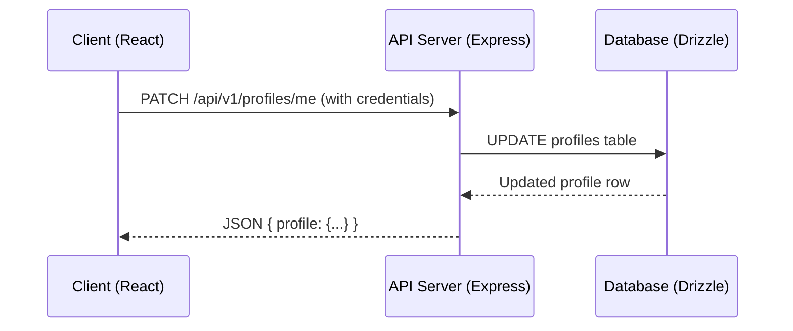

# FOZ Project Architecture

## Monolith Structure

- `src/shared/`: Shared contracts, DTO types, and Zod schemas (the single source of truth, imported via path alias `#shared/*`).
- `src/backend/`: Express + Drizzle backend API server.
- `src/frontend/`: React + Vite client-side single page application.
- `specs/`: Active specifications, implementation plans, and checklists for Spec-Driven Development.

## Profile Management Flow

