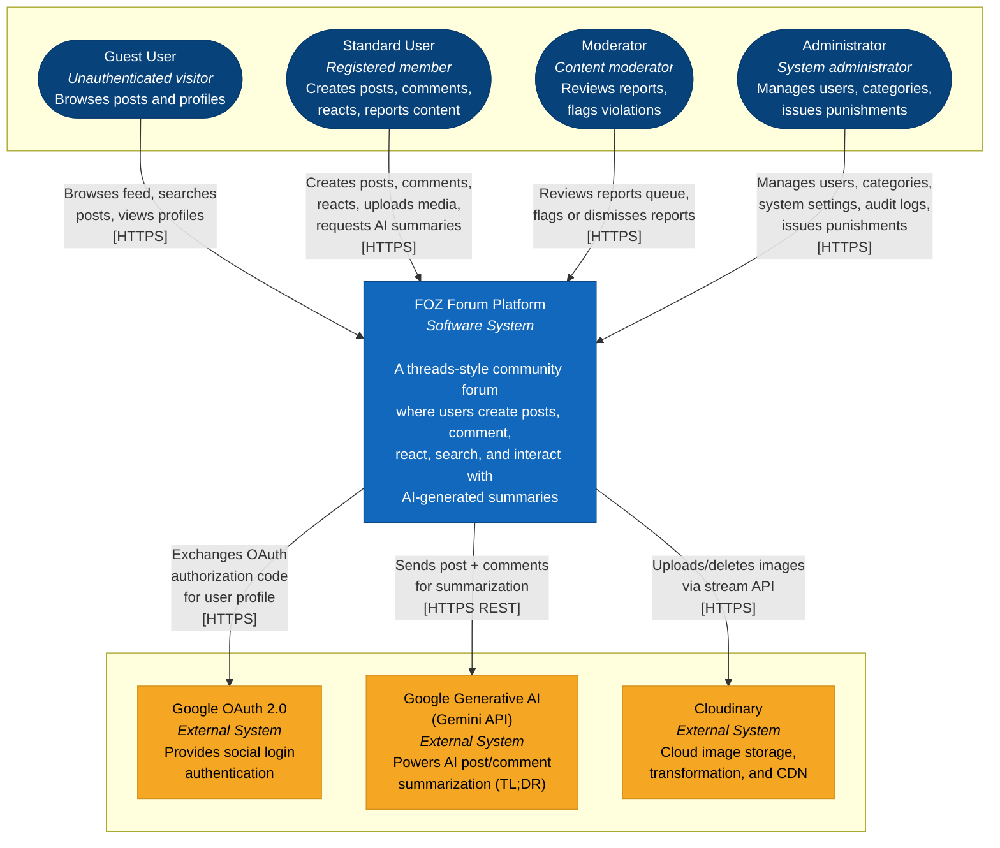
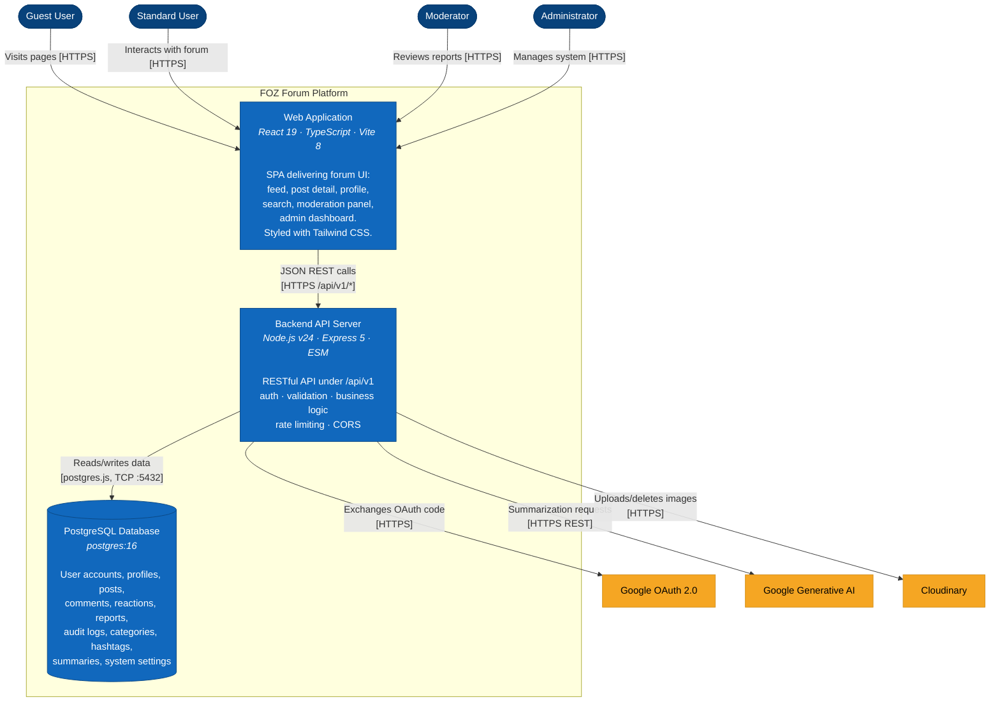
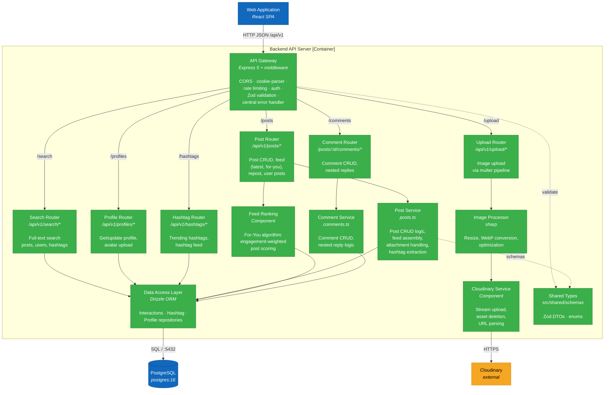
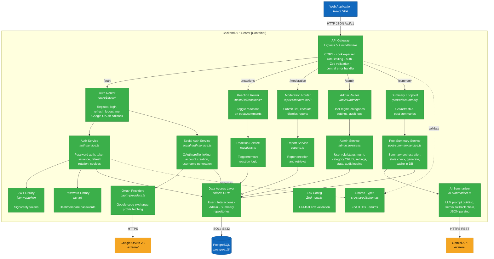

# FOZ Software Architecture Document

> **Version**: 1.0.0  
> **Last Updated**: 2026-08-07
>
> This document formally describes the software architecture of the **FOZ** community forum platform, covering all features delivered across PA1 through PA4. All diagrams follow C4 Model conventions rendered in standard Mermaid flowchart syntax.

---

## Table of Contents

1. [Technology Stack](#1-technology-stack)
2. [C4 Level 1 - System Context Diagram](#2-c4-level-1--system-context-diagram)
3. [C4 Level 2 - Container Diagram](#3-c4-level-2--container-diagram)
   - 3.1 [Diagram](#31-diagram)
   - 3.2 [Container Descriptions](#32-container-descriptions)
   - 3.3 [Relationships Summary](#33-relationships-summary)
4. [C4 Level 3 - Component Diagrams](#4-c4-level-3--component-diagrams)
   - 4.1 [Frontend - Web Application](#41-frontend--web-application)
   - 4.2 [Backend - API Server](#42-backend--api-server)

---

# B - Software Architecture: System Context Diagram

## 1. Technology Stack

The FOZ project uses the following technologies across its stack:

### Frontend

| Technology | Purpose |
|---|---|
| **React 19** | UI component framework (SPA) |
| **TypeScript 6** | Type-safe application code |
| **Vite 8** | Build tool and dev server with HMR |
| **Tailwind CSS 4** | Utility-first styling (vanilla config, no UI library) |
| **react-router-dom 7** | Client-side routing |
| **@tanstack/react-query 5** | Server-state management and caching |
| **zustand 5** | Lightweight client-state management (auth store) |
| **react-hook-form 7** | Form state management and validation |
| **react-hot-toast 2** | Toast notification system |
| **react-icons 5** | Icon library |
| **Vitest 4** | Unit testing framework |

### Backend

| Technology | Purpose |
|---|---|
| **Node.js (LTS ≥ 24)** | JavaScript runtime (ESM) |
| **Express 5** | Web framework for RESTful API |
| **TypeScript 6** | Type-safe server code |
| **Drizzle ORM** | SQL-visible ORM with type-safe queries |
| **drizzle-kit** | Database migration tooling |
| **Zod 4** | Runtime schema validation at API boundaries |
| **bcrypt 6** | Password hashing |
| **jsonwebtoken 9** | JWT access and refresh token management |
| **express-rate-limit 8** | Rate limiting for abuse-prone endpoints |
| **multer 2** | Multipart file upload handling |
| **sharp 0.35** | Server-side image processing and optimization |
| **cookie-parser** | HTTP cookie parsing for refresh tokens |
| **Vitest 4** | Unit and integration testing |

### Database

| Technology | Purpose |
|---|---|
| **PostgreSQL 16** | Primary relational database (provisioned via Docker) |
| **postgres.js** | Node.js PostgreSQL client driver |

### External Services

| Service | Purpose |
|---|---|
| **Cloudinary** | Cloud-based image/media storage and CDN delivery |
| **Google Generative AI API** (Gemini) | AI-powered post & comment summarization (TL;DR) with fallback provider chain |
| **Google OAuth 2.0** | Social authentication (Google Sign-In) |

### Shared Module

| Technology | Purpose |
|---|---|
| **`src/shared/`** | Zod schemas, DTOs, enums - single source of truth imported by both frontend and backend via `#shared/*` path aliases. No npm workspace, no codegen, no tRPC. |

---

## 2. C4 Level 1 - System Context Diagram

The System Context diagram shows the FOZ system as a single box, the actors who use it, and the external systems it depends on.

### Diagram Explanation

The **FOZ Forum Platform** is the central system. Four types of actors interact with it:

- **Guest User**: An unauthenticated visitor who can browse the public feed, view post detail pages, search for posts/users/hashtags, and view user profiles. Guests **cannot** create content, react, report, or trigger AI features.
- **Standard User**: A registered and authenticated member who can perform all guest actions plus create posts (with text and image attachments), comment (including nested replies), react (like) to posts and comments, edit/delete their own content, manage their profile (display name, bio, avatar, location, website), report content or users, request AI-generated TL;DR summaries, and change their password.
- **Moderator**: Has standard user privileges plus access to the moderation queue. Moderators can review reports, flag violations (escalate), or dismiss reports. They **cannot** issue punishments directly - this enforces separation of powers.
- **Administrator**: Has moderator privileges plus access to the admin dashboard. Administrators manage users (warn, suspend, ban), manage forum categories, configure system settings, view audit logs, and issue punishments for flagged violations.

The system depends on three external services:

- **Google OAuth 2.0**: Handles social login. The backend exchanges an authorization code for an access token, fetches the user's Google profile, and links or creates a FOZ account.
- **Google Generative AI (Gemini)**: Provides AI-powered summarization of posts and their comments. The AI summarizer service sends prompts to the Gemini API and parses structured JSON responses. A fallback provider chain (multiple Gemini model versions) ensures resilience.
- **Cloudinary**: Handles cloud-based image storage. Post attachments and profile avatars are uploaded to Cloudinary via a streaming API, with CDN-delivered URLs stored in the database.

---

# C - Software Architecture: Container Diagram and Component Diagram

## 3. C4 Level 2 - Container Diagram

The Container diagram zooms into the FOZ system to show the major containers - the deployable units - the technology each uses, and how they communicate. A container is a separately runnable/deployable unit that holds the system's code and/or data; each container runs in its own process and communicates with the others over a network.

### 3.1 Diagram

### 3.2 Container Descriptions

- **Container - Web Application (SPA)**
  - **Responsibility / Services**: A single-page application that renders the complete user interface and handles all user interactions - page routing, fetching and caching server state, managing client session state (access token, user info), validating form input, showing notifications, and displaying AI TL;DR summaries. It delivers the post feed (latest and "for you"), post detail with comments and reactions, user profiles, search (posts, users, hashtags), profile management, moderator dashboard and report queue, admin dashboard with user/category/settings/audit-log management, and authentication screens (login, register, onboarding, password change). It has no direct database access; all data is retrieved from the Backend API Server via HTTP/HTTPS REST calls.
  - **Technology**: React 19 + TypeScript built with Vite 8, styled with Tailwind CSS v4; `react-router-dom` for client routing, `@tanstack/react-query` for server state caching and synchronization, `zustand` for client auth state, `react-hook-form` + `@hookform/resolvers` for form handling, `react-hot-toast` for transient notifications. Tested with Vitest and `@testing-library/react`.
  - **Communication**: Receives HTTPS requests from the User browser; sends JSON REST calls to the Backend API Server over HTTP/HTTPS under `/api/v1`. In development, the Vite dev server proxies `/api/v1` requests to `http://localhost:4000`. In production, the Vercel deployment rewrites `/api/v1/*` to the Render-hosted backend. Authenticated requests include an `Authorization: Bearer <token>` header, and auth refresh requests send HTTP-only credentials.

- **Container - Backend API Server**
  - **Responsibility / Services**: Hosts the REST API under the `/api/v1` prefix, exposing services for `auth`, `posts`, `comments`, `reactions`, `profiles`, `search`, `upload`, `moderation`, `admin`, `hashtags`, and a `/api/v1/health` status probe. It runs the AI / TL;DR post summary service (`post-summary.service.ts` backed by `ai-summarizer.ts`), the feed enrichment service (`listPostFeed`), hand-wired Zod request validation middleware, rate limiting (`express-rate-limit`), cookie parsing (`cookie-parser`), CORS middleware, and a central error handler that maps thrown errors and `ZodError`s to consistent HTTP error envelopes.
  - **Technology**: Node.js (v24 ESM) with Express 5; `jsonwebtoken` + `bcrypt` for user authentication; `express-rate-limit`, `cookie-parser`, `cors`; Drizzle ORM (`drizzle-orm` + `postgres-js`) with `drizzle-kit` database migrations; `zod` for request schema validation; `multer` for multipart file uploads; `sharp` for server-side image processing; fail-fast env validation (`env.ts`).
  - **Communication**:
    - **Web Application**: Receives HTTPS JSON requests.
    - **PostgreSQL Database**: Connects via `postgres.js` driver (TCP, port 5432, connection pool max 10).
    - **Google OAuth 2.0**: Exchanges authorization codes for tokens and fetches user profiles (HTTPS).
    - **Gemini API**: Sends structured prompts for post/comment summarization and parses JSON responses (HTTPS REST).
    - **Cloudinary**: Streams image uploads and issues delete requests (HTTPS).

- **Container - PostgreSQL Database**
  - **Responsibility / Services**: Persists all application relational data - user accounts (with role and status), user profiles, HTTP-only refresh sessions, posts (with parent/repost references), post attachments, comments (with nested threading), reactions (likes), content reports, admin audit logs, forum categories, system settings, hashtags, post–hashtag associations, post summaries, and user–social-link mappings.
  - **Technology**: `postgres:16` running as the Docker service `foz_db` (port 5432, volume `foz_pg_data`, database `foz_dev`), accessed via Drizzle ORM (`postgres-js`); database migrations are managed using `drizzle-kit`.
  - **Communication**: Only accepts database connections (PostgreSQL wire protocol over TCP port 5432) from the Backend API Server via Drizzle ORM; it is isolated from direct access by the browser or Web Application.

- **External System - Google OAuth 2.0**
  - **Responsibility / Services**: Provides social authentication (Google Sign-In). The backend exchanges an authorization code for an access token, fetches the user's Google profile, and links or creates a FOZ account.
  - **Communication**: Receives outbound HTTPS calls from the Backend API Server; does not communicate directly with the Web Application or browser.

- **External System - Google Generative AI (Gemini)**
  - **Responsibility / Services**: Generates structured AI TL;DR summaries (post snapshot, key discussion highlights, and sentiment) on demand for forum posts.
  - **Technology**: Google Gemini HTTP API (`gemini-2.5-flash` / `gemini-1.5-flash` / `gemini-2.0-flash`) called via native `fetch` with a fallback provider chain.
  - **Communication**: Receives outbound HTTPS calls from the Backend API Server; does not communicate directly with the Web Application or browser.

- **External System - Cloudinary**
  - **Responsibility / Services**: Cloud-based image/media storage and CDN delivery. Post attachments and profile avatars are uploaded via a streaming API, with CDN-delivered URLs stored in the database.
  - **Communication**: Receives outbound HTTPS calls from the Backend API Server for image uploads and deletions.

### 3.3 Relationships Summary

| From | To | Protocol | Description |
|---|---|---|---|
| User (all roles) | Web Application | HTTPS | Browsing, form submission, and UI interaction |
| Web Application | Backend API Server | HTTP/HTTPS JSON | REST calls to `/api/v1/*`. Dev: Vite proxies to `localhost:4000`. Authenticated calls pass `Bearer` tokens; refresh uses HTTP-only credentials |
| Backend API Server | PostgreSQL Database | SQL over TCP :5432 | Drizzle ORM queries via `postgres-js` driver |
| Backend API Server | Google OAuth 2.0 | HTTPS | Exchanges authorization codes for tokens, fetches user profiles |
| Backend API Server | Google Gemini API | HTTPS REST | Sends structured prompts, receives AI-generated summaries |
| Backend API Server | Cloudinary | HTTPS | Streams image uploads and issues delete requests |

---

## 4. C4 Level 3 - Component Diagrams

The diagrams below zoom into the Web Application and Backend API Server containers, detailing their primary internal components and interactions. The PostgreSQL Database and external systems are shown for context.

### 4.1 Frontend - Web Application

#### 4.1.1 Diagram

```mermaid
flowchart TD
    API_EXT["Backend API Server<br/><i>Container</i>"]

    subgraph spa ["Web Application - React 19 + Vite 8"]

        subgraph routing ["Routing & Layout Layer"]
            Router["App Router<br/><i>react-router-dom · App.tsx</i><br/><br/>Client-side routes with<br/>role-based guards<br/>(RequireRole, AdminGuard)"]
            NavBar["NavBar<br/><i>Component</i><br/><br/>Global navigation bar<br/>with links, search,<br/>user menu, create-post"]
        end

        subgraph pages ["Page Components"]
            FeedPages["Feed Pages<br/><i>HomePage</i><br/><br/>Latest and For-You feed<br/>with infinite scroll and<br/>trending hashtags widget"]
            PostPage["Post Detail Page<br/><i>PostPage</i><br/><br/>Full post view, comments,<br/>nested replies, reactions,<br/>TL;DR summary, media,<br/>reporting"]
            ProfilePage["Profile Page<br/><i>ProfilePage</i><br/><br/>User profile with posts,<br/>bio, avatar, edit modal"]
            SearchPage["Search Page<br/><i>SearchPage</i><br/><br/>Full-text search for<br/>posts, users, hashtags<br/>with tab filters"]
            AuthPages["Auth Pages<br/><i>Login, Register,<br/>Onboarding, ChangePassword</i><br/><br/>Credential and social<br/>login flows, registration,<br/>avatar onboarding"]
            ModPages["Moderator Pages<br/><i>Dashboard, ReportsQueue</i><br/><br/>Report review queue<br/>with escalate/dismiss"]
            AdminPages["Admin Pages<br/><i>Dashboard, Users, Reports,<br/>Categories, Settings,<br/>AuditLogs</i><br/><br/>Full admin panel"]
        end

        subgraph state ["State & Data Layer"]
            AuthStore["Auth Store<br/><i>zustand · stores/auth.ts</i><br/><br/>Client-side auth state:<br/>user, accessToken,<br/>login/logout, silent refresh"]
            QueryLayer["Query Layer<br/><i>@tanstack/react-query</i><br/><br/>Server-state cache:<br/>queries and mutations<br/>for all API resources"]
            APIClient["API Client<br/><i>fetch wrappers · src/api/</i><br/><br/>Typed fetch functions<br/>for each backend resource"]
        end

        subgraph ui ["Shared UI Components"]
            CreatePost["CreatePostModal<br/><i>Component</i><br/><br/>Post creation form<br/>with rich text, images,<br/>hashtag support"]
            FeedItem["FeedPostItem<br/><i>Component</i><br/><br/>Post card with reactions,<br/>repost, comment count"]
            CommentTree["Comment Components<br/><i>Component</i><br/><br/>Threaded comment tree<br/>with nested replies<br/>and inline reactions"]
            ReportModal["ReportModal<br/><i>Component</i><br/><br/>Report dialog for posts,<br/>comments, and users"]
            MediaGallery["Media Components<br/><i>Component</i><br/><br/>Image uploader, gallery,<br/>full-screen viewer"]
            SummaryCard["PostSummaryCard<br/><i>Component</i><br/><br/>AI-generated TL;DR<br/>with highlights and<br/>sentiment"]
        end
    end

    Router --> FeedPages
    Router --> PostPage
    Router --> ProfilePage
    Router --> SearchPage
    Router --> AuthPages
    Router --> ModPages
    Router --> AdminPages
    Router --> NavBar

    FeedPages --> FeedItem
    FeedPages --> CreatePost
    PostPage --> CommentTree
    PostPage --> SummaryCard
    PostPage --> MediaGallery
    PostPage --> ReportModal
    ProfilePage --> FeedItem

    FeedPages --> QueryLayer
    PostPage --> QueryLayer
    ProfilePage --> QueryLayer
    SearchPage --> QueryLayer
    ModPages --> QueryLayer
    AdminPages --> QueryLayer
    AuthPages --> AuthStore

    QueryLayer --> APIClient
    AuthStore --> APIClient
    APIClient -- "HTTPS JSON /api/v1/*" --> API_EXT

    classDef system fill:#1168bd,stroke:#0b4884,color:#fff
    classDef comp fill:#3baf4a,stroke:#2d8a3a,color:#fff

    class API_EXT system
    class Router,NavBar,FeedPages,PostPage,ProfilePage,SearchPage,AuthPages,ModPages,AdminPages comp
    class AuthStore,QueryLayer,APIClient comp
    class CreatePost,FeedItem,CommentTree,ReportModal,MediaGallery,SummaryCard comp
```

#### 4.1.2 Component Descriptions

- **App Router (`App.tsx`)**
  - **Responsibility**: Declares all client-side routes (`/latest`, `/foryou`, `/posts/:id`, `/profiles/@:username`, `/search`, `/login`, `/register`, `/moderator`, `/admin/*`, etc.) and wraps protected routes with `RequireRole` and `AdminGuard` components that check the auth store for the required role.
  - **Relationships**: Receives navigation actions from the User; renders matching Page Components; injects global layout and dialog controls.

- **NavBar**
  - **Responsibility**: Persistent global navigation bar rendered on feed and profile pages. Contains links to Home, Search, profile; user avatar menu (profile, settings, logout); and a create-post button for authenticated users.
  - **Relationships**: Reads from Auth Store; triggers CreatePostModal.

- **Feed Pages (`HomePage`)**
  - **Responsibility**: Renders the post feed in two modes: "Latest" (chronological) and "For You" (engagement-ranked). Supports infinite scroll via cursor-based pagination. Includes a TrendingHashtagsWidget sidebar.
  - **Relationships**: Uses FeedPostItem for each post; uses QueryLayer for data fetching.

- **Post Detail Page (`PostPage`)**
  - **Responsibility**: Full post view with body text, media gallery, reaction controls, comment thread with nested replies, AI-generated TL;DR summary card, report button, and post edit/delete for the owner.
  - **Relationships**: Uses CommentTree, SummaryCard, MediaGallery, ReportModal; uses QueryLayer.

- **Profile Page (`ProfilePage`)**
  - **Responsibility**: Displays a user's profile (display name, bio, avatar, location, website) and their posts. Includes a ProfileEditModal for the profile owner to update their information and upload avatars.
  - **Relationships**: Uses FeedItem for user's posts; uses QueryLayer.

- **Search Page (`SearchPage`)**
  - **Responsibility**: Provides full-text search across posts, users, and hashtags with tab-based result filtering.
  - **Relationships**: Uses QueryLayer.

- **Auth Pages (`LoginPage`, `RegisterPage`, `OnboardingPage`, `ChangePasswordPage`)**
  - **Responsibility**: Login page (email/password + Google OAuth), register page (with Zod-validated form), onboarding avatar upload, and change-password page.
  - **Relationships**: Uses Auth Store to persist session; uses APIClient.

- **Moderator Pages (`ModDashboard`, `ReportsQueue`)**
  - **Responsibility**: Moderator dashboard with report statistics and a reports queue page where moderators can review, flag (escalate), or dismiss user reports.
  - **Relationships**: Uses QueryLayer; guarded by RequireRole.

- **Admin Pages (`Dashboard`, `Users`, `Reports`, `Categories`, `Settings`, `AuditLogs`)**
  - **Responsibility**: Full admin panel: dashboard (site statistics), user management (role changes, suspensions, bans), report management, forum category CRUD, system settings, and audit log viewer.
  - **Relationships**: Uses QueryLayer; guarded by AdminGuard.

- **Auth Store (`src/frontend/src/stores/auth.ts`)**
  - **Responsibility**: Zustand store managing client-side authentication state: `user` object, `accessToken`, `setSession`, `clearSession`, and `silentRefresh` (automatic token renewal via the refresh cookie).
  - **Relationships**: Read by API Client & Hooks for token injection; updated by Auth API hooks upon login, registration, or session restoration.

- **Query Layer (@tanstack/react-query)**
  - **Responsibility**: React Query `QueryClient` instance providing server-state caching, automatic refetching, optimistic updates, and mutations for all API resources.
  - **Relationships**: Delegates actual HTTP calls to APIClient.

- **API Client (`src/frontend/src/api/`)**
  - **Responsibility**: Modular API modules (`auth.ts`, `interactions.ts`, `post-summary.ts`, `profile.ts`, `search.ts`, `upload.ts`, `admin.ts`, `hashtags.ts`) providing typed `fetch` wrappers with `Bearer` authorization headers alongside `@tanstack/react-query` hooks for caching and data sync.
  - **Relationships**: Invoked by Feature Pages and Forms; reads access tokens from Auth Store; executes REST calls to Backend API Server.

- **CreatePostModal**
  - **Responsibility**: Modal dialog for creating new posts with text content, image attachments (via ImageUploader -> Cloudinary), and hashtag extraction.
  - **Relationships**: Uses APIClient (upload, post creation).

- **FeedPostItem**
  - **Responsibility**: Reusable post card showing author info, post content (with expandable text and hashtag links), media thumbnail, reaction controls, comment count, and repost indicator.
  - **Relationships**: Used by Feed Pages and Profile Page.

- **Comment Components**
  - **Responsibility**: Threaded comment tree supporting nested replies, inline reactions, edit/delete for comment owners, and report.
  - **Relationships**: Used by PostPage.

- **ReportModal**
  - **Responsibility**: Modal dialog for submitting reports against posts, comments, or users, with reason type selection and optional details text.
  - **Relationships**: Used by PostPage and FeedPostItem.

- **Media Components**
  - **Responsibility**: `ImageUploader` (drag-and-drop image selection with preview), `HorizontalMediaGallery` (carousel for post attachments), and `ImageViewerModal` (full-screen image viewer).
  - **Relationships**: Used by CreatePostModal, PostPage, Profile.

- **PostSummaryCard**
  - **Responsibility**: Displays AI-generated TL;DR summary with post snapshot, key highlights list, and sentiment badge. Includes a generate/refresh button for authenticated users.
  - **Relationships**: Used by PostPage; triggers summary API via QueryLayer.

---

### 4.2 Backend - API Server

The backend component diagram is split into two focused diagrams for readability. Diagram A covers content and discovery flows; Diagram B covers identity, governance, and AI flows.

#### 4.2.1 Diagram A - Content & Discovery (Feed · Search · Profile · Hashtags · Media)

#### 4.2.2 Diagram B - Identity, Governance & AI (Auth · OAuth · Reactions · Reports · Moderation · Admin · AI TL;DR)

> **Note:** The API Gateway, Data Access Layer, and Shared Types are reused across both diagrams (shared infrastructure). The split is only for presentation clarity - the backend runs as **one container**.

#### 4.2.3 Component Descriptions

##### Middleware Pipeline (API Gateway)

The API Gateway (`src/backend/index.ts`) applies middleware in the following order before routing:

| Component | Responsibility | Source |
|---|---|---|
| **CORS Middleware** | Enforces origin-based CORS policy with credentials support. Allowed origins are configurable via `CORS_ORIGIN` env var. | `src/backend/index.ts` |
| **Auth Middleware** | Extracts and verifies the JWT access token from the `Authorization: Bearer` header. Hydrates `req.user` with `{ sub, role, status }`. Routes can be optionally or mandatorily authenticated (`requireAuth`, `optionalAuth`). | `src/backend/api/auth/` |
| **Rate Limiter** | Applies configurable per-window rate limits to abuse-prone endpoints (auth, AI summarization). Uses `express-rate-limit` with in-memory store. | `src/backend/lib/rate-limit.ts` |
| **Zod Validation** | Validates request bodies and parameters against Zod schemas from `src/shared/` at the API boundary. Rejects invalid requests with structured 422 error responses. | Inline in route handlers |
| **Central Error Handler** | The single place that maps thrown errors to HTTP JSON responses: `ZodError` -> 422, `AuthError` -> status from error, payload-too-large -> 413, unhandled -> 500. No error swallowing anywhere else. | `src/backend/index.ts` |

##### Route Layer

| Router | Path Prefix | Responsibility |
|---|---|---|
| **Auth Router** | `/api/v1/auth` | `POST /register`, `POST /login`, `POST /refresh`, `DELETE /logout`, `GET /me`, `GET /google` (initiate OAuth), `GET /google/callback`, `POST /change-password` |
| **Post Router** | `/api/v1/posts` | `GET /` (feed), `GET /for-you`, `POST /` (create), `GET /:id`, `PATCH /:id`, `DELETE /:id`, `POST /:id/repost`, `GET /user/:userId` |
| **Comment Router** | `/api/v1/posts/:postId/comments` | `GET /`, `POST /`, `PATCH /:commentId`, `DELETE /:commentId` |
| **Reaction Router** | `/api/v1/posts/:targetId/reactions` | `POST /` (toggle like on post or comment) |
| **Profile Router** | `/api/v1/profiles` | `GET /me`, `PATCH /me`, `GET /:userId`, `GET /username/:username` |
| **Search Router** | `/api/v1/search` | `GET /` (unified search with type filter: posts, users, hashtags) |
| **Upload Router** | `/api/v1/upload` | `POST /` (image upload via multer -> sharp -> Cloudinary) |
| **Moderation Router** | `/api/v1/moderation` | `POST /reports` (submit), `GET /reports` (queue), `PATCH /reports/:id` (escalate/dismiss) |
| **Admin Router** | `/api/v1/admin` | `GET /stats`, `GET/PATCH /users`, `GET /audit-logs`, `GET/POST/PATCH/DELETE /categories`, `GET/PATCH /settings`, `GET/PATCH /reports` |
| **Hashtag Router** | `/api/v1/hashtags` | `GET /trending`, `GET /:tag/posts` |

##### Service Layer

| Component | Responsibility | Key Relationships |
|---|---|---|
| **Auth Service** (`src/backend/api/auth/auth.service.ts`) | Core authentication logic: password verification, JWT access token signing (HS256, 15-min TTL), refresh token issuance with rotation (7-day, HttpOnly cookie), cookie construction, and session management. Defines the `AuthError` class used by the central error handler. | Uses JWT Library, Password Library, User Repository. |
| **Social Auth Service** (`src/backend/api/auth/social-auth.service.ts`) | Handles the OAuth account-linking flow: finds existing social links, links social profiles to existing email-matched accounts, or creates new user accounts with generated usernames. Issues session tokens matching the standard auth flow. | Uses OAuth Providers, User Repository. |
| **OAuth Providers** (`src/backend/api/auth/oauth-providers.ts`) | Implements provider-specific OAuth logic. Currently supports Google: exchanges authorization codes for tokens via the Google token endpoint, then fetches the user profile from the Google userinfo API. | Calls Google OAuth 2.0 (external). |
| **Post Service** (`src/backend/services/interactions/posts.ts`) | Business logic for post CRUD: creation (with content, attachments, and hashtag extraction), reading (single post with author/reactions/comment count), updating, soft-deletion (respecting ownership), and feed assembly with cursor-based pagination. | Uses Interactions Repository, Hashtag Repository. |
| **Feed Ranking** | Implements the "For You" feed algorithm: scores posts based on engagement metrics (reaction count, comment count, recency) to produce a ranked feed. | Uses Interactions Repository. |
| **Comment Service** (`src/backend/services/interactions/comments.ts`) | Business logic for comment CRUD: creation (with post-existence check and optional parent-comment for nesting), updating, and soft-deletion with ownership enforcement. | Uses Interactions Repository. |
| **Reaction Service** (`src/backend/services/interactions/reactions.ts`) | Toggle-style reaction logic: adds a reaction if it doesn't exist, removes it if it does. Currently supports the "like" reaction kind on both posts and comments. | Uses Interactions Repository. |
| **Report Service** (`src/backend/services/interactions/reports.ts`) | Creates user reports against posts, comments, or other users with a reason type and optional details. Retrieves reports for the moderation queue. | Uses Interactions Repository. |
| **AI Summarizer** (`src/backend/services/ai-summarizer.ts`) | Core AI logic: builds a structured prompt from post content and comment bodies, calls the Gemini API with a fallback chain of model versions (`gemini-2.5-flash` -> `gemini-1.5-flash` -> `gemini-2.0-flash`), parses the JSON response into `{ postSnapshot, keyHighlights, sentiment }`, and falls back to a text-truncation heuristic if all API calls fail. | Calls Gemini API (external). |
| **Post Summary Service** (`src/backend/services/post-summary.service.ts`) | Orchestrates the summary lifecycle: checks if a cached summary exists and is still fresh, triggers AI Summarizer if not, and upserts the result into the database. | Uses AI Summarizer, Summary Repository. |
| **Cloudinary Service** | Wraps the Cloudinary SDK: configures credentials from env, streams file buffers to Cloudinary's upload API, extracts public IDs from URLs, and deletes assets. | Calls Cloudinary (external). |
| **Image Processor** | Uses `sharp` to resize, reformat (to WebP), and optimize uploaded images before they are sent to Cloudinary. Ensures consistent image dimensions and file sizes. | Used by Upload Router. |
| **Admin Service** | Admin business logic: dashboard statistics (user/post/comment/report counts), user management (role changes, status changes with audit logging), forum category CRUD, system settings management, and audit log retrieval. | Uses Admin Repository, User Repository. |

##### Data Access Layer (`src/backend/db/`)

| Component | Responsibility | Database Tables |
|---|---|---|
| **User Repository** | Queries for user accounts and profiles: find by ID, email, or username; create users; update profiles; issue refresh tokens; manage refresh sessions. | `user_accounts`, `profiles`, `refresh_sessions`, `user_social_links` |
| **Interactions Repository** | Queries for posts, comments, reactions, reports, and attachments. Handles feed queries with pagination, post-with-relations fetching, comment trees, reaction toggling, and report management. | `posts`, `comments`, `reactions`, `reports`, `post_attachments` |
| **Hashtag Repository** | Manages hashtag entities and their associations with posts. Supports trending hashtag queries (by post count) and hashtag-based post feeds. | `hashtags`, `post_hashtags` |
| **Summary Repository** (`src/backend/db/post-summary.repository.ts`) | Upserts and retrieves AI-generated post summaries. Handles staleness checks based on comment count changes. | `post_summaries` |
| **Admin Repository** | Queries for admin operations: audit log insertion and retrieval, forum category CRUD, system settings reads/writes, and aggregate statistics. | `admin_audit_logs`, `forum_categories`, `system_settings` |
| **Profile Repository** (`src/backend/db/profiles.ts`) | Dedicated profile queries: get profile by user ID, update profile fields (display name, bio, avatar URL, location, website). | `profiles` |

##### Library Layer

| Component | Responsibility |
|---|---|
| **JWT Library** (`jsonwebtoken`) | Wraps `jsonwebtoken` to sign access tokens with `HS256` and configurable TTL, and to verify tokens extracting the payload `{ sub, role, status }`. |
| **Password Library** (`bcrypt`) | Wraps `bcrypt` for password hashing (configurable cost factor) and comparison. |
| **Env Config** (`src/backend/env.ts`) | Validates all environment variables at startup using a Zod schema. Fails fast with clear error messages if required variables are missing or malformed. Exports the typed `env` object used throughout the backend. |
