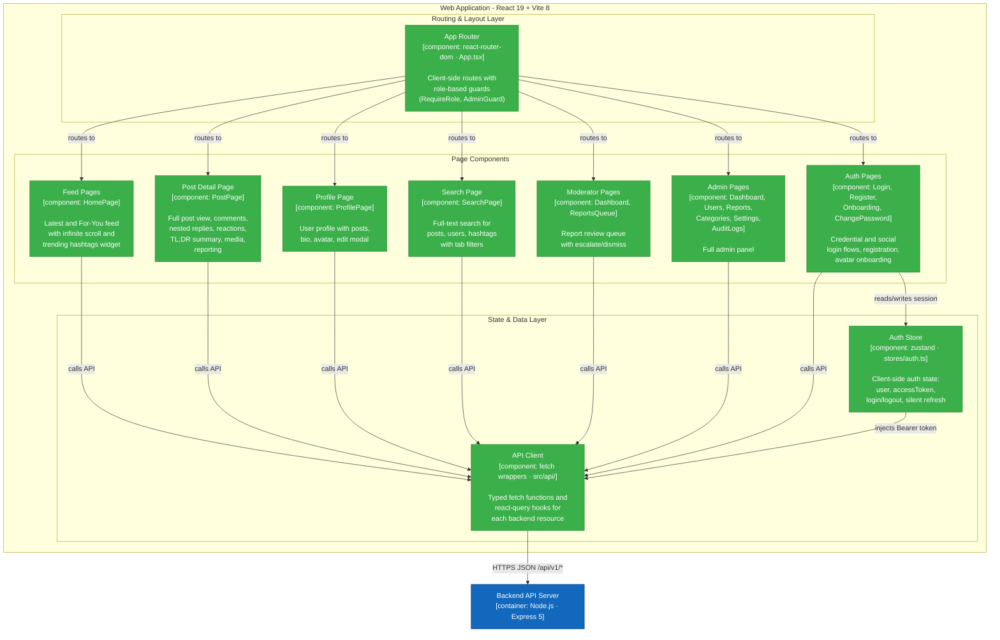
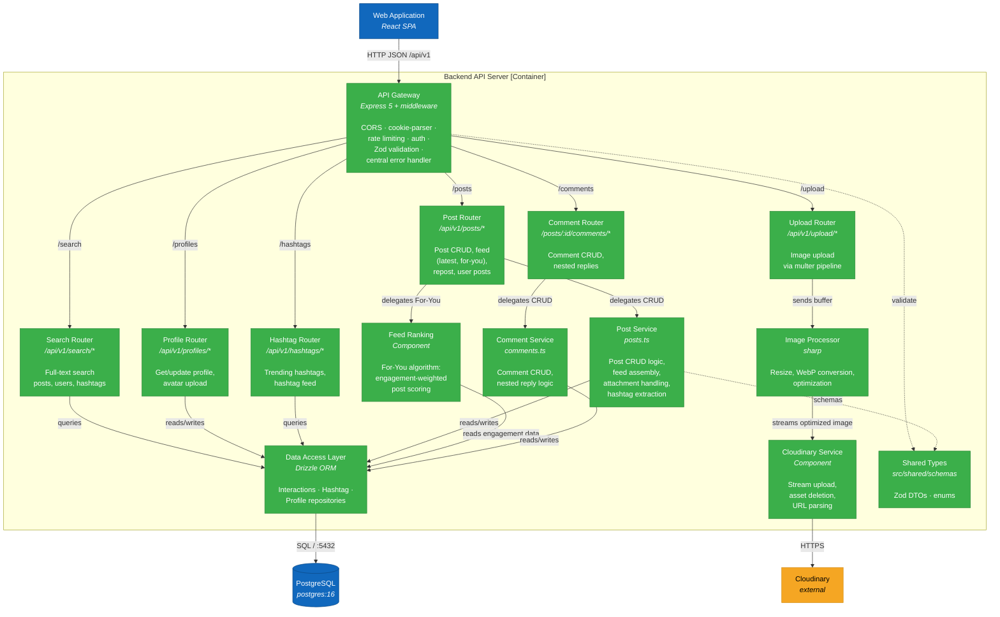
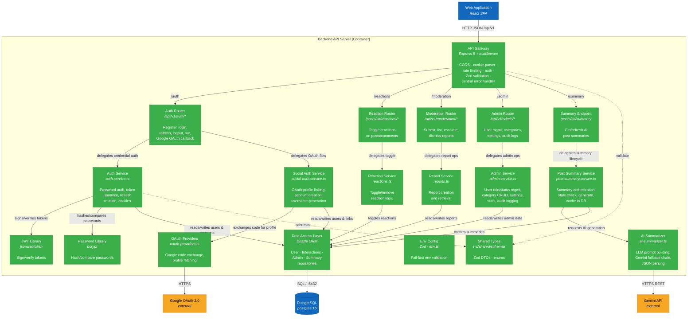

# FOZ Software Architecture Document

> **Version**: 1.0.0  
> **Last Updated**: 2026-08-08
>
> Architecture overview of the **FOZ** community forum, covering PA1–PA4. Diagrams use C4 Model conventions rendered in Mermaid.

---

## Table of Contents

1. [Technology Stack](#1-technology-stack)
2. [C4 Level 1 - System Context Diagram](#2-c4-level-1--system-context-diagram)
3. [C4 Level 2 - Container Diagram](#3-c4-level-2--container-diagram)
   - 3.1 [Diagram](#31-diagram)
   - 3.2 [Container Descriptions](#32-container-descriptions)
   - 3.3 [Relationships Summary](#33-relationships-summary)
4. [C4 Level 3 - Component Diagrams](#4-c4-level-3--component-diagrams)
   - 4.1 [Frontend - Web Application](#41-frontend--web-application)
   - 4.2 [Backend - API Server](#42-backend--api-server)

---

# B - Software Architecture: System Context Diagram

## 1. Technology Stack

### Frontend

| Technology | Purpose |
|---|---|
| **React 19** | UI component framework (SPA) |
| **TypeScript 6** | Type-safe application code |
| **Vite 8** | Build tool and dev server with HMR |
| **Tailwind CSS 4** | Utility-first styling (vanilla config, no UI library) |
| **react-router-dom 7** | Client-side routing |
| **@tanstack/react-query 5** | Server-state management and caching |
| **zustand 5** | Lightweight client-state management (auth store) |
| **react-hook-form 7** | Form state management and validation |
| **react-hot-toast 2** | Toast notification system |
| **react-icons 5** | Icon library |
| **Vitest 4** | Unit testing framework |

### Backend

| Technology | Purpose |
|---|---|
| **Node.js (LTS ≥ 24)** | JavaScript runtime (ESM) |
| **Express 5** | Web framework for RESTful API |
| **TypeScript 6** | Type-safe server code |
| **Drizzle ORM** | SQL-visible ORM with type-safe queries |
| **drizzle-kit** | Database migration tooling |
| **Zod 4** | Runtime schema validation at API boundaries |
| **bcrypt 6** | Password hashing |
| **jsonwebtoken 9** | JWT access and refresh token management |
| **express-rate-limit 8** | Rate limiting for abuse-prone endpoints |
| **multer 2** | Multipart file upload handling |
| **sharp 0.35** | Server-side image processing and optimization |
| **cookie-parser** | HTTP cookie parsing for refresh tokens |
| **Vitest 4** | Unit and integration testing |

### Database

| Technology | Purpose |
|---|---|
| **PostgreSQL 16** | Primary relational database (provisioned via Docker) |
| **postgres.js** | Node.js PostgreSQL client driver |

### External Services

| Service | Purpose |
|---|---|
| **Cloudinary** | Cloud-based image/media storage and CDN delivery |
| **Google Generative AI API** (Gemini) | AI-powered post & comment summarization (TL;DR) with fallback provider chain |
| **Google OAuth 2.0** | Social authentication (Google Sign-In) |

### Shared Module

| Technology | Purpose |
|---|---|
| **`src/shared/`** | Zod schemas, DTOs, enums - single source of truth imported by both frontend and backend via `#shared/*` path aliases. No npm workspace, no codegen, no tRPC. |

---

## 2. C4 Level 1 - System Context Diagram

This diagram shows FOZ as a single box, the actors who interact with it, and the external systems it depends on.

### Diagram Explanation

Four actor types interact with the system:

- **Guest** — Unauthenticated. Can browse the feed, search, and view profiles. Cannot create content, react, report, or use AI features.
- **Standard User** — Authenticated member. Everything a guest can do, plus creating posts (text + images), commenting (nested replies), reacting, editing/deleting own content, managing their profile, reporting, requesting AI TL;DR summaries, and changing their password.
- **Moderator** — Standard user privileges plus the moderation queue (review, flag, or dismiss reports). Cannot issue punishments directly — this enforces separation of powers.
- **Administrator** — Moderator privileges plus the admin dashboard: user management (warn, suspend, ban), category management, system settings, audit logs, and punishment issuance.

The system depends on three external services:

- **Google OAuth 2.0** — Social login. The backend exchanges an auth code for a token, fetches the Google profile, and links or creates a FOZ account.
- **Google Generative AI (Gemini)** — AI post/comment summarization. Uses a fallback chain across multiple Gemini model versions for resilience.
- **Cloudinary** — Image storage and CDN. Attachments and avatars are streamed to Cloudinary; CDN URLs are stored in the database.

---

# C - Software Architecture: Container Diagram and Component Diagram

## 3. C4 Level 2 - Container Diagram

Zooms into FOZ to show its deployable units (containers), the technology each uses, and how they talk to each other. In C4 terms a "container" is a separately runnable process or data store.

### 3.1 Diagram

### 3.2 Container Descriptions

- **Web Application (SPA)** — Renders the entire forum UI: feed (latest + for-you), post detail with comments/reactions, profiles, search, moderation queue, admin dashboard, and auth screens. No direct DB access, all data comes from the API via REST.
  - **Technology**: React 19 + TypeScript + Vite 8, styled with Tailwind CSS v4. Key libs: `react-router-dom` (routing), `@tanstack/react-query` (server-state cache), `zustand` (auth state), `react-hook-form` (forms), `react-hot-toast` (toasts). Tested with Vitest + Testing Library.
  - **Communication**: Sends JSON requests to `/api/v1/*`. Dev: Vite proxies to `localhost:4000`. Prod: Vercel rewrites to the Render backend. Auth uses `Bearer` tokens; refresh uses an HttpOnly cookie.

- **Backend API Server** — RESTful API under `/api/v1` covering auth, posts, comments, reactions, profiles, search, upload, moderation, admin, hashtags, and a `/health` probe. Includes AI summarization, Zod validation, rate limiting, CORS, and a central error handler.
  - **Technology**: Node.js v24 (ESM) + Express 5. Auth: `jsonwebtoken` + `bcrypt`. DB: Drizzle ORM + `postgres.js` + `drizzle-kit` migrations. Validation: `zod`. Uploads: `multer` + `sharp`. Env: fail-fast Zod validation at startup.
  - **Communication**: Receives JSON from the SPA. Connects to Postgres via `postgres.js` (TCP :5432, pool max 10). Calls Google OAuth, Gemini, and Cloudinary over HTTPS.

- **PostgreSQL Database** — Stores all relational data: users, profiles, refresh sessions, posts, attachments, comments, reactions, reports, audit logs, categories, settings, hashtags, summaries, and social links.
  - **Technology**: `postgres:16` Docker service (`foz_db`, port 5432, volume `foz_pg_data`, database `foz_dev`). Migrations via `drizzle-kit`.
  - **Communication**: Accepts connections only from the Backend API Server (TCP :5432). No browser or SPA access.

- **Google OAuth 2.0** *(external)* — Social login. Backend exchanges auth codes for tokens and fetches user profiles. HTTPS only, called by the backend.

- **Google Generative AI / Gemini** *(external)* — On-demand AI TL;DR summaries (post snapshot, highlights, sentiment). Uses `gemini-2.5-flash` / `gemini-1.5-flash` / `gemini-2.0-flash` with a fallback chain. HTTPS only, called by the backend.

- **Cloudinary** *(external)* — Image storage and CDN. Attachments and avatars are streamed up; CDN URLs are persisted in Postgres. HTTPS only, called by the backend.

### 3.3 Relationships Summary

| From | To | Protocol | Description |
|---|---|---|---|
| User (all roles) | Web Application | HTTPS | Browsing, form submission, and UI interaction |
| Web Application | Backend API Server | HTTP/HTTPS JSON | REST calls to `/api/v1/*`. Dev: Vite proxies to `localhost:4000`. Authenticated calls pass `Bearer` tokens; refresh uses HTTP-only credentials |
| Backend API Server | PostgreSQL Database | SQL over TCP :5432 | Drizzle ORM queries via `postgres-js` driver |
| Backend API Server | Google OAuth 2.0 | HTTPS | Exchanges authorization codes for tokens, fetches user profiles |
| Backend API Server | Google Gemini API | HTTPS REST | Sends structured prompts, receives AI-generated summaries |
| Backend API Server | Cloudinary | HTTPS | Streams image uploads and issues delete requests |

---

## 4. C4 Level 3 - Component Diagrams

These diagrams zoom into the Web Application and Backend API Server containers to show their internal components. The database and external systems appear for context.

### 4.1 Frontend - Web Application

#### 4.1.1 Diagram

#### 4.1.2 Component Descriptions

- **App Router (`App.tsx`)**
  - **Responsibility**: Declares all client-side routes (`/latest`, `/foryou`, `/posts/:id`, `/profiles/@:username`, `/search`, `/login`, `/register`, `/moderator`, `/admin/*`, etc.) and wraps protected routes with `RequireRole` and `AdminGuard` components that check the auth store for the required role.
  - **Relationships**: Receives navigation actions from the User; renders matching Page Components; injects global layout and dialog controls.

- **Feed Pages (`HomePage`)**
  - **Responsibility**: Renders the post feed in two modes: "Latest" (chronological) and "For You" (engagement-ranked). Supports infinite scroll via cursor-based pagination. Includes a TrendingHashtagsWidget sidebar.
  - **Relationships**: Calls APIClient for post, feed, and reaction data.

- **Post Detail Page (`PostPage`)**
  - **Responsibility**: Full post view with body text, media gallery, reaction controls, comment thread with nested replies, AI-generated TL;DR summary card, report button, and post edit/delete for the owner.
  - **Relationships**: Calls APIClient for post, comment, reaction, summary, and report data.

- **Profile Page (`ProfilePage`)**
  - **Responsibility**: Displays a user's profile (display name, bio, avatar, location, website) and their posts. Includes a ProfileEditModal for the profile owner to update their information and upload avatars.
  - **Relationships**: Calls APIClient for profile and user post data.

- **Search Page (`SearchPage`)**
  - **Responsibility**: Provides full-text search across posts, users, and hashtags with tab-based result filtering.
  - **Relationships**: Calls APIClient for search queries.

- **Auth Pages (`LoginPage`, `RegisterPage`, `OnboardingPage`, `ChangePasswordPage`)**
  - **Responsibility**: Login page (email/password + Google OAuth), register page (with Zod-validated form), onboarding avatar upload, and change-password page.
  - **Relationships**: Uses Auth Store to persist session; calls APIClient for auth endpoints.

- **Moderator Pages (`ModDashboard`, `ReportsQueue`)**
  - **Responsibility**: Moderator dashboard with report statistics and a reports queue page where moderators can review, flag (escalate), or dismiss user reports.
  - **Relationships**: Calls APIClient for moderation endpoints; guarded by RequireRole.

- **Admin Pages** (`Dashboard`, `Users`, `Reports`, `Categories`, `Settings`, `AuditLogs`) — Full admin panel: site stats, user management, report management, category CRUD, system settings, audit logs. Guarded by AdminGuard. Calls APIClient for admin endpoints.

- **Auth Store (`src/frontend/src/stores/auth.ts`)**
  - **Responsibility**: Zustand store managing client-side authentication state: `user` object, `accessToken`, `setSession`, `clearSession`, and `silentRefresh` (automatic token renewal via the refresh cookie).
  - **Relationships**: Read by APIClient for Bearer token injection; updated by Auth Pages upon login, registration, or session restoration.

- **API Client (`src/frontend/src/api/`)**
  - **Responsibility**: Modular API modules (`auth.ts`, `interactions.ts`, `post-summary.ts`, `profile.ts`, `search.ts`, `upload.ts`, `admin.ts`, `hashtags.ts`) providing typed `fetch` wrappers with `Bearer` authorization headers and `@tanstack/react-query` hooks for caching and data sync.
  - **Relationships**: Invoked by all page components; reads access tokens from Auth Store; executes REST calls to Backend API Server.

---

### 4.2 Backend - API Server

The backend is split into two diagrams for readability: **Diagram A** covers content and discovery (posts, comments, search, profiles, hashtags, media); **Diagram B** covers identity, governance, and AI (auth, OAuth, reactions, reports, moderation, admin, TL;DR).

#### 4.2.1 Diagram A - Content & Discovery (Feed · Search · Profile · Hashtags · Media)

#### 4.2.2 Diagram B - Identity, Governance & AI (Auth · OAuth · Reactions · Reports · Moderation · Admin · AI TL;DR)

> **Note:** The API Gateway, DAL, and Shared Types appear in both diagrams (shared infrastructure). The split is purely for presentation — the backend runs as **one container**.

#### 4.2.3 Component Descriptions

##### Middleware Pipeline (API Gateway)

Middleware applied (in order) before routing in `src/backend/index.ts`:

| Component | Responsibility | Source |
|---|---|---|
| **CORS Middleware** | Enforces origin-based CORS policy with credentials support. Allowed origins are configurable via `CORS_ORIGIN` env var. | `src/backend/index.ts` |
| **Auth Middleware** | Extracts and verifies the JWT access token from the `Authorization: Bearer` header. Hydrates `req.user` with `{ sub, role, status }`. Routes can be optionally or mandatorily authenticated (`requireAuth`, `optionalAuth`). | `src/backend/api/auth/` |
| **Rate Limiter** | Applies configurable per-window rate limits to abuse-prone endpoints (auth, AI summarization). Uses `express-rate-limit` with in-memory store. | `src/backend/lib/rate-limit.ts` |
| **Zod Validation** | Validates request bodies and parameters against Zod schemas from `src/shared/` at the API boundary. Rejects invalid requests with structured 422 error responses. | Inline in route handlers |
| **Central Error Handler** | The single place that maps thrown errors to HTTP JSON responses: `ZodError` -> 422, `AuthError` -> status from error, payload-too-large -> 413, unhandled -> 500. No error swallowing anywhere else. | `src/backend/index.ts` |

##### Route Layer

| Router | Path Prefix | Responsibility |
|---|---|---|
| **Auth Router** | `/api/v1/auth` | `POST /register`, `POST /login`, `POST /refresh`, `DELETE /logout`, `GET /me`, `GET /google` (initiate OAuth), `GET /google/callback`, `POST /change-password` |
| **Post Router** | `/api/v1/posts` | `GET /` (feed), `GET /for-you`, `POST /` (create), `GET /:id`, `PATCH /:id`, `DELETE /:id`, `POST /:id/repost`, `GET /user/:userId` |
| **Comment Router** | `/api/v1/posts/:postId/comments` | `GET /`, `POST /`, `PATCH /:commentId`, `DELETE /:commentId` |
| **Reaction Router** | `/api/v1/posts/:targetId/reactions` | `POST /` (toggle like on post or comment) |
| **Profile Router** | `/api/v1/profiles` | `GET /me`, `PATCH /me`, `GET /:userId`, `GET /username/:username` |
| **Search Router** | `/api/v1/search` | `GET /` (unified search with type filter: posts, users, hashtags) |
| **Upload Router** | `/api/v1/upload` | `POST /` (image upload via multer -> sharp -> Cloudinary) |
| **Moderation Router** | `/api/v1/moderation` | `POST /reports` (submit), `GET /reports` (queue), `PATCH /reports/:id` (escalate/dismiss) |
| **Admin Router** | `/api/v1/admin` | `GET /stats`, `GET/PATCH /users`, `GET /audit-logs`, `GET/POST/PATCH/DELETE /categories`, `GET/PATCH /settings`, `GET/PATCH /reports` |
| **Hashtag Router** | `/api/v1/hashtags` | `GET /trending`, `GET /:tag/posts` |

##### Service Layer

| Component | Responsibility | Key Relationships |
|---|---|---|
| **Auth Service** (`src/backend/api/auth/auth.service.ts`) | Core authentication logic: password verification, JWT access token signing (HS256, 15-min TTL), refresh token issuance with rotation (7-day, HttpOnly cookie), cookie construction, and session management. Defines the `AuthError` class used by the central error handler. | Uses JWT Library, Password Library, User Repository. |
| **Social Auth Service** (`src/backend/api/auth/social-auth.service.ts`) | Handles the OAuth account-linking flow: finds existing social links, links social profiles to existing email-matched accounts, or creates new user accounts with generated usernames. Issues session tokens matching the standard auth flow. | Uses OAuth Providers, User Repository. |
| **OAuth Providers** (`src/backend/api/auth/oauth-providers.ts`) | Implements provider-specific OAuth logic. Currently supports Google: exchanges authorization codes for tokens via the Google token endpoint, then fetches the user profile from the Google userinfo API. | Calls Google OAuth 2.0 (external). |
| **Post Service** (`src/backend/services/interactions/posts.ts`) | Business logic for post CRUD: creation (with content, attachments, and hashtag extraction), reading (single post with author/reactions/comment count), updating, soft-deletion (respecting ownership), and feed assembly with cursor-based pagination. | Uses Interactions Repository, Hashtag Repository. |
| **Feed Ranking** | Implements the "For You" feed algorithm: scores posts based on engagement metrics (reaction count, comment count, recency) to produce a ranked feed. | Uses Interactions Repository. |
| **Comment Service** (`src/backend/services/interactions/comments.ts`) | Business logic for comment CRUD: creation (with post-existence check and optional parent-comment for nesting), updating, and soft-deletion with ownership enforcement. | Uses Interactions Repository. |
| **Reaction Service** (`src/backend/services/interactions/reactions.ts`) | Toggle-style reaction logic: adds a reaction if it doesn't exist, removes it if it does. Currently supports the "like" reaction kind on both posts and comments. | Uses Interactions Repository. |
| **Report Service** (`src/backend/services/interactions/reports.ts`) | Creates user reports against posts, comments, or other users with a reason type and optional details. Retrieves reports for the moderation queue. | Uses Interactions Repository. |
| **AI Summarizer** (`src/backend/services/ai-summarizer.ts`) | Core AI logic: builds a structured prompt from post content and comment bodies, calls the Gemini API with a fallback chain of model versions (`gemini-2.5-flash` -> `gemini-1.5-flash` -> `gemini-2.0-flash`), parses the JSON response into `{ postSnapshot, keyHighlights, sentiment }`, and falls back to a text-truncation heuristic if all API calls fail. | Calls Gemini API (external). |
| **Post Summary Service** (`src/backend/services/post-summary.service.ts`) | Orchestrates the summary lifecycle: checks if a cached summary exists and is still fresh, triggers AI Summarizer if not, and upserts the result into the database. | Uses AI Summarizer, Summary Repository. |
| **Cloudinary Service** | Wraps the Cloudinary SDK: configures credentials from env, streams file buffers to Cloudinary's upload API, extracts public IDs from URLs, and deletes assets. | Calls Cloudinary (external). |
| **Image Processor** | Uses `sharp` to resize, reformat (to WebP), and optimize uploaded images before they are sent to Cloudinary. Ensures consistent image dimensions and file sizes. | Used by Upload Router. |
| **Admin Service** | Admin business logic: dashboard statistics (user/post/comment/report counts), user management (role changes, status changes with audit logging), forum category CRUD, system settings management, and audit log retrieval. | Uses Admin Repository, User Repository. |

##### Data Access Layer (`src/backend/db/`)

| Component | Responsibility | Database Tables |
|---|---|---|
| **User Repository** | Queries for user accounts and profiles: find by ID, email, or username; create users; update profiles; issue refresh tokens; manage refresh sessions. | `user_accounts`, `profiles`, `refresh_sessions`, `user_social_links` |
| **Interactions Repository** | Queries for posts, comments, reactions, reports, and attachments. Handles feed queries with pagination, post-with-relations fetching, comment trees, reaction toggling, and report management. | `posts`, `comments`, `reactions`, `reports`, `post_attachments` |
| **Hashtag Repository** | Manages hashtag entities and their associations with posts. Supports trending hashtag queries (by post count) and hashtag-based post feeds. | `hashtags`, `post_hashtags` |
| **Summary Repository** (`src/backend/db/post-summary.repository.ts`) | Upserts and retrieves AI-generated post summaries. Handles staleness checks based on comment count changes. | `post_summaries` |
| **Admin Repository** | Queries for admin operations: audit log insertion and retrieval, forum category CRUD, system settings reads/writes, and aggregate statistics. | `admin_audit_logs`, `forum_categories`, `system_settings` |
| **Profile Repository** (`src/backend/db/profiles.ts`) | Dedicated profile queries: get profile by user ID, update profile fields (display name, bio, avatar URL, location, website). | `profiles` |

##### Library Layer

| Component | Responsibility |
|---|---|
| **JWT Library** (`jsonwebtoken`) | Wraps `jsonwebtoken` to sign access tokens with `HS256` and configurable TTL, and to verify tokens extracting the payload `{ sub, role, status }`. |
| **Password Library** (`bcrypt`) | Wraps `bcrypt` for password hashing (configurable cost factor) and comparison. |
| **Env Config** (`src/backend/env.ts`) | Validates all environment variables at startup using a Zod schema. Fails fast with clear error messages if required variables are missing or malformed. Exports the typed `env` object used throughout the backend. |
