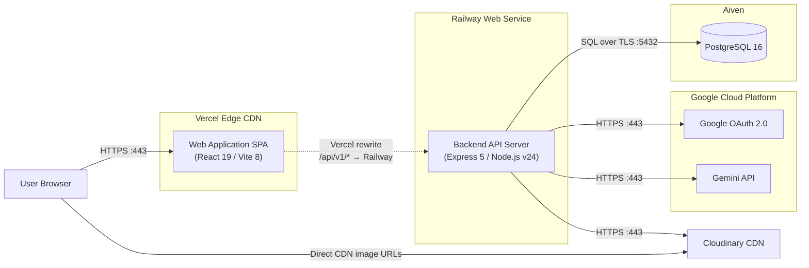

# FOZ — Threads-style Community Forum

FOZ is a web-based forum application focused on fundamental community discussions. Its value lies in providing a simple, intuitive platform where users can easily ask questions, share knowledge, and connect over shared interests without navigating overly complex interfaces.

## Table of Contents

1. [📖 Introduction & Overview](#-introduction--overview)
	1. [Target Users and Environments](#target-users-and-environments)
	2. [Key Features](#key-features)
	3. [User Roles & Permissions](#user-roles--permissions)
	4. [Functional Groups](#functional-groups)
2. [🛠️ Getting Started & Setup](#-getting-started--setup)
	1. [Prerequisites](#prerequisites)
	2. [First-Time Setup](#first-time-setup)
		1. [Windows](#windows)
		2. [Linux / macOS](#linux--macos)
		3. [Post-setup Steps](#post-setup-steps)
	3. [Running the System Locally](#running-the-system-locally)
		1. [Windows](#windows)
		2. [Linux / macOS](#linux--macos)
3. [🛡️ Administration & Moderation](#-administration--moderation)
	1. [Assigning Admin & Moderator Roles](#assigning-admin--moderator-roles)
	2. [Using the Moderator Portal](#using-the-moderator-portal)
	3. [Using the Admin Portal](#using-the-admin-portal)
4. [🗄️ Working with the Database](#-working-with-the-database)
	1. [Applying Schema Migrations](#applying-schema-migrations)
	2. [Option A — Drizzle Studio (Web GUI)](#option-a--drizzle-studio-web-gui)
	3. [Option B — psql (CLI)](#option-b--psql-cli)
5. [🧪 Testing](#-testing)
6. [💻 Development & Architecture](#-development--architecture)
	1. [File Structure](#file-structure)
	2. [API Routing Convention](#api-routing-convention)
	3. [Authentication API Endpoints](#authentication-api-endpoints)
	4. [Production Deployment Architecture](#production-deployment-architecture)
7. [🤖 Team AI Usage Logging](#-team-ai-usage-logging)

## 📖 Introduction & Overview

This project is built to showcase a clean community platform. Below are details outlining target users, key features, functional groups, and roles, derived from the [1B. Project Proposal.md](file:///d:/FOZ/docs/1B.%20Project%20Proposal.md).

### Target Users and Environments

The target audience is general **web** users seeking online community spaces. They will use the application exclusively through standard web browsers on any internet-connected device, including desktop computers, laptops, and smartphones.

### Key Features

- **Post Creation:** Users can easily create text-based posts to initiate new discussion threads on topics they care about. This feature allows users to share their thoughts, ask questions, and start conversations with the community.
- **Feed Generation:** The application will generate a feed of posts based on current trends, calculated by recent engagement metrics like comment velocity and like counts. This ensures that users see content that is relevant to them, enhancing their overall experience on the platform.
- **User Interactions:** Members can browse existing threads, read ongoing discussions, and interact by leaving their own comments or likes. This fosters engagement and allows users to contribute to the community dialogue.
- **Search & Discovery:** Users can search for specific topics, posts, or other users to find relevant content. This feature helps users discover desired discussions and enhance their overall experience.
- **Administration & Moderation:** The application includes a robust reporting system that allows users to report inappropriate content. Moderators can review these reports and forward them to administrators for further review or remove offending content. This helps maintain a safe and respectful community environment.
- **Post Summarize (TL;DR) [AI Feature]:** The application utilizes an AI engine to generate brief on-demand overviews of lengthy discussion posts. This feature helps users quickly understand the main points of a conversation without having to read through every comment, making it easier to stay informed and engaged with community discussions.

### User Roles & Permissions

| Role                                   | Description                                                                                                                                                                                                |
| -------------------------------------- | ---------------------------------------------------------------------------------------------------------------------------------------------------------------------------------------------------------- |
| **Guest (Unauthenticated User)**       | Can view profiles, read posts, and see comments. Cannot post, like, report. Any interaction attempt should trigger the authentication flow.                                                                |
| **Standard User (Authenticated User)** | Can create posts, like, comment, report, and delete their own content. Can manage their own profile.                                                                                                       |
| **Moderator**                          | Inherits all Standard User abilities. Can review reports from Standard Users, then forward to Administrator if needed. Cannot delete users or posts from the database or alter system-wide configurations. |
| **Administrator**                      | This is the highest level of access. Complete access over all database records. Can permanently remove user accounts, instantly delete any content, assign Moderator roles.                                |

### Functional Groups

| Group Name                      | Functions                                                                                                                                                                                                         |
| ------------------------------- | ----------------------------------------------------------------------------------------------------------------------------------------------------------------------------------------------------------------- |
| **Authentication**              | Sign up, log in, log out                                                                                                                                                                                          |
| **Profile management**          | Edit profile info, change password, change avatar                                                                                                                                                                 |
| **Post Creation**               | Creating a new post, deleting posts (restricted by the post owner check)                                                                                                                                          |
| **Feed Generation**             | Post recommendation                                                                                                                                                                                               |
| **User Interactions**           | Comment to the post, like/unlike a post or comment.                                                                                                                                                               |
| **Search & Discovery**          | User profile or post search                                                                                                                                                                                       |
| **Administration & Moderation** | User reporting system (Standard User can report posts), Moderator reporting system (review the reports from users and forward to admin), Admin reporting system (post removal and user removal. Assign Moderator) |
| **Post Summarize**              | On-demand summarization inside a post.                                                                                                                                                                            |

---

## 🛠️ Getting Started & Setup

### Prerequisites

- **Node.js**: version `24` or higher (refer to the [.nvmrc](file:///d:/FOZ/.nvmrc) file; consider using `nvm` or `fnm`).
- **Docker**: Required to run the local PostgreSQL database service.

---

### First-Time Setup

> [!IMPORTANT]
> Disable the postgres service on your host machine if it already uses port `5432`, then run:

#### Windows

Run the setup batch script in PowerShell:

```powershell
./setup.bat
```

#### Linux / macOS

Grant executable permission and run the setup script:

```bash
chmod +x setup.sh
./setup.sh
```

#### Post-setup Steps

1. Create and configure your [.env](file:///d:/FOZ/.env) file (copied from [.env.example](file:///d:/FOZ/.env.example)) and set `JWT_ACCESS_SECRET` to your preferred secret key of at least 16 characters.
2. **AI Summarization Setup (Post Summarize TL;DR)**:
   - Obtain a free API key from [Google AI Studio](https://aistudio.google.com/app/apikey).
   - Add your API key to `.env`:
     ```env
     AI_API_KEY=AIzaSy...
     ```
   - *Note: If `AI_API_KEY` is left empty, the application uses an intelligent fallback summarizer without breaking UI capabilities.*


---

### Running the System Locally

> [!IMPORTANT]
> Disable the postgres service on your host machine if it already uses port `5432`, then run:

#### Windows

```powershell
./start.bat
```

#### Linux / macOS

```bash
chmod +x start.sh
./start.sh
```

Once running, the application components will be available at:

- **Frontend Development Server**: `http://localhost:5173`
- **Backend API Server**: `http://localhost:4000`

---

## 🛡️ Administration & Moderation

FOZ features a role-based access control system (`guest`, `standard`, `moderator`, `administrator`) with dedicated portals for content moderation and platform administration.

### Assigning Admin & Moderator Roles

New accounts are registered with the `standard` role by default. To promote a user account to **Moderator** or **Administrator**, choose one of the following methods:

#### Option 1 — Direct SQL via Docker CLI (Recommended for Local Setup)

Execute an SQL update directly against the running PostgreSQL container:

```sh
# Promote user to Moderator
docker exec -i foz_db psql -U foz -d foz_dev -c "UPDATE user_accounts SET role = 'moderator' WHERE email = 'user@example.com';"

# Promote user to Administrator
docker exec -i foz_db psql -U foz -d foz_dev -c "UPDATE user_accounts SET role = 'administrator' WHERE email = 'admin@example.com';"
```

#### Option 2 — Drizzle Studio (Web GUI)

1. Launch Drizzle Studio:
   ```sh
   npx drizzle-kit studio
   ```
2. Open `http://local.drizzle.studio` in your browser.
3. Select the `user_accounts` table, locate the target user, and update their `role` column to `moderator` or `administrator`.

#### Option 3 — Admin Dashboard (Web UI)

If you are already logged in as an Administrator:
1. Open the Admin User Management page at `http://localhost:5173/admin/users`.
2. Search for the target user in the list.
3. Click the user action menu and select **Change Role** to grant **Moderator** or **Administrator** privileges.

---

### Using the Moderator Portal

Users assigned the **Moderator** or **Administrator** role can access moderation tools:

- **Moderator Dashboard** (`/moderator` or `http://localhost:5173/moderator`):
  - View real-time metrics: Pending Reviews, Resolved Today, Avg Response Time, Queue Capacity.
  - Inspect shift activity graphs, high-priority reports, and recent moderation actions.
- **Reports Queue** (`/moderator/queue` or `http://localhost:5173/moderator/queue`):
  - Review user reports submitted for posts, comments, or user profiles.
  - **Resolve / Take Action**: Flag or handle content violating community standards.
  - **Dismiss**: Dismiss invalid or false reports.
  - **Escalate**: Escalate complex reports to Administrators for high-level enforcement.

---

### Using the Admin Portal

Users assigned the **Administrator** role have full access to platform administration at `http://localhost:5173/admin`:

- **Dashboard** (`/admin`): System overview, platform analytics, content counts, and key performance indicators.
- **User Management** (`/admin/users`):
  - Search and filter all registered users.
  - Assign or change roles (`standard`, `moderator`, `administrator`).
  - Update user account statuses (`active`, `suspended`, `banned`).
  - View detailed user profiles or permanently delete user accounts.
- **Reports Management** (`/admin/reports`): Review all reported content and handle escalated moderation issues.
- **Audit Logs** (`/admin/audit-logs`): Track system-wide events including role changes, administrative actions, and moderation decisions with complete timestamps and actor details.
- **Category Management** (`/admin/categories`): Create, update, or remove forum category structures.
- **System Settings** (`/admin/settings`): Manage system configuration settings.

---

## 🗄️ Working with the Database

The local Postgres instance runs in Docker as the `foz_db` container. Two databases are created in it: `foz_dev` (for development) and `foz_test` (for the vitest test suite).

### Schema Workflow

Both `dev:be` and `start` run `drizzle-kit migrate` automatically on startup, so pending migrations are applied every time you start the backend.

When you change a schema file in `src/backend/db/schema/`:

```sh
# 1. Generate a migration file from your schema changes
npx drizzle-kit generate

# 2. Restart the backend (migrate runs automatically)
npm run dev:be
```

> [!WARNING]
> **Do not use `drizzle-kit push`.** It syncs the schema directly to the database without creating migration files or updating the migration journal. This causes drift — the live DB and the migration history get out of sync, leading to failures on the next `migrate` run. Always use `generate` + `migrate` instead.

### Resetting the Database

To wipe all data and start fresh (e.g. after major schema conflicts):

```sh
docker exec -i foz_db psql -U foz -d foz_dev -c "DROP SCHEMA public CASCADE; CREATE SCHEMA public;"
npx drizzle-kit migrate
```

### 🧪 Isolated Testing Databases & Fixtures

FOZ provides two dedicated, isolated testing databases that run inside the same PostgreSQL instance without interfering with `foz_dev`:

1. **`foz_test_empty`**: Clean slate database with up-to-date migrations, 0 posts, and pre-configured administrative accounts:
   - **Administrator**: `admin@admin.foz` / `admin@admin.foz`
   - **Moderator**: `mod@mod.foz` / `mod@mod.foz`
2. **`foz_test_populated`**: High-density dataset with 50 users (`user1@foz.test`..`user50@foz.test` / `password123`), 100 posts spanning a 30-day timeline, threaded comments/replies, reposts, likes, hashtags, and moderation reports.

#### Test Database Commands

```sh
# Setup & migrate both test databases simultaneously
npm run db:test:setup

# Reset empty state database (foz_test_empty)
npm run db:test:empty:reset

# Reset populated interaction database (foz_test_populated)
npm run db:test:populated:reset

# Apply pending Drizzle migrations to both test databases
npm run db:test:migrate
```

#### Running the Full App with Test Databases

You can launch the full local environment (Docker DB + Backend + Frontend) targeting any specific database:

- **Option 1: 1-Click Batch Launchers (Windows)**
  - Double-click `start-empty.bat` to run against `foz_test_empty`.
  - Double-click `start-populated.bat` to run against `foz_test_populated`.
  - Double-click `start.bat` to run against standard development (`foz_dev`).

- **Option 2: Command Line (Windows)**
  ```cmd
  .\start.bat empty       # Boots servers targeting foz_test_empty
  .\start.bat populated   # Boots servers targeting foz_test_populated
  .\start.bat             # Boots servers targeting foz_dev
  ```

- **Option 3: Command Line (macOS / Linux)**
  ```sh
  ./start.sh empty        # Boots servers targeting foz_test_empty
  ./start.sh populated    # Boots servers targeting foz_test_populated
  ./start.sh              # Boots servers targeting foz_dev
  ```


### Option A — Drizzle Studio (Web GUI)

The codebase includes a [drizzle.config.ts](file:///d:/FOZ/drizzle.config.ts) file wired up to read the `DATABASE_URL` from [.env](file:///d:/FOZ/.env). To view and manage data in a browser UI:

```sh
# 1. Start the Drizzle Kit Studio server
npx drizzle-kit studio

# 2. Open the URL printed in terminal (typically http://local.drizzle.studio)
```

Drizzle Studio displays all 10 tables (`user_accounts`, `profiles`, `posts`, `comments`, `reactions`, `role_history`, `reports`, `moderation_reviews`, `post_summaries`, `refresh_sessions`) with full row counts, schemas, and inline editing support.

### Option B — psql (CLI)

You can connect to the running database shell directly via the Docker container:

```sh
# Interactive shell session
docker exec -it foz_db psql -U foz -d foz_dev

# Run a one-off query command
docker exec -i foz_db psql -U foz -d foz_dev -c "SELECT * FROM user_accounts;"
```

Useful CLI queries:

```sql
-- List all tables
\dt

-- Describe user_accounts table schema
\d user_accounts

-- Pretty-print wide rows
\x

-- View recent users (excluding password hashes)
SELECT id, email, role, status, created_at
FROM user_accounts
ORDER BY created_at DESC LIMIT 20;

-- Reset database tables completely (use with caution)
TRUNCATE TABLE refresh_sessions, profiles, user_accounts RESTART IDENTITY CASCADE;
```

---

## 🧪 Testing

To run the Vitest test suite, compile the TypeScript code and execute tests:

```sh
# Start database container
docker compose up -d db

# Perform TypeScript compile check
npx tsc --noEmit

# Run tests
npx vitest run
```

_Note: The rate-limit middleware is disabled automatically when `NODE_ENV=test` to avoid rate-limiting test requests._

---

## 💻 Development & Architecture

### File Structure

```Plaintext
FOZ/
├── src/                            # Source code
│   ├── frontend/                   # Vite + React
│   ├── backend/                    # Express + Drizzle ORM
│   └── shared/                     # Zod schemas + shared types (source of truth)
├── docs/                           # Documentation (project planning, tech stack, etc.)
│   ├── PA/                         # Project Assignments
│   ├── Techstack/                  # Backend and frontend technology documents
│   ├── references/                 # Reference apps/sites the team studied
│   ├── ui-designs/                 # Visual design references (Figma exports)
│   └── ideas/                      # Design notes and drafts
├── specs/                          # SpecKit specifications (by feature)
├── ai-logs/                        # AI usage logs (by team member)
├── tests/                          # Test plan, test cases, and reports
├── .env.example                    # Template for environment variables
└── README.md                       # Project documentation
```

### API Routing Convention

All API endpoints live under the `/api/v1` prefix.

- This prefix is registered once in [index.ts](file:///d:/FOZ/src/backend/index.ts) via an `apiRouter` mounted with `app.use("/api/v1", apiRouter)`.
- To add a new API resource, create its `Router()` in the corresponding folder under [api/](file:///d:/FOZ/src/backend/api) (e.g. `src/backend/api/<resource>/routes.ts`) and mount it on `apiRouter` in [index.ts](file:///d:/FOZ/src/backend/index.ts) **without** the prefix:
  ```ts
  import { userRouter } from "#backend/api/users/routes.js";
  apiRouter.use("/users", userRouter); // Resolves to /api/v1/users
  ```
- Routes that must not be versioned (e.g., `/health`) are mounted directly on `app` (outside the `apiRouter`).

### Authentication API Endpoints

The application includes a complete authentication slice (Phase 002) with the following routes:

| Method  | Path                    | Auth Required      | Body Params                        | Returns                                    |
| :------ | :---------------------- | :----------------- | :--------------------------------- | :----------------------------------------- |
| `POST`  | `/api/v1/auth/register` | Guest              | `{ email, password }`              | `201` + `AuthResponse` + refresh cookie    |
| `POST`  | `/api/v1/auth/login`    | Guest              | `{ email, password }`              | `200` + `AuthResponse` + refresh cookie    |
| `POST`  | `/api/v1/auth/refresh`  | None (uses cookie) | —                                  | `200` + `RefreshResponse` + rotated cookie |
| `POST`  | `/api/v1/auth/logout`   | Bearer Token       | —                                  | `200` + cleared cookie                     |
| `PATCH` | `/api/v1/auth/password` | Bearer Token       | `{ currentPassword, newPassword }` | `200`                                      |

_Note: Access tokens live in client memory only (zustand); refresh tokens are sent via `httpOnly`, `SameSite=Lax` cookies on path `/api/v1/auth`._

### Production Deployment Architecture

The application infrastructure leverages cloud providers for hosting and media management:

- **Frontend**: **Vercel** — Global Edge CDN serving static Vite React SPA with automated proxy rewrites (`vercel.json`).
- **Backend API**: **Railway** — Managed Express 5 Node.js web service running continuous container workloads.
- **Database**: **Aiven** — Fully managed PostgreSQL 16 database with TLS encryption.
- **Media Storage**: **Cloudinary** — Image cloud service for avatar and post attachment uploads.
- **AI & Identity**: **Google Cloud Platform** — Google OAuth 2.0 for social login and Gemini API for post TL;DR summarization.



---

## 🤖 Team AI Usage Logging

This project tracks AI-assisted code changes to maintain transparency across the development team.

- **Antigravity users:** The `ai-usage-log` skill automatically appends logging entries to `ai-logs/<your-username>.md`.
- **Copilot Chat users (VS Code):** Use git commit hooks to log Copilot prompts during commits. Run the following command once to set up:
  ```bash
  git config core.hooksPath .githooks
  ```
