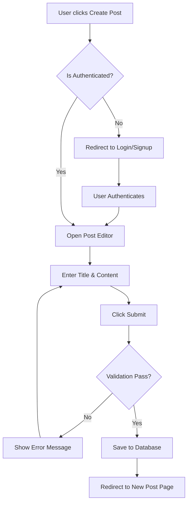
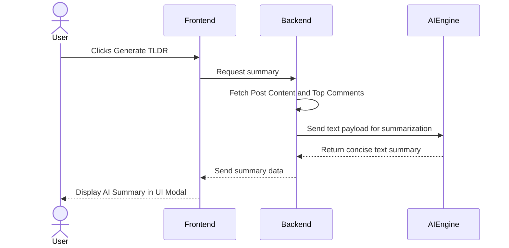
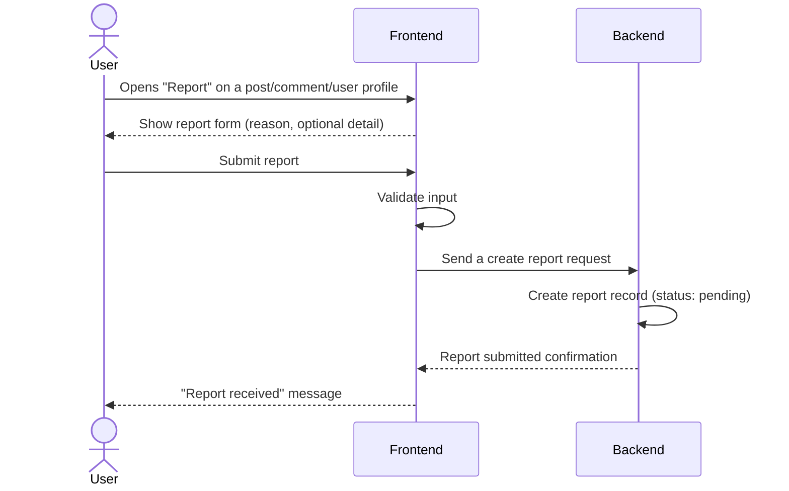
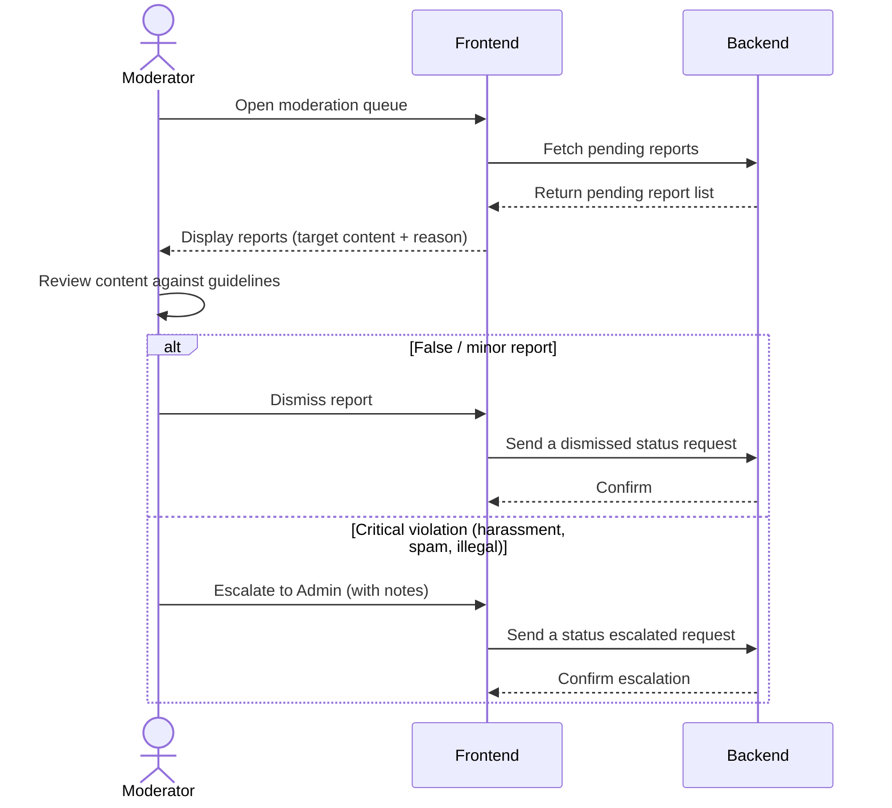
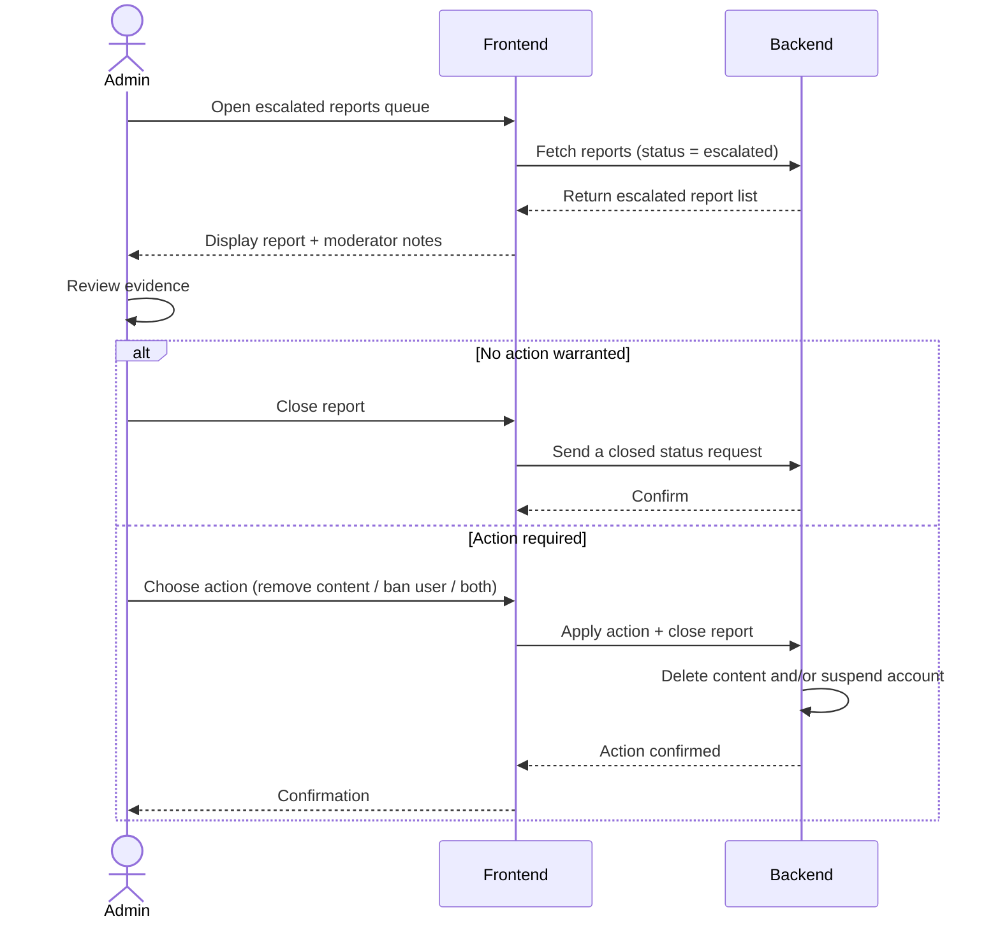

# 3B - Detailed Vision Document

*Work performed by: Nguyễn Hải Trọng | Reviewed by: Võ An Phú | Edited by: Võ An Phú*

## Version 1.3

| | |
| :--- | :--- |
| **FOZ** | Version: 1.3 |
| **Vision document** | Date: 25/07/2026 |

### Vision (Small Project)
| Date | Version | Description | Author | Review by |
| :--- | :--- | :--- | :--- | :--- |
| 07/07/2026 | 1.0 | Defined problem statement, user roles, product features, and non-functional requirements. | Nguyễn Hải Trọng | Võ An Phú |
| 08/07/2026 | 1.1 | Added scope boundaries, moderation workflow, security/accessibility NFRs, and clarified role capabilities. | Võ An Phú | Võ An Phú |
| 24/07/2026 | 1.2 | Formatted table of content, detailed alternatives and competitors, user environments and product non-functional requirements. | Nguyễn Hải Trọng | Võ An Phú |
| 25/07/2026 | 1.3 | Clarified media support (images/video) throughout, added data privacy and accessibility NFRs, removed implementation-specific references, grouped features by priority, general editorial cleanup. | Nguyễn Hải Trọng | Võ An Phú |
### 1. Introduction

The purpose of this Vision Document is to collect, analyze, and define the high-level needs and features of FOZ, a web-based forum application. It focuses on the capabilities required by the stakeholders and target users, providing a clear foundation for the project's scope. 

#### 1.1. References
* CS300 - Introduction to Software Engineering: PA1-2026 Guidelines.
* CS300 - Introduction to Software Engineering: PA2-2026 Guidelines.
* FOZ Project Proposal (PA1).
* FOZ Existing App Survey (Reddit, Threads).

### 2. Positioning

#### 2.1. Problem Statement

| | |
| :--- | :--- |
| **The problem of** | cluttered, overly complex, and algorithm-heavy interfaces in current online discussion platforms |
| **affects** | general web users seeking straightforward, topic-focused community spaces |
| **the impact of which is** | a high barrier to entry, distraction from core discussions, and a frustrating user experience when trying to find specific information |
| **a successful solution would be** | a simple, intuitive web-based forum that focuses purely on meaningful community discussions, equipped with AI tools to quickly summarize long threads. |

#### 2.2. Product Position Statement

| | |
| :----- | :----- |
| **For** | General web users seeking online community spaces |
| **Who** | want to easily ask questions, share knowledge, and connect over shared interests |
| **The FOZ** | is a web-based forum application |
| **That** | provides a simple, intuitive platform focusing on fundamental community discussions with an on-demand AI summarization feature |
| **Unlike** | traditional platforms (e.g., Reddit or Threads) that feature overwhelming UI layouts and aggressive recommendation algorithms |
| **Our product** | delivers a streamlined, clutter-free user experience tailored specifically for community dialogue — supporting text, images, and video — with rapid information consumption. |

### 3. Stakeholder and User Descriptions

#### 3.1. Stakeholder Summary
| Name | Description | Responsibilities |
| :--- | :--- | :--- |
| **Project Manager** | Team leader (Nguyễn Tuấn An). | Facilitates meetings, tracks sprint progress in Jira, ensures deadlines are met, and oversees project delivery. |
| **Development Team** | Full-stack engineers (Nam, Trọng, Khánh, Phú), with domain leads for QA (Nam), Backend/DB (Trọng), UI/UX (Khánh), and Frontend (Phú). | Designs UI/UX, builds frontend/backend architectures, manages the database, and ensures software quality via testing. Detailed role assignments are in the Project Plan. |
| **Instructors / TAs** | Course evaluators. | Monitors project progress, provides feedback, and evaluates the final product against course requirements. |

#### 3.2. User Summary
| Name | Description | Responsibilities |
| :--- | :--- | :--- |
| **Guest** | Unauthenticated visitors. | Read-only access: can view profiles, read posts, and see comments. Cannot post, like, report, or trigger the AI Post Summarize (TL;DR) feature. Any write interaction prompts the authentication flow. |
| **Standard User** | Authenticated community members. | Can create posts, like/unlike posts and comments, comment, report inappropriate posts/comments or other users, manage their own profile, and delete their own posts. |
| **Moderator** | Elevated users with community management tools. | Inherits all Standard User abilities. Reviews user reports and forwards critical issues to Administrators. Cannot permanently delete users or posts from the database or alter system-wide configurations. |
| **Administrator** | Highest level of system access. | Full control via the admin dashboard: can permanently ban users, delete content, and assign Moderator roles. All actions are performed through the application UI, not direct database access. |

#### 3.3. User Environment
FOZ is designed as a web-first application, ensuring maximum accessibility across various devices without the need for dedicated app installations.
* **Supported Devices:** Desktop computers, laptops, tablets, and mobile smartphones. The UI is fully responsive and adapts to screen sizes ranging from 320px (mobile) to 4K displays.
* **Operating Systems:** Platform-agnostic (Windows, macOS, Linux, iOS, Android).
* **Supported Browsers:** Modern web browsers with JavaScript enabled, including Google Chrome (v90+), Safari (v14+), Microsoft Edge (v90+), and Mozilla Firefox (v88+).
* **Network Requirements:** Requires an active broadband, 4G, or 5G internet connection for real-time interactions, uploading images and videos, and fetching dynamic feeds. Offline mode is not supported.

#### 3.4. Summary of Key Stakeholder or User Needs

| Need                                        | Priority | Concerns                                                                   | Current Solution                             | Proposed Solutions                                                                         |
| :------------------------------------------ | :------- | :------------------------------------------------------------------------- | :------------------------------------------- | :----------------------------------------------------------------------------------------- |
| **Quick comprehension of long discussions** | High     | Users do not have time to read hundreds of replies to find the consensus.  | Scrolling manually and reading top comments. | Integrate an AI "Post Summarize (TL;DR)" feature.                                          |
| **Discover relevant content**               | High     | Users want to find active communities without heavy, intrusive algorithms. | Algorithmic "For You" pages (e.g., Threads). | Generate a clean feed based purely on recent engagement metrics (comment velocity, likes). |
| **Safe community environment**              | Medium   | Toxic behavior ruins the discussion experience.                            | Automated bans which are often inaccurate.   | A multi-tier user reporting system involving Standard Users, Moderators, and Admins.       |

#### 3.5. Alternatives and Competition
Based on our PA1 survey and market analysis, FOZ competes in the community discussion space against several established platforms:
* **Threads:** Features a very clean UI and smooth cross-platform authentication (via Instagram). However, it leans heavily towards micro-blogging and aggressive algorithm recommendations rather than structured, topic-based forum discussions. FOZ focuses on chronological/engagement-based feeds without intrusive algorithmic manipulation.
* **Reddit:** Excels in community categorization and deep, nested discussions. However, its interface can be highly cluttered and overwhelming for casual users, and its strict karma/rules system acts as a high barrier to entry. FOZ bridges this gap by offering the deep discussion capabilities of Reddit (nested comments) but with a minimalist, accessible UI similar to Threads.

### 4. Product Overview

#### 4.1. Product Perspective
FOZ is an independent, self-contained web application. It acts as a centralized hub for community interactions, requiring only a modern web browser to access. The system will integrate with a third-party AI service (such as the OpenAI API or Gemini API) strictly to power the "Post Summarize" feature.

#### 4.2. Assumptions and Dependencies
* **Internet Connection:** The application requires a stable internet connection to fetch real-time discussions.
* **AI API Availability:** The TL;DR feature depends on external AI providers. To mitigate quota exhaustion or outages, the backend supports a fallback provider chain so that a single provider failure does not disable the feature.
* **Modern Browsers:** It is assumed that users are operating modern web browsers with JavaScript enabled.

#### 4.3. Scope Boundaries
* **In-scope:** A web-based application covering the functional groups defined in [§5 Product Features](#5-product-features) — Authentication, Profile Management, Post Creation (text, images, video), Feed Generation, User Interactions, Search & Discovery, Administration & Moderation, and Post Summarize (TL;DR).
* **Out-of-scope:** Native mobile applications (iOS/Android), real-time chat channels, push notifications, and complex personalized recommendation algorithms.

### 5. Product Features 

**1. Post Creation** *(Priority: High)*

Authenticated users can compose and publish posts containing text, images, and videos. A clean editor encourages thoughtful content creation and drives the community's core content engine.

**2. Feed Generation** *(Priority: High)*

A dynamic feed surfaces posts ranked by recent engagement metrics (comment velocity, likes). The feed includes text, image, and video content, surfaced without invasive tracking or algorithmic manipulation.

**3. User Interactions (Comments & Likes)** *(Priority: High)*

Users can browse threads and interact through nested comments and likes on posts and comments. This drives ongoing engagement and surfaces popular discussions.

**4. AI Post Summarize (TL;DR)** *(Priority: High)*

On-demand AI-generated summaries of lengthy threads, incorporating top comments for context. Allows time-constrained users to quickly grasp the main points and overall consensus of a discussion.

**5. Authentication & Account Security** *(Priority: High)*

Sign-up, login, logout, and session management gate all write operations. Passwords are hashed and salted; sessions use secure, HttpOnly cookies with JWT tokens.

**6. Search & Discovery** *(Priority: Medium)*

Users can query posts (including media captions), user profiles, and topics across the database. Essential for finding specific content as the forum grows.

**7. Administration & Moderation System** *(Priority: Medium)*

A multi-tiered reporting system: users flag content, moderators review and escalate, admins take final action (remove content, ban users). Maintains community safety and discourse quality.

**8. Profile Management** *(Priority: Medium)*

Authenticated users can edit profile information, change passwords, and update avatars. Provides a recognizable, controllable presence within the community.

#### Key Workflows (Mermaid Diagrams)

**Workflow 1: User Authentication & Post Creation**

**Workflow 2: AI Post Summarize (TL;DR)**

**Workflow 3: User Reports a Post, Comment, or User**

**Workflow 4: Moderator Reviews Reports & Escalates Critical Cases**

**Workflow 5: Admin Acts on Escalated Reports**

### 6. Non-Functional Requirements

**Performance Requirements**
* The application's initial page load time must be < 2 seconds on a standard broadband connection. Frontend routing between pages should feel instantaneous (< 200ms).
* Backend API response times for standard queries (fetching feeds, creating posts, querying comments) must be < 500 milliseconds.
* The system architecture must support at least 100 concurrent users interacting with the platform simultaneously without noticeable performance degradation.

**Security Requirements**
* All user passwords must be securely hashed and salted (using bcrypt or argon2) before being stored in the PostgreSQL database.
* All client-server communications must be encrypted using HTTPS (TLS 1.2 or higher).
* All user input must be strictly validated server-side using robust schema validation and output-encoded to prevent Cross-Site Scripting (XSS) and SQL injection attacks.
* Authentication sessions must be managed via secure, HttpOnly, SameSite cookies with JWT tokens to prevent Cross-Site Request Forgery (CSRF).
* API endpoints, especially the AI Post Summarize (TL;DR) and authentication routes, must be rate-limited per user/IP to prevent brute-force attacks, quota abuse, and cost escalation.
* User data (profiles, posts, comments) must be stored securely. Users must be able to delete their account and associated content. The system must not share personal data with third parties beyond what is required for core functionality.

**Reliability & Availability Requirements**
* The system should target a 99.9% uptime for core features (viewing and creating posts).
* If the external AI provider is unavailable or rate-limited, the TL;DR feature must degrade gracefully with a clear error message in the UI, without affecting the rest of the application's functionality.
* The application must log critical errors and key moderation actions (bans, content removal, report escalations) to support system monitoring, debugging, and incident review.

**Platform & Usability Requirements**
* The UI must be implemented using responsive design principles, ensuring it renders correctly and maintains high usability across mobile, tablet, and desktop viewports.
* The application must be rigorously tested and confirmed functional on the latest stable versions of Google Chrome, Safari, Mozilla Firefox, and Microsoft Edge.
* The platform should follow WCAG basic guidelines, including proper semantic HTML, alt-text for media attachments, and sufficient color contrast ratios to accommodate visually impaired users.
* All interactive elements must be keyboard-navigable. The application should support screen readers via proper ARIA attributes and semantic HTML structure.
* Core actions (create a post, comment, search, generate TL;DR) must be highly intuitive, allowing a new authenticated user to complete them successfully without any external training, tutorials, or documentation.
