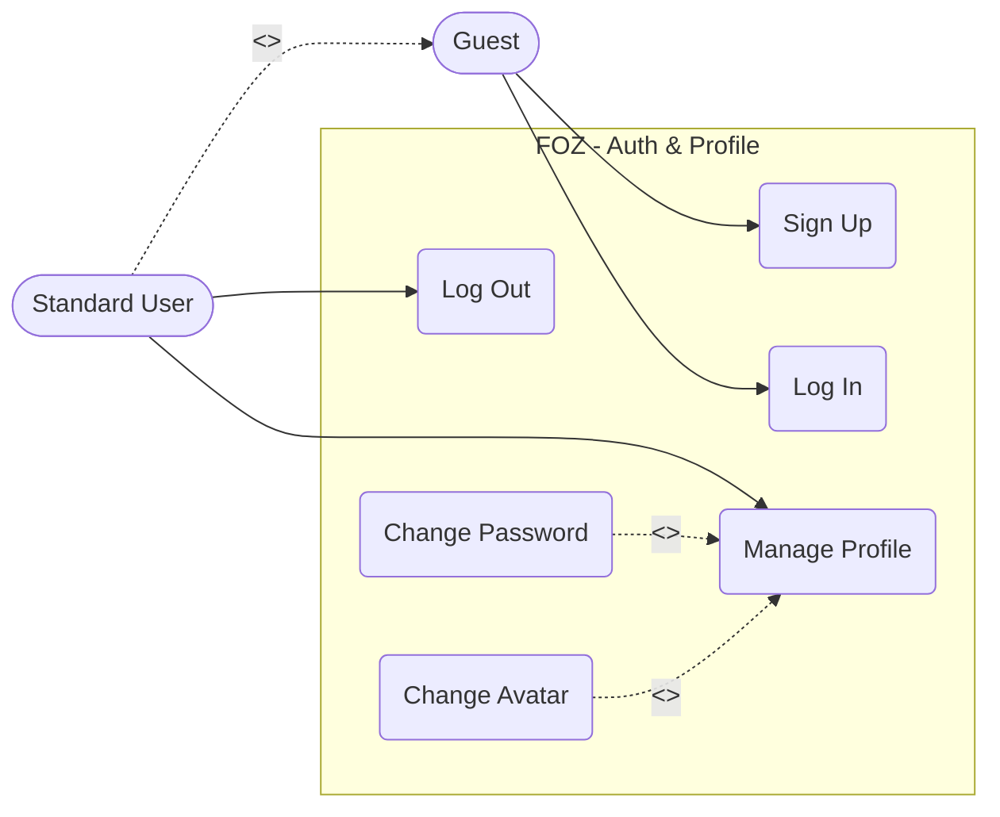
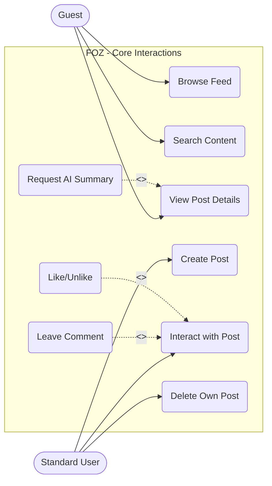
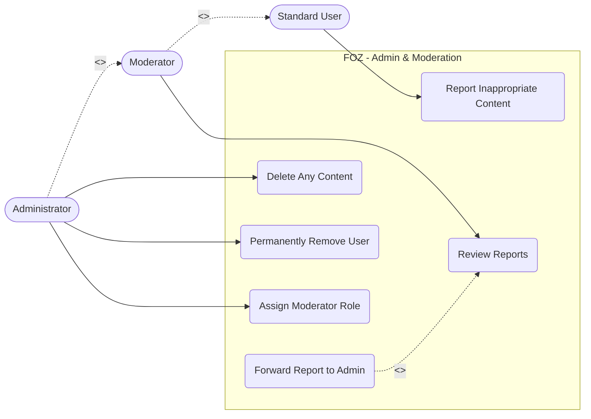

# C - Use-Case Model
*Performed by: Nguyễn Hải Trọng | Reviewed by: Nguyễn Hải Nam*

Based on the requirements documented in the Vision Document, the system's use cases are modeled below using Mermaid syntax[cite: 10]. To ensure clarity and maintainability, the comprehensive system is divided into three logical diagrams based on functional groups.

## 1. Authentication & Profile Management
This diagram covers the fundamental access and identity management functionalities.

* **Actors:** Guest, Standard User.
* **Generalization:** `Standard User` inherits baseline viewing capabilities from `Guest`.
* **Relationships:** `Change Password` and `Change Avatar` are optional extensions of the `Manage Profile` use case.

## 2. Core Forum Interactions & AI Feature
This diagram illustrates the primary value proposition of the forum, including post creation, interaction, discovery, and the AI capability.

* **Actors:** Guest, Standard User.

* **Relationships:**
    * `Leave Comment` and `Like/Unlike` optionally extend the general `Interact with Post` use case.

    * `Request AI Summary` extends the `View Post Details` use case, representing the on-demand "Post Summarize (TL;DR)" feature.

## 3. Administration & Moderation
This diagram maps out the reporting system and elevated privileges required to maintain a safe community environment.

* **Actors:** Standard User, Moderator, Administrator.

* **Generalization:** `Moderator` inherits capabilities from `Standard User`. `Administrator` inherits capabilities from Moderator and holds the highest access level.

* **Relationships:** `Forward Report to Admin` extends the `Review Reports` use case when a `Moderator` encounters a severe violation they cannot fully resolve.
