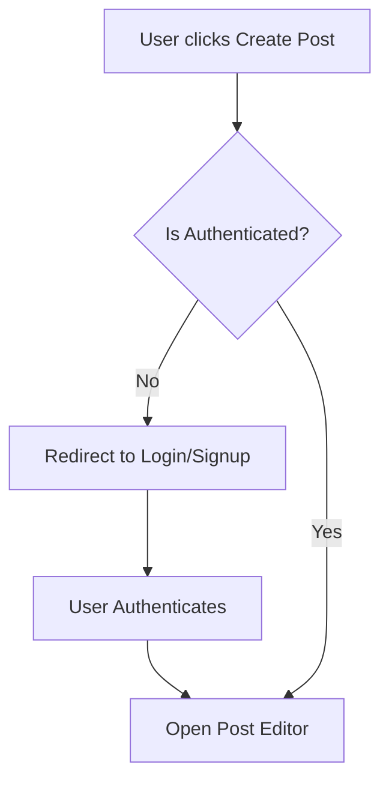

  

    
VNUHCM - University of Science

    
Faculty of Information Technology

  

  

  

    <h1 style="margin: 0; padding: 0 0 10px 0; font-size: 2.2em; border: none;">PAxxx Report</h1>
    
Group 6: PDF

  

  

  

    CSC13002 - Introduction to Software Engineering
  

  

    

      
Author:

      
Nguyễn Tuấn An - 24127011

      
Nguyễn Hải Nam - 24127088

      
Nguyễn Hải Trọng - 24127311

      
Phạm Đinh Gia Khánh - 24127420

      
Võ An Phú - 24127494

    

    

      
Lecturer:

      
Ms. Nguyễn Thị Minh Tuyền

      
Mr. Hồ Tuấn Thanh

      
Mr. Mai Anh Tuấn

    

  

  

    MONTH DAY, YEAR
  

# Table of Contents

1. [A - How to add Table of Contents](#a---how-to-add-table-of-contents)
	1. [1. Requirements](#1-requirements)
		1. [1.1. How to export to PDF](#11-how-to-export-to-pdf)
2. [B - Export to PDF](#b---export-to-pdf)
	1. [1. Requirements](#1-requirements)
		1. [1.1 How to export to PDF](#11-how-to-export-to-pdf)
3. [C - Diagram example](#c---diagram-example)
	1. [1. Diagram rules](#1-diagram-rules)
4. [D - Image example](#d---image-example)
	1. [1. Insert image rule](#1-insert-image-rule)

# A - How to add Table of Contents

*Work performed by: [Name] | Reviewed by: [Name] | Edited by: [Name]*

## 1. Requirements

Install Obsidian

Install Plugin "Table of Contents"

Plugin settings -> enable "Markdown links"

### 1.1. How to export to PDF

==Delete all Table of Contents (Including title) -> CTRL P -> TABLE OF CONTENTS==

# B - Export to PDF

*Work performed by: [Name] | Reviewed by: [Name] | Edited by: [Name]*

## 1. Requirements

Install Obsidian

Install Plugin **"Better export PDF"**

Use default format

### 1.1 How to export to PDF

==CTRL P -> Better export PDF: Export current file to PDF==

# C - Diagram example

*Work performed by: [Name] | Reviewed by: [Name] | Edited by: [Name]*

## 1. Diagram rules

Diagram must be drawn using Mermaid.

Example as below:

**Workflow 1: User Authentication & Post Creation**

# D - Image example

*Work performed by: [Name] | Reviewed by: [Name] | Edited by: [Name]*

## 1. Insert image rule

Insert as markdown format ``

Example as below:

