# PA1

# B - Project Proposal

Performer: Nguyễn Tuấn An (24127011)

Reviewer: Nguyễn Hải Trọng (24127311)

## Introduction

This project is a web-based forum application focused on fundamental community discussions. Its value lies in providing a simple, intuitive platform where users can easily ask questions, share knowledge, and connect over shared interests without navigating overly complex interfaces.

## Target users and environments

The target audience is general **web** users seeking online community spaces. They will use the application exclusively through standard web browsers on any internet-connected device, including desktop computers, laptops, and smartphones.

## Key features

**Post Creation:** Users can easily create text-based posts to initiate new discussion threads on topics they care about. This feature allows users to share their thoughts, ask questions, and start conversations with the community.

**Feed Generation:** The application will generate a feed of posts based on current trends, calculated by recent engagement metrics like comment velocity and like counts. This ensures that users see content that is relevant to them, enhancing their overall experience on the platform.

**User Interactions:** Members can browse existing threads, read ongoing discussions, and interact by leaving their own comments or likes. This fosters engagement and allows users to contribute to the community dialogue.

**Search & Discovery:** Users can search for specific topics, posts, or other users to find relevant content. This feature helps users discover desired discussions and enhance their overall experience.

**Administration & Moderation:** The application includes a robust reporting system that allows users to report inappropriate content. Moderators can review these reports and forwarding them to administrators for further review or removing offending content. This helps maintain a safe and respectful community environment.

### AI feature

**Post Summarize (TL;DR):** The application utilizes an AI engine to generate brief on-demand overviews of lengthy discussion posts. This feature helps users quickly understand the main points of a conversation without having to read through every comment, making it easier to stay informed and engaged with the community discussions.

### User Roles

| Role | Description |
| --- | --- |
| Guest (Unauthenticated User) | Can view profiles, read posts, and see comments. Cannot post, like, report. Any interaction attempt should trigger the authentication flow. |
| Standard User (Authenticated User) | Can create posts, like, comment, report, and delete their own content. Can manage their own profile. |
| Moderator | Inherits all Standard User abilities. Can review reports from Standard Users, then forward to Administrator if needed. Cannot delete users or posts from the database or alter system-wide configurations. |
| Administrator | This is the highest level of access. Complete access over all database records. Can permanently remove users account, instantly delete any content, assign Moderator roles. |

### Functional Groups

| Group Name | Functions |
| --- | --- |
| Authentication | Sign up, log in, log out |
| Profile management | Edit profile info, change password, change avatar |
| Post Creation | Creating a new post, deleting posts (restricted by the post owner check) |
| Feed Generation | Post recommendation |
| User Interactions | Comment to the post, like/unlike a post or comment. |
| Search & Discovery | User profile or post search |
| Administration & Moderation | User reporting system (Standard User can report posts), Moderator reporting system (review the reports from users and forward to admin), Admin reporting system (post removal and user removal. Assign Moderator) |
| Post Summarize | On-demand summarization inside a post. |

# C - Existing App Survey

## First app survey: Threads (main for reference)

Performer: Phạm Đinh Gia Khánh (24127420)

Reviewer: Nguyễn Hải Nam (24127088)

### Authentication & First-Time Access

#### 1. Homepage & Navigation

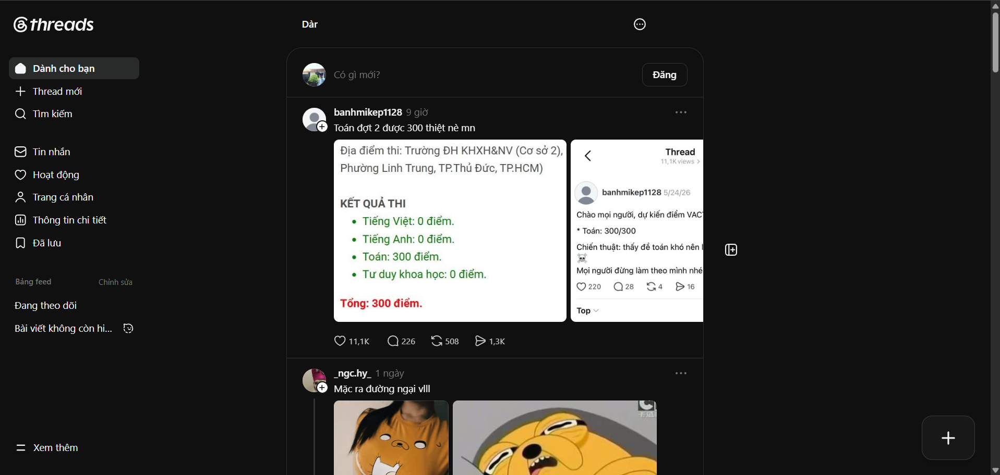

Threads adopts a modern and minimalist social media interface. The main navigation panel is positioned on the left side of the screen, providing quick access to the platform's core features:

* Home Feed

* Search

* Create Post

* Activity / Notifications

* Profile

* Settings

The Threads logo is displayed in the top-left corner and functions as a shortcut that redirects users to the homepage. A large “+” button located in the bottom-right corner allows users to quickly create and publish new posts.

Compared to many traditional social networking platforms, Threads focuses on simplicity and usability. The interface minimizes unnecessary visual elements and clutter, creating a clean and intuitive user experience.

#### 2. Guest Access (Unauthenticated Users)

.png)
%202.png)

Users can access Threads without signing in and browse a feed containing trending and recommended public posts. This allows visitors to explore the platform before creating an account or logging in.

However, interaction features are restricted for unauthenticated users. When attempting actions such as:

* Liking a post

* Replying to a thread

* Reposting content

* Following an account

* Creating a post

Threads displays a pop-up notification prompting the user to sign in before continuing.

#### 3. Sign-In Process


Threads is tightly integrated with Instagram and relies on Instagram accounts for authentication. Users can sign in using their existing Instagram credentials rather than creating a separate Threads account.

If Instagram is already logged in on the device, Threads provides a Quick Sign-In option that enables users to authenticate with a single click. This approach reduces onboarding friction and follows a common authentication pattern used by interconnected social media platforms.

Alternatively, users may manually enter their Instagram username and password to access the platform.

#### 4. Account Registration

Unlike many social media platforms, Threads does not currently support standalone account registration through its web application.

To create a Threads account, users must first create an Instagram account. Once the Instagram account is available, it can be used to access Threads immediately through the integrated authentication system.

This design simplifies account management by maintaining a unified identity across both Instagram and Threads.

### Content Creation & Posting

#### 1. Create Thread


Users can create new content by selecting the Create Thread button from the navigation menu or by clicking the floating “+” button located in the bottom-right corner of the interface.

When activated, Threads opens a post creation dialog that allows users to compose content and attach various media types, including:

* Images

* Videos

* GIFs

* Polls

* Location information

A notable feature of Threads is the ability to associate posts with specific topics or communities. By tagging a thread under a particular subject area, users can increase the visibility of their content among audiences who are interested in that topic. This topic-based distribution mechanism helps optimize content discovery and directs relevant discussions toward users who are more likely to engage with them.

From a design perspective, this feature improves traffic allocation and encourages the formation of topic-centered communities within the platform.

#### 2. Images and Videos

Threads supports rich media content through image and video attachments.

One particularly interesting design element is the way multiple images are displayed within a post. In many cases, adjacent images can be manually arranged into visually connected layouts, creating a seamless viewing experience. This presentation style can produce creative visual effects and make posts appear more engaging compared to traditional image galleries.

Such design choices demonstrate how content presentation can enhance user engagement and encourage more creative forms of storytelling. Similar approaches may serve as useful references when designing visually dynamic social media interfaces.

#### 3. Drafts

Threads allows users to save unfinished posts as drafts.

This feature enables users to:

Continue editing at a later time

Prepare content in advance

Review and refine posts before publication

Draft management improves flexibility and supports users who prefer to plan or revise their content before sharing it publicly.

#### 4. Post Visibility & Content Controls

Threads provides several visibility options that allow users to control who can interact with or view their content.

Depending on the context, users may choose to share a post with:

* Everyone (public)

* Followers only

* Accounts they follow

* Specific mentioned users

In addition, Threads integrates closely with Instagram, allowing users to share content across both platforms. This cross-platform functionality helps maintain consistency within the Meta ecosystem and enables creators to reach audiences on multiple services simultaneously.

Another distinctive feature is Threads' approach to content sensitivity and spoiler protection. Users can choose to hide certain parts of a post, while the platform may also automatically obscure sensitive content. Unlike many social media platforms that simply blur hidden content, Threads often uses a decorative overlay effect featuring animated visual elements.

This approach preserves content moderation functionality while maintaining an aesthetically pleasing user experience. It demonstrates how practical interface requirements can be combined with creative visual design to make the platform feel more engaging and distinctive.

### Profile Management

#### 1. View Profile


The Profile section allows users to manage and review their personal activity on Threads. By selecting the Profile button from the navigation menu, users are redirected to their profile page.

In addition to displaying user activity, Threads also provides profile completion recommendations. If certain profile information is missing, the platform encourages users to complete their profile by adding details such as a profile picture, bio, or links. Similar profile-completion prompts are commonly found on other social networking platforms, as they help users establish a stronger online presence and improve engagement.

On this page, users can view:

* Their published posts (Threads)

* Replies to other users' posts

* Reposted content

* Liked posts


Here, users can also edit their posted threads:


#### 2. Edit Profile

 

The Edit Profile button opens a pop-up dialog containing the user's basic account information and customization options.

Users can modify various profile attributes, including:

* Display name

* Username

* Profile picture (avatar)

* Bio/description

* External links

* Other personal profile information

The editing interface is simple and accessible, allowing users to update their information without leaving the current page. This pop-up design reduces navigation complexity and provides a smoother profile management experience.

### Feed Generation & Content Discovery

#### 1. For You Feed

The For You feed serves as the default homepage of Threads. Users can access it by selecting the For You tab or simply clicking the Threads logo.

This feed is generated through a recommendation algorithm that prioritizes:

* Trending and popular threads

* High-engagement content

* Posts related to topics the user has previously interacted with

* Content aligned with the user's interests and browsing behavior

The primary goal of the For You feed is content discovery. By combining trending discussions with personalized recommendations, Threads helps users explore new creators, communities, and topics beyond the accounts they already follow.


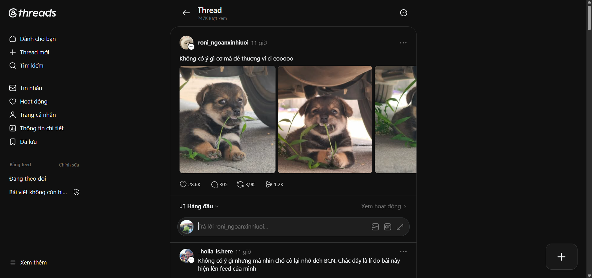

#### 2. Following Feed

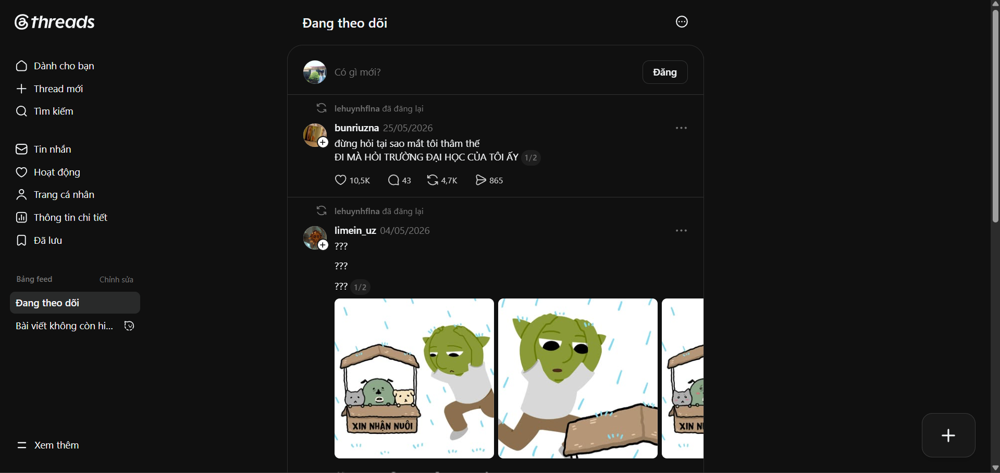

The Following feed provides a more focused and personalized experience by displaying content exclusively from accounts that the user follows.

This feed typically includes:

* Original posts from followed accounts

* Reposts shared by followed accounts

* Replies and interactions from followed users

Unlike the For You feed, the Following feed does not heavily rely on recommendation algorithms. Instead, it prioritizes content from the user's existing social network.

This design benefits users who prefer a chronological and less algorithm-driven experience, ensuring that important updates from followed accounts are not overshadowed by trending or recommended content.

### User Interactions

.png)

#### 1. Like

The Like feature allows users to express appreciation or agreement with a post. Liked posts are stored in the user's account and can be reviewed later through the Profile section.

In addition to serving as a form of engagement, likes contribute to the platform's recommendation system by helping Threads better understand user interests and personalize future content suggestions.

#### 2. Comment and Replies

The Comment feature allows users to participate in discussions by responding directly to a thread.

Unlike traditional comment systems that may be limited in structure, Threads organizes replies as conversation chains. Each comment can receive its own set of replies, creating extended discussions that may evolve into entirely new topics.

As a result, comments are a central part of the Threads experience. Users can freely share opinions, insights, questions, and experiences, making discussions often as valuable as the original post itself. This design encourages deeper engagement and community-driven conversations.

#### 3. Share

The Share feature allows users to distribute content beyond the Threads platform.

Users can:

* Copy and share a direct link to a thread

* Send a thread through direct messages

* Share content to other social media platforms and communication channels

* Sharing plays an important role in content dissemination, helping posts reach a broader audience while also enabling users to easily exchange content with friends and communities. This feature significantly contributes to user engagement and platform growth through organic content distribution.

#### 4. User Preview Card

Threads provides a convenient User Preview Card feature that appears when users hover over another user's profile picture or username.

The preview card displays essential profile information, including:

* Profile picture

* Display name and username

* Short bio

* Follower information

* Follow button

From this pop-up, users can quickly follow the account without leaving their current page. They may also navigate directly to the user's full profile for more detailed information and content.

This feature improves usability by reducing the number of clicks required to discover and connect with other users. It also encourages social interaction by making profile exploration and following accounts more accessible during normal browsing.

#### 5. Post Options Menu

Each thread includes a three-dot menu that provides users with additional interaction and content management options. When selected, a contextual pop-up menu appears, offering several actions related to the post and its author.

Available options may include:

* Save post

* Copy link

* Not interested

* Mute notifications for the post

* Restrict the account

* Block the account

* Report the post

These controls give users greater flexibility in managing their content consumption experience. For example, the Not Interested option helps personalize future recommendations by informing the algorithm about unwanted content, while Mute, Restrict, and Block provide tools for reducing unwanted interactions and improving user safety.

The inclusion of moderation and personalization features within a single contextual menu follows a common social media design pattern. It allows users to quickly perform actions without leaving the current page, reducing interface complexity while maintaining easy access to important controls.

### Search & Discovery

#### 1. Search Functionality

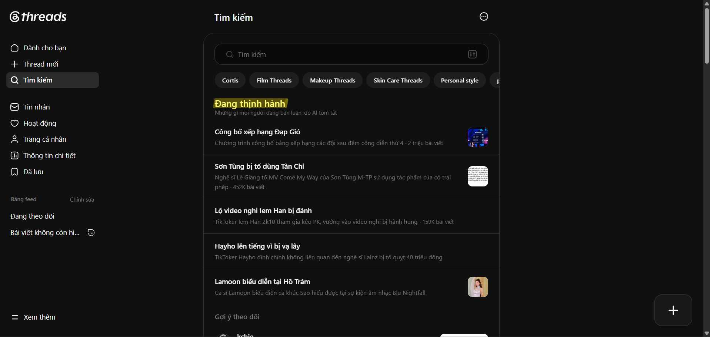

Users can access the search interface by selecting the Search button from the navigation menu.

The search system allows users to find:

* User accounts

* Usernames

* Keywords and phrases

* Topics and discussions related to specific interests

After entering a query, Threads returns a list of relevant results based on the searched keywords. To improve search accuracy, users can apply filters such as:

* Recent results

* Profiles only

* Posts before a specific date

* Posts after a specific date

These filtering options help narrow the search scope and allow users to locate content more efficiently, especially when searching within large discussion topics.

#### 2. Trending Topics Discovery

Below the search bar, Threads displays a collection of trending topics currently gaining attention across the platform.

Each topic is accompanied by a brief AI-generated summary that helps users quickly understand the subject without reading multiple posts. Users can select any trending topic to explore related discussions and view threads associated with that subject.

This feature supports content discovery by making emerging conversations more accessible and easier to follow.

#### 3. Recommended Accounts

.png)

Further down the discovery page, Threads presents a list of recommended accounts that users may be interested in following.

These recommendations are typically generated based on:

* Existing Instagram connections

* Mutual followers and social connections

* Previous interactions on Threads

* Topics and content the user frequently engages with

This recommendation mechanism is similar to those used by platforms such as Facebook and Instagram, helping users expand their network and discover creators or communities aligned with their interests.

By combining search tools, trending topics, and personalized account recommendations, Threads creates a balanced discovery experience that supports both intentional searching and passive content exploration.

### Activity Center

#### Activity Page

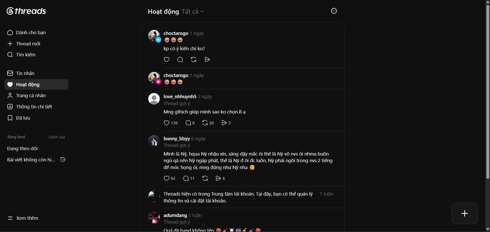

In Threads, notifications are managed through the Activity section, which can be accessed from the navigation menu. Selecting this option redirects users to the Activity page, where they can view all interactions and updates related to their account.

The Activity page serves as a centralized notification hub, displaying events such as:

* Likes on the user's posts

* Replies and comments

* Mentions by other users

* Reposts of the user's content

* New followers

* Other engagement-related activities

In addition to account-specific notifications, Threads may occasionally recommend trending discussions, popular threads, or content that the platform believes may be relevant to the user's interests. These recommendations help users stay informed about ongoing conversations and emerging topics within the community.

To improve usability, users can filter notifications by category, allowing them to focus on specific types of activity, such as:

* Replies

* Mentions

* Likes

* Reposts

* Follows

This filtering system reduces information overload and enables users to quickly locate the interactions that matter most to them.

The Activity page plays an important role in maintaining user engagement by keeping users informed about both personal interactions and broader platform trends, ensuring they remain connected to ongoing discussions and community activity.

### More Menu & Settings

#### 1. More Menu

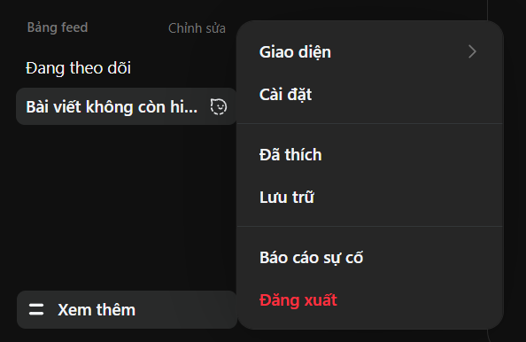

The More button provides access to additional features and account management options that are not displayed directly on the main navigation bar.

Available options include:

* Appearance (Light/Dark Mode)

* Settings

* Liked Posts

* Saved Posts

* Report a Problem

* Log Out

This design helps keep the primary interface clean and uncluttered while still providing quick access to less frequently used functions.

#### 2. Appearance Settings

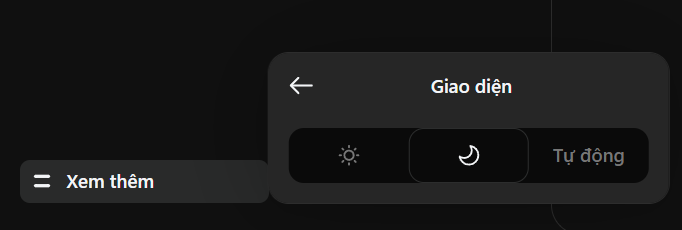

Threads allows users to switch between Light Mode and Dark Mode according to their personal preferences.

Providing multiple appearance options enhances accessibility and allows users to customize their viewing experience.


#### 3. Account Settings

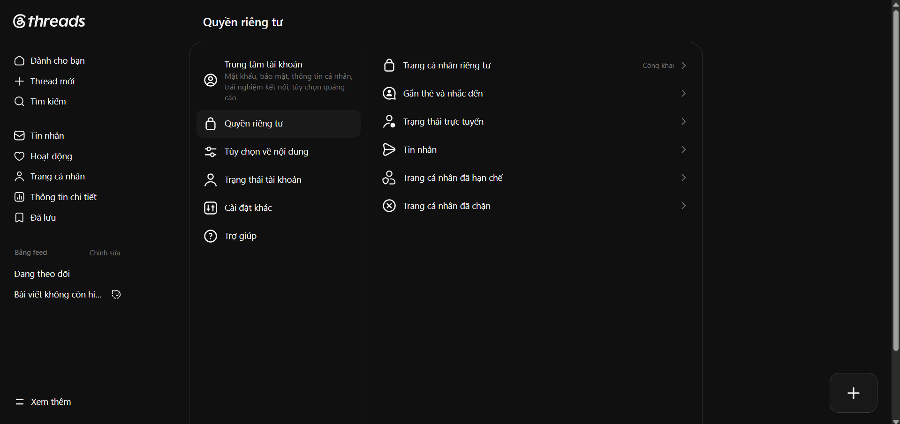

The Settings page serves as the central hub for managing account preferences, privacy, and platform behavior.

##### Account Management

Users can manage account-related information, including:

* Personal profile information

* Linked Instagram account

* Account status and verification information

* Password and security options

Since Threads is integrated with Instagram, many account-related settings are synchronized across the Meta ecosystem.

##### Privacy Controls

Privacy settings allow users to control who can interact with their content and profile.

Common options include:

* Public or private profile visibility

* Mention permissions

* Reply permissions

* Hidden words and content filtering

* Blocked and restricted accounts

These controls help users maintain a safer and more personalized social media experience.

##### Notifications Settings

Users can customize how and when they receive notifications, including:

* Likes

* Replies

* Mentions

* Reposts

* New followers

* Suggested content and recommendations

Notification customization helps reduce distractions and allows users to focus on interactions that are most relevant to them.

##### Content Preferences

Threads provides tools for managing content recommendations and feed personalization.

Users may:

* Hide unwanted content

* Manage muted accounts

* Adjust recommendation preferences

* Review interests and engagement history

* These features contribute to a more personalized browsing experience.

#### 4. Liked and Saved Posts

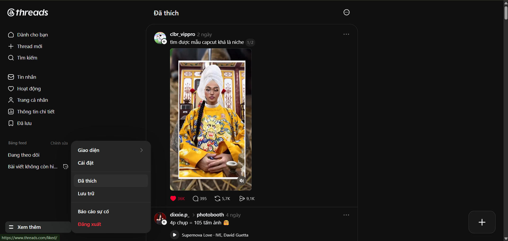

The More menu also provides shortcuts to content that users have previously interacted with.

Liked Posts

Displays posts that the user has liked, allowing them to revisit content that they found interesting or valuable.

Saved Posts

Displays posts that have been explicitly saved for future reference. This feature is useful for preserving important discussions, resources, or content that users wish to access later.

#### 5. Report a Problem

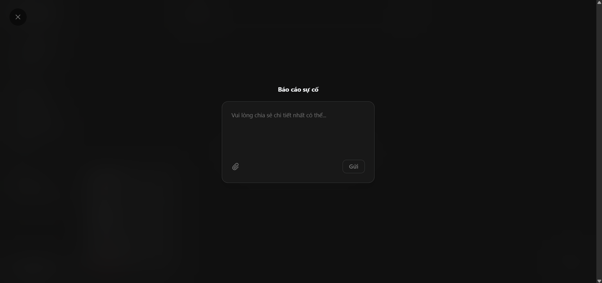

Threads includes a dedicated reporting system that allows users to submit feedback and report technical issues.

Users can:

Report bugs

Describe unexpected behavior

Submit screenshots or supporting information

Provide feedback about platform features

This channel helps Meta collect user feedback and continuously improve the platform.

#### 6. Log Out

This feature allows users to securely sign out of their Threads account, terminating the current session and requiring re-authentication for future access. Logging out is an important security measure, especially when using shared or public devices, as it helps protect user data and prevent unauthorized access.

## Second app survey: Reddit

Performer: Nguyễn Hải Nam (24127088)

Reviewer: Phạm Đinh Gia Khánh (24127420)

### Authentication

* The website features an interface with a clear hierarchical layout. The left navigation sidebar allows guests to freely explore major categories such as Home, Popular, and News. The focal point for guiding new users lies in the top right corner, where two prominent buttons —"Sign Up" and "Log In" (highlighted in the platform's signature orange) — are strategically placed. The central feed displays trending content, while the right-hand column provides a widget recommending "Popular Communities" alongside their real-time member counts.
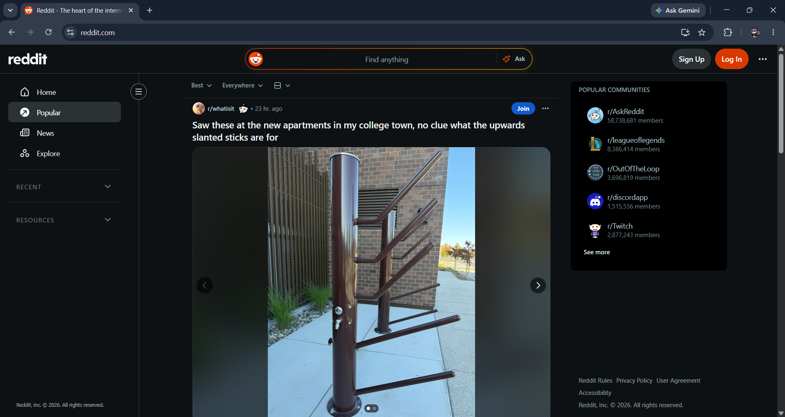

* The registration form is designed as a pop-up modal overlaid on a blurred background of the homepage, helping to focus the user's attention without disrupting their browsing flow. The platform prioritizes convenience by placing Single Sign-On (SSO) methods at the top, allowing for a frictionless registration process via Phone Number, a Google account, or an Apple account. Below the divider is the traditional sign-up method, prompting users to input their details into the "Email" field. The system also cleverly includes a "Log In" hyperlink at the bottom to instantly redirect those who realize they already have an account, accompanied by a reminder regarding the User Agreement and Privacy Policy.
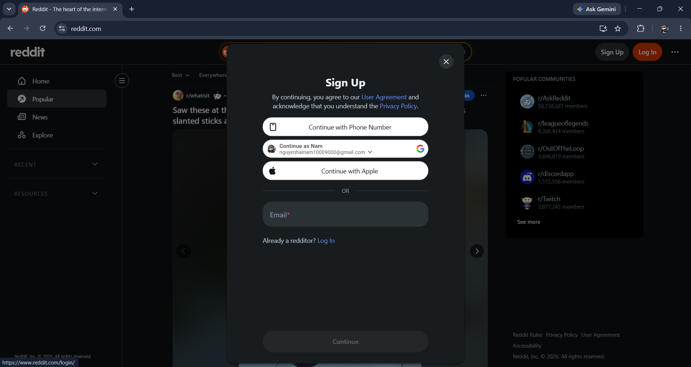

* This secure gateway is designed for returning users to access their personalized accounts. Maintaining a consistent pop-up design, this interface offers the same rapid SSO options (Phone, Google, Apple) and notably introduces an "Email me a one-time link" feature to enhance the passwordless login experience. The lower half features the standard login form, containing "Email or username" and "Password" fields (integrated with an eye icon to toggle password visibility). Immediately below this section are essential account recovery links, such as "Forgot password?", along with a "Sign Up" invitation for new users.
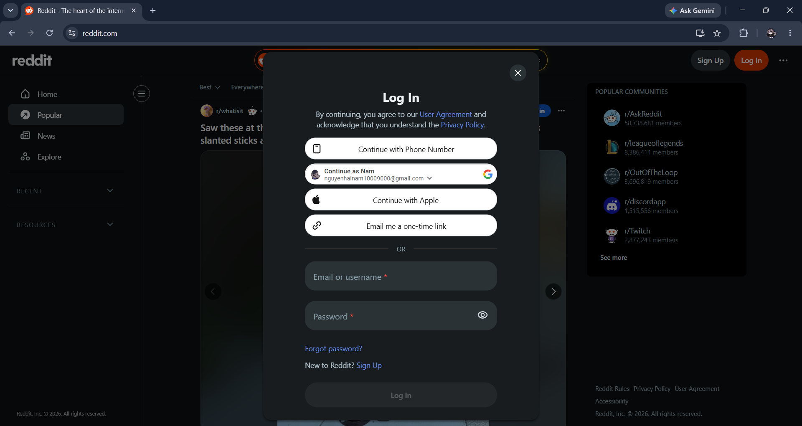

* The personal dashboard appears as a dropdown menu when a user clicks on their avatar in the top right corner of the navigation bar. This menu visually organizes account management shortcuts from top to bottom, including View Profile, Edit Avatar, Drafts, Achievements, and Settings. The "Log Out" option is distinctly positioned with an "open door" icon, providing an intuitive visual cue that helps users easily identify and safely execute the action to terminate their active session.
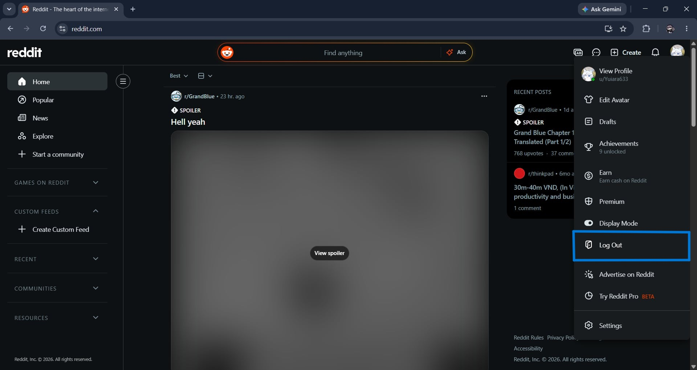

### Profile management

* The journey to personalizing your account starts right from the main navigation bar. By simply clicking on your user avatar tucked in the top right corner of the screen, a comprehensive dropdown menu slides into view, acting as your personal control center. Right at the very top, positioned as the most important action, is the "View Profile" option. This serves as the essential gateway, seamlessly pulling you away from the endless scrolling of the global feed and dropping you directly into your own dedicated space, where you can review your public presence and begin tweaking your user-specific details.
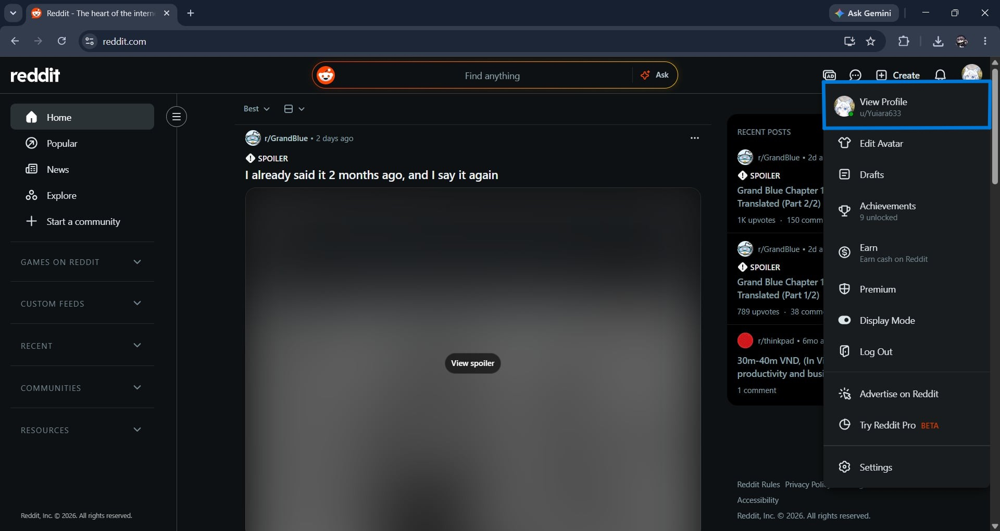

* Once you click through, you're greeted with a clean, organized overview of your digital identity. The main central area uses intuitive tabs to sort your activity—like your posts, comments, and saved items—while the right-hand sidebar acts as a quick-reference digital ID card, displaying your current banner, avatar, and core community stats like your Karma and account age. When you're ready to make changes to how others perceive you, your eyes are naturally drawn down this right sidebar to the dedicated "Settings" module. Here, right next to the "Customize your profile" text, is a highly visible "Update" button. Clicking this is the direct trigger that shifts you from simply viewing your public profile to actively editing it.
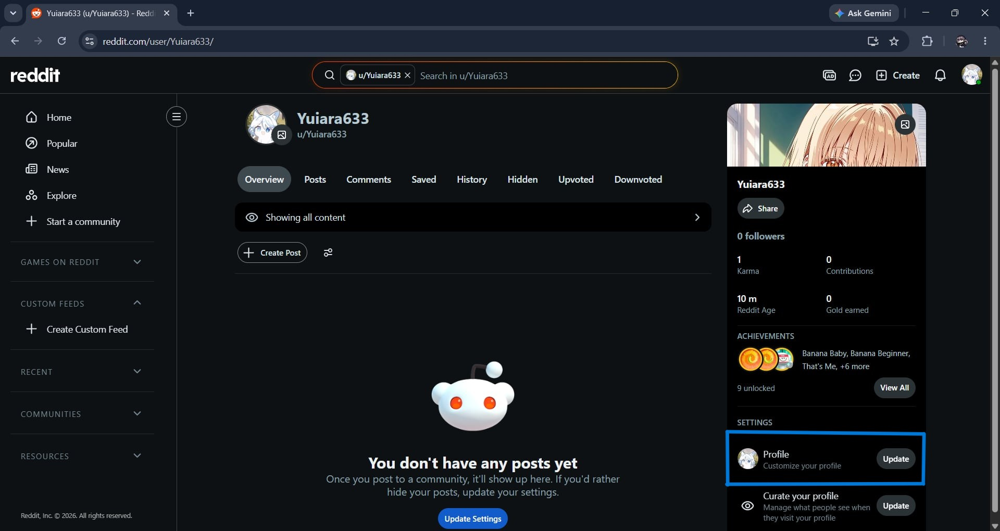

* After hitting that "Update" button, the platform transitions you into a dedicated, distraction-free customization interface. This backend settings menu is cleanly organized with horizontal tabs, placing you squarely in the "Profile" section. Under the "General" heading, you are presented with a straightforward, easy-to-navigate list of editable fields. This is where the real personalization happens: you can craft a unique "Display name" (which exists independently of your permanent username), write an engaging "About description" to serve as your bio, and visually tailor your space by uploading a custom Avatar and background Banner. The page even offers granular controls for linking external social media accounts or toggling an 18+ mature content warning, giving you absolute flexibility and ownership over your public persona.
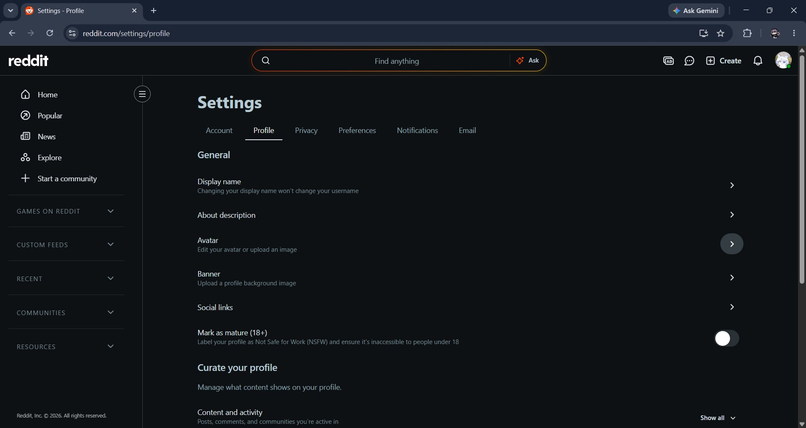

### Post Creation

* When you are ready to share your thoughts, the "Create post" interface serves as a clean, distraction-free canvas for your content. Right at the top, a dropdown indicator confirms exactly where your content will be published—in this instance, directly to your own user profile. The composer is highly versatile, providing specialized tabs depending on the medium you want to use: standard "Text", "Images & Video", a direct "Link", or an interactive "Poll". For text-based entries, you are given a clear 300-character limit for your title to keep things concise. The main body area is equipped with a robust rich-text formatting toolbar that acts like a mini word processor. It allows you to easily apply bolding, create bulleted lists, embed code blocks, or even swap over to raw Markdown if you prefer a more technical approach to formatting. Down at the bottom right, the platform gives you complete control over your publishing timeline with distinct actions to "Save Draft", schedule the post for later via the clock icon, or immediately push it live with the prominent blue "Post" button.
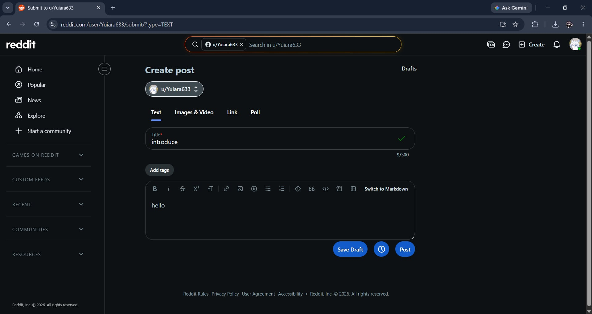

* Even after you have hit publish, you maintain absolute control over your content directly from your profile's feed. By clicking the subtle three-dot overflow menu (often called the kebab menu) located at the top right corner of your active post, a comprehensive list of administrative tools unfolds. Think of this dropdown as the control panel for your post's lifecycle. From here, you can seamlessly jump back in to "Edit post body," highlight your best work by choosing to "Pin Post To Profile," or apply necessary content warnings like "Add spoiler tag" or "Add NSFW tag". Crucially, prominently featured in this list is the "Delete" option, complete with a distinct trash bin icon. This definitive action is a permission strictly reserved for the original author of the post, ensuring that you always have the final say over your digital footprint and can permanently wipe the content from the platform at your discretion.
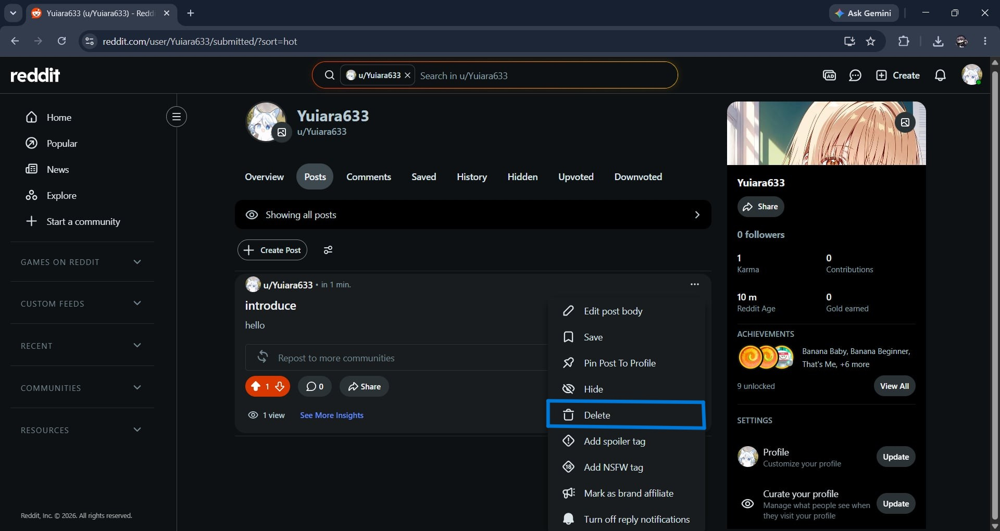

### Feed Generation

* When you select the "Home" tab nestled in the left-hand navigation menu, you are brought to a digital dashboard that is entirely unique to you. This central feed acts as a highly curated stream, pulling content exclusively from the specific subreddits and communities you have actively chosen to subscribe to. For instance, in this view, the main timeline features a niche gaming discussion from a community called `r/Project_Wingman`. At the top of the feed, you have sorting filters like "Best," which help cut through the noise by surfacing the most engaging content from your subscriptions first. Meanwhile, the right-hand sidebar features a convenient "Recent Posts" widget, essentially a breadcrumb trail of your recent reading history—keeping track of threads you've previously clicked on, such as manga discussions or laptop hardware inquiries. It is designed to be a comfortable, personalized bubble tailored exactly to your established hobbies.
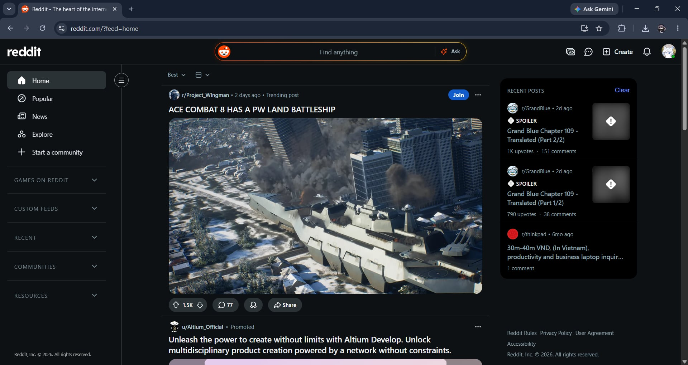

* In stark contrast, clicking the "Popular" option in the navigation bar pulls you out of your personalized bubble and into the broader landscape of viral internet culture. This algorithmic feed is specifically engineered for discovery. Rather than relying on your subscriptions, it aggregates the most heavily upvoted and intensely discussed posts from across the entire platform in real-time. As shown in the interface, the top spot is currently occupied by a viral dashcam video from `r/dashcams` that has already amassed tens of thousands of upvotes and comments. To help narrow down the sheer volume of global trends, the top filter bar includes location-based dropdowns like "Everywhere," allowing you to see what is capturing the public's attention globally or within specific regions. Because this feed exposes you to unfamiliar communities, each post prominently features a blue "Join" button, serving as a constant invitation to discover new interests and bring fresh content back to your personal Home feed.
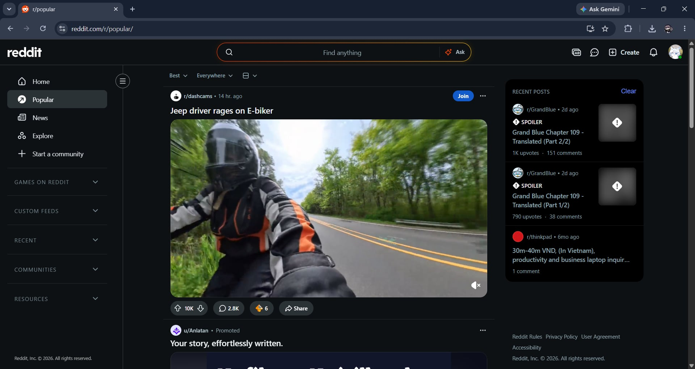

### User Interactions

* The Upvote mechanism serves as the platform's primary tool for expressing positive feedback, agreement, or appreciation for a piece of content. As shown in the interface, when you engage with a post you like, clicking the upward-pointing arrow instantly highlights the button in a vibrant orange-red color. This action dynamically updates the public vote counter (shifting the score to '1' in this example). This positive rating trigger is the lifeblood of the platform's algorithm, essentially acting as a democratic vote that helps push high-quality, relevant, or entertaining posts higher up in the community's feed for others to discover.
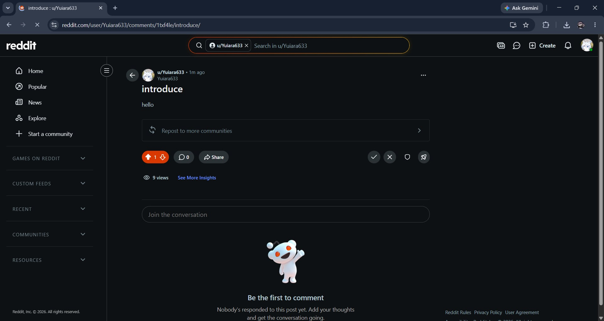

* Conversely, the Downvote button provides a direct and immediate method for users to signal negative feedback, disagreement, or flag low-effort content. When this action is triggered, the downward-facing arrow illuminates in a distinct periwinkle blue shade, simultaneously decreasing the post's overall visibility score (illustrated here by the counter dropping to '-1'). This negative rating trigger plays a crucial role in community self-moderation; it helps bury irrelevant, unhelpful, or off-topic discussions, ensuring that the most valuable content remains at the top of the timeline.
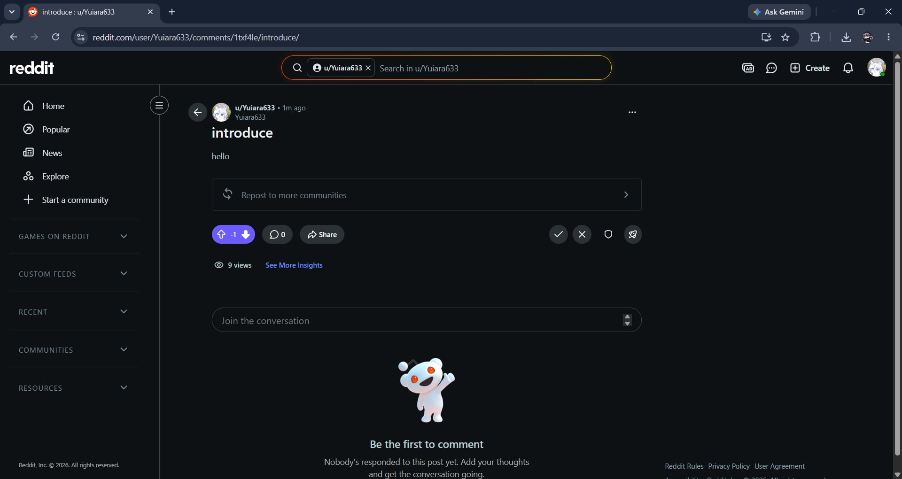

* Beyond simple voting, the true heart of community interaction is facilitated through the dedicated text input area and the resulting engagement panel. Positioned prominently just below the main post with the inviting placeholder text "Join the conversation," this field allows users to draft and format detailed replies. Once a thought is submitted — as demonstrated by the original poster's simple "hi" response — it populates a structured comment thread. Every piece of user feedback generated here comes equipped with its own mini-interaction bar, allowing the wider community to specifically upvote, reply, or share individual thoughts, thereby creating rich, multi-layered conversations.
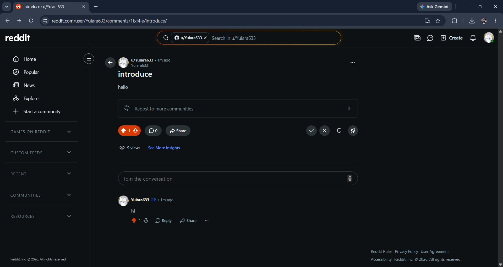

### Search & Discovery

* The main search bar isn't just for looking up general topics; it houses a robust account search functionality designed to help you quickly locate specific Reddit profiles. As seen in the interface, when you type a user indicator like "u/w", the dropdown menu dynamically updates in real-time. It intelligently separates standard search queries from a dedicated "Profiles" list. This visual breakdown immediately shows you the user's avatar, their exact username, and their total karma score, making it incredibly easy to identify and navigate to the exact person, creator, or official entity you are looking for without having to guess their full handle.
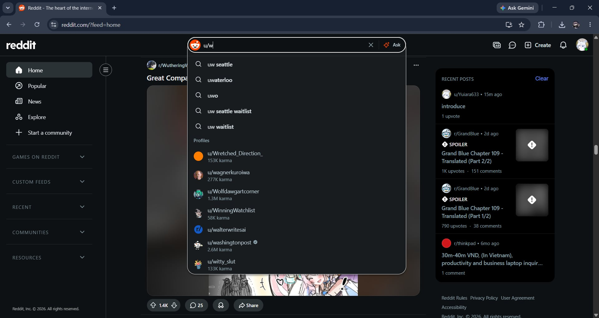

* When you want to explore a broader subject, the platform utilizes a powerful keyword filtering system perfectly designed to help you discover rich content across the entire site based on specific search terms. For example, simply searching for a word like "cats" brings up a highly organized and multi-faceted results page rather than a chaotic wall of text. The interface smartly categorizes the results using intuitive top navigation tabs like Posts, Communities, Comments, and Media. It visually prioritizes engaging video and image thumbnails at the top, lists highly-rated text discussions right below, and even curates a helpful sidebar of related subreddits, giving you a complete, 360-degree view of the exact topic you are interested in.
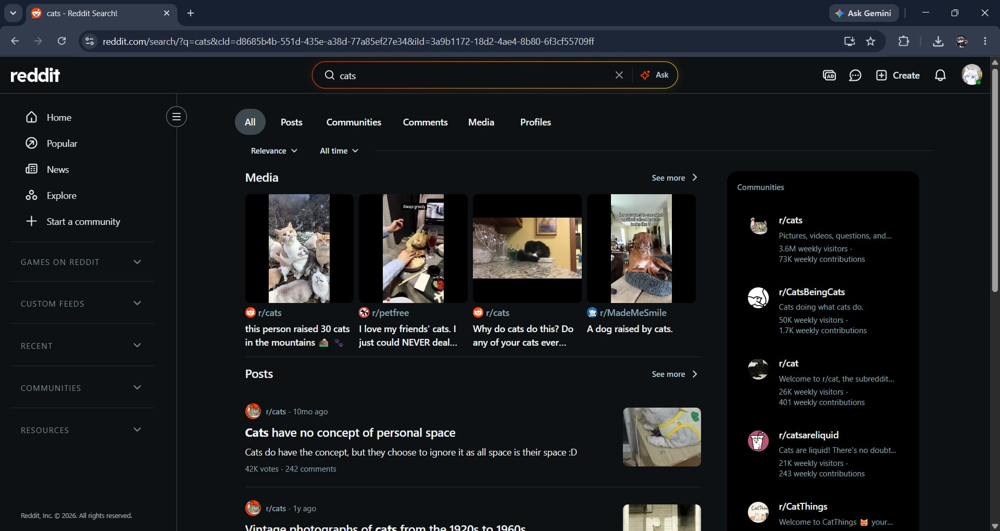

### Administration & Moderation

* The user-initiated 'Report' modal acts as a crucial line of defense for community moderation, empowering everyday users to safely flag inappropriate behavior. As shown in the provided interface, clicking the report option brings up a dedicated pop-up window that purposefully blurs the background content to keep your attention focused on the task. It opens with an encouraging and conversational message, thanking you for looking out for your fellow redditors and helping maintain the platform's integrity. The core of this modal features a cleanly organized grid of clickable, pill-shaped buttons that categorize various content violations. These options are highly comprehensive, covering everything from highly specific community guidelines — highlighted by the prominent button for when a post "Breaks `r/birds` rules" — to serious, platform-wide offenses like "Harassment", "Hate", or "Sharing personal information". At the bottom, the interface thoughtfully includes quick hyperlink resources to review both the global platform rules and the specific subreddit rules, ensuring you have the right context before finalizing and submitting your feedback via the "Next" button.
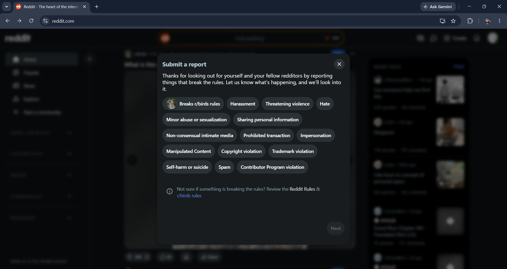

### Subreddit Interface and Identity

* This Explore page is basically the platform's way of playing matchmaker for new interests. Up at the top, there's a really convenient horizontal scrolling bar of category tags—like Games, Tech, or Sports—letting you filter down the massive site based on whatever you are in the mood for. The core of the page is built around a clean grid of community cards. Each card gives you a quick snapshot: the group's icon, a short bio, and their weekly visitor count to show how active they are. The absolute best UX choice here is sticking the "Join" button right on the card itself. It makes subscribing incredibly frictionless because you do not even have to click into the actual subreddit to add it to your daily feed.
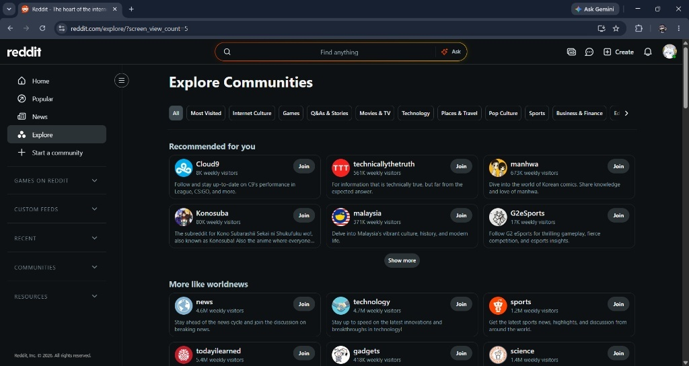

* Looking at the `r/nba` page, you can immediately feel the community's specific vibe. They customized the top banner to look like a hardwood basketball court, which instantly sets the mood. Instead of just showing a raw feed of the newest posts, the layout is carefully managed. Right at the top, they pinned the daily discussion threads so members can easily find them without scrolling. Below that, there's a massive, colorful announcement card for a live AMA session that practically demands attention. Over on the right-hand side, the sidebar acts as a neat control center. It shows the massive scale of the group with millions of visitors, and it neatly packs in all the essential links, like the community rules and wikis, keeping everything super organized and accessible.
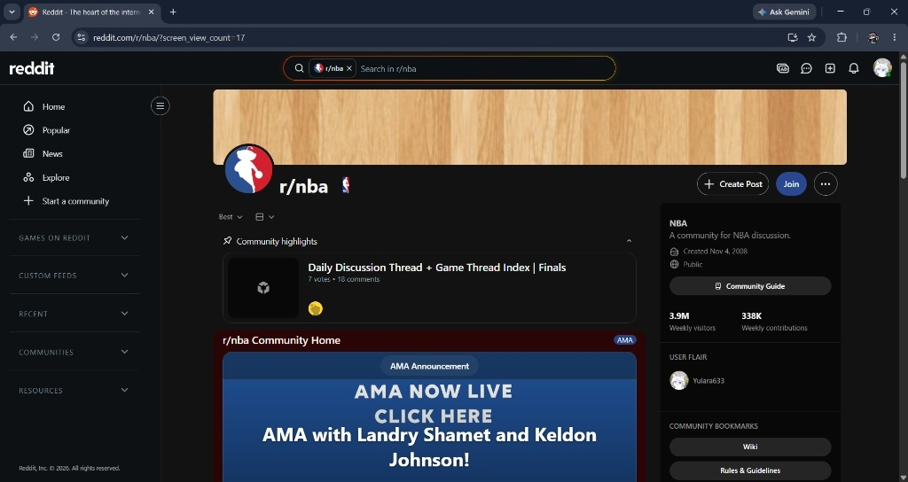

# D - Team Contract

Performer: Nguyễn Tuấn An (24127011)
Reviewer: Nguyễn Hải Trọng (24127311)

## 1. Team Roles and Responsibilities

> **Note:** *All team members are expected to act as **Full-Stack Engineers** throughout the project lifecycle. The roles below designate leadership and domain ownership for specific project phases, meaning the assigned member will guide and manage that area while the entire team participates in the execution.*
>

| Member | Role | Responsibilities |
| --- | --- | --- |
| Nguyễn Tuấn An (24127011) | Project Manager | Facilitates meetings, tracks sprint progress, manages the project board (Jira), and ensures deadlines are met. Contributes to full-stack development. |
| Nguyễn Hải Nam (24127088) | QA Engineer (Tester) | Defines testing protocols. Leads the team in writing test cases and performing bug hunts. Contributes to full-stack development. |
| Nguyễn Hải Trọng (24127311) | Backend & Database Developer | Designs the database schema, establishes API architectures, and leads server-side performance strategies. Guides the team on database queries and backend logic. Contributes to full-stack development. |
| Phạm Đinh Gia Khánh (24127420) | UI/UX Designer | Leads the wireframing, prototyping, and user journey mapping phases. Ensures design consistency across the application. Guides the team during frontend UI implementation. Contributes to full-stack development. |
| Võ An Phú (24127494) | Frontend Developer | Establishes frontend coding standards, selects frontend frameworks/libraries, and ensures responsive, accessible design implementation. Contributes to full-stack development. |

## 2. Communication Plan

* **Primary Communication Tool:** Messenger and Discord (Messenger used for daily communications, quick questions. Discord for updates).
* **Meeting Frequency:**
  * **Weekly Sync:** One 60-minute video meeting to plan the week’s sprint.
  * **Frequent Stand-up:** Asynchronous update via a dedicated Discord thread (What I did yesterday, what I am doing today, any blockers).
* **Response Time Expectations:** Team members are expected to acknowledge or respond to direct messages in Discord within **12 hours** (or 24 hours on weekends). Deliverables must be submitted to the shared repository at least 4 hours before any hard deadline to allow for integration.
* **Protocols:** General discussions happen in the main Discord group; technical deep-dives should happen on a quick call or a dedicated thread to avoid cluttering the main chat.

## 3. Work Schedule and Deadlines

* **Milestones:** The project will be divided into 2-week Sprints. Deadlines for specific features will be set during the Weekly Sync.
* **Availability:** Team members agree to hold core availability between 7:00 PM - 9:30 PM on weekdays for pair programming if necessary.
* **Contingency Plan for Missed Deadlines:**
  * If a team member anticipates missing a deadline, they must notify the Project Manager at least **24 hours in advance**.
  * Tasks will be re-assigned or pair-programmed to ensure the critical path is not blocked.
  * A 2-day “buffer” will be built into all major project milestones to absorb unexpected delays.

## 4. Code and Documentation Standards

* **Coding Conventions:** The team will adhere to standard linting rules by using an automatic formatter named Prettier.
* **Version Control (Git):**
  * Use branches to contribute new features or modifications (e.g., `add-login`).
  * Never push directly to the `main` branch.
* **Code Reviews:** All code must be submitted via Pull Requests (PRs). One team member must review the PR before it can be merged.
* **Testing:** Critical backend endpoints and core frontend components must have accompanying unit tests.
* **Documentation:**
  * Code must be self-documenting with inline comments for complex logic.
  * The project must maintain an up-to-date `README.md` containing setup instructions.
  * API endpoints must be documented.

## 5. Accountability and Performance

* **Measuring Contribution:** Performance is measured by the successful completion of assigned sprint tasks, participation in code reviews or refactors, and attendance at team meetings.
* **Underperformance Process:**

1. **First Instance:** The Project Manager will have a private, constructive conversation with the member to identify blockers and offer support.
2. **Second Instance:** A formal team meeting will be held to discuss the lack of participation and re-align expectations.
3. **Third Instance:** The issue will be officially documented and escalated (see Section 7).

* **Consequences:** Persistent failure to adhere to the contract will result in reduced peer evaluation scores and, ultimately, escalation to the instructors for intervention.

## 6. Decision-Making Process

* **Standard Decisions:** Day-to-day decisions regarding technology choices or features will be made by **consensus** where possible.
* **Voting:** If consensus cannot be reached, decisions will go to a **majority vote** (3 out of 5 members).
* **Final Say:** In the event of a critical stall or an unresolvable technical tie, the Project Manager holds the final executive say for project management issues, while domain leads hold the final say in their respective domains (e.g., Frontend Lead chooses the UI framework if the team is split).

## 7. Conflict Resolution

* **Step 1 (Peer-to-Peer):** The involved members should attempt to resolve the issue directly and professionally via a private call.
* **Step 2 (Mediation):** If unresolved, the Project Manager will step in to mediate the discussion and find a compromise. (If the PM is involved in the conflict, a neutral domain lead will mediate).
* **Step 3 (Escalation):** If the conflict threatens the integrity of the project or creates a toxic environment, the team will formally escalate the issue to the Teaching Assistant (TA) or Instructor for official mediation.

## 8. Review and Update Process

* **Review Schedule:** This contract will be briefly reviewed once a month to ensure it is still serving the team’s needs.
* **Update Process:** Any team member can propose an amendment to the contract. Amendments will be adopted if they pass a simple majority vote (3/5) during a weekly sync.

# E - Development Tools and Process Setup

Performer: Võ An Phú (24127494)
Reviewer: Nguyễn Tuấn An (24127011)

## Tools and Process Setup

1. Communication tools
    * **Messenger** — Group: **Nhập môn CNPM**. For general discussion about the project, below are the group chat and group members.
    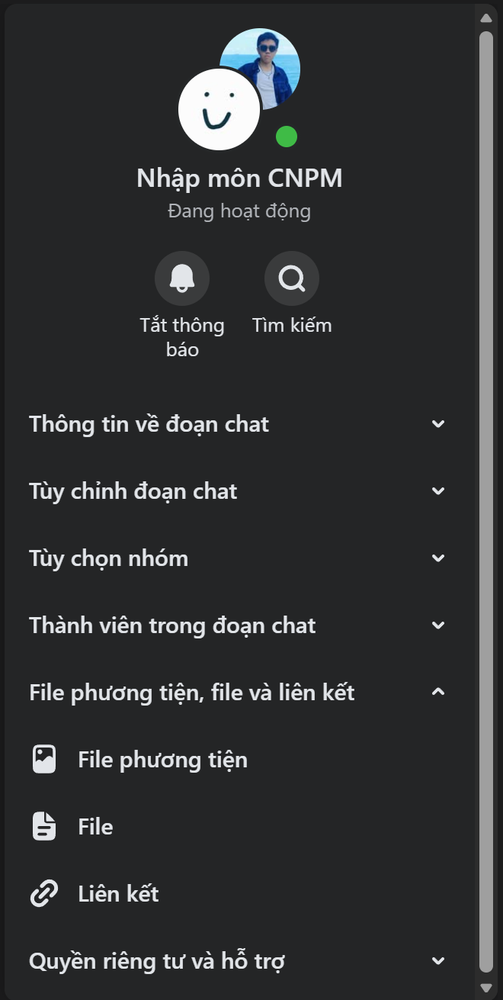
    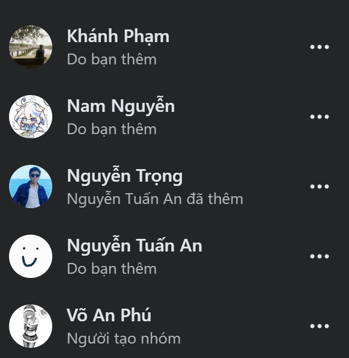
    * **Discord** — Server: **Nhập môn CNPM**. For important announcements (to prevent important messages from getting buried), below is the Discord server screenshot.
    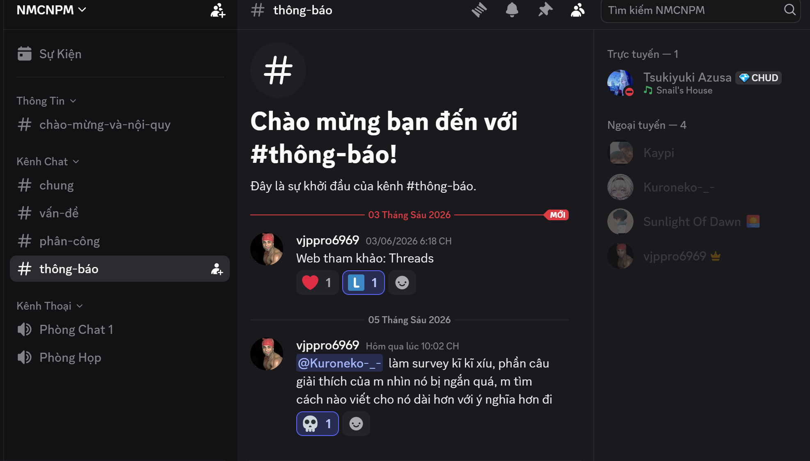

2. Task management: **Jira** — Project/group: **PDF-NMCNPM**. We use Jira for task management following the Scrum model. We chose Jira because it is free, easy to use, and teachers recommended it. Below are screenshots of our Jira board, lists, and backlog.
    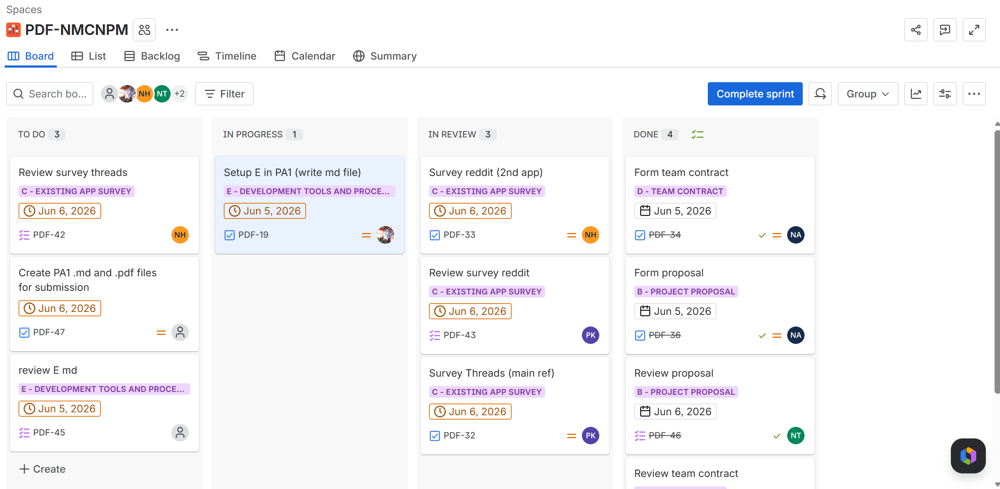
    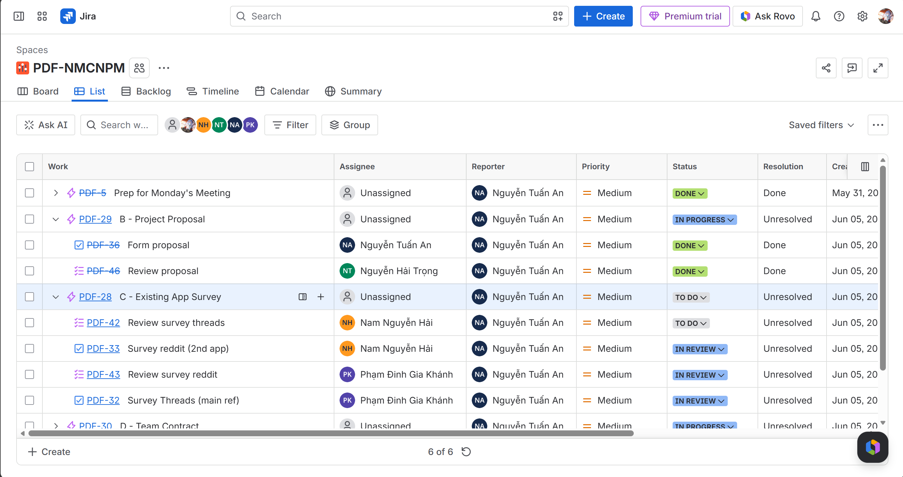
    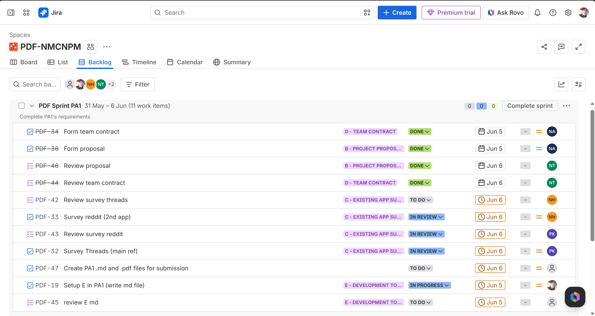

3. **GitHub Repository** — Repository name: **FOZ** (the project name). Below is a screenshot of a branch in our repository.
    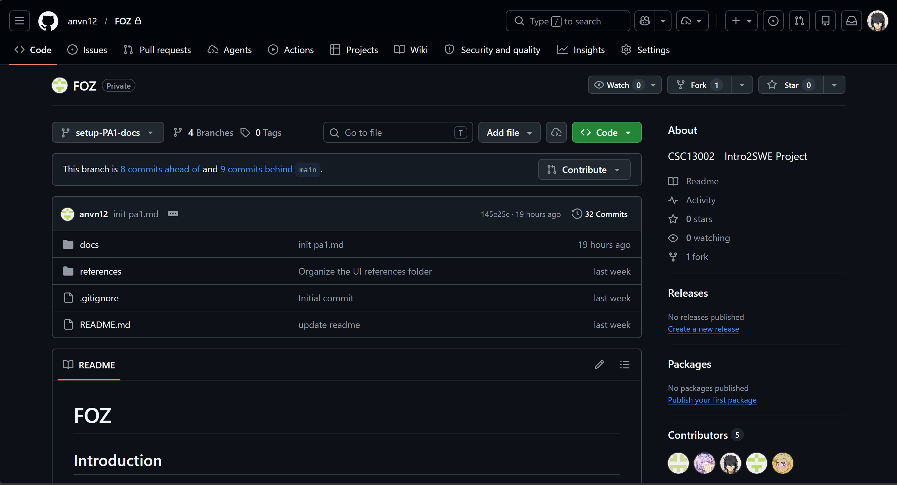

Because we have not implement any code yet, we do not have a folder structure to show. But we intend to adapt a folder structure as follows:

```Plaintext
FOZ/
├── src/                            # Source code
│   ├── frontend/ 
│   └── backend/
├── docs/                           # Documentation
│   ├── meeting-minutes/
│   ├── .md                         # General documentation (e.g., project proposal, team contract)
│   ├── PA/                         # Project Assignments
│   │   └── PA1/
│   │       └── .md
|   └── references/                 # Reference materials (e.g., UI design inspirations)
├── tests/                          # Test plan, test cases, test reports
├── .env.example                    # Template for environment variables
└── README.md                       # Project documentation
```

The folder structure can be changed later if we find a better way to organize our code and documentation.

4. **AI Coding Accounts** — All team members have GitHub Copilot for Students and Antigravity accounts.
