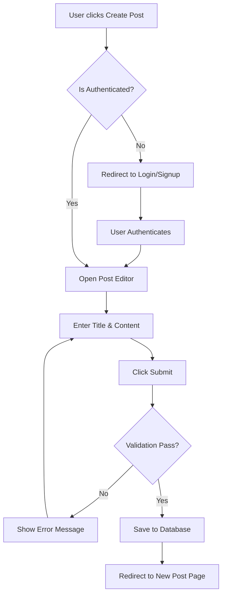
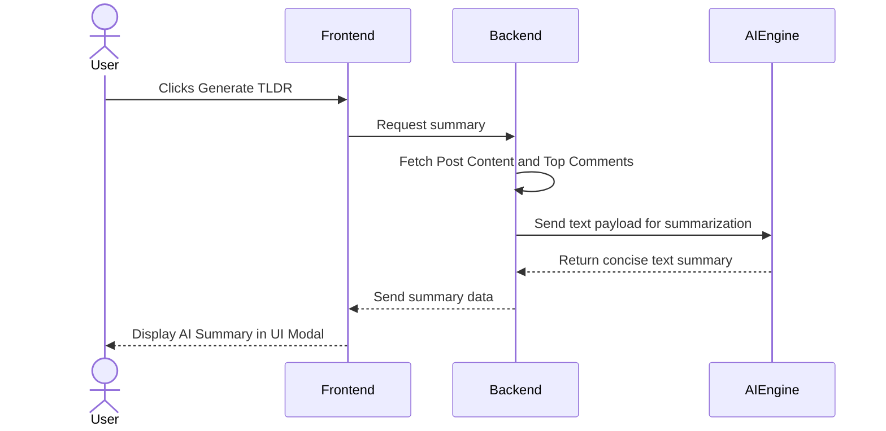
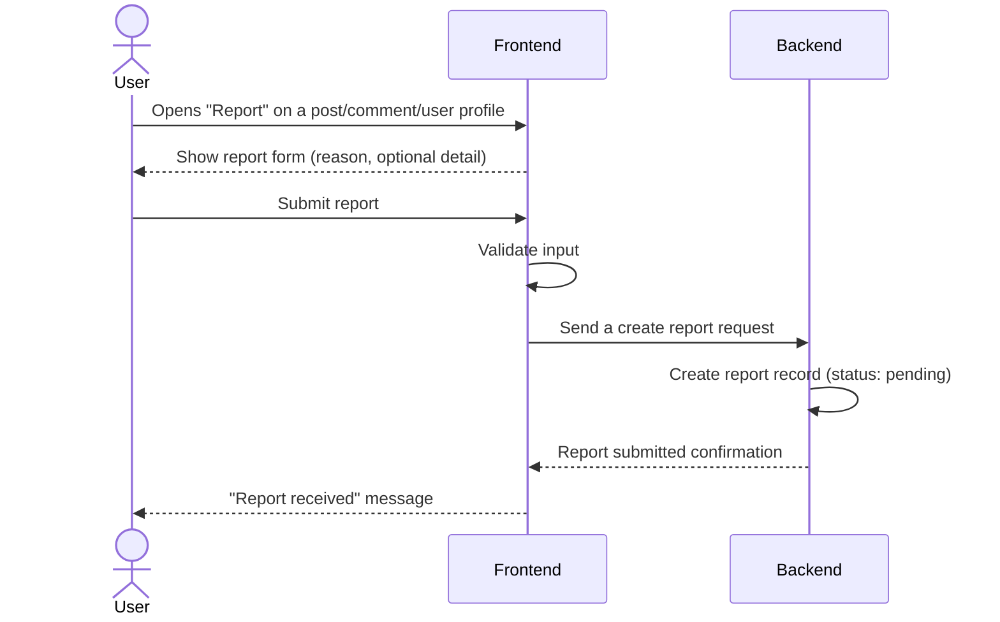
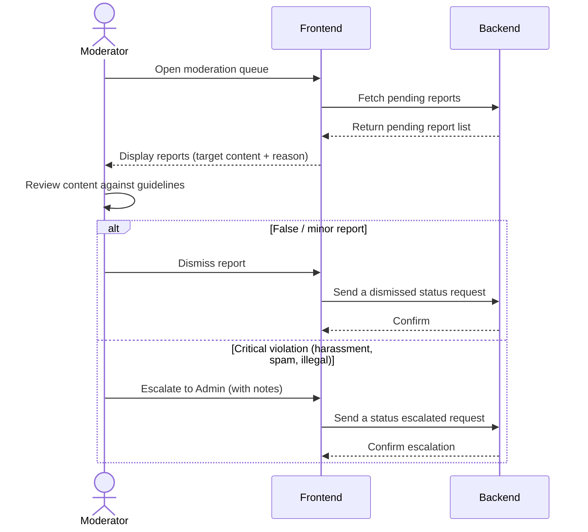
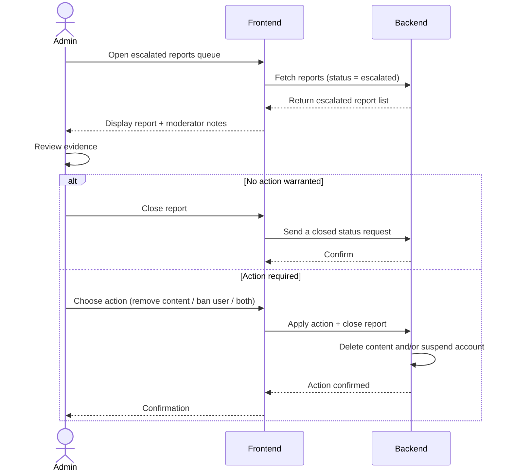
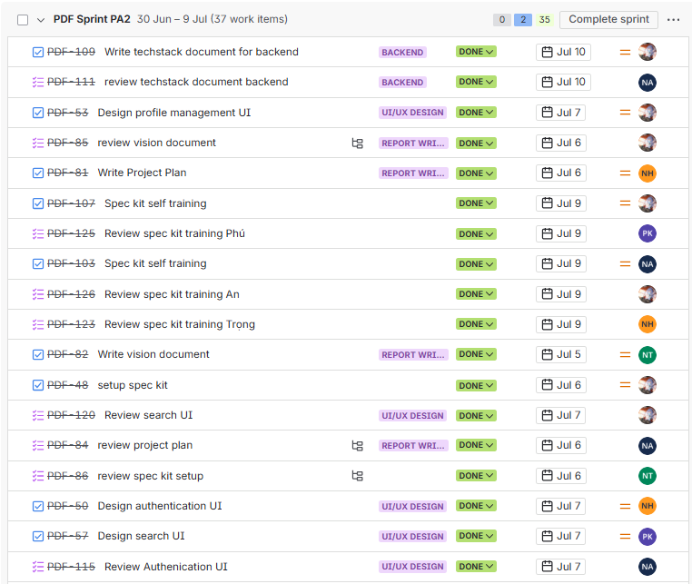
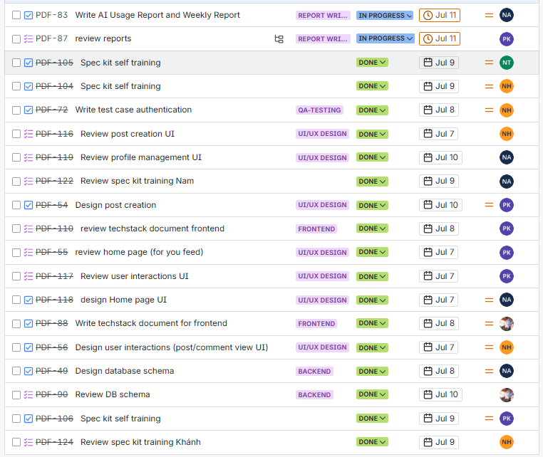

<div style="text-align: center; margin: 0 auto; padding: 40px 20px; min-height: 85vh; display: flex; flex-direction: column;">
  <div style="text-transform: uppercase; line-height: 1.8;">
    <div>VNUHCM - University of Science</div>
    <div>Faculty of Information Technology</div>
  </div>

  <div style="border-top: 2px solid black; margin: 30px 0;"></div>

  <div style="margin: 20px 0;">
    <h1 style="margin: 0; padding: 0 0 10px 0; font-size: 2.2em; border: none;">PA2 Report</h1>
    <div style="font-size: 1.2em; font-weight: bold;">Group 6: PDF</div>
  </div>

  <div style="border-top: 2px solid black; margin: 30px 0;"></div>

  <div style="font-size: 1.2em; font-weight: bold; margin-bottom: 40px;">
    CSC13002 - Introduction to Software Engineering
  </div>

  <div style="display: flex; justify-content: space-between; margin: 0 5%; text-align: left; line-height: 1.8;">
    <div style="width: 50%;">
      <div style="font-style: italic;">Author:</div>
      <div>Nguyễn Tuấn An - 24127011</div>
      <div>Nguyễn Hải Nam - 24127088</div>
      <div>Nguyễn Hải Trọng - 24127311</div>
      <div>Phạm Đinh Gia Khánh - 24127420</div>
      <div>Võ An Phú - 24127494</div>
    </div>
    <div style="width: 45%;">
      <div style="font-style: italic;">Lecturer:</div>
      <div>Ms. Nguyễn Thị Minh Tuyền</div>
      <div>Mr. Hồ Tuấn Thanh</div>
      <div>Mr. Mai Anh Tuấn</div>
    </div>
  </div>

  <div style="margin-top: auto; padding-top: 60px;">

  </div>
</div>

<div style="page-break-after: always;"></div>

# Table of Contents

- [A - Project Plan](#a---project-plan)
	- [1. Introduction](#1-introduction)
	- [2. Project Overview](#2-project-overview)
	- [3. Project Organization](#3-project-organization)
		- [3.1 Team Structure and Member Roles](#31-team-structure-and-member-roles)
		- [3.2 Risk Management](#32-risk-management)
	- [4. Project Plan](#4-project-plan)
		- [4.1 Completed Sprint (Sprint 1 - PA1)](#41-completed-sprint-sprint-1---pa1)
		- [4.2 Upcoming Sprint (Sprint 2 - PA2)](#42-upcoming-sprint-sprint-2---pa2)
		- [4.3 Future Sprints (Sprint 3 - PA3, Sprint 4 - PA4, Sprint 5 - PA5)](#43-future-sprints-sprint-3---pa3-sprint-4---pa4-sprint-5---pa5)
		- [4.4 Schedule](#44-schedule)
		- [4.5 Build Plan](#45-build-plan)
- [B - Vision Document](#b---vision-document)
	- [Version 1.0](#version-10)
		- [Table of Contents](#table-of-contents)
		- [Vision (Small Project)](#vision-small-project)
		- [1. Introduction](#1-introduction)
			- [1.1. References](#11-references)
		- [2. Positioning](#2-positioning)
			- [2.1. Problem Statement](#21-problem-statement)
			- [2.2. Product Position Statement](#22-product-position-statement)
		- [3. Stakeholder and User Descriptions](#3-stakeholder-and-user-descriptions)
			- [3.1. Stakeholder Summary](#31-stakeholder-summary)
			- [3.2. User Summary](#32-user-summary)
			- [3.3. User Environment](#33-user-environment)
			- [3.4. Summary of Key Stakeholder or User Needs](#34-summary-of-key-stakeholder-or-user-needs)
			- [3.5. Alternatives and Competition](#35-alternatives-and-competition)
		- [4. Product Overview](#4-product-overview)
			- [4.1. Product Perspective](#41-product-perspective)
			- [4.2. Assumptions and Dependencies](#42-assumptions-and-dependencies)
			- [4.3. Scope Boundaries](#43-scope-boundaries)
		- [5. Product Features](#5-product-features)
			- [Key Workflows (Mermaid Diagrams)](#key-workflows-mermaid-diagrams)
		- [6. Non-Functional Requirements](#6-non-functional-requirements)
- [C - Spec Kit Initialization](#c---spec-kit-initialization)
- [D - AI Usage Report and Weekly Report](#d---ai-usage-report-and-weekly-report)
	- [AI Usage Report](#ai-usage-report)
		- [Declaration of No AI Use](#declaration-of-no-ai-use)
		- [AI Usage Notes](#ai-usage-notes)
	- [Weekly Report](#weekly-report)
		- [Sprint Planning](#sprint-planning)
		- [Scrum Meetings](#scrum-meetings)
		- [Sprint Review](#sprint-review)
	- [Jira Board](#jira-board)

<div style="page-break-after: always;"></div>

## A - Project Plan

Author: Nguyễn Hải Nam

Reviewer and Editor: Nguyễn Tuấn An

### 1. Introduction

This project is a web-based forum application focused on fundamental community discussions. Its value lies in providing a simple, intuitive platform where users can easily ask questions, share knowledge, and connect over shared interests without navigating overly complex interfaces.

### 2. Project Overview

* **Goals:** Successfully build a user-friendly web-based forum application that covers all the core functions introduced in the scope below.

* **Scope:**
  * **In-scope:** Web-based application fulfilling core functional groups: Authentication, Profile management, Post Creation, Feed Generation, User Interactions, Search & Discovery, Administration & Moderation, Post Summarize (TL;DR).

  * **Out-of-scope:** Native mobile applications (iOS/Android), real-time chat channels, and complex personalized recommendation algorithms. We are strictly focusing on core web-based text discussions and AI summarization.

* **Deliverables:** Source code, phase reports (PA1 - PA5) and a completed web-based forum application demo at the end of the course.

* **Assumptions:**
  * All team members have a solid grasp of basic web programming and AI prompting skill.

  * The development environment (e.g., WSL, Git, related frameworks or databases, etc.) is configured uniformly and runs stably across all members' devices.

### 3. Project Organization

#### 3.1 Team Structure and Member Roles

> **Team Structure:** All team members are expected to act as **Full-Stack Engineers** throughout the project lifecycle. The roles below designate leadership and domain ownership for specific project phases, meaning the assigned member will guide and manage that area while the entire team participates in the execution.

| **Member** | **Role** | **What to do** |
| --- | --- | --- |
| **Nguyễn Tuấn An** (24127011) | Project Manager | Facilitates meetings, tracks sprint progress, manages the project board (Jira), and ensures deadlines are met. Contributes to full-stack development. |
| **Nguyễn Hải Nam** (24127088) | QA Engineer (Tester) | Defines testing protocols. Leads the team in writing test cases and performing bug hunts. Contributes to full-stack development. |
| **Nguyễn Hải Trọng** (24127311) | Backend & Database Developer | Designs the database schema, establishes API architectures, and leads server-side performance strategies. Guides the team on database queries and backend logic. Contributes to full-stack development. |
| **Phạm Đinh Gia Khánh** (24127420) | UI/UX Designer | Leads the wireframing, prototyping, and user journey mapping phases. Ensures design consistency across the application. Guides the team during frontend UI implementation. Contributes to full-stack development. |
| **Võ An Phú** (24127494) | Frontend Developer | Establishes frontend coding standards, selects frontend frameworks/libraries, and ensures responsive, accessible design implementation. Contributes to full-stack development. |

#### 3.2 Risk Management

* **Member Unavailability:**
  * **Risk:** Team members may become temporarily unavailable due to midterm exams or workloads from other courses, potentially causing bottlenecks during Sprints or reducing the overall quality of deliverables.

  * **Mitigation strategy:**
    * Enforce cross-training and mandatory peer code reviews. This ensures shared knowledge of the codebase, allowing any member to seamlessly take over another's tasks in emergencies.

    * Front-load complex and time-consuming tasks to the beginning of each Sprint when members have more bandwidth.

* **Technology Issues:**
  * **Risk:** Running out of AI and TL;DR engine API token quotas during development or testing phases.

  * **Mitigation strategy:** Utilize multiple AI platforms in development phases (such as Github Copilot, Antigravity). Architect the system to support fallback platforms for the AI engine (such as Google Gemini, OpenAI, and Microsoft Copilot) to ensure that if one service fails or hits a hard limit, the application seamlessly switches to another without significant delays.

* **Scope Creep:**
  * **Risk:** Team members may attempt to add "nice-to-have" features (like real-time notifications) that delay the schedule for core PA deliverables.

  * **Mitigation strategy:** Strictly enforce that all new feature ideas must be logged in the Jira backlog and require team approval before being pulled into an active sprint.

### 4. Project Plan

This project applies the Scrum process and is organized into 5 Sprints, each
corresponding to one PA and lasting 2-3 weeks.

#### 4.1 Completed Sprint (Sprint 1 - PA1)

* **Status:** Completed

* **Achievements:**
  * **Group Registration:** Formed a 5-member team, finalized the project name, and successfully registered.

  * **Project Proposal:**
    * Proposed a web-based application featuring 8 functional groups, targeting web users.

    * Defined core AI feature Post Summarization (TL;DR), which utilizes an AI engine to generate brief on-demand overviews of lengthy discussion posts.

  * **Existing App Survey:** Analyzed and compared 2 similar applications Threads and Reddit to identify UI/UX patterns and key factors for our project.

  * **Team Contract:** Established team roles, communication protocols, work schedules, documentation and contribution criteria, as well as unified processes in decision-making, conflict resolution and adjustments.

  * **Development Tools and Process Setup:** Initialized the Scrum workflow. Set up Jira for task tracking, created a private GitHub repository with standard structure, and ensured all members are equipped with AI coding assistant accounts.

#### 4.2 Upcoming Sprint (Sprint 2 - PA2)

* **Main Goal:**
  * Complete the project plan and spec kit setup.
  * Finalize the tech stack.
  * Design the UI/UX for all functional groups.

**Detailed Tasks:**

| Task Description                                    | Assignee            | Reviewer            | Due Date   |
| --------------------------------------------------- | ------------------- | ------------------- | ---------- |
| Write Project Plan                                  | Nguyễn Hải Nam      | Nguyễn Tuấn An      | Jul 6      |
| Write vision document                               | Nguyễn Hải Trọng    | Võ An Phú           | Jul 6      |
| Setup Spec Kit                                      | Võ An Phú           | Nguyễn Hải Trọng    | Jul 6      |
| Write AI Usage Report and Weekly Report             | Nguyễn Tuấn An      | Phạm Đinh Gia Khánh | Jul 9      |
| Design overall UI scheme                            | Phạm Đinh Gia Khánh | Võ An Phú           | Jul 7      |
| Design authentication UI                            | Nguyễn Hải Nam      | Nguyễn Tuấn An      | Jul 7      |
| Design post creation                                | Nguyễn Tuấn An      | Nguyễn Hải Nam      | Jul 7      |
| Design user interactions (post/comment view UI)     | Nguyễn Hải Nam      | Phạm Đinh Gia Khánh | Jul 7      |
| Design home page (for you feed)                     | Nguyễn Hải Trọng    | Nguyễn Tuấn An      | Jul 7      |
| Design profile management UI                        | Võ An Phú           | Nguyễn Hải Trọng    | Jul 7      |
| Design search UI                                    | Phạm Đinh Gia Khánh | Võ An Phú           | Jul 7      |
| Write techstack document for frontend               | Võ An Phú           | Phạm Đinh Gia Khánh | Jul 8      |
| Write techstack document for backend                | Nguyễn Hải Trọng    | Nguyễn Tuấn An      | Jul 8      |
| Design database schema                              | Nguyễn Hải Trọng    | Nguyễn Tuấn An      | Jul 8      |
| Implement authentication                            | Võ An Phú           | Nguyễn Hải Nam      | Jul 8      |
| Spec kit self training                              | Nguyễn Tuấn An      | Võ An Phú           | Jul 9      |
| Spec kit self training                              | Nguyễn Hải Nam      | Nguyễn Tuấn An      | Jul 9      |
| Spec kit self training                              | Nguyễn Hải Trọng    | Nguyễn Hải Nam      | Jul 9      |
| Spec kit self training                              | Phạm Đinh Gia Khánh | Nguyễn Hải Trọng    | Jul 9      |
| Spec kit self training                              | Võ An Phú           | Phạm Đinh Gia Khánh | Jul 9      |

#### 4.3 Future Sprints (Sprint 3 - PA3, Sprint 4 - PA4, Sprint 5 - PA5)

**Planned Tasks**

* **Sprint 3:** Core Architecture & MVP

  * Initialize the database.

  * Set up automated testing frameworks.

  * Develop core functional groups: Profile management, Post Creation, User Interactions, Search & Discovery.

  * Release the first MVP build (Alpha)

* **Sprint 4:** Integration & AI Implementation

  * Develop core functional groups: Feed Generation, Administration & Moderation, Post Summarize

  * Execute system testing.

  * Release the beta build.

* **Sprint 5:** Polish, Optimization & Deployment

  * Testing on non-functional requirements.

  * Finalize all project documentation.

  * Deploy the final release for the project demo.

#### 4.4 Schedule

The detailed schedule of all tasks, work statuses (To Do, In Progress, In Review, Done), and overall progress are strictly managed, tracked, and continuously updated on the project's Jira board.

#### 4.5 Build Plan

Build 1.0 (Alpha) - End of Sprint 3: A baseline build focusing on backend connectivity and basic frontend rendering. Core CRUD operations for forum posts will be testable, though the UI may lack final styling.

Build 2.0 (Beta) - End of Sprint 4: A feature-complete build including the integrated AI summarization tool. This build will be subjected to rigorous testing.

Build 3.0 (Final) - End of Sprint 5: The final, polished build deployed to the production environment, thoroughly tested for all aspects, ready for the final PA5 demonstration.

## B - Vision Document

Author: Nguyễn Hải Trọng

Reviewer and Editor: Võ An Phú

### Version 1.0

| | |
| :--- | :--- |
| **FOZ** | Version: 1.0 |
| **Vision document** | Date: 07/07/2026 |

#### Table of Contents

1. Introduction
   1.1 References
2. Positioning
   2.1 Problem Statement
   2.2 Product Position Statement
3. Stakeholder and User Descriptions
   3.1 Stakeholder Summary
   3.2 User Summary
   3.3 User Environment
   3.4 Summary of Key Stakeholder or User Needs
   3.5 Alternatives and Competition
4. Product Overview
   4.1 Product Perspective
   4.2 Assumptions and Dependencies
   4.3 Scope Boundaries
5. Product Features
6. Non-Functional Requirements

#### Vision (Small Project)
|Date | Version| Description | Author | Review by
| :--- | :--- | :--- | :--- | :--- |
| 07/07/2026 | 1.0 | Defined problem statement, user roles, product features, and non-functional requirements. |  Nguyễn Hải Trọng | Võ An Phú |
| 08/07/2026 | 1.1 | Added scope boundaries, moderation workflow, security/accessibility NFRs, and clarified role capabilities. | Võ An Phú | Võ An Phú |

#### 1. Introduction


The purpose of this Vision Document is to collect, analyze, and define the high-level needs and features of FOZ, a web-based forum application. It focuses on the capabilities required by the stakeholders and target users, providing a clear foundation for the project's scope. 

##### 1.1. References
* CS300 - Introduction to Software Engineering: PA1-2026 Guidelines.
* CS300 - Introduction to Software Engineering: PA2-2026 Guidelines.
* FOZ Project Proposal (PA1).
* FOZ Existing App Survey (Reddit, Threads).

#### 2. Positioning

##### 2.1. Problem Statement

| | |
| :--- | :--- |
| **The problem of** | cluttered, overly complex, and algorithm-heavy interfaces in current online discussion platforms |
| **affects** | general web users seeking straightforward, topic-focused community spaces |
| **the impact of which is** | a high barrier to entry, distraction from core discussions, and a frustrating user experience when trying to find specific information |
| **a successful solution would be** | a simple, intuitive web-based forum that focuses purely on meaningful community discussions, equipped with AI tools to quickly summarize long threads. |

##### 2.2. Product Position Statement

| | |
| :----- | :----- |
| **For** | General web users seeking online community spaces |
| **Who** | want to easily ask questions, share knowledge, and connect over shared interests |
| **The FOZ** | is a web-based forum application |
| **That** | provides a simple, intuitive platform focusing on fundamental community discussions with an on-demand AI summarization feature |
| **Unlike** | traditional platforms (e.g., Reddit or Threads) that feature overwhelming UI layouts and aggressive recommendation algorithms |
| **Our product** | delivers a streamlined, clutter-free user experience tailored specifically for straightforward, text-based community dialogue and rapid information consumption. |

#### 3. Stakeholder and User Descriptions


##### 3.1. Stakeholder Summary
| Name | Description | Responsibilities |
| :--- | :--- | :--- |
| **Project Manager** | Team leader (Nguyễn Tuấn An). | Facilitates meetings, tracks sprint progress in Jira, ensures deadlines are met, and oversees project delivery. |
| **Development Team** | Full-stack engineers (Nam, Trọng, Khánh, Phú), with domain leads for QA (Nam), Backend/DB (Trọng), UI/UX (Khánh), and Frontend (Phú). | Designs UI/UX, builds frontend/backend architectures, manages the database, and ensures software quality via testing. Detailed role assignments are in the Project Plan. |
| **Instructors / TAs** | Course evaluators. | Monitors project progress, provides feedback, and evaluates the final product against course requirements. |

##### 3.2. User Summary
| Name | Description | Responsibilities |
| :--- | :--- | :--- |
| **Guest** | Unauthenticated visitors. | Read-only access: can view profiles, read posts, and see comments. Cannot post, like, report, or trigger the AI Post Summarize (TL;DR) feature. Any write interaction prompts the authentication flow. |
| **Standard User** | Authenticated community members. | Can create posts, like/unlike posts and comments, comment, report inappropriate posts/comments or other users, manage their own profile, and delete their own posts. |
| **Moderator** | Elevated users with community management tools. | Inherits all Standard User abilities. Reviews user reports and forwards critical issues to Administrators. Cannot permanently delete users or posts from the database or alter system-wide configurations. |
| **Administrator** | Highest level of system access. | Complete control over database records. Can permanently ban users, instantly delete content, and assign Moderator roles. |

##### 3.3. User Environment
Users will access FOZ exclusively through standard web browsers (such as Google Chrome, Safari, Microsoft Edge, or Firefox). The application must be responsive, ensuring seamless operation across internet-connected desktop computers, laptops, and mobile smartphones.

##### 3.4. Summary of Key Stakeholder or User Needs

| Need | Priority | Concerns | Current Solution | Proposed Solutions |
| :--- | :--- | :--- | :--- | :--- |
| **Quick comprehension of long discussions** | High | Users do not have time to read hundreds of replies to find the consensus. | Scrolling manually and reading top comments. | Integrate an AI "Post Summarize (TL;DR)" feature. |
| **Discover relevant content** | High | Users want to find active communities without heavy, intrusive algorithms. | Algorithmic "For You" pages (e.g., Threads). | Generate a clean feed based purely on recent engagement metrics (comment velocity, likes). |
| **Safe community environment** | Medium | Toxic behavior ruins the discussion experience. | Automated bans which are often inaccurate. | A multi-tier user reporting system involving Standard Users, Moderators, and Admins. |

##### 3.5. Alternatives and Competition
Based on our PA1 survey:
* **Threads:** Features a very clean UI and smooth cross-platform authentication (via Instagram). However, it leans heavily towards micro-blogging and aggressive algorithm recommendations rather than structured, topic-based forum discussions.
* **Reddit:** Excels in community categorization and deep discussions. However, its interface can be highly cluttered and overwhelming for casual users, and its strict karma/rules system acts as a high barrier to entry. FOZ aims to bridge this gap by offering the deep discussion capabilities of Reddit but with the minimalist, accessible UI similar to Threads.

#### 4. Product Overview


##### 4.1. Product Perspective
FOZ is an independent, self-contained web application. It acts as a centralized hub for community interactions, requiring only a modern web browser to access. The system will integrate with a third-party AI service (such as the OpenAI API or Gemini API) strictly to power the "Post Summarize" feature.

##### 4.2. Assumptions and Dependencies
* **Internet Connection:** The application requires a stable internet connection to fetch real-time discussions.
* **AI API Availability:** The TL;DR feature depends on the continuous availability and responsiveness of the chosen external AI API provider.
* **Modern Browsers:** It is assumed that users are operating modern web browsers with JavaScript enabled.
* **AI Provider Fallback:** The TL;DR feature depends on external AI providers (e.g., OpenAI, Gemini). To mitigate quota exhaustion or outages, the backend is designed to support a fallback provider chain so that a single provider failure does not disable the feature.


##### 4.3. Scope Boundaries
* **In-scope:** A web-based application covering the functional groups defined in 5 — Authentication, Profile Management, Post Creation, Feed Generation, User Interactions, Search & Discovery, Administration & Moderation, and Post Summarize (TL;DR).
* **Out-of-scope:** Native mobile applications (iOS/Android), real-time chat channels, push notifications, and complex personalized recommendation algorithms. The project focuses strictly on core web-based text discussions and on-demand AI summarization.

#### 5. Product Features

**1. Post Creation** *(Priority: High)*

Users can effortlessly compose and publish text-based posts to spark new discussions on topics they care about. This feature provides a clean, distraction-free editor that encourages thoughtful input. It benefits authenticated users by giving them a reliable space to ask questions or share knowledge, thereby driving the core content engine of the entire community.

**2. Feed Generation** *(Priority: High)*

The application generates a dynamic feed of posts calculated by recent engagement metrics, such as comment velocity and like counts. This ensures that the most active and relevant conversations naturally rise to the top without relying on invasive tracking algorithms. It greatly benefits both guests and standard users by minimizing search time and immediately presenting the platform's best content.

**3. User Interactions (Comments & Likes)** *(Priority: High)*

Members can browse existing threads and actively interact by leaving nested comments or liking specific posts. This feature is the lifeblood of the forum, transforming static posts into evolving community dialogues. It empowers standard users to express agreement, validate others' opinions, and build a sense of connection within the platform.

**4. Search & Discovery** *(Priority: Medium)*

A robust search mechanism allows users to query specific topics, keywords, or user profiles across the database. As the forum grows, this feature becomes essential for users who are seeking specific answers rather than casual browsing. It benefits all users by providing a precise tool to cut through the noise and discover niche discussions or specific creators.

**5. Administration & Moderation System** *(Priority: Medium)*

The application includes a multi-tiered reporting system where users can flag inappropriate content or other users for review. Moderators can evaluate these reports and forward severe violations to Administrators, who hold the power to permanently remove content or ban users. This robust safety net benefits the entire user base by maintaining high-quality discourse and ensuring a respectful environment.

**6. AI Post Summarize (TL;DR)** *(Priority: High)*

FOZ integrates an AI engine to generate brief, on-demand overviews of lengthy and complex discussion threads. This solves the problem of information overload when a post has hundreds of conflicting replies. It highly benefits time-constrained users by allowing them to quickly grasp the main points and overall consensus of a conversation in seconds.

**7. Authentication & Account Security** *(Priority: High)*

Authenticated access is the gate to every write operation on FOZ. This feature covers sign-up, login, logout, and session management, ensuring that only verified members can create content or interact. It underpins every other feature by establishing a trusted user identity and protecting accounts through hashed, salted passwords and encrypted transport.

**8. Profile Management** *(Priority: Medium)*

Authenticated users can manage their own identity on the platform: editing profile information, changing their password, and updating an avatar. This gives members a recognizable, controllable presence in discussions and supports the community-building goals of the forum.

##### Key Workflows (Mermaid Diagrams)

**Workflow 1: User Authentication & Post Creation**

**Workflow 2: AI Post Summarize (TL;DR)**


**Workflow 3: User Reports a Post, Comment, or User**


**Workflow 4: Moderator Reviews Reports & Escalates Critical Cases**


**Workflow 5: Admin Acts on Escalated Reports**


#### 6. Non-Functional Requirements

**Performance Requirements:**

* The application's initial page load time must be < 2 seconds on a standard broadband connection. 

* Backend API response times for standard queries (fetching feeds, creating posts) must be < 500 milliseconds. 

* The system architecture must support at least 100 concurrent users interacting with the platform simultaneously without noticeable performance degradation. 

**Security Requirements:**

* All user passwords must be securely hashed and salted (e.g., using bcrypt) before being stored in the database. 

* All client-server communications must be encrypted using HTTPS (TLS 1.2 or higher). 

* All user input must be validated server-side and output-encoded to prevent XSS and SQL injection.

* Authentication sessions must be managed via secure, httpOnly cookies/tokens with CSRF protection.

* The AI Post Summarize (TL;DR) endpoint must be rate-limited per user to prevent quota abuse and cost escalation.

**Reliability & Availability Requirements:**

* If the external AI provider is unavailable, the TL;DR feature must degrade gracefully with a clear message, without affecting the rest of the application.

* The application must log errors and key moderation actions (bans, content removal, report escalations) to support incident review.

**Platform & Usability Requirements:**

* The application must be fully responsive, rendering correctly and maintaining usability on screen widths as small as mobile devices up to Full HD desktop displays. 

* Cross-browser compatibility must be ensured for the latest versions of Google Chrome, Safari, Mozilla Firefox, and Microsoft Edge.

* Core actions (create a post, comment, search, generate TL;DR) must be completable by a new authenticated user without external training or documentation.

## C - Spec Kit Initialization

*Performed by: Võ An Phú | Reviewed and Edited by: Nguyễn Hải Trọng*

All required Spec Kit artifacts are located in the following path: `./speckit-artifacts/` and are organized as in our `/src` folder.

The constitution.md is located at: `./speckit-artifacts/.specify/memory/constitution.md`

The Spec Kit training was writing a brief summary about what they have learned from the given resources and the summary files are located at `./speckit-training/` folder.

## D - AI Usage Report and Weekly Report

Author: Nguyễn Tuấn An

Reviewer and Editor: Phạm Đinh Gia Khánh

### AI Usage Report

#### Declaration of No AI Use

We declare that no AI tools were used in peer review tasks.

#### AI Usage Notes

- Google Stitch, accessed 9:00 on July 9, 2026, prompt: "Design a home page for web in threads style", used to design home page UI for project; student validated the generated design with peer review.

- Copilot. Copilot, GitHub via Visual Studio Code, accessed 20:00 on July 10, 2026, prompt: “/speckit.specify Design a database schema for our application. Details of the app is given in the 1B. Project Proposal.md.” then use /speckit.clarify, tasks, implement, used to generate a database schema for project; student validated the generated schema with peer review and compare the schema with our proposal.

- Google Stitch. Gemini 3.1 Pro, Google, stitch.withgoogle.com, accessed 21:00 on July 9, 2026. prompt: 
  ```
  Act as a Senior UI/UX Designer and Frontend Engineer. Your task is to design the "User Interactions (Post and Comment View UI)" for a modern web forum named "FOZ". 
  ### 1. Global Design System & Vibe
  - **Inspiration:** Meta's Threads app.
  - **Theme:** STRICTLY LIGHT MODE. Use a pristine white background with very crisp, dark gray/black text for maximum readability.
  - **Style:** Minimalist, highly modern, typography-driven, and distraction-free. 
  - **Typography:** Clean sans-serif (e.g., Inter, system-ui). 
  - **Layout:** Mobile-first design, centered in a max-width container (e.g., 600px - 800px) with generous whitespace and extremely subtle 1px solid borders (very low opacity gray) to separate items.
  Please render two completely distinct screens (Screen 1 and Screen 2) to prevent clutter:
  ### SCREEN 1: POST FEED UI (Standalone Posts & Composer)
  This screen focuses on the main feed and how users create or interact with a top-level post.
  **A. The Post Composer:**
  - Show an input area at the top of the feed.
  - **State 1 (Idle):** User's avatar with muted placeholder text ("Start a discussion on FOZ...").
  - **State 2 (Active/Typing):** Expanded area showing typed text, a character counter ring, media attachment icons (image, GIF, poll), and a prominent, clickable "Post" button.
  **B. The Single Post Card:**
  - **Structure:** User Avatar (top left), Username (bold black), Handle/Timestamp (muted gray, next to username). 
  - **Content:** The main text body clearly aligned next to or below the avatar. Show an attached image with nicely rounded corners.
  - **Thread Line:** A subtle, light-gray vertical connecting line dropping down from the bottom of the avatar to indicate the potential for a thread.
  **C. The Action Bar:**
  - Located under the post content. Show these icons: Heart (Like), Bubble (Reply), Arrows (Repost), Paperplane (Share).
  - **States:** Show one post with a "Default" action bar (muted outline icons) and another post with an "Active" action bar (e.g., the Heart icon is solid vibrant red/pink, and the Repost arrows are solid green) along with numerical counters (e.g., "1.2k", "45") aligned perfectly next to the icons.
  ---
  ### SCREEN 2: COMMENT UI (Threaded Detail View)
  This screen focuses on the deep-dive view of a specific post and its nested comment tree.
  **A. Main Parent Post (Focused):**
  - Display the original post at the top, slightly larger font size to indicate it is the current focus of the page.
  - Full action bar visible with interaction metrics.
  **B. The Nested Comment Tree (Threads-style hierarchy):**
  - **Visual Connecting Lines:** This is crucial. Use the signature Threads-style curved/straight vertical gray lines that seamlessly connect the Parent's avatar down to the Child's avatar.
  - **Level 1 Reply:** A direct comment responding to the main post. Avatar sits on the thread line. Includes its own mini action bar.
  - **Level 2 Reply (Nested):** A reply to the Level 1 comment. Show proper indentation and how the connecting line branches off to visually group this sub-conversation.
  - **Composer within Thread:** A small reply input box at the bottom of the active thread line, prompting the user to "Reply to [Username]...".
  - **"Show more" indicator:** A subtle text link at the end of a long thread (e.g., "View 12 more replies").
  ### Output Requirement:
  Visually separate **SCREEN 1** and **SCREEN 2** in your generated output so the distinct layouts, states, and the intricate threading lines in the Light Mode environment are perfectly clear and easy to understand.
  ```
  , used to design user interaction UI (post and comment UI) for the project, AI generated code and images, student edited and revised manually.

- Google Stitch. Gemini 3.1 Pro, Google, stitch.withgoogle.com, accessed 20:00 on July 7, 2026. prompt: 
  ```
  A high-fidelity mobile app UI/UX mockup presented on three distinct phone screens arranged horizontally, in a clean and minimalistic design style inspired by the Threads app, with a primarily black and white color scheme and modern sans-serif typography. The entire presentation is a mockup on actual smartphones, set against a simple, light-colored gradient background. The app is named "FOZ" and features a distinctive, stylized logo at the top of all screens.
  Screen 1 (Left, titled 'FOZ LOGIN'): Shows the "Log in" flow. At the top is the FOZ logo and "LOG IN". Below, text fields for "Username, email or phone" and "Password" (with a 'Show' eye icon). Underneath, a "Forgot password?" link. A prominent, solid black "Log in" button. Below this, a secondary button "Continue with Instagram". At the bottom, a link that says "Don't have an account? Sign up".
  Screen 2 (Middle, titled 'FOZ SIGN UP'): Shows the "Create Account" flow, specifically the profile customization. At the top, the FOZ logo and "SIGN UP". Below, a title "Create your FOZ profile". Fields for "Name" (with example 'John Doe'), "Username" ('@john_foz'), "Bio" ('Write a short bio...'), and "Link" (optional website). There is an option button "Import from Instagram". A main black "Next" button. At the bottom, options to "Skip" or "Already have an account? Log in".
  Screen 3 (Right, titled 'FOZ WELCOME BACK (Logged Out state)'): Shows the screen displayed immediately after logging out, or a general "Welcome back" to log in again. At the top, the FOZ logo and "WELCOME BACK to FOZ". A large central FOZ logo. Text saying "Start connecting again" and "Choose an account to log in". Below this, a list of saved or suggested accounts, for example, "John Doe (@john_foz)" with a "Log in" button next to it. Below, options for "Log in to another FOZ account" and "Create new account". The overall feel is consistent, minimalist, and very clean, with clear calls to action and a focused user journey. All elements, including buttons, input fields, and icons, are consistently designed across all three screens.

  A high-fidelity mobile app UI/UX mockup presented on a single phone screen, in a clean and minimalistic design style inspired by the Threads app, with a primarily black and white color scheme and modern sans-serif typography. The presentation is a mockup on an actual smartphone, set against a simple, light-colored gradient background. The app is named "FOZ" and features a distinctive, stylized logo.
  Screen 4 (At the back, titled 'FOZ LOGOUT CONFIRMATION'): Shows the "Log out" confirmation flow. The background of the screen displays a slightly dimmed/blurred version of a user profile to indicate an active overlay. Centered on the screen is a rectangular modal pop-up box with rounded corners and a solid white background. Inside this modal, at the top, is a circular user avatar placeholder (a simple person icon) with the username "@john_foz" in bold text directly below it. Underneath the user identity is the main confirmation text: "Log out of your account?". Below this text are two stacked, full-width buttons. The top button is a prominent, solid black rectangle with "Log out" written in white text. The bottom button is an outlined, white rectangular button with "Cancel" written in black text. The overall feel is consistent, minimalist, and very clean, ensuring a focused user journey for the authentication exit point.
  ```
  , used to design authentication UI for the project, AI generated code and images, student edited and revised manually.

- Gemini. Gemini 3.1 Pro, Google, gemini.google.com, accessed in 16:00 on July 8, 2026. prompt: "Give me a brief explanation about test case specification and an example of how people break it into many categories and write it as a report.", used to write test cases for authentication; AI just give template and conventions, student wrote manually and verified and revised with GeeksforGeeks.

- pi (pi-coding-agent). Local CLI platform routing to opencode-go (models: glm-5.2 / kimi-k2.6), accessed starting 20:18 on July 8, 2026, prompts:
  ```
  "i have wrote a basic review of the vision doc in /home/shiki/FOZ/docs/2B. Vision Document.md What do you think?"

  "- For 6. Ambiguities in role capabilities, guest is read only, no AI for them. For other fixes, fix as you see fit if you have any Ambiguities, ask me first"

  "the diagram for moderation is a bit of a mess, seperate them into 3 use case and be more careful of actions of each use cases"

  "after these changes recheck the constitiution in /home/shiki/FOZ/src/.specify/memory/constitution.md to see if we need to change to constitution"

  "- q1: 1 table."
  ```
  Purpose: Used to review and update the project vision document, specifically to refine role capabilities, separate moderation workflows, and unify report tables.

  AI-generated content: Edits to docs/2B. Vision Document.md (including generating the separated Mermaid diagrams) and minor verifications in src/.specify/memory/constitution.md.

  Independent work/validation: The student wrote the initial draft and independently dictated the business logic (enforcing guest read-only rules, splitting workflows into exactly three use cases, and deciding on a single-table structure). The student instructed the AI on what to edit and validated the output by cross-referencing it with the constitution document.

  Chat history: Preserved in local JSONL transcripts under ~/.pi/agent/sessions/.

- pi (pi-coding-agent). Local CLI platform routing to opencode-go (models: glm-5.2 / kimi-k2.6), accessed starting 22:06 on July 8, 2026, prompts:

  ```
  "i propose a frontend techstack liek this, what do you think?"

  "-Q1: i think the socket.io is needed because if we dont client would have to poll /api/threads for example..."

  "wait if i want to impelment the tldr and ai stuff, can i still use ts as the backend language ?"

  "actually we also want trending recommendation also but we are just thinking of using some simple algorithm to calculate..."

  "me and my team know next to nothing about database, but i know that sqlite is hard to deploy so postgre is fine..."

  "wait go back to section 4, sorry nut did you mention refresh token http only? i think i should stay away from cookie..."

  "go write" (plus several short acknowledgement/brainstorming prompts).
  ```
  Purpose: Used to brainstorm, validate, and document the frontend and backend technology stack choices for the application.

  AI-generated content: Formatted documentation files docs/frontend/techstack.md and ideas/backend-techstack.md.

  Independent work/validation: The student independently proposed the initial tech stack and actively debated architectural decisions with the AI. The student justified the use of socket.io, decided to use SQL scoring instead of ML for trending algorithms, chose PostgreSQL/Drizzle, and determined the refresh token strategy. The AI acted as a sounding board, and the student validated the final decisions before instructing the AI to draft the documents.

  Chat history: Preserved in local JSONL transcripts under ~/.pi/agent/sessions/.

- pi (pi-coding-agent). Local CLI platform routing to opencode-go (models: glm-5.2 / kimi-k2.6), accessed starting 23:40 on July 10, 2026, prompt:

  ```
  "my teammate just implemented the db in /home/shiki/FOZ/src/src/backend/db would i be able to impelment authN now? becasuse i think i need to scalfold the FE and set tup query layer of drizzle first"
  ```

  Purpose: Used to review a teammate's database schema implementation and plan the sequence of next steps for frontend scaffolding and authentication (AuthN).

  AI-generated content: A formal code review document generated at src/specs/001-threads-schema/review.md.

  Independent work/validation: The student identified the prerequisite steps (scaffolding FE, setting up the Drizzle query layer) before AuthN could be implemented. The student validated the AI's review of the schema against the project specifications to ensure it was safe to proceed with the next development phase.

  Chat history: Preserved in local JSONL transcripts under ~/.pi/agent/sessions/.

### Weekly Report

#### Sprint Planning

=========== 30/6, Sprint 2 planning ===============

Team members present:

- Nguyễn Tuấn An
- Nguyễn Hải Nam
- Nguyễn Hải Trọng
- Phạm Đinh Gia Khánh
- Võ An Phú

Team members absent: None

Reports:

- Nguyễn Tuấn An:
  - List all possible tasks for the sprint including tasks for PA2 and for project development process, getting ideas from the team members to make sure all tasks are covered.
  - Estimate time for each task and assign them to team members.

- Võ An Phú:
  - Discuss the tasks to make clear the requirements and the expected output of each task.

Actions:

- All team members agreed to the tasks and their assignments.

Summary of the meeting:

- The team has finalized the list of tasks for the sprint, including both PA2 and project development process tasks. All team members have agreed on their assignments and estimated time for each task.

#### Scrum Meetings

=========== 7/7, Scrum 1 ===============

Nguyễn Tuấn An

1. Assigned work to team members, reviewed and edited project plan
2. Design home page UI, self train spec kit, review backend documents, write reports.
3. I had personal works to do, so I could not do tasks on time. Other team member lateness also affect my tasks progress

Nguyễn Hải Nam

1. Write Project Plan for PA2, Design Authentication UI and User Interactions UI

2. Write test cases for authentication, review UI designs, evaluate the results of team memebers' Speckit training

3. I can not complete my tasks on time due to personal circumstances and delays from other dependencies within the team.

Nguyễn Hải Trọng

1. Write Vision Document for PA2, Review the Spec Kit Setup
2. Do the Spec Kit self-training.
3. I am not able to do some of the work for the week because my laptop is broken so it affects the team’s progress and puts more work on other team members.

Phạm Đinh Gia Khánh

1. Design search UI and Post upload UI (with mobile responsive)
2. Finish Spect Kit self-training
3. I did not finish my works on time, and I was not really satisfied with the UI design because it looks quite simple and similar to Threads

Võ An Phú

1. Successfully set up spec kit, designed profile management UI
2. Write techstack documents, review vision documents, review UI components designs
3. I had personal works to do, so I could not do tasks on time. Other team member lateness also affect my tasks progress

=========== 11/7, Scrum 2 ===============

Nguyễn Tuấn An

1. Design home page UI, self train spec kit, review backend documents, write reports, designed database schema.
2. Plan for PA3, assign tasks to team members.
3. I have no issue this week.

Nguyễn Hải Nam

1. Write test cases for authentication, review UI designs, evaluate the results of team members' Speckit training
2. Waiting for tasks for PA3
3. I do not have any problems

Nguyễn Hải Trọng

1. Complete Spec Kit self-training
2. Waiting tasks for PA3
3. I am still waiting for my laptop to be fixed to complete tasks for PA3

Phạm Đinh Gia Khánh

1. Design search UI and Post upload UI (with mobile responsive), complete spec kit self-training
2. Waiting for tasks for PA3
3. I do not have any problems

Võ An Phú

1. Wrote techstack for backend and frontend, reviewed vision documents, reviewed UI components designs, designed profile management UI, completed spec kit training, reviewed db schema.
2. Waiting for tasks for PA3
3. I do not have any problems

#### Sprint Review

=========== 11/7, Sprint review ===============

Team members present:

- Nguyễn Tuấn An
- Nguyễn Hải Nam
- Nguyễn Hải Trọng
- Phạm Đinh Gia Khánh
- Võ An Phú

Team members absent: None

What went well: the quality of tasks is good.

What went wrong: too few communications between members, some tasks were not completed on time due to personal issues and delays from other dependencies within the team.

What problems and what caused the problems: personal issues and delays from other dependencies within the team.

What can be done differently in the next sprint to improve: better time management, better communication and collaboration within the team and each member need to notify others about any potential delays.

What lessons we could learn: the importance of regular communication and proactive issue identification.

### Jira Board



