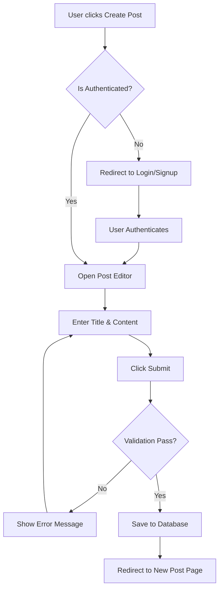
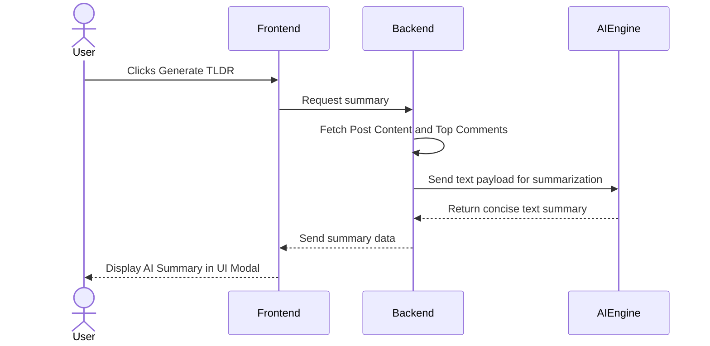
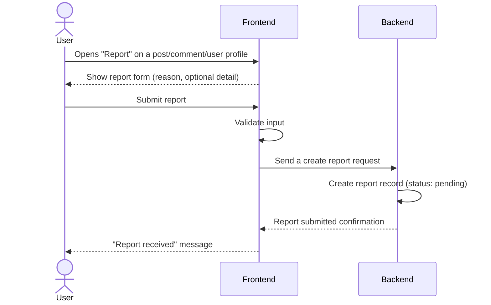
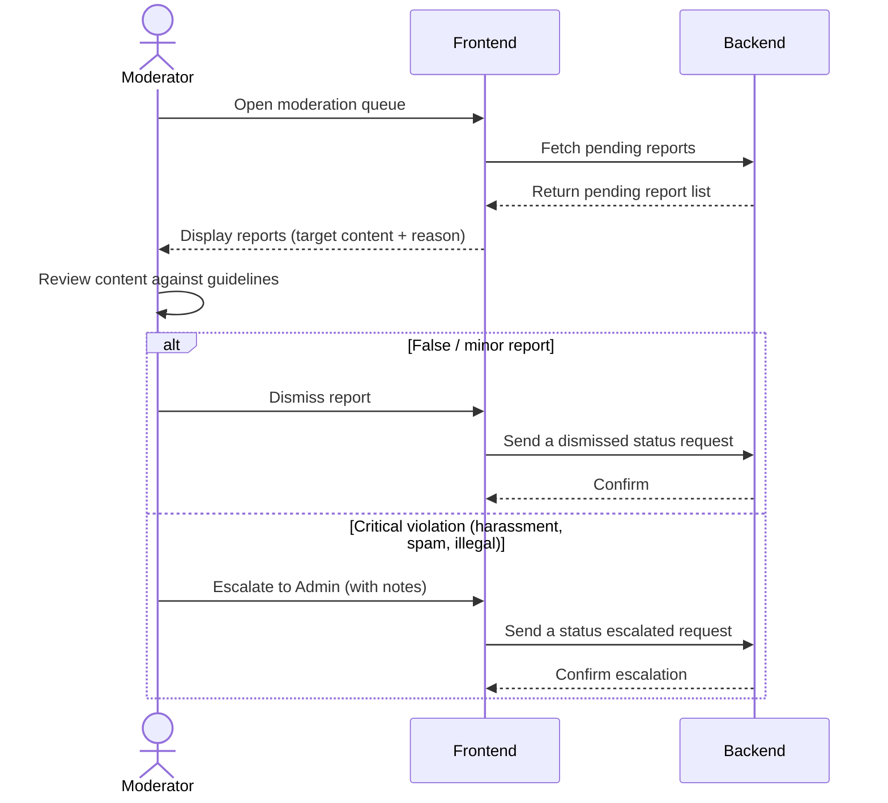
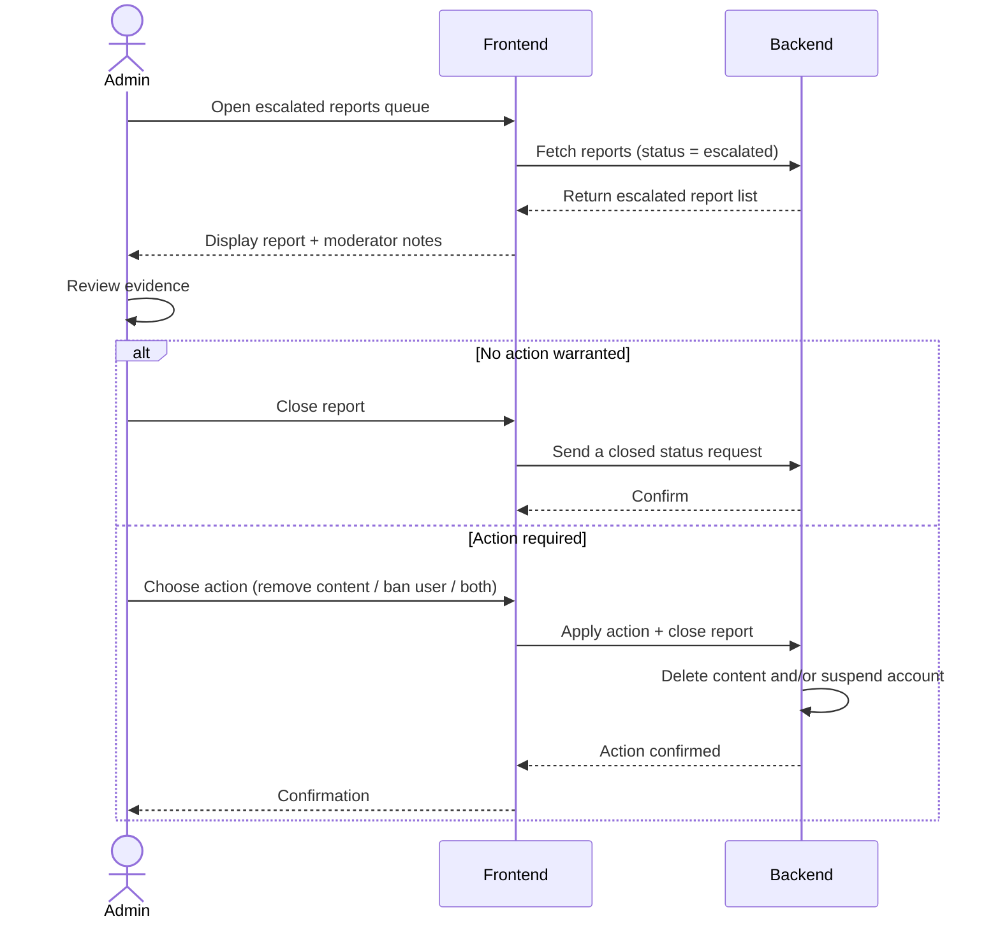
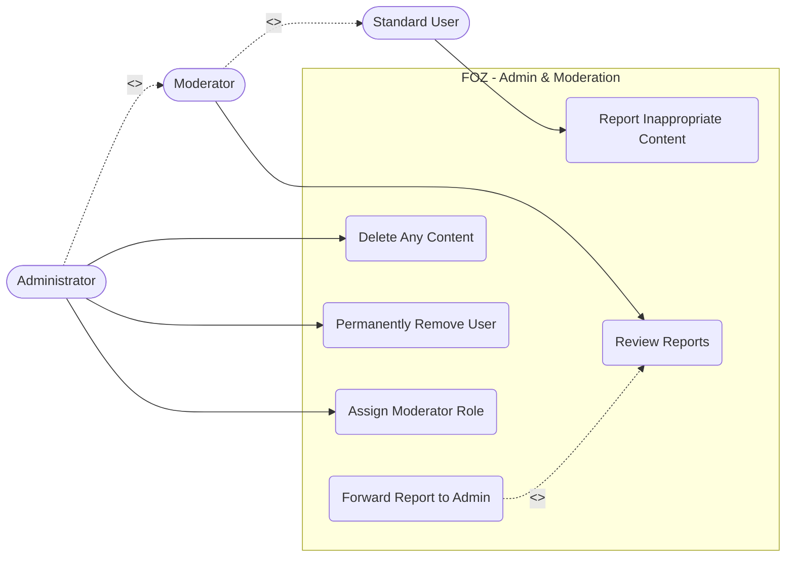
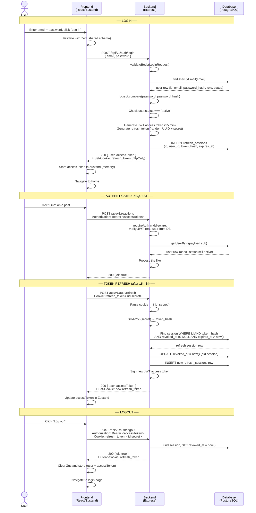
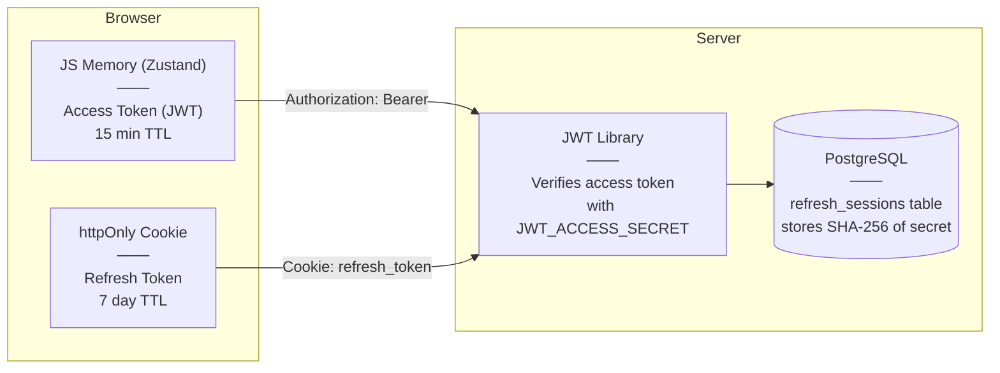
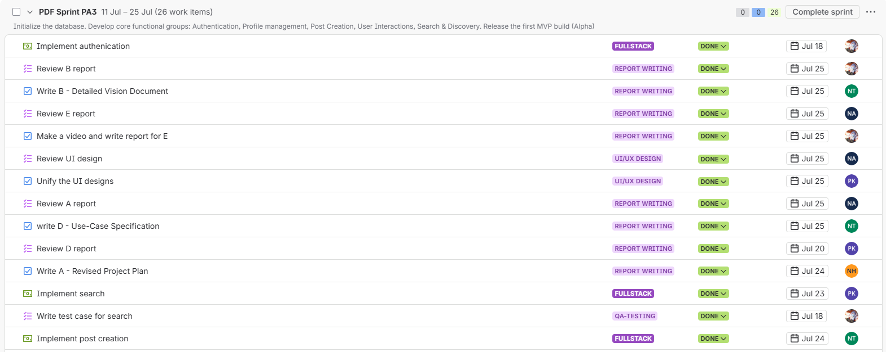
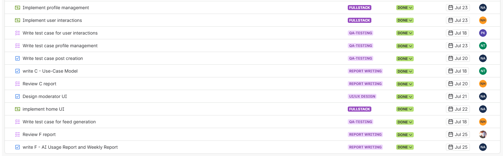

# Table of Contents

- [A - Revised Project Plan](#a---revised-project-plan)
	- [1. Introduction](#1-introduction)
	- [2. Project Overview](#2-project-overview)
	- [3. Project Organization](#3-project-organization)
		- [3.1 Team Structure and Member Roles](#31-team-structure-and-member-roles)
		- [3.2 Risk Management](#32-risk-management)
	- [4. Project Plan](#4-project-plan)
		- [4.1 Completed Sprint (Sprint 1 - PA1, Sprint 2 - PA2)](#41-completed-sprint-sprint-1---pa1-sprint-2---pa2)
			- [4.1.1 Sprint 1 - PA1](#411-sprint-1---pa1)
			- [4.1.2 Sprint 2 - PA2](#412-sprint-2---pa2)
		- [4.2 Current Sprint (Sprint 3 - PA3)](#42-current-sprint-sprint-3---pa3)
		- [4.3 Future Sprints (Sprint 4 - PA4, Sprint 5 - PA5)](#43-future-sprints-sprint-4---pa4-sprint-5---pa5)
			- [4.3.1 Planned Tasks](#431-planned-tasks)
		- [4.4 Schedule](#44-schedule)
		- [4.5 Build Plan](#45-build-plan)
- [B - Detailed Vision Document](#b---detailed-vision-document)
	- [Version 1.3](#version-13)
		- [Vision (Small Project)](#vision-small-project)
		- [1. Introduction](#1-introduction)
			- [1.1. References](#11-references)
		- [2. Positioning](#2-positioning)
			- [2.1. Problem Statement](#21-problem-statement)
			- [2.2. Product Position Statement](#22-product-position-statement)
		- [3. Stakeholder and User Descriptions](#3-stakeholder-and-user-descriptions)
			- [3.1. Stakeholder Summary](#31-stakeholder-summary)
			- [3.2. User Summary](#32-user-summary)
			- [3.3. User Environment](#33-user-environment)
			- [3.4. Summary of Key Stakeholder or User Needs](#34-summary-of-key-stakeholder-or-user-needs)
			- [3.5. Alternatives and Competition](#35-alternatives-and-competition)
		- [4. Product Overview](#4-product-overview)
			- [4.1. Product Perspective](#41-product-perspective)
			- [4.2. Assumptions and Dependencies](#42-assumptions-and-dependencies)
			- [4.3. Scope Boundaries](#43-scope-boundaries)
		- [5. Product Features](#5-product-features)
			- [Key Workflows (Mermaid Diagrams)](#key-workflows-mermaid-diagrams)
		- [6. Non-Functional Requirements](#6-non-functional-requirements)
- [C - Use-Case Model](#c---use-case-model)
	- [1. Authentication & Profile Management](#1-authentication--profile-management)
	- [2. Core Forum Interactions & AI Feature](#2-core-forum-interactions--ai-feature)
	- [3. Administration & Moderation](#3-administration--moderation)
- [D - Use-Case Specification](#d---use-case-specification)
	- [Revision History](#revision-history)
	- [Use-Case Specification: Sign Up](#use-case-specification-sign-up)
		- [1. Sign Up](#1-sign-up)
			- [1.1 Brief Description](#11-brief-description)
		- [2. Flow of Events](#2-flow-of-events)
			- [2.1 Basic Flow](#21-basic-flow)
			- [2.2 Alternative Flows](#22-alternative-flows)
				- [2.2.1 Email Already Exists](#221-email-already-exists)
				- [2.2.2 Weak Password](#222-weak-password)
		- [3. Special Requirements](#3-special-requirements)
		- [4. Preconditions](#4-preconditions)
		- [5. Postconditions](#5-postconditions)
		- [6. Extension Points](#6-extension-points)
		- [7. Prototype Requirement](#7-prototype-requirement)
	- [Use-Case Specification: Log In](#use-case-specification-log-in)
		- [1. Log In](#1-log-in)
			- [1.1 Brief Description](#11-brief-description)
		- [2. Flow of Events](#2-flow-of-events)
			- [2.1 Basic Flow](#21-basic-flow)
			- [2.2 Alternative Flows](#22-alternative-flows)
				- [2.2.1 Invalid Credentials](#221-invalid-credentials)
				- [2.2.2 Account Suspended](#222-account-suspended)
		- [3. Special Requirements](#3-special-requirements)
		- [4. Preconditions](#4-preconditions)
		- [5. Postconditions](#5-postconditions)
		- [6. Extension Points](#6-extension-points)
		- [7. Prototype Requirement](#7-prototype-requirement)
	- [Use-Case Specification: Log Out](#use-case-specification-log-out)
		- [1. Log Out](#1-log-out)
			- [1.1 Brief Description](#11-brief-description)
		- [2. Flow of Events](#2-flow-of-events)
			- [2.1 Basic Flow](#21-basic-flow)
			- [2.2 Alternative Flows](#22-alternative-flows)
				- [2.2.1 Session Already Expired](#221-session-already-expired)
		- [3. Special Requirements](#3-special-requirements)
		- [4. Preconditions](#4-preconditions)
		- [5. Postconditions](#5-postconditions)
		- [6. Extension Points](#6-extension-points)
		- [7. Prototype Requirement](#7-prototype-requirement)
	- [Use-Case Specification: Manage Profile](#use-case-specification-manage-profile)
		- [1. Manage Profile](#1-manage-profile)
			- [1.1 Brief Description](#11-brief-description)
		- [2. Flow of Events](#2-flow-of-events)
			- [2.1 Basic Flow](#21-basic-flow)
			- [2.2 Alternative Flows](#22-alternative-flows)
				- [2.2.1 Invalid Input Format](#221-invalid-input-format)
		- [3. Special Requirements](#3-special-requirements)
		- [4. Preconditions](#4-preconditions)
		- [5. Postconditions](#5-postconditions)
		- [6. Extension Points](#6-extension-points)
		- [7. Prototype Requirement](#7-prototype-requirement)
	- [Use-Case Specification: Change Password](#use-case-specification-change-password)
		- [1. Change Password](#1-change-password)
			- [1.1 Brief Description](#11-brief-description)
		- [2. Flow of Events](#2-flow-of-events)
			- [2.1 Basic Flow](#21-basic-flow)
			- [2.2 Alternative Flows](#22-alternative-flows)
				- [2.2.1 Incorrect Current Password](#221-incorrect-current-password)
		- [3. Special Requirements](#3-special-requirements)
		- [4. Preconditions](#4-preconditions)
		- [5. Postconditions](#5-postconditions)
		- [6. Extension Points](#6-extension-points)
		- [7. Prototype Requirement](#7-prototype-requirement)
	- [Use-Case Specification: Change Avatar](#use-case-specification-change-avatar)
		- [1. Change Avatar](#1-change-avatar)
			- [1.1 Brief Description](#11-brief-description)
		- [2. Flow of Events](#2-flow-of-events)
			- [2.1 Basic Flow](#21-basic-flow)
			- [2.2 Alternative Flows](#22-alternative-flows)
				- [2.2.1 File Too Large](#221-file-too-large)
		- [3. Special Requirements](#3-special-requirements)
		- [4. Preconditions](#4-preconditions)
		- [5. Postconditions](#5-postconditions)
		- [6. Extension Points](#6-extension-points)
		- [7. Prototype Requirement](#7-prototype-requirement)
	- [Use-Case Specification: Browse Feed](#use-case-specification-browse-feed)
		- [1. Browse Feed](#1-browse-feed)
			- [1.1 Brief Description](#11-brief-description)
		- [2. Flow of Events](#2-flow-of-events)
			- [2.1 Basic Flow](#21-basic-flow)
			- [2.2 Alternative Flows](#22-alternative-flows)
				- [2.2.1 No Posts Available](#221-no-posts-available)
		- [3. Special Requirements](#3-special-requirements)
		- [4. Preconditions](#4-preconditions)
		- [5. Postconditions](#5-postconditions)
		- [6. Extension Points](#6-extension-points)
		- [7. Prototype Requirement](#7-prototype-requirement)
	- [Use-Case Specification: Search Content](#use-case-specification-search-content)
		- [1. Search Content](#1-search-content)
			- [1.1 Brief Description](#11-brief-description)
		- [2. Flow of Events](#2-flow-of-events)
			- [2.1 Basic Flow](#21-basic-flow)
			- [2.2 Alternative Flows](#22-alternative-flows)
				- [2.2.1 Empty Query](#221-empty-query)
		- [3. Special Requirements](#3-special-requirements)
		- [4. Preconditions](#4-preconditions)
		- [5. Postconditions](#5-postconditions)
		- [6. Extension Points](#6-extension-points)
		- [7. Prototype Requirement](#7-prototype-requirement)
	- [Use-Case Specification: View Post Details](#use-case-specification-view-post-details)
		- [1. View Post Details](#1-view-post-details)
			- [1.1 Brief Description](#11-brief-description)
		- [2. Flow of Events](#2-flow-of-events)
			- [2.1 Basic Flow](#21-basic-flow)
			- [2.2 Alternative Flows](#22-alternative-flows)
				- [2.2.1 Post Removed or Hidden](#221-post-removed-or-hidden)
		- [3. Special Requirements](#3-special-requirements)
		- [4. Preconditions](#4-preconditions)
		- [5. Postconditions](#5-postconditions)
		- [6. Extension Points](#6-extension-points)
		- [7. Prototype Requirement](#7-prototype-requirement)
	- [Use-Case Specification: Create Post](#use-case-specification-create-post)
		- [1. Create Post](#1-create-post)
			- [1.1 Brief Description](#11-brief-description)
		- [2. Flow of Events](#2-flow-of-events)
			- [2.1 Basic Flow](#21-basic-flow)
			- [2.2 Alternative Flows](#22-alternative-flows)
				- [2.2.1 Content Validation Error](#221-content-validation-error)
		- [3. Special Requirements](#3-special-requirements)
		- [4. Preconditions](#4-preconditions)
		- [5. Postconditions](#5-postconditions)
		- [6. Extension Points](#6-extension-points)
		- [7. Prototype Requirement](#7-prototype-requirement)
	- [Use-Case Specification: Interact with Post](#use-case-specification-interact-with-post)
		- [1. Interact with Post](#1-interact-with-post)
			- [1.1 Brief Description](#11-brief-description)
		- [2. Flow of Events](#2-flow-of-events)
			- [2.1 Basic Flow](#21-basic-flow)
			- [2.2 Alternative Flows](#22-alternative-flows)
		- [3. Special Requirements](#3-special-requirements)
		- [4. Preconditions](#4-preconditions)
		- [5. Postconditions](#5-postconditions)
		- [6. Extension Points](#6-extension-points)
		- [7. Prototype Requirement](#7-prototype-requirement)
	- [Use-Case Specification: Leave Comment](#use-case-specification-leave-comment)
		- [1. Leave Comment](#1-leave-comment)
			- [1.1 Brief Description](#11-brief-description)
		- [2. Flow of Events](#2-flow-of-events)
			- [2.1 Basic Flow](#21-basic-flow)
			- [2.2 Alternative Flows](#22-alternative-flows)
				- [2.2.1 Empty Comment](#221-empty-comment)
		- [3. Special Requirements](#3-special-requirements)
		- [4. Preconditions](#4-preconditions)
		- [5. Postconditions](#5-postconditions)
		- [6. Extension Points](#6-extension-points)
		- [7. Prototype Requirement](#7-prototype-requirement)
	- [Use-Case Specification: Like/Unlike](#use-case-specification-likeunlike)
		- [1. Like/Unlike](#1-likeunlike)
			- [1.1 Brief Description](#11-brief-description)
		- [2. Flow of Events](#2-flow-of-events)
			- [2.1 Basic Flow](#21-basic-flow)
			- [2.2 Alternative Flows](#22-alternative-flows)
		- [3. Special Requirements](#3-special-requirements)
		- [4. Preconditions](#4-preconditions)
		- [5. Postconditions](#5-postconditions)
		- [6. Extension Points](#6-extension-points)
		- [7. Prototype Requirement](#7-prototype-requirement)
	- [Use-Case Specification: Request AI Summary](#use-case-specification-request-ai-summary)
		- [1. Request AI Summary](#1-request-ai-summary)
			- [1.1 Brief Description](#11-brief-description)
		- [2. Flow of Events](#2-flow-of-events)
			- [2.1 Basic Flow](#21-basic-flow)
			- [2.2 Alternative Flows](#22-alternative-flows)
				- [2.2.1 AI Service Error](#221-ai-service-error)
		- [3. Special Requirements](#3-special-requirements)
		- [4. Preconditions](#4-preconditions)
		- [5. Postconditions](#5-postconditions)
		- [6. Extension Points](#6-extension-points)
		- [7. Prototype Requirement](#7-prototype-requirement)
	- [Use-Case Specification: Delete Own Post](#use-case-specification-delete-own-post)
		- [1. Delete Own Post](#1-delete-own-post)
			- [1.1 Brief Description](#11-brief-description)
		- [2. Flow of Events](#2-flow-of-events)
			- [2.1 Basic Flow](#21-basic-flow)
			- [2.2 Alternative Flows](#22-alternative-flows)
				- [2.2.1 User Cancels Deletion](#221-user-cancels-deletion)
		- [3. Special Requirements](#3-special-requirements)
		- [4. Preconditions](#4-preconditions)
		- [5. Postconditions](#5-postconditions)
		- [6. Extension Points](#6-extension-points)
		- [7. Prototype Requirement](#7-prototype-requirement)
	- [Use-Case Specification: Report Inappropriate Content](#use-case-specification-report-inappropriate-content)
		- [1. Report Inappropriate Content](#1-report-inappropriate-content)
			- [1.1 Brief Description](#11-brief-description)
		- [2. Flow of Events](#2-flow-of-events)
			- [2.1 Basic Flow](#21-basic-flow)
			- [2.2 Alternative Flows](#22-alternative-flows)
				- [2.2.1 Content Already Reported by User](#221-content-already-reported-by-user)
		- [3. Special Requirements](#3-special-requirements)
		- [4. Preconditions](#4-preconditions)
		- [5. Postconditions](#5-postconditions)
		- [6. Extension Points](#6-extension-points)
		- [7. Prototype Requirement](#7-prototype-requirement)
	- [Use-Case Specification: Review Reports](#use-case-specification-review-reports)
		- [1. Review Reports](#1-review-reports)
			- [1.1 Brief Description](#11-brief-description)
		- [2. Flow of Events](#2-flow-of-events)
			- [2.1 Basic Flow](#21-basic-flow)
			- [2.2 Alternative Flows](#22-alternative-flows)
				- [2.2.1 Escalation Required](#221-escalation-required)
		- [3. Special Requirements](#3-special-requirements)
		- [4. Preconditions](#4-preconditions)
		- [5. Postconditions](#5-postconditions)
		- [6. Extension Points](#6-extension-points)
		- [7. Prototype Requirement](#7-prototype-requirement)
	- [Use-Case Specification: Forward Report to Admin](#use-case-specification-forward-report-to-admin)
		- [1. Forward Report to Admin](#1-forward-report-to-admin)
			- [1.1 Brief Description](#11-brief-description)
		- [2. Flow of Events](#2-flow-of-events)
			- [2.1 Basic Flow](#21-basic-flow)
			- [2.2 Alternative Flows](#22-alternative-flows)
		- [3. Special Requirements](#3-special-requirements)
		- [4. Preconditions](#4-preconditions)
		- [5. Postconditions](#5-postconditions)
		- [6. Extension Points](#6-extension-points)
		- [7. Prototype Requirement](#7-prototype-requirement)
	- [Use-Case Specification: Delete Any Content](#use-case-specification-delete-any-content)
		- [1. Delete Any Content](#1-delete-any-content)
			- [1.1 Brief Description](#11-brief-description)
		- [2. Flow of Events](#2-flow-of-events)
			- [2.1 Basic Flow](#21-basic-flow)
			- [2.2 Alternative Flows](#22-alternative-flows)
		- [3. Special Requirements](#3-special-requirements)
		- [4. Preconditions](#4-preconditions)
		- [5. Postconditions](#5-postconditions)
		- [6. Extension Points](#6-extension-points)
		- [7. Prototype Requirement](#7-prototype-requirement)
	- [Use-Case Specification: Permanently Remove User](#use-case-specification-permanently-remove-user)
		- [1. Permanently Remove User](#1-permanently-remove-user)
			- [1.1 Brief Description](#11-brief-description)
		- [2. Flow of Events](#2-flow-of-events)
			- [2.1 Basic Flow](#21-basic-flow)
			- [2.2 Alternative Flows](#22-alternative-flows)
		- [3. Special Requirements](#3-special-requirements)
		- [4. Preconditions](#4-preconditions)
		- [5. Postconditions](#5-postconditions)
		- [6. Extension Points](#6-extension-points)
		- [7. Prototype Requirement](#7-prototype-requirement)
	- [Use-Case Specification: Assign Moderator Role](#use-case-specification-assign-moderator-role)
		- [1. Assign Moderator Role](#1-assign-moderator-role)
			- [1.1 Brief Description](#11-brief-description)
		- [2. Flow of Events](#2-flow-of-events)
			- [2.1 Basic Flow](#21-basic-flow)
			- [2.2 Alternative Flows](#22-alternative-flows)
				- [2.2.1 User is already a Moderator](#221-user-is-already-a-moderator)
		- [3. Special Requirements](#3-special-requirements)
		- [4. Preconditions](#4-preconditions)
		- [5. Postconditions](#5-postconditions)
		- [6. Extension Points](#6-extension-points)
		- [7. Prototype Requirement](#7-prototype-requirement)
- [E - Implement 1 Functional Group using Spec Kit (Authentication)](#e---implement-1-functional-group-using-spec-kit-authentication)
	- [Submission Deliverables](#submission-deliverables)
		- [1. Overview](#1-overview)
		- [2. UI Layer](#2-ui-layer)
		- [3. API & Logic Layer](#3-api--logic-layer)
		- [4. Token Strategy](#4-token-strategy)
		- [5. Data Persistence](#5-data-persistence)
		- [6. Auth Flow Diagram](#6-auth-flow-diagram)
		- [7. Token Storage Diagram](#7-token-storage-diagram)
- [F - AI Usage Report and Weekly Report](#f---ai-usage-report-and-weekly-report)
	- [AI Usage Report](#ai-usage-report)
		- [Declaration of No AI Use](#declaration-of-no-ai-use)
		- [AI Usage Notes](#ai-usage-notes)
		- [Weekly Report](#weekly-report)
			- [Sprint Planning](#sprint-planning)
			- [Scrum Meetings](#scrum-meetings)
			- [Sprint Review](#sprint-review)
		- [Jira Board](#jira-board)

# A - Revised Project Plan

*Work performed by: Nguyễn Hải Nam | Reviewed by: Nguyễn Tuấn An | Edited by: Nguyễn Tuấn An*

All changes have been made compared to the PA2-2026 version can be found at: `changes.md`

## 1. Introduction

This project is a web-based forum application focused on fundamental community discussions. Its value lies in providing a simple, intuitive platform where users can easily ask questions, share knowledge, and connect over shared interests without navigating overly complex interfaces.

## 2. Project Overview

- **Goals:** Successfully build a user-friendly web-based forum application that covers all the core functions introduced in the scope below.

- **Scope:**
  - **In-scope:** Web-based application fulfilling core functional groups: Authentication, Profile management, Post Creation, Feed Generation, User Interactions, Search & Discovery, Administration & Moderation, Post Summarize (TL;DR).

  - **Out-of-scope:** Native mobile applications (iOS/Android), real-time chat channels, and complex personalized recommendation algorithms. We are strictly focusing on core web-based text discussions and AI summarization.

- **Deliverables:** Source code, phase reports (PA1 - PA5) and a completed web-based forum application demo at the end of the course.

- **Assumptions:**
  - All team members have a solid grasp of basic web programming and AI prompting skill.

  - The development environment (e.g., WSL, Git, related frameworks or databases, etc.) is configured uniformly and runs stably across all members' devices.

## 3. Project Organization

### 3.1 Team Structure and Member Roles

> **Team Structure:** All team members are expected to act as **Full-Stack Engineers** throughout the project lifecycle. The roles below designate leadership and domain ownership for specific project phases, meaning the assigned member will guide and manage that area while the entire team participates in the execution.

| **Member** | **Role** | **What to do** |
| --- | --- | --- |
| **Nguyễn Tuấn An** (24127011) | Project Manager | Facilitates meetings, tracks sprint progress, manages the project board (Jira), and ensures deadlines are met. Contributes to full-stack development. |
| **Nguyễn Hải Nam** (24127088) | QA Engineer (Tester) | Defines testing protocols. Leads the team in writing test cases and performing bug hunts. Contributes to full-stack development. |
| **Nguyễn Hải Trọng** (24127311) | Backend & Database Developer | Designs the database schema, establishes API architectures, and leads server-side performance strategies. Guides the team on database queries and backend logic. Contributes to full-stack development. |
| **Phạm Đinh Gia Khánh** (24127420) | UI/UX Designer | Leads the wireframing, prototyping, and user journey mapping phases. Ensures design consistency across the application. Guides the team during frontend UI implementation. Contributes to full-stack development. |
| **Võ An Phú** (24127494) | Frontend Developer | Establishes frontend coding standards, selects frontend frameworks/libraries, and ensures responsive, accessible design implementation. Contributes to full-stack development. |

### 3.2 Risk Management

- **Member Unavailability:**
  - **Risk:** Team members may become temporarily unavailable due to midterm exams or workloads from other courses, potentially causing bottlenecks during Sprints or reducing the overall quality of deliverables.

  - **Mitigation strategy:**
    - Enforce cross-training and mandatory peer code reviews. This ensures shared knowledge of the codebase, allowing any member to seamlessly take over another's tasks in emergencies.

    - Front-load complex and time-consuming tasks to the beginning of each Sprint when members have more bandwidth.

- **Technology Issues:**
  - **Risk:** Running out of AI and TL;DR engine API token quotas during development or testing phases.

  - **Mitigation strategy:** Utilize multiple AI platforms in development phases (such as Github Copilot, Antigravity). Architect the system to support fallback platforms for the AI engine (such as Google Gemini, OpenAI, and Microsoft Copilot) to ensure that if one service fails or hits a hard limit, the application seamlessly switches to another without significant delays.

- **Scope Creep:**
  - **Risk:** Team members may attempt to add "nice-to-have" features (like real-time notifications) that delay the schedule for core PA deliverables.

  - **Mitigation strategy:** Strictly enforce that all new feature ideas must be logged in the Jira backlog and require team approval before being pulled into an active sprint.

## 4. Project Plan

This project applies the Scrum process and is organized into 5 Sprints, each
corresponding to one PA and lasting 2-3 weeks.

### 4.1 Completed Sprint (Sprint 1 - PA1, Sprint 2 - PA2)

#### 4.1.1 Sprint 1 - PA1

- **Status:** Completed

- **Achievements:**
  - **Group Registration:** Formed a 5-member team, finalized the project name, and successfully registered.

  - **Project Proposal:**
    - Proposed a web-based application featuring 8 functional groups, targeting web users.

    - Defined core AI feature Post Summarization (TL;DR), which utilizes an AI engine to generate brief on-demand overviews of lengthy discussion posts.

  - **Existing App Survey:** Analyzed and compared 2 similar applications Threads and Reddit to identify UI/UX patterns and key factors for our project.

  - **Team Contract:** Established team roles, communication protocols, work schedules, documentation and contribution criteria, as well as unified processes in decision-making, conflict resolution and adjustments.

  - **Development Tools and Process Setup:** Initialized the Scrum workflow. Set up Jira for task tracking, created a private GitHub repository with standard structure, and ensured all members are equipped with AI coding assistant accounts.

#### 4.1.2 Sprint 2 - PA2

- **Status:** Completed

- **Achievements:**
  - **Project Plan:** Drafted the initial version of the project plan, covering Introduction, Project Overview, Project Organization (team structure and roles, risk management), and Project Plan (Sprint 1 summary, Sprint 2 detailed tasks, planned tasks for future sprints,schedule, and build plan).

  - **Vision Document:** Drafted the initial version of the vision document, covering Introduction, Positioning (problem statement, product position statement), Stakeholder and User Descriptions, Product Overview, Product Features, and Non-Functional Requirements.

  - **Spec Kit Initialization:** Set up a GitHub repository with Spec Kit integrated, initialized Spec Kit for the project and placed the generated artifacts (including `constitution.md`) inside the `/src` folder. All team members completed the Spec Kit training via the official tutorials.

  - **AI Usage Report and Weekly Report:** Declared AI tool usage for the sprint following the AI usage guidelines, and documented Sprint Planning, Scrum meetings, and Sprint Review as required by the Weekly Report instructions, including Jira task screenshots showing task assignments and progress.

  - However, the authentication was delayed due to technical difficulties with the database and system setup.

### 4.2 Current Sprint (Sprint 3 - PA3)

- **Main Goal:**
  - Initialize the database.
  - Revise the project plan and vision document.
  - Develop core functional groups: Profile management, Post Creation, User Interactions, Search & Discovery.
  - Release the first MVP build (Alpha)

**Detailed Tasks:**

| Task Description                                    | Assignee            | Reviewer            | Due Date   |
| --------------------------------------------------- | ------------------- | ------------------- | ---------- |
| Initialize Database and setup | Nguyễn Tuấn An | Võ An Phú | Jul 22 |
| Write Revised Project Plan | Nguyễn Hải Nam | Nguyễn Tuấn An | Jul 24 |
| Implement post creation | Nguyễn Hải Trọng | Nguyễn Tuấn An | Jul 24 |
| Write Use-Case Model | Nguyễn Hải Trọng | Nguyễn Hải Nam | Jul 18 |
| Implement profile management | Nguyễn Tuấn An | Nguyễn Hải Trọng | Jul 23 |
| Write Detailed Vision Document | Nguyễn Hải Trọng | Võ An Phú | Jul 24 |
| Write AI Usage Report and Weekly Report | Nguyễn Tuấn An | Võ An Phú | Jul 25 |
| Implement search | Phạm Đinh Gia Khánh | Võ An Phú | Jul 23 |
| Write Use-Case Specification | Nguyễn Hải Trọng | Phạm Đinh Gia Khánh | Jul 24 |
| Implement user interactions | Nguyễn Hải Nam | Phạm Đinh Gia Khánh | Jul 23 |
| Implement authentication | Võ An Phú | Nguyễn Hải Nam | Jul 18 |
| Make a video for report | Võ An Phú | Nguyễn Tuấn An | Jul 25 |
| Unify the UI designs | Phạm Đinh Gia Khánh | Nguyễn Tuấn An | Jul 24 |
| Design moderator UI | Nguyễn Tuấn An | Phạm Đinh Gia Khánh | Jul 21 |

### 4.3 Future Sprints (Sprint 4 - PA4, Sprint 5 - PA5)

#### 4.3.1 Planned Tasks

- **Sprint 4:** Integration & AI Implementation

  - Develop core functional groups: Feed Generation, Administration & Moderation, Post Summarize

  - Execute system testing.

  - Release the beta build.

- **Sprint 5:** Polish, Optimization & Deployment

  - Testing on non-functional requirements.

  - Finalize all project documentation.

  - Deploy the final release for the project demo.

### 4.4 Schedule

The detailed schedule of all tasks, work statuses (To Do, In Progress, In Review, Done), and overall progress are strictly managed, tracked, and continuously updated on the project's Jira board.

### 4.5 Build Plan

Build 1.0 (Alpha) - End of Sprint 3 (Status: **Upcoming**): A baseline build focusing on backend connectivity and basic frontend rendering. Core CRUD operations for forum posts will be testable, though the UI may lack final styling.

Build 2.0 (Beta) - End of Sprint 4: A feature-complete build including the integrated AI summarization tool. This build will be subjected to rigorous testing.

Build 3.0 (Final) - End of Sprint 5: The final, polished build deployed to the production environment, thoroughly tested for all aspects, ready for the final PA5 demonstration.
ete all Table of Contents (Including title) -> CTRL P -> TABLE OF CONTENTS==

# B - Detailed Vision Document

*Work performed by: Nguyễn Hải Trọng | Reviewed by: Võ An Phú | Edited by: Võ An Phú*

All changes have been made compared to the PA2-2026 version can be found at: `changes.md`

## Version 1.3

| | |
| :--- | :--- |
| **FOZ** | Version: 1.3 |
| **Vision document** | Date: 25/07/2026 |

### Vision (Small Project)
| Date | Version | Description | Author | Review by |
| :--- | :--- | :--- | :--- | :--- |
| 07/07/2026 | 1.0 | Defined problem statement, user roles, product features, and non-functional requirements. | Nguyễn Hải Trọng | Võ An Phú |
| 08/07/2026 | 1.1 | Added scope boundaries, moderation workflow, security/accessibility NFRs, and clarified role capabilities. | Võ An Phú | Võ An Phú |
| 24/07/2026 | 1.2 | Formatted table of content, detailed alternatives and competitors, user environments and product non-functional requirements. | Nguyễn Hải Trọng | Võ An Phú |
| 25/07/2026 | 1.3 | Clarified media support (images/video) throughout, added data privacy and accessibility NFRs, removed implementation-specific references, grouped features by priority, general editorial cleanup. | Nguyễn Hải Trọng | Võ An Phú |
### 1. Introduction

The purpose of this Vision Document is to collect, analyze, and define the high-level needs and features of FOZ, a web-based forum application. It focuses on the capabilities required by the stakeholders and target users, providing a clear foundation for the project's scope. 

#### 1.1. References

* Introduction to Software Engineering: PA1-2026 Guidelines.
* Introduction to Software Engineering: PA2-2026 Guidelines.
* FOZ Project Proposal (PA1).
* FOZ Existing App Survey (Reddit, Threads).

### 2. Positioning

#### 2.1. Problem Statement

| | |
| :--- | :--- |
| **The problem of** | cluttered, overly complex, and algorithm-heavy interfaces in current online discussion platforms |
| **affects** | general web users seeking straightforward, topic-focused community spaces |
| **the impact of which is** | a high barrier to entry, distraction from core discussions, and a frustrating user experience when trying to find specific information |
| **a successful solution would be** | a simple, intuitive web-based forum that focuses purely on meaningful community discussions, equipped with AI tools to quickly summarize long threads. |

#### 2.2. Product Position Statement

| | |
| :----- | :----- |
| **For** | General web users seeking online community spaces |
| **Who** | want to easily ask questions, share knowledge, and connect over shared interests |
| **The FOZ** | is a web-based forum application |
| **That** | provides a simple, intuitive platform focusing on fundamental community discussions with an on-demand AI summarization feature |
| **Unlike** | traditional platforms (e.g., Reddit or Threads) that feature overwhelming UI layouts and aggressive recommendation algorithms |
| **Our product** | delivers a streamlined, clutter-free user experience tailored specifically for community dialogue — supporting text, images, and video — with rapid information consumption. |

### 3. Stakeholder and User Descriptions

#### 3.1. Stakeholder Summary

| Name | Description | Responsibilities |
| :--- | :--- | :--- |
| **Project Manager** | Team leader (Nguyễn Tuấn An). | Facilitates meetings, tracks sprint progress in Jira, ensures deadlines are met, and oversees project delivery. |
| **Development Team** | Full-stack engineers (Nam, Trọng, Khánh, Phú), with domain leads for QA (Nam), Backend/DB (Trọng), UI/UX (Khánh), and Frontend (Phú). | Designs UI/UX, builds frontend/backend architectures, manages the database, and ensures software quality via testing. Detailed role assignments are in the Project Plan. |
| **Instructors / TAs** | Course evaluators. | Monitors project progress, provides feedback, and evaluates the final product against course requirements. |

#### 3.2. User Summary

| Name | Description | Responsibilities |
| :--- | :--- | :--- |
| **Guest** | Unauthenticated visitors. | Read-only access: can view profiles, read posts, and see comments. Cannot post, like, report, or trigger the AI Post Summarize (TL;DR) feature. Any write interaction prompts the authentication flow. |
| **Standard User** | Authenticated community members. | Can create posts, like/unlike posts and comments, comment, report inappropriate posts/comments or other users, manage their own profile, and delete their own posts. |
| **Moderator** | Elevated users with community management tools. | Inherits all Standard User abilities. Reviews user reports and forwards critical issues to Administrators. Cannot permanently delete users or posts from the database or alter system-wide configurations. |
| **Administrator** | Highest level of system access. | Full control via the admin dashboard: can permanently ban users, delete content, and assign Moderator roles. All actions are performed through the application UI, not direct database access. |

#### 3.3. User Environment

FOZ is designed as a web-first application, ensuring maximum accessibility across various devices without the need for dedicated app installations.
- **Supported Devices:** Desktop computers, laptops, tablets, and mobile smartphones. The UI is fully responsive and adapts to screen sizes ranging from 320px (mobile) to 4K displays.
- **Operating Systems:** Platform-agnostic (Windows, macOS, Linux, iOS, Android).
- **Supported Browsers:** Modern web browsers with JavaScript enabled, including Google Chrome (v90+), Safari (v14+), Microsoft Edge (v90+), and Mozilla Firefox (v88+).
- **Network Requirements:** Requires an active broadband, 4G, or 5G internet connection for real-time interactions, uploading images and videos, and fetching dynamic feeds. Offline mode is not supported.

#### 3.4. Summary of Key Stakeholder or User Needs

| Need                                        | Priority | Concerns                                                                   | Current Solution                             | Proposed Solutions                                                                         |
| :------------------------------------------ | :------- | :------------------------------------------------------------------------- | :------------------------------------------- | :----------------------------------------------------------------------------------------- |
| **Quick comprehension of long discussions** | High     | Users do not have time to read hundreds of replies to find the consensus.  | Scrolling manually and reading top comments. | Integrate an AI "Post Summarize (TL;DR)" feature.                                          |
| **Discover relevant content**               | High     | Users want to find active communities without heavy, intrusive algorithms. | Algorithmic "For You" pages (e.g., Threads). | Generate a clean feed based purely on recent engagement metrics (comment velocity, likes). |
| **Safe community environment**              | Medium   | Toxic behavior ruins the discussion experience.                            | Automated bans which are often inaccurate.   | A multi-tier user reporting system involving Standard Users, Moderators, and Admins.       |

#### 3.5. Alternatives and Competition
Based on our PA1 survey and market analysis, FOZ competes in the community discussion space against several established platforms:
- **Threads:** Features a very clean UI and smooth cross-platform authentication (via Instagram). However, it leans heavily towards micro-blogging and aggressive algorithm recommendations rather than structured, topic-based forum discussions. FOZ focuses on chronological/engagement-based feeds without intrusive algorithmic manipulation.
- **Reddit:** Excels in community categorization and deep, nested discussions. However, its interface can be highly cluttered and overwhelming for casual users, and its strict karma/rules system acts as a high barrier to entry. FOZ bridges this gap by offering the deep discussion capabilities of Reddit (nested comments) but with a minimalist, accessible UI similar to Threads.

### 4. Product Overview

#### 4.1. Product Perspective
FOZ is an independent, self-contained web application. It acts as a centralized hub for community interactions, requiring only a modern web browser to access. The system will integrate with a third-party AI service (such as the OpenAI API or Gemini API) strictly to power the "Post Summarize" feature.

#### 4.2. Assumptions and Dependencies

- **Internet Connection:** The application requires a stable internet connection to fetch real-time discussions.
- **AI API Availability:** The TL;DR feature depends on external AI providers. To mitigate quota exhaustion or outages, the backend supports a fallback provider chain so that a single provider failure does not disable the feature.
- **Modern Browsers:** It is assumed that users are operating modern web browsers with JavaScript enabled.

#### 4.3. Scope Boundaries

- **In-scope:** A web-based application covering the functional groups defined in `5. Product Features` — Authentication, Profile Management, Post Creation (text, images, video), Feed Generation, User Interactions, Search & Discovery, Administration & Moderation, and Post Summarize (TL;DR).
- **Out-of-scope:** Native mobile applications (iOS/Android), real-time chat channels, push notifications, and complex personalized recommendation algorithms.

### 5. Product Features 

**1. Post Creation** *(Priority: High)*

Authenticated users can compose and publish posts containing text, images, and videos. A clean editor encourages thoughtful content creation and drives the community's core content engine.

**2. Feed Generation** *(Priority: High)*

A dynamic feed surfaces posts ranked by recent engagement metrics (comment velocity, likes). The feed includes text, image, and video content, surfaced without invasive tracking or algorithmic manipulation.

**3. User Interactions (Comments & Likes)** *(Priority: High)*

Users can browse threads and interact through nested comments and likes on posts and comments. This drives ongoing engagement and surfaces popular discussions.

**4. AI Post Summarize (TL;DR)** *(Priority: High)*

On-demand AI-generated summaries of lengthy threads, incorporating top comments for context. Allows time-constrained users to quickly grasp the main points and overall consensus of a discussion.

**5. Authentication & Account Security** *(Priority: High)*

Sign-up, login, logout, and session management gate all write operations. Passwords are hashed and salted; sessions use secure, HttpOnly cookies with JWT tokens.

**6. Search & Discovery** *(Priority: Medium)*

Users can query posts (including media captions), user profiles, and topics across the database. Essential for finding specific content as the forum grows.

**7. Administration & Moderation System** *(Priority: Medium)*

A multi-tiered reporting system: users flag content, moderators review and escalate, admins take final action (remove content, ban users). Maintains community safety and discourse quality.

**8. Profile Management** *(Priority: Medium)*

Authenticated users can edit profile information, change passwords, and update avatars. Provides a recognizable, controllable presence within the community.

#### Key Workflows (Mermaid Diagrams)

**Workflow 1: User Authentication & Post Creation**

**Workflow 2: AI Post Summarize (TL;DR)**

**Workflow 3: User Reports a Post, Comment, or User**

**Workflow 4: Moderator Reviews Reports & Escalates Critical Cases**

**Workflow 5: Admin Acts on Escalated Reports**

### 6. Non-Functional Requirements

**Performance Requirements**

- The application's initial page load time must be < 2 seconds on a standard broadband connection. Frontend routing between pages should feel instantaneous (< 200ms).
- Backend API response times for standard queries (fetching feeds, creating posts, querying comments) must be < 500 milliseconds.
- The system architecture must support at least 100 concurrent users interacting with the platform simultaneously without noticeable performance degradation.

**Security Requirements**

- All user passwords must be securely hashed and salted (using bcrypt or argon2) before being stored in the PostgreSQL database.
- All client-server communications must be encrypted using HTTPS (TLS 1.2 or higher).
- All user input must be strictly validated server-side using robust schema validation and output-encoded to prevent Cross-Site Scripting (XSS) and SQL injection attacks.
- Authentication sessions must be managed via secure, HttpOnly, SameSite cookies with JWT tokens to prevent Cross-Site Request Forgery (CSRF).
- API endpoints, especially the AI Post Summarize (TL;DR) and authentication routes, must be rate-limited per user/IP to prevent brute-force attacks, quota abuse, and cost escalation.
- User data (profiles, posts, comments) must be stored securely. Users must be able to delete their account and associated content. The system must not share personal data with third parties beyond what is required for core functionality.

**Reliability & Availability Requirements**

- The system should target a 99.9% uptime for core features (viewing and creating posts).
- If the external AI provider is unavailable or rate-limited, the TL;DR feature must degrade gracefully with a clear error message in the UI, without affecting the rest of the application's functionality.
- The application must log critical errors and key moderation actions (bans, content removal, report escalations) to support system monitoring, debugging, and incident review.

**Platform & Usability Requirements**

- The UI must be implemented using responsive design principles, ensuring it renders correctly and maintains high usability across mobile, tablet, and desktop viewports.
- The application must be rigorously tested and confirmed functional on the latest stable versions of Google Chrome, Safari, Mozilla Firefox, and Microsoft Edge.
- The platform should follow WCAG basic guidelines, including proper semantic HTML, alt-text for media attachments, and sufficient color contrast ratios to accommodate visually impaired users.
- All interactive elements must be keyboard-navigable. The application should support screen readers via proper ARIA attributes and semantic HTML structure.
- Core actions (create a post, comment, search, generate TL;DR) must be highly intuitive, allowing a new authenticated user to complete them successfully without any external training, tutorials, or documentation.

# C - Use-Case Model

*Performed by: Nguyễn Hải Trọng | Reviewed by: Nguyễn Hải Nam | Edited by: Nguyễn Hải Nam*

Based on the requirements documented in the Vision Document, the system's use cases are modeled below using Mermaid syntax[cite: 10]. To ensure clarity and maintainability, the comprehensive system is divided into three logical diagrams based on functional groups.

## 1. Authentication & Profile Management
This diagram covers the fundamental access and identity management functionalities.

- **Actors:** Guest, Standard User.
- **Generalization:** `Standard User` inherits baseline viewing capabilities from `Guest`.
- **Relationships:** `Change Password` and `Change Avatar` are optional extensions of the `Manage Profile` use case.

## 2. Core Forum Interactions & AI Feature
This diagram illustrates the primary value proposition of the forum, including post creation, interaction, discovery, and the AI capability.

- **Actors:** Guest, Standard User.

- **Relationships:**
    - `Leave Comment` and `Like/Unlike` optionally extend the general `Interact with Post` use case.

    - `Request AI Summary` extends the `View Post Details` use case, representing the on-demand "Post Summarize (TL;DR)" feature.

## 3. Administration & Moderation
This diagram maps out the reporting system and elevated privileges required to maintain a safe community environment.

* **Actors:** Standard User, Moderator, Administrator.

* **Generalization:** `Moderator` inherits capabilities from `Standard User`. `Administrator` inherits capabilities from Moderator and holds the highest access level.

* **Relationships:** `Forward Report to Admin` extends the `Review Reports` use case when a `Moderator` encounters a severe violation they cannot fully resolve.

# D - Use-Case Specification
*Performed by: Nguyễn Hải Trọng | Reviewed by: Phạm Định Gia Khánh | Edited by: Phạm Định Gia Khánh*

## Revision History

| Date | Version | Description | Author |
| :--- | :--- | :--- | :--- |
| 19/Jul/2026 | 1.0 | Initial draft: Documented all 21 Use-Case Specifications covering Auth, Core Interactions, and Moderation. | Nguyễn Hải Trọng |

## Use-Case Specification: Sign Up

**Project Name:** FOZ  
**Version:** 1.0  
**Document identifier:** FOZ-UCS-01

### 1. Sign Up
* **Use-Case ID:** UC-01
* **Actor(s):** Guest

#### 1.1 Brief Description
This use case allows an unauthenticated guest to create a new user account and profile on the FOZ platform using their email and a secure password.

### 2. Flow of Events

#### 2.1 Basic Flow
1. The use case begins when the Guest navigates to the Registration page.
2. The user enters a valid email address and a strong password.
3. The user clicks "Create account".
4. The system validates the inputs (email format, password length > 8 chars).
5. The system checks if the email is already registered.
6. The system securely hashes the password using bcrypt.
7. The system creates a new record in the `user_accounts` table (role: `standard`, status: `active`) and a default record in the `profiles` table.
8. The system issues an access token and a refresh token (saved in `refresh_sessions`).
9. The system redirects the user to the Home Feed.

#### 2.2 Alternative Flows

##### 2.2.1 Email Already Exists
1. If at step 5, the email exists in the database.
2. The system aborts the registration.
3. The system displays a generic error: "An account with this email already exists".
4. The flow resumes at step 2.

##### 2.2.2 Weak Password
1. If at step 4, the password is less than 8 characters.
2. The system highlights the field with "Password must be at least 8 characters".
3. The flow resumes at step 2.

### 3. Special Requirements
* **Security:** Passwords must be hashed via bcrypt with a minimum cost of 12. Plaintext passwords must never be logged.

### 4. Preconditions
* The user must be a Guest (unauthenticated).

### 5. Postconditions
* A new user account and profile are saved in the database. The user is signed in.

### 6. Extension Points
* None.

### 7. Prototype Requirement 
* **Screen 1 (Basic Flow):**
    
* **Screen 2 (Alt Flow):**
    

## Use-Case Specification: Log In

**Project Name:** FOZ  
**Version:** 1.0  
**Document identifier:** FOZ-UCS-02

### 1. Log In
* **Use-Case ID:** UC-02
* **Actor(s):** Guest

#### 1.1 Brief Description
This use case describes how a registered Guest accesses their account by providing valid credentials.

### 2. Flow of Events

#### 2.1 Basic Flow
1. The use case begins when the Guest navigates to the Login page.
2. The user enters their email and password, then clicks "Sign In".
3. The system finds the user in `user_accounts` and verifies the password hash.
4. The system checks if the account status is `active`.
5. The system issues an Access Token and sets a Refresh Token cookie.
6. The system redirects the user to the Home Feed.

#### 2.2 Alternative Flows

##### 2.2.1 Invalid Credentials
1. If at step 3, the email is not found or the password does not match.
2. The system displays: "Invalid email or password".
3. The flow resumes at step 2.

##### 2.2.2 Account Suspended
1. If at step 4, the account status is `suspended` or `banned`.
2. The system displays: "Your account is not currently available."
3. The use case ends.

### 3. Special Requirements
* **Rate Limiting:** Maximum 10 attempts per 15 minutes to prevent brute-force attacks.

### 4. Preconditions
* The user is unauthenticated.

### 5. Postconditions
* The user is authenticated and an active session is recorded in `refresh_sessions`.

### 6. Extension Points
* None.

### 7. Prototype Requirement 
* **Screen 1 (Basic Flow):**
   
* **Screen 2 (Alt Flow):**
  

## Use-Case Specification: Log Out

**Project Name:** FOZ  
**Version:** 1.0  
**Document identifier:** FOZ-UCS-03

### 1. Log Out
* **Use-Case ID:** UC-03
* **Actor(s):** Standard User

#### 1.1 Brief Description
Allows an authenticated user to securely end their active session on the current device.

### 2. Flow of Events

#### 2.1 Basic Flow
1. The use case begins when the user clicks the "Sign out" button.
2. The system reads the refresh cookie to identify the current session.
3. The system updates the `revoked_at` timestamp in the `refresh_sessions` table for that session.
4. The system clears the local access token and the refresh cookie from the browser.
5. The system redirects the user to the Login page.

#### 2.2 Alternative Flows

##### 2.2.1 Session Already Expired
1. If at step 2, the session token is already expired or invalid.
2. The system proceeds to step 4 without database updates.

### 3. Special Requirements
* None.

### 4. Preconditions
* The user must be authenticated.

### 5. Postconditions
* The user is signed out and redirected to a public page.

### 6. Extension Points
* None.

### 7. Prototype Requirement 
* **Screen 1 (Basic Flow):** 
  

## Use-Case Specification: Manage Profile

**Project Name:** FOZ  
**Version:** 1.0  
**Document identifier:** FOZ-UCS-04

### 1. Manage Profile
* **Use-Case ID:** UC-04
* **Actor(s):** Standard User

#### 1.1 Brief Description
Allows the user to update their public-facing information such as display name, bio, location, and website.

### 2. Flow of Events

#### 2.1 Basic Flow
1. The use case begins when the user navigates to "Edit Profile".
2. The system retrieves current data from the `profiles` table.
3. The user edits text fields (Display Name, Bio, Location, Website) and clicks "Save".
4. The system validates the inputs (e.g., URL format for website).
5. The system updates the `profiles` table and the `updated_at` timestamp.
6. The system displays a success message.

#### 2.2 Alternative Flows

##### 2.2.1 Invalid Input Format
1. If at step 4, the website URL is invalid.
2. The system displays an error below the website field.
3. The flow resumes at step 3.

### 3. Special Requirements
* None.

### 4. Preconditions
* The user is authenticated.

### 5. Postconditions
* Profile data is updated in the database.

### 6. Extension Points
* **Change Password:** Extended via UC-05.
* **Change Avatar:** Extended via UC-06.

### 7. Prototype Requirement 
* **Screen 1 (Basic Flow):**
  

## Use-Case Specification: Change Password

**Project Name:** FOZ  
**Version:** 1.0  
**Document identifier:** FOZ-UCS-05

### 1. Change Password
* **Use-Case ID:** UC-05
* **Actor(s):** Standard User

#### 1.1 Brief Description
Allows an authenticated user to change their password securely by verifying their current password.

### 2. Flow of Events

#### 2.1 Basic Flow
1. The use case extends UC-04 when the user selects "Change password".
2. The user enters their current password, a new password, and confirms the new password.
3. The user clicks "Update password".
4. The system verifies the current password against the stored `password_hash`.
5. The system validates the new password strength.
6. The system hashes the new password and updates `user_accounts`.
7. The system displays a success toast message and redirects to home.

#### 2.2 Alternative Flows

##### 2.2.1 Incorrect Current Password
1. If at step 4, the current password does not match.
2. The system displays "Invalid credentials".
3. The flow resumes at step 2.

### 3. Special Requirements
* **Security:** The new password must not be identical to the old password.

### 4. Preconditions
* The user is authenticated.

### 5. Postconditions
* The user's password hash is updated.

### 6. Extension Points
* None.

### 7. Prototype Requirement 
* **Screen 1 (Basic Flow):** 
  
  **Change Password will be in Settings**

## Use-Case Specification: Change Avatar

**Project Name:** FOZ  
**Version:** 1.0  
**Document identifier:** FOZ-UCS-06

### 1. Change Avatar
* **Use-Case ID:** UC-06
* **Actor(s):** Standard User

#### 1.1 Brief Description
Allows an authenticated user to upload a new profile picture.

### 2. Flow of Events

#### 2.1 Basic Flow
1. The use case extends UC-04 when the user clicks the "Upload picture" icon.
2. The user selects an image file from their device.
3. The system validates the file type and size.
4. The system uploads the file to storage and retrieves the image URL.
5. The system updates the `avatar_url` in the `profiles` table.
6. The system refreshes the avatar display on the UI.

#### 2.2 Alternative Flows

##### 2.2.1 File Too Large
1. If at step 3, the file exceeds the 5MB limit.
2. The system aborts the upload and displays "File size exceeds 5MB".
3. The flow resumes at step 1.

### 3. Special Requirements
* **Space:** Image uploads must be limited to 5MB to conserve server storage.

### 4. Preconditions
* The user is authenticated.

### 5. Postconditions
* The new avatar is visible publicly on the user's profile.

### 6. Extension Points
* None.

### 7. Prototype Requirement 
* **Screen 1 (Basic Flow):** 
  

## Use-Case Specification: Browse Feed

**Project Name:** FOZ  
**Version:** 1.0  
**Document identifier:** FOZ-UCS-07

### 1. Browse Feed
* **Use-Case ID:** UC-07
* **Actor(s):** Guest, Standard User

#### 1.1 Brief Description
Allows users to view a dynamic timeline of forum posts sorted by recent engagement metrics or chronological order.

### 2. Flow of Events

#### 2.1 Basic Flow
1. The use case begins when the user navigates to the application's homepage.
2. The system queries the `posts` table for content with `visibility_state = 'public'` and `lifecycle_state = 'active'`.
3. The system sorts the posts based on engagement algorithms (e.g., recent comment velocity, likes).
4. The system displays the feed with post titles, author avatars, and interaction counts.
5. The user scrolls to load more posts (pagination).

#### 2.2 Alternative Flows

##### 2.2.1 No Posts Available
1. If at step 2, the database returns no posts.
2. The system displays a "No discussions found. Be the first to post!" placeholder.
3. The use case ends.

### 3. Special Requirements
* **Performance:** The initial feed must load in `< 2 seconds`.

### 4. Preconditions
* None.

### 5. Postconditions
* None.

### 6. Extension Points
* None.

### 7. Prototype Requirement 
* **Screen 1 (Basic Flow):** 
  

## Use-Case Specification: Search Content

**Project Name:** FOZ  
**Version:** 1.0  
**Document identifier:** FOZ-UCS-08

### 1. Search Content
* **Use-Case ID:** UC-08
* **Actor(s):** Guest, Standard User

#### 1.1 Brief Description
Allows users to search for specific discussion topics, posts, or user profiles using keywords.

### 2. Flow of Events

#### 2.1 Basic Flow
1. The use case begins when the user enters a keyword into the search bar and presses Enter.
2. The system sends the query to the backend.
3. The backend searches the `posts` (body/title) and `profiles` (display_name) tables for matches.
4. The system filters out content that is deleted, hidden, or authored by banned users.
5. The system displays a categorized list of results (Posts, Users).

#### 2.2 Alternative Flows

##### 2.2.1 Empty Query
1. If at step 2, the search query is empty or just whitespace.
2. The system displays "Please enter a search term." and halts the request.

### 3. Special Requirements
* **Performance:** Search queries must resolve in `< 500ms`.

### 4. Preconditions
* None.

### 5. Postconditions
* None.

### 6. Extension Points
* None.

### 7. Prototype Requirement 
* **Screen 1 (Basic Flow):** 
  

## Use-Case Specification: View Post Details

**Project Name:** FOZ  
**Version:** 1.0  
**Document identifier:** FOZ-UCS-09

### 1. View Post Details
* **Use-Case ID:** UC-09
* **Actor(s):** Guest, Standard User

#### 1.1 Brief Description
Allows a user to read the full body of a post along with its entire nested comment thread.

### 2. Flow of Events

#### 2.1 Basic Flow
1. The use case begins when the user clicks on a post from the feed or search results.
2. The system queries the `posts` and `comments` tables matching the Post ID.
3. The system formats the comment tree hierarchically.
4. The system displays the full post content, author details, and comments.

#### 2.2 Alternative Flows

##### 2.2.1 Post Removed or Hidden
1. If at step 2, the post's `lifecycle_state` is `removed_by_moderation`.
2. The system displays: "This post has been removed by moderators."
3. The use case ends.

### 3. Special Requirements
* None.

### 4. Preconditions
* The post ID must be valid.

### 5. Postconditions
* None.

### 6. Extension Points
* **Request AI Summary:** Extended via UC-14.

### 7. Prototype Requirement 
* **Screen 1 (Basic Flow):** 
  

## Use-Case Specification: Create Post

**Project Name:** FOZ  
**Version:** 1.0  
**Document identifier:** FOZ-UCS-10

### 1. Create Post
* **Use-Case ID:** UC-10
* **Actor(s):** Standard User

#### 1.1 Brief Description
Allows an authenticated user to publish a new text-based post to initiate a discussion.

### 2. Flow of Events

#### 2.1 Basic Flow
1. The use case begins when the user clicks "Create Post".
2. The system displays an editor.
3. The user types the content and clicks "Submit".
4. The system validates the input lengths.
5. The system saves the record in the `posts` table (lifecycle_state: `active`).
6. The system redirects to the new post's detail page.

#### 2.2 Alternative Flows

##### 2.2.1 Content Validation Error
1. If at step 4, the post body is empty.
2. The system highlights the text area with an error.
3. The flow resumes at step 3.

### 3. Special Requirements
* **Security:** Inputs must be sanitized against XSS.

### 4. Preconditions
* The user is authenticated and their account status is `active`.

### 5. Postconditions
* A new record exists in the `posts` table.

### 6. Extension Points
* None.

### 7. Prototype Requirement 
* **Screen 1 (Basic Flow):** 
  

## Use-Case Specification: Interact with Post

**Project Name:** FOZ  
**Version:** 1.0  
**Document identifier:** FOZ-UCS-11

### 1. Interact with Post
* **Use-Case ID:** UC-11
* **Actor(s):** Standard User

#### 1.1 Brief Description
Acts as the generalized use case for users engaging with a post via various actions.

### 2. Flow of Events

#### 2.1 Basic Flow
1. The use case begins when an authenticated user opens a post.
2. The system presents interaction buttons (Like, Reply, Report, Repost).
3. The user selects an interaction option.
4. The system triggers the specific extended workflow.

#### 2.2 Alternative Flows
* Not applicable (handled by extending use cases).

### 3. Special Requirements
* None.

### 4. Preconditions
* The user is authenticated. Post is active.

### 5. Postconditions
* None.

### 6. Extension Points
* **Leave Comment:** Extended via UC-12.
* **Like/Unlike:** Extended via UC-13.

### 7. Prototype Requirement 
* **Screen 1 (Basic Flow):** 
  

## Use-Case Specification: Leave Comment

**Project Name:** FOZ  
**Version:** 1.0  
**Document identifier:** FOZ-UCS-12

### 1. Leave Comment
* **Use-Case ID:** UC-12
* **Actor(s):** Standard User

#### 1.1 Brief Description
Allows an authenticated user to reply to a post or to another comment.

### 2. Flow of Events

#### 2.1 Basic Flow
1. Extends UC-11 when the user clicks "Reply".
2. The system opens a small text input field.
3. The user types their comment and clicks "Post Reply".
4. The system validates the text.
5. The system inserts a record into the `comments` table, mapping `post_id` and optionally `parent_comment_id`.
6. The system updates the UI to show the new comment inline.

#### 2.2 Alternative Flows

##### 2.2.1 Empty Comment
1. If at step 4 the comment is empty.
2. The system disables the "Post Reply" button.

### 3. Special Requirements
* None.

### 4. Preconditions
* User is authenticated.

### 5. Postconditions
* A new comment is persisted to the database.

### 6. Extension Points
* None.

### 7. Prototype Requirement 
* **Screen 1 (Basic Flow):** 
  

## Use-Case Specification: Like/Unlike

**Project Name:** FOZ  
**Version:** 1.0  
**Document identifier:** FOZ-UCS-13

### 1. Like/Unlike
* **Use-Case ID:** UC-13
* **Actor(s):** Standard User

#### 1.1 Brief Description
Allows a user to toggle an appreciation metric on a post or comment.

### 2. Flow of Events

#### 2.1 Basic Flow
1. Extends UC-11 when the user clicks the "Heart/Like" icon.
2. The system checks the `reactions` table to see if a record already exists for this `user_account_id` and `target_id`.
3. If no record exists, the system inserts a new reaction (`reaction_kind: 'like'`) and increments the counter visually.
4. If a record exists, the system deletes it (Unlike) and decrements the counter.

#### 2.2 Alternative Flows
* None.

### 3. Special Requirements
* **Performance:** Reaction toggles should feel instantaneous (optimistic UI updates).

### 4. Preconditions
* User is authenticated.

### 5. Postconditions
* The `reactions` table is updated.

### 6. Extension Points
* None.

### 7. Prototype Requirement 
* **Screen 1 (Basic Flow):** 
  

## Use-Case Specification: Request AI Summary

**Project Name:** FOZ  
**Version:** 1.0  
**Document identifier:** FOZ-UCS-14

### 1. Request AI Summary
* **Use-Case ID:** UC-14
* **Actor(s):** Guest, Standard User

#### 1.1 Brief Description
Generates an AI-powered TL;DR of a lengthy post and its comments for quick reading.

### 2. Flow of Events

#### 2.1 Basic Flow
1. Extends UC-09 when the user clicks "Generate TL;DR".
2. The system checks the `post_summaries` table for a recently cached summary.
3. If not cached, the system fetches the post text and top comments.
4. The system sends the payload to the external AI Engine.
5. The AI returns the summary.
6. The system caches the result in `post_summaries` and displays it in a modal.

#### 2.2 Alternative Flows

##### 2.2.1 AI Service Error
1. If at step 5 the AI API times out or errors.
2. The system displays: "AI Summary is currently unavailable."

### 3. Special Requirements
* **Performance:** AI generation must complete in `< 5 seconds`.

### 4. Preconditions
* The post must have sufficient text/comments to summarize.

### 5. Postconditions
* A cached summary is stored in the database.

### 6. Extension Points
* None.

### 7. Prototype Requirement 
* **Screen 1 (Basic Flow):** 
  

## Use-Case Specification: Delete Own Post

**Project Name:** FOZ  
**Version:** 1.0  
**Document identifier:** FOZ-UCS-15

### 1. Delete Own Post
* **Use-Case ID:** UC-15
* **Actor(s):** Standard User

#### 1.1 Brief Description
Allows a user to permanently remove a post they authored.

### 2. Flow of Events

#### 2.1 Basic Flow
1. The use case begins when the user clicks the "Delete" option on their own post.
2. The system displays a confirmation dialog.
3. The user confirms the deletion.
4. The system updates the post's `lifecycle_state` to `hidden` or sets `deleted_at` timestamp in the `posts` table (soft delete).
5. The system removes the post from the feed and redirects the user home.

#### 2.2 Alternative Flows

##### 2.2.1 User Cancels Deletion
1. If at step 3 the user clicks "Cancel".
2. The dialog closes and no database changes are made.

### 3. Special Requirements
* None.

### 4. Preconditions
* User is authenticated and is the `author_id` of the post.

### 5. Postconditions
* The post is marked deleted and hidden from public view.

### 6. Extension Points
* None.

### 7. Prototype Requirement 
* **Screen 1 (Basic Flow):** 
  

## Use-Case Specification: Report Inappropriate Content

**Project Name:** FOZ  
**Version:** 1.0  
**Document identifier:** FOZ-UCS-16

### 1. Report Inappropriate Content
* **Use-Case ID:** UC-16
* **Actor(s):** Standard User

#### 1.1 Brief Description
Allows users to flag posts or comments that violate community guidelines.

### 2. Flow of Events

#### 2.1 Basic Flow
1. The use case begins when a user clicks "Report" on a piece of content.
2. The system displays a modal with a list of reporting reasons (e.g., Spam, Harassment).
3. The user selects a reason and clicks "Submit Report".
4. The system records the data in the `reports` table (status: `open`).
5. The system displays a "Thank you for your report" toast.

#### 2.2 Alternative Flows

##### 2.2.1 Content Already Reported by User
1. If at step 4, a report from this `reporter_id` for this `subject_id` already exists.
2. The system ignores the duplicate and displays "You have already reported this content."

### 3. Special Requirements
* None.

### 4. Preconditions
* User is authenticated.

### 5. Postconditions
* A new row is added to the `reports` table.

### 6. Extension Points
* None.

### 7. Prototype Requirement 
* **Screen 1 (Basic Flow):** 
  

## Use-Case Specification: Review Reports

**Project Name:** FOZ  
**Version:** 1.0  
**Document identifier:** FOZ-UCS-17

### 1. Review Reports
* **Use-Case ID:** UC-17
* **Actor(s):** Moderator, Administrator

#### 1.1 Brief Description
Allows elevated users to view and take action on content flagged by the community.

### 2. Flow of Events

#### 2.1 Basic Flow
1. The use case begins when a Moderator opens the Moderation Dashboard.
2. The system queries the `reports` table where status is `open`.
3. The moderator selects a report to review the flagged content.
4. The moderator decides to "Dismiss" or "Remove Content".
5. The system updates the report status to `closed`.
6. The system logs the action in the `moderation_reviews` table.

#### 2.2 Alternative Flows

##### 2.2.1 Escalation Required
1. Handled by extension point UC-18.

### 3. Special Requirements
* None.

### 4. Preconditions
* User role must be `moderator` or `administrator`.

### 5. Postconditions
* Report status is updated and a moderation review is logged.

### 6. Extension Points
* **Forward Report to Admin:** Extended via UC-18.

### 7. Prototype Requirement 
* **Screen 1 (Basic Flow):** 
  

## Use-Case Specification: Forward Report to Admin

**Project Name:** FOZ  
**Version:** 1.0  
**Document identifier:** FOZ-UCS-18

### 1. Forward Report to Admin
* **Use-Case ID:** UC-18
* **Actor(s):** Moderator

#### 1.1 Brief Description
Allows a Moderator to escalate severe violations to an Administrator.

### 2. Flow of Events

#### 2.1 Basic Flow
1. Extends UC-17 when a Moderator reviews a highly sensitive report.
2. The Moderator clicks "Escalate to Admin" and optionally adds notes.
3. The system updates the `reports` table status to `escalated`.
4. The system logs the escalation in the `moderation_reviews` table.
5. The report is moved to the Admin-only queue.

#### 2.2 Alternative Flows
* None.

### 3. Special Requirements
* None.

### 4. Preconditions
* User role is `moderator`.

### 5. Postconditions
* Report status is updated to escalated.

### 6. Extension Points
* None.

### 7. Prototype Requirement 
* **Screen 1 (Basic Flow):** 
  

## Use-Case Specification: Delete Any Content

**Project Name:** FOZ  
**Version:** 1.0  
**Document identifier:** FOZ-UCS-19

### 1. Delete Any Content
* **Use-Case ID:** UC-19
* **Actor(s):** Administrator

#### 1.1 Brief Description
Allows an Administrator to instantly and permanently remove any post or comment from the database.

### 2. Flow of Events

#### 2.1 Basic Flow
1. The use case begins when an Admin views any content.
2. The Admin selects the "Force Delete" override option.
3. The Admin confirms the deletion.
4. The system updates the `lifecycle_state` to `removed_by_administration` in the `posts` or `comments` table.
5. The content is immediately scrubbed from all public feeds.

#### 2.2 Alternative Flows
* None.

### 3. Special Requirements
* None.

### 4. Preconditions
* User role MUST be `administrator`.

### 5. Postconditions
* Content is permanently removed from public view.

### 6. Extension Points
* None.

### 7. Prototype Requirement 
* **Screen 1 (Basic Flow):** 
  

## Use-Case Specification: Permanently Remove User

**Project Name:** FOZ  
**Version:** 1.0  
**Document identifier:** FOZ-UCS-20

### 1. Permanently Remove User
* **Use-Case ID:** UC-20
* **Actor(s):** Administrator

#### 1.1 Brief Description
Allows an Administrator to ban a user and optionally purge all their data from the system.

### 2. Flow of Events

#### 2.1 Basic Flow
1. The use case begins when an Admin opens a user's profile.
2. The Admin clicks "Ban User".
3. The Admin selects whether to keep or wipe the user's past content.
4. The Admin clicks "Confirm Ban".
5. The system updates the `user_accounts` status to `banned`.
6. The system revokes all active `refresh_sessions` for that user.
7. The user is forcibly logged out and cannot re-authenticate.

#### 2.2 Alternative Flows
* None.

### 3. Special Requirements
* **Data Integrity:** If data wipe is selected, cascading deletes must properly handle foreign keys to prevent orphan records.

### 4. Preconditions
* User role MUST be `administrator`.

### 5. Postconditions
* The target account is banned and active sessions are destroyed.

### 6. Extension Points
* None.

### 7. Prototype Requirement 
* **Screen 1 (Basic Flow):** 
  

## Use-Case Specification: Assign Moderator Role

**Project Name:** FOZ  
**Version:** 1.0  
**Document identifier:** FOZ-UCS-21

### 1. Assign Moderator Role
* **Use-Case ID:** UC-21
* **Actor(s):** Administrator

#### 1.1 Brief Description
Allows an Administrator to elevate a Standard User to a Moderator.

### 2. Flow of Events

#### 2.1 Basic Flow
1. The use case begins when an Admin views a Standard User's profile or account settings.
2. The Admin selects "Change Role" and chooses "Moderator".
3. The Admin confirms the action.
4. The system updates the `role` field in the `user_accounts` table to `moderator`.
5. The system records the transition in the `role_history` table (previous_role: `standard`, new_role: `moderator`).
6. The target user gains moderator privileges upon their next API request.

#### 2.2 Alternative Flows

##### 2.2.1 User is already a Moderator
1. If at step 2 the user's role is already `moderator`.
2. The system disables the "Make Moderator" button.

### 3. Special Requirements
* None.

### 4. Preconditions
* User role MUST be `administrator`. Target user must be `active`.

### 5. Postconditions
* Target user role is elevated. History is logged in `role_history`.

### 6. Extension Points
* None.

### 7. Prototype Requirement 
* **Screen 1 (Basic Flow):**
  
  **The Admin will assign Moderator role in the User Management**

# E - Implement 1 Functional Group using Spec Kit (Authentication)

*Work performed by: Võ An Phú | Reviewed by: Nguyễn Tuấn An | Edited by: Nguyễn Tuấn An*

## Submission Deliverables

- **Video Demo** explaining the implemented feature (Authentication) can be viewed at: `https://youtu.be/FzBarRA-15M`
- **Source Code:** source code for current progress can be found at folder: `src/`
- **Spec Kit Artifacts:** generated Spec Kit artifacts for current progress can be found at folder: `specs/`

### 1. Overview

The Authentication (AuthN) functional group handles user identity and session management for the FOZ platform. It covers three layers: a React frontend for the user interface, an Express backend for API logic and security, and a PostgreSQL database for persistent storage. The system supports registration, login, logout, password change, and automatic session restoration.

### 2. UI Layer

The frontend provides four pages — Login, Register, Change Password, and a Logout dialog. All pages share a common layout component (`AuthShell`) and a reusable password input with a visibility toggle. Forms are validated client-side using Zod schemas shared with the backend, and errors are displayed inline or via toast notifications. The UI is fully responsive, adapting from mobile to desktop with Material Design 3 styling.

### 3. API & Logic Layer

The backend exposes five endpoints under `/api/v1/auth`:

| Method | Endpoint | Purpose |
|--------|----------|---------|
| POST | `/register` | Create account and auto-login |
| POST | `/login` | Authenticate with email and password |
| POST | `/refresh` | Rotate tokens using the refresh cookie |
| POST | `/logout` | Revoke the current session |
| PATCH | `/password` | Change password (requires current password) |

Each route is protected by middleware for rate limiting (10 requests per 15 minutes), input validation (shared Zod schemas), and authentication guards (`requireAuth` or `requireGuest`).

### 4. Token Strategy

The system uses a dual-token approach:

- **Access Token (JWT)** — stored in JavaScript memory (Zustand), sent as a `Bearer` header on every request, expires in 15 minutes. Contains the user's ID, role, and status.
- **Refresh Token** — stored in an `httpOnly` cookie, expires in 7 days. Only sent to the `/api/v1/auth/refresh` endpoint. Its secret is never stored — only a SHA-256 hash is kept in the database.

On each refresh, the old token is revoked and a new one is issued (token rotation). The `requireAuth` middleware re-reads the user from the database on every request to honor mid-session status changes such as bans or suspensions.

### 5. Data Persistence

Three tables support the AuthN system:

- **`user_accounts`** — stores user identity (id, email, bcrypt password hash, role, status). Email has a unique index on the lowercased value to prevent case-variant duplicates.
- **`refresh_sessions`** — tracks active login sessions (token hash, expiry, revocation timestamp). Uses soft deletes via `revoked_at` for auditability.
- **`profiles`** — created atomically with the user account inside a transaction. Stores display name, avatar, and other profile fields.

### 6. Auth Flow Diagram

### 7. Token Storage Diagram

# F - AI Usage Report and Weekly Report 

*Work performed by: Nguyễn Tuấn An | Reviewed by: Võ An Phú | Edited by: Võ An Phú*

## AI Usage Report

### Declaration of No AI Use

We declare that no AI tools were used in peer review tasks.

### AI Usage Notes

AI Usage Report of each member can be found in folder: `ai-logs/`

### Weekly Report

#### Sprint Planning

=========== 12/7, Sprint 3 planning ===============

Team members present:

- Nguyễn Tuấn An
- Nguyễn Hải Nam
- Nguyễn Hải Trọng
- Phạm Đinh Gia Khánh
- Võ An Phú

Team members absent: None

Reports:

- Nguyễn Tuấn An:
  - List all possible tasks for PA3 and for project development process, getting ideas from the team members to make sure all tasks are covered.
  - Estimate time for each task and assign them to team members.

Actions:

- All team members agreed to the tasks and their assignments.

Summary of the meeting:

- The team has finalized the list of tasks for the sprint, including both PA3 and project development process tasks. All team members have agreed on their assignments and estimated time for each task.

#### Scrum Meetings

=========== 20/7, Scrum 1 ===============

Nguyễn Tuấn An

1. Assigned work to team members, fixed and wrote setup scripts, wrote test cases for post creation functional group, implemented profile management functional group, set up spec kit for antigravity.
2. Test profile management functional group with the test cases written by Trong, write F AI Usage Report and Weekly Report, review A Revised Project Plan.
3. My work has been delayed due to error in system setup, running out of AI token.

Nguyễn Hải Nam
1. Implement user interactions
2. Write Revised Project Plan and Write test case for feed generation
3. I can not complete my tasks on time due to personal circumstances and delays from other dependencies within the team.

Nguyễn Hải Trọng
1. Write Use-Case Model
2. Write test cases for profile management, Implement Post Creation, Write Use-Case Specification, Update Vision Document based on TA's feedback
3. None

Phạm Đinh Gia Khánh
1. None
2. User interaction testcases, implement search, unify UI design, review D report
3. I missed the deadline of some tasks because had to take some exams, as well as I got the deadline wrong

Võ An Phú
1. Full drizzle schema + query layer, project scaffold, Speckit - AuthN backend + frontend, wrote 12 test cases for search
2. Review document B and F, make video for E (AuthN)
3. There was a conflict with parsing and pathing due to different setup configurations.

=========== 25/7, Scrum 2 ===============

Nguyễn Tuấn An
1. Tested profile management, created home page UI, designed moderator UI, fixed log out dialog not showing profile picture, set up PA report format, reviewed project plan, wrote AI Usage Report and Weekly Report, reviewed demo video for report, gathered report materials and submitted report. 
2. Plan for PA4, assign tasks to team members.
3. None

Nguyễn Hải Nam
1. Feed Generation test cases, Write Revised Project Plan with changes.md
2. Waiting tasks for PA4
3. None

Nguyễn Hải Trọng
1. Write test cases for profile management, Implement Post Creation and related features in the user posts, Fix user interactions, Write Use-Case Specification, Update Vision Document based on TA's feedback
2. Waiting tasks for PA4
3. None

Phạm Đinh Gia Khánh
1. User interaction testcases, implement search, unify UI design, review D report
2. Waiting tasks for PA4
3. None

Võ An Phú
1. Implemented FE UI(LoginPage, RegisterPage), wire them to exisiting /auth endpoitns, Make video and write report for E (authN), reviewed B, reviewed F
2. Waiting for tasks in PA4
3. None

#### Sprint Review

=========== 25/7, Sprint review ===============

Team members present:

- Nguyễn Tuấn An
- Nguyễn Hải Nam
- Nguyễn Hải Trọng
- Phạm Đinh Gia Khánh
- Võ An Phú

Team members absent: None

What went well: the quality of tasks is good.

What went wrong: some tasks were delayed.

What problems and what caused the problems: commitment to tasks was not strong.

What can be done differently in the next sprint to improve: team members should be more disciplined and committed to their tasks.

What lessons we could learn: the importance of discipline and commitment to tasks.

### Jira Board

