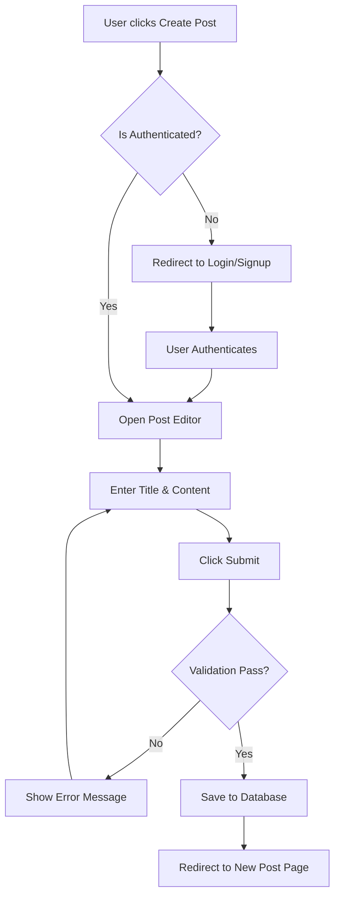
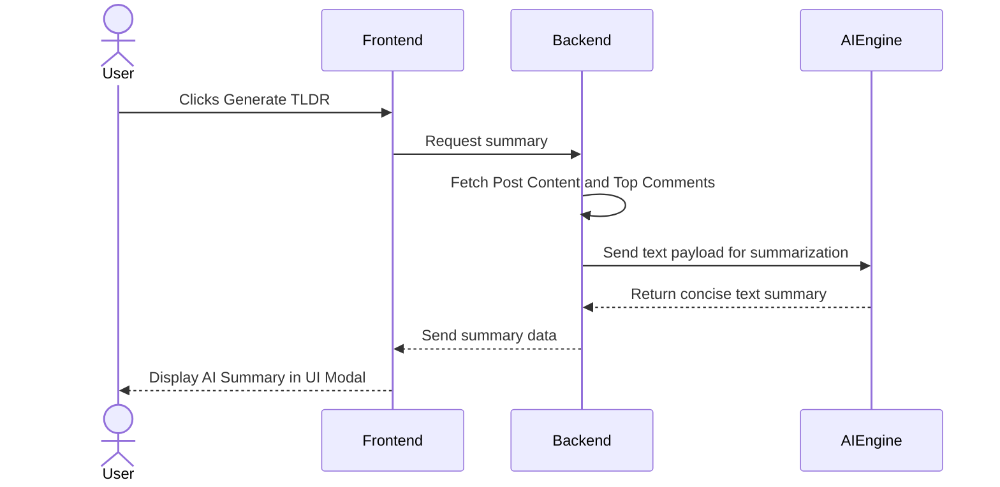
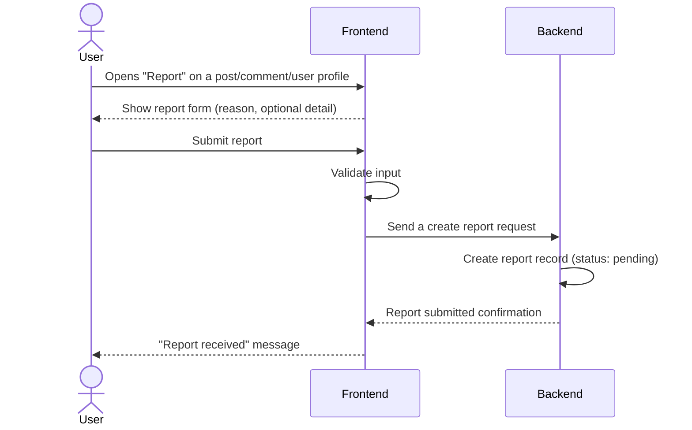
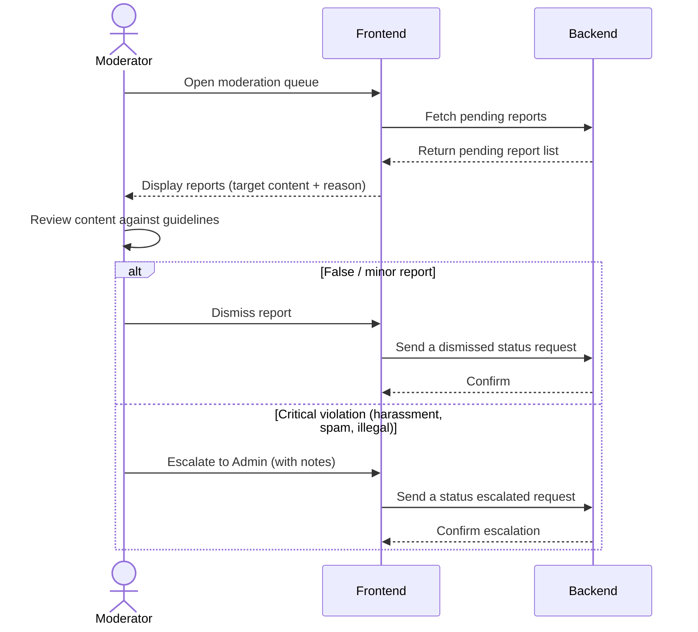
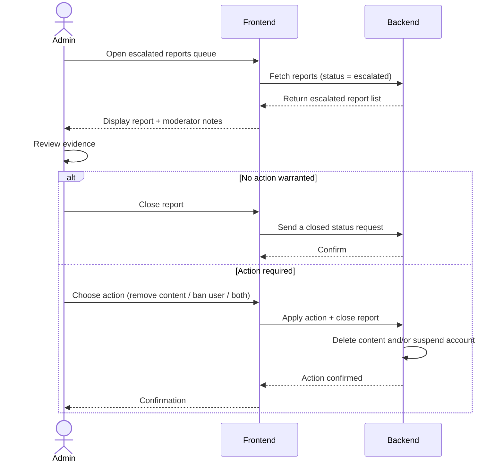
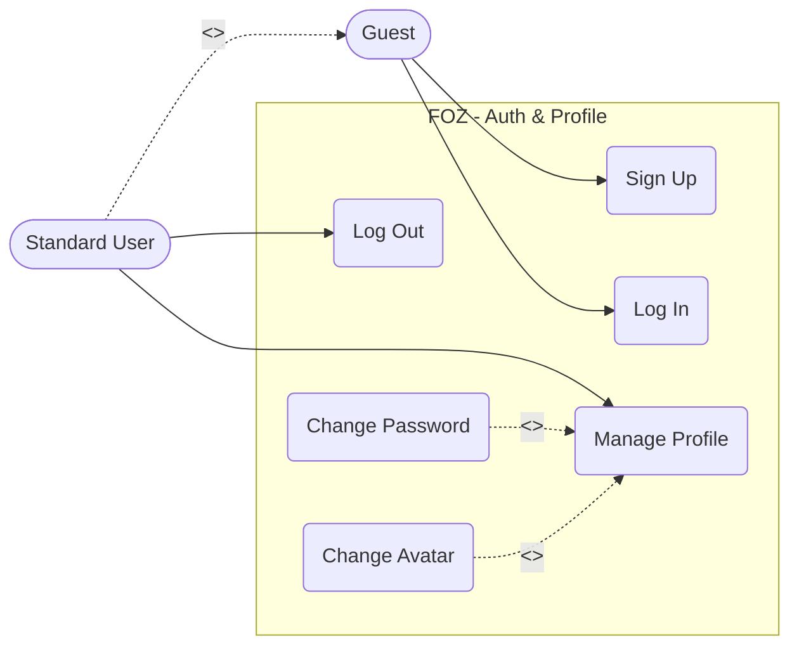
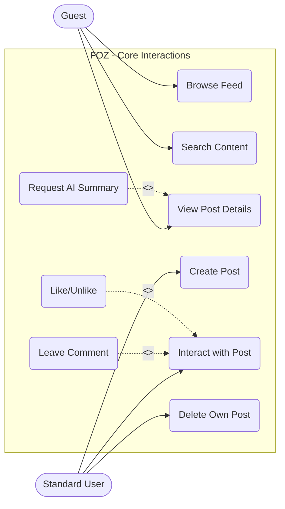
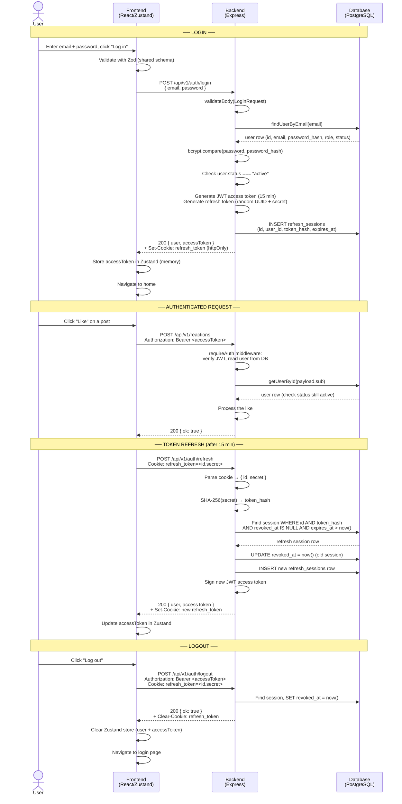
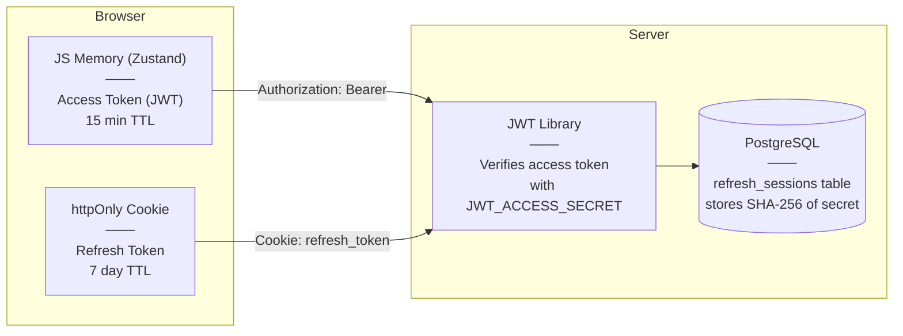

# Table of Contents

- [A - Revised Project Plan](#a---revised-project-plan)
	- [1. Introduction](#1-introduction)
	- [2. Project Overview](#2-project-overview)
	- [3. Project Organization](#3-project-organization)
		- [3.1 Team Structure and Member Roles](#31-team-structure-and-member-roles)
		- [3.2 Risk Management](#32-risk-management)
	- [4. Project Plan](#4-project-plan)
		- [4.1 Completed Sprint (Sprint 1 - PA1, Sprint 2 - PA2)](#41-completed-sprint-sprint-1---pa1-sprint-2---pa2)
			- [4.1.1 Sprint 1 - PA1](#411-sprint-1---pa1)
			- [4.1.2 Sprint 2 - PA2](#412-sprint-2---pa2)
		- [4.2 Current Sprint (Sprint 3 - PA3)](#42-current-sprint-sprint-3---pa3)
		- [4.3 Future Sprints (Sprint 4 - PA4, Sprint 5 - PA5)](#43-future-sprints-sprint-4---pa4-sprint-5---pa5)
			- [4.3.1 Planned Tasks](#431-planned-tasks)
		- [4.4 Schedule](#44-schedule)
		- [4.5 Build Plan](#45-build-plan)
- [B - Detailed Vision Document](#b---detailed-vision-document)
	- [Version 1.3](#version-13)
		- [Vision (Small Project)](#vision-small-project)
		- [1. Introduction](#1-introduction)
			- [1.1. References](#11-references)
		- [2. Positioning](#2-positioning)
			- [2.1. Problem Statement](#21-problem-statement)
			- [2.2. Product Position Statement](#22-product-position-statement)
		- [3. Stakeholder and User Descriptions](#3-stakeholder-and-user-descriptions)
			- [3.1. Stakeholder Summary](#31-stakeholder-summary)
			- [3.2. User Summary](#32-user-summary)
			- [3.3. User Environment](#33-user-environment)
			- [3.4. Summary of Key Stakeholder or User Needs](#34-summary-of-key-stakeholder-or-user-needs)
			- [3.5. Alternatives and Competition](#35-alternatives-and-competition)
		- [4. Product Overview](#4-product-overview)
			- [4.1. Product Perspective](#41-product-perspective)
			- [4.2. Assumptions and Dependencies](#42-assumptions-and-dependencies)
			- [4.3. Scope Boundaries](#43-scope-boundaries)
		- [5. Product Features](#5-product-features)
			- [Key Workflows (Mermaid Diagrams)](#key-workflows-mermaid-diagrams)
		- [6. Non-Functional Requirements](#6-non-functional-requirements)
- [C - Use-Case Model](#c---use-case-model)
	- [1. Authentication & Profile Management](#1-authentication--profile-management)
	- [2. Core Forum Interactions & AI Feature](#2-core-forum-interactions--ai-feature)
	- [3. Administration & Moderation](#3-administration--moderation)
- [D - Use-Case Specification](#d---use-case-specification)
	- [Revision History](#revision-history)
	- [Use-Case Specification: Sign Up](#use-case-specification-sign-up)
		- [1. Sign Up](#1-sign-up)
			- [1.1 Brief Description](#11-brief-description)
		- [2. Flow of Events](#2-flow-of-events)
			- [2.1 Basic Flow](#21-basic-flow)
			- [2.2 Alternative Flows](#22-alternative-flows)
				- [2.2.1 Email Already Exists](#221-email-already-exists)
				- [2.2.2 Weak Password](#222-weak-password)
		- [3. Special Requirements](#3-special-requirements)
		- [4. Preconditions](#4-preconditions)
		- [5. Postconditions](#5-postconditions)
		- [6. Extension Points](#6-extension-points)
		- [7. Prototype Requirement](#7-prototype-requirement)
	- [Use-Case Specification: Log In](#use-case-specification-log-in)
		- [1. Log In](#1-log-in)
			- [1.1 Brief Description](#11-brief-description)
		- [2. Flow of Events](#2-flow-of-events)
			- [2.1 Basic Flow](#21-basic-flow)
			- [2.2 Alternative Flows](#22-alternative-flows)
				- [2.2.1 Invalid Credentials](#221-invalid-credentials)
				- [2.2.2 Account Suspended](#222-account-suspended)
		- [3. Special Requirements](#3-special-requirements)
		- [4. Preconditions](#4-preconditions)
		- [5. Postconditions](#5-postconditions)
		- [6. Extension Points](#6-extension-points)
		- [7. Prototype Requirement](#7-prototype-requirement)
	- [Use-Case Specification: Log Out](#use-case-specification-log-out)
		- [1. Log Out](#1-log-out)
			- [1.1 Brief Description](#11-brief-description)
		- [2. Flow of Events](#2-flow-of-events)
			- [2.1 Basic Flow](#21-basic-flow)
			- [2.2 Alternative Flows](#22-alternative-flows)
				- [2.2.1 Session Already Expired](#221-session-already-expired)
		- [3. Special Requirements](#3-special-requirements)
		- [4. Preconditions](#4-preconditions)
		- [5. Postconditions](#5-postconditions)
		- [6. Extension Points](#6-extension-points)
		- [7. Prototype Requirement](#7-prototype-requirement)
	- [Use-Case Specification: Manage Profile](#use-case-specification-manage-profile)
		- [1. Manage Profile](#1-manage-profile)
			- [1.1 Brief Description](#11-brief-description)
		- [2. Flow of Events](#2-flow-of-events)
			- [2.1 Basic Flow](#21-basic-flow)
			- [2.2 Alternative Flows](#22-alternative-flows)
				- [2.2.1 Invalid Input Format](#221-invalid-input-format)
		- [3. Special Requirements](#3-special-requirements)
		- [4. Preconditions](#4-preconditions)
		- [5. Postconditions](#5-postconditions)
		- [6. Extension Points](#6-extension-points)
		- [7. Prototype Requirement](#7-prototype-requirement)
	- [Use-Case Specification: Change Password](#use-case-specification-change-password)
		- [1. Change Password](#1-change-password)
			- [1.1 Brief Description](#11-brief-description)
		- [2. Flow of Events](#2-flow-of-events)
			- [2.1 Basic Flow](#21-basic-flow)
			- [2.2 Alternative Flows](#22-alternative-flows)
				- [2.2.1 Incorrect Current Password](#221-incorrect-current-password)
		- [3. Special Requirements](#3-special-requirements)
		- [4. Preconditions](#4-preconditions)
		- [5. Postconditions](#5-postconditions)
		- [6. Extension Points](#6-extension-points)
		- [7. Prototype Requirement](#7-prototype-requirement)
	- [Use-Case Specification: Change Avatar](#use-case-specification-change-avatar)
		- [1. Change Avatar](#1-change-avatar)
			- [1.1 Brief Description](#11-brief-description)
		- [2. Flow of Events](#2-flow-of-events)
			- [2.1 Basic Flow](#21-basic-flow)
			- [2.2 Alternative Flows](#22-alternative-flows)
				- [2.2.1 File Too Large](#221-file-too-large)
		- [3. Special Requirements](#3-special-requirements)
		- [4. Preconditions](#4-preconditions)
		- [5. Postconditions](#5-postconditions)
		- [6. Extension Points](#6-extension-points)
		- [7. Prototype Requirement](#7-prototype-requirement)
	- [Use-Case Specification: Browse Feed](#use-case-specification-browse-feed)
		- [1. Browse Feed](#1-browse-feed)
			- [1.1 Brief Description](#11-brief-description)
		- [2. Flow of Events](#2-flow-of-events)
			- [2.1 Basic Flow](#21-basic-flow)
			- [2.2 Alternative Flows](#22-alternative-flows)
				- [2.2.1 No Posts Available](#221-no-posts-available)
		- [3. Special Requirements](#3-special-requirements)
		- [4. Preconditions](#4-preconditions)
		- [5. Postconditions](#5-postconditions)
		- [6. Extension Points](#6-extension-points)
		- [7. Prototype Requirement](#7-prototype-requirement)
	- [Use-Case Specification: Search Content](#use-case-specification-search-content)
		- [1. Search Content](#1-search-content)
			- [1.1 Brief Description](#11-brief-description)
		- [2. Flow of Events](#2-flow-of-events)
			- [2.1 Basic Flow](#21-basic-flow)
			- [2.2 Alternative Flows](#22-alternative-flows)
				- [2.2.1 Empty Query](#221-empty-query)
		- [3. Special Requirements](#3-special-requirements)
		- [4. Preconditions](#4-preconditions)
		- [5. Postconditions](#5-postconditions)
		- [6. Extension Points](#6-extension-points)
		- [7. Prototype Requirement](#7-prototype-requirement)
	- [Use-Case Specification: View Post Details](#use-case-specification-view-post-details)
		- [1. View Post Details](#1-view-post-details)
			- [1.1 Brief Description](#11-brief-description)
		- [2. Flow of Events](#2-flow-of-events)
			- [2.1 Basic Flow](#21-basic-flow)
			- [2.2 Alternative Flows](#22-alternative-flows)
				- [2.2.1 Post Removed or Hidden](#221-post-removed-or-hidden)
		- [3. Special Requirements](#3-special-requirements)
		- [4. Preconditions](#4-preconditions)
		- [5. Postconditions](#5-postconditions)
		- [6. Extension Points](#6-extension-points)
		- [7. Prototype Requirement](#7-prototype-requirement)
	- [Use-Case Specification: Create Post](#use-case-specification-create-post)
		- [1. Create Post](#1-create-post)
			- [1.1 Brief Description](#11-brief-description)
		- [2. Flow of Events](#2-flow-of-events)
			- [2.1 Basic Flow](#21-basic-flow)
			- [2.2 Alternative Flows](#22-alternative-flows)
				- [2.2.1 Content Validation Error](#221-content-validation-error)
		- [3. Special Requirements](#3-special-requirements)
		- [4. Preconditions](#4-preconditions)
		- [5. Postconditions](#5-postconditions)
		- [6. Extension Points](#6-extension-points)
		- [7. Prototype Requirement](#7-prototype-requirement)
	- [Use-Case Specification: Interact with Post](#use-case-specification-interact-with-post)
		- [1. Interact with Post](#1-interact-with-post)
			- [1.1 Brief Description](#11-brief-description)
		- [2. Flow of Events](#2-flow-of-events)
			- [2.1 Basic Flow](#21-basic-flow)
			- [2.2 Alternative Flows](#22-alternative-flows)
		- [3. Special Requirements](#3-special-requirements)
		- [4. Preconditions](#4-preconditions)
		- [5. Postconditions](#5-postconditions)
		- [6. Extension Points](#6-extension-points)
		- [7. Prototype Requirement](#7-prototype-requirement)
	- [Use-Case Specification: Leave Comment](#use-case-specification-leave-comment)
		- [1. Leave Comment](#1-leave-comment)
			- [1.1 Brief Description](#11-brief-description)
		- [2. Flow of Events](#2-flow-of-events)
			- [2.1 Basic Flow](#21-basic-flow)
			- [2.2 Alternative Flows](#22-alternative-flows)
				- [2.2.1 Empty Comment](#221-empty-comment)
		- [3. Special Requirements](#3-special-requirements)
		- [4. Preconditions](#4-preconditions)
		- [5. Postconditions](#5-postconditions)
		- [6. Extension Points](#6-extension-points)
		- [7. Prototype Requirement](#7-prototype-requirement)
	- [Use-Case Specification: Like/Unlike](#use-case-specification-likeunlike)
		- [1. Like/Unlike](#1-likeunlike)
			- [1.1 Brief Description](#11-brief-description)
		- [2. Flow of Events](#2-flow-of-events)
			- [2.1 Basic Flow](#21-basic-flow)
			- [2.2 Alternative Flows](#22-alternative-flows)
		- [3. Special Requirements](#3-special-requirements)
		- [4. Preconditions](#4-preconditions)
		- [5. Postconditions](#5-postconditions)
		- [6. Extension Points](#6-extension-points)
		- [7. Prototype Requirement](#7-prototype-requirement)
	- [Use-Case Specification: Request AI Summary](#use-case-specification-request-ai-summary)
		- [1. Request AI Summary](#1-request-ai-summary)
			- [1.1 Brief Description](#11-brief-description)
		- [2. Flow of Events](#2-flow-of-events)
			- [2.1 Basic Flow](#21-basic-flow)
			- [2.2 Alternative Flows](#22-alternative-flows)
				- [2.2.1 AI Service Error](#221-ai-service-error)
		- [3. Special Requirements](#3-special-requirements)
		- [4. Preconditions](#4-preconditions)
		- [5. Postconditions](#5-postconditions)
		- [6. Extension Points](#6-extension-points)
		- [7. Prototype Requirement](#7-prototype-requirement)
	- [Use-Case Specification: Delete Own Post](#use-case-specification-delete-own-post)
		- [1. Delete Own Post](#1-delete-own-post)
			- [1.1 Brief Description](#11-brief-description)
		- [2. Flow of Events](#2-flow-of-events)
			- [2.1 Basic Flow](#21-basic-flow)
			- [2.2 Alternative Flows](#22-alternative-flows)
				- [2.2.1 User Cancels Deletion](#221-user-cancels-deletion)
		- [3. Special Requirements](#3-special-requirements)
		- [4. Preconditions](#4-preconditions)
		- [5. Postconditions](#5-postconditions)
		- [6. Extension Points](#6-extension-points)
		- [7. Prototype Requirement](#7-prototype-requirement)
	- [Use-Case Specification: Report Inappropriate Content](#use-case-specification-report-inappropriate-content)
		- [1. Report Inappropriate Content](#1-report-inappropriate-content)
			- [1.1 Brief Description](#11-brief-description)
		- [2. Flow of Events](#2-flow-of-events)
			- [2.1 Basic Flow](#21-basic-flow)
			- [2.2 Alternative Flows](#22-alternative-flows)
				- [2.2.1 Content Already Reported by User](#221-content-already-reported-by-user)
		- [3. Special Requirements](#3-special-requirements)
		- [4. Preconditions](#4-preconditions)
		- [5. Postconditions](#5-postconditions)
		- [6. Extension Points](#6-extension-points)
		- [7. Prototype Requirement](#7-prototype-requirement)
	- [Use-Case Specification: Review Reports](#use-case-specification-review-reports)
		- [1. Review Reports](#1-review-reports)
			- [1.1 Brief Description](#11-brief-description)
		- [2. Flow of Events](#2-flow-of-events)
			- [2.1 Basic Flow](#21-basic-flow)
			- [2.2 Alternative Flows](#22-alternative-flows)
				- [2.2.1 Escalation Required](#221-escalation-required)
		- [3. Special Requirements](#3-special-requirements)
		- [4. Preconditions](#4-preconditions)
		- [5. Postconditions](#5-postconditions)
		- [6. Extension Points](#6-extension-points)
		- [7. Prototype Requirement](#7-prototype-requirement)
	- [Use-Case Specification: Forward Report to Admin](#use-case-specification-forward-report-to-admin)
		- [1. Forward Report to Admin](#1-forward-report-to-admin)
			- [1.1 Brief Description](#11-brief-description)
		- [2. Flow of Events](#2-flow-of-events)
			- [2.1 Basic Flow](#21-basic-flow)
			- [2.2 Alternative Flows](#22-alternative-flows)
		- [3. Special Requirements](#3-special-requirements)
		- [4. Preconditions](#4-preconditions)
		- [5. Postconditions](#5-postconditions)
		- [6. Extension Points](#6-extension-points)
		- [7. Prototype Requirement](#7-prototype-requirement)
	- [Use-Case Specification: Delete Any Content](#use-case-specification-delete-any-content)
		- [1. Delete Any Content](#1-delete-any-content)
			- [1.1 Brief Description](#11-brief-description)
		- [2. Flow of Events](#2-flow-of-events)
			- [2.1 Basic Flow](#21-basic-flow)
			- [2.2 Alternative Flows](#22-alternative-flows)
		- [3. Special Requirements](#3-special-requirements)
		- [4. Preconditions](#4-preconditions)
		- [5. Postconditions](#5-postconditions)
		- [6. Extension Points](#6-extension-points)
		- [7. Prototype Requirement](#7-prototype-requirement)
	- [Use-Case Specification: Permanently Remove User](#use-case-specification-permanently-remove-user)
		- [1. Permanently Remove User](#1-permanently-remove-user)
			- [1.1 Brief Description](#11-brief-description)
		- [2. Flow of Events](#2-flow-of-events)
			- [2.1 Basic Flow](#21-basic-flow)
			- [2.2 Alternative Flows](#22-alternative-flows)
		- [3. Special Requirements](#3-special-requirements)
		- [4. Preconditions](#4-preconditions)
		- [5. Postconditions](#5-postconditions)
		- [6. Extension Points](#6-extension-points)
		- [7. Prototype Requirement](#7-prototype-requirement)
	- [Use-Case Specification: Assign Moderator Role](#use-case-specification-assign-moderator-role)
		- [1. Assign Moderator Role](#1-assign-moderator-role)
			- [1.1 Brief Description](#11-brief-description)
		- [2. Flow of Events](#2-flow-of-events)
			- [2.1 Basic Flow](#21-basic-flow)
			- [2.2 Alternative Flows](#22-alternative-flows)
				- [2.2.1 User is already a Moderator](#221-user-is-already-a-moderator)
		- [3. Special Requirements](#3-special-requirements)
		- [4. Preconditions](#4-preconditions)
		- [5. Postconditions](#5-postconditions)
		- [6. Extension Points](#6-extension-points)
		- [7. Prototype Requirement](#7-prototype-requirement)
- [E - Implement 1 Functional Group using Spec Kit (Authentication)](#e---implement-1-functional-group-using-spec-kit-authentication)
	- [Submission Deliverables](#submission-deliverables)
		- [1. Overview](#1-overview)
		- [2. UI Layer](#2-ui-layer)
		- [3. API & Logic Layer](#3-api--logic-layer)
		- [4. Token Strategy](#4-token-strategy)
		- [5. Data Persistence](#5-data-persistence)
		- [6. Auth Flow Diagram](#6-auth-flow-diagram)
		- [7. Token Storage Diagram](#7-token-storage-diagram)
- [F - AI Usage Report and Weekly Report](#f---ai-usage-report-and-weekly-report)
	- [AI Usage Report](#ai-usage-report)
		- [Declaration of No AI Use](#declaration-of-no-ai-use)
		- [AI Usage Notes](#ai-usage-notes)
		- [Weekly Report](#weekly-report)
			- [Sprint Planning](#sprint-planning)
			- [Scrum Meetings](#scrum-meetings)
			- [Sprint Review](#sprint-review)
		- [Jira Board](#jira-board)

# A - Revised Project Plan

*Work performed by: Nguyễn Hải Nam | Reviewed by: Nguyễn Tuấn An | Edited by: Nguyễn Tuấn An*

All changes have been made compared to the PA2-2026 version can be found at: `changes.md`

## 1. Introduction

This project is a web-based forum application focused on fundamental community discussions. Its value lies in providing a simple, intuitive platform where users can easily ask questions, share knowledge, and connect over shared interests without navigating overly complex interfaces.

## 2. Project Overview

- **Goals:** Successfully build a user-friendly web-based forum application that covers all the core functions introduced in the scope below.

- **Scope:**
  - **In-scope:** Web-based application fulfilling core functional groups: Authentication, Profile management, Post Creation, Feed Generation, User Interactions, Search & Discovery, Administration & Moderation, Post Summarize (TL;DR).

  - **Out-of-scope:** Native mobile applications (iOS/Android), real-time chat channels, and complex personalized recommendation algorithms. We are strictly focusing on core web-based text discussions and AI summarization.

- **Deliverables:** Source code, phase reports (PA1 - PA5) and a completed web-based forum application demo at the end of the course.

- **Assumptions:**
  - All team members have a solid grasp of basic web programming and AI prompting skill.

  - The development environment (e.g., WSL, Git, related frameworks or databases, etc.) is configured uniformly and runs stably across all members' devices.

## 3. Project Organization

### 3.1 Team Structure and Member Roles

> **Team Structure:** All team members are expected to act as **Full-Stack Engineers** throughout the project lifecycle. The roles below designate leadership and domain ownership for specific project phases, meaning the assigned member will guide and manage that area while the entire team participates in the execution.

| **Member** | **Role** | **What to do** |
| --- | --- | --- |
| **Nguyễn Tuấn An** (24127011) | Project Manager | Facilitates meetings, tracks sprint progress, manages the project board (Jira), and ensures deadlines are met. Contributes to full-stack development. |
| **Nguyễn Hải Nam** (24127088) | QA Engineer (Tester) | Defines testing protocols. Leads the team in writing test cases and performing bug hunts. Contributes to full-stack development. |
| **Nguyễn Hải Trọng** (24127311) | Backend & Database Developer | Designs the database schema, establishes API architectures, and leads server-side performance strategies. Guides the team on database queries and backend logic. Contributes to full-stack development. |
| **Phạm Đinh Gia Khánh** (24127420) | UI/UX Designer | Leads the wireframing, prototyping, and user journey mapping phases. Ensures design consistency across the application. Guides the team during frontend UI implementation. Contributes to full-stack development. |
| **Võ An Phú** (24127494) | Frontend Developer | Establishes frontend coding standards, selects frontend frameworks/libraries, and ensures responsive, accessible design implementation. Contributes to full-stack development. |

### 3.2 Risk Management

- **Member Unavailability:**
  - **Risk:** Team members may become temporarily unavailable due to midterm exams or workloads from other courses, potentially causing bottlenecks during Sprints or reducing the overall quality of deliverables.

  - **Mitigation strategy:**
    - Enforce cross-training and mandatory peer code reviews. This ensures shared knowledge of the codebase, allowing any member to seamlessly take over another's tasks in emergencies.

    - Front-load complex and time-consuming tasks to the beginning of each Sprint when members have more bandwidth.

- **Technology Issues:**
  - **Risk:** Running out of AI and TL;DR engine API token quotas during development or testing phases.

  - **Mitigation strategy:** Utilize multiple AI platforms in development phases (such as Github Copilot, Antigravity). Architect the system to support fallback platforms for the AI engine (such as Google Gemini, OpenAI, and Microsoft Copilot) to ensure that if one service fails or hits a hard limit, the application seamlessly switches to another without significant delays.

- **Scope Creep:**
  - **Risk:** Team members may attempt to add "nice-to-have" features (like real-time notifications) that delay the schedule for core PA deliverables.

  - **Mitigation strategy:** Strictly enforce that all new feature ideas must be logged in the Jira backlog and require team approval before being pulled into an active sprint.

## 4. Project Plan

This project applies the Scrum process and is organized into 5 Sprints, each
corresponding to one PA and lasting 2-3 weeks.

### 4.1 Completed Sprint (Sprint 1 - PA1, Sprint 2 - PA2)

#### 4.1.1 Sprint 1 - PA1

- **Status:** Completed

- **Achievements:**
  - **Group Registration:** Formed a 5-member team, finalized the project name, and successfully registered.

  - **Project Proposal:**
    - Proposed a web-based application featuring 8 functional groups, targeting web users.

    - Defined core AI feature Post Summarization (TL;DR), which utilizes an AI engine to generate brief on-demand overviews of lengthy discussion posts.

  - **Existing App Survey:** Analyzed and compared 2 similar applications Threads and Reddit to identify UI/UX patterns and key factors for our project.

  - **Team Contract:** Established team roles, communication protocols, work schedules, documentation and contribution criteria, as well as unified processes in decision-making, conflict resolution and adjustments.

  - **Development Tools and Process Setup:** Initialized the Scrum workflow. Set up Jira for task tracking, created a private GitHub repository with standard structure, and ensured all members are equipped with AI coding assistant accounts.

#### 4.1.2 Sprint 2 - PA2

- **Status:** Completed

- **Achievements:**
  - **Project Plan:** Drafted the initial version of the project plan, covering Introduction, Project Overview, Project Organization (team structure and roles, risk management), and Project Plan (Sprint 1 summary, Sprint 2 detailed tasks, planned tasks for future sprints,schedule, and build plan).

  - **Vision Document:** Drafted the initial version of the vision document, covering Introduction, Positioning (problem statement, product position statement), Stakeholder and User Descriptions, Product Overview, Product Features, and Non-Functional Requirements.

  - **Spec Kit Initialization:** Set up a GitHub repository with Spec Kit integrated, initialized Spec Kit for the project and placed the generated artifacts (including `constitution.md`) inside the `/src` folder. All team members completed the Spec Kit training via the official tutorials.

  - **AI Usage Report and Weekly Report:** Declared AI tool usage for the sprint following the AI usage guidelines, and documented Sprint Planning, Scrum meetings, and Sprint Review as required by the Weekly Report instructions, including Jira task screenshots showing task assignments and progress.

  - However, the authentication was delayed due to technical difficulties with the database and system setup.

### 4.2 Current Sprint (Sprint 3 - PA3)

- **Main Goal:**
  - Initialize the database.
  - Revise the project plan and vision document.
  - Develop core functional groups: Profile management, Post Creation, User Interactions, Search & Discovery.
  - Release the first MVP build (Alpha)

**Detailed Tasks:**

| Task Description                                    | Assignee            | Reviewer            | Due Date   |
| --------------------------------------------------- | ------------------- | ------------------- | ---------- |
| Initialize Database and setup | Nguyễn Tuấn An | Võ An Phú | Jul 22 |
| Write Revised Project Plan | Nguyễn Hải Nam | Nguyễn Tuấn An | Jul 24 |
| Implement post creation | Nguyễn Hải Trọng | Nguyễn Tuấn An | Jul 24 |
| Write Use-Case Model | Nguyễn Hải Trọng | Nguyễn Hải Nam | Jul 18 |
| Implement profile management | Nguyễn Tuấn An | Nguyễn Hải Trọng | Jul 23 |
| Write Detailed Vision Document | Nguyễn Hải Trọng | Võ An Phú | Jul 24 |
| Write AI Usage Report and Weekly Report | Nguyễn Tuấn An | Võ An Phú | Jul 25 |
| Implement search | Phạm Đinh Gia Khánh | Võ An Phú | Jul 23 |
| Write Use-Case Specification | Nguyễn Hải Trọng | Phạm Đinh Gia Khánh | Jul 24 |
| Implement user interactions | Nguyễn Hải Nam | Phạm Đinh Gia Khánh | Jul 23 |
| Implement authentication | Võ An Phú | Nguyễn Hải Nam | Jul 18 |
| Make a video for report | Võ An Phú | Nguyễn Tuấn An | Jul 25 |
| Unify the UI designs | Phạm Đinh Gia Khánh | Nguyễn Tuấn An | Jul 24 |
| Design moderator UI | Nguyễn Tuấn An | Phạm Đinh Gia Khánh | Jul 21 |

### 4.3 Future Sprints (Sprint 4 - PA4, Sprint 5 - PA5)

#### 4.3.1 Planned Tasks

- **Sprint 4:** Integration & AI Implementation

  - Develop core functional groups: Feed Generation, Administration & Moderation, Post Summarize

  - Execute system testing.

  - Release the beta build.

- **Sprint 5:** Polish, Optimization & Deployment

  - Testing on non-functional requirements.

  - Finalize all project documentation.

  - Deploy the final release for the project demo.

### 4.4 Schedule

The detailed schedule of all tasks, work statuses (To Do, In Progress, In Review, Done), and overall progress are strictly managed, tracked, and continuously updated on the project's Jira board.

### 4.5 Build Plan

Build 1.0 (Alpha) - End of Sprint 3 (Status: **Upcoming**): A baseline build focusing on backend connectivity and basic frontend rendering. Core CRUD operations for forum posts will be testable, though the UI may lack final styling.

Build 2.0 (Beta) - End of Sprint 4: A feature-complete build including the integrated AI summarization tool. This build will be subjected to rigorous testing.

Build 3.0 (Final) - End of Sprint 5: The final, polished build deployed to the production environment, thoroughly tested for all aspects, ready for the final PA5 demonstration.

# B - Detailed Vision Document

*Work performed by: Nguyễn Hải Trọng | Reviewed by: Võ An Phú | Edited by: Võ An Phú*

All changes have been made compared to the PA2-2026 version can be found at: `changes.md`

## Version 1.3

| | |
| :--- | :--- |
| **FOZ** | Version: 1.3 |
| **Vision document** | Date: 25/07/2026 |

### Vision (Small Project)
| Date | Version | Description | Author | Review by |
| :--- | :--- | :--- | :--- | :--- |
| 07/07/2026 | 1.0 | Defined problem statement, user roles, product features, and non-functional requirements. | Nguyễn Hải Trọng | Võ An Phú |
| 08/07/2026 | 1.1 | Added scope boundaries, moderation workflow, security/accessibility NFRs, and clarified role capabilities. | Võ An Phú | Võ An Phú |
| 24/07/2026 | 1.2 | Formatted table of content, detailed alternatives and competitors, user environments and product non-functional requirements. | Nguyễn Hải Trọng | Võ An Phú |
| 25/07/2026 | 1.3 | Clarified media support (images/video) throughout, added data privacy and accessibility NFRs, removed implementation-specific references, grouped features by priority, general editorial cleanup. | Nguyễn Hải Trọng | Võ An Phú |
### 1. Introduction

The purpose of this Vision Document is to collect, analyze, and define the high-level needs and features of FOZ, a web-based forum application. It focuses on the capabilities required by the stakeholders and target users, providing a clear foundation for the project's scope. 

#### 1.1. References

* Introduction to Software Engineering: PA1-2026 Guidelines.
* Introduction to Software Engineering: PA2-2026 Guidelines.
* FOZ Project Proposal (PA1).
* FOZ Existing App Survey (Reddit, Threads).

### 2. Positioning

#### 2.1. Problem Statement

| | |
| :--- | :--- |
| **The problem of** | cluttered, overly complex, and algorithm-heavy interfaces in current online discussion platforms |
| **affects** | general web users seeking straightforward, topic-focused community spaces |
| **the impact of which is** | a high barrier to entry, distraction from core discussions, and a frustrating user experience when trying to find specific information |
| **a successful solution would be** | a simple, intuitive web-based forum that focuses purely on meaningful community discussions, equipped with AI tools to quickly summarize long threads. |

#### 2.2. Product Position Statement

| | |
| :----- | :----- |
| **For** | General web users seeking online community spaces |
| **Who** | want to easily ask questions, share knowledge, and connect over shared interests |
| **The FOZ** | is a web-based forum application |
| **That** | provides a simple, intuitive platform focusing on fundamental community discussions with an on-demand AI summarization feature |
| **Unlike** | traditional platforms (e.g., Reddit or Threads) that feature overwhelming UI layouts and aggressive recommendation algorithms |
| **Our product** | delivers a streamlined, clutter-free user experience tailored specifically for community dialogue — supporting text, images, and video — with rapid information consumption. |

### 3. Stakeholder and User Descriptions

#### 3.1. Stakeholder Summary

| Name | Description | Responsibilities |
| :--- | :--- | :--- |
| **Project Manager** | Team leader (Nguyễn Tuấn An). | Facilitates meetings, tracks sprint progress in Jira, ensures deadlines are met, and oversees project delivery. |
| **Development Team** | Full-stack engineers (Nam, Trọng, Khánh, Phú), with domain leads for QA (Nam), Backend/DB (Trọng), UI/UX (Khánh), and Frontend (Phú). | Designs UI/UX, builds frontend/backend architectures, manages the database, and ensures software quality via testing. Detailed role assignments are in the Project Plan. |
| **Instructors / TAs** | Course evaluators. | Monitors project progress, provides feedback, and evaluates the final product against course requirements. |

#### 3.2. User Summary

| Name | Description | Responsibilities |
| :--- | :--- | :--- |
| **Guest** | Unauthenticated visitors. | Read-only access: can view profiles, read posts, and see comments. Cannot post, like, report, or trigger the AI Post Summarize (TL;DR) feature. Any write interaction prompts the authentication flow. |
| **Standard User** | Authenticated community members. | Can create posts, like/unlike posts and comments, comment, report inappropriate posts/comments or other users, manage their own profile, and delete their own posts. |
| **Moderator** | Elevated users with community management tools. | Inherits all Standard User abilities. Reviews user reports and forwards critical issues to Administrators. Cannot permanently delete users or posts from the database or alter system-wide configurations. |
| **Administrator** | Highest level of system access. | Full control via the admin dashboard: can permanently ban users, delete content, and assign Moderator roles. All actions are performed through the application UI, not direct database access. |

#### 3.3. User Environment

FOZ is designed as a web-first application, ensuring maximum accessibility across various devices without the need for dedicated app installations.
- **Supported Devices:** Desktop computers, laptops, tablets, and mobile smartphones. The UI is fully responsive and adapts to screen sizes ranging from 320px (mobile) to 4K displays.
- **Operating Systems:** Platform-agnostic (Windows, macOS, Linux, iOS, Android).
- **Supported Browsers:** Modern web browsers with JavaScript enabled, including Google Chrome (v90+), Safari (v14+), Microsoft Edge (v90+), and Mozilla Firefox (v88+).
- **Network Requirements:** Requires an active broadband, 4G, or 5G internet connection for real-time interactions, uploading images and videos, and fetching dynamic feeds. Offline mode is not supported.

#### 3.4. Summary of Key Stakeholder or User Needs

| Need                                        | Priority | Concerns                                                                   | Current Solution                             | Proposed Solutions                                                                         |
| :------------------------------------------ | :------- | :------------------------------------------------------------------------- | :------------------------------------------- | :----------------------------------------------------------------------------------------- |
| **Quick comprehension of long discussions** | High     | Users do not have time to read hundreds of replies to find the consensus.  | Scrolling manually and reading top comments. | Integrate an AI "Post Summarize (TL;DR)" feature.                                          |
| **Discover relevant content**               | High     | Users want to find active communities without heavy, intrusive algorithms. | Algorithmic "For You" pages (e.g., Threads). | Generate a clean feed based purely on recent engagement metrics (comment velocity, likes). |
| **Safe community environment**              | Medium   | Toxic behavior ruins the discussion experience.                            | Automated bans which are often inaccurate.   | A multi-tier user reporting system involving Standard Users, Moderators, and Admins.       |

#### 3.5. Alternatives and Competition
Based on our PA1 survey and market analysis, FOZ competes in the community discussion space against several established platforms:
- **Threads:** Features a very clean UI and smooth cross-platform authentication (via Instagram). However, it leans heavily towards micro-blogging and aggressive algorithm recommendations rather than structured, topic-based forum discussions. FOZ focuses on chronological/engagement-based feeds without intrusive algorithmic manipulation.
- **Reddit:** Excels in community categorization and deep, nested discussions. However, its interface can be highly cluttered and overwhelming for casual users, and its strict karma/rules system acts as a high barrier to entry. FOZ bridges this gap by offering the deep discussion capabilities of Reddit (nested comments) but with a minimalist, accessible UI similar to Threads.

### 4. Product Overview

#### 4.1. Product Perspective
FOZ is an independent, self-contained web application. It acts as a centralized hub for community interactions, requiring only a modern web browser to access. The system will integrate with a third-party AI service (such as the OpenAI API or Gemini API) strictly to power the "Post Summarize" feature.

#### 4.2. Assumptions and Dependencies

- **Internet Connection:** The application requires a stable internet connection to fetch real-time discussions.
- **AI API Availability:** The TL;DR feature depends on external AI providers. To mitigate quota exhaustion or outages, the backend supports a fallback provider chain so that a single provider failure does not disable the feature.
- **Modern Browsers:** It is assumed that users are operating modern web browsers with JavaScript enabled.

#### 4.3. Scope Boundaries

- **In-scope:** A web-based application covering the functional groups defined in `5. Product Features` — Authentication, Profile Management, Post Creation (text, images, video), Feed Generation, User Interactions, Search & Discovery, Administration & Moderation, and Post Summarize (TL;DR).
- **Out-of-scope:** Native mobile applications (iOS/Android), real-time chat channels, push notifications, and complex personalized recommendation algorithms.

### 5. Product Features 

**1. Post Creation** *(Priority: High)*

Authenticated users can compose and publish posts containing text, images, and videos. A clean editor encourages thoughtful content creation and drives the community's core content engine.

**2. Feed Generation** *(Priority: High)*

A dynamic feed surfaces posts ranked by recent engagement metrics (comment velocity, likes). The feed includes text, image, and video content, surfaced without invasive tracking or algorithmic manipulation.

**3. User Interactions (Comments & Likes)** *(Priority: High)*

Users can browse threads and interact through nested comments and likes on posts and comments. This drives ongoing engagement and surfaces popular discussions.

**4. AI Post Summarize (TL;DR)** *(Priority: High)*

On-demand AI-generated summaries of lengthy threads, incorporating top comments for context. Allows time-constrained users to quickly grasp the main points and overall consensus of a discussion.

**5. Authentication & Account Security** *(Priority: High)*

Sign-up, login, logout, and session management gate all write operations. Passwords are hashed and salted; sessions use secure, HttpOnly cookies with JWT tokens.

**6. Search & Discovery** *(Priority: Medium)*

Users can query posts (including media captions), user profiles, and topics across the database. Essential for finding specific content as the forum grows.

**7. Administration & Moderation System** *(Priority: Medium)*

A multi-tiered reporting system: users flag content, moderators review and escalate, admins take final action (remove content, ban users). Maintains community safety and discourse quality.

**8. Profile Management** *(Priority: Medium)*

Authenticated users can edit profile information, change passwords, and update avatars. Provides a recognizable, controllable presence within the community.

#### Key Workflows (Mermaid Diagrams)

**Workflow 1: User Authentication & Post Creation**

**Workflow 2: AI Post Summarize (TL;DR)**

**Workflow 3: User Reports a Post, Comment, or User**

**Workflow 4: Moderator Reviews Reports & Escalates Critical Cases**

**Workflow 5: Admin Acts on Escalated Reports**

### 6. Non-Functional Requirements

**Performance Requirements**

- The application's initial page load time must be < 2 seconds on a standard broadband connection. Frontend routing between pages should feel instantaneous (< 200ms).
- Backend API response times for standard queries (fetching feeds, creating posts, querying comments) must be < 500 milliseconds.
- The system architecture must support at least 100 concurrent users interacting with the platform simultaneously without noticeable performance degradation.

**Security Requirements**

- All user passwords must be securely hashed and salted (using bcrypt or argon2) before being stored in the PostgreSQL database.
- All client-server communications must be encrypted using HTTPS (TLS 1.2 or higher).
- All user input must be strictly validated server-side using robust schema validation and output-encoded to prevent Cross-Site Scripting (XSS) and SQL injection attacks.
- Authentication sessions must be managed via secure, HttpOnly, SameSite cookies with JWT tokens to prevent Cross-Site Request Forgery (CSRF).
- API endpoints, especially the AI Post Summarize (TL;DR) and authentication routes, must be rate-limited per user/IP to prevent brute-force attacks, quota abuse, and cost escalation.
- User data (profiles, posts, comments) must be stored securely. Users must be able to delete their account and associated content. The system must not share personal data with third parties beyond what is required for core functionality.

**Reliability & Availability Requirements**

- The system should target a 99.9% uptime for core features (viewing and creating posts).
- If the external AI provider is unavailable or rate-limited, the TL;DR feature must degrade gracefully with a clear error message in the UI, without affecting the rest of the application's functionality.
- The application must log critical errors and key moderation actions (bans, content removal, report escalations) to support system monitoring, debugging, and incident review.

**Platform & Usability Requirements**

- The UI must be implemented using responsive design principles, ensuring it renders correctly and maintains high usability across mobile, tablet, and desktop viewports.
- The application must be rigorously tested and confirmed functional on the latest stable versions of Google Chrome, Safari, Mozilla Firefox, and Microsoft Edge.
- The platform should follow WCAG basic guidelines, including proper semantic HTML, alt-text for media attachments, and sufficient color contrast ratios to accommodate visually impaired users.
- All interactive elements must be keyboard-navigable. The application should support screen readers via proper ARIA attributes and semantic HTML structure.
- Core actions (create a post, comment, search, generate TL;DR) must be highly intuitive, allowing a new authenticated user to complete them successfully without any external training, tutorials, or documentation.

# C - Use-Case Model

*Performed by: Nguyễn Hải Trọng | Reviewed by: Nguyễn Hải Nam | Edited by: Nguyễn Hải Nam*

Based on the requirements documented in the Vision Document, the system's use cases are modeled below using Mermaid syntax[cite: 10]. To ensure clarity and maintainability, the comprehensive system is divided into three logical diagrams based on functional groups.

## 1. Authentication & Profile Management
This diagram covers the fundamental access and identity management functionalities.

- **Actors:** Guest, Standard User.
- **Generalization:** `Standard User` inherits baseline viewing capabilities from `Guest`.
- **Relationships:** `Change Password` and `Change Avatar` are optional extensions of the `Manage Profile` use case.

## 2. Core Forum Interactions & AI Feature
This diagram illustrates the primary value proposition of the forum, including post creation, interaction, discovery, and the AI capability.

- **Actors:** Guest, Standard User.

- **Relationships:**
    - `Leave Comment` and `Like/Unlike` optionally extend the general `Interact with Post` use case.

    - `Request AI Summary` extends the `View Post Details` use case, representing the on-demand "Post Summarize (TL;DR)" feature.

## 3. Administration & Moderation
This diagram maps out the reporting system and elevated privileges required to maintain a safe community environment.

* **Actors:** Standard User, Moderator, Administrator.

* **Generalization:** `Moderator` inherits capabilities from `Standard User`. `Administrator` inherits capabilities from Moderator and holds the highest access level.

* **Relationships:** `Forward Report to Admin` extends the `Review Reports` use case when a `Moderator` encounters a severe violation they cannot fully resolve.

# D - Use-Case Specification
*Performed by: Nguyễn Hải Trọng | Reviewed by: Phạm Định Gia Khánh | Edited by: Phạm Định Gia Khánh*

## Revision History

| Date | Version | Description | Author |
| :--- | :--- | :--- | :--- |
| 19/Jul/2026 | 1.0 | Initial draft: Documented all 21 Use-Case Specifications covering Auth, Core Interactions, and Moderation. | Nguyễn Hải Trọng |
| 06/Aug/2026 | 1.1 | Update the Alternative Flow and Reordered sections for clarity | Nguyễn Hải Trọng |
| 22/Aug/2026 | 1.2 | Update UCS 01–05 to reflect current app implementation (onboarding redirection, role-based login routing, username collision handling, avatar management, and NIST password constraints) | Nguyễn Tuấn An |

## Use-Case Specification: Sign Up
*Performed by: Nguyễn Hải Trọng | Reviewed by: Nguyễn Tuấn An | Edited by: Nguyễn Tuấn An* 
**Project Name:** FOZ  
**Version:** 1.2  
**Document identifier:** FOZ-UCS-01

### 1. Sign Up
* **Use-Case ID:** UC-01
* **Actor(s):** Guest

#### 1.1 Brief Description
This use case allows an unauthenticated guest to create a new user account and initial profile on the FOZ platform using an email, unique username, and secure password, or via Google OAuth authentication.

### 2. Preconditions
* The user must be a Guest (unauthenticated).

### 3. Flow of Events
#### 3.1 Basic Flow
1. The use case begins when the Guest navigates to the Registration page (`/register`).
2. The user enters a unique username, a valid email address, a strong password, and confirms the password.
3. The user clicks "Sign up" (or "Create account").
4. The system validates the inputs (email format, username length 3–30 characters and allowed characters `[a-z0-9._]`, password length between 8 and 128 characters, and password confirmation match).
5. The system checks if the email or username is already registered in the database.
6. The system securely hashes the password using bcrypt (cost factor 12).
7. The system creates a new record in the `user_accounts` table (role: `standard`, status: `active`) and a default profile record in the `profiles` table (with display name initialized to username).
8. The system issues a JWT access token and creates an active session in `refresh_sessions`, setting the `refresh_token` http-only cookie.
9. The system redirects the user to the Onboarding Profile Setup page (`/onboarding/avatar`) to configure their display name and avatar (or proceed to the Home Feed).

#### 3.2 Alternative Flows

##### 3.2.1 Email Already Exists
1. If at step 5, the entered email address already exists in the database.
2. The system aborts the registration and returns HTTP 409 (`EMAIL_TAKEN`).
3. The system displays an error message: "An account with this email already exists".
4. The flow resumes at step 2.

##### 3.2.2 Weak Password
1. If at step 4, the password is less than 8 characters.
2. The system highlights the password field and displays: "Password must be at least 8 characters".
3. The flow resumes at step 2.

##### 3.2.3 Password Too Long
1. If at step 4, the password exceeds 128 characters.
2. The system highlights the password field and displays: "Password is too long".
3. The flow resumes at step 2.

##### 3.2.4 Rate Limit Exceeded
1. If the user makes more than 15 registration attempts within 1 minutes.
2. The system rejects the request with HTTP 429 (`RATE_LIMITED`) and displays: "Too many requests, slow down."
3. The use case ends.

##### 3.2.5 Confirm Password Does Not Match
1. If at step 4, the confirmation password does not match the entered password.
2. The system highlights the confirmation field and displays: "Passwords do not match".
3. The flow resumes at step 2.

##### 3.2.6 Username Already Taken, Reserved, or Invalid
1. If at step 4 or 5, the chosen username already exists in the database, is a reserved keyword (e.g., `admin`, `moderator`, `system`), or contains characters other than lowercase letters, numbers, underscores, and periods.
2. The system aborts registration and displays the specific validation error (e.g., "This username is already taken", "This username is reserved", or "Username can only contain lowercase letters, numbers, underscores, and periods").
3. The flow resumes at step 2.

##### 3.2.7 Sign Up with Google Account
1. At step 2, the user chooses to "Continue with Google".
2. The system initiates Google OAuth (popup or redirect to Google OAuth consent screen).
3. The user successfully authenticates with Google.
4. The system automatically provisions a `user_accounts` record (passwordless) and `profiles` record using Google profile data, deriving a unique base username from the email prefix.
5. The system issues access and refresh tokens, displays a success notification ("Account created! Set up your profile."), and redirects the user to the onboarding page (`/onboarding/avatar`).

##### 3.2.8 Google Sign Up Username Collision
1. If at step 4 of the Google Sign Up flow, the derived base username is already taken by another user or is a reserved keyword.
2. The system automatically generates a unique username by appending an incremental numeric counter (e.g., base name + "1") to the base name.
3. The system proceeds to provision the account with the newly generated unique username.

### 4. Special Requirements
* **Security:** Passwords must be hashed via bcrypt with a minimum cost factor of 12. Plaintext passwords must never be logged. JWT access tokens are stored in client memory; refresh tokens are stored in http-only `SameSite=Lax` cookies.
* **Rate Limiting:** Maximum 100 registration attempts per 15 minutes per IP address.

### 5. Postconditions
* A new active user account and profile are saved in the database. An active session is stored in `refresh_sessions`. The user is authenticated.

### 6. Extension Points
* None.

### 7. Prototype Requirement
* **Screen 1 (Basic Flow):**
    
* **Screen 2 (Alt Flow - Email Already Exists):**
    
* **Screen 3 (Alt Flow - Weak Password):**
    
* **Screen 4 (Alt Flow - Password Too Long):**
    
* **Screen 5 (Alt Flow - Rate Limit Exceeded):**
    
* **Screen 6 (Alt Flow - Confirm Password Does Not Match):**
    
* **Screen 7 (Alt Flow - Username Already Taken):**
    
* **Screen 8 (Alt Flow - Sign Up with Google Account):**
    
* **Screen 9 (Alt Flow - Google Sign Up Username Collision):**
    
    This is the email to test the alternative flow.
    
    The website already has a username that matches the Google account email prefix.
    
    The system automatically generates a unique username by appending number "1" to the base name.

## Use-Case Specification: Log In
*Performed by: Nguyễn Hải Trọng | Reviewed by: Nguyễn Tuấn An | Edited by: Nguyễn Hải Trọng* 
**Project Name:** FOZ  
**Version:** 1.2  
**Document identifier:** FOZ-UCS-02

### 1. Log In
* **Use-Case ID:** UC-02
* **Actor(s):** Guest

#### 1.1 Brief Description
This use case describes how a registered user accesses their account by providing valid credentials (email and password) or authenticating via Google OAuth.

### 2. Preconditions
* The user is unauthenticated (Guest).

### 3. Flow of Events
#### 3.1 Basic Flow
1. The use case begins when the Guest navigates to the Login page (`/login`).
2. The user enters their registered email address and password, then clicks "Log in".
3. The system finds the user in `user_accounts` and verifies the password hash using bcrypt.
4. The system checks if the user account status is `active`.
5. The system issues a short-lived JWT Access Token and sets an http-only Refresh Token cookie (recording the session in `refresh_sessions`).
6. The system redirects the user based on their role: Administrators to `/admin`, Moderators to `/moderator`, and Standard Users to the Home Feed (`/`).

#### 3.2 Alternative Flows

##### 3.2.1 Invalid Credentials
1. If at step 3, the email is not found in the database or the password does not match.
2. The system rejects the request with HTTP 401 (`INVALID_CREDENTIALS`) and displays: "Invalid email or password".
3. The flow resumes at step 2.

##### 3.2.2 Account Suspended or Banned
1. If at step 4, the account status is `suspended` or `banned` (not `active`).
2. The system rejects authentication with HTTP 403 (`ACCOUNT_NOT_ACTIVE`) and displays: "Your account is not currently available."
3. The use case ends.

##### 3.2.3 Rate Limit Exceeded
1. If the user makes more than 15 login attempts within 1 minutes.
2. The system rejects the request with HTTP 429 (`RATE_LIMITED`) and displays: "Too many requests, slow down."
3. The use case ends.

##### 3.2.4 Sign In with Google Account
1. If at step 2, the user chooses to "Sign in with Google".
2. The system initiates Google OAuth (popup or redirect to Google OAuth consent screen).
3. The user successfully authenticates with Google.
4. The system checks the database for an existing Google social link or matching email in `user_accounts`.
5. The system verifies the account is active, issues an Access Token, sets the Refresh Token cookie, and redirects the user based on role (or to onboarding if new).
6. The use case ends.

##### 3.2.5 Log In with Non-Existent Google Account
1. If at step 4 of the Google Sign In flow, the system finds no existing user account associated with the Google profile or email.
2. The system automatically provisions a new user account on the fly (including auto-generating a unique username and saving profile details) instead of rejecting the login.
3. The login attempt is seamlessly converted into a successful registration, and the user is redirected to the onboarding profile setup page (`/onboarding/avatar`).
4. The use case ends.

### 4. Special Requirements
* **Rate Limiting:** Maximum 100 attempts per 15 minutes per IP to prevent brute-force attacks.
* **Security:** Passwords verified via timing-safe comparison; access tokens kept in memory; refresh tokens in http-only cookies.

### 5. Postconditions
* The user is authenticated, an active session is recorded in `refresh_sessions`, and the user is navigated to the appropriate landing view.

### 6. Extension Points
* None.

### 7. Prototype Requirement
* **Screen 1 (Basic Flow):**
    
* **Screen 2 (Alt Flow - Invalid Credentials):**
    
* **Screen 3 (Alt Flow - Account Suspended):**
     FLAG

* **Screen 4 (Alt Flow - Rate Limit Exceeded):**
    
* **Screen 5 (Alt Flow - Sign In with Google Account):**
    
* **Screen 6 (Alt Flow - Log In with Non-Existent Google Account):**
    
    This email hasn't been logged in to the website.
    
    After login, the system automatically creates a new user account.

## Use-Case Specification: Log Out
*Performed by: Nguyễn Hải Trọng | Reviewed by: Nguyễn Tuấn An | Edited by: Nguyễn Hải Trọng* 
**Project Name:** FOZ  
**Version:** 1.1  
**Document identifier:** FOZ-UCS-03

### 1. Log Out
* **Use-Case ID:** UC-03
* **Actor(s):** Authenticated User (Standard User, Moderator, Administrator)

#### 1.1 Brief Description
Allows an authenticated user to securely end their active session on the current device.

### 2. Preconditions
* The user must be authenticated.

### 3. Flow of Events
#### 3.1 Basic Flow
1. The use case begins when the user clicks the "Log out" / "Sign out" button in the navigation or sidebar.
2. The system opens the Logout confirmation modal (`LogoutDialog`), displaying the user's avatar, account handle/email, and confirmation prompt ("Log out of your account?").
3. The user clicks "Log out" in the dialog.
4. The client sends a `POST /api/v1/auth/logout` request.
5. The backend validates the refresh cookie and updates the `revoked_at` timestamp in the `refresh_sessions` table to invalidate the session.
6. The backend clears the `refresh_token` http-only cookie from the response.
7. The client clears the JWT access token and user state from the local authentication store.
8. The modal closes and the user state updates to unauthenticated (Guest).

#### 3.2 Alternative Flows

##### 3.2.1 User Cancels Log Out
1. At step 2, the user clicks "Cancel", presses the Escape key, or clicks outside the modal.
2. The system closes the dialog and no action is taken.
3. The user remains authenticated and the use case ends.

##### 3.2.2 Session Already Expired or Invalid
1. If at step 4, the refresh session token is already expired, revoked, or missing.
2. The backend clears the refresh cookie and responds successfully.
3. The client clears local authentication state and the use case ends.

### 4. Special Requirements
* **Security:** Immediate server-side session revocation in `refresh_sessions` and complete purging of client authentication credentials.

### 5. Postconditions
* The user's session is marked revoked in `refresh_sessions`, authentication cookies/tokens are cleared, and the client returns to an unauthenticated state.

### 6. Extension Points
* None.

### 7. Prototype Requirement
* **Screen 1 (Basic Flow):** 
  
* **Screen 2 (Alt Flow - User Cancels Log Out):**
  

## Use-Case Specification: Manage Profile
*Performed by: Nguyễn Hải Trọng | Reviewed by: Nguyễn Tuấn An | Edited by: Nguyễn Hải Trọng*
**Project Name:** FOZ  
**Version:** 1.2  
**Document identifier:** FOZ-UCS-04

### 1. Manage Profile
* **Use-Case ID:** UC-04
* **Actor(s):** Standard User

#### 1.1 Brief Description
Allows an authenticated user to view and update their public profile details, including display name, unique username handle, bio, location, website URL, and avatar image.

### 2. Preconditions
* The user must be authenticated and viewing their own profile page (`/profiles/@username` or `/profile`).

### 3. Flow of Events
#### 3.1 Basic Flow
1. The use case begins when the user navigates to their profile page and clicks the "Edit profile" button.
2. The system opens the `ProfileEditModal`, pre-populating fields (Avatar, Username handle, Display Name, Bio, Location, Website) with current data from the `profiles` and `user_accounts` tables.
3. The user modifies text fields (Display Name, Bio, Location, Website, or Username) and clicks "Save".
4. The system validates the inputs (Display Name 1–50 characters and valid characters, Bio at most 160 characters, Location at most 100 characters, Website at most 200 characters with valid URL format, Username 3–30 characters and valid format).
5. The client submits a `PATCH /api/v1/profile/me` request.
6. The backend updates the `profiles` table (and `user_accounts` if username was changed) and updates the `updated_at` timestamp.
7. The system displays a success toast ("Profile updated successfully"), closes the modal, and refreshes the profile view with updated details.

#### 3.2 Alternative Flows

##### 3.2.1 Invalid Input Format
1. If at step 4, the website URL is invalid (e.g. missing domain dot or bad protocol) or Display Name contains disallowed special characters.
2. The system displays field validation error messages below the respective input fields.
3. The flow resumes at step 3.

##### 3.2.2 Input Exceeds Maximum Limits
1. If at step 4, any text input exceeds its maximum character limit (Display Name: 50, Bio: 160, Location: 100, Website: 200).
2. The system displays specific field validation errors indicating character limits.
3. The flow resumes at step 3.

##### 3.2.3 Username Handle Collision on Update
1. If at step 3, the user modifies their username handle to one that already exists for another account.
2. The system displays a collision confirmation dialog: "The username has already existed. The system will generate a unique name by adding a number. Do you want to proceed? [Yes] [No]".
3. If the user clicks "Yes", the system re-submits the request with auto-generation enabled, appends an incremental numeric suffix (e.g., `username1`), updates the username, and saves the profile.
4. If the user clicks "No", the confirmation dialog closes and the user can manually change the username handle.

##### 3.2.4 User Cancels Profile Edit
1. If at step 3, the user clicks "Cancel", clicks the close icon, or clicks outside the modal.
2. The system discards all pending changes and closes the modal without modifying database records.
3. The use case ends.

##### 3.2.5 Update Avatar Image
1. At step 2, the user clicks on the avatar preview to select an image file.
2. The client validates that the file is a supported image format (PNG, JPEG, GIF, WebP) and does not exceed 2MB.
3. The client compresses the image to WebP and uploads it to Cloudinary (or encodes as base64 fallback), updating the avatar via `POST /api/v1/profile/me/avatar`.
4. The system updates the avatar preview and persists the new `avatar_url`.
5. The flow resumes at step 3.

### 4. Special Requirements
* **Performance:** Avatar images are compressed on the client before upload to minimize bandwidth and storage.
* **Cleanup:** When an avatar hosted on Cloudinary is replaced, the previous asset is asynchronously destroyed.

### 5. Postconditions
* The user's profile information (and username if changed) is updated in the database and visible publicly.

### 6. Extension Points
* **Change Password:** Extended via UC-05.
* **Change Avatar:** Extended via UC-06.

### 7. Prototype Requirement
* **Screen 1 (Basic Flow):**
  
* **Screen 2 (Alt Flow - Invalid Input Format):**
  
* **Screen 3 (Alt Flow - Validation Errors):**
  
* **Screen 4 (Alt Flow - Input Exceeds Maximum Limits):**
  
* **Screen 5 (Alt Flow - Username Handle Collision on Update):**
  
* **Screen 6 (Alt Flow - User Cancels Profile Edit):**
  

## Use-Case Specification: Change Password
*Performed by: Nguyễn Hải Trọng | Reviewed by: Nguyễn Tuấn An | Edited by: Nguyễn Hải Trọng*
**Project Name:** FOZ  
**Version:** 1.2  
**Document identifier:** FOZ-UCS-05

### 1. Change Password
* **Use-Case ID:** UC-05
* **Actor(s):** Standard User

#### 1.1 Brief Description
Allows an authenticated user to change their password securely by verifying their current password and providing a new password meeting NIST security standards.

### 2. Preconditions
* The user must be authenticated.

### 3. Flow of Events
#### 3.1 Basic Flow
1. The use case begins when the user navigates to the Change Password interface (accessible via `/settings` under Account Settings or `/change-password`).
2. The user enters their current password, a new password, and confirms the new password.
3. The user clicks "Update password".
4. The system verifies the current password against the stored `password_hash` in `user_accounts` using bcrypt.
5. The system validates the new password (length 8–128 characters, differs from current password, and matches confirmation password).
6. The system hashes the new password with bcrypt (cost factor 12) and updates `user_accounts.password_hash` and `updated_at`.
7. The system displays a success toast message ("Password updated"), resets the input fields, and redirects to the Home page (if on the standalone page).

#### 3.2 Alternative Flows

##### 3.2.1 Incorrect Current Password
1. If at step 4, the current password entered does not match the stored hash.
2. The system rejects the request with HTTP 401 (`INCORRECT_CURRENT_PASSWORD`).
3. The system highlights the current password field with "Incorrect current password" and displays an error toast.
4. The flow resumes at step 2.

##### 3.2.2 New Password Matches Old Password
1. If at step 5, the new password is identical to the current password.
2. The system rejects the request and displays: "New password must differ from the current one".
3. The flow resumes at step 2.

##### 3.2.3 Confirm Password Does Not Match
1. If at step 5, the confirmation password does not match the new password.
2. The system highlights the confirmation field and displays: "Passwords do not match".
3. The flow resumes at step 2.

##### 3.2.4 Weak or Too Long New Password
1. If at step 5, the new password is less than 8 characters or exceeds 128 characters.
2. The system rejects the request and displays the appropriate error (e.g., "Password must be at least 8 characters" or "Password is too long").
3. The flow resumes at step 2.

##### 3.2.5 User Cancels
1. If at step 2, the user clicks "Back" or "Back to home" instead of "Update password".
2. The system discards all inputs and returns to the previous screen.
3. The use case ends.

##### 3.2.6 Rate Limit Exceeded
1. If the user makes more than 100 password change requests within 15 minutes.
2. The system rejects the request with HTTP 429 (`RATE_LIMITED`) and displays: "Too many requests, slow down."
3. The use case ends.

### 4. Special Requirements
* **Security:** Passwords must be hashed using bcrypt (cost 12); current password must be verified before changes are applied; new password must not be identical to the old password.

### 5. Postconditions
* The user's `password_hash` in `user_accounts` is updated with the new hash.

### 6. Extension Points
* None.

### 7. Prototype Requirement
* **Screen 1 (Basic Flow):** 
  
  **Change Password will be in Settings**
* **Screen 2 (Alt Flow - Incorrect Current Password):**
  
* **Screen 3 (Alt Flow - New Password Matches Old Password):**
  
* **Screen 4 (Alt Flow - Confirm Password Does Not Match):**
  
* **Screen 5 (Alt Flow - Weak New Password):**
  

## Use-Case Specification: Change Avatar
*Performed by: Nguyễn Hải Trọng | Reviewed by: Nguyễn Tuấn An | Edited by: Nguyễn Hải Trọng*
**Project Name:** FOZ  
**Version:** 1.1  
**Document identifier:** FOZ-UCS-06

### 1. Change Avatar
* **Use-Case ID:** UC-06
* **Actor(s):** Standard User

#### 1.1 Brief Description
Allows an authenticated user to upload a new profile picture.

### 2. Preconditions
* The user is authenticated.

### 3. Flow of Events
#### 3.1 Basic Flow
1. The use case extends UC-04 when the user clicks the "Upload picture" icon.
2. The user selects an image file from their device.
3. The system validates the file type and size.
4. The system uploads the file to storage and retrieves the image URL.
5. The system updates the `avatar_url` in the `profiles` table.
6. The system refreshes the avatar display on the UI.

#### 3.2 Alternative Flows

##### 3.2.1 File Too Large
1. If at step 3, the file exceeds the 25MB raw upload limit.
2. The system aborts the upload and displays "Image file exceeds maximum raw size limit of 25MB."
3. The flow resumes at step 1.

##### 3.2.2 User Cancels
1. If at step 2, the user closes the file picker without selecting an image.
2. The system aborts the upload process.
3. The use case ends.

##### 3.2.3 Wrong File Type
1. If at step 3, the file uploaded is not a supported image format (e.g., PDF, DOCX).
2. The system aborts the upload and displays "Invalid file format. Please upload an image."
3. The flow resumes at step 1.

### 4. Special Requirements
* **Space:** Raw images are compressed heavily on the client and server to conserve server storage.

### 5. Postconditions
* The new avatar is visible publicly on the user's profile.

### 6. Extension Points
* None.

### 7. Prototype Requirement
* **Screen 1 (Basic Flow):** 
  
* **Screen 2 (Alt Flow - File Too Large):**
  
  
* **Screen 3 (Alt Flow - Wrong File Type):**
  
  

## Use-Case Specification: Browse Feed

**Project Name:** FOZ  
**Version:** 1.0  
**Document identifier:** FOZ-UCS-07

### 1. Browse Feed
* **Use-Case ID:** UC-07
* **Actor(s):** Guest, Standard User, Moderator, Admin

#### 1.1 Brief Description
Allows users to view a dynamic timeline of forum posts sorted by recent engagement metrics or chronological order.

### 2. Preconditions
* None.

### 3. Flow of Events
#### 3.1 Basic Flow
1. The use case begins when the user navigates to the application's homepage, which presents the feed tabs "For You" (default) and "Latest".
2. The system queries the `posts` table for content with `visibility_state = 'public'` and `deleted_at IS NULL`, unwrapping reposts so the original post content is shown.
3. The system orders the posts according to the selected feed mode:
   * **For You:** ranking based on engagement, and recency.
   * **Latest:** sorted by posting time, with the newest first.
4. The system displays the feed with post content, author avatars, and interaction counts (likes, comments, reposts).
5. The user scrolls to browse feed.

#### 3.2 Alternative Flows

##### 3.2.1 Switch feed mode

1. The user switches between the "For You" and "Latest" feed tabs.
2. The system reloads and displays the posts according to the newly selected mode.

##### 3.2.2 No Posts Available

1. If at step 2, the database returns no posts.
2. The system displays a "No discussions found. Be the first to post!" placeholder.
3. The use case ends.

##### 3.2.3 Scroll to Load More Posts

1. If at step 5, the user scrolls to the bottom of the visible posts.
2. The system triggers pagination displaying "Load more" button.
3. The user clicks "Load more" button.
4. The system fetches and displays the next set of posts.
5. The use case ends.

##### 3.2.4 View a long content post

1. If at step 4, the post content is too long, the system displays a few first lines of post along with a button "Read more".
2. The user clicks "Read more" button.
3. The system displays the full content of the post along with a button "Show less".
4. The user clicks "Show less" button.
5. The system displays the first few lines of the post.
6. The use case ends.
### 4. Special Requirements
* **Performance:** The initial feed must load in `< 2 seconds` under good network conditions.
### 5. Postconditions
* None.
### 6. Extension Points
* None.
### 7. Prototype Requirement
* **Screen 1 (Basic Flow):** 
  

  **Screen 2 (Alternative Flow 1):** Latest tab
  
  
  **Screen 3 (Alternative Flow 2):** No post available
  

  **Screen 4 (Alternative Flow 3):** Scroll to load more posts
  

  **Screen 5 (Alternative Flow 4):** View a long content post
  
  

## Use-Case Specification: Search Content

**Project Name:** FOZ  
**Version:** 1.0  
**Document identifier:** FOZ-UCS-08

### 1. Search Content
* **Use-Case ID:** UC-08
* **Actor(s):** Guest, Standard User, Moderator, Admin

#### 1.1 Brief Description
Allows users to search for specific discussion topics, posts, or user profiles using keywords.

### 2. Preconditions
* None.

### 3. Flow of Events
#### 3.1 Basic Flow
1. The use case begins when the user navigates to the application's search page, then enters a keyword into the search bar and presses Enter (or clicks the search icon).
2. The system sends the query to the backend.
3. The backend searches the `posts` (body/title) and `profiles` (display_name/username) tables for matches.
4. The system filters out content that is deleted, hidden, or authored by banned users.
5. The system displays a categorized list of results (Posts, Profile) with the **Posts** tab selected by default.

#### 3.2 Alternative Flows

##### 3.2.1 Search feature unavailable

1. If at step 1, the search query is empty or contains only whitespace.
2. The system does not display the search button until a valid search term is entered.
3. The use case ends.

##### 3.2.2 Search Query Exceeds Character Limit

1. If at step 1 of the basic flow, the user enters a search query exceeding the maximum length (500 characters) and attempts to submit.
2. The system blocks query submission and displays an error message notifying the user (e.g., "Search query is too long. Please limit to 500 characters.").
3. The user remains on the search interface to edit the query.
4. The use case ends.

##### 3.2.3 Switch Category (Posts and Profile)

1. At step 5 of the basic flow, the user switches between the "Posts" and "Profile" category tabs on the search results page.
2. The system updates the view to display the search results corresponding to the selected category (matching posts or matching user profiles).
3. The use case ends.

##### 3.2.4 No matching results

1. The user enters a search query.
2. The system finds no matching content.
3. The system displays **"No results for search query."**
4. The use case ends.

##### 3.2.5 Click a hashtag in "TRENDING TOPICS"

1. The user clicks a hashtag under the **"TRENDING TOPICS"** section on the search page.
2. The system automatically populates the search bar with the selected hashtag and executes the search query.
3. The system displays posts matching the selected topic/hashtag.
4. The use case ends.

##### 3.2.6 Click a profile in "Suggested Creators"

1. The user clicks a creator profile under the **"Suggested Creators"** section on the search page.
2. The system navigates the user to the selected creator's profile page.
3. The use case ends.

##### 3.2.7 Click a post in "Trending Discussions"

1. The user clicks a discussion post under the **"Trending Discussions"** section on the search page.
2. The system navigates the user to the selected post's detail page.
3. The use case ends.

### 4. Special Requirements
* **Performance:** Search results should be displayed within 2–3 seconds under good network conditions.

### 5. Postconditions
* None.

### 6. Extension Points
* None.

### 7. Prototype Requirement
* **Screen 1 (Basic Flow):** 
  

 **Screen 2 (Alternative Flow 1 - Empty):**
  

  **Screen 3 (Alternative Flow 2 - Query limit):** 
  

  **Screen 4 (Alternative Flow 3 - Switch Category):** 
  

  **Screen 5 (Alternative Flow 4 - No results):** 
  

  **Screen 6 (Alternative Flow 5 - "TRENDING TOPICS"):** 
  

  **Screen 7 (Alternative Flow 6 - "Suggested Creators"):** 
  

  **Screen 8 (Alternative Flow 7 - "Trending Discussions"):** 
  

## Use-Case Specification: View Post Details

**Project Name:** FOZ  
**Version:** 1.1  
**Document identifier:** FOZ-UCS-09

### 1. View Post Details
* **Use-Case ID:** UC-09
* **Actor(s):** Guest, Standard User

#### 1.1 Brief Description
Allows a user to read the full body of a post along with its entire nested comment thread.

### 2. Preconditions
* The post ID must be valid.

### 3. Flow of Events
#### 3.1 Basic Flow
1. The use case begins when the user clicks on a post from the feed or search results.
2. The system queries the `posts` and `comments` tables matching the Post ID.
3. The system formats the comment tree hierarchically.
4. The system displays the full post content, author details, and comments.

#### 3.2 Alternative Flows

##### 3.2.1 No comments

1. The post has no comments.
2. The system displays **"No comments yet. Be the first to reply!"**

##### 3.2.2 Post Not Found
1. If at step 2, the requested Post ID does not exist in the database, or the post's lifecycle_state is removed_by_moderation.
2. The system displays a 404 Not Found error page.
3. The use case ends.

### 4. Special Requirements
* None.

### 5. Postconditions
* None.

### 6. Extension Points
* **Request AI Summary:** Extended via UC-14.

### 7. Prototype Requirement
* **Screen 1 (Basic Flow):** 
  
* **Screen 2 (Alternative Flow 1 - No comments):**
   

 * **Screen 2 (Alternative Flow 2 - Post Not Found):**
   
   

  
## Use-Case Specification: Create Post

**Project Name:** FOZ  
**Version:** 1.1  
**Document identifier:** FOZ-UCS-10

### 1. Create Post
* **Use-Case ID:** UC-10
* **Actor(s):** Standard User

#### 1.1 Brief Description
Allows an authenticated user to publish a new text-based post to initiate a discussion.

### 2. Preconditions
* The user is authenticated and their account status is `active`.

### 3. Flow of Events
#### 3.1 Basic Flow
1. The use case begins when the user clicks "Create Post".
2. The system displays an editor.
3. The user adds the content and clicks "Post".
4. The system validates the input lengths.
5. The system saves the record in the `posts` table (lifecycle_state: `active`).
6. The system redirects to the new post's detail page.

#### 3.2 Alternative Flows

##### 3.2.1. Post creation canceled
1. The user cancels the post creation.
2. The system remains the draft and returns to the previous screen.

##### 3.2.2 Content Validation Error
1. If at step 4, the post body is empty.
2. The system disallows user to click submit button.
3. The flow resumes at step 3.

##### 3.2.3 Media Attachment Error
1. If at step 3, the users attachs wrong file type of the image to the post.
2. The system aborts and displays a validation error message.
3. The flow resumes at step 3.

##### 3.2.4 Media Attachment Cancelled
1. If at step 3, the user cancels the media attachment.
2. The post body is left empty. 
3. The system aborts and displays a validation error message.
4. The flow resumes at step 3.

##### 3.2.5 Exceeds Limit of Characters
1. If at step 4, the post body exceeds 5,000 characters.
2. The system aborts and displays a validation error message.
3. The flow resumes at step 3.

##### 3.2.6 Exceeds Limit of Number of Media Attachments
1. If at step 4, there are more than 5 media attachments.
2. The system aborts and displays a validation error message.
3. The flow resumes at step 3.

##### 3.2.7 Valid Image with Large Size
1. If at step 3, a valid type image is attached to a post with the size more than 5MB.
2. The system automatically compresses the image before uploading. 
3. The flow resumes at step 5.

##### 3.2.8 Network Timeout after Attaching Any Image
1. If at step 3, the user attachs an image to a post.
2. The network is timeout.
3. The system displays pending "Posting" button.

### 4. Special Requirements
* **Security:** Inputs must be sanitized against XSS.

### 5. Postconditions
* A new record exists in the `posts` table.

### 6. Extension Points
* None.

### 7. Prototype Requirement
* **Screen 1 (Basic Flow):** 
  
  
  
  
  
  
  
  
  
* **Screen 2 (Alternative Flow 2 - Content Validation Error):**
  
* **Screen 3 (Alternative Flow 3 - Media Attachment Error):**
  
* **Screen 4 (Alternative Flow 4 - Media Attachment Cancelled):**
  
  
* **Screen 5 (Alternative Flow 5 - Exceeds Characters Limit):**
  
* **Screen 6 (Alternative Flow 6 - Exceeds Media Attachments Limit):**
  
* **Screen 7 (Alternative Flow 7 - Valid Image with Large Size):**
  
  
  
* **Screen 8 (Alternative Flow 8 - Network Timeout after Attaching Any Image):**
  

## Use-Case Specification: Interact with Post

**Project Name:** FOZ  
**Version:** 1.0  
**Document identifier:** FOZ-UCS-11

### 1. Interact with Post
* **Use-Case ID:** UC-11
* **Actor(s):** Standard User

#### 1.1 Brief Description
Acts as the generalized use case for users engaging with a post via various actions.

### 2. Preconditions
* The user is authenticated. Post is active.

### 3. Flow of Events
#### 3.1 Basic Flow
1. The use case begins when an authenticated user opens a post.
2. The system presents interaction buttons (Like, Reply, Report, Repost).
3. The user selects an interaction option.
4. The system triggers the specific extended workflow.

#### 3.2 Alternative Flows

##### 3.2.1. The user selects **Reply**.

   * The use case is extended by **UC-12: Leave Comment**.

##### 3.2.2. The user selects **Like**.

   * The use case is extended by **UC-13: Like/Unlike**.

##### 3.2.3. The user selects **Report**.

   * The use case is extended by **UC-16: Report Inappropriate Content**.

### 4. Special Requirements
* None.

### 5. Postconditions
* None.

### 6. Extension Points
* **Leave Comment:** Extended via UC-12.
* **Like/Unlike:** Extended via UC-13.
* **Report Inappropriate Content:** Extended via UC-16.

### 7. Prototype Requirement
* **Screen 1 (Basic Flow):** 
  

## Use-Case Specification: Leave Comment

**Project Name:** FOZ  
**Version:** 1.2  
**Document identifier:** FOZ-UCS-12

### 1. Leave Comment
* **Use-Case ID:** UC-12
* **Actor(s):** Standard User

#### 1.1 Brief Description
Allows an authenticated user to reply to a post or to another comment.

### 2. Preconditions
* User is authenticated.

### 3. Flow of Events

#### 3.1 Basic Flow
1. Extends UC-11 when the user clicks "Reply" or the post.
2. The system opens a small text input field.
3. The user types their comment and clicks "Post Reply".
4. The system validates the text.
5. The system inserts a record into the `comments` table, mapping `post_id` and optionally `parent_comment_id`.
6. The system updates the UI to show the new comment inline.

#### 3.2 Alternative Flows
##### 3.2.1 Empty Comment
1. If at step 4, the comment is empty or contains only whitespace.
2. The system disables the "Post Reply" button
3. The flow resumes at step 3.
##### 3.2.2 Comment Exceeds Maximum Length
1. If at step 4, the submitted comment content exceeds the 5,000-character limit.
2. The system rejects the submission and displays a validation error message ("Content is too long").
3. The user modifies the comment body to meet the character requirement.
4. The flow resumes at step 3.
##### 3.2.3 Long Comment Display
1. When displaying a comment that exceeds 240 characters or 4 lines of text.
2. The system automatically truncates the body text preview and appends a "Read more" toggle action.
3. The user clicks "Read more" to expand and view the full comment content.

##### 3.2.4 Newline Input with Shift+Enter
1. If at step 3, the user presses **Shift+Enter** while typing their comment.
2. The system inserts a newline into the comment text instead of submitting the comment.
3. The flow resumes at step 3.

##### 3.2.5 Duplicate Submission Prevention
1. If at step 3, the user submits the comment multiple times in rapid succession (e.g., pressing Enter or the send button repeatedly).
2. The system disables the send button or otherwise ignores duplicate submissions while the first request is still pending.
3. Only one comment record is created; the flow resumes at step 5.

##### 3.2.6 Malicious Script Injection (XSS) Attempt
1. If at step 4, the submitted comment contains malicious markup such as ``.
2. The system sanitizes the input and renders it as plain text; no script executes.
3. The comment remains safely displayed after a page reload; the flow resumes at step 5.

##### 3.2.7 Emoji and Unicode Input
1. If at step 4, the submitted comment contains emojis or text typed from the keyboard.
2. The system accepts and renders the emojis exactly as typed.
3. The flow resumes at step 5.

##### 3.2.8 Nested Reply
1. If at step 1, the user clicks "Reply" on an existing comment instead of on the post.
2. The system opens the reply input for that specific comment.
3. The user types the reply (e.g., "Nested standard reply") and submits it.
4. The system inserts the record into the `comments` table with `parent_comment_id` pointing to the selected comment.
5. The system displays the reply under the selected parent with the correct indentation and reply count, not as a separate top-level comment.
6. The flow resumes at step 6.

##### 3.2.9 Offline Submission
1. If at step 3, the user submits the comment while their device has no internet connection.
2. The request fails to reach the server.
3. The system displays a toast notification notifying the user they are offline.
4. The typed comment is preserved in the input box; the user can retry once the connection is restored.
5. The flow resumes at step 3.

##### 3.2.10 Multi-Level Nested Replies (Depth 1–2)
1. If at step 1, the user replies to a reply (i.e., a comment already nested one level deep).
2. The system displays replies at depth 1 and 2 indented to the right.
3. The replies are clearly indicated with line markers, and a "Hide replies" button connects to the parent comment of the replies.
4. The flow resumes at step 6.

##### 3.2.11 Deep Nested Replies (Depth > 2)
1. If at step 1, the user replies to a comment at depth greater than 2.
2. The system no longer indents the reply further to the right.
3. The reply stays below its parent, and below it a "Hide replies" button is shown.
4. The flow resumes at step 6.

##### 3.2.12 URL in Comment
1. If at step 4, the submitted comment contains a valid URL (e.g., `https://example.com`).
2. The system accepts the comment and displays the URL as plain text (no auto-hyperlinking).
3. The flow resumes at step 5.

##### 3.2.13 Comment Rate Limit Exceeded
1. If at step 3, the user submits 15–20 comments within a single minute.
2. The system displays a pop-up modal telling the user to slow down and prevents them from commenting for the next 10 seconds.
3. The use case ends.

##### 3.2.14 Authentication Expired During Commenting
1. If at step 3, the user's authentication session expires while they are typing the comment.
2. The system displays a modal telling the user their session is expired and prompts them to log in again.
3. The use case ends; the typed draft is preserved so the user can continue after logging back in.

##### 3.2.15 Post Deleted While Commenting
1. If at step 3, an administrator deletes the post while the user is typing a comment.
2. The system displays a modal telling the user that the post is no longer available.
3. The use case ends.

### 4. Special Requirements
* None.

### 5. Postconditions
* A new comment is persisted to the database.

### 6. Extension Points
* None.

### 7. Prototype Requirement 
* **Screen 1 (Basic Flow):** 
   
   
   
   

* **Screen 2 (Alternative Flow 1 - Empty Comment):**
   

* **Screen 3 (Alternative Flow 2 - Comment Exceeds Maximum Length):**
   

* **Screen 4 (Alternative Flow 3 - Long Comment Display):**
   

* **Screen 5 (Alternative Flow 4 - Newline Input with Shift+Enter):**
   

* **Screen 6 (Alternative Flow 5 - Duplicate Submission Prevention):**
   
   
* **Screen 7 (Alternative Flow 6 - Malicious Script Injection (XSS) Attempt):**
   
   

* **Screen 8 (Alternative Flow 7 - Emoji and Unicode Input):**
   
   

* **Screen 9 (Alternative Flow 8 - Nested Reply):**
   
   

* **Screen 10 (Alternative Flow 9 - Offline Submission):**
   

* **Screen 11 (Alternative Flow 10 - Multi-Level Nested Replies (Depth 1–2)):**
   

* **Screen 12 (Alternative Flow 11 - Deep Nested Replies (Depth > 2)):**
   
   

* **Screen 13 (Alternative Flow 12 - URL in Comment):**
   

* **Screen 14 (Alternative Flow 13 - Comment Rate Limit Exceeded):**
   

* **Screen 15 (Alternative Flow 14 - Authentication Expired During Commenting):**
   
   

* **Screen 16 (Alternative Flow 15 - Post Deleted While Commenting):**
   
   

## Use-Case Specification: Like/Unlike

**Project Name:** FOZ  
**Version:** 1.0  
**Document identifier:** FOZ-UCS-13

### 1. Like/Unlike
* **Use-Case ID:** UC-13
* **Actor(s):** Standard User

#### 1.1 Brief Description
Allows a user to toggle an appreciation metric on a post or comment.

### 2. Preconditions
* User is authenticated.

### 3. Flow of Events

#### 3.1 Basic Flow
1. Extends UC-11 when the user clicks the "Heart/Like" icon.
2. The system checks the `reactions` table to see if a record already exists for this `user_account_id` and `target_id`.
3. If no record exists, the system inserts a new reaction (`reaction_kind: 'like'`) and increments the counter visually.
4. If a record exists, the system deletes it (Unlike) and decrements the counter.

#### 3.2 Alternative Flows
##### 3.2.1 Target Post or Comment Deleted / Not Found

1. If at step 2, the target post or comment has been deleted or is no longer available.
2. The system rejects the reaction request with a "Not Found" error.
3. The interface reverts the optimistic UI state and notifies the user that the content is no longer available.
4. The use case ends.

### 4. Special Requirements
* **Performance:** 
  - **UI Response:** Reaction toggles update visually on the UI in **< 50ms** (Optimistic UI).
  - **API Latency:** Database synchronization via API completes within **<= 500ms** under normal network conditions.

### 5. Postconditions
* The `reactions` table is updated.

### 6. Extension Points
* None.

### 7. Prototype Requirement 
* **Screen 1 (Basic Flow):** 
  
* **Screen 2 (Alternative Flow):**
  
  

## Use-Case Specification: Request AI Summary
*Reviewed and Edited by: Nguyen Hai Nam | Reviewed by: Vo An Phu*

**Project Name:** FOZ  
**Version:** 1.1  
**Document identifier:** FOZ-UCS-14

### 1. Request AI Summary
* **Use-Case ID:** UC-14
* **Actor(s):** Standard User

#### 1.1 Brief Description
Allows an authenticated user to request an on-demand AI-generated TL;DR of a post and its comments.

### 2. Preconditions
* The user is authenticated and their account status is `active`.
* A valid post exists, is accessible to the user, and is not hidden or deleted.

### 3. Flow of Events
#### 3.1 Basic Flow
1. Extends UC-09 when the authenticated user clicks "Generate TL;DR".
2. The system verifies that the post is still accessible and applies the per-user summary rate limit.
3. The system retrieves the post body and up to 10 active comments using a deduplicated 4:3:3 sample: four most liked, three most replied to by direct first-level replies, and three most recent. If fewer than 10 active comments exist, it retrieves all of them. Hidden, deleted, or moderated comments are excluded.
4. The system sends only the required post and comment text to the configured AI provider chain over HTTPS.
5. The AI provider returns a summary, and the system validates that the response contains usable summary text.
6. The system displays the generated summary in a modal.

#### 3.2 Alternative Flows

##### 3.2.1 Post Not Found or No Longer Accessible
1. If at step 2 or step 3 the post has been deleted, hidden, or cannot be found.
2. The system displays: "This post is no longer available."
3. The use case ends.

##### 3.2.2 AI Provider Error
1. If at step 4 the primary AI provider times out, returns an error, or exceeds its quota.
2. The system attempts the configured fallback provider.
3. If every configured provider fails, the system safely catches the exception and displays: "Failed to load summary" along with a "Retry" button.
4. The use case ends. If a fallback provider succeeds, the flow resumes at step 5.

##### 3.2.3 Invalid AI Response
1. If at step 5 the provider returns an empty, malformed, or unusable summary.
2. The system does not display the response and shows: "Failed to load summary" along with a "Retry" button.
3. The use case ends.

##### 3.2.4 Rate Limit Exceeded
1. If at step 2 the user has already completed 10 summary requests in the rolling one-minute window.
2. The system rejects the request and displays: "Too many summary requests, please try again in a minute."
3. The use case ends.

##### 3.2.5 Network Offline
1. If the user loses internet connection while the request is pending.
2. The system catches the network failure, stops the loading state, and displays an error message along with a "Retry" button.
3. The use case ends.

##### 3.2.6 Unauthorized or Suspended Access
1. If the user is unauthenticated (guest) or their account is `suspended`.
2. The system immediately rejects the API request (HTTP 401 Unauthorized or HTTP 403 Forbidden).
3. The use case ends.

### 4. Special Requirements
* **Authentication:** Only authenticated Standard Users may trigger an AI request; the API must enforce this requirement.
* **Performance:** The complete provider chain must return a usable summary within `< 5 seconds`.
* **Rate Limit:** Maximum 10 requests per authenticated user in a rolling one-minute window.
* **Security:** User-generated text must be sanitized before it is sent to the external provider, and account identifiers or unrelated personal data must not be included in the payload.
* **Persistence:** The summary is displayed for the current request and is not persistently cached in v1.

### 5. Postconditions
* On success, the generated summary is displayed to the user.
* On failure or rate limiting, no summary is displayed and the post remains unchanged.

### 6. Extension Points
* None.

### 7. Prototype Requirement
* **Screen 1 (Basic Flow):** 
  

* **Screen 2 (Alternative Flow 1 - Post Not Found):** 
  
  

* **Screen 3 (Alternative Flow 2 & 3 - AI Error / Invalid AI Response):**
  

* **Screen 4 (Alternative Flow 4 - Rate Limit Exceeded):**
  

* **Screen 5 (Alternative Flow 5 - Network Offline):**
  

* **Screen 6 (Alternative Flow 6 - Unauthorized Access):**
  
  
## Use-Case Specification: Delete Own Post
*Reviewed and Edited by: Nguyen Hai Nam | Reviewed by: Vo An Phu*

**Project Name:** FOZ  
**Version:** 1.1  
**Document identifier:** FOZ-UCS-15

### 1. Delete Own Post
* **Use-Case ID:** UC-15
* **Actor(s):** Standard User

#### 1.1 Brief Description
Allows an authenticated user to permanently delete a post they authored. The post record is removed from the database and becomes inaccessible to everyone, including the author; it cannot be restored.

### 2. Preconditions
* The user is authenticated and their account status is `active`.
* The target post exists and the user is its `author_id`.

### 3. Flow of Events
#### 3.1 Basic Flow
1. The use case begins when the user clicks the "Delete" option on their own post.
2. The system displays a confirmation dialog warning that the deletion is permanent and irreversible.
3. The user confirms the deletion.
4. The system verifies ownership at the API boundary, then the backend deletes the post row from the `posts` table; dependent comments and attachments are removed via cascade.
5. The system removes the post from all public feeds, search results, and post-detail views, then redirects the user to the home feed.

#### 3.2 Alternative Flows

##### 3.2.1 User Cancels Deletion
1. If at step 3 the user clicks "Cancel", closes the dialog, or presses Escape.
2. The dialog closes, no database changes are made, and the use case ends.

##### 3.2.2 Post Not Found or Forbidden
1. If at step 4 the post no longer exists or the user is not its author.
2. The system makes no changes and displays: "This post cannot be deleted or you do not have permission to delete it."
3. The use case ends.

##### 3.2.3 Deletion Failure
1. If at step 4 the database deletion fails.
2. The system displays: "The post could not be deleted. Please try again." and leaves the post unchanged.
3. The use case ends.

### 4. Special Requirements
* **Authorization:** Ownership must be checked at the API boundary as well as in the user interface.
* **Permanence:** The deletion is a hard delete — the record is removed from the `posts` table and is not recoverable by the author or any application user.
* **Data Integrity:** Dependent comments and attachments are removed via cascade; uploaded media assets are destroyed best-effort in the background.

### 5. Postconditions
* The post record no longer exists in the `posts` table.
* The post is inaccessible to the author, the public, and all application queries.

### 6. Extension Points
* None.

### 7. Prototype Requirement
* **Screen 1 (Basic Flow):** 
  
  

* **Screen 2 (Alternative Flow 1):** 
  
  

* **Screen 3 (Alternative Flow 2):** 
  

 * **Screen 4 (Alternative Flow 3):** 
  
  

## Use-Case Specification: Report Inappropriate Content
*Reviewed and Edited by: Nguyen Hai Nam | Reviewed by: Vo An Phu*

**Project Name:** FOZ  
**Version:** 1.1  
**Document identifier:** FOZ-UCS-16

### 1. Report Inappropriate Content
* **Use-Case ID:** UC-16
* **Actor(s):** Standard User

#### 1.1 Brief Description
Allows an authenticated user to report an active post or comment that may violate the community guidelines.

### 2. Preconditions
* The user is authenticated and their account status is `active`.
* The target is an existing, active post or comment that can be reported.

### 3. Flow of Events
#### 3.1 Basic Flow
1. The use case begins when the user clicks "Report" on an active post or comment.
2. The system displays a report modal with the target content, the required reasons `Harassment`, `Spam`, `Inappropriate`, and `Other`, and an optional details field.
3. The user selects one reason, enters optional details of no more than 1,000 characters, and clicks "Submit Report". If the reason is `Other`, the user must provide details explaining the report.
4. The system validates the target, reason, details, duplicate-report rule, and reporting rate limit.
5. The system inserts a row into `reports` containing `reporter_id`, `subject_type`, `subject_id`, `reason`, `details`, and `status = 'open'`.
6. The system displays a "Thank you for your report" toast.

#### 3.2 Alternative Flows

##### 3.2.1 User Cancels Report
1. If at step 2 or step 3 the user closes the modal, clicks "Cancel", or presses Escape.
2. The system discards the entered data, makes no database changes, and the use case ends.

##### 3.2.2 Validation Error
1. If at step 4 no reason is selected, the `Other` reason has no details, or the details exceed 1,000 characters.
2. The system highlights the invalid field and displays a specific validation error.
3. The flow resumes at step 3.

##### 3.2.3 Content Already Reported by User
1. If at step 4 an open report already exists for the same `reporter_id`, `subject_type`, and `subject_id`.
2. The system does not insert another row and displays: "You have already reported this content."
3. The use case ends.

##### 3.2.4 Content Not Found or No Longer Reportable
1. If at step 4 the target has been deleted, hidden, or cannot be found.
2. The system does not create a report and displays: "This content is no longer available for reporting."
3. The use case ends.

##### 3.2.5 Reporting Rate Limit Exceeded
1. If at step 4 the user has already submitted 10 reports in the rolling 15-minute window.
2. The system rejects the request and displays: "Too many reports. Please try again later."
3. The use case ends.

##### 3.2.6 Report Submission Failure
1. If at step 5 the database insert fails.
2. The system rolls back the operation and displays: "The report could not be submitted. Please try again."
3. The use case ends.

### 4. Special Requirements
* **Security:** Details must be sanitized and validated at the API boundary.
* **Rate Limit:** Maximum 10 report submissions per authenticated user in a rolling 15-minute window.
* **Data Integrity:** A uniqueness constraint must prevent duplicate open reports for the same reporter and target.

### 5. Postconditions
* On success, one new row exists in `reports` with status `open`.
* On cancellation, validation failure, duplicate submission, or an unavailable target, no new report row is created.

### 6. Extension Points
* None.

### 7. Prototype Requirement
* **Screen 1 (Basic Flow):** 
  

* **Screen 2 (Alternative Flow 2):** 
  

* **Screen 3 (Alternative Flow 3):** 
  

* **Screen 4 (Alternative Flow 6):** 
  

## Use-Case Specification: Review Reports
*Reviewed and Edited by: Nguyen Hai Nam | Reviewed by: Vo An Phu*

**Project Name:** FOZ  
**Version:** 1.1 
**Document identifier:** FOZ-UCS-17

### 1. Review Reports
* **Use-Case ID:** UC-17
* **Actor(s):** Moderator, Administrator

#### 1.1 Brief Description
Allows Moderators to review community reports and dismiss or escalate them, and allows Administrators to review escalated reports and dismiss or apply an authorized administrative action.

### 2. Preconditions
* The user is authenticated and has role `moderator` or `administrator`.
* The selected report exists and has not already been resolved.

### 3. Flow of Events
#### 3.1 Basic Flow
1. A Moderator opens the Moderation Dashboard, or an Administrator opens the Admin Dashboard.
2. The system displays reports assigned to the actor or available in that actor's queue: Moderators see unassigned reports with status `open` and their own `under_review` reports, while Administrators see `escalated` reports and their own `under_review` reports.
3. The actor selects a report. If the report is unassigned and eligible for the actor's queue, the system atomically assigns it to the actor and changes its status to `under_review`; if it is already `under_review`, the system verifies that it is assigned to the actor. The system then displays the reported content, report details, and prior review history.
4. The actor enters a decision rationale of at least five words and selects an action:
   * A Moderator selects `Dismiss` or `Escalate to Admin`.
   * An Administrator selects `Dismiss` or invokes UC-19 to permanently delete the reported content.
5. If the actor selects `Dismiss`, the system changes the report status to `dismissed` and records the decision rationale, actor, timestamp, and optional review notes in `moderation_reviews` and `audit_logs`.
6. If the Moderator selects `Escalate to Admin`, the system passes the decision rationale to UC-18.
7. If the Administrator invokes UC-19 and the deletion succeeds, UC-19 records the administrative rationale, closes the related report, and the system displays the completed review.

#### 3.2 Alternative Flows

##### 3.2.1 No Reports Available
1. If at step 2 no eligible reports are found.
2. The system displays: "No reports require review."
3. The use case ends.

##### 3.2.2 Actor Leaves Without a Decision
1. If at step 4 the actor closes the report without selecting an action.
2. If the actor claimed the report during this use case, the system restores it to the previous queue status (`open` for a Moderator or `escalated` for an Administrator) and clears the assignment. If it was already assigned to the actor, the system leaves it `under_review`.
3. The system records no decision and the use case ends.

##### 3.2.3 Report Not Found or Already Processed
1. If at step 3 the report does not exist or another reviewer has already claimed or resolved it.
2. The system displays the current report state and returns a not-found or conflict error without overwriting the other review.
3. The use case ends.

##### 3.2.4 Reported Content No Longer Exists
1. If at step 3 the reported post or comment has already been removed.
2. The system marks the report `closed` with closure code `content_unavailable`, records the closure rationale "Reported content is no longer available.", and informs the actor that no further content action is possible.
3. The use case ends.

### 4. Special Requirements
* **Authorization:** Moderator and Administrator permissions must be enforced at the API boundary, not only in the dashboard.
* **Separation of Powers:** Moderators may dismiss or escalate reports but must not permanently remove content or punish users.
* **Concurrency:** Only one reviewer may claim a report at a time, and state transitions must be conditional on the current report status.
* **Decision Rationale:** Every Moderator or Administrator decision must include a non-empty rationale of at least five words after trimming whitespace.
* **Audit:** Every dismiss, escalation, content removal, and closure must record the decision rationale without storing unnecessary sensitive data.

### 5. Postconditions
* A dismissed report has status `dismissed`, a decision rationale of at least five words, and a moderation review and audit entry.
* An escalated report has status `escalated` after UC-18 completes, with the Moderator's decision rationale recorded.
* A successfully force-deleted report has status `closed` after UC-19 completes, with the Administrator's rationale recorded.
* If the actor cancels before making a decision, no moderation decision is recorded.

### 6. Extension Points
* **Forward Report to Admin:** Extended via UC-18.
* **Force Delete Content:** Invokes UC-19 for Administrator actions.

### 7. Prototype Requirement
* **Screen 1 (Basic Flow):** 
  

* **Screen 2 (Alternative Flow 1):** 
  

* **Screen 3 (Alternative Flow 3):** 
  

* **Screen 4 (Alternative Flow 4):** 
  
## Use-Case Specification: Forward Report to Admin
*Reviewed and Edited by: Nguyen Hai Nam | Reviewed by: Vo An Phu* | Refined by: Pham Dinh Gia Khanh

**Project Name:** FOZ  
**Version:** 1.1 
**Document identifier:** FOZ-UCS-18

### 1. Forward Report to Admin
* **Use-Case ID:** UC-18
* **Actor(s):** Moderator

#### 1.1 Brief Description
Allows a Moderator to escalate a report that may require an administrative decision or punishment beyond the Moderator's authority.

### 2. Preconditions
* The user is authenticated and has role `moderator`.
* The report exists, is currently `under_review`, and has not been dismissed, escalated, or closed.
* The reported content is still available for administrative review.

### 3. Flow of Events
#### 3.1 Basic Flow
1. Extends UC-17 when a Moderator selects `Escalate to Admin` for a report requiring administrative review.
2. The system opens an escalation modal showing the report and requiring an escalation rationale of at least five words.
3. The Moderator enters the escalation rationale and clicks "Escalate to Admin".
4. The system validates the report state and escalation rationale.
5. In one transaction, the system changes the report status to `escalated`, records the decision, Moderator, timestamp, and escalation rationale in `moderation_reviews`, and records the escalation in `audit_logs`.
6. The system places the report in the Admin-only queue.

#### 3.2 Alternative Flows

##### 3.2.1 Missing or Insufficient Escalation Rationale
1. If at step 4 the Moderator submits no rationale or a rationale shorter than five words after trimming whitespace.
2. The system displays: "A rationale of at least 5 words is required to escalate a report."
3. The modal remains open, escalation is prevented, and the flow resumes at step 3.

##### 3.2.2 Report Not Found
1. If at step 4 or step 5 the report does not exist.
2. The system aborts the transaction and displays: "This report is no longer available."
3. The use case ends.

##### 3.2.3 Report Already Processed
1. If at step 4 or step 5 the report is no longer `under_review` because another reviewer processed it.
2. The system aborts the transaction, returns a conflict response, and displays the report's current state.
3. The use case ends.

##### 3.2.4 Escalation Update Failure
1. If at step 5 any status, review-log, or audit-log operation fails.
2. The system rolls back all changes and displays: "The report could not be escalated. Please try again."
3. The use case ends.

#### 3.2.5 Concurrent Escalation
1. If at step 3, two moderators attempt to escalate the same report at nearly the same time.
2. The system accepts the earlier transaction, rolls back the second one, and notifies the second moderator: "This report has already been escalated."
3. The use case ends

### 4. Special Requirements
* **Authorization:** The Moderator role must be enforced at the API boundary.
* **Decision Rationale:** The escalation rationale must contain at least five words after trimming whitespace.
* **Audit:** The escalation decision and non-sensitive escalation rationale must be auditable.
* **Atomicity:** The report status, moderation review, and audit entry must be updated consistently; Admin queue visibility is derived from the resulting `escalated` status.

### 5. Postconditions
* The report status is `escalated`.
* A moderation review and audit entry record the escalation rationale.
* The report is visible in the Admin-only queue.

### 6. Extension Points
* None.

### 7. Prototype Requirement
* **Screen 1 (Basic Flow):** 
  

* **Screen 2 (Alternative Flow 1):** 
  

* **Screen 3 (Alternative Flow 2):** 
  

* **Screen 4 (Alternative Flow 3):** 
  

* **Screen 5 (Alternative Flow 4):** 
  

* **Screen 6 (Alternative Flow 5):** 
  
  

## Use-Case Specification: Delete Any Content
*Reviewed and Edited by: Nguyen Hai Nam | Reviewed by: Vo An Phu*

**Project Name:** FOZ  
**Version:** 1.1 
**Document identifier:** FOZ-UCS-19

### 1. Delete Any Content
* **Use-Case ID:** UC-19
* **Actor(s):** Administrator

#### 1.1 Brief Description
Allows an Administrator to permanently delete an authorized post or comment and its dependent comments, replies, reactions, and attachments.

### 2. Preconditions
* The user is authenticated and has role `administrator`.
* The target is an existing active post or comment selected from an escalated report or an authorized Admin content view.
* The target is eligible for permanent deletion and has not already been deleted.

### 3. Flow of Events
#### 3.1 Basic Flow
1. The use case begins when an Administrator views an eligible target in the Admin Dashboard.
2. The Administrator selects the "Force Delete" option.
3. The system opens a confirmation modal showing the target and requiring an administrative rationale.
4. The Administrator enters a rationale of at least five words and clicks "Confirm Deletion".
5. The system validates the rationale, authorization, target state, and target type.
6. In one transaction, the system permanently deletes the target and its dependent comments or replies, reactions, and attachments, updates any related report to `closed`, and records a `CONTENT_FORCE_DELETE` entry in `audit_logs` containing the actor, target type, target ID, timestamp, and rationale.
7. The system invalidates affected feed, search, and moderation-queue data and displays a success message.

#### 3.2 Alternative Flows

##### 3.2.1 Administrator Cancels Deletion
1. If at step 4 the Administrator clicks "Cancel", closes the modal, or presses Escape.
2. The modal closes, no data is deleted, and the content remains intact.
3. The use case ends.

##### 3.2.2 Missing or Insufficient Rationale
1. If at step 4 the Administrator clicks "Confirm Deletion" without entering a rationale or with a rationale shorter than five words after trimming whitespace.
2. The system displays: "Rationale must be at least 5 words long for content deletion."
3. The modal remains open, the deletion is prevented, and the flow resumes at step 4.

##### 3.2.3 Content Not Found or Already Deleted
1. If at step 5 the target post or comment no longer exists or has already been deleted.
2. The system makes no changes and displays: "This content is no longer available."
3. The use case ends.

##### 3.2.4 Deletion Transaction Fails
1. If at step 6 the content, dependent-record, report, or audit update fails.
2. The system rolls back the entire transaction and displays: "The content could not be deleted. Please try again."
3. The use case ends.

### 4. Special Requirements
* **Authorization:** Administrator permission must be enforced at the API boundary.
* **Audit:** Permanent deletion must be recorded with the action, actor, target, timestamp, and rationale.
* **Data Integrity:** Dependent comments, replies, reactions, attachments, and related report references must be handled without orphan records.
* **Atomicity:** Content deletion and audit logging must succeed or fail together.

### 5. Postconditions
* The target content and its dependent comments or replies, reactions, and attachments no longer exist in the database.
* Related reports are closed or otherwise marked as resolved.
* The deletion is absent from public feeds, search results, and moderation queues.
* A corresponding audit entry exists.

### 6. Extension Points
* None.

### 7. Prototype Requirement
* **Screen 1 (Basic Flow):** 
  

* **Screen 2 (Alternative Flow 2):** 
  

* **Screen 3 (Alternative Flow 3):** 
  

* **Screen 3 (Alternative Flow 4):** 
  

## Use-Case Specification: Permanently Remove User
*Reviewed and Edited by: Nguyen Hai Nam | Reviewed by: Vo An Phu*

**Project Name:** FOZ  
**Version:** 1.1 
**Document identifier:** FOZ-UCS-20

### 1. Permanently Remove User
* **Use-Case ID:** UC-20
* **Actor(s):** Administrator

#### 1.1 Brief Description
Allows an Administrator to permanently remove an eligible user account, revoke all active sessions, and purge its profile, submitted reports, posts, comments, reactions, and attachments.

### 2. Preconditions
* The user is authenticated and has role `administrator`.
* The target account exists, has role `standard` or `moderator`, and is not the acting Administrator's account.
* Administrator accounts are not eligible for removal through this use case.

### 3. Flow of Events
#### 3.1 Basic Flow
1. The use case begins when an Administrator opens the User Management page.
2. The Administrator clicks "Delete" next to the target user account.
3. The system opens the User Action Modal, explains that the action is permanent, and requires an administrative rationale of at least five words.
4. The Administrator enters the rationale and clicks "Delete Account".
5. The system validates the rationale, target account role, target state, and Administrator authorization.
6. In one transaction, the system revokes all active `refresh_sessions`, removes the user's profile, submitted reports, posts, comments, reactions, and attachments, deletes the `user_accounts` record, and records a `USER_DELETE` entry in `audit_logs` containing the actor, target, timestamp, and rationale.
7. The system invalidates the deleted user's session state and displays a success message. Because the account no longer exists, the user cannot authenticate again.

#### 3.2 Alternative Flows

##### 3.2.1 Administrator Cancels Deletion
1. If at step 4 the Administrator clicks "Cancel", closes the modal, or presses Escape.
2. The modal closes, no account data is deleted, and the use case ends.

##### 3.2.2 Missing or Insufficient Rationale
1. If at step 4 the Administrator clicks "Delete Account" without entering a rationale or with a rationale shorter than five words after trimming whitespace.
2. The system displays: "Rationale must be at least 5 words long for account deletion."
3. The modal remains open, the deletion is prevented, and the flow resumes at step 4.

##### 3.2.3 Data-Wipe Transaction Fails
1. If at step 6 a dependent-record deletion, session revocation, account deletion, or audit-log operation fails.
2. The system rolls back the entire transaction and displays: "The user account could not be removed. Please try again."
3. The use case ends.

### 4. Special Requirements
* **Authorization:** Administrator permission and target-account eligibility rules must be enforced at the API boundary.
* **Data Integrity:** Dependent records must be removed in a transaction with foreign keys handled correctly; no orphan records may remain.
* **Audit:** The account-removal action must be logged without storing unnecessary sensitive data.
* **Atomicity:** Session revocation, data removal, account deletion, and audit logging must succeed or fail together.

### 5. Postconditions
* The target `user_accounts` record no longer exists.
* The target user's profile, submitted reports, posts, comments, reactions, and attachments have been removed.
* All active sessions for the target user are revoked.
* A corresponding `USER_DELETE` audit entry exists.

### 6. Extension Points
* None.

### 7. Prototype Requirement
* **Screen 1 (Basic Flow):** 
  

* **Screen 2 (Alternative Flow 2):** 
  

* **Screen 3 (Alternative Flow 3):** 
  

## Use-Case Specification: Assign Moderator Role
*Reviewed and Edited by: Nguyen Hai Nam | Reviewed by: Vo An Phu*

**Project Name:** FOZ  
**Version:** 1.1 
**Document identifier:** FOZ-UCS-21

### 1. Assign Moderator Role
* **Use-Case ID:** UC-21
* **Actor(s):** Administrator

#### 1.1 Brief Description
Allows an Administrator to promote an eligible Standard User to the Moderator role.

### 2. Preconditions
* The user is authenticated and has role `administrator`.
* The target account exists, is active, and currently has role `standard`.
* The target account is not the acting Administrator's account; administrator accounts are not eligible for this role assignment.

### 3. Flow of Events
#### 3.1 Basic Flow
1. The use case begins when an Administrator opens the User Management page.
2. The Administrator selects "Assign Moderator" next to a target Standard User.
3. The system opens the User Action Modal displaying the target's current role and the permitted new role.
4. The Administrator selects `Moderator` and enters an administrative rationale of at least five words.
5. The Administrator clicks "Confirm Role Update".
6. The system validates the rationale, target account, current role, and Administrator authorization.
7. In one transaction, the system changes the target's `role` from `standard` to `moderator` and records an audit entry containing the Administrator, target user, previous role, new role, timestamp, and rationale.
8. The system displays a success message and refreshes the User Management page.

#### 3.2 Alternative Flows

##### 3.2.1 Administrator Cancels Role Assignment
1. If at step 5 the Administrator clicks "Cancel", closes the modal, or presses Escape.
2. The modal closes, no role changes are made, and the use case ends.

##### 3.2.2 Missing or Insufficient Rationale
1. If at step 5 the Administrator clicks "Confirm Role Update" without entering a rationale or with a rationale shorter than five words after trimming whitespace.
2. The system displays: "Rationale must be at least 5 words long for role assignment."
3. The modal remains open, the role update is prevented, and the flow resumes at step 4.

##### 3.2.3 Target Not Found or Not Eligible
1. If at step 6 the target account no longer exists, is inactive, is banned, or no longer has role `standard`.
2. The system rejects the request, displays: "This user is not eligible for Moderator assignment.", and makes no role change.
3. The use case ends.

##### 3.2.4 Concurrent Role Update
1. If at step 7 another Administrator changes the target role before this transaction commits.
2. The system rolls back this request, displays the target's current role, and asks the Administrator to refresh the User Management page.
3. The use case ends.

##### 3.2.5 Role Update or Audit Failure
1. If at step 7 the role update or audit write fails.
2. The system rolls back the transaction and displays: "The role could not be updated. Please try again."
3. The use case ends.

### 4. Special Requirements
* **Authorization:** Administrator permission and the allowed `standard` → `moderator` transition must be enforced at the API boundary.
* **Audit:** The previous role, new role, actor, target, timestamp, and rationale must be recorded.
* **Atomicity:** The role update and audit entry must succeed or fail together.

### 5. Postconditions
* The target user's role is `moderator` in `user_accounts`.
* An audit entry records the successful role transition.
* If an alternative flow occurs, the target role remains unchanged.

### 6. Extension Points
* None.

### 7. Prototype Requirement
* **Screen 1 (Basic Flow):**
  
  **The Admin will assign Moderator role in the User Management**

* **Screen 2 (Alternative Flow 1):**
  

* **Screen 3 (Alternative Flow 2):**
  

* **Screen 3 (Alternative Flow 3):**
  

* **Screen 4 (Alternative Flow 4):**
  

* **Screen 5 (Alternative Flow 5):**
  

# E - Implement 1 Functional Group using Spec Kit (Authentication)

*Work performed by: Võ An Phú | Reviewed by: Nguyễn Tuấn An | Edited by: Nguyễn Tuấn An*

## Submission Deliverables

- **Video Demo** explaining the implemented feature (Authentication) can be viewed at: `https://youtu.be/FzBarRA-15M`
- **Source Code:** source code for current progress can be found at folder: `src/`
- **Spec Kit Artifacts:** generated Spec Kit artifacts for current progress can be found at folder: `specs/`

### 1. Overview

The Authentication (AuthN) functional group handles user identity and session management for the FOZ platform. It covers three layers: a React frontend for the user interface, an Express backend for API logic and security, and a PostgreSQL database for persistent storage. The system supports registration, login, logout, password change, and automatic session restoration.

### 2. UI Layer

The frontend provides four pages — Login, Register, Change Password, and a Logout dialog. All pages share a common layout component (`AuthShell`) and a reusable password input with a visibility toggle. Forms are validated client-side using Zod schemas shared with the backend, and errors are displayed inline or via toast notifications. The UI is fully responsive, adapting from mobile to desktop with Material Design 3 styling.

### 3. API & Logic Layer

The backend exposes five endpoints under `/api/v1/auth`:

| Method | Endpoint | Purpose |
|--------|----------|---------|
| POST | `/register` | Create account and auto-login |
| POST | `/login` | Authenticate with email and password |
| POST | `/refresh` | Rotate tokens using the refresh cookie |
| POST | `/logout` | Revoke the current session |
| PATCH | `/password` | Change password (requires current password) |

Each route is protected by middleware for rate limiting (10 requests per 15 minutes), input validation (shared Zod schemas), and authentication guards (`requireAuth` or `requireGuest`).

### 4. Token Strategy

The system uses a dual-token approach:

- **Access Token (JWT)** — stored in JavaScript memory (Zustand), sent as a `Bearer` header on every request, expires in 15 minutes. Contains the user's ID, role, and status.
- **Refresh Token** — stored in an `httpOnly` cookie, expires in 7 days. Only sent to the `/api/v1/auth/refresh` endpoint. Its secret is never stored — only a SHA-256 hash is kept in the database.

On each refresh, the old token is revoked and a new one is issued (token rotation). The `requireAuth` middleware re-reads the user from the database on every request to honor mid-session status changes such as bans or suspensions.

### 5. Data Persistence

Three tables support the AuthN system:

- **`user_accounts`** — stores user identity (id, email, bcrypt password hash, role, status). Email has a unique index on the lowercased value to prevent case-variant duplicates.
- **`refresh_sessions`** — tracks active login sessions (token hash, expiry, revocation timestamp). Uses soft deletes via `revoked_at` for auditability.
- **`profiles`** — created atomically with the user account inside a transaction. Stores display name, avatar, and other profile fields.

### 6. Auth Flow Diagram

### 7. Token Storage Diagram

# F - AI Usage Report and Weekly Report 

*Work performed by: Nguyễn Tuấn An | Reviewed by: Võ An Phú | Edited by: Võ An Phú*

## AI Usage Report

### Declaration of No AI Use

We declare that no AI tools were used in peer review tasks.

### AI Usage Notes

AI Usage Report of each member can be found in folder: `ai-logs/`

### Weekly Report

#### Sprint Planning

=========== 12/7, Sprint 3 planning ===============

Team members present:

- Nguyễn Tuấn An
- Nguyễn Hải Nam
- Nguyễn Hải Trọng
- Phạm Đinh Gia Khánh
- Võ An Phú

Team members absent: None

Reports:

- Nguyễn Tuấn An:
  - List all possible tasks for PA3 and for project development process, getting ideas from the team members to make sure all tasks are covered.
  - Estimate time for each task and assign them to team members.

Actions:

- All team members agreed to the tasks and their assignments.

Summary of the meeting:

- The team has finalized the list of tasks for the sprint, including both PA3 and project development process tasks. All team members have agreed on their assignments and estimated time for each task.

#### Scrum Meetings

=========== 20/7, Scrum 1 ===============

Nguyễn Tuấn An

1. Assigned work to team members, fixed and wrote setup scripts, wrote test cases for post creation functional group, implemented profile management functional group, set up spec kit for antigravity.
2. Test profile management functional group with the test cases written by Trong, write F AI Usage Report and Weekly Report, review A Revised Project Plan.
3. My work has been delayed due to error in system setup, running out of AI token.

Nguyễn Hải Nam
1. Implement user interactions
2. Write Revised Project Plan and Write test case for feed generation
3. I can not complete my tasks on time due to personal circumstances and delays from other dependencies within the team.

Nguyễn Hải Trọng
1. Write Use-Case Model
2. Write test cases for profile management, Implement Post Creation, Write Use-Case Specification, Update Vision Document based on TA's feedback
3. None

Phạm Đinh Gia Khánh
1. None
2. User interaction testcases, implement search, unify UI design, review D report
3. I missed the deadline of some tasks because had to take some exams, as well as I got the deadline wrong

Võ An Phú
1. Full drizzle schema + query layer, project scaffold, Speckit - AuthN backend + frontend, wrote 12 test cases for search
2. Review document B and F, make video for E (AuthN)
3. There was a conflict with parsing and pathing due to different setup configurations.

=========== 25/7, Scrum 2 ===============

Nguyễn Tuấn An
1. Tested profile management, created home page UI, designed moderator UI, fixed log out dialog not showing profile picture, set up PA report format, reviewed project plan, wrote AI Usage Report and Weekly Report, reviewed demo video for report, gathered report materials and submitted report. 
2. Plan for PA4, assign tasks to team members.
3. None

Nguyễn Hải Nam
1. Feed Generation test cases, Write Revised Project Plan with changes.md
2. Waiting tasks for PA4
3. None

Nguyễn Hải Trọng
1. Write test cases for profile management, Implement Post Creation and related features in the user posts, Fix user interactions, Write Use-Case Specification, Update Vision Document based on TA's feedback
2. Waiting tasks for PA4
3. None

Phạm Đinh Gia Khánh
1. User interaction testcases, implement search, unify UI design, review D report
2. Waiting tasks for PA4
3. None

Võ An Phú
1. Implemented FE UI(LoginPage, RegisterPage), wire them to exisiting /auth endpoitns, Make video and write report for E (authN), reviewed B, reviewed F
2. Waiting for tasks in PA4
3. None

#### Sprint Review

=========== 25/7, Sprint review ===============

Team members present:

- Nguyễn Tuấn An
- Nguyễn Hải Nam
- Nguyễn Hải Trọng
- Phạm Đinh Gia Khánh
- Võ An Phú

Team members absent: None

What went well: the quality of tasks is good.

What went wrong: some tasks were delayed.

What problems and what caused the problems: commitment to tasks was not strong.

What can be done differently in the next sprint to improve: team members should be more disciplined and committed to their tasks.

What lessons we could learn: the importance of discipline and commitment to tasks.

### Jira Board

