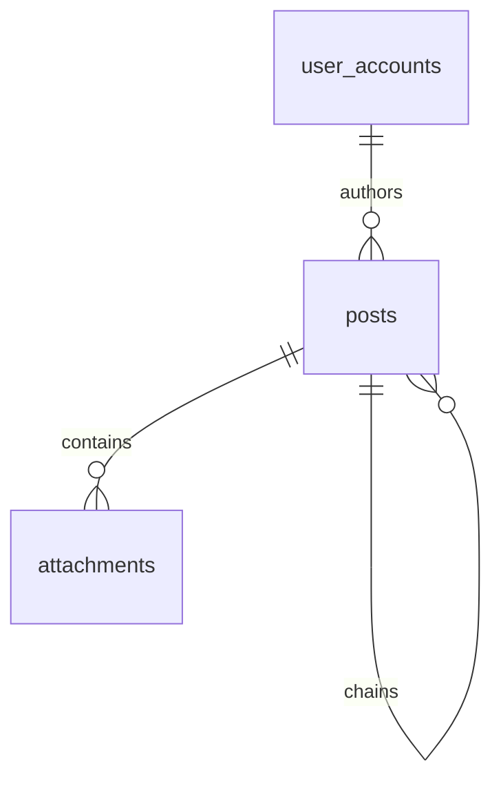

# Data Model: Post Creation

This document outlines the data model for the Post Creation functional group. It introduces two new entities, `Post` and `Attachment`, which integrate with the existing authentication schema.

## New Entities

### Post — table `posts`

- **Purpose**: Represents a discussion post or thread starter created by a user.
- **Key fields**:
  - `id` (uuid, PK) — Unique identifier for the post.
  - `author_id` (uuid, FK → `user_accounts.id`, ON DELETE CASCADE, indexed) — The creator of the post.
  - `content` (text, NULLABLE) — The text content of the post. (Can be null if an attachment is present, but the post must contain either text or an attachment).
  - `parent_id` (uuid, FK → `posts.id`, ON DELETE CASCADE, NULLABLE, indexed) — Self-referential foreign key used to link chained posts together in a single thread (e.g. for User Story 4).
  - `created_at` (timestamptz, NOT NULL, default `now()`) — When the post was created.
  - `updated_at` (timestamptz, NOT NULL, default `now()`) — When the post was last modified.
- **Relationships**:
  - Belongs to exactly one UserAccount (`author_id`).
  - Has many Attachments.
  - Belongs to one optional parent Post (`parent_id`).
  - Has many child Posts (chained replies).
- **Validation / lifecycle rules**:
  - A post MUST have at least one of `content` (non-empty after trimming) OR at least one associated `Attachment`.
  - Content length must not exceed 5,000 characters.

### Attachment — table `attachments`

- **Purpose**: Represents a media file associated with a post (e.g., JPEG, PNG, WebP image).
- **Key fields**:
  - `id` (uuid, PK) — Unique identifier for the attachment.
  - `post_id` (uuid, FK → `posts.id`, ON DELETE CASCADE, indexed) — The post this attachment belongs to.
  - `file_url` (text, NOT NULL) — Publicly accessible URL/path of the uploaded file.
  - `file_type` (text, NOT NULL) — MIME type of the file (e.g., `image/jpeg`, `image/png`, `image/webp`).
  - `file_size` (integer, NOT NULL) — Size of the file in bytes.
  - `created_at` (timestamptz, NOT NULL, default `now()`) — When the attachment record was created.
- **Relationships**:
  - Belongs to exactly one Post.
- **Validation / lifecycle rules**:
  - The maximum size per attachment is 5MB (5,242,880 bytes).
  - Supported MIME types are limited to `image/jpeg`, `image/png`, and `image/webp`.
  - A single Post can have at most 4 attachments.

## Relationships Summary

- `user_accounts` 1 ↔ many `posts`
- `posts` 1 ↔ many `attachments` (limit 4)
- `posts` 1 (parent) ↔ many `posts` (children/chained posts)
