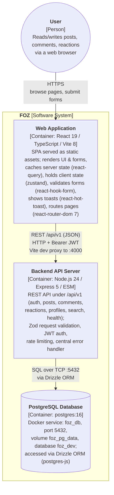

# C - Software Architecture: Container Diagram and Component Diagram

## 1. C4 Model - Level 2 (Container Diagram)

### 1.1 Diagram



### 1.2 Description

The FOZ system is decomposed into three runtime containers plus one external actor (the user). A container is a separately runnable/deployable unit that holds the system's code and/or data; each container runs in its own process and communicates with the others over a network.

- **Person — User**: A visitor to the forum. Reads and writes posts, comments, and reactions through a web browser. Communicates with the Web Application over HTTPS (the only entry point into the system).

- **Container — Web Application**
  - **Responsibility / services**: A single-page application that renders the whole UI and handles all user interactions — page routing, fetching and caching server data, managing local client state (e.g. the auth session), validating forms, and showing notifications. It has no direct database access; every piece of data comes from the Backend API Server.
  - **Technology**: React 19, TypeScript, and Vite 8 (build/dev server), with `react-router-dom` 7 (routing), `@tanstack/react-query` 5 (server state), `zustand` 5 (client state), `react-hook-form` 7 (forms), and `react-hot-toast` 2 (notifications).
  - **Communication**: Receives HTTPS requests from the User; sends JSON REST calls to the Backend API Server over HTTP/HTTPS (`/api/v1`). In development the Vite dev server proxies `/api/v1` to `http://localhost:4000`; the access token is sent as a `Bearer` header and cookies are included for the refresh flow.

- **Container — Backend API Server**
  - **Responsibility / services**: Hosts the REST API under the `/api/v1` prefix, exposing the `auth`, `posts`, `comments`, `reactions`, `profiles`, and `search` services, plus a `/api/v1/health` probe. It validates inbound payloads (Zod), issues/verifies JWT access tokens and httpOnly refresh cookies (bcrypt-hashed), rate-limits requests, and maps thrown errors to consistent HTTP error envelopes via a central error handler.
  - **Technology**: Node.js 24, Express 5 (ESM), Zod, `jsonwebtoken` + `bcrypt`, `express-rate-limit`, `cookie-parser`, `cors`.
  - **Communication**: Receives HTTP/HTTPS JSON requests from the Web Application; reads/writes the PostgreSQL Database over SQL on TCP port 5432 through the Drizzle ORM (postgres-js driver, connection pool of 10).

- **Container — PostgreSQL Database**
  - **Responsibility / services**: Persists all application data — users, roles, refresh sessions, profiles, posts, comments, reactions, and reports.
  - **Technology**: `postgres:16` running as the Docker service `foz_db` (port 5432, volume `foz_pg_data`, database `foz_dev`), accessed through the Drizzle ORM; schema changes are managed with `drizzle-kit` migrations.
  - **Communication**: Only accepts database connections (postgres protocol over TCP 5432) from the Backend API Server via the Drizzle ORM driver; it is never reached directly by the browser or the Web Application.

Relationships:

- **User → Web Application**: HTTPS browsing and form submission; the only entry point into the system.
- **Web Application → Backend API Server**: JSON REST calls to `/api/v1` over HTTP. In development the Vite server proxies `/api/v1` to `http://localhost:4000`. The frontend sends the access token as a `Bearer` token and authenticates via credentials on the refresh endpoint.
- **Backend API Server → PostgreSQL Database**: SQL queries over TCP port 5432, executed through Drizzle ORM with a connection pool (max 10).

Notes:

- The `src/shared` package (Zod schemas) is a compile-time code-sharing module, not a runtime container; it is consumed by both the Web Application and the Backend API Server at build time and does not run as a separate process.
- The system currently has **no external systems** (e.g. LLM providers) and **no realtime/message infrastructure** (no WebSocket/socket.io) in the codebase; the diagram above reflects only what is actually implemented. Internal structure (API gateway, services, data access layer, UI components) is presented at Level 3 in section 2.

## 2. C4 Model - Level 3 (Component Diagram)

### 2.1 Diagram

```mermaid


```

### 2.2 Explanation
