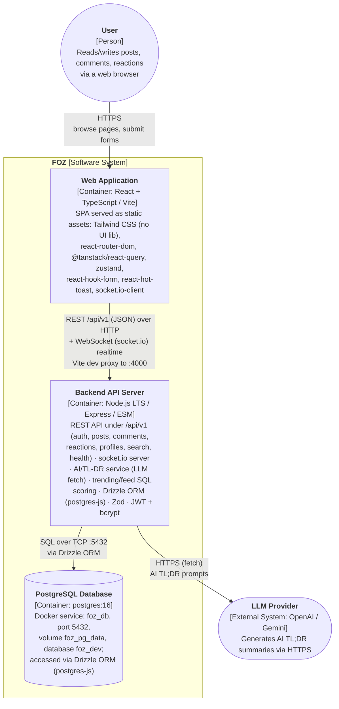
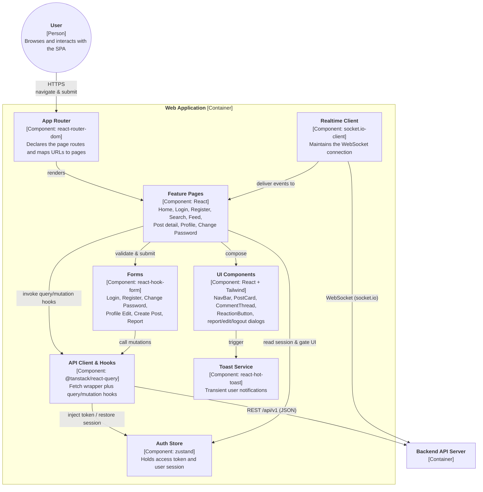
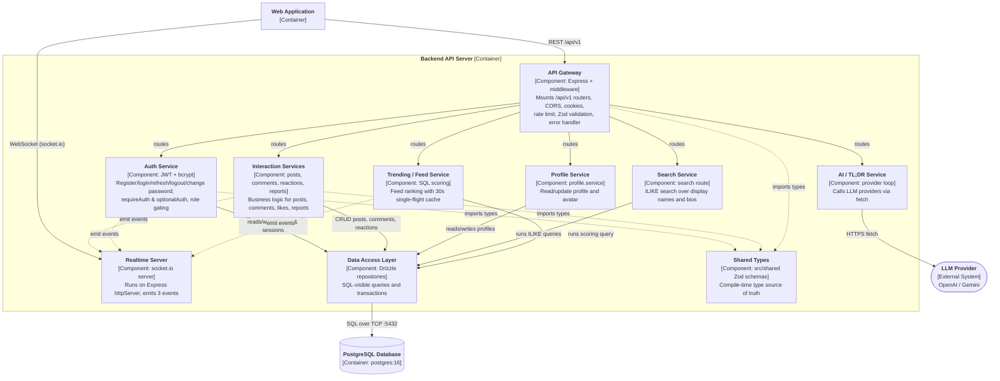

# C - Software Architecture: Container Diagram and Component Diagram

## 1. C4 Model - Level 2 (Container Diagram)

### 1.1 Diagram

### 1.2 Descriptions

The FOZ system is decomposed into three runtime containers plus one external actor (the user) and one external system (the LLM provider). A container is a separately runnable/deployable unit that holds the system's code and/or data; each container runs in its own process and communicates with the others over a network. The technology choices follow the validated stack in `docs/Techstack/fe.md` and `docs/Techstack/be.md`.

- **Person — User**: A visitor to the forum. Reads and writes posts, comments, and reactions through a web browser. Communicates with the Web Application over HTTPS (the only entry point into the system).

- **Container — Web Application**
  - **Responsibility / services**: A single-page application that renders the whole UI and handles all user interactions — page routing, fetching and caching server data, managing local client state (e.g. the auth session), validating forms, showing notifications, and maintaining the realtime connection for live updates. It has no direct database access; every piece of data comes from the Backend API Server.
  - **Technology**: React + TypeScript built with Vite, styled with Tailwind CSS (vanilla config, no UI component library); `react-router-dom` for routing, `@tanstack/react-query` for server state, `zustand` for client state, `react-hook-form` for forms, `react-hot-toast` for toasts, and `socket.io-client` for realtime. Tests with Vitest, lint/format with ESLint + Prettier.
  - **Communication**: Receives HTTPS requests from the User; sends JSON REST calls to the Backend API Server over HTTP/HTTPS (`/api/v1`) and keeps a WebSocket (socket.io) connection open for realtime events. In development the Vite dev server proxies `/api/v1` to `http://localhost:4000`; the access token is sent as a `Bearer` header and cookies are included for the refresh flow.

- **Container — Backend API Server**
  - **Responsibility / services**: Hosts the REST API under the `/api/v1` prefix, exposing the `auth`, `posts`, `comments`, `reactions`, `profiles`, and `search` services, plus a `/api/v1/health` probe. It also runs the realtime server (socket.io on the Express `httpServer`, 3 events), the AI / TL;DR service (single-file provider loop calling LLM providers), the trending / feed service (SQL scoring with a 30s in-process single-flight cache), and a central error handler that maps thrown errors to consistent HTTP error envelopes.
  - **Technology**: Node.js (current LTS, ESM) with Express; hand-wired Zod validation middleware at inbound trust boundaries; `jsonwebtoken` + `bcrypt` for auth; `express-rate-limit`, `cookie-parser`, `cors`; Drizzle ORM (postgres-js) with `drizzle-kit` migrations; `socket.io` for realtime; Zod-validated env config (fail-fast at startup).
  - **Communication**: Receives HTTP/HTTPS JSON requests and WebSocket (socket.io) connections from the Web Application; reads/writes the PostgreSQL Database over SQL on TCP port 5432 through the Drizzle ORM (connection pool of 10); makes outbound HTTPS `fetch` calls to the LLM Provider for AI TL;DR.

- **Container — PostgreSQL Database**
  - **Responsibility / services**: Persists all application data — users, roles, refresh sessions, profiles, posts, comments, reactions, and reports.
  - **Technology**: `postgres:16` running as the Docker service `foz_db` (port 5432, volume `foz_pg_data`, database `foz_dev`), accessed through the Drizzle ORM; schema changes are managed with `drizzle-kit` migrations.
  - **Communication**: Only accepts database connections (postgres protocol over TCP 5432) from the Backend API Server via the Drizzle ORM driver; it is never reached directly by the browser or the Web Application.

- **External System — LLM Provider (OpenAI / Gemini)**
  - **Responsibility / services**: Generates AI TL;DR summaries for posts when requested by the backend's AI service.
  - **Technology**: OpenAI / Gemini HTTP APIs called via plain `fetch` (no SDK).
  - **Communication**: Receives outbound HTTPS calls from the Backend API Server only; it never talks directly to the Web Application or the browser.

Relationships:

- **User → Web Application**: HTTPS browsing and form submission; the only entry point into the system.
- **Web Application → Backend API Server**: JSON REST calls to `/api/v1` over HTTP plus a WebSocket (socket.io) connection for realtime events. In development the Vite server proxies `/api/v1` to `http://localhost:4000`. The frontend sends the access token as a `Bearer` token and authenticates via credentials on the refresh endpoint.
- **Backend API Server → PostgreSQL Database**: SQL queries over TCP port 5432, executed through Drizzle ORM with a connection pool (max 10).
- **Backend API Server → LLM Provider**: Outbound HTTPS `fetch` calls carrying prompt requests for AI TL;DR summaries.

## 2. C4 Model - Level 3 (Component Diagram)

A component is a group of related functionality behind a well-defined interface inside a container. The two diagrams below zoom into the Web Application and the Backend API Server, showing the most representative components and how they interact. The PostgreSQL Database and the LLM Provider are outside these containers and are shown only for context.

### 2.1 Frontend — Web Application Container

#### 2.1.1 Diagram

#### 2.1.2 Component descriptions

- **App Router** — *Responsibility:* defines the URL-to-page mapping (`/`, `/search`, `/feed`, `/posts/:postId`, `/login`, `/register`, `/change-password`, `/profiles/:userId`). *Relationships:* receives navigation from the User; renders Feature Pages; on boot it triggers the silent session refresh via the Auth Store.
- **Feature Pages** — *Responsibility:* top-level screens that assemble the UI for each route and orchestrate data fetching for that view. *Relationships:* rendered by the App Router; composed of UI Components; driven by Forms; invokes API Client & Hooks; reads the Auth Store to gate authenticated actions; receives realtime events from the Realtime Client.
- **UI Components** — *Responsibility:* reusable presentational pieces (NavBar, PostCard, CommentThread, ReactionButton, ProfileEditModal, ReportModal, LogoutDialog). *Relationships:* composed by Feature Pages; trigger Toast Service notifications on success/failure.
- **Forms** — *Responsibility:* validated input handling (login, register, change password, profile edit, create post, report) using `react-hook-form` + Zod resolvers. *Relationships:* submitted from Feature Pages; calls API Client & Hooks mutations; reports validation errors back to the page.
- **API Client & Hooks** — *Responsibility:* thin `fetch` wrapper that injects the Bearer token and `credentials`, plus `@tanstack/react-query` hooks that fetch, cache, and sync server state. *Relationships:* invoked by Feature Pages and Forms; reads/updates the Auth Store token and session; makes REST `/api/v1` calls to the Backend API Server; imports shared types.
- **Auth Store** — *Responsibility:* zustand store holding `accessToken`, the signed-in user, and session status; exposes `setSession`, `clearSession`, and `silentRefresh` (restores the session from the refresh cookie). *Relationships:* read by API Client & Hooks and Feature Pages for token injection and UI gating; written after login/register/refresh/logout.
- **Toast Service** — *Responsibility:* shows transient success/error notifications. *Relationships:* triggered by UI Components (and pages) on user actions and API results.
- **Realtime Client** — *Responsibility:* socket.io-client connection for live updates. *Relationships:* connects over WebSocket to the Backend's Realtime Server; delivers events to Feature Pages (e.g. new posts/comments/reactions); part of the validated stack, pending implementation in the repo.

### 2.2 Backend — Backend API Server Container

#### 2.2.1 Diagram

#### 2.2.2 Component descriptions

- **API Gateway** — *Responsibility:* the Express app entry point. Applies CORS, cookie-parser, JSON body limit, and rate limiting; mounts the `/api/v1` sub-routers (auth, posts, comments, reactions, profiles, search, health); runs the central error handler that maps thrown errors and `ZodError`s to consistent HTTP envelopes. *Relationships:* receives REST requests from the Web Application; routes to Auth, Interaction, Profile, Search, AI, and Trending services; imports shared types for request validation.
- **Auth Service** — *Responsibility:* register/login/logout/refresh/change-password flow. Issues JWT access tokens (15 min) and opaque refresh sessions (7-day httpOnly cookie, bcrypt hashed); verifies tokens via `requireAuth`/`optionalAuth` middleware and enforces role/status gating. *Relationships:* called by the API Gateway; reads/writes users and refresh sessions through the Data Access Layer; can emit auth events to the Realtime Server; imports shared auth schemas.
- **Interaction Services** — *Responsibility:* business logic for the core content features — post create/delete/update/repost/report, comment create/update/delete, and like/unlike reactions. *Relationships:* routed by the API Gateway; performs CRUD through the Data Access Layer; emits realtime events on new interactions; imports shared interaction schemas.
- **Profile Service** — *Responsibility:* reads and updates a user's public profile (display name, bio, avatar, location, website). *Relationships:* routed by the API Gateway; reads/writes the profiles table through the Data Access Layer.
- **Search Service** — *Responsibility:* searches users by display name or bio using case-insensitive `ILIKE` queries (with mock-profile fallback while the DB is down). *Relationships:* routed by the API Gateway; runs SQL queries directly through the Data Access Layer.
- **AI / TL;DR Service** — *Responsibility:* builds prompts and calls OpenAI/Gemini providers over `fetch` to generate TL;DR summaries. *Relationships:* routed by the API Gateway; makes outbound HTTPS calls to the LLM Provider; part of the validated stack, pending implementation.
- **Trending / Feed Service** — *Responsibility:* computes the feed ranking with a SQL scoring formula and serves it with a 30-second in-process single-flight cache. *Relationships:* routed by the API Gateway; runs the scoring query through the Data Access Layer; emits feed events to the Realtime Server; part of the validated stack, pending implementation.
- **Realtime Server** — *Responsibility:* socket.io server attached to the Express `httpServer` that pushes realtime events (3 events) to connected clients. *Relationships:* accepts WebSocket connections from the Web Application; receives inline emits from Interaction, Auth, and Trending services; part of the validated stack, pending implementation.
- **Data Access Layer** — *Responsibility:* Drizzle ORM repositories (`users`, `profiles`, `interactions`) and the postgres-js client; provides SQL-visible queries, transactions, and `drizzle-kit`-managed schema. *Relationships:* used by Auth, Interaction, Profile, Search, and Trending services; issues SQL over TCP 5432 to the PostgreSQL Database.
- **Shared Types** — *Responsibility:* the compile-time source of truth for request/response types via `src/shared` Zod schemas. *Relationships:* imported by the API Gateway, Auth Service, Interaction Services (and the Web Application); not a runtime call — shown with dashed edges.
