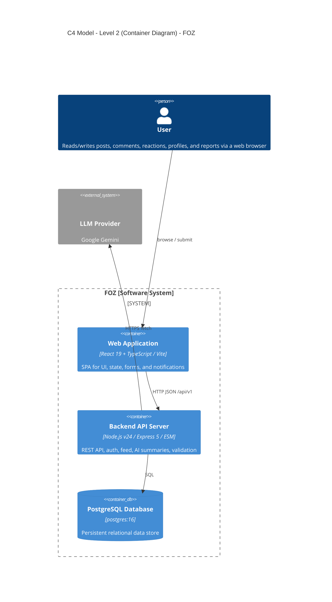
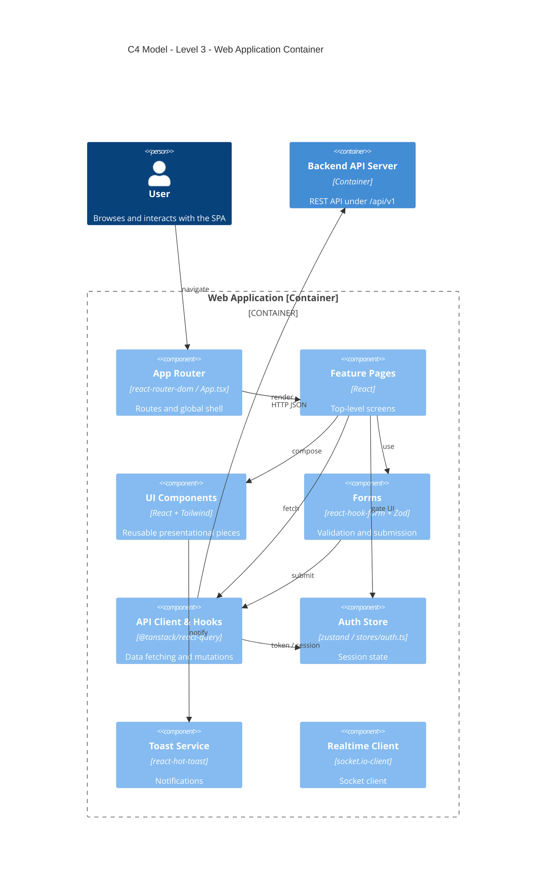
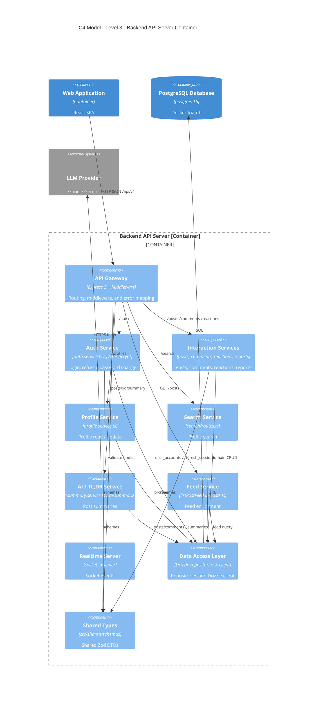

# C - Software Architecture: Container Diagram and Component Diagram

## 1. C4 Model - Level 2 (Container Diagram)

### 1.1 Diagram

### 1.2 Descriptions

The FOZ system is decomposed into three runtime containers plus one external actor (the user) and one external system (the LLM provider). A container is a separately runnable/deployable unit that holds the system's code and/or data; each container runs in its own process and communicates with the others over a network.

- **Person - User**: A visitor to the forum (guest, standard user, moderator, or administrator). Reads and writes posts, comments, reactions, profiles, and reports through a web browser. Communicates with the Web Application over HTTPS (the entry point into the system).

- **Container - Web Application**
  - **Responsibility / Services**: A single-page application (SPA) that renders the complete user interface and handles all user interactions — page routing, fetching and caching server state, managing client session state (access token, user info), validating form input, showing notifications, and displaying AI TL;DR summaries. It has no direct database access; all data is retrieved from the Backend API Server via HTTP/HTTPS REST calls.
  - **Technology**: React 19 + TypeScript built with Vite, styled with Tailwind CSS v4; `react-router-dom` for client routing, `@tanstack/react-query` for server state caching and synchronization, `zustand` for client auth state, `react-hook-form` + `@hookform/resolvers` for form handling, `react-hot-toast` for transient notifications, and `socket.io-client` in devDependencies for real-time notification support. Tested with Vitest and `@testing-library/react`.
  - **Communication**: Receives HTTPS requests from the User browser; sends JSON REST calls to the Backend API Server over HTTP/HTTPS under `/api/v1`. In development, the Vite dev server proxies `/api/v1` requests to `http://localhost:4000`. Authenticated requests include an `Authorization: Bearer <token>` header, and auth refresh requests send HTTP-only credentials.

- **Container - Backend API Server**
  - **Responsibility / Services**: Hosts the REST API under the `/api/v1` prefix, exposing services for `auth`, `posts`, `comments`, `reactions`, `profiles`, `search`, and a `/api/v1/health` status probe. It runs the AI / TL;DR post summary service (`post-summary.service.ts` backed by `ai-summarizer.ts`), the feed enrichment service (`listPostFeed`), hand-wired Zod request validation middleware, rate limiting (`express-rate-limit`), cookie parsing (`cookie-parser`), CORS middleware, and a central error handler that maps thrown errors and `ZodError`s to consistent HTTP error envelopes.
  - **Technology**: Node.js (v24 ESM) with Express 5; `jsonwebtoken` + `bcrypt` for user authentication; `express-rate-limit`, `cookie-parser`, `cors`; Drizzle ORM (`drizzle-orm` + `postgres-js`) with `drizzle-kit` database migrations; `zod` for request schema validation; fail-fast env validation (`env.ts`).
  - **Communication**: Receives HTTP/HTTPS JSON requests from the Web Application; reads and writes the PostgreSQL Database via SQL over TCP port 5432 using Drizzle ORM; executes outbound HTTPS `fetch` calls to the Google Gemini API (`generativelanguage.googleapis.com`) to generate AI TL;DR summaries.

- **Container - PostgreSQL Database**
  - **Responsibility / Services**: Persists all application relational data — user accounts, user profiles, HTTP-only refresh sessions, posts, post attachments, comments, reactions (likes), content reports, and AI post summaries.
  - **Technology**: `postgres:16` running as the Docker service `foz_db` (port 5432, volume `foz_pg_data`, database `foz_dev`), accessed via Drizzle ORM (`postgres-js`); database migrations are managed using `drizzle-kit`.
  - **Communication**: Only accepts database connections (PostgreSQL wire protocol over TCP port 5432) from the Backend API Server via Drizzle ORM; it is isolated from direct access by the browser or Web Application.

- **External System - LLM Provider (Google Gemini)**
  - **Responsibility / Services**: Generates structured AI TL;DR summaries (post snapshot, key discussion highlights, and sentiment) on demand for forum posts.
  - **Technology**: Google Gemini HTTP API (`gemini-2.5-flash` / `gemini-1.5-flash`) called via native `fetch` with a fallback summarizer mechanism.
  - **Communication**: Receives outbound HTTPS calls from the Backend API Server; does not communicate directly with the Web Application or browser.

### 1.3 Relationships Summary

- **User → Web Application**: HTTPS browsing, form submission, and UI interaction.
- **Web Application → Backend API Server**: JSON REST calls to `/api/v1` over HTTP/HTTPS. In development, the Vite dev server proxies `/api/v1` to `http://localhost:4000`. Authenticated calls pass access tokens as `Bearer` headers and send HTTP-only credentials for session refresh.
- **Backend API Server → PostgreSQL Database**: SQL queries over TCP port 5432 executed through Drizzle ORM driver (`postgres-js`).
- **Backend API Server → LLM Provider**: Outbound HTTPS `fetch` calls carrying prompt payloads to retrieve AI post summaries.

---

## 2. C4 Model - Level 3 (Component Diagram)

The two diagrams below zoom into the Web Application and Backend API Server containers, detailing their primary internal components and interactions. The PostgreSQL Database and LLM Provider are shown for external context.

### 2.1 Frontend - Web Application Container

#### 2.1.1 Diagram

#### 2.1.2 Component Descriptions

- **App Router (`App.tsx`)**
  - **Responsibility:** Declares URL routing mapping (`/`, `/search`, `/feed`, `/posts/:postId`, `/login`, `/register`, `/change-password`, `/profiles/:userId`).
  - **Relationships:** Receives navigation actions from the User; renders matching Feature Pages; injects global layout and dialog controls (`LogoutDialog`).
- **Feature Pages (`src/frontend/src/pages/`)**
  - **Responsibility:** Top-level page views (`HomePage`, `FeedPage`, `PostPage`, `SearchPage`, `ProfilePage`, `LoginPage`, `RegisterPage`, `ChangePasswordPage`) that assemble layout components and manage page-level state.
  - **Relationships:** Rendered by App Router; composes UI Components; embeds Forms; invokes API Client & Hooks for data fetching; reads Auth Store state to gate authenticated controls.
- **UI Components (`src/frontend/src/components/`)**
  - **Responsibility:** Reusable presentational components, including header navigation (`NavBar`), post feeds (`FeedPostItem`, `PostCard`), comment discussions (`CommentThread`), reactions (`ReactionButton`), modal dialogs (`CreatePostModal`, `ProfileEditModal`, `ReportModal`, `LogoutDialog`), and the AI feature component (`PostSummaryCard`).
  - **Relationships:** Composed by Feature Pages; triggers Toast Service notifications on successful actions or API errors.
- **Forms (`react-hook-form`)**
  - **Responsibility:** Form input handling, error state tracking, and schema validation (`@hookform/resolvers` + Zod schemas from `src/shared/schemas`) for authentication, post creation, commenting, profile updates, and reporting.
  - **Relationships:** Embedded inside Feature Pages and Modal UI Components; invokes API Client & Hooks mutations on submit.
- **API Client & Hooks (`src/frontend/src/api/`)**
  - **Responsibility:** Modular API modules (`auth.ts`, `interactions.ts`, `post-summary.ts`, `profile.ts`, `search.ts`) providing `fetch` wrappers with `Bearer` authorization headers alongside `@tanstack/react-query` hooks (`useQuery`, `useMutation`) for caching and data sync.
  - **Relationships:** Invoked by Feature Pages and Forms; reads access tokens from Auth Store; executes REST calls to Backend API Server under `/api/v1`.
- **Auth Store (`src/frontend/src/stores/auth.ts`)**
  - **Responsibility:** `zustand` state store managing `accessToken`, active `user` profile data, and session actions (`setAccessToken`, `setUser`, `logout`).
  - **Relationships:** Read by API Client & Hooks for token injection; updated by Auth API hooks upon login, registration, or session restoration.
- **Toast Service (`react-hot-toast`)**
  - **Responsibility:** Displays transient toast notifications for actions such as post creation, profile saving, password updates, and API errors.
  - **Relationships:** Triggered by UI Components, Forms, and API hook error callbacks.
- **Realtime Client (`socket.io-client`)**
  - **Responsibility:** Client socket package included in devDependencies to support WebSocket real-time notification events.
  - **Relationships:** Client package dependency available for real-time event subscriptions, operating alongside the primary REST API communication flow.

---

### 2.2 Backend - Backend API Server Container

#### 2.2.1 Diagram

#### 2.2.2 Component Descriptions

- **API Gateway (`src/backend/index.ts`)**
  - **Responsibility:** Application entry point; applies CORS, cookie parsing (`cookie-parser`), body size limits, rate limiting (`express-rate-limit`), mounts sub-routers on `apiRouter` under `/api/v1` (`/auth`, `/posts`, `/profiles`, `/search`, `/` for comments/reactions), exposes `/api/v1/health`, and runs central error handling that converts thrown errors and `ZodError` instances into uniform JSON response envelopes.
  - **Relationships:** Receives incoming REST requests from Web Application; routes requests to Auth, Interaction, Profile, Search, AI, and Feed services; validates requests using Shared Types schemas.
- **Auth Service (`src/backend/api/auth/`)**
  - **Responsibility:** Authentication flows — user registration, login, logout, refresh session rotation, and password changes. Issues short-lived JWT access tokens (15 minutes) and rotates 7-day HTTP-only refresh tokens (stored as bcrypt hashes in `refresh_sessions`). Enforces `requireAuth` and `optionalAuth` middleware for role and session checks.
  - **Relationships:** Routed by API Gateway; interacts with Data Access Layer (`user_accounts`, `refresh_sessions`); uses Shared Types auth schemas.
- **Interaction Services (`src/backend/services/interactions/`)**
  - **Responsibility:** Domain logic for discussion interactions — post creation/editing/deletion, thread reposts, post attachments, hierarchical commenting, like/unlike reactions, and content reporting (`reports.ts`).
  - **Relationships:** Routed by API Gateway; executes database queries through Data Access Layer (`posts`, `comments`, `reactions`, `reports`, `post_attachments`); utilizes Shared Types schemas.
- **Profile Service (`src/backend/api/profile/`)**
  - **Responsibility:** Retrieves and updates user public profile records (`displayName`, `bio`, `avatarUrl`, `location`, `website`).
  - **Relationships:** Routed by API Gateway; reads and updates `profiles` table via Data Access Layer; uses Shared Types profile schemas.
- **Search Service (`src/backend/api/search/`)**
  - **Responsibility:** Executes case-insensitive `ILIKE` search queries against user display names and bios, returning matching user profiles (with mock fallback data if database query fails).
  - **Relationships:** Routed by API Gateway; queries `profiles` table through Data Access Layer.
- **AI / TL;DR Service (`src/backend/services/post-summary.service.ts` & `ai-summarizer.ts`)**
  - **Responsibility:** On-demand AI post summarization. Samples top post comments, invokes Google Gemini API (`generativelanguage.googleapis.com`) via HTTPS `fetch` (with fallback text summarization), and persists/serves cached summary data (`postSnapshot`, `keyHighlights`, `sentiment`, `commentCount`) in the `post_summaries` table.
  - **Relationships:** Exposed via `/api/v1/posts/:postId/summary` and `/api/v1/posts/:postId/summary/refresh`; reads posts and comments from Data Access Layer; writes to `post_summaries`; makes outbound HTTPS calls to LLM Provider (Google Gemini).
- **Feed Service (`listPostFeed` in `src/backend/services/interactions/posts.ts`)**
  - **Responsibility:** Fetches active public posts, resolves repost origins, and enriches post items with like counts, comment counts, user reaction statuses, attachments, and author profile details.
  - **Relationships:** Routed by API Gateway (`GET /api/v1/posts`); queries `posts`, `comments`, `reactions`, `post_attachments`, and `profiles` tables via Data Access Layer.
- **Realtime Server (`socket.io`)**
  - **Responsibility:** Real-time event communication infrastructure configured on the Express HTTP server to broadcast live forum updates.
  - **Relationships:** Server infrastructure for WebSocket client connections, operating alongside the primary Express REST API.
- **Data Access Layer (`src/backend/db/`)**
  - **Responsibility:** Drizzle ORM client (`db/client.ts`), schema definitions (`users.ts`, `refresh-sessions.ts`, `interactions.ts`), repository functions (`interactions.ts`, `profiles.ts`, `post-summary.repository.ts`), and database migrations managed via `drizzle-kit`.
  - **Relationships:** Invoked by Auth, Interaction, Profile, Search, AI, and Feed services; executes SQL queries over TCP port 5432 to PostgreSQL Database.
- **Shared Types (`src/shared/`)**
  - **Responsibility:** Single source of truth for DTO interfaces, Zod validation schemas (`auth.ts`, `interactions.ts`, `profile.ts`, `post-summary.ts`), and domain enums (`schema-enums.ts`) shared across frontend and backend.
  - **Relationships:** Imported at compile time by API Gateway, backend services, and frontend API clients (represented with dashed relationships in diagrams).
