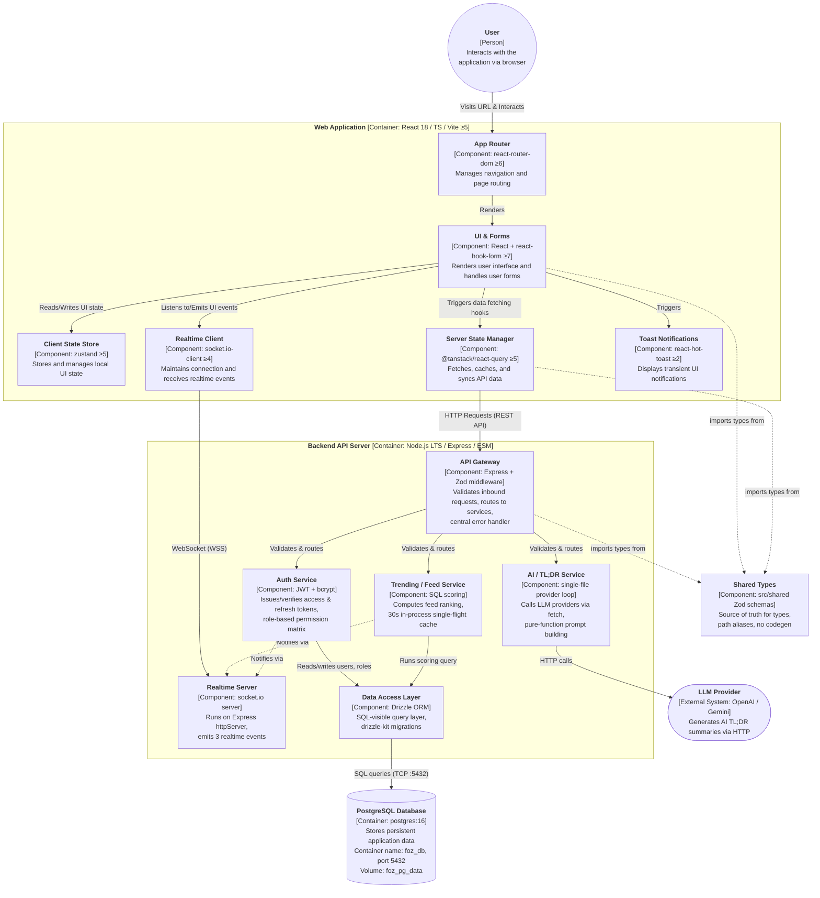

# C - Software Architecture: Container Diagram and Component Diagram

## 1. C4 Model - Level 2 (Container Diagram):

### 1.1 Diagram



### 1.2 Explanation


## 2. C4 Model - Level 3 (Component Diagram):

### 2.1 Diagram

```mermaid


```

### 2.2 Explanation

