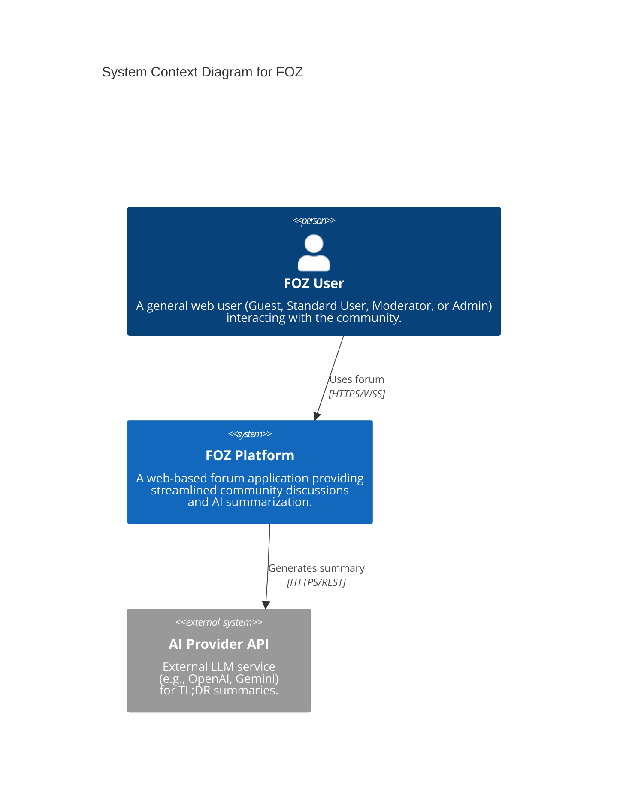
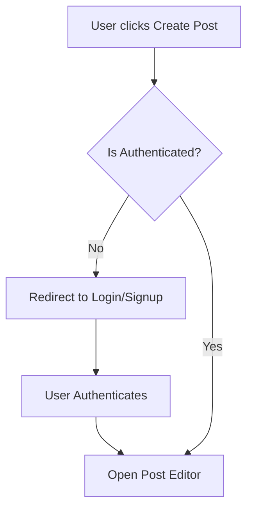

# Table of Contents

- [Table of Contents](#table-of-contents)
- [A - Revised Use-Case Specification](#a---revised-use-case-specification)
	 - [Use-Case Specification: Sign Up](#use-case-specification-sign-up)
   - [Use-Case Specification: Log In](#use-case-specification-log-in)
   - [Use-Case Specification: Log Out](#use-case-specification-log-out)
   - [Use-Case Specification: Manage Profile](#use-case-specification-manage-profile)
   - [Use-Case Specification: Change Password](#use-case-specification-change-password)
   - [Use-Case Specification: Change Avatar](#use-case-specification-change-avatar)
   - [Use-Case Specification: Browse Feed](#use-case-specification-browse-feed)
   - [Use-Case Specification: Search Content](#use-case-specification-search-content)
   - [Use-Case Specification: View Post Details](#use-case-specification-view-post-details)
   - [Use-Case Specification: Create Post](#use-case-specification-create-post)
   - [Use-Case Specification: Interact with Post](#use-case-specification-interact-with-post)
   - [Use-Case Specification: Leave Comment](#use-case-specification-leave-comment)
   - [Use-Case Specification: Like/Unlike](#use-case-specification-likeunlike)
   - [Use-Case Specification: Request AI Summary](#use-case-specification-request-ai-summary)
   - [Use-Case Specification: Delete Own Post](#use-case-specification-delete-own-post)
   - [Use-Case Specification: Report Inappropriate Content](#use-case-specification-report-inappropriate-content)
   - [Use-Case Specification: Review Reports](#use-case-specification-review-reports)
   - [Use-Case Specification: Forward Report to Admin](#use-case-specification-forward-report-to-admin)
   - [Use-Case Specification: Delete Any Content](#use-case-specification-delete-any-content)
   - [Use-Case Specification: Permanently Remove User](#use-case-specification-permanently-remove-user)
   - [Use-Case Specification: Assign Moderator Role](#use-case-specification-assign-moderator-role)
- [B - Software Architecture: System Context Diagram](#b---software-architecture-system-context-diagram)
	- [Tech Stack](#tech-stack)
		- [Frontend](#frontend)
		- [Backend](#backend)
		- [Database](#database)
		- [External APIs / Services](#external-apis--services)
	- [C4 Model - Level 1 (System Context Diagram)](#c4-model---level-1-system-context-diagram)
		- [Diagram Explanation](#diagram-explanation)
- [C - Diagram example](#c---diagram-example)
	- [1. Diagram rules](#1-diagram-rules)
- [D - Image example](#d---image-example)
	- [1. Insert image rule](#1-insert-image-rule)

# A - Revised Use-Case Specification
*Performed by: Nguyễn Hải Trọng | Reviewed by: Phạm Định Gia Khánh*

## Revision History

| Date | Version | Description | Author |
| :--- | :--- | :--- | :--- |
| 19/Jul/2026 | 1.0 | Initial draft: Documented all 21 Use-Case Specifications covering Auth, Core Interactions, and Moderation. | Nguyễn Hải Trọng |
| 06/Aug/2026 | 1.1 | Update the Alternative Flow and Reordered sections for clarity | Nguyễn Hải Trọng |

# Use-Case Specification: Sign Up

**Project Name:** FOZ  
**Version:** 1.1  
**Document identifier:** FOZ-UCS-01

## 1. Sign Up
* **Use-Case ID:** UC-01
* **Actor(s):** Guest

### 1.1 Brief Description
This use case allows an unauthenticated guest to create a new user account and profile on the FOZ platform using their email and a secure password.

## 2. Preconditions
* The user must be a Guest (unauthenticated).

## 3. Flow of Events
### 3.1 Basic Flow
1. The use case begins when the Guest navigates to the Registration page.
2. The user enters a valid email address and a strong password.
3. The user clicks "Create account".
4. The system validates the inputs (email format, password length > 8 chars).
5. The system checks if the email is already registered.
6. The system securely hashes the password using bcrypt.
7. The system creates a new record in the `user_accounts` table (role: `standard`, status: `active`) and a default record in the `profiles` table.
8. The system issues an access token and a refresh token (saved in `refresh_sessions`).
9. The system redirects the user to the Home Feed.

### 3.2 Alternative Flows

#### 3.2.1 Email Already Exists
1. If at step 5, the email exists in the database.
2. The system aborts the registration.
3. The system displays a generic error: "An account with this email already exists".
4. The flow resumes at step 2.

#### 3.2.2 Weak Password
1. If at step 4, the password is less than 8 characters.
2. The system highlights the field with "Password must be at least 8 characters".
3. The flow resumes at step 2.

#### 3.2.3 Password Too Long
1. If at step 4, the password exceeds 128 characters.
2. The system aborts and displays "Password is too long".
3. The flow resumes at step 2.

#### 3.2.4 Rate Limit Exceeded
1. If the user makes more than 100 registration attempts within 15 minutes.
2. The system rejects the request and displays "Too many requests, slow down."
3. The use case ends.

## 4. Special Requirements
* **Security:** Passwords must be hashed via bcrypt with a minimum cost of 12. Plaintext passwords must never be logged.

## 5. Postconditions
* A new user account and profile are saved in the database. The user is signed in.

## 6. Extension Points
* None.

## 7. Prototype Requirement
* **Screen 1 (Basic Flow):**
    
* **Screen 2 (Alt Flow):**
    

# Use-Case Specification: Log In

**Project Name:** FOZ  
**Version:** 1.1  
**Document identifier:** FOZ-UCS-02

## 1. Log In
* **Use-Case ID:** UC-02
* **Actor(s):** Guest

### 1.1 Brief Description
This use case describes how a registered Guest accesses their account by providing valid credentials.

## 2. Preconditions
* The user is unauthenticated.

## 3. Flow of Events
### 3.1 Basic Flow
1. The use case begins when the Guest navigates to the Login page.
2. The user enters their email and password, then clicks "Sign In".
3. The system finds the user in `user_accounts` and verifies the password hash.
4. The system checks if the account status is `active`.
5. The system issues an Access Token and sets a Refresh Token cookie.
6. The system redirects the user to the Home Feed.

### 3.2 Alternative Flows

#### 3.2.1 Invalid Credentials
1. If at step 3, the email is not found or the password does not match.
2. The system displays: "Invalid email or password".
3. The flow resumes at step 2.

#### 3.2.2 Account Suspended
1. If at step 4, the account status is `suspended` or `banned`.
2. The system displays: "Your account is not currently available."
3. The use case ends.

#### 3.2.3 Rate Limit Exceeded
1. If the user makes more than 100 login attempts within 15 minutes.
2. The system rejects the request and displays "Too many requests, slow down."
3. The use case ends.

## 4. Special Requirements
* **Rate Limiting:** Maximum 100 attempts per 15 minutes to prevent brute-force attacks.

## 5. Postconditions
* The user is authenticated and an active session is recorded in `refresh_sessions`.

## 6. Extension Points
* None.

## 7. Prototype Requirement
* **Screen 1 (Basic Flow):**
   
* **Screen 2 (Alt Flow):**
  

# Use-Case Specification: Log Out

**Project Name:** FOZ  
**Version:** 1.0  
**Document identifier:** FOZ-UCS-03

## 1. Log Out
* **Use-Case ID:** UC-03
* **Actor(s):** Standard User

### 1.1 Brief Description
Allows an authenticated user to securely end their active session on the current device.

## 2. Preconditions
* The user must be authenticated.

## 3. Flow of Events
### 3.1 Basic Flow
1. The use case begins when the user clicks the "Sign out" button.
2. The system reads the refresh cookie to identify the current session.
3. The system updates the `revoked_at` timestamp in the `refresh_sessions` table for that session.
4. The system clears the local access token and the refresh cookie from the browser.
5. The system redirects the user to the Login page.

### 3.2 Alternative Flows

#### 3.2.1 Session Already Expired
1. If at step 2, the session token is already expired or invalid.
2. The system proceeds to step 4 without database updates.

## 4. Special Requirements
* None.

## 5. Postconditions
* The user is signed out and redirected to a public page.

## 6. Extension Points
* None.

## 7. Prototype Requirement
* **Screen 1 (Basic Flow):** 
  

# Use-Case Specification: Manage Profile

**Project Name:** FOZ  
**Version:** 1.1  
**Document identifier:** FOZ-UCS-04

## 1. Manage Profile
* **Use-Case ID:** UC-04
* **Actor(s):** Standard User

### 1.1 Brief Description
Allows the user to update their public-facing information such as display name, bio, location, and website.

## 2. Preconditions
* The user is authenticated.

## 3. Flow of Events
### 3.1 Basic Flow
1. The use case begins when the user navigates to "Edit Profile".
2. The system retrieves current data from the `profiles` table.
3. The user edits text fields (Display Name, Bio, Location, Website) and clicks "Save".
4. The system validates the inputs (e.g., URL format for website).
5. The system updates the `profiles` table and the `updated_at` timestamp.
6. The system displays a success message.

### 3.2 Alternative Flows

#### 3.2.1 Invalid Input Format
1. If at step 4, the website URL is invalid.
2. The system displays an error below the website field.
3. The flow resumes at step 3.

#### 3.2.2 Validation Errors
1. If at step 4, inputs exceed max lengths (Display Name: 50, Bio: 160, Location: 100, Website: 200 characters) or Display Name contains invalid characters.
2. The system displays specific field validation errors.
3. The flow resumes at step 3.

## 4. Special Requirements
* None.

## 5. Postconditions
* Profile data is updated in the database.

## 6. Extension Points
* **Change Password:** Extended via UC-05.
* **Change Avatar:** Extended via UC-06.

## 7. Prototype Requirement
* **Screen 1 (Basic Flow):**
  

# Use-Case Specification: Change Password

**Project Name:** FOZ  
**Version:** 1.1  
**Document identifier:** FOZ-UCS-05

## 1. Change Password
* **Use-Case ID:** UC-05
* **Actor(s):** Standard User

### 1.1 Brief Description
Allows an authenticated user to change their password securely by verifying their current password.

## 2. Preconditions
* The user is authenticated.

## 3. Flow of Events
### 3.1 Basic Flow
1. The use case extends UC-04 when the user selects "Change password".
2. The user enters their current password, a new password, and confirms the new password.
3. The user clicks "Update password".
4. The system verifies the current password against the stored `password_hash`.
5. The system validates the new password strength.
6. The system hashes the new password and updates `user_accounts`.
7. The system displays a success toast message and redirects to home.

### 3.2 Alternative Flows

#### 3.2.1 Incorrect Current Password
1. If at step 4, the current password does not match.
2. The system displays "Invalid credentials".
3. The flow resumes at step 2.

#### 3.2.2 New Password Matches Old Password
1. If at step 4, the new password is exactly the same as the current password.
2. The system rejects the request and displays "New password must differ from the current one".
3. The flow resumes at step 2.

## 4. Special Requirements
* **Security:** The new password must not be identical to the old password.

## 5. Postconditions
* The user's password hash is updated.

## 6. Extension Points
* None.

## 7. Prototype Requirement
* **Screen 1 (Basic Flow):** 
  
  **Change Password will be in Settings**

# Use-Case Specification: Change Avatar

**Project Name:** FOZ  
**Version:** 1.1  
**Document identifier:** FOZ-UCS-06

## 1. Change Avatar
* **Use-Case ID:** UC-06
* **Actor(s):** Standard User

### 1.1 Brief Description
Allows an authenticated user to upload a new profile picture.

## 2. Preconditions
* The user is authenticated.

## 3. Flow of Events
### 3.1 Basic Flow
1. The use case extends UC-04 when the user clicks the "Upload picture" icon.
2. The user selects an image file from their device.
3. The system validates the file type and size.
4. The system uploads the file to storage and retrieves the image URL.
5. The system updates the `avatar_url` in the `profiles` table.
6. The system refreshes the avatar display on the UI.

### 3.2 Alternative Flows

#### 3.2.1 File Too Large
1. If at step 3, the file exceeds the 2MB limit.
2. The system aborts the upload and displays "File size exceeds 2MB".
3. The flow resumes at step 1.

## 4. Special Requirements
* **Space:** Image uploads must be limited to 2MB to conserve server storage.

## 5. Postconditions
* The new avatar is visible publicly on the user's profile.

## 6. Extension Points
* None.

## 7. Prototype Requirement
* **Screen 1 (Basic Flow):** 
  

# Use-Case Specification: Browse Feed

**Project Name:** FOZ  
**Version:** 1.0  
**Document identifier:** FOZ-UCS-07

## 1. Browse Feed
* **Use-Case ID:** UC-07
* **Actor(s):** Guest, Standard User

### 1.1 Brief Description
Allows users to view a dynamic timeline of forum posts sorted by recent engagement metrics or chronological order.

## 2. Preconditions
* None.

## 3. Flow of Events
### 3.1 Basic Flow
1. The use case begins when the user navigates to the application's homepage.
2. The system queries the `posts` table for content with `visibility_state = 'public'` and `lifecycle_state = 'active'`.
3. The system sorts the posts based on engagement algorithms (e.g., recent comment velocity, likes).
4. The system displays the feed with post titles, author avatars, and interaction counts.
5. The user scrolls to load more posts (pagination).

### 3.2 Alternative Flows

#### 3.2.1 No Posts Available
1. If at step 2, the database returns no posts.
2. The system displays a "No discussions found. Be the first to post!" placeholder.
3. The use case ends.

## 4. Special Requirements
* **Performance:** The initial feed must load in `< 2 seconds`.

## 5. Postconditions
* None.

## 6. Extension Points
* None.

## 7. Prototype Requirement
* **Screen 1 (Basic Flow):** 
  

# Use-Case Specification: Search Content

**Project Name:** FOZ  
**Version:** 1.0  
**Document identifier:** FOZ-UCS-08

## 1. Search Content
* **Use-Case ID:** UC-08
* **Actor(s):** Guest, Standard User

### 1.1 Brief Description
Allows users to search for specific discussion topics, posts, or user profiles using keywords.

## 2. Preconditions
* None.

## 3. Flow of Events
### 3.1 Basic Flow
1. The use case begins when the user enters a keyword into the search bar and presses Enter.
2. The system sends the query to the backend.
3. The backend searches the `posts` (body/title) and `profiles` (display_name) tables for matches.
4. The system filters out content that is deleted, hidden, or authored by banned users.
5. The system displays a categorized list of results (Posts, Users).

### 3.2 Alternative Flows

#### 3.2.1 Empty Query
1. If at step 2, the search query is empty or just whitespace.
2. The system displays "Please enter a search term." and halts the request.

## 4. Special Requirements
* **Performance:** Search queries must resolve in `< 500ms`.

## 5. Postconditions
* None.

## 6. Extension Points
* None.

## 7. Prototype Requirement
* **Screen 1 (Basic Flow):** 
  

# Use-Case Specification: View Post Details

**Project Name:** FOZ  
**Version:** 1.1  
**Document identifier:** FOZ-UCS-09

## 1. View Post Details
* **Use-Case ID:** UC-09
* **Actor(s):** Guest, Standard User

### 1.1 Brief Description
Allows a user to read the full body of a post along with its entire nested comment thread.

## 2. Preconditions
* The post ID must be valid.

## 3. Flow of Events
### 3.1 Basic Flow
1. The use case begins when the user clicks on a post from the feed or search results.
2. The system queries the `posts` and `comments` tables matching the Post ID.
3. The system formats the comment tree hierarchically.
4. The system displays the full post content, author details, and comments.

### 3.2 Alternative Flows

#### 3.2.1 Post Removed or Hidden
1. If at step 2, the post's `lifecycle_state` is `removed_by_moderation`.
2. The system displays: "This post has been removed by moderators."
3. The use case ends.

#### 3.2.2 Post Not Found
1. If at step 2, the requested Post ID does not exist in the database.
2. The system displays a 404 Not Found error page.
3. The use case ends.

## 4. Special Requirements
* None.

## 5. Postconditions
* None.

## 6. Extension Points
* **Request AI Summary:** Extended via UC-14.

## 7. Prototype Requirement
* **Screen 1 (Basic Flow):** 
  

# Use-Case Specification: Create Post

**Project Name:** FOZ  
**Version:** 1.1  
**Document identifier:** FOZ-UCS-10

## 1. Create Post
* **Use-Case ID:** UC-10
* **Actor(s):** Standard User

### 1.1 Brief Description
Allows an authenticated user to publish a new text-based post to initiate a discussion.

## 2. Preconditions
* The user is authenticated and their account status is `active`.

## 3. Flow of Events
### 3.1 Basic Flow
1. The use case begins when the user clicks "Create Post".
2. The system displays an editor.
3. The user types the content and clicks "Submit".
4. The system validates the input lengths.
5. The system saves the record in the `posts` table (lifecycle_state: `active`).
6. The system redirects to the new post's detail page.

### 3.2 Alternative Flows

#### 3.2.1 Content Validation Error
1. If at step 4, the post body is empty.
2. The system highlights the text area with an error.
3. The flow resumes at step 3.

#### 3.2.2 Exceeds Limits
1. If at step 4, the post body exceeds 5,000 characters, or there are more than 5 media attachments, or the chained thread exceeds 10 posts.
2. The system aborts and displays a validation error message.
3. The flow resumes at step 3.

## 4. Special Requirements
* **Security:** Inputs must be sanitized against XSS.

## 5. Postconditions
* A new record exists in the `posts` table.

## 6. Extension Points
* None.

## 7. Prototype Requirement
* **Screen 1 (Basic Flow):** 
  

# Use-Case Specification: Interact with Post

**Project Name:** FOZ  
**Version:** 1.0  
**Document identifier:** FOZ-UCS-11

## 1. Interact with Post
* **Use-Case ID:** UC-11
* **Actor(s):** Standard User

### 1.1 Brief Description
Acts as the generalized use case for users engaging with a post via various actions.

## 2. Preconditions
* The user is authenticated. Post is active.

## 3. Flow of Events
### 3.1 Basic Flow
1. The use case begins when an authenticated user opens a post.
2. The system presents interaction buttons (Like, Reply, Report, Repost).
3. The user selects an interaction option.
4. The system triggers the specific extended workflow.

### 3.2 Alternative Flows
* Not applicable (handled by extending use cases).

## 4. Special Requirements
* None.

## 5. Postconditions
* None.

## 6. Extension Points
* **Leave Comment:** Extended via UC-12.
* **Like/Unlike:** Extended via UC-13.

## 7. Prototype Requirement
* **Screen 1 (Basic Flow):** 
  

# Use-Case Specification: Leave Comment

**Project Name:** FOZ  
**Version:** 1.1  
**Document identifier:** FOZ-UCS-12

## 1. Leave Comment
* **Use-Case ID:** UC-12
* **Actor(s):** Standard User

### 1.1 Brief Description
Allows an authenticated user to reply to a post or to another comment.

## 2. Preconditions
* User is authenticated.

## 3. Flow of Events
### 3.1 Basic Flow
1. Extends UC-11 when the user clicks "Reply".
2. The system opens a small text input field.
3. The user types their comment and clicks "Post Reply".
4. The system validates the text.
5. The system inserts a record into the `comments` table, mapping `post_id` and optionally `parent_comment_id`.
6. The system updates the UI to show the new comment inline.

### 3.2 Alternative Flows

#### 3.2.1 Empty Comment
1. If at step 4 the comment is empty.
2. The system disables the "Post Reply" button.

#### 3.2.2 Post or Parent Comment Not Found
1. If at step 5, the target `post_id` or `parent_comment_id` has been deleted or hidden.
2. The system aborts the operation and returns a "POST_NOT_FOUND" or "PARENT_COMMENT_NOT_FOUND" error.
3. The user is notified that they cannot reply to deleted content.

## 4. Special Requirements
* None.

## 5. Postconditions
* A new comment is persisted to the database.

## 6. Extension Points
* None.

## 7. Prototype Requirement
* **Screen 1 (Basic Flow):** 
  

# Use-Case Specification: Like/Unlike

**Project Name:** FOZ  
**Version:** 1.0  
**Document identifier:** FOZ-UCS-13

## 1. Like/Unlike
* **Use-Case ID:** UC-13
* **Actor(s):** Standard User

### 1.1 Brief Description
Allows a user to toggle an appreciation metric on a post or comment.

## 2. Preconditions
* User is authenticated.

## 3. Flow of Events
### 3.1 Basic Flow
1. Extends UC-11 when the user clicks the "Heart/Like" icon.
2. The system checks the `reactions` table to see if a record already exists for this `user_account_id` and `target_id`.
3. If no record exists, the system inserts a new reaction (`reaction_kind: 'like'`) and increments the counter visually.
4. If a record exists, the system deletes it (Unlike) and decrements the counter.

### 3.2 Alternative Flows
* None.

## 4. Special Requirements
* **Performance:** Reaction toggles should feel instantaneous (optimistic UI updates).

## 5. Postconditions
* The `reactions` table is updated.

## 6. Extension Points
* None.

## 7. Prototype Requirement
* **Screen 1 (Basic Flow):** 
  

# Use-Case Specification: Request AI Summary

**Project Name:** FOZ  
**Version:** 1.1  
**Document identifier:** FOZ-UCS-14

## 1. Request AI Summary
* **Use-Case ID:** UC-14
* **Actor(s):** Guest, Standard User

### 1.1 Brief Description
Generates an AI-powered TL;DR of a lengthy post and its comments for quick reading.

## 2. Preconditions
* The post must have sufficient text/comments to summarize.

## 3. Flow of Events
### 3.1 Basic Flow
1. Extends UC-09 when the user clicks "Generate TL;DR".
2. The system checks the `post_summaries` table for a recently cached summary.
3. If not cached, the system fetches the post text and top comments.
4. The system sends the payload to the external AI Engine.
5. The AI returns the summary.
6. The system caches the result in `post_summaries` and displays it in a modal.

### 3.2 Alternative Flows

#### 3.2.1 AI Service Error
1. If at step 5 the AI API times out or errors.
2. The system displays: "AI Summary is currently unavailable."

#### 3.2.2 Rate Limit Exceeded
1. If the user makes more than 10 summary requests within 1 minute.
2. The system rejects the request and displays "Too many summary requests, please try again in a minute."
3. The use case ends.

## 4. Special Requirements
* **Performance:** AI generation must complete in `< 5 seconds`.

## 5. Postconditions
* A cached summary is stored in the database.

## 6. Extension Points
* None.

## 7. Prototype Requirement
* **Screen 1 (Basic Flow):** 
  

# Use-Case Specification: Delete Own Post

**Project Name:** FOZ  
**Version:** 1.1  
**Document identifier:** FOZ-UCS-15

## 1. Delete Own Post
* **Use-Case ID:** UC-15
* **Actor(s):** Standard User

### 1.1 Brief Description
Allows a user to permanently remove a post they authored.

## 2. Preconditions
* User is authenticated and is the `author_id` of the post.

## 3. Flow of Events
### 3.1 Basic Flow
1. The use case begins when the user clicks the "Delete" option on their own post.
2. The system displays a confirmation dialog.
3. The user confirms the deletion.
4. The system updates the post's `lifecycle_state` to `hidden` or sets `deleted_at` timestamp in the `posts` table (soft delete).
5. The system removes the post from the feed and redirects the user home.

### 3.2 Alternative Flows

#### 3.2.1 User Cancels Deletion
1. If at step 3 the user clicks "Cancel".
2. The dialog closes and no database changes are made.

#### 3.2.2 Post Not Found or Forbidden
1. If at step 4, the post has already been deleted or the user is not the author.
2. The system aborts the operation and returns a "POST_NOT_FOUND" or "POST_FORBIDDEN" error.
3. The use case ends.

## 4. Special Requirements
* None.

## 5. Postconditions
* The post is marked deleted and hidden from public view.

## 6. Extension Points
* None.

## 7. Prototype Requirement
* **Screen 1 (Basic Flow):** 
  

# Use-Case Specification: Report Inappropriate Content

**Project Name:** FOZ  
**Version:** 1.1  
**Document identifier:** FOZ-UCS-16

## 1. Report Inappropriate Content
* **Use-Case ID:** UC-16
* **Actor(s):** Standard User

### 1.1 Brief Description
Allows users to flag posts or comments that violate community guidelines.

## 2. Preconditions
* User is authenticated.

## 3. Flow of Events
### 3.1 Basic Flow
1. The use case begins when a user clicks "Report" on a piece of content.
2. The system displays a modal with a list of reporting reasons (Harassment, Spam, Inappropriate, Other).
3. The user selects a reason and clicks "Submit Report".
4. The system records the data in the `reports` table (status: `open`).
5. The system displays a "Thank you for your report" toast.

### 3.2 Alternative Flows

#### 3.2.1 Content Already Reported by User
1. If at step 4, a report from this `reporter_id` for this `subject_id` already exists.
2. The system ignores the duplicate and displays "You have already reported this content."

#### 3.2.2 Validation Error
1. If the user submits additional details exceeding 1000 characters.
2. The system highlights the text area with a validation error.
3. The flow resumes at step 3.

## 4. Special Requirements
* None.

## 5. Postconditions
* A new row is added to the `reports` table.

## 6. Extension Points
* None.

## 7. Prototype Requirement
* **Screen 1 (Basic Flow):** 
  

# Use-Case Specification: Review Reports

**Project Name:** FOZ  
**Version:** 1.0  
**Document identifier:** FOZ-UCS-17

## 1. Review Reports
* **Use-Case ID:** UC-17
* **Actor(s):** Moderator, Administrator

### 1.1 Brief Description
Allows elevated users to view and take action on content flagged by the community.

## 2. Preconditions
* User role must be `moderator` or `administrator`.

## 3. Flow of Events
### 3.1 Basic Flow
1. The use case begins when a Moderator opens the Moderation Dashboard.
2. The system queries the `reports` table where status is `open`.
3. The moderator selects a report to review the flagged content.
4. The moderator decides to "Dismiss" or "Remove Content".
5. The system updates the report status to `closed`.
6. The system logs the action in the `moderation_reviews` table.

### 3.2 Alternative Flows

#### 3.2.1 Escalation Required
1. Handled by extension point UC-18.

## 4. Special Requirements
* None.

## 5. Postconditions
* Report status is updated and a moderation review is logged.

## 6. Extension Points
* **Forward Report to Admin:** Extended via UC-18.

## 7. Prototype Requirement
* **Screen 1 (Basic Flow):** 
  

# Use-Case Specification: Forward Report to Admin

**Project Name:** FOZ  
**Version:** 1.0  
**Document identifier:** FOZ-UCS-18

## 1. Forward Report to Admin
* **Use-Case ID:** UC-18
* **Actor(s):** Moderator

### 1.1 Brief Description
Allows a Moderator to escalate severe violations to an Administrator.

## 2. Preconditions
* User role is `moderator`.

## 3. Flow of Events
### 3.1 Basic Flow
1. Extends UC-17 when a Moderator reviews a highly sensitive report.
2. The Moderator clicks "Escalate to Admin" and optionally adds notes.
3. The system updates the `reports` table status to `escalated`.
4. The system logs the escalation in the `moderation_reviews` table.
5. The report is moved to the Admin-only queue.

### 3.2 Alternative Flows
* None.

## 4. Special Requirements
* None.

## 5. Postconditions
* Report status is updated to escalated.

## 6. Extension Points
* None.

## 7. Prototype Requirement
* **Screen 1 (Basic Flow):** 
  

# Use-Case Specification: Delete Any Content

**Project Name:** FOZ  
**Version:** 1.0  
**Document identifier:** FOZ-UCS-19

## 1. Delete Any Content
* **Use-Case ID:** UC-19
* **Actor(s):** Administrator

### 1.1 Brief Description
Allows an Administrator to instantly and permanently remove any post or comment from the database.

## 2. Preconditions
* User role MUST be `administrator`.

## 3. Flow of Events
### 3.1 Basic Flow
1. The use case begins when an Admin views any content.
2. The Admin selects the "Force Delete" override option.
3. The Admin confirms the deletion.
4. The system updates the `lifecycle_state` to `removed_by_administration` in the `posts` or `comments` table.
5. The content is immediately scrubbed from all public feeds.

### 3.2 Alternative Flows
* None.

## 4. Special Requirements
* None.

## 5. Postconditions
* Content is permanently removed from public view.

## 6. Extension Points
* None.

## 7. Prototype Requirement
* **Screen 1 (Basic Flow):** 
  

# Use-Case Specification: Permanently Remove User

**Project Name:** FOZ  
**Version:** 1.0  
**Document identifier:** FOZ-UCS-20

## 1. Permanently Remove User
* **Use-Case ID:** UC-20
* **Actor(s):** Administrator

### 1.1 Brief Description
Allows an Administrator to ban a user and optionally purge all their data from the system.

## 2. Preconditions
* User role MUST be `administrator`.

## 3. Flow of Events
### 3.1 Basic Flow
1. The use case begins when an Admin opens a user's profile.
2. The Admin clicks "Ban User".
3. The Admin selects whether to keep or wipe the user's past content.
4. The Admin clicks "Confirm Ban".
5. The system updates the `user_accounts` status to `banned`.
6. The system revokes all active `refresh_sessions` for that user.
7. The user is forcibly logged out and cannot re-authenticate.

### 3.2 Alternative Flows
* None.

## 4. Special Requirements
* **Data Integrity:** If data wipe is selected, cascading deletes must properly handle foreign keys to prevent orphan records.

## 5. Postconditions
* The target account is banned and active sessions are destroyed.

## 6. Extension Points
* None.

## 7. Prototype Requirement
* **Screen 1 (Basic Flow):** 
  

# Use-Case Specification: Assign Moderator Role

**Project Name:** FOZ  
**Version:** 1.0  
**Document identifier:** FOZ-UCS-21

## 1. Assign Moderator Role
* **Use-Case ID:** UC-21
* **Actor(s):** Administrator

### 1.1 Brief Description
Allows an Administrator to elevate a Standard User to a Moderator.

## 2. Preconditions
* User role MUST be `administrator`. Target user must be `active`.

## 3. Flow of Events
### 3.1 Basic Flow
1. The use case begins when an Admin views a Standard User's profile or account settings.
2. The Admin selects "Change Role" and chooses "Moderator".
3. The Admin confirms the action.
4. The system updates the `role` field in the `user_accounts` table to `moderator`.
5. The system records the transition in the `role_history` table (previous_role: `standard`, new_role: `moderator`).
6. The target user gains moderator privileges upon their next API request.

### 3.2 Alternative Flows

#### 3.2.1 User is already a Moderator
1. If at step 2 the user's role is already `moderator`.
2. The system disables the "Make Moderator" button.

## 4. Special Requirements
* None.

## 5. Postconditions
* Target user role is elevated. History is logged in `role_history`.

## 6. Extension Points
* None.

## 7. Prototype Requirement
* **Screen 1 (Basic Flow):**
  
  **The Admin will assign Moderator role in the User Management**

# B - Software Architecture: System Context Diagram

*Work performed by: Nguyễn Hải Trọng | Reviewed by: Nguyễn Hải Nam*

## Tech Stack

The FOZ project uses the following technologies across its stack:

### Frontend
- **Framework & Language**: React 18 with TypeScript 5 for building a robust and type-safe UI.
- **Build Tool**: Vite 5 for fast, modern web development and bundling.
- **Styling**: Tailwind CSS 3 (vanilla configuration without UI component libraries) for utility-first styling.
- **Routing**: `react-router-dom` v6 for client-side navigation.
- **State Management**: 
  - `@tanstack/react-query` v5 for server state (fetching, caching, and synchronizing data).
  - `zustand` v5 for lightweight client-side state management.
- **Forms & Validation**: `react-hook-form` coupled with Zod for robust client-side validation.
- **Realtime**: `socket.io-client` v4 for real-time features like live feed updates.
- **UI Notifications**: `react-hot-toast` for toast notifications.

### Backend
- **Runtime**: Node.js (current LTS) utilizing ES Modules (ESM).
- **Framework**: Express with hand-wired Zod validation middleware and a central error handler.
- **Database ORM**: Drizzle ORM (SQL-visible approach) along with `drizzle-kit` for managing schema migrations.
- **Realtime Server**: `socket.io` server attached to Express's HTTP server for realtime events.
- **Authentication**: 
  - JWT (JSON Web Tokens) for access control (15-minute access token in memory, 7-day refresh token stored in an HttpOnly, SameSite=Lax cookie).
  - `bcrypt` for secure password hashing.
- **Validation**: Zod used strictly at inbound trust boundaries (request bodies, query params).

### Database
- **Database Engine**: PostgreSQL 16 running locally via Docker (`docker-compose.yml`) for robust, relational data persistence.

### External APIs / Services
- **AI / LLM Provider**: Integration with external AI APIs (e.g., OpenAI API, Gemini API) strictly for the "Post Summarize (TL;DR)" feature, utilizing a direct `fetch`-based provider fallback loop.

## C4 Model - Level 1 (System Context Diagram)

### Diagram Explanation

- **FOZ User (Actor)**: Represents all users interacting with the application. Depending on their role (Guest, Standard User, Moderator, Admin), they can view content, participate in discussions, manage profiles, report inappropriate content, or administrate the platform. Users interact with the FOZ Platform via a modern web browser over secure HTTPS and WebSocket (WSS) connections.
- **FOZ Platform (System)**: The core software system being built. It encompasses the frontend React application, the Node.js/Express backend API, and the PostgreSQL database. It handles user authentication, content management (posts, comments, attachments), realtime feed updates, and interactions (likes, reports).
- **AI Provider API (External System)**: An external third-party service (such as OpenAI or Google Gemini). The FOZ Platform securely communicates with this API over HTTPS/REST to send post and top-comment text payloads in order to receive concise, AI-generated summaries for the "Post Summarize (TL;DR)" feature. It sits completely outside the internal control of the system but is a critical dependency for this specific feature.

# C - Diagram example

*Work performed by: [Name] | Reviewed by: [Name] | Edited by: [Name]*

## 1. Diagram rules

Diagram must be drawn using Mermaid.

Example as below:

**Workflow 1: User Authentication & Post Creation**

# D - Image example

*Work performed by: [Name] | Reviewed by: [Name] | Edited by: [Name]*

## 1. Insert image rule

Insert as markdown format ``

Example as below:

