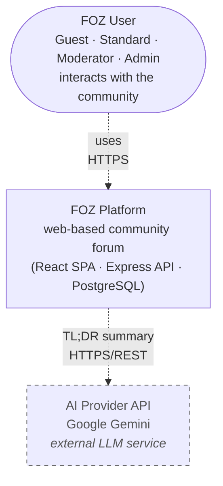
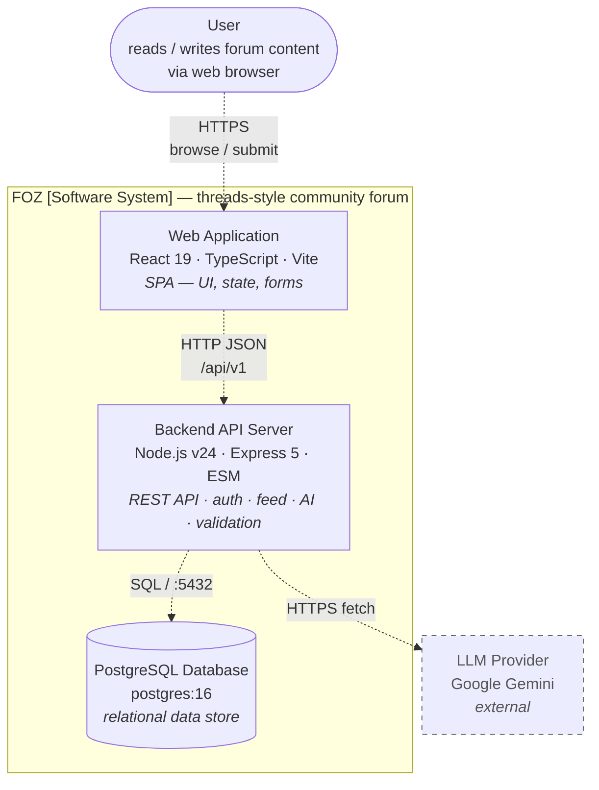
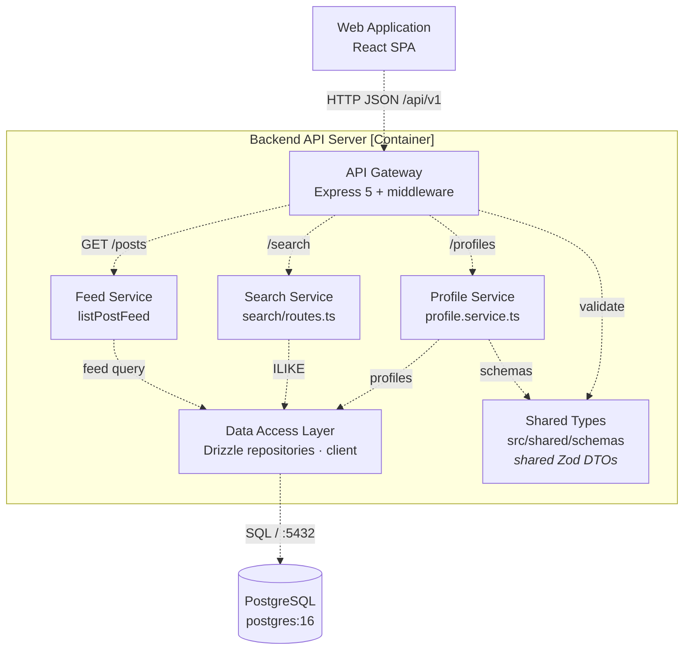
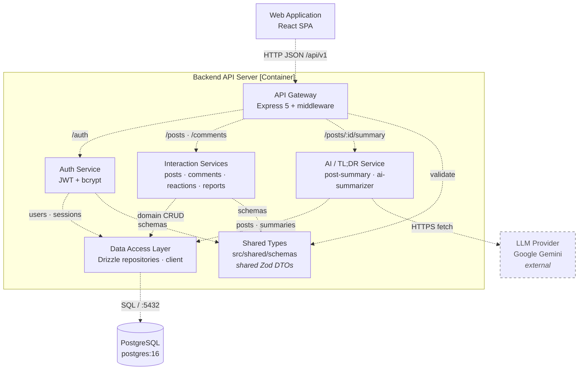

# Table of Contents

- [Table of Contents](#table-of-contents)
- [A - Revised Use-Case Specification](#a---revised-use-case-specification)
	 - [Use-Case Specification: Sign Up](#use-case-specification-sign-up)
   - [Use-Case Specification: Log In](#use-case-specification-log-in)
   - [Use-Case Specification: Log Out](#use-case-specification-log-out)
   - [Use-Case Specification: Manage Profile](#use-case-specification-manage-profile)
   - [Use-Case Specification: Change Password](#use-case-specification-change-password)
   - [Use-Case Specification: Change Avatar](#use-case-specification-change-avatar)
   - [Use-Case Specification: Browse Feed](#use-case-specification-browse-feed)
   - [Use-Case Specification: Search Content](#use-case-specification-search-content)
   - [Use-Case Specification: View Post Details](#use-case-specification-view-post-details)
   - [Use-Case Specification: Create Post](#use-case-specification-create-post)
   - [Use-Case Specification: Interact with Post](#use-case-specification-interact-with-post)
   - [Use-Case Specification: Leave Comment](#use-case-specification-leave-comment)
   - [Use-Case Specification: Like/Unlike](#use-case-specification-likeunlike)
   - [Use-Case Specification: Request AI Summary](#use-case-specification-request-ai-summary)
   - [Use-Case Specification: Delete Own Post](#use-case-specification-delete-own-post)
   - [Use-Case Specification: Report Inappropriate Content](#use-case-specification-report-inappropriate-content)
   - [Use-Case Specification: Review Reports](#use-case-specification-review-reports)
   - [Use-Case Specification: Forward Report to Admin](#use-case-specification-forward-report-to-admin)
   - [Use-Case Specification: Delete Any Content](#use-case-specification-delete-any-content)
   - [Use-Case Specification: Permanently Remove User](#use-case-specification-permanently-remove-user)
   - [Use-Case Specification: Assign Moderator Role](#use-case-specification-assign-moderator-role)
- [B - Software Architecture: System Context Diagram](#b---software-architecture-system-context-diagram)
  - [Tech Stack](#tech-stack)
    - [Frontend](#frontend)
    - [Backend](#backend)
    - [Database](#database)
    - [External APIs / Services](#external-apis--services)
  - [C4 Model - Level 1 (System Context Diagram)](#c4-model---level-1-system-context-diagram)
    - [Diagram Explanation](#diagram-explanation)
- [C - Software Architecture: Container Diagram and Component Diagram](#c---software-architecture-container-diagram-and-component-diagram)
  - [1. C4 Model - Level 2 (Container Diagram)](#1-c4-model---level-2-container-diagram)
    - [1.1 Diagram](#11-diagram)
    - [1.2 Descriptions](#12-descriptions)
    - [1.3 Relationships Summary](#13-relationships-summary)
  - [2. C4 Model - Level 3 (Component Diagram)](#2-c4-model---level-3-component-diagram)
    - [2.1 Frontend - Web Application Container](#21-frontend---web-application-container)
      - [2.1.1 Diagram](#211-diagram)
      - [2.1.2 Component Descriptions](#212-component-descriptions)
    - [2.2 Backend - Backend API Server Container](#22-backend---backend-api-server-container)
      - [2.2.1 Diagram A — Content & Discovery](#221-diagram-a--content--discovery-feed--search--profile)
      - [2.2.2 Diagram B — Identity & Interaction](#222-diagram-b--identity--interaction-auth--interaction--ai-tldr)
      - [2.2.3 Component Descriptions](#223-component-descriptions)
- [D - Image example](#d---image-example)
  - [1. Insert image rule](#1-insert-image-rule)

# A - Revised Use-Case Specification
*Performed by: Nguyễn Hải Trọng | Reviewed by: Phạm Đinh Gia Khánh*

## Revision History

| Date | Version | Description | Author |
| :--- | :--- | :--- | :--- |
| 19/Jul/2026 | 1.0 | Initial draft: Documented all 21 Use-Case Specifications covering Auth, Core Interactions, and Moderation. | Nguyễn Hải Trọng |
| 06/Aug/2026 | 1.1 | Update the Alternative Flow and Reordered sections for clarity | Nguyễn Hải Trọng |

# Use-Case Specification: Sign Up

**Project Name:** FOZ  
**Version:** 1.1  
**Document identifier:** FOZ-UCS-01

## 1. Sign Up
* **Use-Case ID:** UC-01
* **Actor(s):** Guest

### 1.1 Brief Description
This use case allows an unauthenticated guest to create a new user account and profile on the FOZ platform using their email and a secure password.

## 2. Preconditions
* The user must be a Guest (unauthenticated).

## 3. Flow of Events
### 3.1 Basic Flow
1. The use case begins when the Guest navigates to the Registration page.
2. The user enters a valid email address and a strong password.
3. The user clicks "Create account".
4. The system validates the inputs (email format, password length > 8 chars).
5. The system checks if the email is already registered.
6. The system securely hashes the password using bcrypt.
7. The system creates a new record in the `user_accounts` table (role: `standard`, status: `active`) and a default record in the `profiles` table.
8. The system issues an access token and a refresh token (saved in `refresh_sessions`).
9. The system redirects the user to the Home Feed.

### 3.2 Alternative Flows

#### 3.2.1 Email Already Exists
1. If at step 5, the email exists in the database.
2. The system aborts the registration.
3. The system displays a generic error: "An account with this email already exists".
4. The flow resumes at step 2.

#### 3.2.2 Weak Password
1. If at step 4, the password is less than 8 characters.
2. The system highlights the field with "Password must be at least 8 characters".
3. The flow resumes at step 2.

#### 3.2.3 Password Too Long
1. If at step 4, the password exceeds 128 characters.
2. The system aborts and displays "Password is too long".
3. The flow resumes at step 2.

#### 3.2.4 Rate Limit Exceeded
1. If the user makes more than 100 registration attempts within 15 minutes.
2. The system rejects the request and displays "Too many requests, slow down."
3. The use case ends.

#### 3.2.5 Confirm Password Does Not Match
1. If at step 4, the confirmation password does not match the entered password.
2. The system highlights the confirmation field and displays "Passwords do not match".
3. The flow resumes at step 2.

## 4. Special Requirements
* **Security:** Passwords must be hashed via bcrypt with a minimum cost of 12. Plaintext passwords must never be logged.

## 5. Postconditions
* A new user account and profile are saved in the database. The user is signed in.

## 6. Extension Points
* None.

## 7. Prototype Requirement
* **Screen 1 (Basic Flow):**
    
* **Screen 2 (Alt Flow - Email Already Exists):**
    *(Placeholder for Email Already Exists screen)*
* **Screen 3 (Alt Flow - Weak Password):**
    *(Placeholder for Weak Password screen)*
* **Screen 4 (Alt Flow - Password Too Long):**
    *(Placeholder for Password Too Long screen)*
* **Screen 5 (Alt Flow - Rate Limit Exceeded):**
    *(Placeholder for Rate Limit Exceeded screen)*
* **Screen 6 (Alt Flow - Confirm Password Does Not Match):**
    *(Placeholder for Confirm Password Does Not Match screen)*

# Use-Case Specification: Log In

**Project Name:** FOZ  
**Version:** 1.1  
**Document identifier:** FOZ-UCS-02

## 1. Log In
* **Use-Case ID:** UC-02
* **Actor(s):** Guest

### 1.1 Brief Description
This use case describes how a registered Guest accesses their account by providing valid credentials.

## 2. Preconditions
* The user is unauthenticated.

## 3. Flow of Events
### 3.1 Basic Flow
1. The use case begins when the Guest navigates to the Login page.
2. The user enters their email and password, then clicks "Sign In".
3. The system finds the user in `user_accounts` and verifies the password hash.
4. The system checks if the account status is `active`.
5. The system issues an Access Token and sets a Refresh Token cookie.
6. The system redirects the user to the Home Feed.

### 3.2 Alternative Flows

#### 3.2.1 Invalid Credentials
1. If at step 3, the email is not found or the password does not match.
2. The system displays: "Invalid email or password".
3. The flow resumes at step 2.

#### 3.2.2 Account Suspended
1. If at step 4, the account status is `suspended` or `banned`.
2. The system displays: "Your account is not currently available."
3. The use case ends.

#### 3.2.3 Rate Limit Exceeded
1. If the user makes more than 100 login attempts within 15 minutes.
2. The system rejects the request and displays "Too many requests, slow down."
3. The use case ends.

## 4. Special Requirements
* **Rate Limiting:** Maximum 100 attempts per 15 minutes to prevent brute-force attacks.

## 5. Postconditions
* The user is authenticated and an active session is recorded in `refresh_sessions`.

## 6. Extension Points
* None.

## 7. Prototype Requirement
* **Screen 1 (Basic Flow):**
    
* **Screen 2 (Alt Flow - Invalid Credentials):**
    *(Placeholder for Invalid Credentials screen)*
* **Screen 3 (Alt Flow - Account Suspended):**
    *(Placeholder for Account Suspended screen)*
* **Screen 4 (Alt Flow - Rate Limit Exceeded):**
    *(Placeholder for Rate Limit Exceeded screen)*

# Use-Case Specification: Log Out

**Project Name:** FOZ  
**Version:** 1.0  
**Document identifier:** FOZ-UCS-03

## 1. Log Out
* **Use-Case ID:** UC-03
* **Actor(s):** Standard User

### 1.1 Brief Description
Allows an authenticated user to securely end their active session on the current device.

## 2. Preconditions
* The user must be authenticated.

## 3. Flow of Events
### 3.1 Basic Flow
1. The use case begins when the user clicks the "Sign out" button.
2. The system reads the refresh cookie to identify the current session.
3. The system updates the `revoked_at` timestamp in the `refresh_sessions` table for that session.
4. The system clears the local access token and the refresh cookie from the browser.
5. The system redirects the user to the Login page.

### 3.2 Alternative Flows

#### 3.2.1 Session Already Expired
1. If at step 2, the session token is already expired or invalid.
2. The system proceeds to step 4 without database updates.

#### 3.2.2 User Cancels Log Out
1. If the system prompts for confirmation and the user selects "Cancel".
2. The system closes the dialog and no action is taken.
3. The use case ends.

## 4. Special Requirements
* None.

## 5. Postconditions
* The user is signed out and redirected to a public page.

## 6. Extension Points
* None.

## 7. Prototype Requirement
* **Screen 1 (Basic Flow):** 
  
* **Screen 2 (Alt Flow - Session Already Expired):**
    *(Placeholder for Session Already Expired screen)*
* **Screen 3 (Alt Flow - User Cancels Log Out):**
    *(Placeholder for User Cancels Log Out screen)*

# Use-Case Specification: Manage Profile

**Project Name:** FOZ  
**Version:** 1.1  
**Document identifier:** FOZ-UCS-04

## 1. Manage Profile
* **Use-Case ID:** UC-04
* **Actor(s):** Standard User

### 1.1 Brief Description
Allows the user to update their public-facing information such as display name, bio, location, and website.

## 2. Preconditions
* The user is authenticated.

## 3. Flow of Events
### 3.1 Basic Flow
1. The use case begins when the user navigates to "Edit Profile".
2. The system retrieves current data from the `profiles` table.
3. The user edits text fields (Display Name, Bio, Location, Website) and clicks "Save".
4. The system validates the inputs (e.g., URL format for website).
5. The system updates the `profiles` table and the `updated_at` timestamp.
6. The system displays a success message.

### 3.2 Alternative Flows

#### 3.2.1 Invalid Input Format
1. If at step 4, the website URL is invalid.
2. The system displays an error below the website field.
3. The flow resumes at step 3.

#### 3.2.2 Validation Errors
1. If at step 4, inputs exceed max lengths (Display Name: 50, Bio: 160, Location: 100, Website: 200 characters) or Display Name contains invalid characters.
2. The system displays specific field validation errors.
3. The flow resumes at step 3.

#### 3.2.3 User Cancels
1. If at step 3, the user clicks "Cancel" instead of "Save".
2. The system discards any unsaved changes and returns to the profile view.
3. The use case ends.

## 4. Special Requirements
* None.

## 5. Postconditions
* Profile data is updated in the database.

## 6. Extension Points
* **Change Password:** Extended via UC-05.
* **Change Avatar:** Extended via UC-06.

## 7. Prototype Requirement
* **Screen 1 (Basic Flow):**
  
* **Screen 2 (Alt Flow - Invalid Input Format):**
    *(Placeholder for Invalid Input Format screen)*
* **Screen 3 (Alt Flow - Validation Errors):**
    *(Placeholder for Validation Errors screen)*
* **Screen 4 (Alt Flow - User Cancels):**
    *(Placeholder for User Cancels screen)*

# Use-Case Specification: Change Password

**Project Name:** FOZ  
**Version:** 1.1  
**Document identifier:** FOZ-UCS-05

## 1. Change Password
* **Use-Case ID:** UC-05
* **Actor(s):** Standard User

### 1.1 Brief Description
Allows an authenticated user to change their password securely by verifying their current password.

## 2. Preconditions
* The user is authenticated.

## 3. Flow of Events
### 3.1 Basic Flow
1. The use case extends UC-04 when the user selects "Change password".
2. The user enters their current password, a new password, and confirms the new password.
3. The user clicks "Update password".
4. The system verifies the current password against the stored `password_hash`.
5. The system validates the new password strength.
6. The system hashes the new password and updates `user_accounts`.
7. The system displays a success toast message and redirects to home.

### 3.2 Alternative Flows

#### 3.2.1 Incorrect Current Password
1. If at step 4, the current password does not match.
2. The system displays "Invalid credentials".
3. The flow resumes at step 2.

#### 3.2.2 New Password Matches Old Password
1. If at step 4, the new password is exactly the same as the current password.
2. The system rejects the request and displays "New password must differ from the current one".
3. The flow resumes at step 2.

#### 3.2.3 Confirm Password Does Not Match
1. If at step 5, the confirmation password does not match the new password.
2. The system highlights the confirmation field and displays "Passwords do not match".
3. The flow resumes at step 2.

#### 3.2.4 Weak New Password
1. If at step 5, the new password is less than 8 characters.
2. The system rejects the request and displays "Password must be at least 8 characters".
3. The flow resumes at step 2.

#### 3.2.5 User Cancels
1. If at step 2, the user clicks "Cancel" instead of "Update password".
2. The system discards the input and returns to the previous screen.
3. The use case ends.

## 4. Special Requirements
* **Security:** The new password must not be identical to the old password.

## 5. Postconditions
* The user's password hash is updated.

## 6. Extension Points
* None.

## 7. Prototype Requirement
* **Screen 1 (Basic Flow):** 
  
  **Change Password will be in Settings**
* **Screen 2 (Alt Flow - Incorrect Current Password):**
    *(Placeholder for Incorrect Current Password screen)*
* **Screen 3 (Alt Flow - New Password Matches Old Password):**
    *(Placeholder for New Password Matches Old Password screen)*
* **Screen 4 (Alt Flow - Confirm Password Does Not Match):**
    *(Placeholder for Confirm Password Does Not Match screen)*
* **Screen 5 (Alt Flow - Weak New Password):**
    *(Placeholder for Weak New Password screen)*
* **Screen 6 (Alt Flow - User Cancels):**
    *(Placeholder for User Cancels screen)*

# Use-Case Specification: Change Avatar

**Project Name:** FOZ  
**Version:** 1.1  
**Document identifier:** FOZ-UCS-06

## 1. Change Avatar
* **Use-Case ID:** UC-06
* **Actor(s):** Standard User

### 1.1 Brief Description
Allows an authenticated user to upload a new profile picture.

## 2. Preconditions
* The user is authenticated.

## 3. Flow of Events
### 3.1 Basic Flow
1. The use case extends UC-04 when the user clicks the "Upload picture" icon.
2. The user selects an image file from their device.
3. The system validates the file type and size.
4. The system uploads the file to storage and retrieves the image URL.
5. The system updates the `avatar_url` in the `profiles` table.
6. The system refreshes the avatar display on the UI.

### 3.2 Alternative Flows

#### 3.2.1 Wrong File Type
1. If at step 3, the file uploaded is not a supported image format (e.g., PDF, DOCX).
2. The system aborts the upload and displays "Invalid file format. Please upload an image."
3. The flow resumes at step 1.

#### 3.2.2 User Cancels
1. If at step 2, the user closes the file picker without selecting an image.
2. The system aborts the upload process.
3. The use case ends.

## 4. Special Requirements
* **Space:** Image uploads must be limited to 2MB to conserve server storage.

## 5. Postconditions
* The new avatar is visible publicly on the user's profile.

## 6. Extension Points
* None.

## 7. Prototype Requirement
* **Screen 1 (Basic Flow):** 
  
* **Screen 2 (Alt Flow - Wrong File Type):**
    *(Placeholder for Wrong File Type screen)*
* **Screen 3 (Alt Flow - User Cancels):**
    *(Placeholder for User Cancels screen)*

# Use-Case Specification: Browse Feed

**Project Name:** FOZ  
**Version:** 1.0  
**Document identifier:** FOZ-UCS-07

## 1. Browse Feed
* **Use-Case ID:** UC-07
* **Actor(s):** Guest, Standard User

### 1.1 Brief Description
Allows users to view a dynamic timeline of forum posts sorted by recent engagement metrics or chronological order.

## 2. Preconditions
* None.

## 3. Flow of Events
### 3.1 Basic Flow
1. The use case begins when the user navigates to the application's homepage.
2. The system queries the `posts` table for content with `visibility_state = 'public'` and `lifecycle_state = 'active'`.
3.The system sorts posts by their posting time, with the newest first.
4. The system displays the feed with post titles, author avatars, and interaction counts.
5. The user scrolls to load more posts (pagination).

### 3.2 Alternative Flows
1. The user switches from the Latest feed to the For You feed.
2. The system loads and displays personalized posts based on the user's interests.

#### 3.2.1 No Posts Available
1. If at step 2, the database returns no posts.
2. The system displays a "No discussions found. Be the first to post!" placeholder.
3. The use case ends.

## 4. Special Requirements
* **Performance:** The initial feed must load in `< 2 seconds` under good network conditions.

## 5. Postconditions
* None.

## 6. Extension Points
* None.

## 7. Prototype Requirement
* **Screen 1 (Basic Flow):** 
  

  **Screen 2 (Alternative Flow):**
  

 **Editor:** Khánh 

# Use-Case Specification: Search Content

**Project Name:** FOZ  
**Version:** 1.0  
**Document identifier:** FOZ-UCS-08

## 1. Search Content
* **Use-Case ID:** UC-08
* **Actor(s):** Guest, Standard User

### 1.1 Brief Description
Allows users to search for specific discussion topics, posts, or user profiles using keywords.

## 2. Preconditions
* None.

## 3. Flow of Events
### 3.1 Basic Flow
1. The use case begins when the user enters a keyword into the search bar and presses Enter.
2. The system sends the query to the backend.
3. The backend searches the `posts` (body/title) and `profiles` (display_name) tables for matches.
4. The system filters out content that is deleted, hidden, or authored by banned users.
5. The system displays a categorized list of results (Posts, Users).

### 3.2 Alternative Flows

1. **Search feature unavailable**

* The search feature is unavailable, so the user cannot perform a search.

2. **No matching results**

   * The user enters a search query.
   * The system finds no matching content.
   * The system displays **"No results for "<search query>"."**

#### 3.2.1 Empty Query
1. If at step 2, the search query is empty or just whitespace.
2. The system displays "Please enter a search term." and halts the request.

## 4. Special Requirements
* **Performance:** Search results should be displayed within 2–3 seconds under good network conditions. `.

## 5. Postconditions
* None.

## 6. Extension Points
* None.

## 7. Prototype Requirement
* **Screen 1 (Basic Flow):** 
  

  **Screen 2 (Alternative Flow):**
   

# Use-Case Specification: View Post Details

**Project Name:** FOZ  
**Version:** 1.1  
**Document identifier:** FOZ-UCS-09

## 1. View Post Details
* **Use-Case ID:** UC-09
* **Actor(s):** Guest, Standard User

### 1.1 Brief Description
Allows a user to read the full body of a post along with its entire nested comment thread.

## 2. Preconditions
* The post ID must be valid.

## 3. Flow of Events
### 3.1 Basic Flow
1. The use case begins when the user clicks on a post from the feed or search results.
2. The system queries the `posts` and `comments` tables matching the Post ID.
3. The system formats the comment tree hierarchically.
4. The system displays the full post content, author details, and comments.

### 3.2 Alternative Flows

1. **No comments**

   * The post has no comments.
   * The system displays **"No comments yet. Be the first to reply!"**

#### 3.2.1 Post Removed or Hidden
1. If at step 2, the post's `lifecycle_state` is `removed_by_moderation`.
2. The system displays: "This post has been removed by moderators."
3. The use case ends.

#### 3.2.2 Post Not Found
1. If at step 2, the requested Post ID does not exist in the database.
2. The system displays a 404 Not Found error page.
3. The use case ends.

## 4. Special Requirements
* None.

## 5. Postconditions
* None.

## 6. Extension Points
* **Request AI Summary:** Extended via UC-14.

## 7. Prototype Requirement
* **Screen 1 (Basic Flow):** 
  
* **Screen 2 (Alternative Flow):**
*   

  
# Use-Case Specification: Create Post

**Project Name:** FOZ  
**Version:** 1.1  
**Document identifier:** FOZ-UCS-10

## 1. Create Post
* **Use-Case ID:** UC-10
* **Actor(s):** Standard User

### 1.1 Brief Description
Allows an authenticated user to publish a new text-based post to initiate a discussion.

## 2. Preconditions
* The user is authenticated and their account status is `active`.

## 3. Flow of Events
### 3.1 Basic Flow
1. The use case begins when the user clicks "Create Post".
2. The system displays an editor.
3. The user types the content and clicks "Submit".
4. The system validates the input lengths.
5. The system saves the record in the `posts` table (lifecycle_state: `active`).
6. The system redirects to the new post's detail page.

### 3.2 Alternative Flows

1. **Post creation canceled**

   * The user cancels the post creation.
   * The system discards the draft and returns to the previous screen.

#### 3.2.1 Content Validation Error
1. If at step 4, the post body is empty.
2. The system disallows user to click submit button.
3. The flow resumes at step 3.

#### 3.2.2 Exceeds Limits
1. If at step 4, the post body exceeds 5,000 characters, or there are more than 5 media attachments, or the chained thread exceeds 10 posts.
2. The system aborts and displays a validation error message.
3. The flow resumes at step 3.

## 4. Special Requirements
* **Security:** Inputs must be sanitized against XSS.

## 5. Postconditions
* A new record exists in the `posts` table.

## 6. Extension Points
* None.

## 7. Prototype Requirement
* **Screen 1 (Basic Flow):** 
  

# Use-Case Specification: Interact with Post

**Project Name:** FOZ  
**Version:** 1.0  
**Document identifier:** FOZ-UCS-11

## 1. Interact with Post
* **Use-Case ID:** UC-11
* **Actor(s):** Standard User

### 1.1 Brief Description
Acts as the generalized use case for users engaging with a post via various actions.

## 2. Preconditions
* The user is authenticated. Post is active.

## 3. Flow of Events
### 3.1 Basic Flow
1. The use case begins when an authenticated user opens a post.
2. The system presents interaction buttons (Like, Reply, Report, Repost).
3. The user selects an interaction option.
4. The system triggers the specific extended workflow.

### 3.2 Alternative Flows

1. The user selects **Reply**.

   * The use case is extended by **UC-12: Leave Comment**.

2. The user selects **Like**.

   * The use case is extended by **UC-13: Like/Unlike**.

3. The user selects **Report**.

   * The use case is extended by **UC-16: Report Inappropriate Content**.

## 4. Special Requirements
* None.

## 5. Postconditions
* None.

## 6. Extension Points
* **Leave Comment:** Extended via UC-12.
* **Like/Unlike:** Extended via UC-13.

## 7. Prototype Requirement
* **Screen 1 (Basic Flow):** 
  

## Use-Case Specification: Leave Comment

**Project Name:** FOZ  
**Version:** 1.0  
**Document identifier:** FOZ-UCS-12

### 1. Leave Comment
* **Use-Case ID:** UC-12
* **Actor(s):** Standard User

#### 1.1 Brief Description
Allows an authenticated user to reply to a post or to another comment.

### 2. Flow of Events

#### 2.1 Basic Flow
1. Extends UC-11 when the user clicks "Reply".
2. The system opens a small text input field.
3. The user types their comment and clicks "Post Reply".
4. The system validates the text.
5. The system inserts a record into the `comments` table, mapping `post_id` and optionally `parent_comment_id`.
6. The system updates the UI to show the new comment inline.

#### 2.2 Alternative Flows
##### 2.2.1 Empty Comment
1. If at step 4, the comment is empty or contains only whitespace.
2. The system disables the "Post Reply" button
3. The flow resumes at step 3.
##### 2.2.2 Comment Exceeds Maximum Length
1. If at step 4, the submitted comment content exceeds the 5,000-character limit.
2. The system rejects the submission and displays a validation error message ("Content is too long").
3. The user modifies the comment body to meet the character requirement.
4. The flow resumes at step 3.
##### 2.2.3 Long Comment Display
1. When displaying a comment that exceeds 240 characters or 4 lines of text.
2. The system automatically truncates the body text preview and appends a "Read more" toggle action.
3. The user clicks "Read more" to expand and view the full comment content.

### 3. Special Requirements
* None.

### 4. Preconditions
* User is authenticated.

### 5. Postconditions
* A new comment is persisted to the database.

### 6. Extension Points
* None.

### 7. Prototype Requirement 
* **Screen 1 (Basic Flow):** 
   

  **Screen 2 (Alternative Flow 2):**
   

    **Screen 3 (Alternative Flow 3):**
   

## Use-Case Specification: Like/Unlike

**Project Name:** FOZ  
**Version:** 1.0  
**Document identifier:** FOZ-UCS-13

### 1. Like/Unlike
* **Use-Case ID:** UC-13
* **Actor(s):** Standard User

#### 1.1 Brief Description
Allows a user to toggle an appreciation metric on a post or comment.

### 2. Flow of Events

#### 2.1 Basic Flow
1. Extends UC-11 when the user clicks the "Heart/Like" icon.
2. The system checks the `reactions` table to see if a record already exists for this `user_account_id` and `target_id`.
3. If no record exists, the system inserts a new reaction (`reaction_kind: 'like'`) and increments the counter visually.
4. If a record exists, the system deletes it (Unlike) and decrements the counter.

#### 2.2 Alternative Flows
##### 2.2.1 Target Post or Comment Deleted / Not Found
Deleted
1. If at step 2, the target post or comment has been deleted or is no longer available.
2. The system rejects the reaction request with a "Not Found" error.
3. The interface reverts the optimistic UI state and notifies the user that the content is no longer available.
4. The use case ends.

### 3. Special Requirements
* **Performance:** 
  - **UI Response:** Reaction toggles update visually on the UI in **< 50ms** (Optimistic UI).
  - **API Latency:** Database synchronization via API completes within **<= 500ms** under normal network conditions.

### 4. Preconditions
* User is authenticated.

### 5. Postconditions
* The `reactions` table is updated.

### 6. Extension Points
* None.

### 7. Prototype Requirement 
* **Screen 1 (Basic Flow):** 
  
  * **Screen 2 (Alternative Flow):** 
  

# Use-Case Specification: Request AI Summary

**Project Name:** FOZ  
**Version:** 1.1  
**Document identifier:** FOZ-UCS-14

## 1. Request AI Summary
* **Use-Case ID:** UC-14
* **Actor(s):** Guest, Standard User

### 1.1 Brief Description
Generates an AI-powered TL;DR of a lengthy post and its comments for quick reading.

## 2. Preconditions
* The post must have sufficient text/comments to summarize.

## 3. Flow of Events
### 3.1 Basic Flow
1. Extends UC-09 when the user clicks "Generate TL;DR".
2. The system checks the `post_summaries` table for a recently cached summary.
3. If not cached, the system fetches the post text and top comments.
4. The system sends the payload to the external AI Engine.
5. The AI returns the summary.
6. The system caches the result in `post_summaries` and displays it in a modal.

### 3.2 Alternative Flows

#### 3.2.1 AI Service Error
1. If at step 5 the AI API times out or errors.
2. The system displays: "AI Summary is currently unavailable."

#### 3.2.2 Rate Limit Exceeded
1. If the user makes more than 10 summary requests within 1 minute.
2. The system rejects the request and displays "Too many summary requests, please try again in a minute."
3. The use case ends.

## 4. Special Requirements
* **Performance:** AI generation must complete in `< 5 seconds`.

## 5. Postconditions
* A cached summary is stored in the database.

## 6. Extension Points
* None.

## 7. Prototype Requirement
* **Screen 1 (Basic Flow):** 
  

# Use-Case Specification: Delete Own Post

**Project Name:** FOZ  
**Version:** 1.1  
**Document identifier:** FOZ-UCS-15

## 1. Delete Own Post
* **Use-Case ID:** UC-15
* **Actor(s):** Standard User

### 1.1 Brief Description
Allows a user to permanently remove a post they authored.

## 2. Preconditions
* User is authenticated and is the `author_id` of the post.

## 3. Flow of Events
### 3.1 Basic Flow
1. The use case begins when the user clicks the "Delete" option on their own post.
2. The system displays a confirmation dialog.
3. The user confirms the deletion.
4. The system updates the post's `lifecycle_state` to `hidden` or sets `deleted_at` timestamp in the `posts` table (soft delete).
5. The system removes the post from the feed and redirects the user home.

### 3.2 Alternative Flows

#### 3.2.1 User Cancels Deletion
1. If at step 3 the user clicks "Cancel".
2. The dialog closes and no database changes are made.

#### 3.2.2 Post Not Found or Forbidden
1. If at step 4, the post has already been deleted or the user is not the author.
2. The system aborts the operation and returns a "POST_NOT_FOUND" or "POST_FORBIDDEN" error.
3. The use case ends.

## 4. Special Requirements
* None.

## 5. Postconditions
* The post is marked deleted and hidden from public view.

## 6. Extension Points
* None.

## 7. Prototype Requirement
* **Screen 1 (Basic Flow):** 
  

# Use-Case Specification: Report Inappropriate Content

**Project Name:** FOZ  
**Version:** 1.1  
**Document identifier:** FOZ-UCS-16

## 1. Report Inappropriate Content
* **Use-Case ID:** UC-16
* **Actor(s):** Standard User

### 1.1 Brief Description
Allows users to flag posts or comments that violate community guidelines.

## 2. Preconditions
* User is authenticated.

## 3. Flow of Events
### 3.1 Basic Flow
1. The use case begins when a user clicks "Report" on a piece of content.
2. The system displays a modal with a list of reporting reasons (Harassment, Spam, Inappropriate, Other).
3. The user selects a reason and clicks "Submit Report".
4. The system records the data in the `reports` table (status: `open`).
5. The system displays a "Thank you for your report" toast.

### 3.2 Alternative Flows

#### 3.2.1 Content Already Reported by User
1. If at step 4, a report from this `reporter_id` for this `subject_id` already exists.
2. The system ignores the duplicate and displays "You have already reported this content."

#### 3.2.2 Validation Error
1. If the user submits additional details exceeding 1000 characters.
2. The system highlights the text area with a validation error.
3. The flow resumes at step 3.

## 4. Special Requirements
* None.

## 5. Postconditions
* A new row is added to the `reports` table.

## 6. Extension Points
* None.

## 7. Prototype Requirement
* **Screen 1 (Basic Flow):** 
  

# Use-Case Specification: Review Reports

**Project Name:** FOZ  
**Version:** 1.0  
**Document identifier:** FOZ-UCS-17

## 1. Review Reports
* **Use-Case ID:** UC-17
* **Actor(s):** Moderator, Administrator

### 1.1 Brief Description
Allows elevated users to view and take action on content flagged by the community.

## 2. Preconditions
* User role must be `moderator` or `administrator`.

## 3. Flow of Events
### 3.1 Basic Flow
1. The use case begins when a Moderator opens the Moderation Dashboard.
2. The system queries the `reports` table where status is `open`.
3. The moderator selects a report to review the flagged content.
4. The moderator decides to "Dismiss" or "Remove Content".
5. The system updates the report status to `closed`.
6. The system logs the action in the `moderation_reviews` table.

### 3.2 Alternative Flows

#### 3.2.1 Escalation Required
1. Handled by extension point UC-18.

## 4. Special Requirements
* None.

## 5. Postconditions
* Report status is updated and a moderation review is logged.

## 6. Extension Points
* **Forward Report to Admin:** Extended via UC-18.

## 7. Prototype Requirement
* **Screen 1 (Basic Flow):** 
  

# Use-Case Specification: Forward Report to Admin

**Project Name:** FOZ  
**Version:** 1.0  
**Document identifier:** FOZ-UCS-18

## 1. Forward Report to Admin
* **Use-Case ID:** UC-18
* **Actor(s):** Moderator

### 1.1 Brief Description
Allows a Moderator to escalate severe violations to an Administrator.

## 2. Preconditions
* User role is `moderator`.

## 3. Flow of Events
### 3.1 Basic Flow
1. Extends UC-17 when a Moderator reviews a highly sensitive report.
2. The Moderator clicks "Escalate to Admin" and optionally adds notes.
3. The system updates the `reports` table status to `escalated`.
4. The system logs the escalation in the `moderation_reviews` table.
5. The report is moved to the Admin-only queue.

### 3.2 Alternative Flows
* None.

## 4. Special Requirements
* None.

## 5. Postconditions
* Report status is updated to escalated.

## 6. Extension Points
* None.

## 7. Prototype Requirement
* **Screen 1 (Basic Flow):** 
  

# Use-Case Specification: Delete Any Content

**Project Name:** FOZ  
**Version:** 1.0  
**Document identifier:** FOZ-UCS-19

## 1. Delete Any Content
* **Use-Case ID:** UC-19
* **Actor(s):** Administrator

### 1.1 Brief Description
Allows an Administrator to instantly and permanently remove any post or comment from the database.

## 2. Preconditions
* User role MUST be `administrator`.

## 3. Flow of Events
### 3.1 Basic Flow
1. The use case begins when an Admin views any content.
2. The Admin selects the "Force Delete" override option.
3. The Admin confirms the deletion.
4. The system updates the `lifecycle_state` to `removed_by_administration` in the `posts` or `comments` table.
5. The content is immediately scrubbed from all public feeds.

### 3.2 Alternative Flows
* None.

## 4. Special Requirements
* None.

## 5. Postconditions
* Content is permanently removed from public view.

## 6. Extension Points
* None.

## 7. Prototype Requirement
* **Screen 1 (Basic Flow):** 
  

# Use-Case Specification: Permanently Remove User

**Project Name:** FOZ  
**Version:** 1.0  
**Document identifier:** FOZ-UCS-20

## 1. Permanently Remove User
* **Use-Case ID:** UC-20
* **Actor(s):** Administrator

### 1.1 Brief Description
Allows an Administrator to ban a user and optionally purge all their data from the system.

## 2. Preconditions
* User role MUST be `administrator`.

## 3. Flow of Events
### 3.1 Basic Flow
1. The use case begins when an Admin opens a user's profile.
2. The Admin clicks "Ban User".
3. The Admin selects whether to keep or wipe the user's past content.
4. The Admin clicks "Confirm Ban".
5. The system updates the `user_accounts` status to `banned`.
6. The system revokes all active `refresh_sessions` for that user.
7. The user is forcibly logged out and cannot re-authenticate.

### 3.2 Alternative Flows
* None.

## 4. Special Requirements
* **Data Integrity:** If data wipe is selected, cascading deletes must properly handle foreign keys to prevent orphan records.

## 5. Postconditions
* The target account is banned and active sessions are destroyed.

## 6. Extension Points
* None.

## 7. Prototype Requirement
* **Screen 1 (Basic Flow):** 
  

# Use-Case Specification: Assign Moderator Role

**Project Name:** FOZ  
**Version:** 1.0  
**Document identifier:** FOZ-UCS-21

## 1. Assign Moderator Role
* **Use-Case ID:** UC-21
* **Actor(s):** Administrator

### 1.1 Brief Description
Allows an Administrator to elevate a Standard User to a Moderator.

## 2. Preconditions
* User role MUST be `administrator`. Target user must be `active`.

## 3. Flow of Events
### 3.1 Basic Flow
1. The use case begins when an Admin views a Standard User's profile or account settings.
2. The Admin selects "Change Role" and chooses "Moderator".
3. The Admin confirms the action.
4. The system updates the `role` field in the `user_accounts` table to `moderator`.
5. The system records the transition in the `role_history` table (previous_role: `standard`, new_role: `moderator`).
6. The target user gains moderator privileges upon their next API request.

### 3.2 Alternative Flows

#### 3.2.1 User is already a Moderator
1. If at step 2 the user's role is already `moderator`.
2. The system disables the "Make Moderator" button.

## 4. Special Requirements
* None.

## 5. Postconditions
* Target user role is elevated. History is logged in `role_history`.

## 6. Extension Points
* None.

## 7. Prototype Requirement
* **Screen 1 (Basic Flow):**
  
  **The Admin will assign Moderator role in the User Management**

# B - Software Architecture: System Context Diagram

*Work performed by: Nguyễn Hải Trọng | Reviewed by: Nguyễn Hải Nam*

## Tech Stack

The FOZ project uses the following technologies across its stack:

### Frontend
- **Framework & Language**: React 19 with TypeScript 6 for building a robust and type-safe UI.
- **Build Tool**: Vite 8 for fast, modern web development and bundling.
- **Styling**: Tailwind CSS v4 (`@tailwindcss/postcss`) for utility-first styling, without UI component libraries.
- **Routing**: `react-router-dom` v7 for client-side navigation.
- **State Management**: 
  - `@tanstack/react-query` v5 for server state (fetching, caching, and synchronizing data).
  - `zustand` v5 for lightweight client-side state management.
- **Forms & Validation**: `react-hook-form` v7 coupled with Zod v4 for robust client-side validation.
- **UI Notifications**: `react-hot-toast` for toast notifications.

### Backend
- **Runtime**: Node.js v24 (current LTS) utilizing ES Modules (ESM).
- **Framework**: Express 5 with hand-wired Zod validation middleware and a central error handler.
- **Database ORM**: Drizzle ORM (SQL-visible approach) along with `drizzle-kit` for managing schema migrations.
- **Authentication**: 
  - JWT (JSON Web Tokens) for access control (15-minute access token in memory, 7-day refresh token stored in an HttpOnly, SameSite=Lax cookie).
  - `bcrypt` for secure password hashing.
- **Validation**: Zod v4 used strictly at inbound trust boundaries (request bodies, query params).

### Database
- **Database Engine**: PostgreSQL 16 running locally via Docker (`docker-compose.yml`) for robust, relational data persistence.

### External APIs / Services
- **AI / LLM Provider**: Integration with the Google Gemini API (e.g., `gemini-2.5-flash`) strictly for the "Post Summarize (TL;DR)" feature, utilizing a direct `fetch`-based provider fallback loop.

## C4 Model - Level 1 (System Context Diagram)

### Diagram Explanation

- **FOZ User (Actor)**: Represents all users interacting with the application. Depending on their role (Guest, Standard User, Moderator, Admin), they can view content, participate in discussions, manage profiles, report inappropriate content, or administrate the platform. Users interact with the FOZ Platform via a modern web browser over secure HTTPS.
- **FOZ Platform (System)**: The core software system being built. It encompasses the frontend React application, the Node.js/Express backend API, and the PostgreSQL database. It handles user authentication, content management (posts, comments, attachments), and interactions (likes, reports).
- **AI Provider API (External System)**: An external third-party LLM service (Google Gemini, e.g. `gemini-2.5-flash`). The FOZ Platform securely communicates with this API over HTTPS/REST to send post and top-comment text payloads in order to receive concise, AI-generated summaries for the "Post Summarize (TL;DR)" feature. It sits completely outside the internal control of the system but is a critical dependency for this specific feature.

# C - Software Architecture: Container Diagram and Component Diagram

*Work performed by: Nguyễn Hải Nam | Reviewed and edited by: Võ An Phú*

## 1. C4 Model - Level 2 (Container Diagram)

### 1.1 Diagram

### 1.2 Descriptions

The FOZ system is decomposed into three runtime containers plus one external actor (the user) and one external system (the LLM provider). A container is a separately runnable/deployable unit that holds the system's code and/or data; each container runs in its own process and communicates with the others over a network.

- **Person - User**: A visitor to the forum (guest, standard user, moderator, or administrator). Reads and writes posts, comments, reactions, profiles, and reports through a web browser. Communicates with the Web Application over HTTPS (the entry point into the system).

- **Container - Web Application**
  - **Responsibility / Services**: A single-page application (SPA) that renders the complete user interface and handles all user interactions — page routing, fetching and caching server state, managing client session state (access token, user info), validating form input, showing notifications, and displaying AI TL;DR summaries. It has no direct database access; all data is retrieved from the Backend API Server via HTTP/HTTPS REST calls.
  - **Technology**: React 19 + TypeScript built with Vite, styled with Tailwind CSS v4; `react-router-dom` for client routing, `@tanstack/react-query` for server state caching and synchronization, `zustand` for client auth state, `react-hook-form` + `@hookform/resolvers` for form handling, and `react-hot-toast` for transient notifications. Tested with Vitest and `@testing-library/react`.
  - **Communication**: Receives HTTPS requests from the User browser; sends JSON REST calls to the Backend API Server over HTTP/HTTPS under `/api/v1`. In development, the Vite dev server proxies `/api/v1` requests to `http://localhost:4000`. Authenticated requests include an `Authorization: Bearer <token>` header, and auth refresh requests send HTTP-only credentials.

- **Container - Backend API Server**
  - **Responsibility / Services**: Hosts the REST API under the `/api/v1` prefix, exposing services for `auth`, `posts`, `comments`, `reactions`, `profiles`, `search`, and a `/api/v1/health` status probe. It runs the AI / TL;DR post summary service (`post-summary.service.ts` backed by `ai-summarizer.ts`), the feed enrichment service (`listPostFeed`), hand-wired Zod request validation middleware, rate limiting (`express-rate-limit`), cookie parsing (`cookie-parser`), CORS middleware, and a central error handler that maps thrown errors and `ZodError`s to consistent HTTP error envelopes.
  - **Technology**: Node.js (v24 ESM) with Express 5; `jsonwebtoken` + `bcrypt` for user authentication; `express-rate-limit`, `cookie-parser`, `cors`; Drizzle ORM (`drizzle-orm` + `postgres-js`) with `drizzle-kit` database migrations; `zod` for request schema validation; fail-fast env validation (`env.ts`).
  - **Communication**: Receives HTTP/HTTPS JSON requests from the Web Application; reads and writes the PostgreSQL Database via SQL over TCP port 5432 using Drizzle ORM; executes outbound HTTPS `fetch` calls to the Google Gemini API (`generativelanguage.googleapis.com`) to generate AI TL;DR summaries.

- **Container - PostgreSQL Database**
  - **Responsibility / Services**: Persists all application relational data — user accounts, user profiles, HTTP-only refresh sessions, posts, post attachments, comments, reactions (likes), content reports, and AI post summaries.
  - **Technology**: `postgres:16` running as the Docker service `foz_db` (port 5432, volume `foz_pg_data`, database `foz_dev`), accessed via Drizzle ORM (`postgres-js`); database migrations are managed using `drizzle-kit`.
  - **Communication**: Only accepts database connections (PostgreSQL wire protocol over TCP port 5432) from the Backend API Server via Drizzle ORM; it is isolated from direct access by the browser or Web Application.

- **External System - LLM Provider (Google Gemini)**
  - **Responsibility / Services**: Generates structured AI TL;DR summaries (post snapshot, key discussion highlights, and sentiment) on demand for forum posts.
  - **Technology**: Google Gemini HTTP API (`gemini-2.5-flash` / `gemini-1.5-flash`) called via native `fetch` with a fallback summarizer mechanism.
  - **Communication**: Receives outbound HTTPS calls from the Backend API Server; does not communicate directly with the Web Application or browser.

### 1.3 Relationships Summary

- **User → Web Application**: HTTPS browsing, form submission, and UI interaction.
- **Web Application → Backend API Server**: JSON REST calls to `/api/v1` over HTTP/HTTPS. In development, the Vite dev server proxies `/api/v1` to `http://localhost:4000`. Authenticated calls pass access tokens as `Bearer` headers and send HTTP-only credentials for session refresh.
- **Backend API Server → PostgreSQL Database**: SQL queries over TCP port 5432 executed through Drizzle ORM driver (`postgres-js`).
- **Backend API Server → LLM Provider**: Outbound HTTPS `fetch` calls carrying prompt payloads to retrieve AI post summaries.

---

## 2. C4 Model - Level 3 (Component Diagram)

The two diagrams below zoom into the Web Application and Backend API Server containers, detailing their primary internal components and interactions. The PostgreSQL Database and LLM Provider are shown for external context.

### 2.1 Frontend - Web Application Container

#### 2.1.1 Diagram

#### 2.1.2 Component Descriptions

- **App Router (`App.tsx`)**
  - **Responsibility:** Declares URL routing mapping (`/`, `/search`, `/feed`, `/posts/:postId`, `/login`, `/register`, `/change-password`, `/profiles/:userId`).
  - **Relationships:** Receives navigation actions from the User; renders matching Feature Pages; injects global layout and dialog controls (`LogoutDialog`).
- **Feature Pages (`src/frontend/src/pages/`)**
  - **Responsibility:** Top-level page views (`HomePage`, `FeedPage`, `PostPage`, `SearchPage`, `ProfilePage`, `LoginPage`, `RegisterPage`, `ChangePasswordPage`) that assemble layout components and manage page-level state.
  - **Relationships:** Rendered by App Router; composes UI Components; embeds Forms; invokes API Client & Hooks for data fetching; reads Auth Store state to gate authenticated controls.
- **UI Components (`src/frontend/src/components/`)**
  - **Responsibility:** Reusable presentational components, including header navigation (`NavBar`), post feeds (`FeedPostItem`, `PostCard`), comment discussions (`CommentThread`), reactions (`ReactionButton`), modal dialogs (`CreatePostModal`, `ProfileEditModal`, `ReportModal`, `LogoutDialog`), and the AI feature component (`PostSummaryCard`).
  - **Relationships:** Composed by Feature Pages; triggers Toast Service notifications on successful actions or API errors.
- **Forms (`react-hook-form`)**
  - **Responsibility:** Form input handling, error state tracking, and schema validation (`@hookform/resolvers` + Zod schemas from `src/shared/schemas`) for authentication, post creation, commenting, profile updates, and reporting.
  - **Relationships:** Embedded inside Feature Pages and Modal UI Components; invokes API Client & Hooks mutations on submit.
- **API Client & Hooks (`src/frontend/src/api/`)**
  - **Responsibility:** Modular API modules (`auth.ts`, `interactions.ts`, `post-summary.ts`, `profile.ts`, `search.ts`) providing `fetch` wrappers with `Bearer` authorization headers alongside `@tanstack/react-query` hooks (`useQuery`, `useMutation`) for caching and data sync.
  - **Relationships:** Invoked by Feature Pages and Forms; reads access tokens from Auth Store; executes REST calls to Backend API Server under `/api/v1`.
- **Auth Store (`src/frontend/src/stores/auth.ts`)**
  - **Responsibility:** `zustand` state store managing `accessToken`, active `user` profile data, and session actions (`setAccessToken`, `setUser`, `logout`).
  - **Relationships:** Read by API Client & Hooks for token injection; updated by Auth API hooks upon login, registration, or session restoration.
- **Toast Service (`react-hot-toast`)**
  - **Responsibility:** Displays transient toast notifications for actions such as post creation, profile saving, password updates, and API errors.
  - **Relationships:** Triggered by UI Components, Forms, and API hook error callbacks.
---

### 2.2 Backend - Backend API Server Container

#### 2.2.1 Diagram A — Content & Discovery (Feed · Search · Profile)

#### 2.2.2 Diagram B — Identity & Interaction (Auth · Interaction · AI TL;DR)

> **Note:** The API Gateway, Data Access Layer, and Shared Types are reused across both diagrams (shared infrastructure). The split is only for presentation — the backend runs as one container.

#### 2.2.3 Component Descriptions

- **API Gateway (`src/backend/index.ts`)**
  - **Responsibility:** Application entry point; applies CORS, cookie parsing (`cookie-parser`), body size limits, rate limiting (`express-rate-limit`), mounts sub-routers on `apiRouter` under `/api/v1` (`/auth`, `/posts`, `/profiles`, `/search`, `/` for comments/reactions), exposes `/api/v1/health`, and runs central error handling that converts thrown errors and `ZodError` instances into uniform JSON response envelopes.
  - **Relationships:** Receives incoming REST requests from Web Application; routes requests to Auth, Interaction, Profile, Search, AI, and Feed services; validates requests using Shared Types schemas.
- **Auth Service (`src/backend/api/auth/`)**
  - **Responsibility:** Authentication flows — user registration, login, logout, refresh session rotation, and password changes. Issues short-lived JWT access tokens (15 minutes) and rotates 7-day HTTP-only refresh tokens (stored as bcrypt hashes in `refresh_sessions`). Enforces `requireAuth` and `optionalAuth` middleware for role and session checks.
  - **Relationships:** Routed by API Gateway; interacts with Data Access Layer (`user_accounts`, `refresh_sessions`); uses Shared Types auth schemas.
- **Interaction Services (`src/backend/services/interactions/`)**
  - **Responsibility:** Domain logic for discussion interactions — post creation/editing/deletion, thread reposts, post attachments, hierarchical commenting, like/unlike reactions, and content reporting (`reports.ts`).
  - **Relationships:** Routed by API Gateway; executes database queries through Data Access Layer (`posts`, `comments`, `reactions`, `reports`, `post_attachments`); utilizes Shared Types schemas.
- **Profile Service (`src/backend/api/profile/`)**
  - **Responsibility:** Retrieves and updates user public profile records (`displayName`, `bio`, `avatarUrl`, `location`, `website`).
  - **Relationships:** Routed by API Gateway; reads and updates `profiles` table via Data Access Layer; uses Shared Types profile schemas.
- **Search Service (`src/backend/api/search/`)**
  - **Responsibility:** Executes case-insensitive `ILIKE` search queries against user display names and bios, returning matching user profiles (with mock fallback data if database query fails).
  - **Relationships:** Routed by API Gateway; queries `profiles` table through Data Access Layer.
- **AI / TL;DR Service (`src/backend/services/post-summary.service.ts` & `ai-summarizer.ts`)**
  - **Responsibility:** On-demand AI post summarization. Samples top post comments, invokes Google Gemini API (`generativelanguage.googleapis.com`) via HTTPS `fetch` (with fallback text summarization), and persists/serves cached summary data (`postSnapshot`, `keyHighlights`, `sentiment`, `commentCount`) in the `post_summaries` table.
  - **Relationships:** Exposed via `/api/v1/posts/:postId/summary` and `/api/v1/posts/:postId/summary/refresh`; reads posts and comments from Data Access Layer; writes to `post_summaries`; makes outbound HTTPS calls to LLM Provider (Google Gemini).
- **Feed Service (`listPostFeed` in `src/backend/services/interactions/posts.ts`)**
  - **Responsibility:** Fetches active public posts, resolves repost origins, and enriches post items with like counts, comment counts, user reaction statuses, attachments, and author profile details.
  - **Relationships:** Routed by API Gateway (`GET /api/v1/posts`); queries `posts`, `comments`, `reactions`, `post_attachments`, and `profiles` tables via Data Access Layer.
- **Data Access Layer (`src/backend/db/`)**
  - **Responsibility:** Drizzle ORM client (`db/client.ts`), schema definitions (`users.ts`, `refresh-sessions.ts`, `interactions.ts`), repository functions (`interactions.ts`, `profiles.ts`, `post-summary.repository.ts`), and database migrations managed via `drizzle-kit`.
  - **Relationships:** Invoked by Auth, Interaction, Profile, Search, AI, and Feed services; executes SQL queries over TCP port 5432 to PostgreSQL Database.
- **Shared Types (`src/shared/`)**
  - **Responsibility:** Single source of truth for DTO interfaces, Zod validation schemas (`auth.ts`, `interactions.ts`, `profile.ts`, `post-summary.ts`), and domain enums (`schema-enums.ts`) shared across frontend and backend.
  - **Relationships:** Imported at compile time by API Gateway, backend services, and frontend API clients (represented with dashed relationships in diagrams).

# D - Image example

*Work performed by: [Name] | Reviewed by: [Name] | Edited by: [Name]*

## 1. Insert image rule

Insert as markdown format ``

Example as below:

