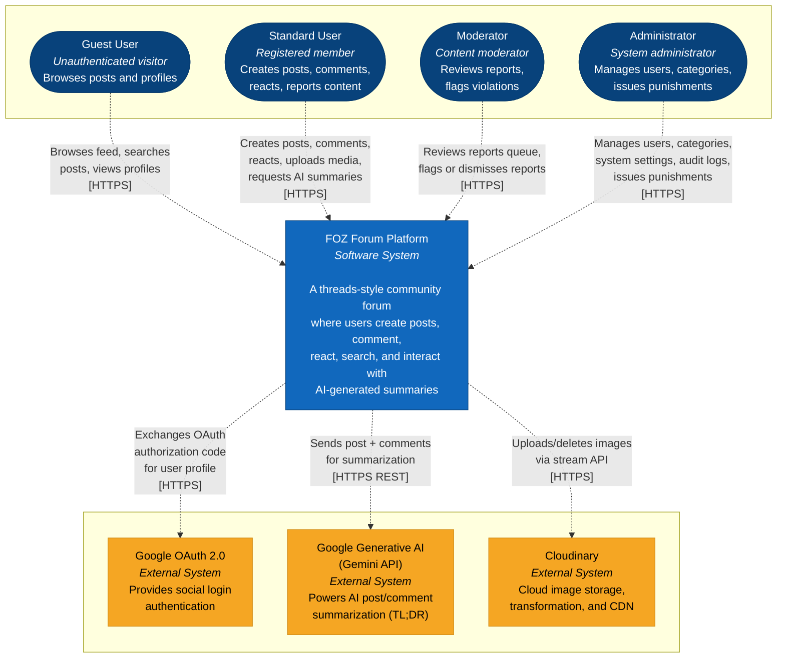
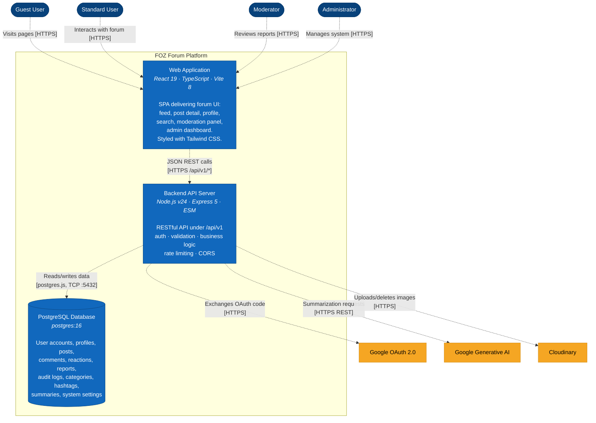
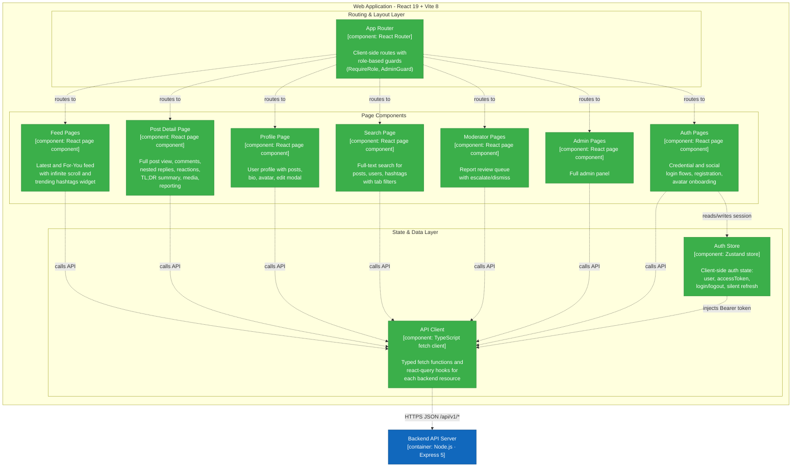
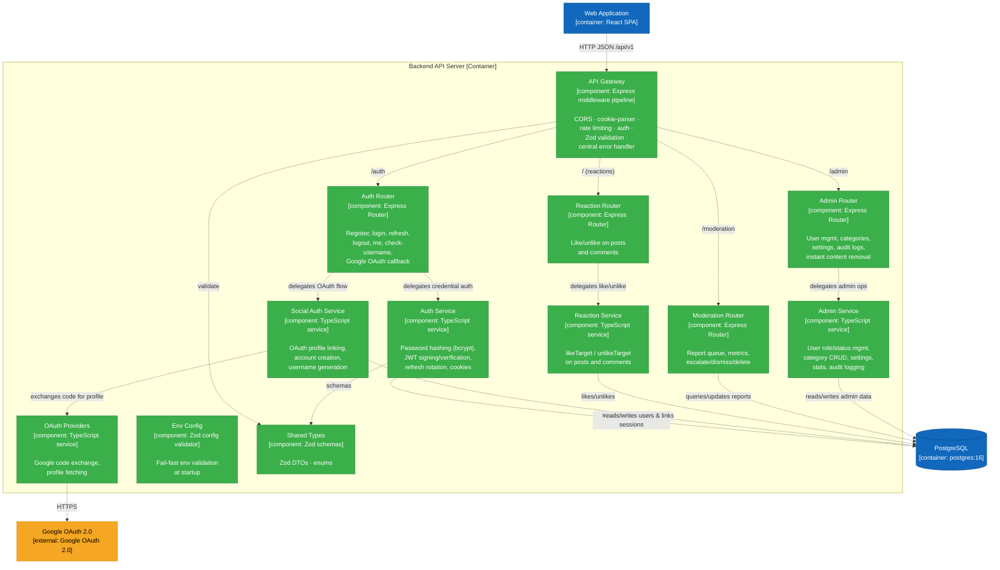
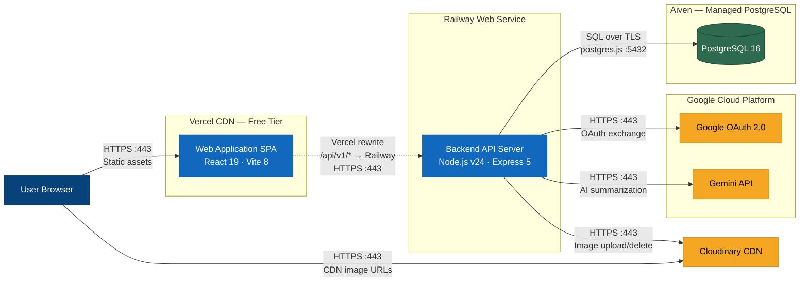
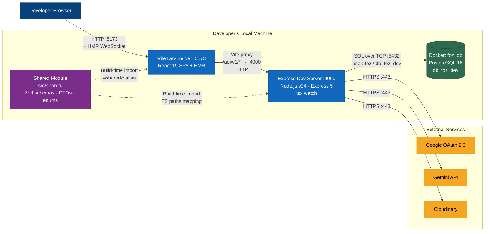
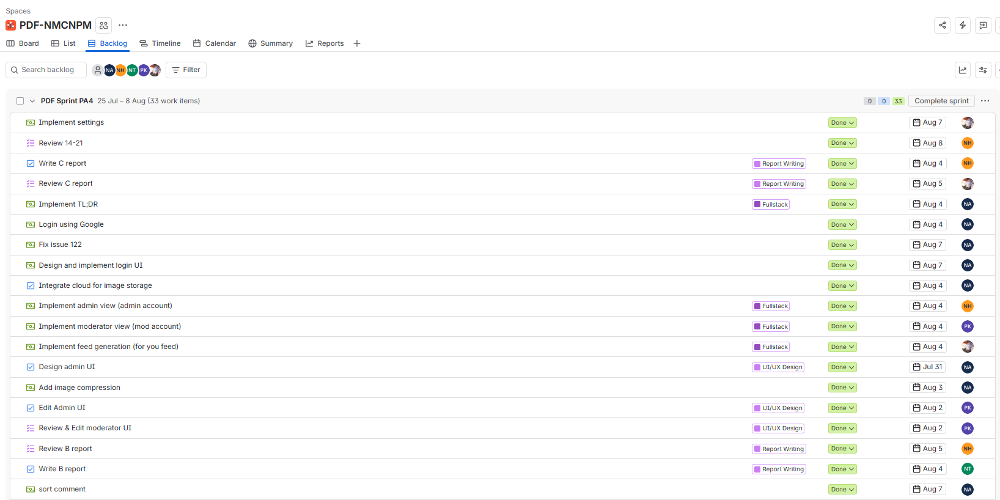
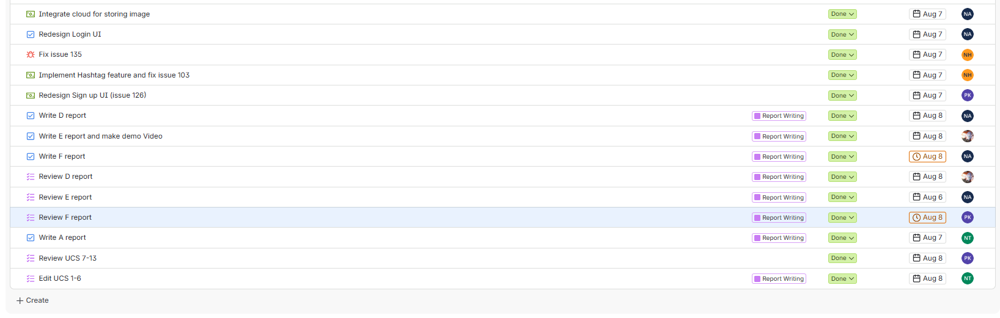

  

    
VNUHCM - University of Science

    
Faculty of Information Technology

  

  

  

    <h1 style="margin: 0; padding: 0 0 10px 0; font-size: 2.2em; border: none;">PA4 Report</h1>
    
Group 6: PDF

  

  

  

    CSC13002 - Introduction to Software Engineering
  

  

    

      
Author:

      
Nguyễn Tuấn An - 24127011

      
Nguyễn Hải Nam - 24127088

      
Nguyễn Hải Trọng - 24127311

      
Phạm Đinh Gia Khánh - 24127420

      
Võ An Phú - 24127494

    

    

      
Lecturer:

      
Ms. Nguyễn Thị Minh Tuyền

      
Mr. Hồ Tuấn Thanh

      
Mr. Mai Anh Tuấn

    

  

  

    July 08th, 2026
  

# Table of Contents

- [A - Revised Use-Case Specification](#a---revised-use-case-specification)
	- [Revision History](#revision-history)
	- [Use-Case Specification: Sign Up](#use-case-specification-sign-up)
		- [1. Sign Up](#1-sign-up)
			- [1.1 Brief Description](#11-brief-description)
		- [2. Preconditions](#2-preconditions)
		- [3. Flow of Events](#3-flow-of-events)
			- [3.1 Basic Flow](#31-basic-flow)
			- [3.2 Alternative Flows](#32-alternative-flows)
				- [3.2.1 Email Already Exists](#321-email-already-exists)
				- [3.2.2 Weak Password](#322-weak-password)
				- [3.2.3 Password Too Long](#323-password-too-long)
				- [3.2.4 Rate Limit Exceeded](#324-rate-limit-exceeded)
				- [3.2.5 Confirm Password Does Not Match](#325-confirm-password-does-not-match)
				- [3.2.6 Username Already Taken](#326-username-already-taken)
				- [3.2.7 Sign Up with Google Account](#327-sign-up-with-google-account)
				- [3.2.8 Google Sign Up Username Collision](#328-google-sign-up-username-collision)
		- [4. Special Requirements](#4-special-requirements)
		- [5. Postconditions](#5-postconditions)
		- [6. Extension Points](#6-extension-points)
		- [7. Prototype Requirement](#7-prototype-requirement)
	- [Use-Case Specification: Log In](#use-case-specification-log-in)
		- [1. Log In](#1-log-in)
			- [1.1 Brief Description](#11-brief-description)
		- [2. Preconditions](#2-preconditions)
		- [3. Flow of Events](#3-flow-of-events)
			- [3.1 Basic Flow](#31-basic-flow)
			- [3.2 Alternative Flows](#32-alternative-flows)
				- [3.2.1 Invalid Credentials](#321-invalid-credentials)
				- [3.2.2 Account Suspended](#322-account-suspended)
				- [3.2.3 Rate Limit Exceeded](#323-rate-limit-exceeded)
				- [3.2.4 Sign In with Google Account](#324-sign-in-with-google-account)
				- [3.2.5 Log In with Non-Existent Google Account](#325-log-in-with-non-existent-google-account)
		- [4. Special Requirements](#4-special-requirements)
		- [5. Postconditions](#5-postconditions)
		- [6. Extension Points](#6-extension-points)
		- [7. Prototype Requirement](#7-prototype-requirement)
	- [Use-Case Specification: Log Out](#use-case-specification-log-out)
		- [1. Log Out](#1-log-out)
			- [1.1 Brief Description](#11-brief-description)
		- [2. Preconditions](#2-preconditions)
		- [3. Flow of Events](#3-flow-of-events)
			- [3.1 Basic Flow](#31-basic-flow)
			- [3.2 Alternative Flows](#32-alternative-flows)
				- [3.2.1 Session Already Expired](#321-session-already-expired)
				- [3.2.2 User Cancels Log Out](#322-user-cancels-log-out)
		- [4. Special Requirements](#4-special-requirements)
		- [5. Postconditions](#5-postconditions)
		- [6. Extension Points](#6-extension-points)
		- [7. Prototype Requirement](#7-prototype-requirement)
	- [Use-Case Specification: Manage Profile](#use-case-specification-manage-profile)
		- [1. Manage Profile](#1-manage-profile)
			- [1.1 Brief Description](#11-brief-description)
		- [2. Preconditions](#2-preconditions)
		- [3. Flow of Events](#3-flow-of-events)
			- [3.1 Basic Flow](#31-basic-flow)
			- [3.2 Alternative Flows](#32-alternative-flows)
				- [3.2.1 Invalid Input Format](#321-invalid-input-format)
				- [3.2.2 Validation Errors](#322-validation-errors)
				- [3.2.3 User Cancels](#323-user-cancels)
		- [4. Special Requirements](#4-special-requirements)
		- [5. Postconditions](#5-postconditions)
		- [6. Extension Points](#6-extension-points)
		- [7. Prototype Requirement](#7-prototype-requirement)
	- [Use-Case Specification: Change Password](#use-case-specification-change-password)
		- [1. Change Password](#1-change-password)
			- [1.1 Brief Description](#11-brief-description)
		- [2. Preconditions](#2-preconditions)
		- [3. Flow of Events](#3-flow-of-events)
			- [3.1 Basic Flow](#31-basic-flow)
			- [3.2 Alternative Flows](#32-alternative-flows)
				- [3.2.1 Incorrect Current Password](#321-incorrect-current-password)
				- [3.2.2 New Password Matches Old Password](#322-new-password-matches-old-password)
				- [3.2.3 Confirm Password Does Not Match](#323-confirm-password-does-not-match)
				- [3.2.4 Weak New Password](#324-weak-new-password)
				- [3.2.5 User Cancels](#325-user-cancels)
		- [4. Special Requirements](#4-special-requirements)
		- [5. Postconditions](#5-postconditions)
		- [6. Extension Points](#6-extension-points)
		- [7. Prototype Requirement](#7-prototype-requirement)
	- [Use-Case Specification: Change Avatar](#use-case-specification-change-avatar)
		- [1. Change Avatar](#1-change-avatar)
			- [1.1 Brief Description](#11-brief-description)
		- [2. Preconditions](#2-preconditions)
		- [3. Flow of Events](#3-flow-of-events)
			- [3.1 Basic Flow](#31-basic-flow)
			- [3.2 Alternative Flows](#32-alternative-flows)
				- [3.2.1 File Too Large](#321-file-too-large)
				- [3.2.2 User Cancels](#322-user-cancels)
				- [3.2.3 Wrong File Type](#323-wrong-file-type)
		- [4. Special Requirements](#4-special-requirements)
		- [5. Postconditions](#5-postconditions)
		- [6. Extension Points](#6-extension-points)
		- [7. Prototype Requirement](#7-prototype-requirement)
	- [Use-Case Specification: Browse Feed](#use-case-specification-browse-feed)
		- [1. Browse Feed](#1-browse-feed)
			- [1.1 Brief Description](#11-brief-description)
		- [2. Preconditions](#2-preconditions)
		- [3. Flow of Events](#3-flow-of-events)
			- [3.1 Basic Flow](#31-basic-flow)
			- [3.2 Alternative Flows](#32-alternative-flows)
				- [3.2.1 Switch feed mode](#321-switch-feed-mode)
				- [3.2.2 No Posts Available](#322-no-posts-available)
		- [4. Special Requirements](#4-special-requirements)
		- [5. Postconditions](#5-postconditions)
		- [6. Extension Points](#6-extension-points)
		- [7. Prototype Requirement](#7-prototype-requirement)
	- [Use-Case Specification: Search Content](#use-case-specification-search-content)
		- [1. Search Content](#1-search-content)
			- [1.1 Brief Description](#11-brief-description)
		- [2. Preconditions](#2-preconditions)
		- [3. Flow of Events](#3-flow-of-events)
			- [3.1 Basic Flow](#31-basic-flow)
			- [3.2 Alternative Flows](#32-alternative-flows)
				- [3.2.1. **Search feature unavailable**](#321-search-feature-unavailable)
				- [3.2.2. **No matching results**](#322-no-matching-results)
		- [4. Special Requirements](#4-special-requirements)
		- [5. Postconditions](#5-postconditions)
		- [6. Extension Points](#6-extension-points)
		- [7. Prototype Requirement](#7-prototype-requirement)
	- [Use-Case Specification: View Post Details](#use-case-specification-view-post-details)
		- [1. View Post Details](#1-view-post-details)
			- [1.1 Brief Description](#11-brief-description)
		- [2. Preconditions](#2-preconditions)
		- [3. Flow of Events](#3-flow-of-events)
			- [3.1 Basic Flow](#31-basic-flow)
			- [3.2 Alternative Flows](#32-alternative-flows)
				- [3.2.1 No comments](#321-no-comments)
				- [3.2.2 Post Not Found](#322-post-not-found)
		- [4. Special Requirements](#4-special-requirements)
		- [5. Postconditions](#5-postconditions)
		- [6. Extension Points](#6-extension-points)
		- [7. Prototype Requirement](#7-prototype-requirement)
	- [Use-Case Specification: Create Post](#use-case-specification-create-post)
		- [1. Create Post](#1-create-post)
			- [1.1 Brief Description](#11-brief-description)
		- [2. Preconditions](#2-preconditions)
		- [3. Flow of Events](#3-flow-of-events)
			- [3.1 Basic Flow](#31-basic-flow)
			- [3.2 Alternative Flows](#32-alternative-flows)
				- [3.2.1. Post creation canceled](#321-post-creation-canceled)
				- [3.2.2 Content Validation Error](#322-content-validation-error)
				- [3.2.3 Exceeds Limits](#323-exceeds-limits)
		- [4. Special Requirements](#4-special-requirements)
		- [5. Postconditions](#5-postconditions)
		- [6. Extension Points](#6-extension-points)
		- [7. Prototype Requirement](#7-prototype-requirement)
	- [Use-Case Specification: Interact with Post](#use-case-specification-interact-with-post)
		- [1. Interact with Post](#1-interact-with-post)
			- [1.1 Brief Description](#11-brief-description)
		- [2. Preconditions](#2-preconditions)
		- [3. Flow of Events](#3-flow-of-events)
			- [3.1 Basic Flow](#31-basic-flow)
			- [3.2 Alternative Flows](#32-alternative-flows)
				- [3.2.1. The user selects **Reply**.](#321-the-user-selects-reply)
				- [3.2.2. The user selects **Like**.](#322-the-user-selects-like)
				- [3.2.3. The user selects **Report**.](#323-the-user-selects-report)
		- [4. Special Requirements](#4-special-requirements)
		- [5. Postconditions](#5-postconditions)
		- [6. Extension Points](#6-extension-points)
		- [7. Prototype Requirement](#7-prototype-requirement)
	- [Use-Case Specification: Leave Comment](#use-case-specification-leave-comment)
		- [1. Leave Comment](#1-leave-comment)
			- [1.1 Brief Description](#11-brief-description)
		- [2. Preconditions](#2-preconditions)
		- [3. Flow of Events](#3-flow-of-events)
			- [3.1 Basic Flow](#31-basic-flow)
			- [3.2 Alternative Flows](#32-alternative-flows)
				- [3.2.1 Empty Comment](#321-empty-comment)
				- [3.2.2 Comment Exceeds Maximum Length](#322-comment-exceeds-maximum-length)
				- [3.2.3 Long Comment Display](#323-long-comment-display)
				- [3.2.4 Newline Input with Shift+Enter](#324-newline-input-with-shiftenter)
				- [3.2.5 Duplicate Submission Prevention](#325-duplicate-submission-prevention)
				- [3.2.6 Malicious Script Injection (XSS) Attempt](#326-malicious-script-injection-xss-attempt)
				- [3.2.7 Emoji and Unicode Input](#327-emoji-and-unicode-input)
				- [3.2.8 Nested Reply](#328-nested-reply)
				- [3.2.9 Offline Submission](#329-offline-submission)
				- [3.2.10 Multi-Level Nested Replies (Depth 1–2)](#3210-multi-level-nested-replies-depth-12)
				- [3.2.11 Deep Nested Replies (Depth > 2)](#3211-deep-nested-replies-depth--2)
				- [3.2.12 URL in Comment](#3212-url-in-comment)
				- [3.2.13 Comment Rate Limit Exceeded](#3213-comment-rate-limit-exceeded)
				- [3.2.14 Authentication Expired During Commenting](#3214-authentication-expired-during-commenting)
				- [3.2.15 Post Deleted While Commenting](#3215-post-deleted-while-commenting)
		- [4. Special Requirements](#4-special-requirements)
		- [5. Postconditions](#5-postconditions)
		- [6. Extension Points](#6-extension-points)
		- [7. Prototype Requirement](#7-prototype-requirement)
	- [Use-Case Specification: Like/Unlike](#use-case-specification-likeunlike)
		- [1. Like/Unlike](#1-likeunlike)
			- [1.1 Brief Description](#11-brief-description)
		- [2. Preconditions](#2-preconditions)
		- [3. Flow of Events](#3-flow-of-events)
			- [3.1 Basic Flow](#31-basic-flow)
			- [3.2 Alternative Flows](#32-alternative-flows)
				- [3.2.1 Target Post or Comment Deleted / Not Found](#321-target-post-or-comment-deleted--not-found)
		- [4. Special Requirements](#4-special-requirements)
		- [5. Postconditions](#5-postconditions)
		- [6. Extension Points](#6-extension-points)
		- [7. Prototype Requirement](#7-prototype-requirement)
	- [Use-Case Specification: Request AI Summary](#use-case-specification-request-ai-summary)
		- [1. Request AI Summary](#1-request-ai-summary)
			- [1.1 Brief Description](#11-brief-description)
		- [2. Preconditions](#2-preconditions)
		- [3. Flow of Events](#3-flow-of-events)
			- [3.1 Basic Flow](#31-basic-flow)
			- [3.2 Alternative Flows](#32-alternative-flows)
				- [3.2.1 Post Not Found or No Longer Accessible](#321-post-not-found-or-no-longer-accessible)
				- [3.2.2 AI Provider Error](#322-ai-provider-error)
				- [3.2.3 Invalid AI Response](#323-invalid-ai-response)
				- [3.2.4 Rate Limit Exceeded](#324-rate-limit-exceeded)
		- [4. Special Requirements](#4-special-requirements)
		- [5. Postconditions](#5-postconditions)
		- [6. Extension Points](#6-extension-points)
		- [7. Prototype Requirement](#7-prototype-requirement)
	- [Use-Case Specification: Delete Own Post](#use-case-specification-delete-own-post)
		- [1. Delete Own Post](#1-delete-own-post)
			- [1.1 Brief Description](#11-brief-description)
		- [2. Preconditions](#2-preconditions)
		- [3. Flow of Events](#3-flow-of-events)
			- [3.1 Basic Flow](#31-basic-flow)
			- [3.2 Alternative Flows](#32-alternative-flows)
				- [3.2.1 User Cancels Deletion](#321-user-cancels-deletion)
				- [3.2.2 Post Not Found or Forbidden](#322-post-not-found-or-forbidden)
				- [3.2.3 Deletion Failure](#323-deletion-failure)
		- [4. Special Requirements](#4-special-requirements)
		- [5. Postconditions](#5-postconditions)
		- [6. Extension Points](#6-extension-points)
		- [7. Prototype Requirement](#7-prototype-requirement)
	- [Use-Case Specification: Report Inappropriate Content](#use-case-specification-report-inappropriate-content)
		- [1. Report Inappropriate Content](#1-report-inappropriate-content)
			- [1.1 Brief Description](#11-brief-description)
		- [2. Preconditions](#2-preconditions)
		- [3. Flow of Events](#3-flow-of-events)
			- [3.1 Basic Flow](#31-basic-flow)
			- [3.2 Alternative Flows](#32-alternative-flows)
				- [3.2.1 User Cancels Report](#321-user-cancels-report)
				- [3.2.2 Validation Error](#322-validation-error)
				- [3.2.3 Content Already Reported by User](#323-content-already-reported-by-user)
				- [3.2.4 Content Not Found or No Longer Reportable](#324-content-not-found-or-no-longer-reportable)
				- [3.2.5 Reporting Rate Limit Exceeded](#325-reporting-rate-limit-exceeded)
				- [3.2.6 Report Submission Failure](#326-report-submission-failure)
		- [4. Special Requirements](#4-special-requirements)
		- [5. Postconditions](#5-postconditions)
		- [6. Extension Points](#6-extension-points)
		- [7. Prototype Requirement](#7-prototype-requirement)
	- [Use-Case Specification: Review Reports](#use-case-specification-review-reports)
		- [1. Review Reports](#1-review-reports)
			- [1.1 Brief Description](#11-brief-description)
		- [2. Preconditions](#2-preconditions)
		- [3. Flow of Events](#3-flow-of-events)
			- [3.1 Basic Flow](#31-basic-flow)
			- [3.2 Alternative Flows](#32-alternative-flows)
				- [3.2.1 No Reports Available](#321-no-reports-available)
				- [3.2.2 Actor Leaves Without a Decision](#322-actor-leaves-without-a-decision)
				- [3.2.3 Report Not Found or Already Processed](#323-report-not-found-or-already-processed)
				- [3.2.4 Reported Content No Longer Exists](#324-reported-content-no-longer-exists)
				- [3.2.5 Unauthorized Action](#325-unauthorized-action)
				- [3.2.6 Missing or Insufficient Decision Rationale](#326-missing-or-insufficient-decision-rationale)
		- [4. Special Requirements](#4-special-requirements)
		- [5. Postconditions](#5-postconditions)
		- [6. Extension Points](#6-extension-points)
		- [7. Prototype Requirement](#7-prototype-requirement)
	- [Use-Case Specification: Forward Report to Admin](#use-case-specification-forward-report-to-admin)
		- [1. Forward Report to Admin](#1-forward-report-to-admin)
			- [1.1 Brief Description](#11-brief-description)
		- [2. Preconditions](#2-preconditions)
		- [3. Flow of Events](#3-flow-of-events)
			- [3.1 Basic Flow](#31-basic-flow)
			- [3.2 Alternative Flows](#32-alternative-flows)
				- [3.2.1 Moderator Cancels Escalation](#321-moderator-cancels-escalation)
				- [3.2.2 Missing or Insufficient Escalation Rationale](#322-missing-or-insufficient-escalation-rationale)
				- [3.2.3 Report Not Found](#323-report-not-found)
				- [3.2.4 Report Already Processed](#324-report-already-processed)
				- [3.2.5 Escalation Update Failure](#325-escalation-update-failure)
		- [4. Special Requirements](#4-special-requirements)
		- [5. Postconditions](#5-postconditions)
		- [6. Extension Points](#6-extension-points)
		- [7. Prototype Requirement](#7-prototype-requirement)
	- [Use-Case Specification: Delete Any Content](#use-case-specification-delete-any-content)
		- [1. Delete Any Content](#1-delete-any-content)
			- [1.1 Brief Description](#11-brief-description)
		- [2. Preconditions](#2-preconditions)
		- [3. Flow of Events](#3-flow-of-events)
			- [3.1 Basic Flow](#31-basic-flow)
			- [3.2 Alternative Flows](#32-alternative-flows)
				- [3.2.1 Administrator Cancels Deletion](#321-administrator-cancels-deletion)
				- [3.2.2 Missing or Insufficient Rationale](#322-missing-or-insufficient-rationale)
				- [3.2.3 Content Not Found or Already Deleted](#323-content-not-found-or-already-deleted)
				- [3.2.4 Target Not Eligible for Force Deletion](#324-target-not-eligible-for-force-deletion)
				- [3.2.5 Deletion Transaction Fails](#325-deletion-transaction-fails)
		- [4. Special Requirements](#4-special-requirements)
		- [5. Postconditions](#5-postconditions)
		- [6. Extension Points](#6-extension-points)
		- [7. Prototype Requirement](#7-prototype-requirement)
	- [Use-Case Specification: Permanently Remove User](#use-case-specification-permanently-remove-user)
		- [1. Permanently Remove User](#1-permanently-remove-user)
			- [1.1 Brief Description](#11-brief-description)
		- [2. Preconditions](#2-preconditions)
		- [3. Flow of Events](#3-flow-of-events)
			- [3.1 Basic Flow](#31-basic-flow)
			- [3.2 Alternative Flows](#32-alternative-flows)
				- [3.2.1 Administrator Cancels Deletion](#321-administrator-cancels-deletion)
				- [3.2.2 Missing or Insufficient Rationale](#322-missing-or-insufficient-rationale)
				- [3.2.3 Target Not Found or Already Removed](#323-target-not-found-or-already-removed)
				- [3.2.4 Target No Longer Eligible](#324-target-no-longer-eligible)
				- [3.2.5 Data-Wipe Transaction Fails](#325-data-wipe-transaction-fails)
		- [4. Special Requirements](#4-special-requirements)
		- [5. Postconditions](#5-postconditions)
		- [6. Extension Points](#6-extension-points)
		- [7. Prototype Requirement](#7-prototype-requirement)
	- [Use-Case Specification: Assign Moderator Role](#use-case-specification-assign-moderator-role)
		- [1. Assign Moderator Role](#1-assign-moderator-role)
			- [1.1 Brief Description](#11-brief-description)
		- [2. Preconditions](#2-preconditions)
		- [3. Flow of Events](#3-flow-of-events)
			- [3.1 Basic Flow](#31-basic-flow)
			- [3.2 Alternative Flows](#32-alternative-flows)
				- [3.2.1 Administrator Cancels Role Assignment](#321-administrator-cancels-role-assignment)
				- [3.2.2 Missing or Insufficient Rationale](#322-missing-or-insufficient-rationale)
				- [3.2.3 Target Not Found or Not Eligible](#323-target-not-found-or-not-eligible)
				- [3.2.4 Concurrent Role Update](#324-concurrent-role-update)
				- [3.2.5 Role Update or Audit Failure](#325-role-update-or-audit-failure)
		- [4. Special Requirements](#4-special-requirements)
		- [5. Postconditions](#5-postconditions)
		- [6. Extension Points](#6-extension-points)
		- [7. Prototype Requirement](#7-prototype-requirement)
- [B - Software Architecture: System Context Diagram](#b---software-architecture-system-context-diagram)
	- [1. Technology Stack](#1-technology-stack)
		- [Frontend](#frontend)
		- [Backend](#backend)
		- [Database](#database)
		- [External Services](#external-services)
		- [Shared Module](#shared-module)
	- [2. C4 Level 1 - System Context Diagram](#2-c4-level-1---system-context-diagram)
		- [Diagram Explanation](#diagram-explanation)
- [C - Software Architecture: Container Diagram and Component Diagram](#c---software-architecture-container-diagram-and-component-diagram)
	- [3. C4 Level 2 - Container Diagram](#3-c4-level-2---container-diagram)
		- [3.1 Diagram](#31-diagram)
		- [3.2 Container Descriptions](#32-container-descriptions)
		- [3.3 Relationships Summary](#33-relationships-summary)
	- [4. C4 Level 3 - Component Diagrams](#4-c4-level-3---component-diagrams)
		- [4.1 Frontend - Web Application](#41-frontend---web-application)
			- [4.1.1 Diagram](#411-diagram)
			- [4.1.2 Component Descriptions](#412-component-descriptions)
		- [4.2 Backend - API Server](#42-backend---api-server)
			- [4.2.1 Diagram A - Content & Discovery (Feed · Search · Profile · Hashtags · Media · Reports · AI TL;DR)](#421-diagram-a---content--discovery-feed-%C2%B7-search-%C2%B7-profile-%C2%B7-hashtags-%C2%B7-media-%C2%B7-reports-%C2%B7-ai-tldr)
			- [4.2.2 Diagram B - Identity, Governance & AI (Auth · OAuth · Reactions · Moderation · Admin)](#422-diagram-b---identity-governance--ai-auth-%C2%B7-oauth-%C2%B7-reactions-%C2%B7-moderation-%C2%B7-admin)
			- [4.2.3 Component Descriptions](#423-component-descriptions)
				- [Middleware Pipeline (API Gateway)](#middleware-pipeline-api-gateway)
				- [Route Layer](#route-layer)
				- [Service Layer](#service-layer)
				- [Data Access (`src/backend/db/`)](#data-access-srcbackenddb)
				- [Infrastructure](#infrastructure)
- [D - Deployment Diagram](#d---deployment-diagram)
	- [1. Production Deployment Diagram](#1-production-deployment-diagram)
		- [1.1 Diagram](#11-diagram)
			- [How the request flows](#how-the-request-flows)
		- [1.2 Node Descriptions](#12-node-descriptions)
		- [1.3 Communication Protocols Summary](#13-communication-protocols-summary)
	- [2. Development Deployment Diagram](#2-development-deployment-diagram)
		- [2.1 Diagram](#21-diagram)
			- [Key development details](#key-development-details)
		- [2.2 Node Descriptions](#22-node-descriptions)
		- [2.3 Communication Protocols Summary](#23-communication-protocols-summary)
	- [3. Environment Comparison](#3-environment-comparison)
- [E - Implement 2 Functional Groups using Spec Kit](#e---implement-2-functional-groups-using-spec-kit)
- [F - AI Usage Report and Weekly Report](#f---ai-usage-report-and-weekly-report)
	- [AI Usage Report](#ai-usage-report)
		- [Declaration of No AI Use](#declaration-of-no-ai-use)
		- [AI Usage Notes](#ai-usage-notes)
	- [Weekly Report](#weekly-report)
		- [Sprint Planning](#sprint-planning)
		- [Scrum Meetings](#scrum-meetings)
		- [Sprint Review](#sprint-review)
		- [Jira Board](#jira-board)

# A - Revised Use-Case Specification
*Performed by: Nguyễn Hải Trọng | Reviewed by: Phạm Đinh Gia Khánh*

## Revision History

| Date | Version | Description | Author |
| :--- | :--- | :--- | :--- |
| 19/Jul/2026 | 1.0 | Initial draft: Documented all 21 Use-Case Specifications covering Auth, Core Interactions, and Moderation. | Nguyễn Hải Trọng |
| 06/Aug/2026 | 1.1 | Update the Alternative Flow and Reordered sections for clarity | Nguyễn Hải Trọng |

## Use-Case Specification: Sign Up
*Performed by: Nguyễn Hải Trọng | Reviewed by: Nguyễn Tuấn An | Edited by: Nguyễn Hải Trọng* 
**Project Name:** FOZ  
**Version:** 1.1  
**Document identifier:** FOZ-UCS-01

### 1. Sign Up
* **Use-Case ID:** UC-01
* **Actor(s):** Guest

#### 1.1 Brief Description
This use case allows an unauthenticated guest to create a new user account and profile on the FOZ platform using their email and a secure password.

### 2. Preconditions
* The user must be a Guest (unauthenticated).

### 3. Flow of Events
#### 3.1 Basic Flow
1. The use case begins when the Guest navigates to the Registration page.
2. The user enters a valid email address, a unique username, and a strong password.
3. The user clicks "Create account".
4. The system validates the inputs (email format, password length > 8 chars).
5. The system checks if the email is already registered.
6. The system securely hashes the password using bcrypt.
7. The system creates a new record in the `user_accounts` table (role: `standard`, status: `active`) and a default record in the `profiles` table.
8. The system issues an access token and a refresh token (saved in `refresh_sessions`).
9. The system redirects the user to the Home Feed.

#### 3.2 Alternative Flows

##### 3.2.1 Email Already Exists
1. If at step 5, the email exists in the database.
2. The system aborts the registration.
3. The system displays a generic error: "An account with this email already exists".
4. The flow resumes at step 2.

##### 3.2.2 Weak Password
1. If at step 4, the password is less than 8 characters.
2. The system highlights the field with "Password must be at least 8 characters".
3. The flow resumes at step 2.

##### 3.2.3 Password Too Long
1. If at step 4, the password exceeds 128 characters.
2. The system aborts and displays "Password is too long".
3. The flow resumes at step 2.

##### 3.2.4 Rate Limit Exceeded
1. If the user makes more than 100 registration attempts within 15 minutes.
2. The system rejects the request and displays "Too many requests, slow down."
3. The use case ends.

##### 3.2.5 Confirm Password Does Not Match
1. If at step 4, the confirmation password does not match the entered password.
2. The system highlights the confirmation field and displays "Passwords do not match".
3. The flow resumes at step 2.

##### 3.2.6 Username Already Taken
1. If at step 5, the chosen username exists in the database.
2. The system aborts the registration and displays "This username is already taken".
3. The flow resumes at step 2.

##### 3.2.7 Sign Up with Google Account
1. If at step 2, the user chooses to "Continue with Google".
2. The system redirects the user to the Google OAuth consent screen.
3. The user successfully authenticates with Google.
4. The system automatically provisions a `user_accounts` and `profiles` record using the Google profile data, deriving a unique username from their email prefix.
5. The system issues access and refresh tokens, bypassing standard registration validation.
6. The flow resumes at step 8.

##### 3.2.8 Google Sign Up Username Collision
1. If at step 4 of the Google Sign Up flow, the derived base username is already taken by another user or is a reserved keyword.
2. The system automatically generates a unique username by appending a numeric counter to the base name.
3. The system proceeds to provision the account with the newly generated username.

### 4. Special Requirements
* **Security:** Passwords must be hashed via bcrypt with a minimum cost of 12. Plaintext passwords must never be logged.

### 5. Postconditions
* A new user account and profile are saved in the database. The user is signed in.

### 6. Extension Points
* None.

### 7. Prototype Requirement
* **Screen 1 (Basic Flow):**
    
* **Screen 2 (Alt Flow - Email Already Exists):**
    
* **Screen 3 (Alt Flow - Weak Password):**
    
* **Screen 4 (Alt Flow - Password Too Long):**
    
* **Screen 5 (Alt Flow - Rate Limit Exceeded):**
    
* **Screen 6 (Alt Flow - Confirm Password Does Not Match):**
    
* **Screen 7 (Alt Flow - Username Already Taken):**
    
* **Screen 8 (Alt Flow - Sign Up with Google Account):**
    
* **Screen 9 (Alt Flow - Google Sign Up Username Collision):**
    
    This is the email to test the alternative flow.
    
    The website already has an username that matches the Google account .
    
    The system automatically generates a unique username by appending number "1" to the base name.

## Use-Case Specification: Log In
*Performed by: Nguyễn Hải Trọng | Reviewed by: Nguyễn Tuấn An | Edited by: Nguyễn Hải Trọng* 
**Project Name:** FOZ  
**Version:** 1.1  
**Document identifier:** FOZ-UCS-02

### 1. Log In
* **Use-Case ID:** UC-02
* **Actor(s):** Guest

#### 1.1 Brief Description
This use case describes how a registered Guest accesses their account by providing valid credentials.

### 2. Preconditions
* The user is unauthenticated.

### 3. Flow of Events
#### 3.1 Basic Flow
1. The use case begins when the Guest navigates to the Login page.
2. The user enters their email and password, then clicks "Sign In".
3. The system finds the user in `user_accounts` and verifies the password hash.
4. The system checks if the account status is `active`.
5. The system issues an Access Token and sets a Refresh Token cookie.
6. The system redirects the user to the Home Feed.

#### 3.2 Alternative Flows

##### 3.2.1 Invalid Credentials
1. If at step 3, the email is not found or the password does not match.
2. The system displays: "Invalid email or password".
3. The flow resumes at step 2.

##### 3.2.2 Account Suspended
1. If at step 4, the account status is `suspended` or `banned`.
2. The system displays: "Your account is not currently available."
3. The use case ends.

##### 3.2.3 Rate Limit Exceeded
1. If the user makes more than 100 login attempts within 15 minutes.
2. The system rejects the request and displays "Too many requests, slow down."
3. The use case ends.

##### 3.2.4 Sign In with Google Account
1. If at step 2, the user chooses to "Sign in with Google".
2. The system redirects the user to the Google OAuth consent screen.
3. The user successfully authenticates with Google.
4. The system checks the database for an existing Google social link or matching email.
5. The system verifies the account is active, issues an Access Token, and sets a Refresh Token cookie.
6. The flow resumes at step 6.

##### 3.2.5 Log In with Non-Existent Google Account
1. If at step 4 of the Google Sign In flow, the system finds no existing user account associated with the Google profile or email.
2. The system automatically provisions a new user account on the fly (including auto-generating a unique username) instead of rejecting the login.
3. The login attempt is seamlessly converted into a successful registration.
4. The flow resumes at step 5 of the Google Sign In flow.

### 4. Special Requirements
* **Rate Limiting:** Maximum 100 attempts per 15 minutes to prevent brute-force attacks.

### 5. Postconditions
* The user is authenticated and an active session is recorded in `refresh_sessions`.

### 6. Extension Points
* None.

### 7. Prototype Requirement
* **Screen 1 (Basic Flow):**
    
* **Screen 2 (Alt Flow - Invalid Credentials):**
    
* **Screen 3 (Alt Flow - Account Suspended):**
    
* **Screen 4 (Alt Flow - Rate Limit Exceeded):**
    
* **Screen 5 (Alt Flow - Sign In with Google Account):**
    
* **Screen 6 (Alt Flow - Log In with Non-Existent Google Account):**
    
    This email hasn't been logged in to the website.
    
    After login, the system automatically creates a new user account.

## Use-Case Specification: Log Out
*Performed by: Nguyễn Hải Trọng | Reviewed by: Nguyễn Tuấn An | Edited by: Nguyễn Hải Trọng* 
**Project Name:** FOZ  
**Version:** 1.0  
**Document identifier:** FOZ-UCS-03

### 1. Log Out
* **Use-Case ID:** UC-03
* **Actor(s):** Standard User

#### 1.1 Brief Description
Allows an authenticated user to securely end their active session on the current device.

### 2. Preconditions
* The user must be authenticated.

### 3. Flow of Events
#### 3.1 Basic Flow
1. The use case begins when the user clicks the "Sign out" button.
2. The system reads the refresh cookie to identify the current session.
3. The system updates the `revoked_at` timestamp in the `refresh_sessions` table for that session.
4. The system clears the local access token and the refresh cookie from the browser.
5. The system redirects the user to the Login page.

#### 3.2 Alternative Flows

##### 3.2.1 Session Already Expired
1. If at step 2, the session token is already expired or invalid.
2. The system proceeds to step 4 without database updates.

##### 3.2.2 User Cancels Log Out
1. If the system prompts for confirmation and the user selects "Cancel".
2. The system closes the dialog and no action is taken.
3. The use case ends.

### 4. Special Requirements
* None.

### 5. Postconditions
* The user is signed out and redirected to a public page.

### 6. Extension Points
* None.

### 7. Prototype Requirement
* **Screen 1 (Basic Flow):** 
  
* **Screen 2 (Alt Flow - User Cancels Log Out):**
  

## Use-Case Specification: Manage Profile
*Performed by: Nguyễn Hải Trọng | Reviewed by: Nguyễn Tuấn An | Edited by: Nguyễn Hải Trọng*
**Project Name:** FOZ  
**Version:** 1.1  
**Document identifier:** FOZ-UCS-04

### 1. Manage Profile
* **Use-Case ID:** UC-04
* **Actor(s):** Standard User

#### 1.1 Brief Description
Allows the user to update their public-facing information such as display name, bio, location, and website.

### 2. Preconditions
* The user is authenticated.

### 3. Flow of Events
#### 3.1 Basic Flow
1. The use case begins when the user navigates to "Edit Profile".
2. The system retrieves current data from the `profiles` table.
3. The user edits text fields (Display Name, Bio, Location, Website) and clicks "Save".
4. The system validates the inputs (e.g., URL format for website).
5. The system updates the `profiles` table and the `updated_at` timestamp.
6. The system displays a success message.

#### 3.2 Alternative Flows

##### 3.2.1 Invalid Input Format
1. If at step 4, the website URL is invalid.
2. The system displays an error below the website field.
3. The flow resumes at step 3.

##### 3.2.2 Validation Errors
1. If at step 4, inputs exceed max lengths (Display Name: 50, Bio: 160, Location: 100, Website: 200 characters) or Display Name contains invalid characters.
2. The system displays specific field validation errors.
3. The flow resumes at step 3.

##### 3.2.3 User Cancels
1. If at step 3, the user clicks "Cancel" instead of "Save".
2. The system discards any unsaved changes and returns to the profile view.
3. The use case ends.

### 4. Special Requirements
* None.

### 5. Postconditions
* Profile data is updated in the database.

### 6. Extension Points
* **Change Password:** Extended via UC-05.
* **Change Avatar:** Extended via UC-06.

### 7. Prototype Requirement
* **Screen 1 (Basic Flow):**
  
* **Screen 2 (Alt Flow - Invalid Input Format):**
  
* **Screen 3 (Alt Flow - Validation Errors):**
  

## Use-Case Specification: Change Password
*Performed by: Nguyễn Hải Trọng | Reviewed by: Nguyễn Tuấn An | Edited by: Nguyễn Hải Trọng*
**Project Name:** FOZ  
**Version:** 1.1  
**Document identifier:** FOZ-UCS-05

### 1. Change Password
* **Use-Case ID:** UC-05
* **Actor(s):** Standard User

#### 1.1 Brief Description
Allows an authenticated user to change their password securely by verifying their current password.

### 2. Preconditions
* The user is authenticated.

### 3. Flow of Events
#### 3.1 Basic Flow
1. The use case extends UC-04 when the user selects "Change password".
2. The user enters their current password, a new password, and confirms the new password.
3. The user clicks "Update password".
4. The system verifies the current password against the stored `password_hash`.
5. The system validates the new password strength.
6. The system hashes the new password and updates `user_accounts`.
7. The system displays a success toast message and redirects to home.

#### 3.2 Alternative Flows

##### 3.2.1 Incorrect Current Password
1. If at step 4, the current password does not match.
2. The system displays "Invalid credentials".
3. The flow resumes at step 2.

##### 3.2.2 New Password Matches Old Password
1. If at step 4, the new password is exactly the same as the current password.
2. The system rejects the request and displays "New password must differ from the current one".
3. The flow resumes at step 2.

##### 3.2.3 Confirm Password Does Not Match
1. If at step 5, the confirmation password does not match the new password.
2. The system highlights the confirmation field and displays "Passwords do not match".
3. The flow resumes at step 2.

##### 3.2.4 Weak New Password
1. If at step 5, the new password is less than 8 characters.
2. The system rejects the request and displays "Password must be at least 8 characters".
3. The flow resumes at step 2.

##### 3.2.5 User Cancels
1. If at step 2, the user clicks "Back" instead of "Update password".
2. The system discards the input and returns to the Homepage screen.
3. The use case ends.

### 4. Special Requirements
* **Security:** The new password must not be identical to the old password.

### 5. Postconditions
* The user's password hash is updated.

### 6. Extension Points
* None.

### 7. Prototype Requirement
* **Screen 1 (Basic Flow):** 
  
  **Change Password will be in Settings**
* **Screen 2 (Alt Flow - Incorrect Current Password):**
  
* **Screen 3 (Alt Flow - New Password Matches Old Password):**
  
* **Screen 4 (Alt Flow - Confirm Password Does Not Match):**
  
* **Screen 5 (Alt Flow - Weak New Password):**
  

## Use-Case Specification: Change Avatar
*Performed by: Nguyễn Hải Trọng | Reviewed by: Nguyễn Tuấn An | Edited by: Nguyễn Hải Trọng*
**Project Name:** FOZ  
**Version:** 1.1  
**Document identifier:** FOZ-UCS-06

### 1. Change Avatar
* **Use-Case ID:** UC-06
* **Actor(s):** Standard User

#### 1.1 Brief Description
Allows an authenticated user to upload a new profile picture.

### 2. Preconditions
* The user is authenticated.

### 3. Flow of Events
#### 3.1 Basic Flow
1. The use case extends UC-04 when the user clicks the "Upload picture" icon.
2. The user selects an image file from their device.
3. The system validates the file type and size.
4. The system uploads the file to storage and retrieves the image URL.
5. The system updates the `avatar_url` in the `profiles` table.
6. The system refreshes the avatar display on the UI.

#### 3.2 Alternative Flows

##### 3.2.1 File Too Large
1. If at step 3, the file exceeds the 25MB raw upload limit.
2. The system aborts the upload and displays "Image file exceeds maximum raw size limit of 25MB."
3. The flow resumes at step 1.

##### 3.2.2 User Cancels
1. If at step 2, the user closes the file picker without selecting an image.
2. The system aborts the upload process.
3. The use case ends.

##### 3.2.3 Wrong File Type
1. If at step 3, the file uploaded is not a supported image format (e.g., PDF, DOCX).
2. The system aborts the upload and displays "Invalid file format. Please upload an image."
3. The flow resumes at step 1.

### 4. Special Requirements
* **Space:** Raw images are compressed heavily on the client and server to conserve server storage.

### 5. Postconditions
* The new avatar is visible publicly on the user's profile.

### 6. Extension Points
* None.

### 7. Prototype Requirement
* **Screen 1 (Basic Flow):** 
  
* **Screen 2 (Alt Flow - File Too Large):**
  
  
* **Screen 3 (Alt Flow - Wrong File Type):**
  
  

## Use-Case Specification: Browse Feed

**Project Name:** FOZ  
**Version:** 1.0  
**Document identifier:** FOZ-UCS-07

### 1. Browse Feed
* **Use-Case ID:** UC-07
* **Actor(s):** Guest, Standard User, Moderator, Admin

#### 1.1 Brief Description
Allows users to view a dynamic timeline of forum posts sorted by recent engagement metrics or chronological order.

### 2. Preconditions
* None.

### 3. Flow of Events
#### 3.1 Basic Flow
1. The use case begins when the user navigates to the application's homepage, which presents the feed tabs "For You" (default) and "Latest".
2. The system queries the `posts` table for content with `visibility_state = 'public'` and `deleted_at IS NULL`, unwrapping reposts so the original post content is shown.
3. The system orders the posts according to the selected feed mode:
   * **For You:** ranking based on engagement, and recency.
   * **Latest:** sorted by posting time, with the newest first.
4. The system displays the feed with post content, author avatars, and interaction counts (likes, comments, reposts).
5. The user scrolls to browse feed.

#### 3.2 Alternative Flows

##### 3.2.1 Switch feed mode

1. The user switches between the "For You" and "Latest" feed tabs.
2. The system reloads and displays the posts according to the newly selected mode.

##### 3.2.2 No Posts Available

1. If at step 2, the database returns no posts.
2. The system displays a "No discussions found. Be the first to post!" placeholder.
3. The use case ends.

##### 3.2.3 Scroll to Load More Posts

1. If at step 5, the user scrolls to the bottom of the visible posts.
2. The system triggers pagination displaying "Load more" button.
3. The user clicks "Load more" button.
4. The system fetches and displays the next set of posts.
5. The use case ends.

##### 3.2.4 View a long content post

1. If at step 4, the post content is too long, the system displays a few first lines of post along with a button "Read more".
2. The user clicks "Read more" button.
3. The system displays the full content of the post along with a button "Show less".
4. The user clicks "Show less" button.
5. The system displays the first few lines of the post.
6. The use case ends.
### 4. Special Requirements
* **Performance:** The initial feed must load in `< 2 seconds` under good network conditions.
### 5. Postconditions
* None.
### 6. Extension Points
* None.
### 7. Prototype Requirement
* **Screen 1 (Basic Flow):** 
  

  **Screen 2 (Alternative Flow 1):** Latest tab
  
  
  **Screen 3 (Alternative Flow 2):** No post available
  

  **Screen 4 (Alternative Flow 3):** Scroll to load more posts
  

  **Screen 5 (Alternative Flow 4):** View a long content post
  
  

## Use-Case Specification: Search Content

**Project Name:** FOZ  
**Version:** 1.0  
**Document identifier:** FOZ-UCS-08

### 1. Search Content
* **Use-Case ID:** UC-08
* **Actor(s):** Guest, Standard User, Moderator, Admin

#### 1.1 Brief Description
Allows users to search for specific discussion topics, posts, or user profiles using keywords.

### 2. Preconditions
* None.

### 3. Flow of Events
#### 3.1 Basic Flow
1. The use case begins when the user navigates to the application's search page, then enters a keyword into the search bar and presses Enter.
2. The system sends the query to the backend.
3. The backend searches the `posts` (body/title) and `profiles` (display_name) tables for matches.
4. The system filters out content that is deleted, hidden, or authored by banned users.
5. The system displays a categorized list of results (Posts, Users).

#### 3.2 Alternative Flows

##### 3.2.1. Search feature unavailable

1. If at step 2, the search query is empty or just whitespace.
2. The system does not display the search button until valid index is entered

##### 3.2.2. No matching results

1. The user enters a search query.
2. The system finds no matching content.
3. The system displays **"No results for search query."**

##### 3.2.3. Click a hashtag in "TRENDING TOPICS"

1. The user clicks a hashtag under the **"TRENDING TOPICS"** section on the search page.
2. The system automatically populates the search bar with the selected hashtag and executes the search query.
3. The system displays posts matching the selected topic/hashtag.

##### 3.2.4. Click a profile in "Suggested Creators"

1. The user clicks a creator profile under the **"Suggested Creators"** section on the search page.
2. The system navigates the user to the selected creator's profile page.
3. The use case ends.

##### 3.2.5. Click a post in "Trending Discussions"

1. The user clicks a discussion post under the **"Trending Discussions"** section on the search page.
2. The system navigates the user to the selected post's detail page.
3. The use case ends.

### 4. Special Requirements
* **Performance:** Search results should be displayed within 2–3 seconds under good network conditions.

### 5. Postconditions
* None.

### 6. Extension Points
* None.

### 7. Prototype Requirement
* **Screen 1 (Basic Flow):** 
  

 **Screen 2 (Alternative Flow 1):**
  

  **Screen 3 (Alternative Flow 2):**
  

## Use-Case Specification: View Post Details

**Project Name:** FOZ  
**Version:** 1.1  
**Document identifier:** FOZ-UCS-09

### 1. View Post Details
* **Use-Case ID:** UC-09
* **Actor(s):** Guest, Standard User

#### 1.1 Brief Description
Allows a user to read the full body of a post along with its entire nested comment thread.

### 2. Preconditions
* The post ID must be valid.

### 3. Flow of Events
#### 3.1 Basic Flow
1. The use case begins when the user clicks on a post from the feed or search results.
2. The system queries the `posts` and `comments` tables matching the Post ID.
3. The system formats the comment tree hierarchically.
4. The system displays the full post content, author details, and comments.

#### 3.2 Alternative Flows

##### 3.2.1 No comments

1. The post has no comments.
2. The system displays **"No comments yet. Be the first to reply!"**

##### 3.2.2 Post Not Found
1. If at step 2, the requested Post ID does not exist in the database, or the post's lifecycle_state is removed_by_moderation.
2. The system displays a 404 Not Found error page.
3. The use case ends.

### 4. Special Requirements
* None.

### 5. Postconditions
* None.

### 6. Extension Points
* **Request AI Summary:** Extended via UC-14.

### 7. Prototype Requirement
* **Screen 1 (Basic Flow):** 
  
* **Screen 2 (Alternative Flow 1):**
*   

 * **Screen 2 (Alternative Flow 2):**
*    

  
## Use-Case Specification: Create Post

**Project Name:** FOZ  
**Version:** 1.1  
**Document identifier:** FOZ-UCS-10

### 1. Create Post
* **Use-Case ID:** UC-10
* **Actor(s):** Standard User

#### 1.1 Brief Description
Allows an authenticated user to publish a new text-based post to initiate a discussion.

### 2. Preconditions
* The user is authenticated and their account status is `active`.

### 3. Flow of Events
#### 3.1 Basic Flow
1. The use case begins when the user clicks "Create Post". 1, 4, 6, 7, 11
2. The system displays an editor.
3. The user adds the content and clicks "Post".
4. The system validates the input lengths.
5. The system saves the record in the `posts` table (lifecycle_state: `active`).
6. The system redirects to the new post's detail page.

#### 3.2 Alternative Flows

##### 3.2.1. Post creation canceled
1. The user cancels the post creation.
2. The system remains the draft and returns to the previous screen.

##### 3.2.2 Content Validation Error
1. If at step 4, the post body is empty.
2. The system disallows user to click submit button.
3. The flow resumes at step 3.

##### 3.2.3 Media Attachment Error
1. If at step 3, the users attachs wrong file type of the image to the post.
2. The system aborts and displays a validation error message.
3. The flow resumes at step 3.

##### 3.2.4 Media Attachment Cancelled
1. If at step 3, the user cancels the media attachment.
2. The post body is left empty. 
3. The system aborts and displays a validation error message.
4. The flow resumes at step 3.

##### 3.2.5 Exceeds Limit of Characters
1. If at step 4, the post body exceeds 5,000 characters.
2. The system aborts and displays a validation error message.
3. The flow resumes at step 3.

##### 3.2.6 Exceeds Limit of Number of Media Attachments
1. If at step 4, there are more than 5 media attachments.
2. The system aborts and displays a validation error message.
3. The flow resumes at step 3.

##### 3.2.7 Valid Image with Large Size
1. If at step 3, a valid type image is attached to a post with the size more than 5MB.
2. The system automatically compresses the image before uploading. 
3. The flow resumes at step 5.

##### 3.2.8 Network Timeout after Attaching Any Image
1. If at step 3, the user attachs an image to a post.
2. The network is timeout.
3. The system displays pending "Posting" button.

### 4. Special Requirements
* **Security:** Inputs must be sanitized against XSS.

### 5. Postconditions
* A new record exists in the `posts` table.

### 6. Extension Points
* None.

### 7. Prototype Requirement
* **Screen 1 (Basic Flow):** 
  
  
  
  
  
  
  
  
  
* **Screen 2 (Alternative Flow 2):**
  
* **Screen 3 (Alternative Flow 3):**
  
* **Screen 4 (Alternative Flow 4):**
  
* **Screen 5 (Alternative Flow 5):**
  
  
* **Screen 6 (Alternative Flow 6):**
  
* **Screen 7 (Alternative Flow 7):**
  
* **Screen 8 (Alternative Flow 8):**
  
  
  
* **Screen 9 (Alternative Flow 9):**
  

## Use-Case Specification: Interact with Post

**Project Name:** FOZ  
**Version:** 1.0  
**Document identifier:** FOZ-UCS-11

### 1. Interact with Post
* **Use-Case ID:** UC-11
* **Actor(s):** Standard User

#### 1.1 Brief Description
Acts as the generalized use case for users engaging with a post via various actions.

### 2. Preconditions
* The user is authenticated. Post is active.

### 3. Flow of Events
#### 3.1 Basic Flow
1. The use case begins when an authenticated user opens a post.
2. The system presents interaction buttons (Like, Reply, Report, Repost).
3. The user selects an interaction option.
4. The system triggers the specific extended workflow.

#### 3.2 Alternative Flows

##### 3.2.1. The user selects **Reply**.

   * The use case is extended by **UC-12: Leave Comment**.

##### 3.2.2. The user selects **Like**.

   * The use case is extended by **UC-13: Like/Unlike**.

##### 3.2.3. The user selects **Report**.

   * The use case is extended by **UC-16: Report Inappropriate Content**.

### 4. Special Requirements
* None.

### 5. Postconditions
* None.

### 6. Extension Points
* **Leave Comment:** Extended via UC-12.
* **Like/Unlike:** Extended via UC-13.
* **Report Inappropriate Content:** Extended via UC-16.

### 7. Prototype Requirement
* **Screen 1 (Basic Flow):** 
  

## Use-Case Specification: Leave Comment

**Project Name:** FOZ  
**Version:** 1.0  
**Document identifier:** FOZ-UCS-12

### 1. Leave Comment
* **Use-Case ID:** UC-12
* **Actor(s):** Standard User

#### 1.1 Brief Description
Allows an authenticated user to reply to a post or to another comment.

### 2. Preconditions
* User is authenticated.

### 3. Flow of Events

#### 3.1 Basic Flow
1. Extends UC-11 when the user clicks "Reply" or the post.
2. The system opens a small text input field.
3. The user types their comment and clicks "Post Reply".
4. The system validates the text.
5. The system inserts a record into the `comments` table, mapping `post_id` and optionally `parent_comment_id`.
6. The system updates the UI to show the new comment inline.

#### 3.2 Alternative Flows
##### 3.2.1 Empty Comment
1. If at step 4, the comment is empty or contains only whitespace.
2. The system disables the "Post Reply" button
3. The flow resumes at step 3.
##### 3.2.2 Comment Exceeds Maximum Length
1. If at step 4, the submitted comment content exceeds the 5,000-character limit.
2. The system rejects the submission and displays a validation error message ("Content is too long").
3. The user modifies the comment body to meet the character requirement.
4. The flow resumes at step 3.
##### 3.2.3 Long Comment Display
1. When displaying a comment that exceeds 240 characters or 4 lines of text.
2. The system automatically truncates the body text preview and appends a "Read more" toggle action.
3. The user clicks "Read more" to expand and view the full comment content.

##### 3.2.4 Newline Input with Shift+Enter
1. If at step 3, the user presses **Shift+Enter** while typing their comment.
2. The system inserts a newline into the comment text instead of submitting the comment.
3. The flow resumes at step 3.

##### 3.2.5 Duplicate Submission Prevention
1. If at step 3, the user submits the comment multiple times in rapid succession (e.g., pressing Enter or the send button repeatedly).
2. The system disables the send button or otherwise ignores duplicate submissions while the first request is still pending.
3. Only one comment record is created; the flow resumes at step 5.

##### 3.2.6 Malicious Script Injection (XSS) Attempt
1. If at step 4, the submitted comment contains malicious markup such as ``.
2. The system sanitizes the input and renders it as plain text; no script executes.
3. The comment remains safely displayed after a page reload; the flow resumes at step 5.

##### 3.2.7 Emoji and Unicode Input
1. If at step 4, the submitted comment contains emojis or text typed from the keyboard.
2. The system accepts and renders the emojis exactly as typed.
3. The flow resumes at step 5.

##### 3.2.8 Nested Reply
1. If at step 1, the user clicks "Reply" on an existing comment instead of on the post.
2. The system opens the reply input for that specific comment.
3. The user types the reply (e.g., "Nested standard reply") and submits it.
4. The system inserts the record into the `comments` table with `parent_comment_id` pointing to the selected comment.
5. The system displays the reply under the selected parent with the correct indentation and reply count, not as a separate top-level comment.
6. The flow resumes at step 6.

##### 3.2.9 Offline Submission
1. If at step 3, the user submits the comment while their device has no internet connection.
2. The request fails to reach the server.
3. The system displays a toast notification notifying the user they are offline.
4. The typed comment is preserved in the input box; the user can retry once the connection is restored.
5. The flow resumes at step 3.

##### 3.2.10 Multi-Level Nested Replies (Depth 1–2)
1. If at step 1, the user replies to a reply (i.e., a comment already nested one level deep).
2. The system displays replies at depth 1 and 2 indented to the right.
3. The replies are clearly indicated with line markers, and a "Hide replies" button connects to the parent comment of the replies.
4. The flow resumes at step 6.

##### 3.2.11 Deep Nested Replies (Depth > 2)
1. If at step 1, the user replies to a comment at depth greater than 2.
2. The system no longer indents the reply further to the right.
3. The reply stays below its parent, and below it a "Hide replies" button is shown.
4. The flow resumes at step 6.

##### 3.2.12 URL in Comment
1. If at step 4, the submitted comment contains a valid URL (e.g., `https://example.com`).
2. The system accepts the comment and displays the URL as plain text (no auto-hyperlinking).
3. The flow resumes at step 5.

##### 3.2.13 Comment Rate Limit Exceeded
1. If at step 3, the user submits 15–20 comments within a single minute.
2. The system displays a pop-up modal telling the user to slow down and prevents them from commenting for the next 10 seconds.
3. The use case ends.

##### 3.2.14 Authentication Expired During Commenting
1. If at step 3, the user's authentication session expires while they are typing the comment.
2. The system displays a modal telling the user their session is expired and prompts them to log in again.
3. The use case ends; the typed draft is preserved so the user can continue after logging back in.

##### 3.2.15 Post Deleted While Commenting
1. If at step 3, an administrator deletes the post while the user is typing a comment.
2. The system displays a modal telling the user that the post is no longer available.
3. The use case ends.

### 4. Special Requirements
* None.

### 5. Postconditions
* A new comment is persisted to the database.

### 6. Extension Points
* None.

### 7. Prototype Requirement 
* **Screen 1 (Basic Flow):** 
   
   
   
   

* **Screen 2 (Alternative Flow 1 - Empty Comment):**
   

* **Screen 3 (Alternative Flow 2 - Comment Exceeds Maximum Length):**
   

* **Screen 4 (Alternative Flow 3 - Long Comment Display):**
   

* **Screen 5 (Alternative Flow 4 - Newline Input with Shift+Enter):**
   

* **Screen 6 (Alternative Flow 5 - Duplicate Submission Prevention):**
   
   
* **Screen 7 (Alternative Flow 6 - Malicious Script Injection (XSS) Attempt):**
   
   

* **Screen 8 (Alternative Flow 7 - Emoji and Unicode Input):**
   
   

* **Screen 9 (Alternative Flow 8 - Nested Reply):**
   
   

* **Screen 10 (Alternative Flow 9 - Offline Submission):**
   

* **Screen 11 (Alternative Flow 10 - Multi-Level Nested Replies (Depth 1–2)):**
   

* **Screen 12 (Alternative Flow 11 - Deep Nested Replies (Depth > 2)):**
   
   

* **Screen 13 (Alternative Flow 12 - URL in Comment):**
   

* **Screen 14 (Alternative Flow 13 - Comment Rate Limit Exceeded):**
   

* **Screen 15 (Alternative Flow 14 - Authentication Expired During Commenting):**
   
   

* **Screen 16 (Alternative Flow 15 - Post Deleted While Commenting):**
   
   

## Use-Case Specification: Like/Unlike

**Project Name:** FOZ  
**Version:** 1.0  
**Document identifier:** FOZ-UCS-13

### 1. Like/Unlike
* **Use-Case ID:** UC-13
* **Actor(s):** Standard User

#### 1.1 Brief Description
Allows a user to toggle an appreciation metric on a post or comment.

### 2. Preconditions
* User is authenticated.

### 3. Flow of Events

#### 3.1 Basic Flow
1. Extends UC-11 when the user clicks the "Heart/Like" icon.
2. The system checks the `reactions` table to see if a record already exists for this `user_account_id` and `target_id`.
3. If no record exists, the system inserts a new reaction (`reaction_kind: 'like'`) and increments the counter visually.
4. If a record exists, the system deletes it (Unlike) and decrements the counter.

#### 3.2 Alternative Flows
##### 3.2.1 Target Post or Comment Deleted / Not Found

1. If at step 2, the target post or comment has been deleted or is no longer available.
2. The system rejects the reaction request with a "Not Found" error.
3. The interface reverts the optimistic UI state and notifies the user that the content is no longer available.
4. The use case ends.

### 4. Special Requirements
* **Performance:** 
  - **UI Response:** Reaction toggles update visually on the UI in **< 50ms** (Optimistic UI).
  - **API Latency:** Database synchronization via API completes within **<= 500ms** under normal network conditions.

### 5. Postconditions
* The `reactions` table is updated.

### 6. Extension Points
* None.

### 7. Prototype Requirement 
* **Screen 1 (Basic Flow):** 
  
* **Screen 2 (Alternative Flow):**
  

## Use-Case Specification: Request AI Summary
*Reviewed and Edited by: Nguyen Hai Nam | Reviewed by: Vo An Phu*

**Project Name:** FOZ  
**Version:** 1.1  
**Document identifier:** FOZ-UCS-14

### 1. Request AI Summary
* **Use-Case ID:** UC-14
* **Actor(s):** Standard User

#### 1.1 Brief Description
Allows an authenticated user to request an on-demand AI-generated TL;DR of a post and its comments.

### 2. Preconditions
* The user is authenticated and their account status is `active`.
* A valid post exists, is accessible to the user, and is not hidden or deleted.

### 3. Flow of Events
#### 3.1 Basic Flow
1. Extends UC-09 when the authenticated user clicks "Generate TL;DR".
2. The system verifies that the post is still accessible and applies the per-user summary rate limit.
3. The system retrieves the post body and up to 10 active comments using a deduplicated 4:3:3 sample: four most liked, three most replied to by direct first-level replies, and three most recent. If fewer than 10 active comments exist, it retrieves all of them. Hidden, deleted, or moderated comments are excluded.
4. The system sends only the required post and comment text to the configured AI provider chain over HTTPS.
5. The AI provider returns a summary, and the system validates that the response contains usable summary text.
6. The system displays the generated summary in a modal.

#### 3.2 Alternative Flows

##### 3.2.1 Post Not Found or No Longer Accessible
1. If at step 2 or step 3 the post has been deleted, hidden, or cannot be found.
2. The system displays: "This post is no longer available."
3. The use case ends.

##### 3.2.2 AI Provider Error
1. If at step 4 the primary AI provider times out, returns an error, or exceeds its quota.
2. The system attempts the configured fallback provider.
3. If every configured provider fails, the system displays: "Failed to load summary"
4. The use case ends. If a fallback provider succeeds, the flow resumes at step 5.

##### 3.2.3 Invalid AI Response
1. If at step 5 the provider returns an empty, malformed, or unusable summary.
2. The system does not display the response and shows: "Failed to load summary"
3. The use case ends.

##### 3.2.4 Rate Limit Exceeded
1. If at step 2 the user has already completed 10 summary requests in the rolling one-minute window.
2. The system rejects the request and displays: "Too many summary requests, please try again in a minute."
3. The use case ends.

### 4. Special Requirements
* **Authentication:** Only authenticated Standard Users may trigger an AI request; the API must enforce this requirement.
* **Performance:** The complete provider chain must return a usable summary within `< 5 seconds`.
* **Rate Limit:** Maximum 10 requests per authenticated user in a rolling one-minute window.
* **Security:** User-generated text must be sanitized before it is sent to the external provider, and account identifiers or unrelated personal data must not be included in the payload.
* **Persistence:** The summary is displayed for the current request and is not persistently cached in v1.

### 5. Postconditions
* On success, the generated summary is displayed to the user.
* On failure or rate limiting, no summary is displayed and the post remains unchanged.

### 6. Extension Points
* None.

### 7. Prototype Requirement
* **Screen 1 (Basic Flow):** 
  

* **Screen 2 (Alternative Flow 2):**
  

* **Screen 3 (Alternative Flow 4):**
  

## Use-Case Specification: Delete Own Post
*Reviewed and Edited by: Nguyen Hai Nam | Reviewed by: Vo An Phu*

**Project Name:** FOZ  
**Version:** 1.1  
**Document identifier:** FOZ-UCS-15

### 1. Delete Own Post
* **Use-Case ID:** UC-15
* **Actor(s):** Standard User

#### 1.1 Brief Description
Allows an authenticated user to permanently delete a post they authored. The post record is removed from the database and becomes inaccessible to everyone, including the author; it cannot be restored.

### 2. Preconditions
* The user is authenticated and their account status is `active`.
* The target post exists and the user is its `author_id`.

### 3. Flow of Events
#### 3.1 Basic Flow
1. The use case begins when the user clicks the "Delete" option on their own post.
2. The system displays a confirmation dialog warning that the deletion is permanent and irreversible.
3. The user confirms the deletion.
4. The system verifies ownership at the API boundary, then the backend deletes the post row from the `posts` table; dependent comments and attachments are removed via cascade.
5. The system removes the post from all public feeds, search results, and post-detail views, then redirects the user to the home feed.

#### 3.2 Alternative Flows

##### 3.2.1 User Cancels Deletion
1. If at step 3 the user clicks "Cancel", closes the dialog, or presses Escape.
2. The dialog closes, no database changes are made, and the use case ends.

##### 3.2.2 Post Not Found or Forbidden
1. If at step 4 the post no longer exists or the user is not its author.
2. The system makes no changes and displays: "This post cannot be deleted or you do not have permission to delete it."
3. The use case ends.

##### 3.2.3 Deletion Failure
1. If at step 4 the database deletion fails.
2. The system displays: "The post could not be deleted. Please try again." and leaves the post unchanged.
3. The use case ends.

### 4. Special Requirements
* **Authorization:** Ownership must be checked at the API boundary as well as in the user interface.
* **Permanence:** The deletion is a hard delete — the record is removed from the `posts` table and is not recoverable by the author or any application user.
* **Data Integrity:** Dependent comments and attachments are removed via cascade; uploaded media assets are destroyed best-effort in the background.

### 5. Postconditions
* The post record no longer exists in the `posts` table.
* The post is inaccessible to the author, the public, and all application queries.

### 6. Extension Points
* None.

### 7. Prototype Requirement
* **Screen 1 (Basic Flow):** 
  

* **Screen 2 (Alternative Flow 1):** 
  
  

* **Screen 3 (Alternative Flow 2):** 
  
  

## Use-Case Specification: Report Inappropriate Content
*Reviewed and Edited by: Nguyen Hai Nam | Reviewed by: Vo An Phu*

**Project Name:** FOZ  
**Version:** 1.1  
**Document identifier:** FOZ-UCS-16

### 1. Report Inappropriate Content
* **Use-Case ID:** UC-16
* **Actor(s):** Standard User

#### 1.1 Brief Description
Allows an authenticated user to report an active post or comment that may violate the community guidelines.

### 2. Preconditions
* The user is authenticated and their account status is `active`.
* The target is an existing, active post or comment that can be reported.

### 3. Flow of Events
#### 3.1 Basic Flow
1. The use case begins when the user clicks "Report" on an active post or comment.
2. The system displays a report modal with the target content, the required reasons `Harassment`, `Spam`, `Inappropriate`, and `Other`, and an optional details field.
3. The user selects one reason, enters optional details of no more than 1,000 characters, and clicks "Submit Report". If the reason is `Other`, the user must provide details explaining the report.
4. The system validates the target, reason, details, duplicate-report rule, and reporting rate limit.
5. The system inserts a row into `reports` containing `reporter_id`, `subject_type`, `subject_id`, `reason`, `details`, and `status = 'open'`.
6. The system displays a "Thank you for your report" toast.

#### 3.2 Alternative Flows

##### 3.2.1 User Cancels Report
1. If at step 2 or step 3 the user closes the modal, clicks "Cancel", or presses Escape.
2. The system discards the entered data, makes no database changes, and the use case ends.

##### 3.2.2 Validation Error
1. If at step 4 no reason is selected, the `Other` reason has no details, or the details exceed 1,000 characters.
2. The system highlights the invalid field and displays a specific validation error.
3. The flow resumes at step 3.

##### 3.2.3 Content Already Reported by User
1. If at step 4 an open report already exists for the same `reporter_id`, `subject_type`, and `subject_id`.
2. The system does not insert another row and displays: "You have already reported this content."
3. The use case ends.

##### 3.2.4 Content Not Found or No Longer Reportable
1. If at step 4 the target has been deleted, hidden, or cannot be found.
2. The system does not create a report and displays: "This content is no longer available for reporting."
3. The use case ends.

##### 3.2.5 Reporting Rate Limit Exceeded
1. If at step 4 the user has already submitted 10 reports in the rolling 15-minute window.
2. The system rejects the request and displays: "Too many reports. Please try again later."
3. The use case ends.

##### 3.2.6 Report Submission Failure
1. If at step 5 the database insert fails.
2. The system rolls back the operation and displays: "The report could not be submitted. Please try again."
3. The use case ends.

### 4. Special Requirements
* **Security:** Details must be sanitized and validated at the API boundary.
* **Rate Limit:** Maximum 10 report submissions per authenticated user in a rolling 15-minute window.
* **Data Integrity:** A uniqueness constraint must prevent duplicate open reports for the same reporter and target.

### 5. Postconditions
* On success, one new row exists in `reports` with status `open`.
* On cancellation, validation failure, duplicate submission, or an unavailable target, no new report row is created.

### 6. Extension Points
* None.

### 7. Prototype Requirement
* **Screen 1 (Basic Flow):** 
  

* **Screen 2 (Alternative Flow 3):** 
  

* **Screen 3 (Alternative Flow 2):** 
  

## Use-Case Specification: Review Reports
*Reviewed and Edited by: Nguyen Hai Nam | Reviewed by: Vo An Phu*

**Project Name:** FOZ  
**Version:** 1.1 
**Document identifier:** FOZ-UCS-17

### 1. Review Reports
* **Use-Case ID:** UC-17
* **Actor(s):** Moderator, Administrator

#### 1.1 Brief Description
Allows Moderators to review community reports and dismiss or escalate them, and allows Administrators to review escalated reports and dismiss or apply an authorized administrative action.

### 2. Preconditions
* The user is authenticated and has role `moderator` or `administrator`.
* The selected report exists and has not already been resolved.

### 3. Flow of Events
#### 3.1 Basic Flow
1. A Moderator opens the Moderation Dashboard, or an Administrator opens the Admin Dashboard.
2. The system displays reports assigned to the actor or available in that actor's queue: Moderators see unassigned reports with status `open` and their own `under_review` reports, while Administrators see `escalated` reports and their own `under_review` reports.
3. The actor selects a report. If the report is unassigned and eligible for the actor's queue, the system atomically assigns it to the actor and changes its status to `under_review`; if it is already `under_review`, the system verifies that it is assigned to the actor. The system then displays the reported content, report details, and prior review history.
4. The actor enters a decision rationale of at least five words and selects an action:
   * A Moderator selects `Dismiss` or `Escalate to Admin`.
   * An Administrator selects `Dismiss` or invokes UC-19 to permanently delete the reported content.
5. If the actor selects `Dismiss`, the system changes the report status to `dismissed` and records the decision rationale, actor, timestamp, and optional review notes in `moderation_reviews` and `audit_logs`.
6. If the Moderator selects `Escalate to Admin`, the system passes the decision rationale to UC-18.
7. If the Administrator invokes UC-19 and the deletion succeeds, UC-19 records the administrative rationale, closes the related report, and the system displays the completed review.

#### 3.2 Alternative Flows

##### 3.2.1 No Reports Available
1. If at step 2 no eligible reports are found.
2. The system displays: "No reports require review."
3. The use case ends.

##### 3.2.2 Actor Leaves Without a Decision
1. If at step 4 the actor closes the report without selecting an action.
2. If the actor claimed the report during this use case, the system restores it to the previous queue status (`open` for a Moderator or `escalated` for an Administrator) and clears the assignment. If it was already assigned to the actor, the system leaves it `under_review`.
3. The system records no decision and the use case ends.

##### 3.2.3 Report Not Found or Already Processed
1. If at step 3 the report does not exist or another reviewer has already claimed or resolved it.
2. The system displays the current report state and returns a not-found or conflict error without overwriting the other review.
3. The use case ends.

##### 3.2.4 Reported Content No Longer Exists
1. If at step 3 the reported post or comment has already been removed.
2. The system marks the report `closed` with closure code `content_unavailable`, records the closure rationale "Reported content is no longer available.", and informs the actor that no further content action is possible.
3. The use case ends.

##### 3.2.5 Unauthorized Action
1. If at step 4 the actor attempts an action not permitted for their role, such as a Moderator attempting to delete content.
2. The system rejects the action, displays an authorization error, and leaves the report in its current review state.
3. The use case ends.

##### 3.2.6 Missing or Insufficient Decision Rationale
1. If at step 4 the actor selects an action without entering a rationale or enters a rationale shorter than five words after trimming whitespace.
2. The system displays: "A rationale of at least 5 words is required for every moderation decision."
3. The action is prevented, the report remains in its current review state, and the decision form remains open.
4. The flow resumes at step 4.

### 4. Special Requirements
* **Authorization:** Moderator and Administrator permissions must be enforced at the API boundary, not only in the dashboard.
* **Separation of Powers:** Moderators may dismiss or escalate reports but must not permanently remove content or punish users.
* **Concurrency:** Only one reviewer may claim a report at a time, and state transitions must be conditional on the current report status.
* **Decision Rationale:** Every Moderator or Administrator decision must include a non-empty rationale of at least five words after trimming whitespace.
* **Audit:** Every dismiss, escalation, content removal, and closure must record the decision rationale without storing unnecessary sensitive data.

### 5. Postconditions
* A dismissed report has status `dismissed`, a decision rationale of at least five words, and a moderation review and audit entry.
* An escalated report has status `escalated` after UC-18 completes, with the Moderator's decision rationale recorded.
* A successfully force-deleted report has status `closed` after UC-19 completes, with the Administrator's rationale recorded.
* If the actor cancels before making a decision, no moderation decision is recorded.

### 6. Extension Points
* **Forward Report to Admin:** Extended via UC-18.
* **Force Delete Content:** Invokes UC-19 for Administrator actions.

### 7. Prototype Requirement
* **Screen 1 (Basic Flow):** 
  

## Use-Case Specification: Forward Report to Admin
*Reviewed and Edited by: Nguyen Hai Nam | Reviewed by: Vo An Phu*

**Project Name:** FOZ  
**Version:** 1.1 
**Document identifier:** FOZ-UCS-18

### 1. Forward Report to Admin
* **Use-Case ID:** UC-18
* **Actor(s):** Moderator

#### 1.1 Brief Description
Allows a Moderator to escalate a report that may require an administrative decision or punishment beyond the Moderator's authority.

### 2. Preconditions
* The user is authenticated and has role `moderator`.
* The report exists, is currently `under_review`, and has not been dismissed, escalated, or closed.
* The reported content is still available for administrative review.

### 3. Flow of Events
#### 3.1 Basic Flow
1. Extends UC-17 when a Moderator selects `Escalate to Admin` for a report requiring administrative review.
2. The system opens an escalation modal showing the report and requiring an escalation rationale of at least five words.
3. The Moderator enters the escalation rationale and clicks "Escalate to Admin".
4. The system validates the report state and escalation rationale.
5. In one transaction, the system changes the report status to `escalated`, records the decision, Moderator, timestamp, and escalation rationale in `moderation_reviews`, and records the escalation in `audit_logs`.
6. The system places the report in the Admin-only queue.

#### 3.2 Alternative Flows

##### 3.2.1 Moderator Cancels Escalation
1. If at step 3 the Moderator clicks "Cancel", closes the modal, or presses Escape.
2. The modal closes, no database changes are made, and the report remains `under_review`.
3. The use case ends.

##### 3.2.2 Missing or Insufficient Escalation Rationale
1. If at step 4 the Moderator submits no rationale or a rationale shorter than five words after trimming whitespace.
2. The system displays: "A rationale of at least 5 words is required to escalate a report."
3. The modal remains open, escalation is prevented, and the flow resumes at step 3.

##### 3.2.3 Report Not Found
1. If at step 4 or step 5 the report does not exist.
2. The system aborts the transaction and displays: "This report is no longer available."
3. The use case ends.

##### 3.2.4 Report Already Processed
1. If at step 4 or step 5 the report is no longer `under_review` because another reviewer processed it.
2. The system aborts the transaction, returns a conflict response, and displays the report's current state.
3. The use case ends.

##### 3.2.5 Escalation Update Failure
1. If at step 5 any status, review-log, or audit-log operation fails.
2. The system rolls back all changes and displays: "The report could not be escalated. Please try again."
3. The use case ends.

### 4. Special Requirements
* **Authorization:** The Moderator role must be enforced at the API boundary.
* **Decision Rationale:** The escalation rationale must contain at least five words after trimming whitespace.
* **Audit:** The escalation decision and non-sensitive escalation rationale must be auditable.
* **Atomicity:** The report status, moderation review, and audit entry must be updated consistently; Admin queue visibility is derived from the resulting `escalated` status.

### 5. Postconditions
* The report status is `escalated`.
* A moderation review and audit entry record the escalation rationale.
* The report is visible in the Admin-only queue.

### 6. Extension Points
* None.

### 7. Prototype Requirement
* **Screen 1 (Basic Flow):** 
  

* **Screen 2 (Alternative Flow 1):** 
  

* **Screen 3 (Alternative Flow 3):** 
  

## Use-Case Specification: Delete Any Content
*Reviewed and Edited by: Nguyen Hai Nam | Reviewed by: Vo An Phu*

**Project Name:** FOZ  
**Version:** 1.1 
**Document identifier:** FOZ-UCS-19

### 1. Delete Any Content
* **Use-Case ID:** UC-19
* **Actor(s):** Administrator

#### 1.1 Brief Description
Allows an Administrator to permanently delete an authorized post or comment and its dependent comments, replies, reactions, and attachments.

### 2. Preconditions
* The user is authenticated and has role `administrator`.
* The target is an existing active post or comment selected from an escalated report or an authorized Admin content view.
* The target is eligible for permanent deletion and has not already been deleted.

### 3. Flow of Events
#### 3.1 Basic Flow
1. The use case begins when an Administrator views an eligible target in the Admin Dashboard.
2. The Administrator selects the "Force Delete" option.
3. The system opens a confirmation modal showing the target and requiring an administrative rationale.
4. The Administrator enters a rationale of at least five words and clicks "Confirm Deletion".
5. The system validates the rationale, authorization, target state, and target type.
6. In one transaction, the system permanently deletes the target and its dependent comments or replies, reactions, and attachments, updates any related report to `closed`, and records a `CONTENT_FORCE_DELETE` entry in `audit_logs` containing the actor, target type, target ID, timestamp, and rationale.
7. The system invalidates affected feed, search, and moderation-queue data and displays a success message.

#### 3.2 Alternative Flows

##### 3.2.1 Administrator Cancels Deletion
1. If at step 4 the Administrator clicks "Cancel", closes the modal, or presses Escape.
2. The modal closes, no data is deleted, and the content remains intact.
3. The use case ends.

##### 3.2.2 Missing or Insufficient Rationale
1. If at step 4 the Administrator clicks "Confirm Deletion" without entering a rationale or with a rationale shorter than five words after trimming whitespace.
2. The system displays: "Rationale must be at least 5 words long for content deletion."
3. The modal remains open, the deletion is prevented, and the flow resumes at step 4.

##### 3.2.3 Content Not Found or Already Deleted
1. If at step 5 the target post or comment no longer exists or has already been deleted.
2. The system makes no changes and displays: "This content is no longer available."
3. The use case ends.

##### 3.2.4 Target Not Eligible for Force Deletion
1. If at step 5 the target is not an authorized target or its related report is in a state that does not permit permanent deletion.
2. The system rejects the request, records no deletion, and displays: "This content cannot be permanently deleted in its current state."
3. The use case ends.

##### 3.2.5 Deletion Transaction Fails
1. If at step 6 the content, dependent-record, report, or audit update fails.
2. The system rolls back the entire transaction and displays: "The content could not be deleted. Please try again."
3. The use case ends.

### 4. Special Requirements
* **Authorization:** Administrator permission must be enforced at the API boundary.
* **Audit:** Permanent deletion must be recorded with the action, actor, target, timestamp, and rationale.
* **Data Integrity:** Dependent comments, replies, reactions, attachments, and related report references must be handled without orphan records.
* **Atomicity:** Content deletion and audit logging must succeed or fail together.

### 5. Postconditions
* The target content and its dependent comments or replies, reactions, and attachments no longer exist in the database.
* Related reports are closed or otherwise marked as resolved.
* The deletion is absent from public feeds, search results, and moderation queues.
* A corresponding audit entry exists.

### 6. Extension Points
* None.

### 7. Prototype Requirement
* **Screen 1 (Basic Flow):** 
  

* **Screen 2 (Alternative Flow 1):** 
  

* **Screen 3 (Alternative Flow 3):** 
  

## Use-Case Specification: Permanently Remove User
*Reviewed and Edited by: Nguyen Hai Nam | Reviewed by: Vo An Phu*

**Project Name:** FOZ  
**Version:** 1.1 
**Document identifier:** FOZ-UCS-20

### 1. Permanently Remove User
* **Use-Case ID:** UC-20
* **Actor(s):** Administrator

#### 1.1 Brief Description
Allows an Administrator to permanently remove an eligible user account, revoke all active sessions, and purge its profile, submitted reports, posts, comments, reactions, and attachments.

### 2. Preconditions
* The user is authenticated and has role `administrator`.
* The target account exists, has role `standard` or `moderator`, and is not the acting Administrator's account.
* Administrator accounts are not eligible for removal through this use case.

### 3. Flow of Events
#### 3.1 Basic Flow
1. The use case begins when an Administrator opens the User Management page.
2. The Administrator clicks "Delete" next to the target user account.
3. The system opens the User Action Modal, explains that the action is permanent, and requires an administrative rationale of at least five words.
4. The Administrator enters the rationale and clicks "Delete Account".
5. The system validates the rationale, target account role, target state, and Administrator authorization.
6. In one transaction, the system revokes all active `refresh_sessions`, removes the user's profile, submitted reports, posts, comments, reactions, and attachments, deletes the `user_accounts` record, and records a `USER_DELETE` entry in `audit_logs` containing the actor, target, timestamp, and rationale.
7. The system invalidates the deleted user's session state and displays a success message. Because the account no longer exists, the user cannot authenticate again.

#### 3.2 Alternative Flows

##### 3.2.1 Administrator Cancels Deletion
1. If at step 4 the Administrator clicks "Cancel", closes the modal, or presses Escape.
2. The modal closes, no account data is deleted, and the use case ends.

##### 3.2.2 Missing or Insufficient Rationale
1. If at step 4 the Administrator clicks "Delete Account" without entering a rationale or with a rationale shorter than five words after trimming whitespace.
2. The system displays: "Rationale must be at least 5 words long for account deletion."
3. The modal remains open, the deletion is prevented, and the flow resumes at step 4.

##### 3.2.3 Target Not Found or Already Removed
1. If at step 5 the target account no longer exists or has already been removed.
2. The system makes no changes and displays: "This user account is no longer available."
3. The use case ends.

##### 3.2.4 Target No Longer Eligible
1. If at step 5 the target account's role has changed to `administrator`, the target is the acting Administrator, or account-protection rules otherwise make the target ineligible.
2. The system rejects the request, displays: "This account cannot be permanently removed.", and makes no changes.
3. The use case ends.

##### 3.2.5 Data-Wipe Transaction Fails
1. If at step 6 a dependent-record deletion, session revocation, account deletion, or audit-log operation fails.
2. The system rolls back the entire transaction and displays: "The user account could not be removed. Please try again."
3. The use case ends.

### 4. Special Requirements
* **Authorization:** Administrator permission and target-account eligibility rules must be enforced at the API boundary.
* **Data Integrity:** Dependent records must be removed in a transaction with foreign keys handled correctly; no orphan records may remain.
* **Audit:** The account-removal action must be logged without storing unnecessary sensitive data.
* **Atomicity:** Session revocation, data removal, account deletion, and audit logging must succeed or fail together.

### 5. Postconditions
* The target `user_accounts` record no longer exists.
* The target user's profile, submitted reports, posts, comments, reactions, and attachments have been removed.
* All active sessions for the target user are revoked.
* A corresponding `USER_DELETE` audit entry exists.

### 6. Extension Points
* None.

### 7. Prototype Requirement
* **Screen 1 (Basic Flow):** 
  

* **Screen 2 (Alternative Flow 1):** 
  

* **Screen 3 (Alternative Flow 2):** 
  

## Use-Case Specification: Assign Moderator Role
*Reviewed and Edited by: Nguyen Hai Nam | Reviewed by: Vo An Phu*

**Project Name:** FOZ  
**Version:** 1.1 
**Document identifier:** FOZ-UCS-21

### 1. Assign Moderator Role
* **Use-Case ID:** UC-21
* **Actor(s):** Administrator

#### 1.1 Brief Description
Allows an Administrator to promote an eligible Standard User to the Moderator role.

### 2. Preconditions
* The user is authenticated and has role `administrator`.
* The target account exists, is active, and currently has role `standard`.
* The target account is not the acting Administrator's account; administrator accounts are not eligible for this role assignment.

### 3. Flow of Events
#### 3.1 Basic Flow
1. The use case begins when an Administrator opens the User Management page.
2. The Administrator selects "Assign Moderator" next to a target Standard User.
3. The system opens the User Action Modal displaying the target's current role and the permitted new role.
4. The Administrator selects `Moderator` and enters an administrative rationale of at least five words.
5. The Administrator clicks "Confirm Role Update".
6. The system validates the rationale, target account, current role, and Administrator authorization.
7. In one transaction, the system changes the target's `role` from `standard` to `moderator` and records an audit entry containing the Administrator, target user, previous role, new role, timestamp, and rationale.
8. The system displays a success message and refreshes the User Management page.

#### 3.2 Alternative Flows

##### 3.2.1 Administrator Cancels Role Assignment
1. If at step 5 the Administrator clicks "Cancel", closes the modal, or presses Escape.
2. The modal closes, no role changes are made, and the use case ends.

##### 3.2.2 Missing or Insufficient Rationale
1. If at step 5 the Administrator clicks "Confirm Role Update" without entering a rationale or with a rationale shorter than five words after trimming whitespace.
2. The system displays: "Rationale must be at least 5 words long for role assignment."
3. The modal remains open, the role update is prevented, and the flow resumes at step 4.

##### 3.2.3 Target Not Found or Not Eligible
1. If at step 6 the target account no longer exists, is inactive, is banned, or no longer has role `standard`.
2. The system rejects the request, displays: "This user is not eligible for Moderator assignment.", and makes no role change.
3. The use case ends.

##### 3.2.4 Concurrent Role Update
1. If at step 7 another Administrator changes the target role before this transaction commits.
2. The system rolls back this request, displays the target's current role, and asks the Administrator to refresh the User Management page.
3. The use case ends.

##### 3.2.5 Role Update or Audit Failure
1. If at step 7 the role update or audit write fails.
2. The system rolls back the transaction and displays: "The role could not be updated. Please try again."
3. The use case ends.

### 4. Special Requirements
* **Authorization:** Administrator permission and the allowed `standard` → `moderator` transition must be enforced at the API boundary.
* **Audit:** The previous role, new role, actor, target, timestamp, and rationale must be recorded.
* **Atomicity:** The role update and audit entry must succeed or fail together.

### 5. Postconditions
* The target user's role is `moderator` in `user_accounts`.
* An audit entry records the successful role transition.
* If an alternative flow occurs, the target role remains unchanged.

### 6. Extension Points
* None.

### 7. Prototype Requirement
* **Screen 1 (Basic Flow):**
  
  **The Admin will assign Moderator role in the User Management**

* **Screen 2 (Alternative Flow 1):**
  

* **Screen 3 (Alternative Flow 2):**
  

# B - Software Architecture: System Context Diagram

*Work performed by: Nguyễn Hải Trọng | Reviewed by: Nguyễn Hải Nam, Võ An Phú, Nguyễn Tuấn An | Edited by: Võ An Phú, Nguyễn Tuấn An*

## 1. Technology Stack

### Frontend

| Technology | Purpose |
|---|---|
| **React 19** | UI component framework (SPA) |
| **TypeScript 6** | Type-safe application code |
| **Vite 8** | Build tool and dev server with HMR |
| **Tailwind CSS 4** | Utility-first styling (vanilla config, no UI library) |
| **react-router-dom 7** | Client-side routing |
| **@tanstack/react-query 5** | Server-state management and caching |
| **zustand 5** | Lightweight client-state management (auth store) |
| **react-hook-form 7** | Form state management and validation |
| **react-hot-toast 2** | Toast notification system |
| **react-icons 5** | Icon library |
| **Vitest 4** | Unit testing framework |

### Backend

| Technology | Purpose |
|---|---|
| **Node.js (LTS ≥ 24)** | JavaScript runtime (ESM) |
| **Express 5** | Web framework for RESTful API |
| **TypeScript 6** | Type-safe server code |
| **Drizzle ORM** | SQL-visible ORM with type-safe queries |
| **drizzle-kit** | Database migration tooling |
| **Zod 4** | Runtime schema validation at API boundaries |
| **bcrypt 6** | Password hashing |
| **jsonwebtoken 9** | JWT access and refresh token management |
| **express-rate-limit 8** | Rate limiting for abuse-prone endpoints |
| **multer 2** | Multipart file upload handling |
| **sharp 0.35** | Server-side image processing and optimization |
| **cookie-parser** | HTTP cookie parsing for refresh tokens |
| **Vitest 4** | Unit and integration testing |

### Database

| Technology | Purpose |
|---|---|
| **PostgreSQL 16** | Primary relational database (provisioned via Docker) |
| **postgres.js** | Node.js PostgreSQL client driver |

### External Services

| Service | Purpose |
|---|---|
| **Cloudinary** | Cloud-based image/media storage and CDN delivery |
| **Google Generative AI API** (Gemini) | AI-powered post & comment summarization (TL;DR) with fallback provider chain |
| **Google OAuth 2.0** | Social authentication (Google Sign-In) |

### Shared Module

| Technology | Purpose |
|---|---|
| **`src/shared/`** | Zod schemas, DTOs, enums - single source of truth imported by both frontend and backend via `#shared/*` path aliases. No npm workspace, no codegen, no tRPC. |

---

## 2. C4 Level 1 - System Context Diagram

This diagram shows FOZ as a single box, the actors who interact with it, and the external systems it depends on.

### Diagram Explanation

Four actor types interact with the system:

- **Guest** — Unauthenticated. Can browse the feed, search, and view profiles. Cannot create content, react, report, or use AI features.
- **Standard User** — Authenticated member. Everything a guest can do, plus creating posts (text + images), commenting (nested replies), reacting, editing/deleting own content, managing their profile, reporting, requesting AI TL;DR summaries, and changing their password.
- **Moderator** — Standard user privileges plus the moderation queue (review, flag, or dismiss reports). Cannot issue punishments directly — this enforces separation of powers.
- **Administrator** — Moderator privileges plus the admin dashboard: user management (warn, suspend, ban), category management, system settings, audit logs, and punishment issuance.

The system depends on three external services:

- **Google OAuth 2.0** — Social login. The backend exchanges an auth code for a token, fetches the Google profile, and links or creates a FOZ account.
- **Google Generative AI (Gemini)** — AI post/comment summarization. Uses a fallback chain across multiple Gemini model versions for resilience.
- **Cloudinary** — Image storage and CDN. Attachments and avatars are streamed to Cloudinary; CDN URLs are stored in the database.

---

# C - Software Architecture: Container Diagram and Component Diagram

*Work performed by: Nguyễn Hải Nam | Reviewed by: Võ An Phú, Nguyễn Tuấn An | Edited by: Võ An Phú, Nguyễn Tuấn An*

## 3. C4 Level 2 - Container Diagram

Zooms into FOZ to show its deployable units (containers), the technology each uses, and how they talk to each other. In C4 terms a "container" is a separately runnable process or data store.

### 3.1 Diagram

### 3.2 Container Descriptions

- **Web Application (SPA)** — Renders the entire forum UI: feed (latest + for-you), post detail with comments/reactions, profiles, search, moderation queue, admin dashboard, and auth screens. No direct DB access, all data comes from the API via REST.
  - **Technology**: React 19 + TypeScript + Vite 8, styled with Tailwind CSS v4. Key libs: `react-router-dom` (routing), `@tanstack/react-query` (server-state cache), `zustand` (auth state), `react-hook-form` (forms), `react-hot-toast` (toasts). Tested with Vitest + Testing Library.
  - **Communication**: Sends JSON requests to `/api/v1/*`. Dev: Vite proxies to `localhost:4000`. Prod: Vercel rewrites to the Render backend. Auth uses `Bearer` tokens; refresh uses an HttpOnly cookie.

- **Backend API Server** — RESTful API under `/api/v1` covering auth, posts, comments, reactions, profiles, search, upload, moderation, admin, hashtags, and a `/health` probe. Includes AI summarization, Zod validation, rate limiting, CORS, and a central error handler.
  - **Technology**: Node.js v24 (ESM) + Express 5. Auth: `jsonwebtoken` + `bcrypt`. DB: Drizzle ORM + `postgres.js` + `drizzle-kit` migrations. Validation: `zod`. Uploads: `multer` + `sharp`. Env: fail-fast Zod validation at startup.
  - **Communication**: Receives JSON from the SPA. Connects to Postgres via `postgres.js` (TCP :5432, pool max 10). Calls Google OAuth, Gemini, and Cloudinary over HTTPS.

- **PostgreSQL Database** — Stores all relational data: users, profiles, refresh sessions, posts, attachments, comments, reactions, reports, audit logs, categories, settings, hashtags, summaries, and social links.
  - **Technology**: `postgres:16` Docker service (`foz_db`, port 5432, volume `foz_pg_data`, database `foz_dev`). Migrations via `drizzle-kit`.
  - **Communication**: Accepts connections only from the Backend API Server (TCP :5432). No browser or SPA access.

- **Google OAuth 2.0** *(external)* — Social login. Backend exchanges auth codes for tokens and fetches user profiles. HTTPS only, called by the backend.

- **Google Generative AI / Gemini** *(external)* — On-demand AI TL;DR summaries (post snapshot, highlights, sentiment). Uses `gemini-2.5-flash` / `gemini-1.5-flash` / `gemini-2.0-flash` with a fallback chain. HTTPS only, called by the backend.

- **Cloudinary** *(external)* — Image storage and CDN. Attachments and avatars are streamed up; CDN URLs are persisted in Postgres. HTTPS only, called by the backend.

### 3.3 Relationships Summary

| From | To | Protocol | Description |
|---|---|---|---|
| User (all roles) | Web Application | HTTPS | Browsing, form submission, and UI interaction |
| Web Application | Backend API Server | HTTP/HTTPS JSON | REST calls to `/api/v1/*`. Dev: Vite proxies to `localhost:4000`. Authenticated calls pass `Bearer` tokens; refresh uses HTTP-only credentials |
| Backend API Server | PostgreSQL Database | SQL over TCP :5432 | Drizzle ORM queries via `postgres-js` driver |
| Backend API Server | Google OAuth 2.0 | HTTPS | Exchanges authorization codes for tokens, fetches user profiles |
| Backend API Server | Google Gemini API | HTTPS REST | Sends structured prompts, receives AI-generated summaries |
| Backend API Server | Cloudinary | HTTPS | Streams image uploads and issues delete requests |

---

## 4. C4 Level 3 - Component Diagrams

These diagrams zoom into the Web Application and Backend API Server containers to show their internal components. The database and external systems appear for context.

### 4.1 Frontend - Web Application

#### 4.1.1 Diagram

#### 4.1.2 Component Descriptions

- **App Router (`App.tsx`)**
  - **Responsibility**: Declares all client-side routes (`/latest`, `/foryou`, `/posts/:id`, `/profiles/@:username`, `/search`, `/login`, `/register`, `/moderator`, `/admin/*`, etc.) and wraps protected routes with `RequireRole` and `AdminGuard` components that check the auth store for the required role.
  - **Relationships**: Receives navigation actions from the User; renders matching Page Components; injects global layout and dialog controls.

- **Feed Pages (`HomePage`)**
  - **Responsibility**: Renders the post feed in two modes: "Latest" (chronological) and "For You" (engagement-ranked). Supports infinite scroll via cursor-based pagination. Includes a TrendingHashtagsWidget sidebar.
  - **Relationships**: Calls APIClient for post, feed, and reaction data.

- **Post Detail Page (`PostPage`)**
  - **Responsibility**: Full post view with body text, media gallery, reaction controls, comment thread with nested replies, AI-generated TL;DR summary card, report button, and post edit/delete for the owner.
  - **Relationships**: Calls APIClient for post, comment, reaction, summary, and report data.

- **Profile Page (`ProfilePage`)**
  - **Responsibility**: Displays a user's profile (display name, bio, avatar, location, website) and their posts. Includes a ProfileEditModal for the profile owner to update their information and upload avatars.
  - **Relationships**: Calls APIClient for profile and user post data.

- **Search Page (`SearchPage`)**
  - **Responsibility**: Provides full-text search across posts, users, and hashtags with tab-based result filtering.
  - **Relationships**: Calls APIClient for search queries.

- **Auth Pages (`LoginPage`, `RegisterPage`, `OnboardingPage`, `ChangePasswordPage`)**
  - **Responsibility**: Login page (email/password + Google OAuth), register page (with Zod-validated form), onboarding avatar upload, and change-password page.
  - **Relationships**: Uses Auth Store to persist session; calls APIClient for auth endpoints.

- **Moderator Pages (`ModDashboard`, `ReportsQueue`)**
  - **Responsibility**: Moderator dashboard with report statistics and a reports queue page where moderators can review, flag (escalate), or dismiss user reports.
  - **Relationships**: Calls APIClient for moderation endpoints; guarded by RequireRole.

- **Admin Pages** (`Dashboard`, `Users`, `Reports`, `Categories`, `Settings`, `AuditLogs`) — Full admin panel: site stats, user management, report management, category CRUD, system settings, audit logs. Guarded by AdminGuard. Calls APIClient for admin endpoints.

- **Auth Store (`src/frontend/src/stores/auth.ts`)**
  - **Responsibility**: Zustand store managing client-side authentication state: `user` object, `accessToken`, `setSession`, `clearSession`, and `silentRefresh` (automatic token renewal via the refresh cookie).
  - **Relationships**: Read by APIClient for Bearer token injection; updated by Auth Pages upon login, registration, or session restoration.

- **API Client (`src/frontend/src/api/`)**
  - **Responsibility**: Modular API modules (`auth.ts`, `interactions.ts`, `post-summary.ts`, `profile.ts`, `search.ts`, `upload.ts`, `admin.ts`, `hashtags.ts`) providing typed `fetch` wrappers with `Bearer` authorization headers and `@tanstack/react-query` hooks for caching and data sync.
  - **Relationships**: Invoked by all page components; reads access tokens from Auth Store; executes REST calls to Backend API Server.

---

### 4.2 Backend - API Server

The backend is split into two diagrams for readability: **Diagram A** covers content and discovery (posts, comments, search, profiles, hashtags, media, reports, AI TL;DR); **Diagram B** covers identity and governance (auth, OAuth, reactions, moderation, admin).

**Why AI TL;DR is in Diagram A:** the summary endpoints live on the Post Router (`/posts/:postId/summary`), and the summary service / AI summarizer are wired from there, not from a standalone router.

**Why no Report Service in Diagram B:** report *creation* lives on the Post Router (Diagram A); the Moderation Router only reads/updates reports directly against the database and has no service layer.

#### 4.2.1 Diagram A - Content & Discovery (Feed · Search · Profile · Hashtags · Media · Reports · AI TL;DR)

```mermaid
flowchart TD
    WebApp_A["Web Application<br/>[container: React SPA]"]
    DB_A[("PostgreSQL<br/>[container: postgres:16]")]
    Cloud_A["Cloudinary<br/>[external: Cloudinary]"]
    Gemini_A["Gemini API<br/>[external: Google Generative AI]"]

    subgraph BE_A ["Backend API Server [Container]"]
        GW_A["API Gateway<br/>[component: Express middleware pipeline]<br/><br/>CORS · cookie-parser ·<br/>rate limiting · auth ·<br/>Zod validation ·<br/>central error handler"]

        PostR["Post Router<br/>[component: Express Router]<br/><br/>Post CRUD, feed (latest,<br/>for-you, popular), repost,<br/>report submission,<br/>AI summary endpoints"]
        CommentR["Comment Router<br/>[component: Express Router]<br/><br/>Comment CRUD,<br/>author comments,<br/>nested replies"]
        SearchR["Search Router<br/>[component: Express Router]<br/><br/>Full-text search<br/>(posts, users) +<br/>discovery feed"]
        ProfileR["Profile Router<br/>[component: Express Router]<br/><br/>Get/update profile,<br/>avatar upload"]
        HashtagR["Hashtag Router<br/>[component: Express Router]<br/><br/>Trending hashtags,<br/>hashtag feed"]
        UploadR["Upload Router<br/>[component: Express Router]<br/><br/>Local image upload +<br/>Cloudinary upload/delete"]

        PostSvc["Post Service<br/>[component: TypeScript service]<br/><br/>Post CRUD logic,<br/>feed assembly (incl.<br/>For-You ranking),<br/>attachment handling"]
        CommentSvc["Comment Service<br/>[component: TypeScript service]<br/><br/>Comment CRUD,<br/>nested reply logic"]
        ProfileSvc["Profile Service<br/>[component: TypeScript service]<br/><br/>Profile read/update,<br/>avatar change cleanup"]
        ReportSvc["Report Service<br/>[component: TypeScript service]<br/><br/>Report creation against<br/>posts/comments"]
        ImgProc["Image Processor<br/>[component: sharp image pipeline]<br/><br/>sharp: resize, WebP,<br/>EXIF strip, size cap"]
        CloudSvc["Cloudinary Service<br/>[component: Cloudinary SDK wrapper]<br/><br/>Stream upload, asset<br/>deletion, public-id parsing"]
        PostSumSvc["Post Summary Service<br/>[component: TypeScript service]<br/><br/>Summary lifecycle:<br/>cache check, generate,<br/>upsert in DB"]
        AISvc["AI Summarizer<br/>[component: TypeScript service]<br/><br/>LLM prompt building,<br/>Gemini fallback chain,<br/>JSON parsing"]

        Shared_A["Shared Types<br/>[component: Zod schemas]<br/><br/>Zod DTOs · enums"]
    end

    WebApp_A -. "HTTP JSON /api/v1" .-> GW_A

    GW_A -. "/posts" .-> PostR
    GW_A -. "/ (comments)" .-> CommentR
    GW_A -. "/search" .-> SearchR
    GW_A -. "/profiles" .-> ProfileR
    GW_A -. "/hashtags" .-> HashtagR
    GW_A -. "/upload" .-> UploadR

    PostR -. "delegates CRUD" .-> PostSvc
    PostR -. "delegates summary" .-> PostSumSvc
    PostR -. "creates reports" .-> ReportSvc
    PostR -. "syncs hashtags" .-> DB_A
    CommentR -. "delegates CRUD" .-> CommentSvc
    ProfileR -. "delegates" .-> ProfileSvc
    UploadR -. "processes image" .-> ImgProc
    UploadR -. "streams to Cloudinary" .-> CloudSvc
    PostSumSvc -. "requests AI generation" .-> AISvc

    PostSvc -. "reads/writes" .-> DB_A
    PostSvc -. "deletes assets on post delete" .-> CloudSvc
    CommentSvc -. "reads/writes" .-> DB_A
    SearchR -. "queries" .-> DB_A
    ProfileSvc -. "reads/writes" .-> DB_A
    ProfileSvc -. "deletes old avatars" .-> CloudSvc
    HashtagR -. "queries" .-> DB_A
    ReportSvc -. "reads/writes" .-> DB_A
    PostSumSvc -. "caches summaries" .-> DB_A
    CloudSvc -. "HTTPS" .-> Cloud_A
    AISvc -. "HTTPS REST" .-> Gemini_A

    GW_A -. "validate" .-> Shared_A
    PostSvc -. "schemas" .-> Shared_A

    classDef system fill:#1168bd,stroke:#0b4884,color:#fff
    classDef comp fill:#3baf4a,stroke:#2d8a3a,color:#fff
    classDef ext fill:#f5a623,stroke:#d4901c,color:#000

    class WebApp_A,DB_A system
    class Cloud_A,Gemini_A ext
    class GW_A,PostR,CommentR,SearchR,ProfileR,HashtagR,UploadR comp
    class PostSvc,CommentSvc,ProfileSvc,ReportSvc,ImgProc,CloudSvc,PostSumSvc,AISvc comp
    class Shared_A comp
```

#### 4.2.2 Diagram B - Identity, Governance & AI (Auth · OAuth · Reactions · Moderation · Admin)

> **Note:** The API Gateway and Shared Types appear in both diagrams (shared infrastructure). The split is purely for presentation — the backend runs as **one container**.

#### 4.2.3 Component Descriptions

##### Middleware Pipeline (API Gateway)

Middleware applied (in order) before routing in `src/backend/index.ts`:

| Component | Responsibility | Source |
|---|---|---|
| **CORS Middleware** | Enforces origin-based CORS policy with credentials support. Allowed origins are configurable via `CORS_ORIGIN` env var. | `src/backend/index.ts` |
| **Auth Middleware** | Extracts and verifies the JWT access token from the `Authorization: Bearer` header. Hydrates `req.user` with `{ sub, role, status }`. Routes can be optionally or mandatorily authenticated (`requireAuth`, `optionalAuth`). | `src/backend/api/auth/` |
| **Rate Limiter** | Applies configurable per-window rate limits to abuse-prone endpoints (auth, AI summarization). Uses `express-rate-limit` with in-memory store. | `src/backend/lib/rate-limit.ts` |
| **Zod Validation** | Validates request bodies and parameters against Zod schemas from `src/shared/` at the API boundary. Rejects invalid requests with structured 422 error responses. | Inline in route handlers |
| **Central Error Handler** | The single place that maps thrown errors to HTTP JSON responses: `ZodError` -> 422, `AuthError` -> status from error, payload-too-large -> 413, unhandled -> 500. No error swallowing anywhere else. | `src/backend/index.ts` |

##### Route Layer

| Router | Mount Point | Endpoints |
|---|---|---|
| **Auth Router** | `/api/v1/auth` | `POST /register`, `POST /login`, `POST /refresh`, `POST /logout`, `GET /me`, `GET /check-username`, `GET /google`, `GET /google/callback`, `PATCH /password` |
| **Post Router** | `/api/v1/posts` | `GET /` (feed via `?type=latest\|for-you`, `?authorId=`), `POST /`, `PATCH /:postId`, `DELETE /:postId`, `POST /:postId/repost`, `DELETE /:postId/repost`, `POST /:postId/report`, `GET /:postId/summary`, `POST /:postId/summary/refresh` |
| **Comment Router** | mounted at `/` (no prefix) | `GET /posts/:postId/comments`, `POST /posts/:postId/comments`, `GET /comments` (by `?authorId=`), `PATCH /comments/:commentId`, `DELETE /comments/:commentId` |
| **Reaction Router** | mounted at `/` (no prefix) | `POST /posts/:postId/reaction`, `DELETE /posts/:postId/reaction`, `POST /comments/:commentId/reaction`, `DELETE /comments/:commentId/reaction` (like/unlike on posts and comments) |
| **Profile Router** | `/api/v1/profiles` | `GET /by-username/:username`, `GET /:userId`, `PATCH /me`, `POST /me/avatar` |
| **Search Router** | `/api/v1/search` | `GET /discovery` (suggested creators, trending discussions, topics), `GET /` (unified search, `?type=posts\|users\|all`) |
| **Upload Router** | `/api/v1/upload` | `POST /image` (multer → sharp → local disk), `POST /cloudinary` (stream upload), `DELETE /cloudinary/{*publicId}` |
| **Moderation Router** | `/api/v1/moderation` | `GET /metrics`, `GET /reports`, `PATCH /reports/:reportId/status`, `POST /reports/:reportId/action` (delete_content / dismiss / escalate) |
| **Admin Router** | `/api/v1/admin` | `GET /metrics`, `GET /users`, `PUT /users/:userId/role`, `DELETE /users/:userId`, `GET /audit-logs`, `GET /reports`, `DELETE /content/:type/:id`, `GET/POST /categories`, `PUT /categories/:id`, `DELETE /categories/:id`, `GET /settings`, `PUT /settings` |
| **Hashtag Router** | `/api/v1/hashtags` | `GET /trending`, `GET /:tag/posts` |

##### Service Layer

| Component | Responsibility | Key Relationships |
|---|---|---|
| **Auth Service** (`src/backend/api/auth/auth.service.ts`) | Core authentication logic: password hashing and verification (bcrypt), JWT access token signing and verification (HS256, 15-min TTL), refresh token issuance with rotation (7-day, HttpOnly cookie), cookie construction, and session management. Defines the `AuthError` class used by the central error handler. | Reads/writes `user_accounts`, `profiles`, `refresh_sessions` tables. |
| **Social Auth Service** (`src/backend/api/auth/social-auth.service.ts`) | Handles the OAuth account-linking flow: finds existing social links, links social profiles to existing email-matched accounts, or creates new user accounts with generated usernames. Issues session tokens matching the standard auth flow. | Calls OAuth Providers; reads/writes `user_accounts`, `user_social_links` tables. |
| **OAuth Providers** (`src/backend/api/auth/oauth-providers.ts`) | Implements provider-specific OAuth logic. Currently supports Google: exchanges authorization codes for tokens via the Google token endpoint, then fetches the user profile from the Google userinfo API. | Calls Google OAuth 2.0 (external). |
| **Post Service** (`src/backend/services/interactions/posts.ts`) | Business logic for post CRUD: creation (with content and attachments), reading (single post with author/reactions/comment count), updating, soft-deletion (respecting ownership), repost create/remove, and feed assembly with cursor-based pagination. Includes the For-You feed algorithm (engagement-weighted scoring via `feed-ranking.ts`). Hashtag sync on create/update is done by the **Post Router** directly, not this service. | Reads/writes `posts`, `post_attachments`; calls Cloudinary Service to delete attachments on post delete. |
| **Comment Service** (`src/backend/services/interactions/comments.ts`) | Business logic for comment CRUD: creation (with post-existence check and optional parent-comment for nesting), updating, and soft-deletion with ownership enforcement. | Reads/writes `comments` table. |
| **Reaction Service** (`src/backend/services/interactions/reactions.ts`) | Like/unlike logic: `likeTarget` adds a reaction, `unlikeTarget` removes it. Currently supports the "like" reaction kind on both posts and comments. | Reads/writes `reactions` table. |
| **Report Service** (`src/backend/services/interactions/reports.ts`) | Creates user reports against posts or comments with a reason type and optional details. Report creation is invoked by the **Post Router** (`POST /posts/:postId/report`); the Moderation Router reads/updates reports directly via `db` and does not use this service. | Reads/writes `reports` table. Called by Post Router. |
| **AI Summarizer** (`src/backend/services/ai-summarizer.ts`) | Core AI logic: builds a structured prompt from post content and comment bodies, calls the Gemini API with a fallback chain of model versions (`gemini-2.5-flash` -> `gemini-1.5-flash` -> `gemini-2.0-flash`), parses the JSON response into `{ postSnapshot, keyHighlights, sentiment }`, and falls back to a text-truncation heuristic if all API calls fail. | Calls Gemini API (external). |
| **Post Summary Service** (`src/backend/services/post-summary.service.ts`) | Orchestrates the summary lifecycle: checks if a cached summary exists and is still fresh, triggers AI Summarizer if not, and upserts the result into the database. | Uses AI Summarizer; reads/writes `post_summaries` table. |
| **Profile Service** (`src/backend/api/profile/profile.service.ts`) | Profile read by user ID / username and update. On avatar change, deletes the previous Cloudinary avatar asset (best-effort). Defines the `ProfileError` class. | Reads/writes `profiles`; calls Cloudinary Service for old-avatar cleanup. |
| **Image Processor** (`src/backend/services/image-processor.ts`) | Wraps `sharp`: validates format, auto-orients, resizes to per-upload-type limits, converts to WebP, strips EXIF, and enforces a 2MB output cap with quality step-down. | Used by Upload Router (`POST /upload/image`); writes to local disk, no DB or Cloudinary. |
| **Cloudinary Service** (`src/backend/services/cloudinary.ts`) | Wraps the Cloudinary SDK: streams file buffers to Cloudinary's upload API, extracts public IDs from URLs, and deletes assets. | Calls Cloudinary (external). Used by Upload Router (`/upload/cloudinary`), Post Service (attachment cleanup), and Profile Service (avatar cleanup). |
| **Admin Service** | Admin business logic: dashboard statistics (user/post/comment/report counts), user management (role changes, status changes with audit logging), forum category CRUD, system settings management, and audit log retrieval. | Reads/writes `admin_audit_logs`, `forum_categories`, `system_settings`, `reports`, `user_accounts` tables. |

##### Data Access (`src/backend/db/`)

Database access is handled by Drizzle ORM repository modules. These are an implementation detail of the service layer — each service imports the repositories it needs directly. Key tables:

| Table Group | Tables | Used By |
|---|---|---|
| **User & Auth** | `user_accounts`, `profiles`, `refresh_sessions`, `user_social_links` | Auth Service, Social Auth Service |
| **Content** | `posts`, `comments`, `reactions`, `post_attachments` | Post Service, Comment Service, Reaction Service |
| **Reports & Moderation** | `reports` | Report Service, Admin Service |
| **Hashtags** | `hashtags`, `post_hashtags` | Post Service, Hashtag Router |
| **Summaries** | `post_summaries` | Post Summary Service |
| **Admin** | `admin_audit_logs`, `forum_categories`, `system_settings` | Admin Service |

##### Infrastructure

| Component | Responsibility |
|---|---|
| **Env Config** (`src/backend/env.ts`) | Validates all environment variables at startup using a Zod schema. Fails fast with clear error messages if required variables are missing or malformed. Exports the typed `env` object used throughout the backend. |

# D - Deployment Diagram

*Work performed by: Nguyễn Tuấn An | Reviewed by: Võ An Phú | Edited by: Võ An Phú*

> **Version**: 1.2.0
> **Last Updated**: 2026-08-12
>
> This document maps the containers defined in the Architecture Document to the physical and cloud infrastructure that runs them, for both **development** and **production** environments. Diagrams use Mermaid syntax following C4 deployment conventions.

---

**NOTE:** Due to data leak concerns, there are some variables that are not included in this document. 

## 1. Production Deployment Diagram

### 1.1 Diagram

#### How the request flows

1. The **User Browser** loads static assets (HTML, JS, CSS) from **Vercel CDN** over HTTPS.
2. Once the React SPA is running in the browser, all API calls go to the same Vercel domain under `/api/v1/*`.
3. **Vercel rewrite rules** (defined in `vercel.json`) transparently proxy those requests to `https://foz-backend.up.railway.app/api/v1/*` — the browser never contacts Railway directly.
4. The **Backend API Server** on Railway connects to **Aiven PostgreSQL** via the `postgres.js` driver (TLS-encrypted, port 5432), and makes outbound HTTPS calls to **Google OAuth 2.0**, **Gemini API**, and **Cloudinary** as needed.
5. The browser loads images directly from **Cloudinary CDN** URLs stored in the database.

### 1.2 Node Descriptions

| Node | Infrastructure / Cloud Service | Containers Deployed | Notes |
| --- | --- | --- | --- |
| **User Device** | Desktop or mobile device running a modern web browser (Chrome, Firefox, Safari, Edge) | **Web Application (SPA)** — downloaded and executed client-side as static JS/CSS/HTML | The React 19 SPA runs entirely in the browser after the initial page load. All server communication is via REST API calls. |
| **Vercel — Edge Network / CDN** | **Vercel** (free tier). Global edge CDN with serverless rewrite rules. | **Web Application (SPA)** — static build output (`src/frontend/dist`) served from Vercel's CDN. | Vercel serves the static SPA bundle and uses rewrite rules (`vercel.json`) to proxy all `/api/v1/*` requests to the Railway-hosted backend (`foz-backend.up.railway.app`). This eliminates CORS issues in production and provides a unified domain for the user. Build command: `npm run build`. |
| **Railway — Web Service** | **Railway**. Cloud platform & container hosting. | **Backend API Server** — Node.js v24 Express 5 application running as a Railway Web Service. | The backend runs as a single long-lived containerized service. Railway handles environment variables, continuous deployment from GitHub, and domain routing for Google OAuth callback URL construction (`https://foz-backend.up.railway.app`). |
| **Aiven — Managed PostgreSQL** | **Aiven**. Fully managed cloud database service. | **PostgreSQL Database** — `postgres:16`-compatible managed database. | Aiven provides a highly available, cloud-managed PostgreSQL 16 instance. The backend connects via `DATABASE_URL` using the `postgres.js` driver over TLS-encrypted TCP on port 5432. Schema migrations are managed via `drizzle-kit`. |
| **Google Cloud Platform** | **Google Cloud** (API-based services). | **Google OAuth 2.0** — social login identity provider. **Google Generative AI (Gemini API)** — AI summarization service. | Two independent Google services: OAuth 2.0 for authentication and Gemini API for post/comment TL;DR summarization with a fallback model chain (`gemini-2.5-flash` → `gemini-1.5-flash` → `gemini-2.0-flash`). |
| **Cloudinary** | **Cloudinary** (free tier). Cloud-based media management and CDN. | **Cloudinary Media Service** — image storage, transformation, and CDN delivery. | Post attachments and profile avatars are uploaded from the backend via Cloudinary's streaming API. CDN URLs are stored in the database and served directly to browsers for read access. |

### 1.3 Communication Protocols Summary

| From | To | Protocol | Port | Description |
|---|---|---|---|---|
| User Browser | Vercel CDN | HTTPS | 443 | Initial SPA download (HTML, JS, CSS, static assets) |
| Vercel CDN (rewrite) | Railway Backend | HTTPS | 443 | Vercel transparently rewrites `/api/v1/*` to `foz-backend.up.railway.app`. The browser never contacts Railway directly. Authenticated requests include `Authorization: Bearer <token>` header; refresh uses HTTP-only cookies. |
| Railway Backend | Aiven PostgreSQL | PostgreSQL wire protocol over TLS | 5432 | SQL queries via `postgres.js` driver through Drizzle ORM |
| Railway Backend | Google OAuth 2.0 | HTTPS | 443 | Authorization code exchange and user profile fetch |
| Railway Backend | Google Gemini API | HTTPS REST | 443 | Structured prompt submission and JSON response parsing |
| Railway Backend | Cloudinary | HTTPS | 443 | Image stream upload and asset deletion |
| User Browser | Cloudinary CDN | HTTPS | 443 | Direct image retrieval via CDN-delivered URLs |

---

## 2. Development Deployment Diagram

### 2.1 Diagram

#### Key development details

- **Vite proxy**: The Vite config (`src/frontend/vite.config.ts`) proxies both `/api/v1` and `/health` to `http://localhost:4000`, eliminating CORS issues during local development.
- **Backend runner**: The backend is launched via `tsx watch src/backend/index.ts` (defined as the `dev:be` script in `package.json`), which provides hot-reload on file changes.
- **Database**: PostgreSQL 16 runs as Docker service `foz_db` via `docker-compose.yml` with credentials `foz/foz`, database `foz_dev`, data persisted in volume `foz_pg_data`, and a health check (`pg_isready -U foz -d foz_dev`).
- **Shared Module**: Not a running process — `src/shared/` is imported at build time by both Vite (via `#shared` alias) and the backend (via TypeScript `paths` mapping).

### 2.2 Node Descriptions

| Node | Infrastructure | Containers / Processes Running | Notes |
|---|---|---|---|
| **Developer Browser** | Local browser (Chrome, Firefox, Edge) | **Web Application (SPA)** — React app loaded from `http://localhost:5173` | HMR (Hot Module Replacement) via Vite's WebSocket connection provides instant feedback during development. |
| **Vite Dev Server** | Local machine, Node.js process on **port 5173** | **Web Application (SPA)** — Vite 8 dev server serving the React 19 SPA with HMR | Proxies `/api/v1` and `/health` to `http://localhost:4000`. |
| **Express Dev Server** | Local machine, Node.js process on **port 4000** | **Backend API Server** — Express 5 RESTful API running in development mode | Launched via `tsx watch` for hot-reload. Environment variables loaded from `.env` file. |
| **Docker Container (foz_db)** | Local machine, **Docker** running `docker-compose.yml` | **PostgreSQL 16** — `postgres:16` image as service `foz_db` | Credentials: user `foz`, password `foz`, database `foz_dev`. Port `5432` exposed to localhost. Data persisted in Docker volume `foz_pg_data`. |
| **Shared Module** | Local filesystem (`src/shared/`) | **Shared Module** — TypeScript source (Zod schemas, DTOs, enums) | Not a running process. Consumed at build time via `#shared/*` path aliases. Changes trigger HMR/rebuild in consumers. |
| **Google Cloud Platform** | Google Cloud (same APIs as production) | **Google OAuth 2.0**, **Gemini API** | Requires `GOOGLE_CLIENT_ID`, `GOOGLE_CLIENT_SECRET`, and `AI_API_KEY` in `.env`. OAuth callback defaults to `http://localhost:4000/api/v1/auth/google/callback`. |
| **Cloudinary** | Cloudinary Cloud (same API as production) | **Cloudinary Media Service** | Requires `CLOUDINARY_CLOUD_NAME`, `CLOUDINARY_API_KEY`, and `CLOUDINARY_API_SECRET` in `.env`. |

### 2.3 Communication Protocols Summary

| From | To | Protocol | Port | Description |
|---|---|---|---|---|
| Browser | Vite Dev Server | HTTP + WebSocket | 5173 | Page loads and HMR updates |
| Vite Dev Server | Express Dev Server | HTTP (Vite proxy) | 4000 | Proxied REST API calls (`/api/v1/*` and `/health` → `localhost:4000`) |
| Express Dev Server | Docker PostgreSQL | PostgreSQL wire protocol (TCP) | 5432 | SQL queries via `postgres.js` / Drizzle ORM (unencrypted locally) |
| Express Dev Server | Google OAuth 2.0 | HTTPS | 443 | Authorization code exchange and user profile fetch |
| Express Dev Server | Gemini API | HTTPS REST | 443 | AI summarization requests |
| Express Dev Server | Cloudinary | HTTPS | 443 | Image upload and deletion |

---

## 3. Environment Comparison

| Aspect | Development | Production |
| --- | --- | --- |
| **Frontend Hosting** | Vite dev server on `localhost:5173` | Vercel Edge CDN (global, static build) |
| **Backend Hosting** | Express on `localhost:4000` via `tsx watch` | Railway Web Service (`foz-backend.up.railway.app`) |
| **Database** | Docker container `foz_db` (`postgres:16`, local) | Aiven Managed PostgreSQL (cloud, TLS-encrypted) |
| **API Proxying** | Vite proxy (`/api/v1` and `/health` → `localhost:4000`) | Vercel rewrite rules (`/api/v1/*` → Railway) |
| **TLS/HTTPS** | HTTP (no TLS locally) | HTTPS everywhere (Vercel, Railway, Aiven all enforce TLS) |
| **Image Storage** | Cloudinary (same cloud service) | Cloudinary (same cloud service) |
| **OAuth Callback** | `http://localhost:4000/api/v1/auth/google/callback` | `https://foz-backend.up.railway.app/api/v1/auth/google/callback` |
| **Shared Module** | Live source imports with HMR rebuild | Compiled into static bundles at build time |
| **Database Credentials** | Hardcoded in `docker-compose.yml` (`foz/foz`) | Managed via Aiven console + `DATABASE_URL` env var |
| **Cold Start / Uptime** | None (always running) | Continuous service running on Railway |

# E - Implement 2 Functional Groups using Spec Kit

*Work performed by: Võ An Phú | Reviewed by: Nguyễn Tuấn An | Edited by: Nguyễn Tuấn An*

- **Video Demo:** can be found at: `youtube-link.txt` or `https://youtu.be/ETm_nWagoRE?si=to6VentWdVtbCzoN`
- **Source Code:** source code for current progress can be found at folder: `src/`
- **Spec Kit Artifacts:** generated Spec Kit artifacts for current progress can be found at folder: `specs/`

# F - AI Usage Report and Weekly Report

*Work performed by: Nguyễn Tuấn An | Reviewed by: Phạm Đinh Gia Khánh | Edited by: Phạm Đinh Gia Khánh*

## AI Usage Report

### Declaration of No AI Use

We declare that no AI tools were used in peer review tasks.

### AI Usage Notes

AI Usage Report of each member can be found in folder: `ai-logs/`

## Weekly Report

### Sprint Planning

=========== 25/7, Sprint 4 planning ===============

Team members present:

- Nguyễn Tuấn An
- Nguyễn Hải Nam
- Nguyễn Hải Trọng
- Phạm Đinh Gia Khánh
- Võ An Phú

Team members absent: None

Reports:

- Nguyễn Tuấn An:
  - List all possible tasks for PA4 and for project development process, getting ideas from the team members to make sure all tasks are covered.
  - Estimate time for each task and assign them to team members.

Actions:

- All team members agreed to the tasks and their assignments.

Summary of the meeting:

- The team has finalized the list of tasks for the sprint, including both PA4 and project development process tasks. All team members have agreed on their assignments and estimated time for each task.

### Scrum Meetings

=========== 2/8, Scrum 1 ===============

Nguyễn Tuấn An

1. Fix ai usage log skill, fix post creation function, implement post summarize function, fix UI in home + comment sections, deploy app to website, add image compression, add multiple images scrolling effect 
2. Write report D, plan for PA5
3. None

Nguyễn Hải Nam

1. Write and Draw Software Architecture: Container Diagram and Component Diagram, Implement Admin view, Review Software Architecture: System Context Diagram
2. Integration and System test
3. None

Nguyễn Hải Trọng

1. Write and Draw Software Architecture:  System Context Diagram
2. Review report D and write report A
3. None

Phạm Đinh Gia Khánh

1. Design Admin UI, implement Moderator view
2. Review report A
3. None

Võ An Phú

1. Implemented for you feed, fixed create post pro5 picture out of sync, fix picture not showing in /foryou
2. Write report and make video for E, review C report
3. None

=========== 8/8, Scrum 2 ===============

Nguyễn Tuấn An

1. Integrate cloud; design logo; fix for you button on guest; add guide when hovering navbar; add client side process for fast Like response; fix redirect when register/login; add click post/image to view detail; add read more button; add sort comment; fix search use mock data; redesign login UI; implement login with Google; redesign report format; Review and edit B C reports; write D report
2. Plan for PA5, assign tasks to team members.
3. None

Nguyễn Hải Nam

1. Revised and rewrite UC14 to UC21, Implement hashtag feature, polish profile page ui
2. Waiting for new tasks
3. None

Nguyễn Hải Trọng

1. Write part B and edit UC01 to UC06 in report A
2. Waiting for new tasks for PA5, fixing some issues in Github
3. None

Phạm Đinh Gia Khánh

1. Implement post report, upgrade signup design,  review and edit  A report,
2. Waiting for new tasks, optimize some functions
3. None

Võ An Phú

1. Make video for E: Post creation, For you feed generation; Review and edit C report; implemented setting; fix dark mode readmore
2. Wait task
3. None

### Sprint Review

=========== 8/8 Sprint Review ===============

Team members present:

- Nguyễn Tuấn An
- Nguyễn Hải Nam
- Nguyễn Hải Trọng
- Phạm Đinh Gia Khánh
- Võ An Phú

Team members absent: None

What went well: discover several potential vulnerabilities, revise project based on lecturers' feedbacks.

What went wrong: some tasks quality not good and need refinement.

What problems and what caused the problems: foundation of knowledge weak.

What can be done differently in the next sprint to improve: team members should learn more.

What lessons we could learn: the importance of learning and grinding.

### Jira Board

