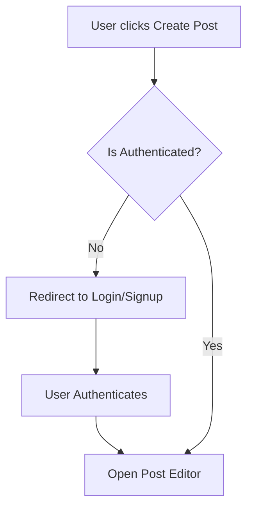

# Table of Contents

1. [A - How to add Table of Contents](#a---how-to-add-table-of-contents)
	1. [1. Requirements](#1-requirements)
		1. [1.1. How to export to PDF](#11-how-to-export-to-pdf)
2. [B - Export to PDF](#b---export-to-pdf)
	1. [1. Requirements](#1-requirements)
		1. [1.1 How to export to PDF](#11-how-to-export-to-pdf)
3. [C - Diagram example](#c---diagram-example)
	1. [1. Diagram rules](#1-diagram-rules)
4. [D - Image example](#d---image-example)
	1. [1. Insert image rule](#1-insert-image-rule)

# A - How to add Table of Contents

*Work performed by: [Name] | Reviewed by: [Name] | Edited by: [Name]*

## 1. Requirements

Install Obsidian

Install Plugin "Table of Contents"

Plugin settings -> enable "Markdown links"

### 1.1. How to export to PDF

==Delete all Table of Contents (Including title) -> CTRL P -> TABLE OF CONTENTS==

# B - Export to PDF

*Work performed by: [Name] | Reviewed by: [Name] | Edited by: [Name]*

## 1. Requirements

Install Obsidian

Install Plugin **"Better export PDF"**

Use default format

### 1.1 How to export to PDF

==CTRL P -> Better export PDF: Export current file to PDF==

# C - Diagram example

*Work performed by: [Name] | Reviewed by: [Name] | Edited by: [Name]*

## 1. Diagram rules

Diagram must be drawn using Mermaid.

Example as below:

**Workflow 1: User Authentication & Post Creation**

# D - Image example

*Work performed by: [Name] | Reviewed by: [Name] | Edited by: [Name]*

## 1. Insert image rule

Insert as markdown format ``

Example as below:

# E - Implement 2 Functional Groups using Spec Kit

*Work performed by: Võ An Phú | Reviewed by: Nguyễn Tuấn An | Edited by: Nguyễn Tuấn An*

The demo can be found at: `youtube-link.txt` or `https://youtu.be/ETm_nWagoRE?si=to6VentWdVtbCzoN`

# F - AI Usage Report and Weekly Report

*Work performed by: Nguyễn Tuấn An | Reviewed by: Phạm Đinh Gia Khánh | Edited by: Phạm Đinh Gia Khánh*

## AI Usage Report

### Declaration of No AI Use

We declare that no AI tools were used in peer review tasks.

### AI Usage Notes

AI Usage Report of each member can be found in folder: `ai-logs/`

### Weekly Report

#### Sprint Planning

=========== 25/7, Sprint 4 planning ===============

Team members present:

- Nguyễn Tuấn An
- Nguyễn Hải Nam
- Nguyễn Hải Trọng
- Phạm Đinh Gia Khánh
- Võ An Phú

Team members absent: None

Reports:

- Nguyễn Tuấn An:
  - List all possible tasks for PA4 and for project development process, getting ideas from the team members to make sure all tasks are covered.
  - Estimate time for each task and assign them to team members.

Actions:

- All team members agreed to the tasks and their assignments.

Summary of the meeting:

- The team has finalized the list of tasks for the sprint, including both PA4 and project development process tasks. All team members have agreed on their assignments and estimated time for each task.

#### Scrum Meetings

=========== 2/8, Scrum 1 ===============

Nguyễn Tuấn An

1. Fix ai usage log skill, fix post creation function, implement post summarize function, fix UI in home + comment sections, deploy app to website, add image compression, add multiple images scrolling effect 
2. Write report D, plan for PA5
3. None

Nguyễn Hải Nam

1. Write and Draw Software Architecture: Container Diagram and Component Diagram, Implement Admin view, Review Software Architecture: System Context Diagram
2. Integration and System test
3. None

Nguyễn Hải Trọng

1. Write and Draw Software Architecture:  System Context Diagram
2. Review report D and write report A
3. None

Phạm Đinh Gia Khánh

1. Design Admin UI, implement Moderator view
2. Review report A
3. None

Võ An Phú

1. Implemented for you feed, fixed create post pro5 picture out of sync, fix picture not showing in /foryou
2. Write report and make video for E, review C report
3. None

=========== 8/8, Scrum 2 ===============

Nguyễn Tuấn An

1. Integrate cloud for storing image; fix cloud problems; design draft logo; polish TLDR, home icon, menu box; design and add favicon; fix for you button on guest; add guide when hovering navbar; add client side process for fast Like response; fix redirect when register, login; add click post to view detail, view full image, click profile picture to view profile; add read more button; fix comment UX; add sort comment; fix search use mock data; redesign login UI; implement login with Google
2. Plan for PA5, assign tasks to team members.
3. None

Nguyễn Hải Nam

1. What have I done since last week?
2. What will I do until next week?
3. What issues / problems /obstacles do I have?

Nguyễn Hải Trọng

1. What have I done since last week?
2. What will I do until next week?
3. What issues / problems /obstacles do I have?

Phạm Đinh Gia Khánh

1. What have I done since last week?
2. What will I do until next week?
3. What issues / problems /obstacles do I have?

Võ An Phú

1. What have I done since last week?
2. What will I do until next week?
3. What issues / problems /obstacles do I have?

#### Sprint Review

=========== 8/8 Sprint Review ===============

Team members present:

- Nguyễn Tuấn An
- Nguyễn Hải Nam
- Nguyễn Hải Trọng
- Phạm Đinh Gia Khánh
- Võ An Phú

Team members absent: None

What went well: discover several potential vulnerabilities, revise project based on lecturers' feedbacks.

What went wrong: some tasks quality not good and need refinement.

What problems and what caused the problems: foundation of knowledge weak.

What can be done differently in the next sprint to improve: team members should learn more.

What lessons we could learn: the importance of learning and grinding.

### Jira Board

<insert board>