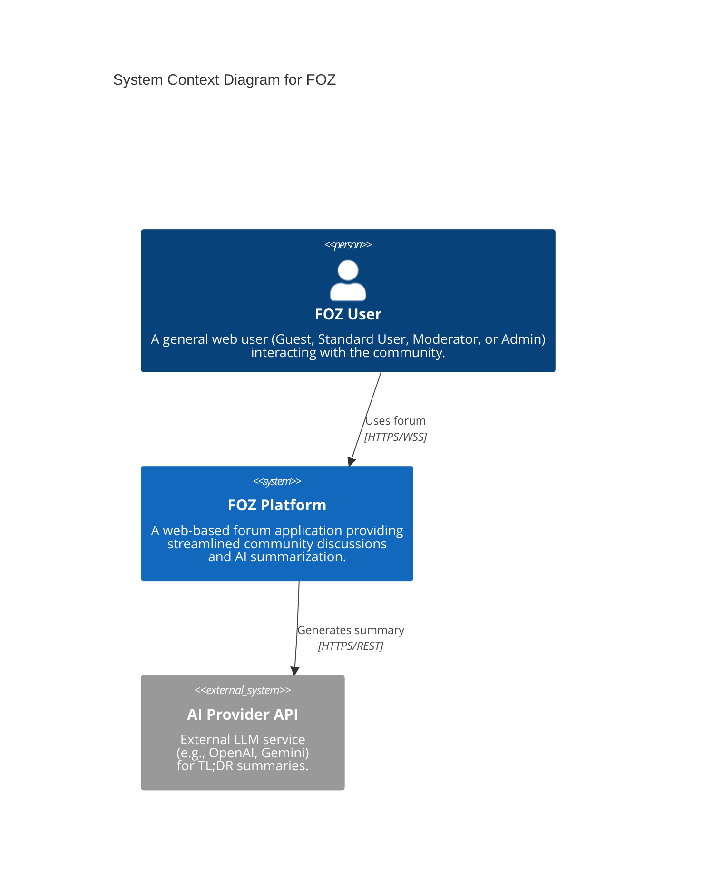
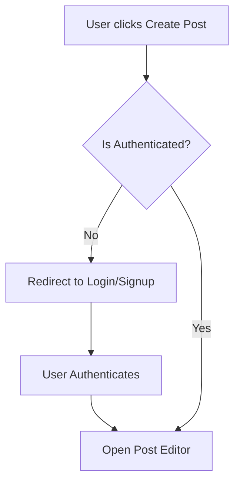

# Table of Contents

- [Table of Contents](#table-of-contents)
- [A - How to add Table of Contents](#a---how-to-add-table-of-contents)
	- [1. Requirements](#1-requirements)
		- [1.1. How to export to PDF](#11-how-to-export-to-pdf)
- [B - Software Architecture: System Context Diagram](#b---software-architecture-system-context-diagram)
	- [Tech Stack](#tech-stack)
		- [Frontend](#frontend)
		- [Backend](#backend)
		- [Database](#database)
		- [External APIs / Services](#external-apis--services)
	- [C4 Model - Level 1 (System Context Diagram)](#c4-model---level-1-system-context-diagram)
		- [Diagram Explanation](#diagram-explanation)
- [C - Diagram example](#c---diagram-example)
	- [1. Diagram rules](#1-diagram-rules)
- [D - Image example](#d---image-example)
	- [1. Insert image rule](#1-insert-image-rule)

# A - How to add Table of Contents

*Work performed by: [Name] | Reviewed by: [Name] | Edited by: [Name]*

## 1. Requirements

Install Obsidian

Install Plugin "Table of Contents"

Plugin settings -> enable "Markdown links"

### 1.1. How to export to PDF

==Delete all Table of Contents (Including title) -> CTRL P -> TABLE OF CONTENTS==

# B - Software Architecture: System Context Diagram

*Work performed by: Nguyễn Hải Trọng | Reviewed by: Nguyễn Hải Nam*

## Tech Stack

The FOZ project uses the following technologies across its stack:

### Frontend
- **Framework & Language**: React 18 with TypeScript 5 for building a robust and type-safe UI.
- **Build Tool**: Vite 5 for fast, modern web development and bundling.
- **Styling**: Tailwind CSS 3 (vanilla configuration without UI component libraries) for utility-first styling.
- **Routing**: `react-router-dom` v6 for client-side navigation.
- **State Management**: 
  - `@tanstack/react-query` v5 for server state (fetching, caching, and synchronizing data).
  - `zustand` v5 for lightweight client-side state management.
- **Forms & Validation**: `react-hook-form` coupled with Zod for robust client-side validation.
- **Realtime**: `socket.io-client` v4 for real-time features like live feed updates.
- **UI Notifications**: `react-hot-toast` for toast notifications.

### Backend
- **Runtime**: Node.js (current LTS) utilizing ES Modules (ESM).
- **Framework**: Express with hand-wired Zod validation middleware and a central error handler.
- **Database ORM**: Drizzle ORM (SQL-visible approach) along with `drizzle-kit` for managing schema migrations.
- **Realtime Server**: `socket.io` server attached to Express's HTTP server for realtime events.
- **Authentication**: 
  - JWT (JSON Web Tokens) for access control (15-minute access token in memory, 7-day refresh token stored in an HttpOnly, SameSite=Lax cookie).
  - `bcrypt` for secure password hashing.
- **Validation**: Zod used strictly at inbound trust boundaries (request bodies, query params).

### Database
- **Database Engine**: PostgreSQL 16 running locally via Docker (`docker-compose.yml`) for robust, relational data persistence.

### External APIs / Services
- **AI / LLM Provider**: Integration with external AI APIs (e.g., OpenAI API, Gemini API) strictly for the "Post Summarize (TL;DR)" feature, utilizing a direct `fetch`-based provider fallback loop.

## C4 Model - Level 1 (System Context Diagram)

### Diagram Explanation

- **FOZ User (Actor)**: Represents all users interacting with the application. Depending on their role (Guest, Standard User, Moderator, Admin), they can view content, participate in discussions, manage profiles, report inappropriate content, or administrate the platform. Users interact with the FOZ Platform via a modern web browser over secure HTTPS and WebSocket (WSS) connections.
- **FOZ Platform (System)**: The core software system being built. It encompasses the frontend React application, the Node.js/Express backend API, and the PostgreSQL database. It handles user authentication, content management (posts, comments, attachments), realtime feed updates, and interactions (likes, reports).
- **AI Provider API (External System)**: An external third-party service (such as OpenAI or Google Gemini). The FOZ Platform securely communicates with this API over HTTPS/REST to send post and top-comment text payloads in order to receive concise, AI-generated summaries for the "Post Summarize (TL;DR)" feature. It sits completely outside the internal control of the system but is a critical dependency for this specific feature.

# C - Diagram example

*Work performed by: [Name] | Reviewed by: [Name] | Edited by: [Name]*

## 1. Diagram rules

Diagram must be drawn using Mermaid.

Example as below:

**Workflow 1: User Authentication & Post Creation**

# D - Image example

*Work performed by: [Name] | Reviewed by: [Name] | Edited by: [Name]*

## 1. Insert image rule

Insert as markdown format ``

Example as below:

