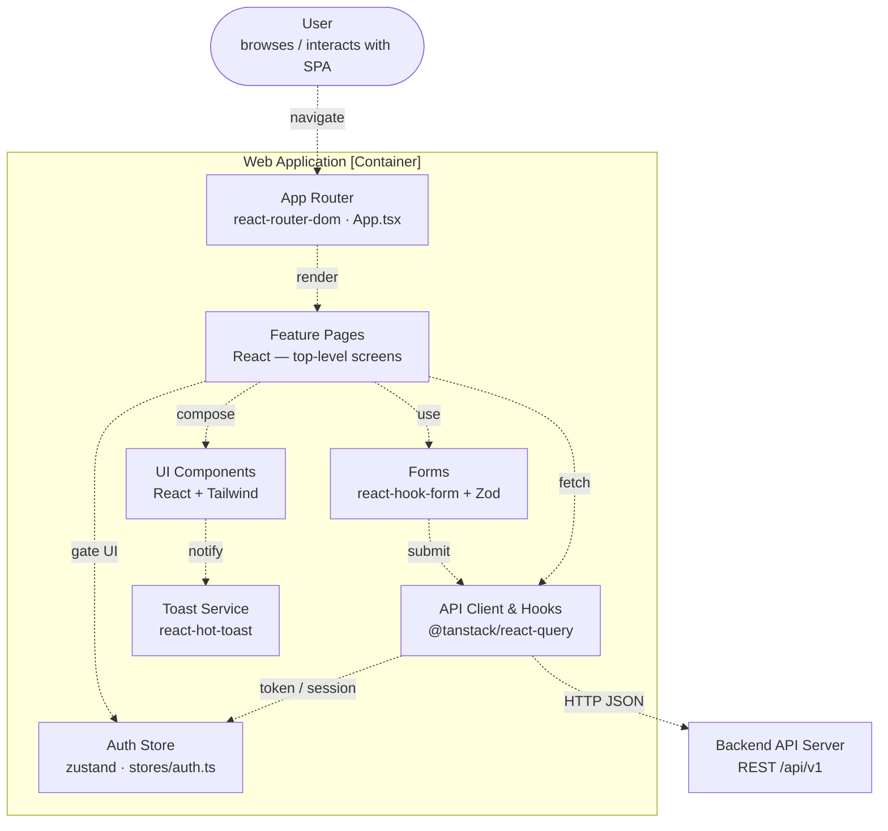
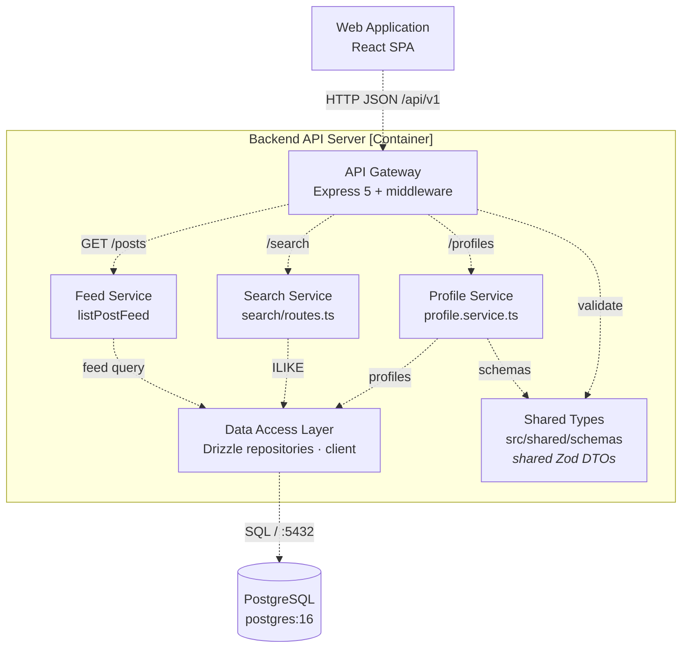
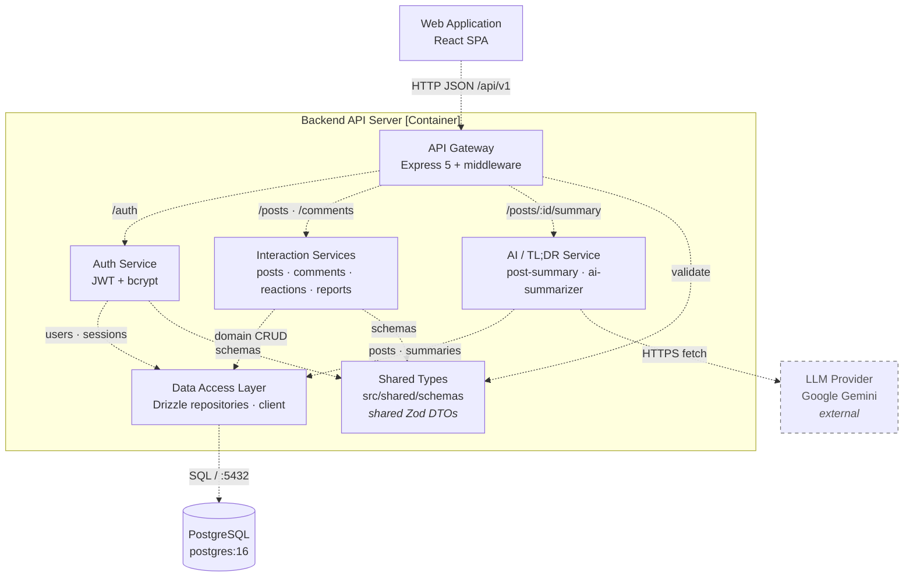

# Table of Contents

- [Table of Contents](#table-of-contents)
- [A - Revised Use-Case Specification](#a---revised-use-case-specification)
	 - [Use-Case Specification: Sign Up](#use-case-specification-sign-up)
   - [Use-Case Specification: Log In](#use-case-specification-log-in)
   - [Use-Case Specification: Log Out](#use-case-specification-log-out)
   - [Use-Case Specification: Manage Profile](#use-case-specification-manage-profile)
   - [Use-Case Specification: Change Password](#use-case-specification-change-password)
   - [Use-Case Specification: Change Avatar](#use-case-specification-change-avatar)
   - [Use-Case Specification: Browse Feed](#use-case-specification-browse-feed)
   - [Use-Case Specification: Search Content](#use-case-specification-search-content)
   - [Use-Case Specification: View Post Details](#use-case-specification-view-post-details)
   - [Use-Case Specification: Create Post](#use-case-specification-create-post)
   - [Use-Case Specification: Interact with Post](#use-case-specification-interact-with-post)
   - [Use-Case Specification: Leave Comment](#use-case-specification-leave-comment)
   - [Use-Case Specification: Like/Unlike](#use-case-specification-likeunlike)
   - [Use-Case Specification: Request AI Summary](#use-case-specification-request-ai-summary)
   - [Use-Case Specification: Delete Own Post](#use-case-specification-delete-own-post)
   - [Use-Case Specification: Report Inappropriate Content](#use-case-specification-report-inappropriate-content)
   - [Use-Case Specification: Review Reports](#use-case-specification-review-reports)
   - [Use-Case Specification: Forward Report to Admin](#use-case-specification-forward-report-to-admin)
   - [Use-Case Specification: Delete Any Content](#use-case-specification-delete-any-content)
   - [Use-Case Specification: Permanently Remove User](#use-case-specification-permanently-remove-user)
   - [Use-Case Specification: Assign Moderator Role](#use-case-specification-assign-moderator-role)
- [B - Software Architecture: System Context Diagram](#b---software-architecture-system-context-diagram)
  - [Tech Stack](#tech-stack)
    - [Frontend](#frontend)
    - [Backend](#backend)
    - [Database](#database)
    - [External APIs / Services](#external-apis--services)
  - [C4 Model - Level 1 (System Context Diagram)](#c4-model---level-1-system-context-diagram)
    - [Diagram Explanation](#diagram-explanation)
- [C - Software Architecture: Container Diagram and Component Diagram](#c---software-architecture-container-diagram-and-component-diagram)
  - [1. C4 Model - Level 2 (Container Diagram)](#1-c4-model---level-2-container-diagram)
    - [1.1 Diagram](#11-diagram)
    - [1.2 Descriptions](#12-descriptions)
    - [1.3 Relationships Summary](#13-relationships-summary)
  - [2. C4 Model - Level 3 (Component Diagram)](#2-c4-model---level-3-component-diagram)
    - [2.1 Frontend - Web Application Container](#21-frontend---web-application-container)
      - [2.1.1 Diagram](#211-diagram)
      - [2.1.2 Component Descriptions](#212-component-descriptions)
    - [2.2 Backend - Backend API Server Container](#22-backend---backend-api-server-container)
      - [2.2.1 Diagram A — Content & Discovery](#221-diagram-a--content--discovery-feed--search--profile)
      - [2.2.2 Diagram B — Identity & Interaction](#222-diagram-b--identity--interaction-auth--interaction--ai-tldr)
      - [2.2.3 Component Descriptions](#223-component-descriptions)
- [D - Image example](#d---image-example)
  - [1. Insert image rule](#1-insert-image-rule)

# A - Revised Use-Case Specification
*Performed by: Nguyễn Hải Trọng | Reviewed by: Phạm Đinh Gia Khánh*

## Revision History

| Date | Version | Description | Author |
| :--- | :--- | :--- | :--- |
| 19/Jul/2026 | 1.0 | Initial draft: Documented all 21 Use-Case Specifications covering Auth, Core Interactions, and Moderation. | Nguyễn Hải Trọng |
| 06/Aug/2026 | 1.1 | Update the Alternative Flow and Reordered sections for clarity | Nguyễn Hải Trọng |

# Use-Case Specification: Sign Up
*Performed by: Nguyễn Hải Trọng | Reviewed by: Nguyễn Tuấn An | Edited by: Nguyễn Hải Trọng* 
**Project Name:** FOZ  
**Version:** 1.1  
**Document identifier:** FOZ-UCS-01

## 1. Sign Up
* **Use-Case ID:** UC-01
* **Actor(s):** Guest

### 1.1 Brief Description
This use case allows an unauthenticated guest to create a new user account and profile on the FOZ platform using their email and a secure password.

## 2. Preconditions
* The user must be a Guest (unauthenticated).

## 3. Flow of Events
### 3.1 Basic Flow
1. The use case begins when the Guest navigates to the Registration page.
2. The user enters a valid email address, a unique username, and a strong password.
3. The user clicks "Create account".
4. The system validates the inputs (email format, password length > 8 chars).
5. The system checks if the email is already registered.
6. The system securely hashes the password using bcrypt.
7. The system creates a new record in the `user_accounts` table (role: `standard`, status: `active`) and a default record in the `profiles` table.
8. The system issues an access token and a refresh token (saved in `refresh_sessions`).
9. The system redirects the user to the Home Feed.

### 3.2 Alternative Flows

#### 3.2.1 Email Already Exists
1. If at step 5, the email exists in the database.
2. The system aborts the registration.
3. The system displays a generic error: "An account with this email already exists".
4. The flow resumes at step 2.

#### 3.2.2 Weak Password
1. If at step 4, the password is less than 8 characters.
2. The system highlights the field with "Password must be at least 8 characters".
3. The flow resumes at step 2.

#### 3.2.3 Password Too Long
1. If at step 4, the password exceeds 128 characters.
2. The system aborts and displays "Password is too long".
3. The flow resumes at step 2.

#### 3.2.4 Rate Limit Exceeded
1. If the user makes more than 100 registration attempts within 15 minutes.
2. The system rejects the request and displays "Too many requests, slow down."
3. The use case ends.

#### 3.2.5 Confirm Password Does Not Match
1. If at step 4, the confirmation password does not match the entered password.
2. The system highlights the confirmation field and displays "Passwords do not match".
3. The flow resumes at step 2.

#### 3.2.6 Username Already Taken
1. If at step 5, the chosen username exists in the database.
2. The system aborts the registration and displays "This username is already taken".
3. The flow resumes at step 2.

#### 3.2.7 Sign Up with Google Account
1. If at step 2, the user chooses to "Continue with Google".
2. The system redirects the user to the Google OAuth consent screen.
3. The user successfully authenticates with Google.
4. The system automatically provisions a `user_accounts` and `profiles` record using the Google profile data, deriving a unique username from their email prefix.
5. The system issues access and refresh tokens, bypassing standard registration validation.
6. The flow resumes at step 8.

#### 3.2.8 Google Sign Up Username Collision
1. If at step 4 of the Google Sign Up flow, the derived base username is already taken by another user or is a reserved keyword.
2. The system automatically generates a unique username by appending a numeric counter to the base name.
3. The system proceeds to provision the account with the newly generated username.

## 4. Special Requirements
* **Security:** Passwords must be hashed via bcrypt with a minimum cost of 12. Plaintext passwords must never be logged.

## 5. Postconditions
* A new user account and profile are saved in the database. The user is signed in.

## 6. Extension Points
* None.

## 7. Prototype Requirement
* **Screen 1 (Basic Flow):**
    
* **Screen 2 (Alt Flow - Email Already Exists):**
    
* **Screen 3 (Alt Flow - Weak Password):**
    
* **Screen 4 (Alt Flow - Password Too Long):**
    
* **Screen 5 (Alt Flow - Rate Limit Exceeded):**
    
* **Screen 6 (Alt Flow - Confirm Password Does Not Match):**
    
* **Screen 7 (Alt Flow - Username Already Taken):**
    
* **Screen 8 (Alt Flow - Sign Up with Google Account):**
    
* **Screen 9 (Alt Flow - Google Sign Up Username Collision):**
    
    This is the email to test the alternative flow.
    
    The website already has an username that matches the Google account .
    
    The system automatically generates a unique username by appending number "1" to the base name.

# Use-Case Specification: Log In
*Performed by: Nguyễn Hải Trọng | Reviewed by: Nguyễn Tuấn An | Edited by: Nguyễn Hải Trọng* 
**Project Name:** FOZ  
**Version:** 1.1  
**Document identifier:** FOZ-UCS-02

## 1. Log In
* **Use-Case ID:** UC-02
* **Actor(s):** Guest

### 1.1 Brief Description
This use case describes how a registered Guest accesses their account by providing valid credentials.

## 2. Preconditions
* The user is unauthenticated.

## 3. Flow of Events
### 3.1 Basic Flow
1. The use case begins when the Guest navigates to the Login page.
2. The user enters their email and password, then clicks "Sign In".
3. The system finds the user in `user_accounts` and verifies the password hash.
4. The system checks if the account status is `active`.
5. The system issues an Access Token and sets a Refresh Token cookie.
6. The system redirects the user to the Home Feed.

### 3.2 Alternative Flows

#### 3.2.1 Invalid Credentials
1. If at step 3, the email is not found or the password does not match.
2. The system displays: "Invalid email or password".
3. The flow resumes at step 2.

#### 3.2.2 Account Suspended
1. If at step 4, the account status is `suspended` or `banned`.
2. The system displays: "Your account is not currently available."
3. The use case ends.

#### 3.2.3 Rate Limit Exceeded
1. If the user makes more than 100 login attempts within 15 minutes.
2. The system rejects the request and displays "Too many requests, slow down."
3. The use case ends.

#### 3.2.4 Sign In with Google Account
1. If at step 2, the user chooses to "Sign in with Google".
2. The system redirects the user to the Google OAuth consent screen.
3. The user successfully authenticates with Google.
4. The system checks the database for an existing Google social link or matching email.
5. The system verifies the account is active, issues an Access Token, and sets a Refresh Token cookie.
6. The flow resumes at step 6.

#### 3.2.5 Log In with Non-Existent Google Account
1. If at step 4 of the Google Sign In flow, the system finds no existing user account associated with the Google profile or email.
2. The system automatically provisions a new user account on the fly (including auto-generating a unique username) instead of rejecting the login.
3. The login attempt is seamlessly converted into a successful registration.
4. The flow resumes at step 5 of the Google Sign In flow.

## 4. Special Requirements
* **Rate Limiting:** Maximum 100 attempts per 15 minutes to prevent brute-force attacks.

## 5. Postconditions
* The user is authenticated and an active session is recorded in `refresh_sessions`.

## 6. Extension Points
* None.

## 7. Prototype Requirement
* **Screen 1 (Basic Flow):**
    
* **Screen 2 (Alt Flow - Invalid Credentials):**
    
* **Screen 3 (Alt Flow - Account Suspended):**
    
* **Screen 4 (Alt Flow - Rate Limit Exceeded):**
    
* **Screen 5 (Alt Flow - Sign In with Google Account):**
    
* **Screen 6 (Alt Flow - Log In with Non-Existent Google Account):**
    
    This email hasn't been logged in to the website.
    
    After login, the system automatically creates a new user account.

# Use-Case Specification: Log Out
*Performed by: Nguyễn Hải Trọng | Reviewed by: Nguyễn Tuấn An | Edited by: Nguyễn Hải Trọng* 
**Project Name:** FOZ  
**Version:** 1.0  
**Document identifier:** FOZ-UCS-03

## 1. Log Out
* **Use-Case ID:** UC-03
* **Actor(s):** Standard User

### 1.1 Brief Description
Allows an authenticated user to securely end their active session on the current device.

## 2. Preconditions
* The user must be authenticated.

## 3. Flow of Events
### 3.1 Basic Flow
1. The use case begins when the user clicks the "Sign out" button.
2. The system reads the refresh cookie to identify the current session.
3. The system updates the `revoked_at` timestamp in the `refresh_sessions` table for that session.
4. The system clears the local access token and the refresh cookie from the browser.
5. The system redirects the user to the Login page.

### 3.2 Alternative Flows

#### 3.2.1 Session Already Expired
1. If at step 2, the session token is already expired or invalid.
2. The system proceeds to step 4 without database updates.

#### 3.2.2 User Cancels Log Out
1. If the system prompts for confirmation and the user selects "Cancel".
2. The system closes the dialog and no action is taken.
3. The use case ends.

## 4. Special Requirements
* None.

## 5. Postconditions
* The user is signed out and redirected to a public page.

## 6. Extension Points
* None.

## 7. Prototype Requirement
* **Screen 1 (Basic Flow):** 
  
* **Screen 2 (Alt Flow - User Cancels Log Out):**
  

# Use-Case Specification: Manage Profile
*Performed by: Nguyễn Hải Trọng | Reviewed by: Nguyễn Tuấn An | Edited by: Nguyễn Hải Trọng*
**Project Name:** FOZ  
**Version:** 1.1  
**Document identifier:** FOZ-UCS-04

## 1. Manage Profile
* **Use-Case ID:** UC-04
* **Actor(s):** Standard User

### 1.1 Brief Description
Allows the user to update their public-facing information such as display name, bio, location, and website.

## 2. Preconditions
* The user is authenticated.

## 3. Flow of Events
### 3.1 Basic Flow
1. The use case begins when the user navigates to "Edit Profile".
2. The system retrieves current data from the `profiles` table.
3. The user edits text fields (Display Name, Bio, Location, Website) and clicks "Save".
4. The system validates the inputs (e.g., URL format for website).
5. The system updates the `profiles` table and the `updated_at` timestamp.
6. The system displays a success message.

### 3.2 Alternative Flows

#### 3.2.1 Invalid Input Format
1. If at step 4, the website URL is invalid.
2. The system displays an error below the website field.
3. The flow resumes at step 3.

#### 3.2.2 Validation Errors
1. If at step 4, inputs exceed max lengths (Display Name: 50, Bio: 160, Location: 100, Website: 200 characters) or Display Name contains invalid characters.
2. The system displays specific field validation errors.
3. The flow resumes at step 3.

#### 3.2.3 User Cancels
1. If at step 3, the user clicks "Cancel" instead of "Save".
2. The system discards any unsaved changes and returns to the profile view.
3. The use case ends.

## 4. Special Requirements
* None.

## 5. Postconditions
* Profile data is updated in the database.

## 6. Extension Points
* **Change Password:** Extended via UC-05.
* **Change Avatar:** Extended via UC-06.

## 7. Prototype Requirement
* **Screen 1 (Basic Flow):**
  
* **Screen 2 (Alt Flow - Invalid Input Format):**
  
* **Screen 3 (Alt Flow - Validation Errors):**
  

# Use-Case Specification: Change Password
*Performed by: Nguyễn Hải Trọng | Reviewed by: Nguyễn Tuấn An | Edited by: Nguyễn Hải Trọng*
**Project Name:** FOZ  
**Version:** 1.1  
**Document identifier:** FOZ-UCS-05

## 1. Change Password
* **Use-Case ID:** UC-05
* **Actor(s):** Standard User

### 1.1 Brief Description
Allows an authenticated user to change their password securely by verifying their current password.

## 2. Preconditions
* The user is authenticated.

## 3. Flow of Events
### 3.1 Basic Flow
1. The use case extends UC-04 when the user selects "Change password".
2. The user enters their current password, a new password, and confirms the new password.
3. The user clicks "Update password".
4. The system verifies the current password against the stored `password_hash`.
5. The system validates the new password strength.
6. The system hashes the new password and updates `user_accounts`.
7. The system displays a success toast message and redirects to home.

### 3.2 Alternative Flows

#### 3.2.1 Incorrect Current Password
1. If at step 4, the current password does not match.
2. The system displays "Invalid credentials".
3. The flow resumes at step 2.

#### 3.2.2 New Password Matches Old Password
1. If at step 4, the new password is exactly the same as the current password.
2. The system rejects the request and displays "New password must differ from the current one".
3. The flow resumes at step 2.

#### 3.2.3 Confirm Password Does Not Match
1. If at step 5, the confirmation password does not match the new password.
2. The system highlights the confirmation field and displays "Passwords do not match".
3. The flow resumes at step 2.

#### 3.2.4 Weak New Password
1. If at step 5, the new password is less than 8 characters.
2. The system rejects the request and displays "Password must be at least 8 characters".
3. The flow resumes at step 2.

#### 3.2.5 User Cancels
1. If at step 2, the user clicks "Back" instead of "Update password".
2. The system discards the input and returns to the Homepage screen.
3. The use case ends.

## 4. Special Requirements
* **Security:** The new password must not be identical to the old password.

## 5. Postconditions
* The user's password hash is updated.

## 6. Extension Points
* None.

## 7. Prototype Requirement
* **Screen 1 (Basic Flow):** 
  
  **Change Password will be in Settings**
* **Screen 2 (Alt Flow - Incorrect Current Password):**
  
* **Screen 3 (Alt Flow - New Password Matches Old Password):**
  
* **Screen 4 (Alt Flow - Confirm Password Does Not Match):**
  
* **Screen 5 (Alt Flow - Weak New Password):**
  

# Use-Case Specification: Change Avatar
*Performed by: Nguyễn Hải Trọng | Reviewed by: Nguyễn Tuấn An | Edited by: Nguyễn Hải Trọng*
**Project Name:** FOZ  
**Version:** 1.1  
**Document identifier:** FOZ-UCS-06

## 1. Change Avatar
* **Use-Case ID:** UC-06
* **Actor(s):** Standard User

### 1.1 Brief Description
Allows an authenticated user to upload a new profile picture.

## 2. Preconditions
* The user is authenticated.

## 3. Flow of Events
### 3.1 Basic Flow
1. The use case extends UC-04 when the user clicks the "Upload picture" icon.
2. The user selects an image file from their device.
3. The system validates the file type and size.
4. The system uploads the file to storage and retrieves the image URL.
5. The system updates the `avatar_url` in the `profiles` table.
6. The system refreshes the avatar display on the UI.

### 3.2 Alternative Flows

#### 3.2.1 File Too Large
1. If at step 3, the file exceeds the 25MB raw upload limit.
2. The system aborts the upload and displays "Image file exceeds maximum raw size limit of 25MB."
3. The flow resumes at step 1.

#### 3.2.2 User Cancels
1. If at step 2, the user closes the file picker without selecting an image.
2. The system aborts the upload process.
3. The use case ends.

#### 3.2.3 Wrong File Type
1. If at step 3, the file uploaded is not a supported image format (e.g., PDF, DOCX).
2. The system aborts the upload and displays "Invalid file format. Please upload an image."
3. The flow resumes at step 1.

## 4. Special Requirements
* **Space:** Raw images are compressed heavily on the client and server to conserve server storage.

## 5. Postconditions
* The new avatar is visible publicly on the user's profile.

## 6. Extension Points
* None.

## 7. Prototype Requirement
* **Screen 1 (Basic Flow):** 
  
* **Screen 2 (Alt Flow - File Too Large):**
  
  
* **Screen 3 (Alt Flow - Wrong File Type):**
  
  

# Use-Case Specification: Browse Feed

**Project Name:** FOZ  
**Version:** 1.0  
**Document identifier:** FOZ-UCS-07

## 1. Browse Feed
* **Use-Case ID:** UC-07
* **Actor(s):** Guest, Standard User

### 1.1 Brief Description
Allows users to view a dynamic timeline of forum posts sorted by recent engagement metrics or chronological order.

## 2. Preconditions
* None.

## 3. Flow of Events
### 3.1 Basic Flow
1. The use case begins when the user navigates to the application's homepage, which presents the feed tabs "For You" (default) and "Latest".
2. The system queries the `posts` table for content with `visibility_state = 'public'` and `deleted_at IS NULL`, unwrapping reposts so the original post content is shown.
3. The system orders the posts according to the selected feed mode:
   * **For You:** personalized ranking based on viewer affinity, engagement, and recency; guests and viewers with no interaction history receive a popularity-ranked feed.
   * **Latest:** sorted by posting time, with the newest first.
4. The system displays the feed with post content, author avatars, and interaction counts (likes, comments, reposts).
5. The user scrolls to load more posts (cursor-based pagination).

### 3.2 Alternative Flows

#### 3.2.1 Switch feed mode
1. The user switches between the "For You" and "Latest" feed tabs.
2. The system reloads and displays the posts according to the newly selected mode.

#### 3.2.2 No Posts Available
1. If at step 2, the database returns no posts.
2. The system displays a "No discussions found. Be the first to post!" placeholder.
3. The use case ends.

## 4. Special Requirements
* **Performance:** The initial feed must load in `< 2 seconds` under good network conditions.

## 5. Postconditions
* None.

## 6. Extension Points
* None.

## 7. Prototype Requirement
* **Screen 1 (Basic Flow):** 
  

  **Screen 2 (Alternative Flow 1):**
  
  
  **Screen 3 (Alternative Flow 3):**
  

# Use-Case Specification: Search Content

**Project Name:** FOZ  
**Version:** 1.0  
**Document identifier:** FOZ-UCS-08

## 1. Search Content
* **Use-Case ID:** UC-08
* **Actor(s):** Guest, Standard User

### 1.1 Brief Description
Allows users to search for specific discussion topics, posts, or user profiles using keywords.

## 2. Preconditions
* None.

## 3. Flow of Events
### 3.1 Basic Flow
1. The use case begins when the user enters a keyword into the search bar and presses Enter.
2. The system sends the query to the backend.
3. The backend searches the `posts` (body/title) and `profiles` (display_name) tables for matches.
4. The system filters out content that is deleted, hidden, or authored by banned users.
5. The system displays a categorized list of results (Posts, Users).

### 3.2 Alternative Flows

#### 3.2.1. **Search feature unavailable**

1. If at step 2, the search query is empty or just whitespace.
2. The system does not display the search button until valid index is entered

#### 3.2.2. **No matching results**

1. The user enters a search query.
2. The system finds no matching content.
3. The system displays **"No results for search query."**

## 4. Special Requirements
* **Performance:** Search results should be displayed within 2–3 seconds under good network conditions. `.

## 5. Postconditions
* None.

## 6. Extension Points
* None.

## 7. Prototype Requirement
* **Screen 1 (Basic Flow):** 
  

 **Screen 2 (Alternative Flow 1):**
  

  **Screen 3 (Alternative Flow 2):**
  

# Use-Case Specification: View Post Details

**Project Name:** FOZ  
**Version:** 1.1  
**Document identifier:** FOZ-UCS-09

## 1. View Post Details
* **Use-Case ID:** UC-09
* **Actor(s):** Guest, Standard User

### 1.1 Brief Description
Allows a user to read the full body of a post along with its entire nested comment thread.

## 2. Preconditions
* The post ID must be valid.

## 3. Flow of Events
### 3.1 Basic Flow
1. The use case begins when the user clicks on a post from the feed or search results.
2. The system queries the `posts` and `comments` tables matching the Post ID.
3. The system formats the comment tree hierarchically.
4. The system displays the full post content, author details, and comments.

### 3.2 Alternative Flows

#### 3.2.1 No comments

1. The post has no comments.
2. The system displays **"No comments yet. Be the first to reply!"**

#### 3.2.2 Post Not Found
1. If at step 2, the requested Post ID does not exist in the database, or the post's lifecycle_state is removed_by_moderation.
2. The system displays a 404 Not Found error page.
3. The use case ends.

## 4. Special Requirements
* None.

## 5. Postconditions
* None.

## 6. Extension Points
* **Request AI Summary:** Extended via UC-14.

## 7. Prototype Requirement
* **Screen 1 (Basic Flow):** 
  
* **Screen 2 (Alternative Flow 1):**
*   

 * **Screen 2 (Alternative Flow 2):**
*    

  
# Use-Case Specification: Create Post

**Project Name:** FOZ  
**Version:** 1.1  
**Document identifier:** FOZ-UCS-10

## 1. Create Post
* **Use-Case ID:** UC-10
* **Actor(s):** Standard User

### 1.1 Brief Description
Allows an authenticated user to publish a new text-based post to initiate a discussion.

## 2. Preconditions
* The user is authenticated and their account status is `active`.

## 3. Flow of Events
### 3.1 Basic Flow
1. The use case begins when the user clicks "Create Post".
2. The system displays an editor.
3. The user types the content and clicks "Submit".
4. The system validates the input lengths.
5. The system saves the record in the `posts` table (lifecycle_state: `active`).
6. The system redirects to the new post's detail page.

### 3.2 Alternative Flows

#### 3.2.1. **Post creation canceled**

1. The user cancels the post creation.
2. The system discards the draft and returns to the previous screen.

#### 3.2.2 Content Validation Error
1. If at step 4, the post body is empty.
2. The system disallows user to click submit button.
3. The flow resumes at step 3.

#### 3.2.3 Exceeds Limits
1. If at step 4, the post body exceeds 5,000 characters, or there are more than 5 media attachments, or the chained thread exceeds 10 posts.
2. The system aborts and displays a validation error message.
3. The flow resumes at step 3.

## 4. Special Requirements
* **Security:** Inputs must be sanitized against XSS.

## 5. Postconditions
* A new record exists in the `posts` table.

## 6. Extension Points
* None.

## 7. Prototype Requirement
* **Screen 1 (Basic Flow):** 
  
  * **Screen 2 (Alternative Flow 2):** 
  
  * **Screen 2 (Alternative Flow 3):** 
  

# Use-Case Specification: Interact with Post

**Project Name:** FOZ  
**Version:** 1.0  
**Document identifier:** FOZ-UCS-11

## 1. Interact with Post
* **Use-Case ID:** UC-11
* **Actor(s):** Standard User

### 1.1 Brief Description
Acts as the generalized use case for users engaging with a post via various actions.

## 2. Preconditions
* The user is authenticated. Post is active.

## 3. Flow of Events
### 3.1 Basic Flow
1. The use case begins when an authenticated user opens a post.
2. The system presents interaction buttons (Like, Reply, Report, Repost).
3. The user selects an interaction option.
4. The system triggers the specific extended workflow.

### 3.2 Alternative Flows

#### 3.2.1. The user selects **Reply**.

   * The use case is extended by **UC-12: Leave Comment**.

#### 3.2.2. The user selects **Like**.

   * The use case is extended by **UC-13: Like/Unlike**.

#### 3.2.3. The user selects **Report**.

   * The use case is extended by **UC-16: Report Inappropriate Content**.

## 4. Special Requirements
* None.

## 5. Postconditions
* None.

## 6. Extension Points
* **Leave Comment:** Extended via UC-12.
* **Like/Unlike:** Extended via UC-13.

## 7. Prototype Requirement
* **Screen 1 (Basic Flow):** 
  

## Use-Case Specification: Leave Comment

**Project Name:** FOZ  
**Version:** 1.0  
**Document identifier:** FOZ-UCS-12

### 1. Leave Comment
* **Use-Case ID:** UC-12
* **Actor(s):** Standard User

#### 1.1 Brief Description
Allows an authenticated user to reply to a post or to another comment.

### 2. Flow of Events

#### 2.1 Basic Flow
1. Extends UC-11 when the user clicks "Reply".
2. The system opens a small text input field.
3. The user types their comment and clicks "Post Reply".
4. The system validates the text.
5. The system inserts a record into the `comments` table, mapping `post_id` and optionally `parent_comment_id`.
6. The system updates the UI to show the new comment inline.

#### 2.2 Alternative Flows
##### 2.2.1 Empty Comment
1. If at step 4, the comment is empty or contains only whitespace.
2. The system disables the "Post Reply" button
3. The flow resumes at step 3.
##### 2.2.2 Comment Exceeds Maximum Length
1. If at step 4, the submitted comment content exceeds the 5,000-character limit.
2. The system rejects the submission and displays a validation error message ("Content is too long").
3. The user modifies the comment body to meet the character requirement.
4. The flow resumes at step 3.
##### 2.2.3 Long Comment Display
1. When displaying a comment that exceeds 240 characters or 4 lines of text.
2. The system automatically truncates the body text preview and appends a "Read more" toggle action.
3. The user clicks "Read more" to expand and view the full comment content.

### 3. Special Requirements
* None.

### 4. Preconditions
* User is authenticated.

### 5. Postconditions
* A new comment is persisted to the database.

### 6. Extension Points
* None.

### 7. Prototype Requirement 
* **Screen 1 (Basic Flow):** 
   

  **Screen 2 (Alternative Flow 2):**
   

    **Screen 3 (Alternative Flow 3):**
   

## Use-Case Specification: Like/Unlike

**Project Name:** FOZ  
**Version:** 1.0  
**Document identifier:** FOZ-UCS-13

### 1. Like/Unlike
* **Use-Case ID:** UC-13
* **Actor(s):** Standard User

#### 1.1 Brief Description
Allows a user to toggle an appreciation metric on a post or comment.

### 2. Flow of Events

#### 2.1 Basic Flow
1. Extends UC-11 when the user clicks the "Heart/Like" icon.
2. The system checks the `reactions` table to see if a record already exists for this `user_account_id` and `target_id`.
3. If no record exists, the system inserts a new reaction (`reaction_kind: 'like'`) and increments the counter visually.
4. If a record exists, the system deletes it (Unlike) and decrements the counter.

#### 2.2 Alternative Flows
##### 2.2.1 Target Post or Comment Deleted / Not Found

1. If at step 2, the target post or comment has been deleted or is no longer available.
2. The system rejects the reaction request with a "Not Found" error.
3. The interface reverts the optimistic UI state and notifies the user that the content is no longer available.
4. The use case ends.

### 3. Special Requirements
* **Performance:** 
  - **UI Response:** Reaction toggles update visually on the UI in **< 50ms** (Optimistic UI).
  - **API Latency:** Database synchronization via API completes within **<= 500ms** under normal network conditions.

### 4. Preconditions
* User is authenticated.

### 5. Postconditions
* The `reactions` table is updated.

### 6. Extension Points
* None.

### 7. Prototype Requirement 
* **Screen 1 (Basic Flow):** 
  
  * **Screen 2 (Alternative Flow):** 
  

# Use-Case Specification: Request AI Summary
*Reviewed and Edited by: Nguyen Hai Nam | Reviewed by: Vo An Phu*

**Project Name:** FOZ  
**Version:** 1.1  
**Document identifier:** FOZ-UCS-14

## 1. Request AI Summary
* **Use-Case ID:** UC-14
* **Actor(s):** Standard User

### 1.1 Brief Description
Allows an authenticated user to request an on-demand AI-generated TL;DR of a post and its comments.

## 2. Preconditions
* The user is authenticated and their account status is `active`.
* A valid post exists, is accessible to the user, and is not hidden or deleted.

## 3. Flow of Events
### 3.1 Basic Flow
1. Extends UC-09 when the authenticated user clicks "Generate TL;DR".
2. The system verifies that the post is still accessible and applies the per-user summary rate limit.
3. The system retrieves the post body and up to 10 active comments using a deduplicated 4:3:3 sample: four most liked, three most replied to by direct first-level replies, and three most recent. If fewer than 10 active comments exist, it retrieves all of them. Hidden, deleted, or moderated comments are excluded.
4. The system sends only the required post and comment text to the configured AI provider chain over HTTPS.
5. The AI provider returns a summary, and the system validates that the response contains usable summary text.
6. The system displays the generated summary in a modal.

### 3.2 Alternative Flows

#### 3.2.1 Post Not Found or No Longer Accessible
1. If at step 2 or step 3 the post has been deleted, hidden, or cannot be found.
2. The system displays: "This post is no longer available."
3. The use case ends.

#### 3.2.2 AI Provider Error
1. If at step 4 the primary AI provider times out, returns an error, or exceeds its quota.
2. The system attempts the configured fallback provider.
3. If every configured provider fails, the system displays: "AI Summary is currently unavailable."
4. The use case ends. If a fallback provider succeeds, the flow resumes at step 5.

#### 3.2.3 Invalid AI Response
1. If at step 5 the provider returns an empty, malformed, or unusable summary.
2. The system does not display the response and shows: "AI Summary is currently unavailable."
3. The use case ends.

#### 3.2.4 Rate Limit Exceeded
1. If at step 2 the user has already completed 10 summary requests in the rolling one-minute window.
2. The system rejects the request and displays: "Too many summary requests, please try again in a minute."
3. The use case ends.

## 4. Special Requirements
* **Authentication:** Only authenticated Standard Users may trigger an AI request; the API must enforce this requirement.
* **Performance:** The complete provider chain must return a usable summary within `< 5 seconds`.
* **Rate Limit:** Maximum 10 requests per authenticated user in a rolling one-minute window.
* **Security:** User-generated text must be sanitized before it is sent to the external provider, and account identifiers or unrelated personal data must not be included in the payload.
* **Persistence:** The summary is displayed for the current request and is not persistently cached in v1.

## 5. Postconditions
* On success, the generated summary is displayed to the user.
* On failure or rate limiting, no summary is displayed and the post remains unchanged.

## 6. Extension Points
* None.

## 7. Prototype Requirement
* **Screen 1 (Basic Flow):** 
  

* **Screen 2 (Alternative Flow 1):** 
  

* **Screen 3 (Alternative Flow 2):** 
  

# Use-Case Specification: Delete Own Post
*Reviewed and Edited by: Nguyen Hai Nam | Reviewed by: Vo An Phu*

**Project Name:** FOZ  
**Version:** 1.1  
**Document identifier:** FOZ-UCS-15

## 1. Delete Own Post
* **Use-Case ID:** UC-15
* **Actor(s):** Standard User

### 1.1 Brief Description
Allows an authenticated user to soft-delete a post they authored so that it is hidden from public view while its record is retained.

## 2. Preconditions
* The user is authenticated and their account status is `active`.
* The target post exists, is currently active, and the user is its `author_id`.

## 3. Flow of Events
### 3.1 Basic Flow
1. The use case begins when the user clicks the "Delete" option on their own active post.
2. The system displays a confirmation dialog identifying the post that will be hidden.
3. The user confirms the deletion.
4. The system atomically updates the post's `lifecycle_state` to `hidden` in the `posts` table.
5. The system removes the post from public feeds and search results, then redirects the user to the home feed.

### 3.2 Alternative Flows

#### 3.2.1 User Cancels Deletion
1. If at step 3 the user clicks "Cancel", closes the dialog, or presses Escape.
2. The dialog closes, no database changes are made, and the use case ends.

#### 3.2.2 Post Not Found or Forbidden
1. If at step 4 the post no longer exists, is already hidden, or the user is not its author.
2. The system makes no changes and displays: "This post cannot be deleted or you do not have permission to delete it."
3. The use case ends.

#### 3.2.3 Update Failure
1. If at step 4 the database update fails.
2. The system rolls back the operation and displays: "The post could not be deleted. Please try again."
3. The use case ends.

## 4. Special Requirements
* **Authorization:** Ownership must be checked at the API boundary as well as in the user interface.
* **Visibility:** Hidden posts must be excluded from public feeds, search results, and normal post-detail views.
* **Data Retention:** The post record, comments, reactions, and attachments are retained after this soft delete; this use case does not permanently purge them.

## 5. Postconditions
* The post's `lifecycle_state` is `hidden`.
* The post no longer appears in public feeds or search results.

## 6. Extension Points
* None.

## 7. Prototype Requirement
* **Screen 1 (Basic Flow):** 
  

* **Screen 2 (Alternative Flow 1):** 
  
  

* **Screen 3 (Alternative Flow 2):** 
  
  

# Use-Case Specification: Report Inappropriate Content
*Reviewed and Edited by: Nguyen Hai Nam | Reviewed by: Vo An Phu*

**Project Name:** FOZ  
**Version:** 1.1  
**Document identifier:** FOZ-UCS-16

## 1. Report Inappropriate Content
* **Use-Case ID:** UC-16
* **Actor(s):** Standard User

### 1.1 Brief Description
Allows an authenticated user to report an active post or comment that may violate the community guidelines.

## 2. Preconditions
* The user is authenticated and their account status is `active`.
* The target is an existing, active post or comment that can be reported.

## 3. Flow of Events
### 3.1 Basic Flow
1. The use case begins when the user clicks "Report" on an active post or comment.
2. The system displays a report modal with the target content, the required reasons `Harassment`, `Spam`, `Inappropriate`, and `Other`, and an optional details field.
3. The user selects one reason, enters optional details of no more than 1,000 characters, and clicks "Submit Report". If the reason is `Other`, the user must provide details explaining the report.
4. The system validates the target, reason, details, duplicate-report rule, and reporting rate limit.
5. The system inserts a row into `reports` containing `reporter_id`, `subject_type`, `subject_id`, `reason`, `details`, and `status = 'open'`.
6. The system displays a "Thank you for your report" toast.

### 3.2 Alternative Flows

#### 3.2.1 User Cancels Report
1. If at step 2 or step 3 the user closes the modal, clicks "Cancel", or presses Escape.
2. The system discards the entered data, makes no database changes, and the use case ends.

#### 3.2.2 Validation Error
1. If at step 4 no reason is selected, the `Other` reason has no details, or the details exceed 1,000 characters.
2. The system highlights the invalid field and displays a specific validation error.
3. The flow resumes at step 3.

#### 3.2.3 Content Already Reported by User
1. If at step 4 an open report already exists for the same `reporter_id`, `subject_type`, and `subject_id`.
2. The system does not insert another row and displays: "You have already reported this content."
3. The use case ends.

#### 3.2.4 Content Not Found or No Longer Reportable
1. If at step 4 the target has been deleted, hidden, or cannot be found.
2. The system does not create a report and displays: "This content is no longer available for reporting."
3. The use case ends.

#### 3.2.5 Reporting Rate Limit Exceeded
1. If at step 4 the user has already submitted 10 reports in the rolling 15-minute window.
2. The system rejects the request and displays: "Too many reports. Please try again later."
3. The use case ends.

#### 3.2.6 Report Submission Failure
1. If at step 5 the database insert fails.
2. The system rolls back the operation and displays: "The report could not be submitted. Please try again."
3. The use case ends.

## 4. Special Requirements
* **Security:** Details must be sanitized and validated at the API boundary.
* **Rate Limit:** Maximum 10 report submissions per authenticated user in a rolling 15-minute window.
* **Data Integrity:** A uniqueness constraint must prevent duplicate open reports for the same reporter and target.

## 5. Postconditions
* On success, one new row exists in `reports` with status `open`.
* On cancellation, validation failure, duplicate submission, or an unavailable target, no new report row is created.

## 6. Extension Points
* None.

## 7. Prototype Requirement
* **Screen 1 (Basic Flow):** 
  

* **Screen 2 (Alternative Flow 1):** 
  

* **Screen 3 (Alternative Flow 2):** 
  

# Use-Case Specification: Review Reports
*Reviewed and Edited by: Nguyen Hai Nam | Reviewed by: Vo An Phu*

**Project Name:** FOZ  
**Version:** 1.1 
**Document identifier:** FOZ-UCS-17

## 1. Review Reports
* **Use-Case ID:** UC-17
* **Actor(s):** Moderator, Administrator

### 1.1 Brief Description
Allows Moderators to review community reports and dismiss or escalate them, and allows Administrators to review escalated reports and dismiss or apply an authorized administrative action.

## 2. Preconditions
* The user is authenticated and has role `moderator` or `administrator`.
* The selected report exists and has not already been resolved.

## 3. Flow of Events
### 3.1 Basic Flow
1. A Moderator opens the Moderation Dashboard, or an Administrator opens the Admin Dashboard.
2. The system displays reports assigned to the actor or available in that actor's queue: Moderators see unassigned reports with status `open` and their own `under_review` reports, while Administrators see `escalated` reports and their own `under_review` reports.
3. The actor selects a report. If the report is unassigned and eligible for the actor's queue, the system atomically assigns it to the actor and changes its status to `under_review`; if it is already `under_review`, the system verifies that it is assigned to the actor. The system then displays the reported content, report details, and prior review history.
4. The actor enters a decision rationale of at least five words and selects an action:
   * A Moderator selects `Dismiss` or `Escalate to Admin`.
   * An Administrator selects `Dismiss` or invokes UC-19 to permanently delete the reported content.
5. If the actor selects `Dismiss`, the system changes the report status to `dismissed` and records the decision rationale, actor, timestamp, and optional review notes in `moderation_reviews` and `audit_logs`.
6. If the Moderator selects `Escalate to Admin`, the system passes the decision rationale to UC-18.
7. If the Administrator invokes UC-19 and the deletion succeeds, UC-19 records the administrative rationale, closes the related report, and the system displays the completed review.

### 3.2 Alternative Flows

#### 3.2.1 No Reports Available
1. If at step 2 no eligible reports are found.
2. The system displays: "No reports require review."
3. The use case ends.

#### 3.2.2 Actor Leaves Without a Decision
1. If at step 4 the actor closes the report without selecting an action.
2. If the actor claimed the report during this use case, the system restores it to the previous queue status (`open` for a Moderator or `escalated` for an Administrator) and clears the assignment. If it was already assigned to the actor, the system leaves it `under_review`.
3. The system records no decision and the use case ends.

#### 3.2.3 Report Not Found or Already Processed
1. If at step 3 the report does not exist or another reviewer has already claimed or resolved it.
2. The system displays the current report state and returns a not-found or conflict error without overwriting the other review.
3. The use case ends.

#### 3.2.4 Reported Content No Longer Exists
1. If at step 3 the reported post or comment has already been removed.
2. The system marks the report `closed` with closure code `content_unavailable`, records the closure rationale "Reported content is no longer available.", and informs the actor that no further content action is possible.
3. The use case ends.

#### 3.2.5 Unauthorized Action
1. If at step 4 the actor attempts an action not permitted for their role, such as a Moderator attempting to delete content.
2. The system rejects the action, displays an authorization error, and leaves the report in its current review state.
3. The use case ends.

#### 3.2.6 Missing or Insufficient Decision Rationale
1. If at step 4 the actor selects an action without entering a rationale or enters a rationale shorter than five words after trimming whitespace.
2. The system displays: "A rationale of at least 5 words is required for every moderation decision."
3. The action is prevented, the report remains in its current review state, and the decision form remains open.
4. The flow resumes at step 4.

## 4. Special Requirements
* **Authorization:** Moderator and Administrator permissions must be enforced at the API boundary, not only in the dashboard.
* **Separation of Powers:** Moderators may dismiss or escalate reports but must not permanently remove content or punish users.
* **Concurrency:** Only one reviewer may claim a report at a time, and state transitions must be conditional on the current report status.
* **Decision Rationale:** Every Moderator or Administrator decision must include a non-empty rationale of at least five words after trimming whitespace.
* **Audit:** Every dismiss, escalation, content removal, and closure must record the decision rationale without storing unnecessary sensitive data.

## 5. Postconditions
* A dismissed report has status `dismissed`, a decision rationale of at least five words, and a moderation review and audit entry.
* An escalated report has status `escalated` after UC-18 completes, with the Moderator's decision rationale recorded.
* A successfully force-deleted report has status `closed` after UC-19 completes, with the Administrator's rationale recorded.
* If the actor cancels before making a decision, no moderation decision is recorded.

## 6. Extension Points
* **Forward Report to Admin:** Extended via UC-18.
* **Force Delete Content:** Invokes UC-19 for Administrator actions.

## 7. Prototype Requirement
* **Screen 1 (Basic Flow):** 
  

# Use-Case Specification: Forward Report to Admin
*Reviewed and Edited by: Nguyen Hai Nam | Reviewed by: Vo An Phu*

**Project Name:** FOZ  
**Version:** 1.1 
**Document identifier:** FOZ-UCS-18

## 1. Forward Report to Admin
* **Use-Case ID:** UC-18
* **Actor(s):** Moderator

### 1.1 Brief Description
Allows a Moderator to escalate a report that may require an administrative decision or punishment beyond the Moderator's authority.

## 2. Preconditions
* The user is authenticated and has role `moderator`.
* The report exists, is currently `under_review`, and has not been dismissed, escalated, or closed.
* The reported content is still available for administrative review.

## 3. Flow of Events
### 3.1 Basic Flow
1. Extends UC-17 when a Moderator selects `Escalate to Admin` for a report requiring administrative review.
2. The system opens an escalation modal showing the report and requiring an escalation rationale of at least five words.
3. The Moderator enters the escalation rationale and clicks "Escalate to Admin".
4. The system validates the report state and escalation rationale.
5. In one transaction, the system changes the report status to `escalated`, records the decision, Moderator, timestamp, and escalation rationale in `moderation_reviews`, and records the escalation in `audit_logs`.
6. The system places the report in the Admin-only queue.

### 3.2 Alternative Flows

#### 3.2.1 Moderator Cancels Escalation
1. If at step 3 the Moderator clicks "Cancel", closes the modal, or presses Escape.
2. The modal closes, no database changes are made, and the report remains `under_review`.
3. The use case ends.

#### 3.2.2 Missing or Insufficient Escalation Rationale
1. If at step 4 the Moderator submits no rationale or a rationale shorter than five words after trimming whitespace.
2. The system displays: "A rationale of at least 5 words is required to escalate a report."
3. The modal remains open, escalation is prevented, and the flow resumes at step 3.

#### 3.2.3 Report Not Found
1. If at step 4 or step 5 the report does not exist.
2. The system aborts the transaction and displays: "This report is no longer available."
3. The use case ends.

#### 3.2.4 Report Already Processed
1. If at step 4 or step 5 the report is no longer `under_review` because another reviewer processed it.
2. The system aborts the transaction, returns a conflict response, and displays the report's current state.
3. The use case ends.

#### 3.2.5 Escalation Update Failure
1. If at step 5 any status, review-log, or audit-log operation fails.
2. The system rolls back all changes and displays: "The report could not be escalated. Please try again."
3. The use case ends.

## 4. Special Requirements
* **Authorization:** The Moderator role must be enforced at the API boundary.
* **Decision Rationale:** The escalation rationale must contain at least five words after trimming whitespace.
* **Audit:** The escalation decision and non-sensitive escalation rationale must be auditable.
* **Atomicity:** The report status, moderation review, and audit entry must be updated consistently; Admin queue visibility is derived from the resulting `escalated` status.

## 5. Postconditions
* The report status is `escalated`.
* A moderation review and audit entry record the escalation rationale.
* The report is visible in the Admin-only queue.

## 6. Extension Points
* None.

## 7. Prototype Requirement
* **Screen 1 (Basic Flow):** 
  

* **Screen 2 (Alternative Flow 1):** 
  

* **Screen 3 (Alternative Flow 2):** 
  

# Use-Case Specification: Delete Any Content
*Reviewed and Edited by: Nguyen Hai Nam | Reviewed by: Vo An Phu*

**Project Name:** FOZ  
**Version:** 1.1 
**Document identifier:** FOZ-UCS-19

## 1. Delete Any Content
* **Use-Case ID:** UC-19
* **Actor(s):** Administrator

### 1.1 Brief Description
Allows an Administrator to permanently delete an authorized post or comment and its dependent comments, replies, reactions, and attachments.

## 2. Preconditions
* The user is authenticated and has role `administrator`.
* The target is an existing active post or comment selected from an escalated report or an authorized Admin content view.
* The target is eligible for permanent deletion and has not already been deleted.

## 3. Flow of Events
### 3.1 Basic Flow
1. The use case begins when an Administrator views an eligible target in the Admin Dashboard.
2. The Administrator selects the "Force Delete" option.
3. The system opens a confirmation modal showing the target and requiring an administrative rationale.
4. The Administrator enters a rationale of at least five words and clicks "Confirm Deletion".
5. The system validates the rationale, authorization, target state, and target type.
6. In one transaction, the system permanently deletes the target and its dependent comments or replies, reactions, and attachments, updates any related report to `closed`, and records a `CONTENT_FORCE_DELETE` entry in `audit_logs` containing the actor, target type, target ID, timestamp, and rationale.
7. The system invalidates affected feed, search, and moderation-queue data and displays a success message.

### 3.2 Alternative Flows

#### 3.2.1 Administrator Cancels Deletion
1. If at step 4 the Administrator clicks "Cancel", closes the modal, or presses Escape.
2. The modal closes, no data is deleted, and the content remains intact.
3. The use case ends.

#### 3.2.2 Missing or Insufficient Rationale
1. If at step 4 the Administrator clicks "Confirm Deletion" without entering a rationale or with a rationale shorter than five words after trimming whitespace.
2. The system displays: "Rationale must be at least 5 words long for content deletion."
3. The modal remains open, the deletion is prevented, and the flow resumes at step 4.

#### 3.2.3 Content Not Found or Already Deleted
1. If at step 5 the target post or comment no longer exists or has already been deleted.
2. The system makes no changes and displays: "This content is no longer available."
3. The use case ends.

#### 3.2.4 Target Not Eligible for Force Deletion
1. If at step 5 the target is not an authorized target or its related report is in a state that does not permit permanent deletion.
2. The system rejects the request, records no deletion, and displays: "This content cannot be permanently deleted in its current state."
3. The use case ends.

#### 3.2.5 Deletion Transaction Fails
1. If at step 6 the content, dependent-record, report, or audit update fails.
2. The system rolls back the entire transaction and displays: "The content could not be deleted. Please try again."
3. The use case ends.

## 4. Special Requirements
* **Authorization:** Administrator permission must be enforced at the API boundary.
* **Audit:** Permanent deletion must be recorded with the action, actor, target, timestamp, and rationale.
* **Data Integrity:** Dependent comments, replies, reactions, attachments, and related report references must be handled without orphan records.
* **Atomicity:** Content deletion and audit logging must succeed or fail together.

## 5. Postconditions
* The target content and its dependent comments or replies, reactions, and attachments no longer exist in the database.
* Related reports are closed or otherwise marked as resolved.
* The deletion is absent from public feeds, search results, and moderation queues.
* A corresponding audit entry exists.

## 6. Extension Points
* None.

## 7. Prototype Requirement
* **Screen 1 (Basic Flow):** 
  

* **Screen 2 (Alternative Flow 1):** 
  

* **Screen 3 (Alternative Flow 2):** 
  

# Use-Case Specification: Permanently Remove User
*Reviewed and Edited by: Nguyen Hai Nam | Reviewed by: Vo An Phu*

**Project Name:** FOZ  
**Version:** 1.1 
**Document identifier:** FOZ-UCS-20

## 1. Permanently Remove User
* **Use-Case ID:** UC-20
* **Actor(s):** Administrator

### 1.1 Brief Description
Allows an Administrator to permanently remove an eligible user account, revoke all active sessions, and purge its profile, submitted reports, posts, comments, reactions, and attachments.

## 2. Preconditions
* The user is authenticated and has role `administrator`.
* The target account exists, has role `standard` or `moderator`, and is not the acting Administrator's account.
* Administrator accounts are not eligible for removal through this use case.

## 3. Flow of Events
### 3.1 Basic Flow
1. The use case begins when an Administrator opens the User Management page.
2. The Administrator clicks "Delete" next to the target user account.
3. The system opens the User Action Modal, explains that the action is permanent, and requires an administrative rationale of at least five words.
4. The Administrator enters the rationale and clicks "Delete Account".
5. The system validates the rationale, target account role, target state, and Administrator authorization.
6. In one transaction, the system revokes all active `refresh_sessions`, removes the user's profile, submitted reports, posts, comments, reactions, and attachments, deletes the `user_accounts` record, and records a `USER_DELETE` entry in `audit_logs` containing the actor, target, timestamp, and rationale.
7. The system invalidates the deleted user's session state and displays a success message. Because the account no longer exists, the user cannot authenticate again.

### 3.2 Alternative Flows

#### 3.2.1 Administrator Cancels Deletion
1. If at step 4 the Administrator clicks "Cancel", closes the modal, or presses Escape.
2. The modal closes, no account data is deleted, and the use case ends.

#### 3.2.2 Missing or Insufficient Rationale
1. If at step 4 the Administrator clicks "Delete Account" without entering a rationale or with a rationale shorter than five words after trimming whitespace.
2. The system displays: "Rationale must be at least 5 words long for account deletion."
3. The modal remains open, the deletion is prevented, and the flow resumes at step 4.

#### 3.2.3 Target Not Found or Already Removed
1. If at step 5 the target account no longer exists or has already been removed.
2. The system makes no changes and displays: "This user account is no longer available."
3. The use case ends.

#### 3.2.4 Target No Longer Eligible
1. If at step 5 the target account's role has changed to `administrator`, the target is the acting Administrator, or account-protection rules otherwise make the target ineligible.
2. The system rejects the request, displays: "This account cannot be permanently removed.", and makes no changes.
3. The use case ends.

#### 3.2.5 Data-Wipe Transaction Fails
1. If at step 6 a dependent-record deletion, session revocation, account deletion, or audit-log operation fails.
2. The system rolls back the entire transaction and displays: "The user account could not be removed. Please try again."
3. The use case ends.

## 4. Special Requirements
* **Authorization:** Administrator permission and target-account eligibility rules must be enforced at the API boundary.
* **Data Integrity:** Dependent records must be removed in a transaction with foreign keys handled correctly; no orphan records may remain.
* **Audit:** The account-removal action must be logged without storing unnecessary sensitive data.
* **Atomicity:** Session revocation, data removal, account deletion, and audit logging must succeed or fail together.

## 5. Postconditions
* The target `user_accounts` record no longer exists.
* The target user's profile, submitted reports, posts, comments, reactions, and attachments have been removed.
* All active sessions for the target user are revoked.
* A corresponding `USER_DELETE` audit entry exists.

## 6. Extension Points
* None.

## 7. Prototype Requirement
* **Screen 1 (Basic Flow):** 
  

* **Screen 2 (Alternative Flow 1):** 
  

* **Screen 3 (Alternative Flow 2):** 
  

# Use-Case Specification: Assign Moderator Role
*Reviewed and Edited by: Nguyen Hai Nam | Reviewed by: Vo An Phu*

**Project Name:** FOZ  
**Version:** 1.1 
**Document identifier:** FOZ-UCS-21

## 1. Assign Moderator Role
* **Use-Case ID:** UC-21
* **Actor(s):** Administrator

### 1.1 Brief Description
Allows an Administrator to promote an eligible Standard User to the Moderator role.

## 2. Preconditions
* The user is authenticated and has role `administrator`.
* The target account exists, is active, and currently has role `standard`.
* The target account is not the acting Administrator's account; administrator accounts are not eligible for this role assignment.

## 3. Flow of Events
### 3.1 Basic Flow
1. The use case begins when an Administrator opens the User Management page.
2. The Administrator selects "Assign Moderator" next to a target Standard User.
3. The system opens the User Action Modal displaying the target's current role and the permitted new role.
4. The Administrator selects `Moderator` and enters an administrative rationale of at least five words.
5. The Administrator clicks "Confirm Role Update".
6. The system validates the rationale, target account, current role, and Administrator authorization.
7. In one transaction, the system changes the target's `role` from `standard` to `moderator` and records an audit entry containing the Administrator, target user, previous role, new role, timestamp, and rationale.
8. The system displays a success message and refreshes the User Management page.

### 3.2 Alternative Flows

#### 3.2.1 Administrator Cancels Role Assignment
1. If at step 5 the Administrator clicks "Cancel", closes the modal, or presses Escape.
2. The modal closes, no role changes are made, and the use case ends.

#### 3.2.2 Missing or Insufficient Rationale
1. If at step 5 the Administrator clicks "Confirm Role Update" without entering a rationale or with a rationale shorter than five words after trimming whitespace.
2. The system displays: "Rationale must be at least 5 words long for role assignment."
3. The modal remains open, the role update is prevented, and the flow resumes at step 4.

#### 3.2.3 Target Not Found or Not Eligible
1. If at step 6 the target account no longer exists, is inactive, is banned, or no longer has role `standard`.
2. The system rejects the request, displays: "This user is not eligible for Moderator assignment.", and makes no role change.
3. The use case ends.

#### 3.2.4 Concurrent Role Update
1. If at step 7 another Administrator changes the target role before this transaction commits.
2. The system rolls back this request, displays the target's current role, and asks the Administrator to refresh the User Management page.
3. The use case ends.

#### 3.2.5 Role Update or Audit Failure
1. If at step 7 the role update or audit write fails.
2. The system rolls back the transaction and displays: "The role could not be updated. Please try again."
3. The use case ends.

## 4. Special Requirements
* **Authorization:** Administrator permission and the allowed `standard` → `moderator` transition must be enforced at the API boundary.
* **Audit:** The previous role, new role, actor, target, timestamp, and rationale must be recorded.
* **Atomicity:** The role update and audit entry must succeed or fail together.

## 5. Postconditions
* The target user's role is `moderator` in `user_accounts`.
* An audit entry records the successful role transition.
* If an alternative flow occurs, the target role remains unchanged.

## 6. Extension Points
* None.

## 7. Prototype Requirement
* **Screen 1 (Basic Flow):**
  
  **The Admin will assign Moderator role in the User Management**

* **Screen 2 (Alternative Flow 1):**
  

* **Screen 3 (Alternative Flow 2):**
  

# B - Software Architecture: System Context Diagram

*Work performed by: Nguyễn Hải Trọng | Reviewed by: Nguyễn Hải Nam*

## Tech Stack

The FOZ project uses the following technologies across its stack:

### Frontend
- **Framework & Language**: React 19 with TypeScript 6 for building a robust and type-safe UI.
- **Build Tool**: Vite 8 for fast, modern web development and bundling.
- **Styling**: Tailwind CSS v4 (`@tailwindcss/postcss`) for utility-first styling, without UI component libraries.
- **Routing**: `react-router-dom` v7 for client-side navigation.
- **State Management**: 
  - `@tanstack/react-query` v5 for server state (fetching, caching, and synchronizing data).
  - `zustand` v5 for lightweight client-side state management.
- **Forms & Validation**: `react-hook-form` v7 coupled with Zod v4 for robust client-side validation.
- **UI Notifications**: `react-hot-toast` for toast notifications.

### Backend
- **Runtime**: Node.js v24 (current LTS) utilizing ES Modules (ESM).
- **Framework**: Express 5 with hand-wired Zod validation middleware and a central error handler.
- **Database ORM**: Drizzle ORM (SQL-visible approach) along with `drizzle-kit` for managing schema migrations.
- **Authentication**: 
  - JWT (JSON Web Tokens) for access control (15-minute access token in memory, 7-day refresh token stored in an HttpOnly, SameSite=Lax cookie).
  - `bcrypt` for secure password hashing.
- **Validation**: Zod v4 used strictly at inbound trust boundaries (request bodies, query params).

### Database
- **Database Engine**: PostgreSQL 16 running locally via Docker (`docker-compose.yml`) for robust, relational data persistence.

### External APIs / Services
- **AI / LLM Provider**: Integration with the Google Gemini API (e.g., `gemini-2.5-flash`) strictly for the "Post Summarize (TL;DR)" feature, utilizing a direct `fetch`-based provider fallback loop.

## C4 Model - Level 1 (System Context Diagram)

### Diagram Explanation

- **FOZ User (Actor)**: Represents all users interacting with the application. Depending on their role (Guest, Standard User, Moderator, Admin), they can view content, participate in discussions, manage profiles, report inappropriate content, or administrate the platform. Users interact with the FOZ Platform via a modern web browser over secure HTTPS.
- **FOZ Platform (System)**: The core software system being built. It encompasses the frontend React application, the Node.js/Express backend API, and the PostgreSQL database. It handles user authentication, content management (posts, comments, attachments), and interactions (likes, reports).
- **AI Provider API (External System)**: An external third-party LLM service (Google Gemini, e.g. `gemini-2.5-flash`). The FOZ Platform securely communicates with this API over HTTPS/REST to send post and top-comment text payloads in order to receive concise, AI-generated summaries for the "Post Summarize (TL;DR)" feature. It sits completely outside the internal control of the system but is a critical dependency for this specific feature.

# C - Software Architecture: Container Diagram and Component Diagram

*Work performed by: Nguyễn Hải Nam | Reviewed and edited by: Võ An Phú*

## 1. C4 Model - Level 2 (Container Diagram)

### 1.1 Diagram

### 1.2 Descriptions

The FOZ system is decomposed into three runtime containers plus one external actor (the user) and one external system (the LLM provider). A container is a separately runnable/deployable unit that holds the system's code and/or data; each container runs in its own process and communicates with the others over a network.

- **Person - User**: A visitor to the forum (guest, standard user, moderator, or administrator). Reads and writes posts, comments, reactions, profiles, and reports through a web browser. Communicates with the Web Application over HTTPS (the entry point into the system).

- **Container - Web Application**
  - **Responsibility / Services**: A single-page application (SPA) that renders the complete user interface and handles all user interactions — page routing, fetching and caching server state, managing client session state (access token, user info), validating form input, showing notifications, and displaying AI TL;DR summaries. It has no direct database access; all data is retrieved from the Backend API Server via HTTP/HTTPS REST calls.
  - **Technology**: React 19 + TypeScript built with Vite, styled with Tailwind CSS v4; `react-router-dom` for client routing, `@tanstack/react-query` for server state caching and synchronization, `zustand` for client auth state, `react-hook-form` + `@hookform/resolvers` for form handling, and `react-hot-toast` for transient notifications. Tested with Vitest and `@testing-library/react`.
  - **Communication**: Receives HTTPS requests from the User browser; sends JSON REST calls to the Backend API Server over HTTP/HTTPS under `/api/v1`. In development, the Vite dev server proxies `/api/v1` requests to `http://localhost:4000`. Authenticated requests include an `Authorization: Bearer <token>` header, and auth refresh requests send HTTP-only credentials.

- **Container - Backend API Server**
  - **Responsibility / Services**: Hosts the REST API under the `/api/v1` prefix, exposing services for `auth`, `posts`, `comments`, `reactions`, `profiles`, `search`, and a `/api/v1/health` status probe. It runs the AI / TL;DR post summary service (`post-summary.service.ts` backed by `ai-summarizer.ts`), the feed enrichment service (`listPostFeed`), hand-wired Zod request validation middleware, rate limiting (`express-rate-limit`), cookie parsing (`cookie-parser`), CORS middleware, and a central error handler that maps thrown errors and `ZodError`s to consistent HTTP error envelopes.
  - **Technology**: Node.js (v24 ESM) with Express 5; `jsonwebtoken` + `bcrypt` for user authentication; `express-rate-limit`, `cookie-parser`, `cors`; Drizzle ORM (`drizzle-orm` + `postgres-js`) with `drizzle-kit` database migrations; `zod` for request schema validation; fail-fast env validation (`env.ts`).
  - **Communication**: Receives HTTP/HTTPS JSON requests from the Web Application; reads and writes the PostgreSQL Database via SQL over TCP port 5432 using Drizzle ORM; executes outbound HTTPS `fetch` calls to the Google Gemini API (`generativelanguage.googleapis.com`) to generate AI TL;DR summaries.

- **Container - PostgreSQL Database**
  - **Responsibility / Services**: Persists all application relational data — user accounts, user profiles, HTTP-only refresh sessions, posts, post attachments, comments, reactions (likes), content reports, and AI post summaries.
  - **Technology**: `postgres:16` running as the Docker service `foz_db` (port 5432, volume `foz_pg_data`, database `foz_dev`), accessed via Drizzle ORM (`postgres-js`); database migrations are managed using `drizzle-kit`.
  - **Communication**: Only accepts database connections (PostgreSQL wire protocol over TCP port 5432) from the Backend API Server via Drizzle ORM; it is isolated from direct access by the browser or Web Application.

- **External System - LLM Provider (Google Gemini)**
  - **Responsibility / Services**: Generates structured AI TL;DR summaries (post snapshot, key discussion highlights, and sentiment) on demand for forum posts.
  - **Technology**: Google Gemini HTTP API (`gemini-2.5-flash` / `gemini-1.5-flash`) called via native `fetch` with a fallback summarizer mechanism.
  - **Communication**: Receives outbound HTTPS calls from the Backend API Server; does not communicate directly with the Web Application or browser.

### 1.3 Relationships Summary

- **User → Web Application**: HTTPS browsing, form submission, and UI interaction.
- **Web Application → Backend API Server**: JSON REST calls to `/api/v1` over HTTP/HTTPS. In development, the Vite dev server proxies `/api/v1` to `http://localhost:4000`. Authenticated calls pass access tokens as `Bearer` headers and send HTTP-only credentials for session refresh.
- **Backend API Server → PostgreSQL Database**: SQL queries over TCP port 5432 executed through Drizzle ORM driver (`postgres-js`).
- **Backend API Server → LLM Provider**: Outbound HTTPS `fetch` calls carrying prompt payloads to retrieve AI post summaries.

---

## 2. C4 Model - Level 3 (Component Diagram)

The two diagrams below zoom into the Web Application and Backend API Server containers, detailing their primary internal components and interactions. The PostgreSQL Database and LLM Provider are shown for external context.

### 2.1 Frontend - Web Application Container

#### 2.1.1 Diagram

#### 2.1.2 Component Descriptions

- **App Router (`App.tsx`)**
  - **Responsibility:** Declares URL routing mapping (`/`, `/search`, `/feed`, `/posts/:postId`, `/login`, `/register`, `/change-password`, `/profiles/:userId`).
  - **Relationships:** Receives navigation actions from the User; renders matching Feature Pages; injects global layout and dialog controls (`LogoutDialog`).
- **Feature Pages (`src/frontend/src/pages/`)**
  - **Responsibility:** Top-level page views (`HomePage`, `FeedPage`, `PostPage`, `SearchPage`, `ProfilePage`, `LoginPage`, `RegisterPage`, `ChangePasswordPage`) that assemble layout components and manage page-level state.
  - **Relationships:** Rendered by App Router; composes UI Components; embeds Forms; invokes API Client & Hooks for data fetching; reads Auth Store state to gate authenticated controls.
- **UI Components (`src/frontend/src/components/`)**
  - **Responsibility:** Reusable presentational components, including header navigation (`NavBar`), post feeds (`FeedPostItem`, `PostCard`), comment discussions (`CommentThread`), reactions (`ReactionButton`), modal dialogs (`CreatePostModal`, `ProfileEditModal`, `ReportModal`, `LogoutDialog`), and the AI feature component (`PostSummaryCard`).
  - **Relationships:** Composed by Feature Pages; triggers Toast Service notifications on successful actions or API errors.
- **Forms (`react-hook-form`)**
  - **Responsibility:** Form input handling, error state tracking, and schema validation (`@hookform/resolvers` + Zod schemas from `src/shared/schemas`) for authentication, post creation, commenting, profile updates, and reporting.
  - **Relationships:** Embedded inside Feature Pages and Modal UI Components; invokes API Client & Hooks mutations on submit.
- **API Client & Hooks (`src/frontend/src/api/`)**
  - **Responsibility:** Modular API modules (`auth.ts`, `interactions.ts`, `post-summary.ts`, `profile.ts`, `search.ts`) providing `fetch` wrappers with `Bearer` authorization headers alongside `@tanstack/react-query` hooks (`useQuery`, `useMutation`) for caching and data sync.
  - **Relationships:** Invoked by Feature Pages and Forms; reads access tokens from Auth Store; executes REST calls to Backend API Server under `/api/v1`.
- **Auth Store (`src/frontend/src/stores/auth.ts`)**
  - **Responsibility:** `zustand` state store managing `accessToken`, active `user` profile data, and session actions (`setAccessToken`, `setUser`, `logout`).
  - **Relationships:** Read by API Client & Hooks for token injection; updated by Auth API hooks upon login, registration, or session restoration.
- **Toast Service (`react-hot-toast`)**
  - **Responsibility:** Displays transient toast notifications for actions such as post creation, profile saving, password updates, and API errors.
  - **Relationships:** Triggered by UI Components, Forms, and API hook error callbacks.
---

### 2.2 Backend - Backend API Server Container

#### 2.2.1 Diagram A — Content & Discovery (Feed · Search · Profile)

#### 2.2.2 Diagram B — Identity & Interaction (Auth · Interaction · AI TL;DR)

> **Note:** The API Gateway, Data Access Layer, and Shared Types are reused across both diagrams (shared infrastructure). The split is only for presentation — the backend runs as one container.

#### 2.2.3 Component Descriptions

- **API Gateway (`src/backend/index.ts`)**
  - **Responsibility:** Application entry point; applies CORS, cookie parsing (`cookie-parser`), body size limits, rate limiting (`express-rate-limit`), mounts sub-routers on `apiRouter` under `/api/v1` (`/auth`, `/posts`, `/profiles`, `/search`, `/` for comments/reactions), exposes `/api/v1/health`, and runs central error handling that converts thrown errors and `ZodError` instances into uniform JSON response envelopes.
  - **Relationships:** Receives incoming REST requests from Web Application; routes requests to Auth, Interaction, Profile, Search, AI, and Feed services; validates requests using Shared Types schemas.
- **Auth Service (`src/backend/api/auth/`)**
  - **Responsibility:** Authentication flows — user registration, login, logout, refresh session rotation, and password changes. Issues short-lived JWT access tokens (15 minutes) and rotates 7-day HTTP-only refresh tokens (stored as bcrypt hashes in `refresh_sessions`). Enforces `requireAuth` and `optionalAuth` middleware for role and session checks.
  - **Relationships:** Routed by API Gateway; interacts with Data Access Layer (`user_accounts`, `refresh_sessions`); uses Shared Types auth schemas.
- **Interaction Services (`src/backend/services/interactions/`)**
  - **Responsibility:** Domain logic for discussion interactions — post creation/editing/deletion, thread reposts, post attachments, hierarchical commenting, like/unlike reactions, and content reporting (`reports.ts`).
  - **Relationships:** Routed by API Gateway; executes database queries through Data Access Layer (`posts`, `comments`, `reactions`, `reports`, `post_attachments`); utilizes Shared Types schemas.
- **Profile Service (`src/backend/api/profile/`)**
  - **Responsibility:** Retrieves and updates user public profile records (`displayName`, `bio`, `avatarUrl`, `location`, `website`).
  - **Relationships:** Routed by API Gateway; reads and updates `profiles` table via Data Access Layer; uses Shared Types profile schemas.
- **Search Service (`src/backend/api/search/`)**
  - **Responsibility:** Executes case-insensitive `ILIKE` search queries against user display names and bios, returning matching user profiles (with mock fallback data if database query fails).
  - **Relationships:** Routed by API Gateway; queries `profiles` table through Data Access Layer.
- **AI / TL;DR Service (`src/backend/services/post-summary.service.ts` & `ai-summarizer.ts`)**
  - **Responsibility:** On-demand AI post summarization. Samples top post comments, invokes Google Gemini API (`generativelanguage.googleapis.com`) via HTTPS `fetch` (with fallback text summarization), and persists/serves cached summary data (`postSnapshot`, `keyHighlights`, `sentiment`, `commentCount`) in the `post_summaries` table.
  - **Relationships:** Exposed via `/api/v1/posts/:postId/summary` and `/api/v1/posts/:postId/summary/refresh`; reads posts and comments from Data Access Layer; writes to `post_summaries`; makes outbound HTTPS calls to LLM Provider (Google Gemini).
- **Feed Service (`listPostFeed` in `src/backend/services/interactions/posts.ts`)**
  - **Responsibility:** Fetches active public posts, resolves repost origins, and enriches post items with like counts, comment counts, user reaction statuses, attachments, and author profile details.
  - **Relationships:** Routed by API Gateway (`GET /api/v1/posts`); queries `posts`, `comments`, `reactions`, `post_attachments`, and `profiles` tables via Data Access Layer.
- **Data Access Layer (`src/backend/db/`)**
  - **Responsibility:** Drizzle ORM client (`db/client.ts`), schema definitions (`users.ts`, `refresh-sessions.ts`, `interactions.ts`), repository functions (`interactions.ts`, `profiles.ts`, `post-summary.repository.ts`), and database migrations managed via `drizzle-kit`.
  - **Relationships:** Invoked by Auth, Interaction, Profile, Search, AI, and Feed services; executes SQL queries over TCP port 5432 to PostgreSQL Database.
- **Shared Types (`src/shared/`)**
  - **Responsibility:** Single source of truth for DTO interfaces, Zod validation schemas (`auth.ts`, `interactions.ts`, `profile.ts`, `post-summary.ts`), and domain enums (`schema-enums.ts`) shared across frontend and backend.
  - **Relationships:** Imported at compile time by API Gateway, backend services, and frontend API clients (represented with dashed relationships in diagrams).

# D - Image example

*Work performed by: [Name] | Reviewed by: [Name] | Edited by: [Name]*

## 1. Insert image rule

Insert as markdown format ``

Example as below:

