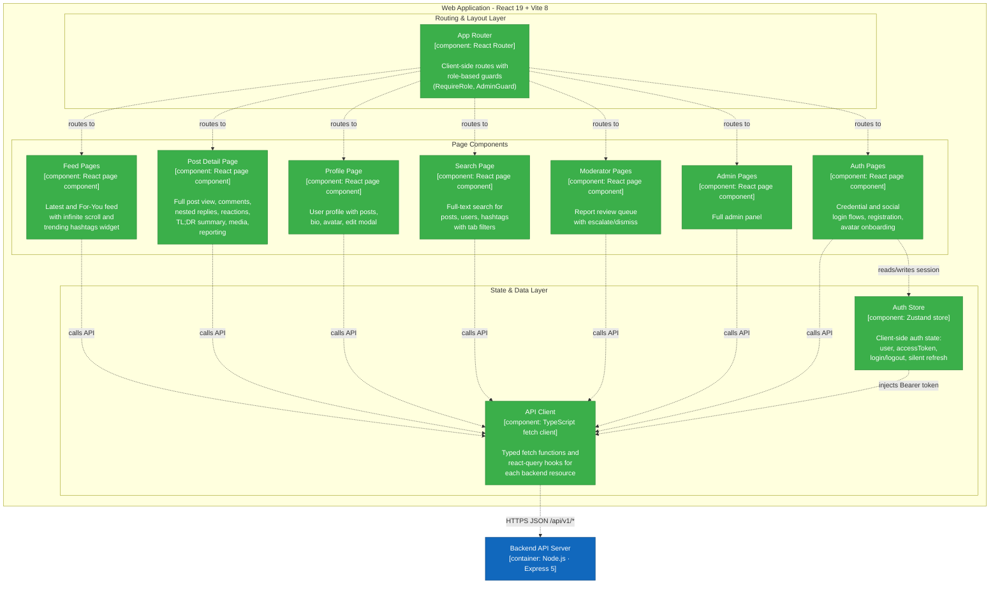
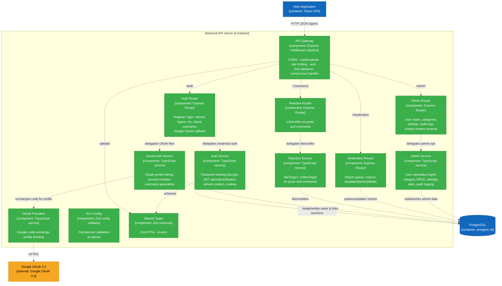

# Table of Contents

- [Table of Contents](#table-of-contents)
- [A - How to add Table of Contents](#a---how-to-add-table-of-contents)

# A - How to add Table of Contents

*Work performed by: [Name] | Reviewed by: [Name] | Edited by: [Name]*

# B - Software Architecture: System Context Diagram

*Work performed by: Nguyễn Hải Trọng | Reviewed by: Nguyễn Hải Nam, Võ An Phú, Nguyễn Tuấn An | Edited by: Võ An Phú, Nguyễn Tuấn An*

## 1. Technology Stack

### Frontend

| Technology | Purpose |
|---|---|
| **React 19** | UI component framework (SPA) |
| **TypeScript 6** | Type-safe application code |
| **Vite 8** | Build tool and dev server with HMR |
| **Tailwind CSS 4** | Utility-first styling (vanilla config, no UI library) |
| **react-router-dom 7** | Client-side routing |
| **@tanstack/react-query 5** | Server-state management and caching |
| **zustand 5** | Lightweight client-state management (auth store) |
| **react-hook-form 7** | Form state management and validation |
| **react-hot-toast 2** | Toast notification system |
| **react-icons 5** | Icon library |
| **Vitest 4** | Unit testing framework |

### Backend

| Technology | Purpose |
|---|---|
| **Node.js (LTS ≥ 24)** | JavaScript runtime (ESM) |
| **Express 5** | Web framework for RESTful API |
| **TypeScript 6** | Type-safe server code |
| **Drizzle ORM** | SQL-visible ORM with type-safe queries |
| **drizzle-kit** | Database migration tooling |
| **Zod 4** | Runtime schema validation at API boundaries |
| **bcrypt 6** | Password hashing |
| **jsonwebtoken 9** | JWT access and refresh token management |
| **express-rate-limit 8** | Rate limiting for abuse-prone endpoints |
| **multer 2** | Multipart file upload handling |
| **sharp 0.35** | Server-side image processing and optimization |
| **cookie-parser** | HTTP cookie parsing for refresh tokens |
| **Vitest 4** | Unit and integration testing |

### Database

| Technology | Purpose |
|---|---|
| **PostgreSQL 16** | Primary relational database (provisioned via Docker) |
| **postgres.js** | Node.js PostgreSQL client driver |

### External Services

| Service | Purpose |
|---|---|
| **Cloudinary** | Cloud-based image/media storage and CDN delivery |
| **Google Generative AI API** (Gemini) | AI-powered post & comment summarization (TL;DR) with fallback provider chain |
| **Google OAuth 2.0** | Social authentication (Google Sign-In) |

### Shared Module

| Technology | Purpose |
|---|---|
| **`src/shared/`** | Zod schemas, DTOs, enums - single source of truth imported by both frontend and backend via `#shared/*` path aliases. No npm workspace, no codegen, no tRPC. |

---

## 2. C4 Level 1 - System Context Diagram

This diagram shows FOZ as a single box, the actors who interact with it, and the external systems it depends on.

### Diagram Explanation

Four actor types interact with the system:

- **Guest** — Unauthenticated. Can browse the feed, search, and view profiles. Cannot create content, react, report, or use AI features.
- **Standard User** — Authenticated member. Everything a guest can do, plus creating posts (text + images), commenting (nested replies), reacting, editing/deleting own content, managing their profile, reporting, requesting AI TL;DR summaries, and changing their password.
- **Moderator** — Standard user privileges plus the moderation queue (review, flag, or dismiss reports). Cannot issue punishments directly — this enforces separation of powers.
- **Administrator** — Moderator privileges plus the admin dashboard: user management (warn, suspend, ban), category management, system settings, audit logs, and punishment issuance.

The system depends on three external services:

- **Google OAuth 2.0** — Social login. The backend exchanges an auth code for a token, fetches the Google profile, and links or creates a FOZ account.
- **Google Generative AI (Gemini)** — AI post/comment summarization. Uses a fallback chain across multiple Gemini model versions for resilience.
- **Cloudinary** — Image storage and CDN. Attachments and avatars are streamed to Cloudinary; CDN URLs are stored in the database.

---

# C - Software Architecture: Container Diagram and Component Diagram

*Work performed by: Nguyễn Hải Nam | Reviewed by: Võ An Phú, Nguyễn Tuấn An | Edited by: Võ An Phú, Nguyễn Tuấn An*

## 3. C4 Level 2 - Container Diagram

Zooms into FOZ to show its deployable units (containers), the technology each uses, and how they talk to each other. In C4 terms a "container" is a separately runnable process or data store.

### 3.1 Diagram

### 3.2 Container Descriptions

- **Web Application (SPA)** — Renders the entire forum UI: feed (latest + for-you), post detail with comments/reactions, profiles, search, moderation queue, admin dashboard, and auth screens. No direct DB access, all data comes from the API via REST.
  - **Technology**: React 19 + TypeScript + Vite 8, styled with Tailwind CSS v4. Key libs: `react-router-dom` (routing), `@tanstack/react-query` (server-state cache), `zustand` (auth state), `react-hook-form` (forms), `react-hot-toast` (toasts). Tested with Vitest + Testing Library.
  - **Communication**: Sends JSON requests to `/api/v1/*`. Dev: Vite proxies to `localhost:4000`. Prod: Vercel rewrites to the Render backend. Auth uses `Bearer` tokens; refresh uses an HttpOnly cookie.

- **Backend API Server** — RESTful API under `/api/v1` covering auth, posts, comments, reactions, profiles, search, upload, moderation, admin, hashtags, and a `/health` probe. Includes AI summarization, Zod validation, rate limiting, CORS, and a central error handler.
  - **Technology**: Node.js v24 (ESM) + Express 5. Auth: `jsonwebtoken` + `bcrypt`. DB: Drizzle ORM + `postgres.js` + `drizzle-kit` migrations. Validation: `zod`. Uploads: `multer` + `sharp`. Env: fail-fast Zod validation at startup.
  - **Communication**: Receives JSON from the SPA. Connects to Postgres via `postgres.js` (TCP :5432, pool max 10). Calls Google OAuth, Gemini, and Cloudinary over HTTPS.

- **PostgreSQL Database** — Stores all relational data: users, profiles, refresh sessions, posts, attachments, comments, reactions, reports, audit logs, categories, settings, hashtags, summaries, and social links.
  - **Technology**: `postgres:16` Docker service (`foz_db`, port 5432, volume `foz_pg_data`, database `foz_dev`). Migrations via `drizzle-kit`.
  - **Communication**: Accepts connections only from the Backend API Server (TCP :5432). No browser or SPA access.

- **Google OAuth 2.0** *(external)* — Social login. Backend exchanges auth codes for tokens and fetches user profiles. HTTPS only, called by the backend.

- **Google Generative AI / Gemini** *(external)* — On-demand AI TL;DR summaries (post snapshot, highlights, sentiment). Uses `gemini-2.5-flash` / `gemini-1.5-flash` / `gemini-2.0-flash` with a fallback chain. HTTPS only, called by the backend.

- **Cloudinary** *(external)* — Image storage and CDN. Attachments and avatars are streamed up; CDN URLs are persisted in Postgres. HTTPS only, called by the backend.

### 3.3 Relationships Summary

| From | To | Protocol | Description |
|---|---|---|---|
| User (all roles) | Web Application | HTTPS | Browsing, form submission, and UI interaction |
| Web Application | Backend API Server | HTTP/HTTPS JSON | REST calls to `/api/v1/*`. Dev: Vite proxies to `localhost:4000`. Authenticated calls pass `Bearer` tokens; refresh uses HTTP-only credentials |
| Backend API Server | PostgreSQL Database | SQL over TCP :5432 | Drizzle ORM queries via `postgres-js` driver |
| Backend API Server | Google OAuth 2.0 | HTTPS | Exchanges authorization codes for tokens, fetches user profiles |
| Backend API Server | Google Gemini API | HTTPS REST | Sends structured prompts, receives AI-generated summaries |
| Backend API Server | Cloudinary | HTTPS | Streams image uploads and issues delete requests |

---

## 4. C4 Level 3 - Component Diagrams

These diagrams zoom into the Web Application and Backend API Server containers to show their internal components. The database and external systems appear for context.

### 4.1 Frontend - Web Application

#### 4.1.1 Diagram

#### 4.1.2 Component Descriptions

- **App Router (`App.tsx`)**
  - **Responsibility**: Declares all client-side routes (`/latest`, `/foryou`, `/posts/:id`, `/profiles/@:username`, `/search`, `/login`, `/register`, `/moderator`, `/admin/*`, etc.) and wraps protected routes with `RequireRole` and `AdminGuard` components that check the auth store for the required role.
  - **Relationships**: Receives navigation actions from the User; renders matching Page Components; injects global layout and dialog controls.

- **Feed Pages (`HomePage`)**
  - **Responsibility**: Renders the post feed in two modes: "Latest" (chronological) and "For You" (engagement-ranked). Supports infinite scroll via cursor-based pagination. Includes a TrendingHashtagsWidget sidebar.
  - **Relationships**: Calls APIClient for post, feed, and reaction data.

- **Post Detail Page (`PostPage`)**
  - **Responsibility**: Full post view with body text, media gallery, reaction controls, comment thread with nested replies, AI-generated TL;DR summary card, report button, and post edit/delete for the owner.
  - **Relationships**: Calls APIClient for post, comment, reaction, summary, and report data.

- **Profile Page (`ProfilePage`)**
  - **Responsibility**: Displays a user's profile (display name, bio, avatar, location, website) and their posts. Includes a ProfileEditModal for the profile owner to update their information and upload avatars.
  - **Relationships**: Calls APIClient for profile and user post data.

- **Search Page (`SearchPage`)**
  - **Responsibility**: Provides full-text search across posts, users, and hashtags with tab-based result filtering.
  - **Relationships**: Calls APIClient for search queries.

- **Auth Pages (`LoginPage`, `RegisterPage`, `OnboardingPage`, `ChangePasswordPage`)**
  - **Responsibility**: Login page (email/password + Google OAuth), register page (with Zod-validated form), onboarding avatar upload, and change-password page.
  - **Relationships**: Uses Auth Store to persist session; calls APIClient for auth endpoints.

- **Moderator Pages (`ModDashboard`, `ReportsQueue`)**
  - **Responsibility**: Moderator dashboard with report statistics and a reports queue page where moderators can review, flag (escalate), or dismiss user reports.
  - **Relationships**: Calls APIClient for moderation endpoints; guarded by RequireRole.

- **Admin Pages** (`Dashboard`, `Users`, `Reports`, `Categories`, `Settings`, `AuditLogs`) — Full admin panel: site stats, user management, report management, category CRUD, system settings, audit logs. Guarded by AdminGuard. Calls APIClient for admin endpoints.

- **Auth Store (`src/frontend/src/stores/auth.ts`)**
  - **Responsibility**: Zustand store managing client-side authentication state: `user` object, `accessToken`, `setSession`, `clearSession`, and `silentRefresh` (automatic token renewal via the refresh cookie).
  - **Relationships**: Read by APIClient for Bearer token injection; updated by Auth Pages upon login, registration, or session restoration.

- **API Client (`src/frontend/src/api/`)**
  - **Responsibility**: Modular API modules (`auth.ts`, `interactions.ts`, `post-summary.ts`, `profile.ts`, `search.ts`, `upload.ts`, `admin.ts`, `hashtags.ts`) providing typed `fetch` wrappers with `Bearer` authorization headers and `@tanstack/react-query` hooks for caching and data sync.
  - **Relationships**: Invoked by all page components; reads access tokens from Auth Store; executes REST calls to Backend API Server.

---

### 4.2 Backend - API Server

The backend is split into two diagrams for readability: **Diagram A** covers content and discovery (posts, comments, search, profiles, hashtags, media, reports, AI TL;DR); **Diagram B** covers identity and governance (auth, OAuth, reactions, moderation, admin).

**Why AI TL;DR is in Diagram A:** the summary endpoints live on the Post Router (`/posts/:postId/summary`), and the summary service / AI summarizer are wired from there, not from a standalone router.

**Why no Report Service in Diagram B:** report *creation* lives on the Post Router (Diagram A); the Moderation Router only reads/updates reports directly against the database and has no service layer.

#### 4.2.1 Diagram A - Content & Discovery (Feed · Search · Profile · Hashtags · Media · Reports · AI TL;DR)

```mermaid
flowchart TD
    WebApp_A["Web Application<br/>[container: React SPA]"]
    DB_A[("PostgreSQL<br/>[container: postgres:16]")]
    Cloud_A["Cloudinary<br/>[external: Cloudinary]"]
    Gemini_A["Gemini API<br/>[external: Google Generative AI]"]

    subgraph BE_A ["Backend API Server [Container]"]
        GW_A["API Gateway<br/>[component: Express middleware pipeline]<br/><br/>CORS · cookie-parser ·<br/>rate limiting · auth ·<br/>Zod validation ·<br/>central error handler"]

        PostR["Post Router<br/>[component: Express Router]<br/><br/>Post CRUD, feed (latest,<br/>for-you, popular), repost,<br/>report submission,<br/>AI summary endpoints"]
        CommentR["Comment Router<br/>[component: Express Router]<br/><br/>Comment CRUD,<br/>author comments,<br/>nested replies"]
        SearchR["Search Router<br/>[component: Express Router]<br/><br/>Full-text search<br/>(posts, users) +<br/>discovery feed"]
        ProfileR["Profile Router<br/>[component: Express Router]<br/><br/>Get/update profile,<br/>avatar upload"]
        HashtagR["Hashtag Router<br/>[component: Express Router]<br/><br/>Trending hashtags,<br/>hashtag feed"]
        UploadR["Upload Router<br/>[component: Express Router]<br/><br/>Local image upload +<br/>Cloudinary upload/delete"]

        PostSvc["Post Service<br/>[component: TypeScript service]<br/><br/>Post CRUD logic,<br/>feed assembly (incl.<br/>For-You ranking),<br/>attachment handling"]
        CommentSvc["Comment Service<br/>[component: TypeScript service]<br/><br/>Comment CRUD,<br/>nested reply logic"]
        ProfileSvc["Profile Service<br/>[component: TypeScript service]<br/><br/>Profile read/update,<br/>avatar change cleanup"]
        ReportSvc["Report Service<br/>[component: TypeScript service]<br/><br/>Report creation against<br/>posts/comments"]
        ImgProc["Image Processor<br/>[component: sharp image pipeline]<br/><br/>sharp: resize, WebP,<br/>EXIF strip, size cap"]
        CloudSvc["Cloudinary Service<br/>[component: Cloudinary SDK wrapper]<br/><br/>Stream upload, asset<br/>deletion, public-id parsing"]
        PostSumSvc["Post Summary Service<br/>[component: TypeScript service]<br/><br/>Summary lifecycle:<br/>cache check, generate,<br/>upsert in DB"]
        AISvc["AI Summarizer<br/>[component: TypeScript service]<br/><br/>LLM prompt building,<br/>Gemini fallback chain,<br/>JSON parsing"]

        Shared_A["Shared Types<br/>[component: Zod schemas]<br/><br/>Zod DTOs · enums"]
    end

    WebApp_A -. "HTTP JSON /api/v1" .-> GW_A

    GW_A -. "/posts" .-> PostR
    GW_A -. "/ (comments)" .-> CommentR
    GW_A -. "/search" .-> SearchR
    GW_A -. "/profiles" .-> ProfileR
    GW_A -. "/hashtags" .-> HashtagR
    GW_A -. "/upload" .-> UploadR

    PostR -. "delegates CRUD" .-> PostSvc
    PostR -. "delegates summary" .-> PostSumSvc
    PostR -. "creates reports" .-> ReportSvc
    PostR -. "syncs hashtags" .-> DB_A
    CommentR -. "delegates CRUD" .-> CommentSvc
    ProfileR -. "delegates" .-> ProfileSvc
    UploadR -. "processes image" .-> ImgProc
    UploadR -. "streams to Cloudinary" .-> CloudSvc
    PostSumSvc -. "requests AI generation" .-> AISvc

    PostSvc -. "reads/writes" .-> DB_A
    PostSvc -. "deletes assets on post delete" .-> CloudSvc
    CommentSvc -. "reads/writes" .-> DB_A
    SearchR -. "queries" .-> DB_A
    ProfileSvc -. "reads/writes" .-> DB_A
    ProfileSvc -. "deletes old avatars" .-> CloudSvc
    HashtagR -. "queries" .-> DB_A
    ReportSvc -. "reads/writes" .-> DB_A
    PostSumSvc -. "caches summaries" .-> DB_A
    CloudSvc -. "HTTPS" .-> Cloud_A
    AISvc -. "HTTPS REST" .-> Gemini_A

    GW_A -. "validate" .-> Shared_A
    PostSvc -. "schemas" .-> Shared_A

    classDef system fill:#1168bd,stroke:#0b4884,color:#fff
    classDef comp fill:#3baf4a,stroke:#2d8a3a,color:#fff
    classDef ext fill:#f5a623,stroke:#d4901c,color:#000

    class WebApp_A,DB_A system
    class Cloud_A,Gemini_A ext
    class GW_A,PostR,CommentR,SearchR,ProfileR,HashtagR,UploadR comp
    class PostSvc,CommentSvc,ProfileSvc,ReportSvc,ImgProc,CloudSvc,PostSumSvc,AISvc comp
    class Shared_A comp
```

#### 4.2.2 Diagram B - Identity, Governance & AI (Auth · OAuth · Reactions · Moderation · Admin)

> **Note:** The API Gateway and Shared Types appear in both diagrams (shared infrastructure). The split is purely for presentation — the backend runs as **one container**.

#### 4.2.3 Component Descriptions

##### Middleware Pipeline (API Gateway)

Middleware applied (in order) before routing in `src/backend/index.ts`:

| Component | Responsibility | Source |
|---|---|---|
| **CORS Middleware** | Enforces origin-based CORS policy with credentials support. Allowed origins are configurable via `CORS_ORIGIN` env var. | `src/backend/index.ts` |
| **Auth Middleware** | Extracts and verifies the JWT access token from the `Authorization: Bearer` header. Hydrates `req.user` with `{ sub, role, status }`. Routes can be optionally or mandatorily authenticated (`requireAuth`, `optionalAuth`). | `src/backend/api/auth/` |
| **Rate Limiter** | Applies configurable per-window rate limits to abuse-prone endpoints (auth, AI summarization). Uses `express-rate-limit` with in-memory store. | `src/backend/lib/rate-limit.ts` |
| **Zod Validation** | Validates request bodies and parameters against Zod schemas from `src/shared/` at the API boundary. Rejects invalid requests with structured 422 error responses. | Inline in route handlers |
| **Central Error Handler** | The single place that maps thrown errors to HTTP JSON responses: `ZodError` -> 422, `AuthError` -> status from error, payload-too-large -> 413, unhandled -> 500. No error swallowing anywhere else. | `src/backend/index.ts` |

##### Route Layer

| Router | Mount Point | Endpoints |
|---|---|---|
| **Auth Router** | `/api/v1/auth` | `POST /register`, `POST /login`, `POST /refresh`, `POST /logout`, `GET /me`, `GET /check-username`, `GET /google`, `GET /google/callback`, `PATCH /password` |
| **Post Router** | `/api/v1/posts` | `GET /` (feed via `?type=latest\|for-you`, `?authorId=`), `POST /`, `PATCH /:postId`, `DELETE /:postId`, `POST /:postId/repost`, `DELETE /:postId/repost`, `POST /:postId/report`, `GET /:postId/summary`, `POST /:postId/summary/refresh` |
| **Comment Router** | mounted at `/` (no prefix) | `GET /posts/:postId/comments`, `POST /posts/:postId/comments`, `GET /comments` (by `?authorId=`), `PATCH /comments/:commentId`, `DELETE /comments/:commentId` |
| **Reaction Router** | mounted at `/` (no prefix) | `POST /posts/:postId/reaction`, `DELETE /posts/:postId/reaction`, `POST /comments/:commentId/reaction`, `DELETE /comments/:commentId/reaction` (like/unlike on posts and comments) |
| **Profile Router** | `/api/v1/profiles` | `GET /by-username/:username`, `GET /:userId`, `PATCH /me`, `POST /me/avatar` |
| **Search Router** | `/api/v1/search` | `GET /discovery` (suggested creators, trending discussions, topics), `GET /` (unified search, `?type=posts\|users\|all`) |
| **Upload Router** | `/api/v1/upload` | `POST /image` (multer → sharp → local disk), `POST /cloudinary` (stream upload), `DELETE /cloudinary/{*publicId}` |
| **Moderation Router** | `/api/v1/moderation` | `GET /metrics`, `GET /reports`, `PATCH /reports/:reportId/status`, `POST /reports/:reportId/action` (delete_content / dismiss / escalate) |
| **Admin Router** | `/api/v1/admin` | `GET /metrics`, `GET /users`, `PUT /users/:userId/role`, `DELETE /users/:userId`, `GET /audit-logs`, `GET /reports`, `DELETE /content/:type/:id`, `GET/POST /categories`, `PUT /categories/:id`, `DELETE /categories/:id`, `GET /settings`, `PUT /settings` |
| **Hashtag Router** | `/api/v1/hashtags` | `GET /trending`, `GET /:tag/posts` |

##### Service Layer

| Component | Responsibility | Key Relationships |
|---|---|---|
| **Auth Service** (`src/backend/api/auth/auth.service.ts`) | Core authentication logic: password hashing and verification (bcrypt), JWT access token signing and verification (HS256, 15-min TTL), refresh token issuance with rotation (7-day, HttpOnly cookie), cookie construction, and session management. Defines the `AuthError` class used by the central error handler. | Reads/writes `user_accounts`, `profiles`, `refresh_sessions` tables. |
| **Social Auth Service** (`src/backend/api/auth/social-auth.service.ts`) | Handles the OAuth account-linking flow: finds existing social links, links social profiles to existing email-matched accounts, or creates new user accounts with generated usernames. Issues session tokens matching the standard auth flow. | Calls OAuth Providers; reads/writes `user_accounts`, `user_social_links` tables. |
| **OAuth Providers** (`src/backend/api/auth/oauth-providers.ts`) | Implements provider-specific OAuth logic. Currently supports Google: exchanges authorization codes for tokens via the Google token endpoint, then fetches the user profile from the Google userinfo API. | Calls Google OAuth 2.0 (external). |
| **Post Service** (`src/backend/services/interactions/posts.ts`) | Business logic for post CRUD: creation (with content and attachments), reading (single post with author/reactions/comment count), updating, soft-deletion (respecting ownership), repost create/remove, and feed assembly with cursor-based pagination. Includes the For-You feed algorithm (engagement-weighted scoring via `feed-ranking.ts`). Hashtag sync on create/update is done by the **Post Router** directly, not this service. | Reads/writes `posts`, `post_attachments`; calls Cloudinary Service to delete attachments on post delete. |
| **Comment Service** (`src/backend/services/interactions/comments.ts`) | Business logic for comment CRUD: creation (with post-existence check and optional parent-comment for nesting), updating, and soft-deletion with ownership enforcement. | Reads/writes `comments` table. |
| **Reaction Service** (`src/backend/services/interactions/reactions.ts`) | Like/unlike logic: `likeTarget` adds a reaction, `unlikeTarget` removes it. Currently supports the "like" reaction kind on both posts and comments. | Reads/writes `reactions` table. |
| **Report Service** (`src/backend/services/interactions/reports.ts`) | Creates user reports against posts or comments with a reason type and optional details. Report creation is invoked by the **Post Router** (`POST /posts/:postId/report`); the Moderation Router reads/updates reports directly via `db` and does not use this service. | Reads/writes `reports` table. Called by Post Router. |
| **AI Summarizer** (`src/backend/services/ai-summarizer.ts`) | Core AI logic: builds a structured prompt from post content and comment bodies, calls the Gemini API with a fallback chain of model versions (`gemini-2.5-flash` -> `gemini-1.5-flash` -> `gemini-2.0-flash`), parses the JSON response into `{ postSnapshot, keyHighlights, sentiment }`, and falls back to a text-truncation heuristic if all API calls fail. | Calls Gemini API (external). |
| **Post Summary Service** (`src/backend/services/post-summary.service.ts`) | Orchestrates the summary lifecycle: checks if a cached summary exists and is still fresh, triggers AI Summarizer if not, and upserts the result into the database. | Uses AI Summarizer; reads/writes `post_summaries` table. |
| **Profile Service** (`src/backend/api/profile/profile.service.ts`) | Profile read by user ID / username and update. On avatar change, deletes the previous Cloudinary avatar asset (best-effort). Defines the `ProfileError` class. | Reads/writes `profiles`; calls Cloudinary Service for old-avatar cleanup. |
| **Image Processor** (`src/backend/services/image-processor.ts`) | Wraps `sharp`: validates format, auto-orients, resizes to per-upload-type limits, converts to WebP, strips EXIF, and enforces a 2MB output cap with quality step-down. | Used by Upload Router (`POST /upload/image`); writes to local disk, no DB or Cloudinary. |
| **Cloudinary Service** (`src/backend/services/cloudinary.ts`) | Wraps the Cloudinary SDK: streams file buffers to Cloudinary's upload API, extracts public IDs from URLs, and deletes assets. | Calls Cloudinary (external). Used by Upload Router (`/upload/cloudinary`), Post Service (attachment cleanup), and Profile Service (avatar cleanup). |
| **Admin Service** | Admin business logic: dashboard statistics (user/post/comment/report counts), user management (role changes, status changes with audit logging), forum category CRUD, system settings management, and audit log retrieval. | Reads/writes `admin_audit_logs`, `forum_categories`, `system_settings`, `reports`, `user_accounts` tables. |

##### Data Access (`src/backend/db/`)

Database access is handled by Drizzle ORM repository modules. These are an implementation detail of the service layer — each service imports the repositories it needs directly. Key tables:

| Table Group | Tables | Used By |
|---|---|---|
| **User & Auth** | `user_accounts`, `profiles`, `refresh_sessions`, `user_social_links` | Auth Service, Social Auth Service |
| **Content** | `posts`, `comments`, `reactions`, `post_attachments` | Post Service, Comment Service, Reaction Service |
| **Reports & Moderation** | `reports` | Report Service, Admin Service |
| **Hashtags** | `hashtags`, `post_hashtags` | Post Service, Hashtag Router |
| **Summaries** | `post_summaries` | Post Summary Service |
| **Admin** | `admin_audit_logs`, `forum_categories`, `system_settings` | Admin Service |

##### Infrastructure

| Component | Responsibility |
|---|---|
| **Env Config** (`src/backend/env.ts`) | Validates all environment variables at startup using a Zod schema. Fails fast with clear error messages if required variables are missing or malformed. Exports the typed `env` object used throughout the backend. |

# D - Deployment Diagram

*Work performed by: Nguyễn Tuấn An | Reviewed by: Võ An Phú | Edited by: Võ An Phú*

<insert content>

# E - Implement 2 Functional Groups using Spec Kit

*Work performed by: Võ An Phú | Reviewed by: Nguyễn Tuấn An | Edited by: Nguyễn Tuấn An*

The demo can be found at: `youtube-link.txt` or `https://youtu.be/ETm_nWagoRE?si=to6VentWdVtbCzoN`

# F - AI Usage Report and Weekly Report

*Work performed by: Nguyễn Tuấn An | Reviewed by: Phạm Đinh Gia Khánh | Edited by: Phạm Đinh Gia Khánh*

## AI Usage Report

### Declaration of No AI Use

We declare that no AI tools were used in peer review tasks.

### AI Usage Notes

AI Usage Report of each member can be found in folder: `ai-logs/`

### Weekly Report

#### Sprint Planning

=========== 25/7, Sprint 4 planning ===============

Team members present:

- Nguyễn Tuấn An
- Nguyễn Hải Nam
- Nguyễn Hải Trọng
- Phạm Đinh Gia Khánh
- Võ An Phú

Team members absent: None

Reports:

- Nguyễn Tuấn An:
  - List all possible tasks for PA4 and for project development process, getting ideas from the team members to make sure all tasks are covered.
  - Estimate time for each task and assign them to team members.

Actions:

- All team members agreed to the tasks and their assignments.

Summary of the meeting:

- The team has finalized the list of tasks for the sprint, including both PA4 and project development process tasks. All team members have agreed on their assignments and estimated time for each task.

#### Scrum Meetings

=========== 2/8, Scrum 1 ===============

Nguyễn Tuấn An

1. Fix ai usage log skill, fix post creation function, implement post summarize function, fix UI in home + comment sections, deploy app to website, add image compression, add multiple images scrolling effect 
2. Write report D, plan for PA5
3. None

Nguyễn Hải Nam

1. Write and Draw Software Architecture: Container Diagram and Component Diagram, Implement Admin view, Review Software Architecture: System Context Diagram
2. Integration and System test
3. None

Nguyễn Hải Trọng

1. Write and Draw Software Architecture:  System Context Diagram
2. Review report D and write report A
3. None

Phạm Đinh Gia Khánh

1. Design Admin UI, implement Moderator view
2. Review report A
3. None

Võ An Phú

1. Implemented for you feed, fixed create post pro5 picture out of sync, fix picture not showing in /foryou
2. Write report and make video for E, review C report
3. None

=========== 8/8, Scrum 2 ===============

Nguyễn Tuấn An

1. Integrate cloud for storing image; fix cloud problems; design draft logo; polish TLDR, home icon, menu box; design and add favicon; fix for you button on guest; add guide when hovering navbar; add client side process for fast Like response; fix redirect when register, login; add click post to view detail, view full image, click profile picture to view profile; add read more button; fix comment UX; add sort comment; fix search use mock data; redesign login UI; implement login with Google
2. Plan for PA5, assign tasks to team members.
3. None

Nguyễn Hải Nam

1. What have I done since last week?
2. What will I do until next week?
3. What issues / problems /obstacles do I have?

Nguyễn Hải Trọng

1. What have I done since last week?
2. What will I do until next week?
3. What issues / problems /obstacles do I have?

Phạm Đinh Gia Khánh

1. What have I done since last week?
2. What will I do until next week?
3. What issues / problems /obstacles do I have?

Võ An Phú

1. Make video for E: Post creation, For you feed generation; Review and edit C report; implemented setting; fix dark mode readmore
2. wait task
3. none

#### Sprint Review

=========== 8/8 Sprint Review ===============

Team members present:

- Nguyễn Tuấn An
- Nguyễn Hải Nam
- Nguyễn Hải Trọng
- Phạm Đinh Gia Khánh
- Võ An Phú

Team members absent: None

What went well: discover several potential vulnerabilities, revise project based on lecturers' feedbacks.

What went wrong: some tasks quality not good and need refinement.

What problems and what caused the problems: foundation of knowledge weak.

What can be done differently in the next sprint to improve: team members should learn more.

What lessons we could learn: the importance of learning and grinding.

### Jira Board

<insert board>