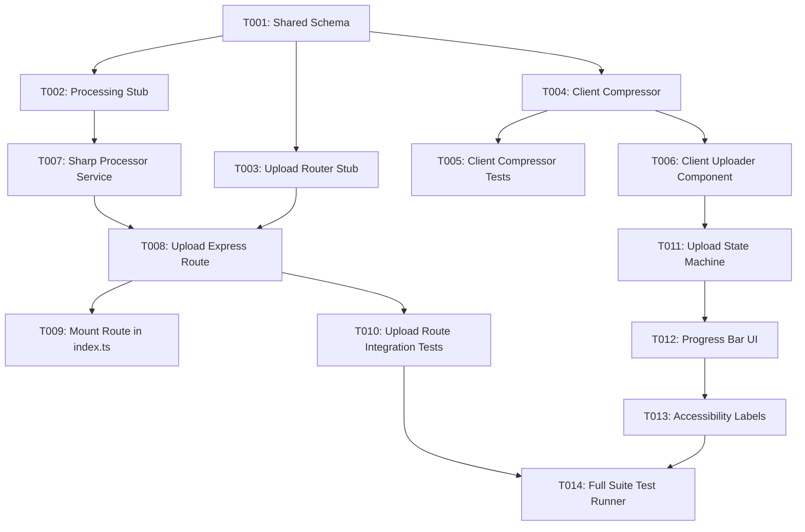

# Tasks: Image Upload Verification and Compression

**Feature Branch**: `014-image-upload-compression` | **Spec**: [spec.md](file:///d:/FOZ/specs/014-image-upload-compression/spec.md) | **Plan**: [plan.md](file:///d:/FOZ/specs/014-image-upload-compression/plan.md)

## Implementation Strategy & Dependencies

1. **MVP Scope**: User Story 1 & User Story 2 form the MVP. Once US1 (client-side pre-check/compression) and US2 (server fallback verification) are complete, the platform can safely accept compressed image uploads without risk of server overload.
2. **Sequential Story Order**: Setup & Foundation → US1 (Client Pre-Check/Compression) → US2 (Server Safety & Fallback) → US3 (Visual Progress & UI Feedback) → Polish.

---

## Phase 1: Setup

- [x] T001 Create shared Zod validation schemas for image uploads in `src/shared/schemas/image.ts`

---

## Phase 2: Foundational Tasks

- [x] T002 Create image processing service module stub in `src/backend/services/image-processor.ts`
- [x] T003 [P] Setup upload router and multer memory storage middleware in `src/backend/api/upload/routes.ts`

---

## Phase 3: User Story 1 - Client-Side Image Pre-Check and Compression (Priority: P1)

**Story Goal**: Validate file format/size and compress images (max 1600x1600 feed, 512x512 avatar) to WebP format on client device before upload.
**Independent Test**: Select a 10MB JPEG photo in browser; confirm client compressor resizes and outputs a WebP blob < 2MB prior to dispatch.

- [x] T004 [P] [US1] Implement client-side image compressor utility with Canvas API in `src/frontend/src/utils/imageCompressor.ts`
- [x] T005 [P] [US1] Create unit tests for client-side compressor utility in `src/frontend/src/utils/__tests__/imageCompressor.test.ts`
- [x] T006 [US1] Integrate client-side validation and pre-compression into upload workflow in `src/frontend/src/components/ImageUploader.tsx`

---

## Phase 4: User Story 2 - Server-Side Validation and Fallback Compression (Priority: P2)

**Story Goal**: Perform secondary magic-byte validation, EXIF metadata stripping, WebP conversion, and fallback processing on Express backend.
**Independent Test**: Send an uncompressed raw image file directly to `/api/v1/upload/image`; verify server validates format, strips EXIF, resizes, and saves compressed WebP asset.

- [x] T007 [P] [US2] Implement sharp-based processing (EXIF stripping, dimension bounding, WebP re-encoding) in `src/backend/services/image-processor.ts`
- [x] T008 [US2] Create Express upload handler endpoint `POST /api/v1/upload/image` in `src/backend/api/upload/routes.ts`
- [x] T009 [US2] Mount upload sub-router on `apiRouter` in `src/backend/index.ts` at `/upload`
- [x] T010 [P] [US2] Create integration tests for upload endpoint in `src/backend/api/upload/__tests__/upload.test.ts`

---

## Phase 5: User Story 3 - Visual Feedback and Quality Preservation (Priority: P3)

**Story Goal**: Provide real-time upload progress feedback and visual status indicators during processing.
**Independent Test**: Upload an image via UI and observe status progression ("Validating", "Compressing", "Uploading") with progress indicator.

- [x] T011 [P] [US3] Add upload progress & stage tracking state logic in `src/frontend/src/components/ImageUploader.tsx`
- [x] T012 [US3] Render progress bar and inline error notifications in `src/frontend/src/components/ImageUploader.tsx`

---

## Phase 6: Polish & Cross-Cutting Concerns

- [x] T013 [P] Add accessibility labels (ARIA progressbar, screen-reader status, alt-text prompt) in `src/frontend/src/components/ImageUploader.tsx`
- [x] T014 Execute full unit and integration test suite (`npx vitest run`)

---

## Dependency Graph & Parallel Opportunities

### Parallel Execution Opportunities
- **Phase 3 (US1)**: `T004` (Client Compressor) and `T005` (Compressor Tests) can be built concurrently.
- **Phase 4 (US2)**: `T007` (Backend Sharp Processor) and `T003` (Multer Router Stub) can be built in parallel.
- **Phase 5 (US3)**: `T011` (State Machine) and UI progress styling can be developed independently of backend routes once contracts are set.
