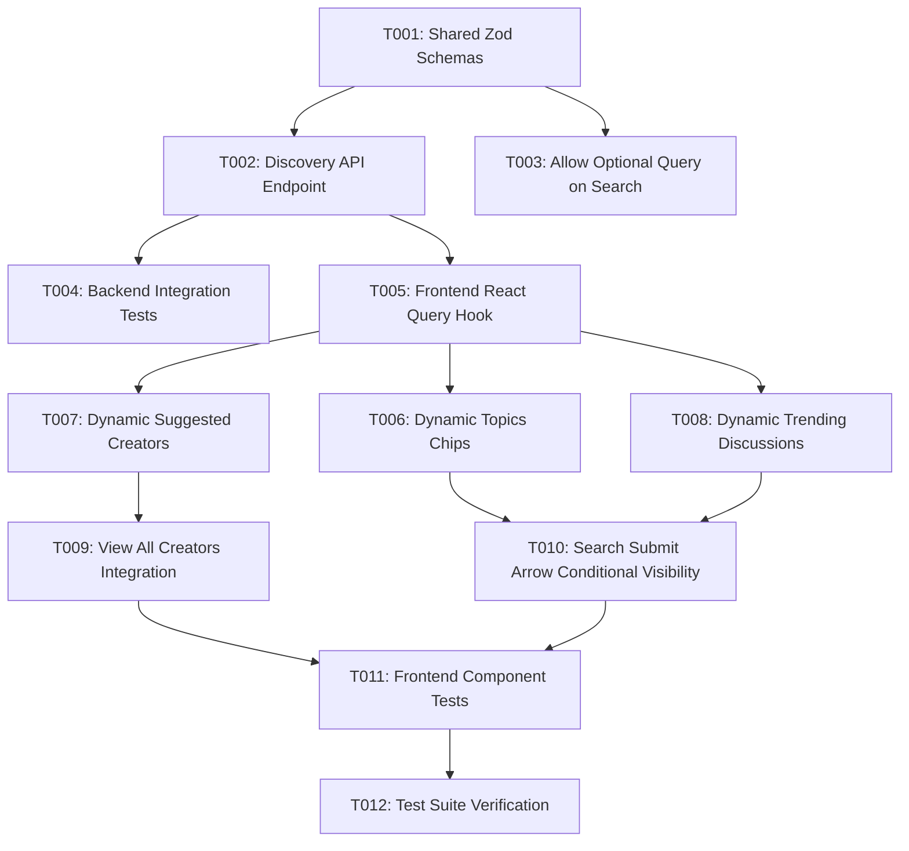

# Tasks: Search Discovery Widgets & Input Fixes

**Feature Branch**: `017-fix-search-widgets`  
**Plan**: [plan.md](file:///d:/FOZ/specs/017-fix-search-widgets/plan.md)  
**Spec**: [spec.md](file:///d:/FOZ/specs/017-fix-search-widgets/spec.md)

---

## Task Execution Graph

---

## Phase 1: Setup & Data Schemas

Goal: Define shared Zod validation schemas and TypeScript DTOs for discovery payloads.

- [x] T001 Create search discovery Zod validation schemas in `src/shared/schemas/search.ts` and export them from `src/shared/schemas/index.ts`

---

## Phase 2: Foundational Backend API

Goal: Implement backend search discovery endpoints and update query constraints.

- [x] T002 Implement `GET /api/v1/search/discovery` handler returning dynamic topics, active creator profiles, and popular discussions in `src/backend/api/search/routes.ts`
- [x] T003 [P] Update `GET /api/v1/search` endpoint in `src/backend/api/search/routes.ts` to allow empty/optional search query string when filtering user profiles
- [x] T004 Write integration tests for discovery endpoint in `src/backend/api/search/__tests__/discovery.test.ts`

---

## Phase 3: User Story 1 - Dynamic Search Discovery Content (Priority: P1)

Goal: Replace hardcoded static mock data for Trending Topics, Suggested Creators, and Trending Discussions with live dynamic backend data.

**Independent Test**: Load `/search` with empty search input and verify that Trending Topics, Suggested Creators, and Trending Discussions display real database records.

- [x] T005 [P] [US1] Implement `useSearchDiscovery()` React Query hook in `src/frontend/src/api/search.ts`
- [x] T006 [US1] Replace hardcoded mock Trending Topics in `src/frontend/src/pages/SearchPage.tsx` with dynamic topics data from `useSearchDiscovery()`, wiring tag click to execute search
- [x] T007 [US1] Replace hardcoded mock Suggested Creators in `src/frontend/src/pages/SearchPage.tsx` with dynamic creators data from `useSearchDiscovery()`, wiring card click to navigate to `/profiles/:userAccountId`
- [x] T008 [US1] Replace hardcoded mock Trending Discussions in `src/frontend/src/pages/SearchPage.tsx` with dynamic discussions data from `useSearchDiscovery()`, wiring item click to navigate to `/posts/:postId`

---

## Phase 4: User Story 2 - Functional "View all" Suggested Creators (Priority: P2)

Goal: Make the "View all" header button and trailing card functional by triggering a profile search to list creators directly on the Search page.

**Independent Test**: Click "View all" next to Suggested Creators and verify that profile search results populate the search page with all recommended creators.

- [x] T009 [US2] Update `src/frontend/src/pages/SearchPage.tsx` to handle "View all" header link and card click, executing profile search query to display creators list on Search page

---

## Phase 5: User Story 3 - Search Input Submit Button Visibility (Priority: P3)

Goal: Ensure the submit right arrow button in the search input box renders conditionally—only visible when non-empty input is present.

**Independent Test**: Observe empty search input on `/search` and verify submit arrow button is hidden; type text and verify arrow button appears immediately.

- [x] T010 [US3] Update search input form in `src/frontend/src/pages/SearchPage.tsx` to conditionally render the submit right arrow button strictly when `searchTerm.trim() !== ""`

---

## Phase 6: Polish & Verification

Goal: Add comprehensive component unit tests and verify full feature implementation.

- [x] T011 [P] Write frontend component tests for `SearchPage.tsx` covering conditional submit arrow visibility, dynamic discovery rendering, and "View all" actions in `src/frontend/src/pages/__tests__/SearchPage.test.tsx`
- [x] T012 Run full Vitest test suite (`npx vitest run`) to verify 0 regressions across frontend and backend

---

## Implementation Strategy & Parallel Opportunities

- **MVP Scope**: Phase 1 through Phase 3 (dynamic discovery widgets rendering real data).
- **Parallel Opportunities**:
  - `T003` (backend query update) can be implemented in parallel with `T002` (discovery route).
  - `T005` (frontend hook) can be prepared in parallel with backend tests `T004`.
  - `T011` (frontend tests) can be written in parallel once UI components are wired up.
