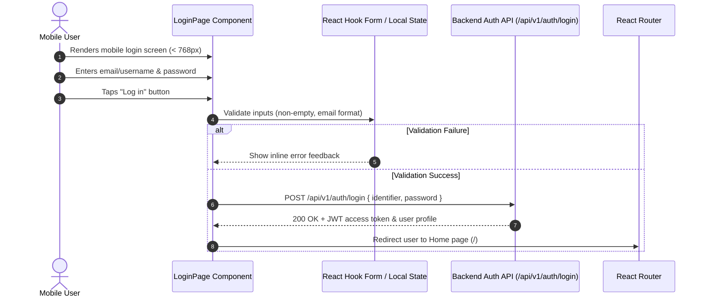

# Data Model: Mobile Login UI Redesign (White Mode Lumina)

## 1. UI Component Entities & Models

### `LoginFormState`
Represents the local state of the login form input fields and UI interactions.

| Attribute | Type | Validation / Rules | Description |
|-----------|------|--------------------|-------------|
| `identifier` | `string` | Required, non-empty, trimmed email or username | User input for email address or mobile/username |
| `password` | `string` | Required, non-empty | User input for account password |
| `showPassword` | `boolean` | Default: `false` | Toggles password input visibility (`text` vs `password`) |
| `isSubmitting` | `boolean` | Default: `false` | True when authentication API request is pending |
| `errorMessage` | `string \| null` | Default: `null` | Displayed inline or toast when validation/auth fails |

---

### `LuminaThemeTokens`
Defines the client-side CSS design tokens for White Mode Lumina Glassmorphism.

| Token | CSS Variable / Value | Usage |
|-------|----------------------|-------|
| `canvas-bg` | `#f9f9ff` | Fixed main page background canvas |
| `orb-primary` | `#afc6ff` | Soft floating shader orb 1 (top-left) |
| `orb-secondary` | `#dbb8ff` | Soft floating shader orb 2 (bottom-right) |
| `glass-panel-bg` | `rgba(255, 255, 255, 0.7)` | Translucent frosted glass card background |
| `glass-panel-border` | `rgba(255, 255, 255, 0.8)` / `rgba(0, 0, 0, 0.08)` | Specular highlight border |
| `input-glass-bg` | `rgba(255, 255, 255, 0.5)` | Transparent input field fill |
| `input-focus-border` | `#2E7DFF` | Focus state border highlight |
| `btn-gradient` | `linear-gradient(135deg, #2E7DFF 0%, #9D3BFF 100%)` | Primary "Log in" action button |
| `text-on-surface` | `#0f172a` (Slate 900) | Primary text contrast color |
| `text-brand-gradient` | `from-#2E7DFF to-#9D3BFF` | Brand text gradient highlight ("Zillions.") |

---

### `MobileNavigationConfig`
Represents viewport-dependent UI navigation controls for mobile device layout.

| Attribute | Type | Values | Description |
|-----------|------|--------|-------------|
| `viewportMode` | `string` | `'mobile'` (<768px), `'desktop'` (≥768px) | Active layout mode based on media query |
| `headerLogoVisible` | `boolean` | `true` on mobile, `true` on desktop navbar | Shows FOZ logo + text gradient at top of screen |
| `heroPanelVisible` | `boolean` | `false` on mobile, `true` on desktop | Toggles left-hand brand panel & trending carousel |

---

## 2. Validation & Auth Request Flow

