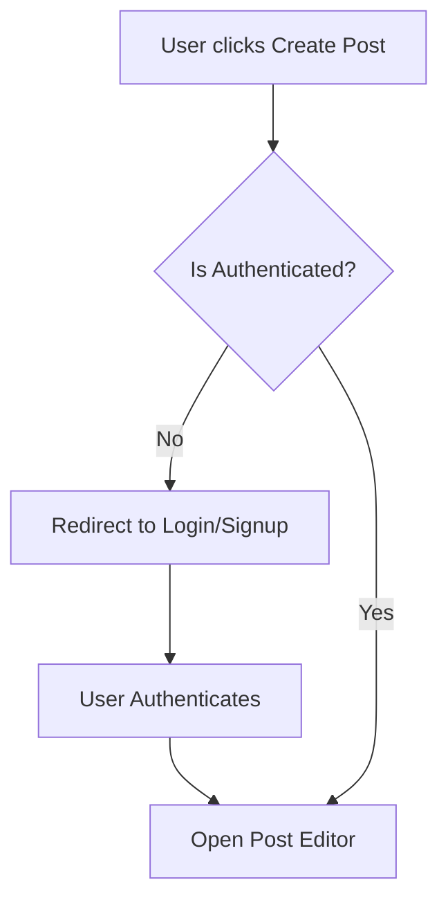

  

    
VNUHCM - University of Science

    
Faculty of Information Technology

  

  

  

    <h1 style="margin: 0; padding: 0 0 10px 0; font-size: 2.2em; border: none;">PA5 Report</h1>
    
Group 6: PDF

  

  

  

    CSC13002 - Introduction to Software Engineering
  

  

    

      
Author:

      
Nguyễn Tuấn An - 24127011

      
Nguyễn Hải Nam - 24127088

      
Nguyễn Hải Trọng - 24127311

      
Phạm Đinh Gia Khánh - 24127420

      
Võ An Phú - 24127494

    

    

      
Lecturer:

      
Ms. Nguyễn Thị Minh Tuyền

      
Mr. Hồ Tuấn Thanh

      
Mr. Mai Anh Tuấn

    

  

  

    July 21, 2026
  

# Table of Contents

- [Table of Contents](#table-of-contents)
- [A - Test Plan and Test Cases](#a---test-plan-and-test-cases)
  - [Test Cases for Request AI Summary (UC-14)](#test-cases-for-request-ai-summary-uc-14)
- [B - Export to PDF](#b---export-to-pdf)
  - [1. Requirements](#1-requirements)
    - [1.1 How to export to PDF](#11-how-to-export-to-pdf)
- [C - Diagram example](#c---diagram-example)
  - [1. Diagram rules](#1-diagram-rules)
- [D - Image example](#d---image-example)
  - [1. Insert image rule](#1-insert-image-rule)

# A - Test Plan and Test Cases

*Work performed by: Nguyễn Hải Trọng | Reviewed by: [Name] | Edited by: [Name]*

## Test Cases for Request AI Summary (UC-14)

The following test cases validate the "Request AI Summary" feature (UC-14), covering standard flows, edge cases, error handling, resiliency, and access control.

| Test Case ID | Test Description / Scenario | Test Category | Preconditions | Test Steps | Test Data / Input | Expected Result |
| :--- | :--- | :--- | :--- | :--- | :--- | :--- |
| **TC-UC14-001** | Happy Path: Standard thread summarization | Positive | Auth user `status=active`, Post exists with 5 comments. | 1. Navigate to post details. 2. Click "Generate TL;DR". | Post with standard text, 5 regular comments. | Loading spinner appears. Then modal displays bulleted summary of post and comments. HTTP 200. |
| **TC-UC14-002** | Happy Path: Long thread >10 comments | Positive | Auth user `status=active`, Post exists with 15 comments. | 1. Navigate to post details. 2. Click "Generate TL;DR". | Post with 15 comments. | System samples 10 comments (4 most liked, 3 most replied, 3 recent). Modal displays summary. HTTP 200. |
| **TC-UC14-003** | Edge Case: Single post with 0 comments | Edge Case | Auth user `status=active`, Post exists with 0 comments. | 1. Navigate to post details. 2. Click "Generate TL;DR". | Post with 0 comments. | Modal displays a summary based solely on the post content without throwing errors. HTTP 200. |
| **TC-UC14-004** | Edge Case: Thread with only deleted/hidden comments | Edge Case | Auth user `status=active`, Post has 3 comments (all `visibilityState="hidden"`). | 1. Navigate to post details. 2. Click "Generate TL;DR". | Post with 3 hidden comments. | System ignores hidden comments. Summary modal generated based solely on post content. |
| **TC-UC14-005** | Edge Case: Extremely long discussion | Edge Case | Auth user `status=active`, Post and comments text total ~15,000 characters. | 1. Navigate to post details. 2. Click "Generate TL;DR". | Extremely long post and 10 long comments. | System successfully processes or truncates input safely without exceeding LLM context window. Summary is generated successfully. |
| **TC-UC14-006** | UI State: Closing and reopening the modal | UI State | Auth user `status=active`. | 1. Click "Generate TL;DR". 2. Wait for summary. 3. Close modal. 4. Click "Generate TL;DR" again. | Standard post. | The cached summary is displayed immediately without triggering a redundant AI API request. |
| **TC-UC14-007** | Concurrency: Rapid multiple clicks | Concurrency | Auth user `status=active`. | 1. Navigate to post details. 2. Rapidly double-click or spam "Generate TL;DR" button. | Standard post. | Button disables/debounces after first click. Only one `/api/v1/posts/:id/summarize` request is fired. Modal opens once. |
| **TC-UC14-008** | Negative: Post deleted before request | Negative | Auth user viewing post. | 1. Another client deletes the post. 2. User clicks "Generate TL;DR". | Deleted post ID. | System catches error (HTTP 404). Displays toast: "This post is no longer available." Modal doesn't open. |
| **TC-UC14-009** | Resiliency: External AI API timeout (>10s) | Resiliency | Mock AI Provider to delay response by >10s. | 1. Click "Generate TL;DR". | Mock timeout. | System attempts fallback. If fallback fails, modal shows "Failed to load summary" and stops loading spinner. |
| **TC-UC14-010** | Error Handling: AI API rate limit (429) | Error Handling | Auth user hits system rate limit for summaries. | 1. Click "Generate TL;DR". | 429 Too Many Requests response. | Loading stops. Modal/toast displays: "Too many requests. Please try again later." HTTP 429. |
| **TC-UC14-011** | Error Handling: AI API service unavailable (503) | Error Handling | Mock AI Provider to return 503. | 1. Click "Generate TL;DR". | 503 Service Unavailable. | System tries fallback. If all fail, displays "Failed to load summary" with a "Retry" button. |
| **TC-UC14-012** | Resiliency: Offline network reconnection | Resiliency | Auth user `status=active`. | 1. Click "Generate TL;DR". 2. Disable internet connection. | Network timeout/abort. | Modal displays network error message. A "Retry" button is provided to re-attempt once connection is restored. |
| **TC-UC14-013** | Access Control / UI: Guest permissions | Access Control | User is unauthenticated (guest). | 1. Navigate to post details. | Guest token / No token. | The "Generate TL;DR" button is rendered and clickable. Direct API GET/POST succeeds due to `optionalAuth` implementation. *(Note: This implementation deviates from the UC spec which mandates authentication)*. |
| **TC-UC14-014** | Access Control: Suspended user | Access Control | Auth user `status=suspended`. | 1. Attempt to trigger `/api/v1/posts/:id/summary`. | Valid post, suspended token. | Action is blocked at middleware level. HTTP `403 Forbidden`. |
| **TC-UC14-015** | Feature: Refresh existing summary | Positive | Auth user `status=active`, Post has an existing cached summary. | 1. Navigate to post details. 2. Click "Generate TL;DR". 3. Click the "Refresh" icon. | Existing post with new comments added since last summary. | System calls `/api/v1/posts/:postId/summary/refresh`, regenerates summary bypassing cache, and updates UI. HTTP 200. |
| **TC-UC14-016** | Edge Case: Summary Cache Hit | Edge Case | Auth user `status=active`, Post already has a recent summary in DB. | 1. Navigate to post details. 2. Click "Generate TL;DR". | Post with cached summary. | System instantly returns `{ cached: true }` and displays summary without hitting external AI API. HTTP 200. |
| **TC-UC14-017** | Edge Case: Post contains media attachments | Edge Case | Auth user `status=active`, Post contains 4 images. | 1. Navigate to post details. 2. Click "Generate TL;DR". | Post with text and images. | Summary is generated based solely on text content. Attachments are gracefully ignored by AI summarizer. HTTP 200. |

# B - Export to PDF

*Work performed by: [Name] | Reviewed by: [Name] | Edited by: [Name]*

## 1. Requirements

Install Obsidian

Install Plugin **"Better export PDF"**

Use default format

### 1.1 How to export to PDF

==CTRL P -> Better export PDF: Export current file to PDF==

# C - Diagram example

*Work performed by: [Name] | Reviewed by: [Name] | Edited by: [Name]*

## 1. Diagram rules

Diagram must be drawn using Mermaid.

Example as below:

**Workflow 1: User Authentication & Post Creation**

# D - Image example

*Work performed by: [Name] | Reviewed by: [Name] | Edited by: [Name]*

## 1. Insert image rule

Insert as markdown format ``

Example as below:

