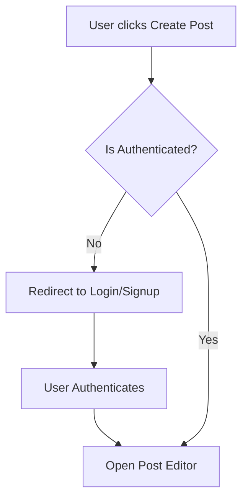

  

    
VNUHCM - University of Science

    
Faculty of Information Technology

  

  

  

    <h1 style="margin: 0; padding: 0 0 10px 0; font-size: 2.2em; border: none;">PA5 Report</h1>
    
Group 6: PDF

  

  

  

    CSC13002 - Introduction to Software Engineering
  

  

    

      
Author:

      
Nguyễn Tuấn An - 24127011

      
Nguyễn Hải Nam - 24127088

      
Nguyễn Hải Trọng - 24127311

      
Phạm Đinh Gia Khánh - 24127420

      
Võ An Phú - 24127494

    

    

      
Lecturer:

      
Ms. Nguyễn Thị Minh Tuyền

      
Mr. Hồ Tuấn Thanh

      
Mr. Mai Anh Tuấn

    

  

  

    July 21, 2026
  

# Table of Contents

1. [A - How to add Table of Contents](#a---how-to-add-table-of-contents)
	1. [1. Requirements](#1-requirements)
		1. [1.1. How to export to PDF](#11-how-to-export-to-pdf)
2. [B - Export to PDF](#b---export-to-pdf)
	1. [1. Requirements](#1-requirements)
		1. [1.1 How to export to PDF](#11-how-to-export-to-pdf)
3. [C - Diagram example](#c---diagram-example)
	1. [1. Diagram rules](#1-diagram-rules)
4. [D - Image example](#d---image-example)
	1. [1. Insert image rule](#1-insert-image-rule)
- [Table of Contents](#table-of-contents)
- [A - Test Plan and Test Cases](#a---test-plan-and-test-cases)
  - [Test Summary Report](#test-summary-report)
    - [1. Project Information](#1-project-information)
    - [2. Test Objectives](#2-test-objectives)
    - [3. Test Execution Summary](#3-test-execution-summary)
    - [4. Defect Summary (All Fixed)](#4-defect-summary-all-fixed)
      - [UC-07 \& UC-08 Defects (Browse \& Search) - FIXED](#uc-07--uc-08-defects-browse--search---fixed)
      - [UC-10 Defects - FIXED](#uc-10-defects---fixed)
      - [UC-12 Defects (Leave Comment) - FIXED](#uc-12-defects-leave-comment---fixed)
      - [UC-14 Defects (Request AI Summary) - FIXED](#uc-14-defects-request-ai-summary---fixed)
      - [UC-18 Defects (Escalate Report) - FIXED](#uc-18-defects-escalate-report---fixed)
    - [5. Scope \& Coverage Analysis](#5-scope--coverage-analysis)
      - [Feed \& Search (UC-07, UC-08)](#feed--search-uc-07-uc-08)
      - [Engagement (UC-10, UC-12, UC-14)](#engagement-uc-10-uc-12-uc-14)
      - [Moderation (UC-18)](#moderation-uc-18)
    - [6. Conclusion](#6-conclusion)
  - [Bug Report](#bug-report)
      - [1. Browse Feed (UC-07)](#1-browse-feed-uc-07)
      - [2. Search Content (UC-08)](#2-search-content-uc-08)
      - [3. Create Post (UC-10)](#3-create-post-uc-10)
      - [4. Leave Comment (UC-12)](#4-leave-comment-uc-12)
      - [5. Request AI Summary (UC-14)](#5-request-ai-summary-uc-14)
      - [6. Escalate Report (UC-18)](#6-escalate-report-uc-18)
- [B - Export to PDF](#b---export-to-pdf)
  - [1. Requirements](#1-requirements)
    - [1.1 How to export to PDF](#11-how-to-export-to-pdf)
- [C - Diagram example](#c---diagram-example)
  - [1. Diagram rules](#1-diagram-rules)
- [D - Image example](#d---image-example)
  - [1. Insert image rule](#1-insert-image-rule)

# A - Test Plan and Test Cases
*Work performed by: Nguyen Hai Nam | Reviewed and Edited by: Nguyen Hai Nam,*

## 1. Test Plan

### 1.1 Test Objectives and Scope

#### 1.1.1 Test Objectives

* **Primary Functional Correctness:** To verify that the core user flows of the FOZ forum perform according to specifications without critical errors or UI breakdowns.

* **Role-Based Access Control:** To ensure proper privilege segregation across user roles (`Guest`, `Standard User`, `Moderator`, and `Administrator`), specifically validating that elevated administrative actions are restricted strictly to authorized admin accounts.

* **AI Feature Validation:** To validate the functional correctness of the AI-powered `Post Summarization` feature, ensuring that it produces accurate TL;DR summaries via the Google Gemini API integration and handles missing API keys smoothly via fallback mechanisms.

* **Defect Tracking & Reporting:** To execute manual test cases, identify bugs or regressions, and log detailed reports for developers to fix.

#### 1.1.2 Test Scope

##### 1.1.2.1 In-Scope

* **Target Use Cases:** Manual functional testing of the 6 chosen use cases: UC-07, UC-08, UC-10, UC-12, UC-14, UC-18.

* **Full-Stack Integration:** Web frontend interaction (Vite/Client) interacting with backend API routes (`/api/v1/...`) and PostgreSQL persistence via Drizzle ORM.

* **Browser Compatibility:** Basic UI and functional checks on modern browsers (e.g., Google Chrome, Microsoft Edge).

##### 1.1.2.2 Out-of-Scope

* **Non-functional Requirements:** Load testing, stress testing, high-concurrency scaling, and deep security penetration auditing.

* **Unselected Use Cases:** Features outside the 6 selected use cases (such as authorization or avatar customization).

* **Native Mobile Applications:** Testing is strictly limited to desktop/responsive web environments.

* **Test Automation:** Writing or executing automated test scripts (e.g., Unit, E2E testing).

### 1.2 Features to be tested

* UC-07 - Browse Feed (Feed Generation)

* UC-08 - Search Content (Search & Discovery)

* UC-10 - Create Post (Post Creation)

* UC-12 - Leave Comments (User Interaction)

* UC-14 - Request AI Summary (Post Summarization)

* UC-18 - Forward Report to Admin (Administration & Moderation)

### 1.3 Test Environment and Tools

#### 1.3.1 Operating and Execution Environment

* **Operating System:** Windows 11 / Linux (Ubuntu 24.04 LTS / WSL2)

* **Frontend Environment:** Vite, React, dev server on `http://localhost:5173`.

* **Backend Environment:** Express, Drizzle ORM, dev server on `http://localhost:4000`.

* **Database Container:** PostgreSQL `v16+` running via Docker exposed on port `5432`.

#### 1.3.2 Test and Inspection Tools

*   **Web Browsers:** Google Chrome and Microsoft Edge for manual functional UI execution and responsive viewport checks.

*   **Browser Developer Tools:** Chrome DevTools and Microsoft Edge DevTools (Console, Network, etc.)

*   **Database Inspection GUI:** Drizzle Studio (`npx drizzle-kit studio`) to inspect real-time table state changes in PostgreSQL (users, posts, comments, roles, etc.).

*   **External Services & API Keys:** Google AI Studio API key for AI summarization testing.

*   **Source Code & Environment Management:** Git version control, Docker Engine for database containerization, VS Code and Antigravity IDE.

### 1.4 Test Schedule and Responsibilities

#### 1.4.1 Test Responsibilities

| Role / Responsibility | Assigned Team Member | Specific Tasks & Deliverables |
| --- | --- | --- |
| **Test Planning** | Nguyen Hai Nam | Write specific Test Plan for team. |
| **Test Environment and Data Preparation** | Nguyen Hai Nam & Nguyen Tuan An | Set up the local testing environment (DB container, backend, frontend). Prepare test data including mock user accounts, pre-existing posts, and valid/invalid Gemini API keys for AI testing. |
| **Test Case Design (UC-07 & UC-08)** | Nguyen Tuan An | Refine and write 10 test cases for **UC-07 (Browse Feed)** and **UC-08 (Search Content)**. |
| **Test Case Design (UC-10)** | Nguyen Hai Nam | Refine and write 10 test cases for **UC-10 (Create Post)**. |
| **Test Case Design (UC-12)** | Vo An Phu | Refine and write 10 test cases for **UC-12 (Leave Comment)**. |
| **Test Case Design (UC-14)** | Nguyen Hai Trong | Refine and write 10 test cases for **UC-14 (Request AI Summary)**. |
| **Test Case Design (UC-18)** | Pham Dinh Gia Khanh | Refine and write 10 test cases for **UC-18 (Forward Report to Admin)**. |
| **Test Case Review & Quality Assurance (UC-07 & UC-08)** | Nguyen Hai Nam & Pham Dinh Gia Khanh | Review and refine all test cases for **UC-07 & UC-08** |
| **Test Case Review & Quality Assurance (UC-10 & UC-12)** | Nguyen Tuan An & Nguyen Hai Trong | Review and refine all test cases for **UC-10 & UC-12** |
| **Test Case Review & Quality Assurance (UC-14 & UC-18)** | Pham Dinh Gia Khanh & Vo An Phu | Review and refine all test cases for **UC-14 & UC-18** |
| **Test Case Review & Quality Assurance for AI-generated test cases** | All Team Members | Review and refine all test cases for AI-generated test cases |
| **Test Execution and Bug Logging** | All Team Members | - Execute assigned manual test cases using Cross-testing approach, accurately recording the **Test case ID**, **execution date**, **status** (Pass/Fail), and **actual results**. - Log all discovered defects into the Bug Report, ensuring every failed test case is strictly linked to at least one **bug ID**. - Record bug details, including **bug description**, **steps to reproduce**, **expected vs. actual results**, **severity**, and **status**. |
| **Retesting and Final Run Verification** | Nguyen Hai Nam & Vo An Phu | Perform Retesting on fixed bugs and execute the Final Run to ensure all previously failed test cases are successfully passed and bug statuses are updated to 'Closed/Fixed'. |
| **Test Report and Document Finalization** | Nguyen Hai Nam & Nguyen Hai Trong | - Document Bug Report and Test Summary. - Compile, format, and finalize the complete Software Testing Document. |

#### 1.4.2 Test Schedule

| Phase | Milestone / Task Category | Timeframe | Primary Assignees |
| --- | --- | --- | --- |
| Phase 1 | **Test Planning & Preparation:** Finalize the test plan, set up the local testing environment, and prepare all required test data (mock accounts, pre-existing posts, API keys). | Aug 11 - Aug 15, 2026 | Nguyen Hai Nam & Nguyen Tuan An |
| Phase 2 | **Test Case Design & Review:** Refine and design 60 test cases across 6 selected use cases. Review and refine all AI-generated test cases. Conduct peer reviews to ensure optimal test coverage and validity. | Aug 16 - Aug 18,  2026 | All Team Members |
| Phase 3 | **First Run Execution & Bug Logging:** Perform cross-testing on the application. Accurately record execution status (Pass/Fail) and systematically log all discovered defects. | Aug 19 - Aug 21, 2026 | All Team Members |
| Phase 4 | **Bug Fixing & Retesting (Final Run):** Allocate time for defect resolution. Perform retesting on previously failed test cases to verify fixes and achieve a 100% pass rate. | Aug 22 - Aug 24, 2026 | Nguyen Hai Nam & Vo An Phu (Retesting) |
| Phase 5 | **Reporting & Finalization:** Compile Test Summary metrics, verify bug ID traceability, format and finalize the document. | Aug 25, 2026 |	Nguyen Hai Nam & Nguyen Hai Trong |

### 1.5 Entry and Exit Criteria

#### 1.5.1 Entry Criteria

* **Feature Implementation & Code Stability:** Code for all 6 selected use cases (UC-07, UC-08, UC-10, UC-12, UC-14, UC-18) is fully integrated and ready for testing.

* **Environment & Server Readiness:**
  * The PostgreSQL database Docker container is running on port `5432` with all database migrations applied.
  * The backend server (`http://localhost:4000`) runs without errors.
  * The frontend server (`http://localhost:5173`) runs without errors .

* **Test Data Seeded:** Mock user accounts (for all roles) and sample data (posts, comments, etc.) are loaded into the database.

* **Test Cases Approved:** All 60 functional test cases have been reviewed, refined, and approved by the team.

* **API Keys Configured:** `.env` variables are set, including both valid and invalid Gemini API keys to verify the AI fallback mechanism. 

#### 1.5.2 Exit Criteria

* **100% Execution:** All 60 designed test cases have been executed.

* **Results Logged:** Execution dates, status (Pass/Fail), and actual results are fully documented for every test case.

* **Defect Traceability:** Every test case that failed during the First Run is linked to a specific Bug ID.

* **Bugs Fixed & Retested:** High-severity/critical defects have been resolved by developers. Retesting (Final Run) confirms these tests now pass.

* **Report Finalized:** The Test Summary metrics and Bug Report are fully populated and formatted for submission.

## 2. Test Cases

> The below link contains the manual functional test cases designed by our team.

[Team Manual Functional Test Cases](./Individual-Test-Execution/Individual-Manual-Test-Cases-Execution.xlsx)

> The link below contains our team's document on reviewing, refining, and adding AI-generated test cases.

[Team's Document on Reviewing, Refining, and Adding AI-generated Test Cases](./Review-AI-Test-Case/)

## 3. Test Execution

> The below link contains the manual functional test execution with required records performed by our team.

[Team Manual Functional Test Execution](./Individual-Test-Execution/Individual-Manual-Test-Cases-Execution.xlsx)

## 4. Bug Report

### 4.1 Bug Report

> The link below contains the bug report performed by our team.

[Team Bug Report](./Individual-Bug-Report/Individual-Bug-Report.xlsx)

### 4.2 Test Summary

#### 1. Test Objectives
The objective of this test cycle was to validate the functionality of key features in the FOZ application, specifically focusing on:
* **UC-07 (Browse Feed):** Verifying the feed functionality across all user roles, sorting, ranking algorithms, scroll behaviors, and offline states.
* **UC-08 (Search Content):** Validating the search capability across posts and profiles, including hashtag filtering, query limits, empty states, and offline conditions.
* **UC-10 (Create Post):** Verifying that users can successfully create posts with text and media, including error handling for boundary limits and network issues.
* **UC-12 (Leave Comment):** Testing comment submissions across roles, verifying nested replies, UI responsivness, XSS security, character truncation, and duplicate request blocking.
* **UC-14 (Request AI Summary):** Validating the generation of AI summaries for posts and comments, including cache behavior, external API resiliency, and access control.
* **UC-18 (Escalate Report):** Validating the ability for moderators to escalate reports of serious or complex violations to administrators, including handling concurrent edge cases, deleted content, and input validation.

#### 2. Test Execution Summary

| Feature / Use Case | Tester | Test Date | Total Cases | Initial Failed (Defects Logged) | Final Failed | Final Passed | Final Pass Rate |
|---|---|---|---|---|---|---|---|
| **UC-07 (Browse Feed)** | Nguyễn Tuấn An  | 2026-08-21 | 11 | 3 | 0 | 11 | 100% |
| **UC-08 (Search Content)** | Nguyễn Tuấn An | 2026-08-22 | 15 | 4 | 0 | 15 | 100% |
| **UC-10 (Create Post)** | Nguyễn Hải Nam | 2026-08-17 | 17 | 1 | 0 | 17 | 100% |
| **UC-12 (Leave Comment)** | Võ An Phú | 2026-08-17 | 24 | 5 | 0 | 24 | 100% |
| **UC-14 (Request AI Summary)** | Nguyễn Hải Trọng | 2026-08-23 | 17 | 5 | 0 | 17 | 100% |
| **UC-18 (Escalate Report)** | Phạm Đinh Gia Khánh | 2026-08-22 | 19 | 7 | 0 | 19 | 100% |
| **Total** | | | **103** | **25** | **0** | **103** | **100%** |

*(Note: During the initial testing phase, 25 test steps had associated Defect IDs logged. All 25 failed/defective test steps have since been addressed, re-tested, and successfully verified. The application now yields a clean 100% pass rate across these core use cases.)*
# B - Export to PDF

*Work performed by: [Name] | Reviewed by: [Name] | Edited by: [Name]*

## 1. Requirements

Install Obsidian

Install Plugin **"Better export PDF"**

Use default format

### 1.1 How to export to PDF

==CTRL P -> Better export PDF: Export current file to PDF==

# C - Diagram example

*Work performed by: [Name] | Reviewed by: [Name] | Edited by: [Name]*

## 1. Diagram rules

Diagram must be drawn using Mermaid.

Example as below:

**Workflow 1: User Authentication & Post Creation**

# D - Image example

*Work performed by: [Name] | Reviewed by: [Name] | Edited by: [Name]*

## 1. Insert image rule

Insert as markdown format ``

Example as below:

