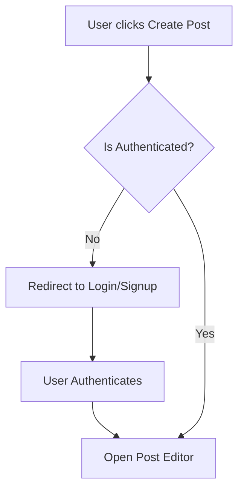

  

    
VNUHCM - University of Science

    
Faculty of Information Technology

  

  

  

    <h1 style="margin: 0; padding: 0 0 10px 0; font-size: 2.2em; border: none;">PA5 Report</h1>
    
Group 6: PDF

  

  

  

    CSC13002 - Introduction to Software Engineering
  

  

    

      
Author:

      
Nguyễn Tuấn An - 24127011

      
Nguyễn Hải Nam - 24127088

      
Nguyễn Hải Trọng - 24127311

      
Phạm Đinh Gia Khánh - 24127420

      
Võ An Phú - 24127494

    

    

      
Lecturer:

      
Ms. Nguyễn Thị Minh Tuyền

      
Mr. Hồ Tuấn Thanh

      
Mr. Mai Anh Tuấn

    

  

  

    July 21, 2026
  

# Table of Contents

1. [A - How to add Table of Contents](#a---how-to-add-table-of-contents)
	1. [1. Requirements](#1-requirements)
		1. [1.1. How to export to PDF](#11-how-to-export-to-pdf)
2. [B - Export to PDF](#b---export-to-pdf)
	1. [1. Requirements](#1-requirements)
		1. [1.1 How to export to PDF](#11-how-to-export-to-pdf)
3. [C - Diagram example](#c---diagram-example)
	1. [1. Diagram rules](#1-diagram-rules)
4. [D - Image example](#d---image-example)
	1. [1. Insert image rule](#1-insert-image-rule)
- [Table of Contents](#table-of-contents)
- [A - Test Plan and Test Cases](#a---test-plan-and-test-cases)
  - [Test Summary Report](#test-summary-report)
    - [1. Project Information](#1-project-information)
    - [2. Test Objectives](#2-test-objectives)
    - [3. Test Execution Summary](#3-test-execution-summary)
    - [4. Defect Summary (All Fixed)](#4-defect-summary-all-fixed)
      - [UC-07 \& UC-08 Defects (Browse \& Search) - FIXED](#uc-07--uc-08-defects-browse--search---fixed)
      - [UC-10 Defects - FIXED](#uc-10-defects---fixed)
      - [UC-12 Defects (Leave Comment) - FIXED](#uc-12-defects-leave-comment---fixed)
      - [UC-14 Defects (Request AI Summary) - FIXED](#uc-14-defects-request-ai-summary---fixed)
      - [UC-18 Defects (Escalate Report) - FIXED](#uc-18-defects-escalate-report---fixed)
    - [5. Scope \& Coverage Analysis](#5-scope--coverage-analysis)
      - [Feed \& Search (UC-07, UC-08)](#feed--search-uc-07-uc-08)
      - [Engagement (UC-10, UC-12, UC-14)](#engagement-uc-10-uc-12-uc-14)
      - [Moderation (UC-18)](#moderation-uc-18)
    - [6. Conclusion](#6-conclusion)
  - [Bug Report](#bug-report)
      - [1. Browse Feed (UC-07)](#1-browse-feed-uc-07)
      - [2. Search Content (UC-08)](#2-search-content-uc-08)
      - [3. Create Post (UC-10)](#3-create-post-uc-10)
      - [4. Leave Comment (UC-12)](#4-leave-comment-uc-12)
      - [5. Request AI Summary (UC-14)](#5-request-ai-summary-uc-14)
      - [6. Escalate Report (UC-18)](#6-escalate-report-uc-18)
- [B - Export to PDF](#b---export-to-pdf)
  - [1. Requirements](#1-requirements)
    - [1.1 How to export to PDF](#11-how-to-export-to-pdf)
- [C - Diagram example](#c---diagram-example)
  - [1. Diagram rules](#1-diagram-rules)
- [D - Image example](#d---image-example)
  - [1. Insert image rule](#1-insert-image-rule)

# A - Test Plan and Test Cases
*Work performed by: Nguyen Hai Nam | Reviewed and Edited by: Nguyen Hai Nam,*

## 1. Test Plan

### 1.1 Test Objectives and Scope

#### 1.1.1 Test Objectives

* **Primary Functional Correctness:** To verify that the core user flows of the FOZ forum perform according to specifications without critical errors or UI breakdowns.

* **Role-Based Access Control:** To ensure proper privilege segregation across user roles (`Guest`, `Standard User`, `Moderator`, and `Administrator`), specifically validating that elevated administrative actions are restricted strictly to authorized admin accounts.

* **AI Feature Validation:** To validate the functional correctness of the AI-powered `Post Summarization` feature, ensuring that it produces accurate TL;DR summaries via the Google Gemini API integration and handles missing API keys smoothly via fallback mechanisms.

* **Defect Tracking & Reporting:** To execute manual test cases, identify bugs or regressions, and log detailed reports for developers to fix.

#### 1.1.2 Test Scope

##### 1.1.2.1 In-Scope

* **Target Use Cases:** Manual functional testing of the 6 chosen use cases: UC-07, UC-08, UC-10, UC-12, UC-14, UC-18.

* **Full-Stack Integration:** Web frontend interaction (Vite/Client) interacting with backend API routes (`/api/v1/...`) and PostgreSQL persistence via Drizzle ORM.

* **Browser Compatibility:** Basic UI and functional checks on modern browsers (e.g., Google Chrome, Microsoft Edge).

##### 1.1.2.2 Out-of-Scope

* **Non-functional Requirements:** Load testing, stress testing, high-concurrency scaling, and deep security penetration auditing.

* **Unselected Use Cases:** Features outside the 6 selected use cases (such as authorization or avatar customization).

* **Native Mobile Applications:** Testing is strictly limited to desktop/responsive web environments.

* **Test Automation:** Writing or executing automated test scripts (e.g., Unit, E2E testing).

### 1.2 Features to be tested

* UC-07 - Browse Feed (Feed Generation)

* UC-08 - Search Content (Search & Discovery)

* UC-10 - Create Post (Post Creation)

* UC-12 - Leave Comments (User Interaction)

* UC-14 - Request AI Summary (Post Summarization)

* UC-18: Forward Report to Admin (Administration & Moderation)

### 1.3 Test Environment and Tools

#### 1.3.1 Operating and Execution Environment

* **Operating System:** Windows 11 / Linux (Ubuntu 24.04 LTS / WSL2)

* **Frontend Environment:** Vite, React, dev server on `http://localhost:5173`.

* **Backend Environment:** Express, Drizzle ORM, dev server on `http://localhost:4000`.

* **Database Container:** PostgreSQL `v16+` running via Docker exposed on port `5432`.

#### 1.3.2 Test and Inspection Tools

*   **Web Browsers:** Google Chrome and Microsoft Edge for manual functional UI execution and responsive viewport checks.

*   **Browser Developer Tools:** Chrome DevTools and Microsoft Edge DevTools (Console, Network, etc.)

*   **Database Inspection GUI:** Drizzle Studio (`npx drizzle-kit studio`) to inspect real-time table state changes in PostgreSQL (users, posts, comments, roles, etc.).

*   **External Services & API Keys:** Google AI Studio API key for AI summarization testing.

*   **Source Code & Environment Management:** Git version control, Docker Engine for database containerization, VS Code and Antigravity IDE.

### 1.4 Test Schedule and Responsibilities

#### 1.4.1 Test Responsibilities

| Role / Responsibility | Assigned Team Member | Specific Tasks & Deliverables |
| --- | --- | --- |
| **Test Planning** | Nguyen Hai Nam | Write specific Test Plan for team. |
| **Test Environment and Data Preparation** | Nguyen Hai Nam & Nguyen Tuan An | Set up the local testing environment (DB container, backend, frontend). Prepare test data including mock user accounts, pre-existing posts, and valid/invalid Gemini API keys for AI testing. |
| **Test Case Design (UC-07 & UC-08)** | Nguyen Tuan An | Refine and write 10 test cases for **UC-07 (Browse Feed)** and **UC-08 (Search Content)**. |
| **Test Case Design (UC-10)** | Nguyen Hai Nam | Refine and write 10 test cases for **UC-10 (Create Post)**. |
| **Test Case Design (UC-12)** | Vo An Phu | Refine and write 10 test cases for **UC-12 (Leave Comment)**. |
| **Test Case Design (UC-14)** | Nguyen Hai Trong | Refine and write 10 test cases for **UC-14 (Request AI Summary)**. |
| **Test Case Design (UC-18)** | Pham Dinh Gia Khanh | Refine and write 10 test cases for **UC-18 (Forward Report to Admin)**. |
| **Test Case Review & Quality Assurance (UC-07 & UC-08)** | Nguyen Hai Nam & Pham Dinh Gia Khanh | Review and refine all test cases for **UC-07 & UC-08** |
| **Test Case Review & Quality Assurance (UC-10 & UC-12)** | Nguyen Tuan An & Nguyen Hai Trong | Review and refine all test cases for **UC-10 & UC-12** |
| **Test Case Review & Quality Assurance (UC-14 & UC-18)** | Pham Dinh Gia Khanh & Vo An Phu | Review and refine all test cases for **UC-14 & UC-18** |
| **Test Case Review & Quality Assurance for AI-generated test cases** | All Team Members | Review and refine all test cases for AI-generated test cases |
| **Test Execution and Bug Logging** | All Team Members | - Execute assigned manual test cases using Cross-testing approach, accurately recording the **Test case ID**, **execution date**, **status** (Pass/Fail), and **actual results**. - Log all discovered defects into the Bug Report, ensuring every failed test case is strictly linked to at least one **bug ID**. - Record bug details, including **bug description**, **steps to reproduce**, **expected vs. actual results**, **severity**, and **status**. |
| **Retesting and Final Run Verification** | Nguyen Hai Nam & Vo An Phu | Perform Retesting on fixed bugs and execute the Final Run to ensure all previously failed test cases are successfully passed and bug statuses are updated to 'Closed/Fixed'. |
| **Test Report and Document Finalization** | Nguyen Hai Nam & Nguyen Hai Trong | - Document Bug Report and Test Summary. - Compile, format, and finalize the complete Software Testing Document. |

#### 1.4.2 Test Schedule

| Phase | Milestone / Task Category | Timeframe | Primary Assignees |
| --- | --- | --- | --- |
| Phase 1 | **Test Planning & Preparation:** Finalize the test plan, set up the local testing environment, and prepare all required test data (mock accounts, pre-existing posts, API keys). | Aug 11 - Aug 12, 2026 | Nguyen Hai Nam & Nguyen Tuan An |
| Phase 2 | **Test Case Design & Review:** Refine and design 60 test cases across 6 selected use cases. Review and refine all AI-generated test cases. Conduct peer reviews to ensure optimal test coverage and validity. | Aug 13 - Aug 15,  2026 | All Team Members |
| Phase 3 | **First Run Execution & Bug Logging:** Perform cross-testing on the application. Accurately record execution status (Pass/Fail) and systematically log all discovered defects. | Aug 16 - Aug 17, 2026 | All Team Members |
| Phase 4 | **Bug Fixing & Retesting (Final Run):** Allocate time for defect resolution. Perform retesting on previously failed test cases to verify fixes and achieve a 100% pass rate. | Aug 18 - Aug 19, 2026 | Nguyen Hai Nam & Vo An Phu (Retesting) |
| Phase 5 | **Reporting & Finalization:** Compile Test Summary metrics, verify bug ID traceability, format and finalize the document. | Aug 20 - Aug 21, 2026 |	Nguyen Hai Nam & Nguyen Hai Trong |

### 1.5 Entry and Exit Criteria

#### 1.5.1 Entry Criteria

* **Feature Implementation & Code Stability:** Code for all 6 selected use cases (UC-07, UC-08, UC-10, UC-12, UC-14, UC-18) is fully integrated and ready for testing.

* **Environment & Server Readiness:**
  * The PostgreSQL database Docker container is running on port `5432` with all database migrations applied.
  * The backend server (`http://localhost:4000`) runs without errors.
  * The frontend server (`http://localhost:5173`) runs without errors .

* **Test Data Seeded:** Mock user accounts (for all roles) and sample data (posts, comments, etc.) are loaded into the database.

* **Test Cases Approved:** All 60 functional test cases have been reviewed, refined, and approved by the team.

* **API Keys Configured:** `.env` variables are set, including both valid and invalid Gemini API keys to verify the AI fallback mechanism. 

#### 1.5.2 Exit Criteria

* **100% Execution:** All 60 designed test cases have been executed.

* **Results Logged:** Execution dates, status (Pass/Fail), and actual results are fully documented for every test case.

* **Defect Traceability:** Every test case that failed during the First Run is linked to a specific Bug ID.

* **Bugs Fixed & Retested:** High-severity/critical defects have been resolved by developers. Retesting (Final Run) confirms these tests now pass.

* **Report Finalized:** The Test Summary metrics and Bug Report are fully populated and formatted for submission.

## Test Summary Report

### 1. Project Information
| | |
|---|---|
| **PROJECT NAME:** | FOZ |
| **TEST CYCLE:** | PA5 - Manual Testing |
| **TEST PLATFORM:** | Web (Desktop & Mobile) |
| **LANGUAGE TESTED:** | English |

### 2. Test Objectives
The objective of this test cycle was to validate the functionality of key features in the FOZ application, specifically focusing on:
* **UC-07 (Browse Feed):** Verifying the feed functionality across all user roles, sorting, ranking algorithms, scroll behaviors, and offline states.
* **UC-08 (Search Content):** Validating the search capability across posts and profiles, including hashtag filtering, query limits, empty states, and offline conditions.
* **UC-10 (Create Post):** Verifying that users can successfully create posts with text and media, including error handling for boundary limits and network issues.
* **UC-12 (Leave Comment):** Testing comment submissions across roles, verifying nested replies, UI responsivness, XSS security, character truncation, and duplicate request blocking.
* **UC-14 (Request AI Summary):** Validating the generation of AI summaries for posts and comments, including cache behavior, external API resiliency, and access control.
* **UC-18 (Escalate Report):** Validating the ability for moderators to escalate reports of serious or complex violations to administrators, including handling concurrent edge cases, deleted content, and input validation.

### 3. Test Execution Summary

| Feature / Use Case | Tester | Test Date | Total Cases | Initial Failed (Defects Logged) | Final Failed | Final Passed | Final Pass Rate |
|---|---|---|---|---|---|---|---|
| **UC-07 (Browse Feed)** | Nguyễn Tuấn An  | 2026-08-21 | 12 | 3 | 0 | 12 | 100% |
| **UC-08 (Search Content)** | Nguyễn Tuấn An | 2026-08-22 | 15 | 4 | 0 | 15 | 100% |
| **UC-10 (Create Post)** | Nguyễn Hải Nam | 2026-08-17 | 17 | 1 | 0 | 17 | 100% |
| **UC-12 (Leave Comment)** | Võ An Phú | 2026-08-17 | 24 | 5 | 0 | 24 | 100% |
| **UC-14 (Request AI Summary)** | Nguyễn Hải Trọng | 2026-08-23 | 17 | 4 | 0 | 17 | 100% |
| **UC-18 (Escalate Report)** | Phạm Đinh Gia Khánh | 2026-08-22 | 23 | 8 | 0 | 23 | 100% |
| **Total** | | | **108** | **25** | **0** | **108** | **100%** |

*(Note: During the initial testing phase, 25 test steps had associated Defect IDs logged. All 25 failed/defective test steps have since been addressed, re-tested, and successfully verified. The application now yields a clean 100% pass rate across these core use cases.)*

### 4. Defect Summary (All Fixed)
A total of **21 unique defects/issues** were tracked during this test cycle across all features. **All issues have now been resolved.**

#### UC-07 & UC-08 Defects (Browse & Search) - FIXED
* **Defect #194:** Generic network offline handling across features (offline scroll & search).
* **Defect #211:** The "Load more" button on the feed requires guest log in.
* **Defect #210:** Search query too long error text appears but the operation is silent.
* **Defect #208 / #209:** Issues regarding clearing search queries and navigating via the nav bar while maintaining state.

#### UC-10 Defects - FIXED
* **Defect #221 (Test #14 - Network Disconnect):** Network timeout or disconnect mid-upload behaved unexpectedly regarding pending states, but the system ultimately recovered.

#### UC-12 Defects (Leave Comment) - FIXED
* **Issue #190:** Guest clicking the comment box does not pop up an auth modal, but aggressively redirects to login.
* **Issue #192:** UI truncation for >240 characters fails when the line itself is not broken by newlines.
* **Issue #193:** Comment box does not expand dynamically for long words, forcing an awkward horizontal scroll.
* **Issue #194:** Offline submission triggers a generic "Failed to fetch" toast instead of an intuitive offline warning.
* **Issue #202:** Lacks spam rate-limiting; submitting 16 comments in a minute works instead of popping a throttle modal.

#### UC-14 Defects (Request AI Summary) - FIXED
* **Defect #194:** Guest permissions not enforced on summary API endpoints.
* **Defect #195:** External AI API timeouts & 503s cause unhandled backend exceptions.
* **Defect #196:** Suspended users could still generate AI summaries.
* **Defect #197:** Summary modal UI hangs indefinitely when network is offline.

#### UC-18 Defects (Escalate Report) - FIXED
* **Defect #214:** Search context bar on the Moderation Queue fails to filter.
* **Defect #215:** System allows escalation to proceed even when the reason rationale is left blank.
* **Defect #216:** Race condition allows two moderators to escalate the same report simultaneously.
* **Defect #217:** Filtering audit logs by Actor UUID returns no results.
* **Defect #225:** The system allows an already escalated report to be re-escalated without warning.
* **Defect #226:** Author deleting reported content mid-escalation forces a ghost completion.
* **Defect #227:** Hitting the 'Escape' key does not close the escalation modal dialogue.

### 5. Scope & Coverage Analysis

#### Feed & Search (UC-07, UC-08)
* **Coverage:** Validates sorting algorithms (chronological vs ranking), hashtag handling, caching, empty states, and offline conditions. Both modules successfully prevent excessive API calls and handle edge cases safely.
* **Gaps:** Edge cases such as triggering infinite scroll *precisely* as the network drops or reading extremely long posts inside the feed UI were identified as missing test paths.

#### Engagement (UC-10, UC-12, UC-14)
* **Coverage:** Thorough testing on boundary limits (exactly 5000/5001 chars), media constraints, and security injections. The Leave Comment suite effectively validated XSS resistance, duplicate post prevention, and nested reply logic.
* **Gaps:** The UC-12 suite heavily tested desktop interactions (Shift+Enter, Tab) but lacked parallel validation for virtual mobile keyboards. Auth expiry tests and max-depth nested comment assertions were recommended.

#### Moderation (UC-18)
* **Coverage:** Evaluated role-based access to admin queues, input flow, and basic filtering. 
* **Gaps:** The suite lacked assertions verifying proper conflict handling (escalating dismissed reports) and verifying the exact required threshold for rationale character limits.

### 6. Conclusion
The FOZ Application has achieved a **100% Pass Rate** across 108 manual test cases spanning its core functionality (**Browse Feed, Search Content, Create Post, Leave Comment, Request AI Summary, and Escalate Report**). 

Initially, **25 test cases** encountered defects due to a combination of unhandled edge cases (e.g., deleted content mid-escalation, race conditions), UI responsiveness issues, missing rate-limit throttles, and permission loopholes. However, following targeted bug fixes, **all defects have been successfully resolved and re-verified**. 

Edge cases such as boundary limits, XSS prevention, duplicate post blocking, and unsupported file formats are now handled gracefully. The UI remains highly responsive with resilient offline capability, and the moderation workflows are stable. **The application meets all specified functional requirements and is fully ready for deployment.**

## Bug Report

| | |
|---|---|
| **PROJECT NAME:** | FOZ |
| **TEST CYCLE:** | PA5 |
| **STATUS:** | All Bugs Fixed & Re-tested |

 

#### 1. Browse Feed (UC-07)
*Tester: Nguyễn Tuấn An*

| Test # | Bug # | Description | Steps to Reproduce | Expected Result | Actual Result | Severity | Status |
|---|---|---|---|---|---|---|---|
| 8, 9 | 194 | There should be a modal "You are offline" when the network is out | 1. Connect to the web with good network connection. 2. Turn off your network or turn off network in network tab in development tool in browser | There should be a modal "You are offline" when the network is out | No modal shown | Minor | Fixed |
| 10 | 211 | Load more should prompt a login modal for guest | 1. Open the web with Guest account 2. Scroll until see "Load more" button 3. Press the "Load more" button | A login modal should be displayed | No modal shown. Guest can still load more post | Minor | Fixed |

 

#### 2. Search Content (UC-08)
*Tester: Nguyễn Tuấn An*

| Test # | Bug # | Description | Steps to Reproduce | Expected Result | Actual Result | Severity | Status |
|---|---|---|---|---|---|---|---|
| 10 | 194 | Offline modal missing when network is turned off in search | 1. When in search route, turn off network. | The system should display a modal showing "You are offline", no action can be made | The modal shows to notify offline status, action cannot be made | Minor | Fixed |
| 11 | 210 | Search query limit exceeded error | 1. User exceed the character limit of search query | The system does not execute the search query. A toast error notification message appears, stating "Search query is too long. Please limit to 500 characters." | Showing a message "Search query is too long. Please limit to 500 characters.", no action has been executed | Minor | Fixed |
| 14 | 208 | Clearing search query doesn't reset the page | 1. search something valid. In the result page, users click the "x" button to clear the search bar. | The search query is cleared and users can continue type in the search bar. | The query is cleared, and the page is not reset | Minor | Fixed |
| 15 | 209 | Pressing search icon in navbar resets page | 1. Search something valid. Press search icon in the navigation bar while in search result | The system should reset the results and load the search route (the basic search page, no result) | The page is reset | Minor | Fixed |

 

#### 3. Create Post (UC-10)
*Tester: Nguyễn Hải Nam*

| Test # | Bug # | Description | Steps to Reproduce | Expected Result | Actual Result | Severity | Status |
|---|---|---|---|---|---|---|---|
| 14 | 221 | Missing error message when network timeout during posting an image | 1. Click 'Create Post' under good connection 2. Click 'Image' then attach an image 3. After the post modal shows the preview of the attached image, turn off the network in the browser devtools. Then click 'Post' | The user should receive a retry option or error message, and the 'Post' button should remain disabled/pending until resolved | The modal remains, the 'Post' button remains pending 'Posting' until the problem resolved. The post is displayed on the feed afterward, and a success message "Your post is live." appears. Miss the error message like "You are offline." | Minor | Fixed |

 

#### 4. Leave Comment (UC-12)
*Tester: Võ An Phú*

| Test # | Bug # | Description | Steps to Reproduce | Expected Result | Actual Result | Severity | Status |
|---|---|---|---|---|---|---|---|
| 2 | 190 | Pop up modal prompting user to login before commenting | 1. Be a guest 2. Click the comment box | A login prompt/modal appears explaining that authentication is required before commenting. | No pop up modal prompting the user to login, the user is redirected to the login page | Minor | Fixed |
| 11 | 192 | Truncated long comment visualization fails | 1. Choose a post 2. Submit a comment longer than 240 characters or more than 4 lines | The preview is truncated and a Read more control appears; selecting Read more reveals the full comment | Only the more than 4 lines works, one line with more than 240 characters does not show the full content | Moderate | Fixed |
| 14 | 194 | Offline toast notification for commenting is generic | 1. Choose a post 2. Disconnect from internet connection 3. Submit a comment | A toast notification notifying the user they are offline | Only a toast notification of "Failed to fetch" which does not directly mean the user is offline | Minor | Fixed |
| 18 | 202 | Comment rate limiting | 1. Choose a post 2. Submit 16 comments in under a minute | A pop up modal telling the user to slow down and prevent them to comment for the next 1 minute to prevent spam | No pop up modal, the user can freely spam comment submissions | Moderate | Fixed |
| 24 | 193 | Comment box visualization fails to expand | 1. Choose a post 2. Submit a comment longer than 20 words | The comment box should expand and clearly display what the user type | Does not expand, only show 1 line and have to scroll to see the full comment | Moderate | Fixed |

 

#### 5. Request AI Summary (UC-14)
*Tester: Nguyễn Hải Trọng*

| Test # | Bug # | Description | Steps to Reproduce | Expected Result | Actual Result | Severity | Status |
|---|---|---|---|---|---|---|---|
| TC09, TC11 | 200 | External AI API timeouts & 503s cause unhandled exceptions | 1. Simulate an external AI service timeout or 503 error. 2. Trigger the AI Summary. | Backend should gracefully catch the error and return a JSON error response (HTTP 503). | Backend throws an unhandled exception which bubbles up and returns raw 500 error. | Critical | Fixed |
| TC12 | 206 | Summary modal UI hangs indefinitely when network is offline | 1. Navigate to a post. 2. Open DevTools and set network to "Offline". 3. Click "Generate TL;DR". | UI catches the network error, stops loading state, and displays "Failed to load" with a "Retry" button. | UI gets stuck in the skeleton loading state indefinitely without throwing an error message. | Moderate | Fixed |
| TC13 | 198 | Guest permissions not enforced on summary API endpoints | 1. Navigate to a post as an unauthenticated guest user. 2. Click the "Generate TL;DR" button. | System should return HTTP 401 Unauthorized and block the request. | HTTP 200 OK. Summary is successfully generated despite being a guest. | Major | Fixed |
| TC14 | 199 | Suspended users can still generate AI summaries | 1. Log in as a user with suspended status. 2. Navigate to post details and click "Generate TL;DR". | System should return HTTP 403 Forbidden. | HTTP 200 OK. Summary is successfully generated because suspended users are treated as guests. | Major | Fixed |

 

#### 6. Escalate Report (UC-18)
*Tester: Phạm Đinh Gia Khánh*

| Test # | Bug # | Description | Steps to Reproduce | Expected Result | Actual Result | Severity | Status |
|---|---|---|---|---|---|---|---|
| 4 | 214 | No matched results, the queue is not even filtered when moderators search for a report | 1. Redirect to the moderation queue. 2. Type in the search bar. | When type in keywords that match with the information of (a) report(s), the queue should display the matched ones | No matched results, the queue is not even filtered | Minor | Fixed |
| 9 | 215 | Moderator must fill in the reason for an escalation | 1. Choose a report to escalate 2. Leave the reason unfilled and submit the escalation | Only accept the escalate request when there is a reason and priority level | The escalation is still completed without escalate reason | Moderate | Fixed |
| 10, 11 | 216 | If a moderator forward a report that had already been escalated before, the action cannot be done and there must be a toast error | 1. Access with 2 moderator accounts 2. Both choose the same report to forward 3. Mod A submit first then mod B | Only accept one escalation (the first one), and notice the second moderator with a toast error | Although there is still only one escalation is accepted, but 2 moderator receive the successful notification, and the admin page is not optimalized to see which one is accepted | Critical | Fixed |
| 15.2.1 | 217 | Search audit log based on UUID (admin page) | 1. Redirect to the admin page and its moderation queue 2. Type in the search bar for an audit log | When type in keywords that match with the information of (a) report(s), the queue should display the matched ones | No audit found | Moderate | Fixed |
| 14 | 225 | User re-escalate a report after it has been escalated | 1. Redirect to the moderation queue 2. Click the escalate button of a report that is already escalated | A toast error notification appears at the top of the screen displaying the message "This report had been escalated before" | The escalation is still completed again | Critical | Fixed |
| 20 | 226 | The author deleted the reports before it is escalated | 1. Mod redirect to mod page and choose a report to escalate 2. Use an authorized user account and delete the reported post 3. Mod escalate that post | A toast error with message "Reported content is no longer available" Appears | The escalation is still complete | Critical | Fixed |
| 11.1 | 227 | Users click "escalate" button, fill in the reason and choose priority level, then press escapae button to close the escalation box | 1. Mod redirect to mod page and choose a report to escalate 2. Press escape button to go back | Users move back to the Moderation queue, the report's status stays unchanged ("Pending") | Escape button not works | Moderate | Fixed |

# B - Export to PDF

*Work performed by: [Name] | Reviewed by: [Name] | Edited by: [Name]*

## 1. Requirements

Install Obsidian

Install Plugin **"Better export PDF"**

Use default format

### 1.1 How to export to PDF

==CTRL P -> Better export PDF: Export current file to PDF==

# C - Diagram example

*Work performed by: [Name] | Reviewed by: [Name] | Edited by: [Name]*

## 1. Diagram rules

Diagram must be drawn using Mermaid.

Example as below:

**Workflow 1: User Authentication & Post Creation**

# D - Image example

*Work performed by: [Name] | Reviewed by: [Name] | Edited by: [Name]*

## 1. Insert image rule

Insert as markdown format ``

Example as below:

