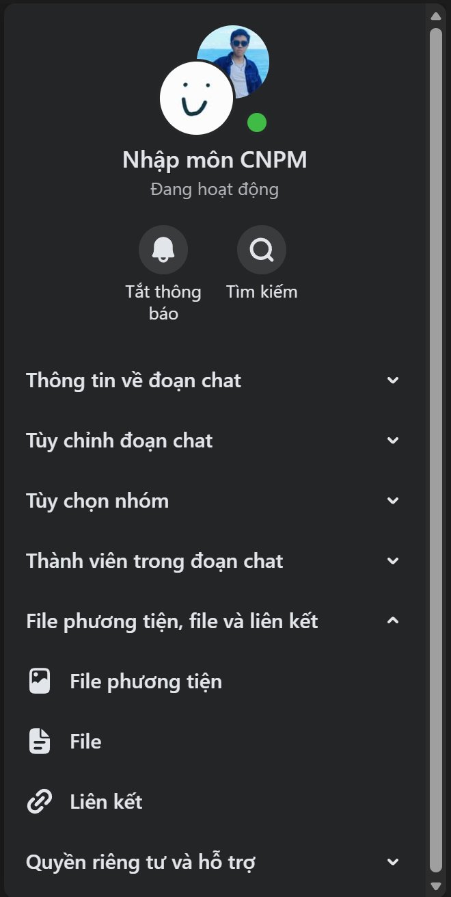
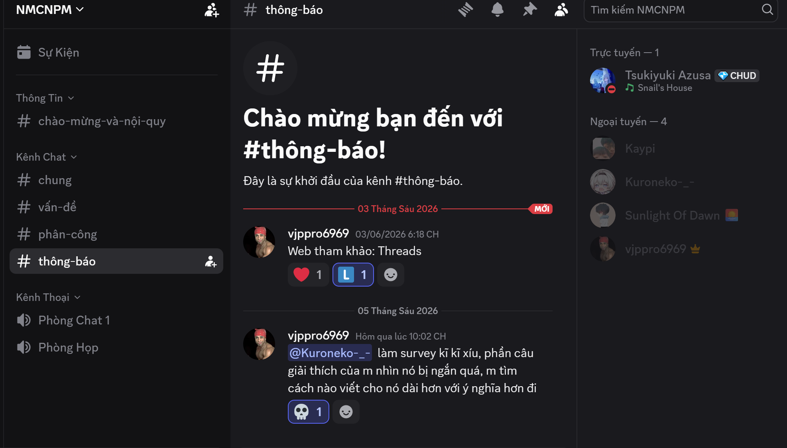
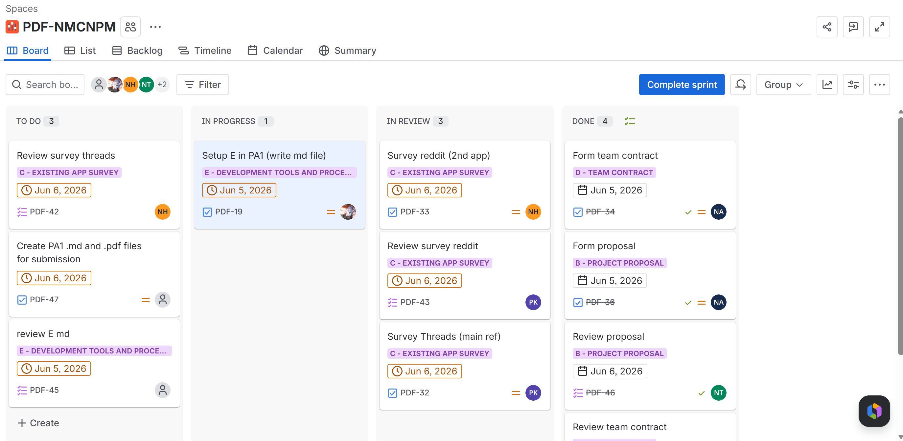
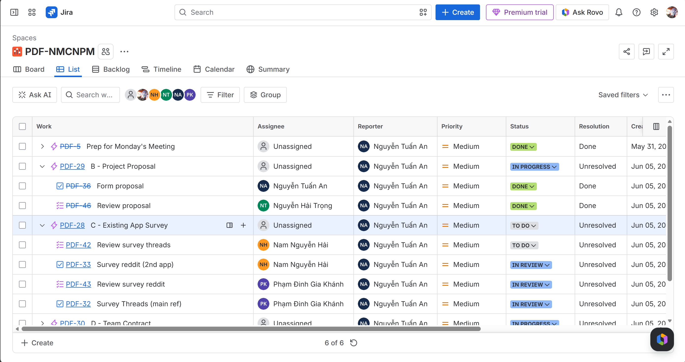
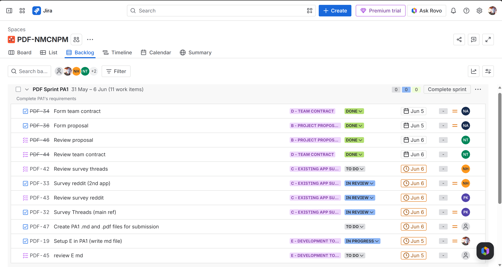

# Development Tools and Process Setup

1. Communication tools
    - **Messenger**: group name: **Nhập môn CNPM** For general disscusion about the project, below is the group chat and group members.
    
    
    - **Discord** : group name: **Nhập môn CNPM**For important announcements bout the project (to prevent important messages get burried), below is the Discord server.
    

2. Task management: **Jira**, group name: **PDF-NMCNPM** used for task management following the Scrum model, the reason we choosed Jira is becauses it's free, easy to use and the teachers also recommended using it, below is some of our Jira site board, list, backlog. 
    
    
    

5. Git (GitHub/GitLab/Bitbucket): used to store both source code and documentation. Since all reports and documentation will be written in textbased formats (Markdown), they should be version-controlled alongside the code. Your repository should be in private mode (the instructors/TAs will request access when needed). Important: Never commit API keys, secrets, or credentials to the repository to avoid security risks and
potential financial loss. The following is a suggested folder structure: 
    - /src : source code
    - /docs : documentation
        - management/ : planning documents, reports (weekly report, project status report, etc.)
        - requirements/ : vision document, use cases
        - analysis-and-design/ : software architecture document, diagrams, UI design
        - test/ : test plan, test cases, test reports

6. Spec Kit: given that students are new to web/mobile app development and that AI-assisted development is now widely available, the instructors encourage all teams to adopt specification-driven development for building software products. Your team will use Spec Kit to manage the development workflow from specification to implementation. Detailed instructions on how to use Spec Kit will be provided separately. Spec Kit setup and initialization will be required starting from PA2.

7. AI Coding Accounts: each team member must register for free educational accounts on AI coding platforms (e.g., GitHub Copilot for Students, Cursor, etc.).