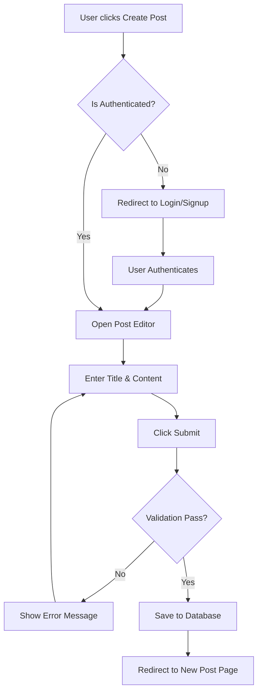
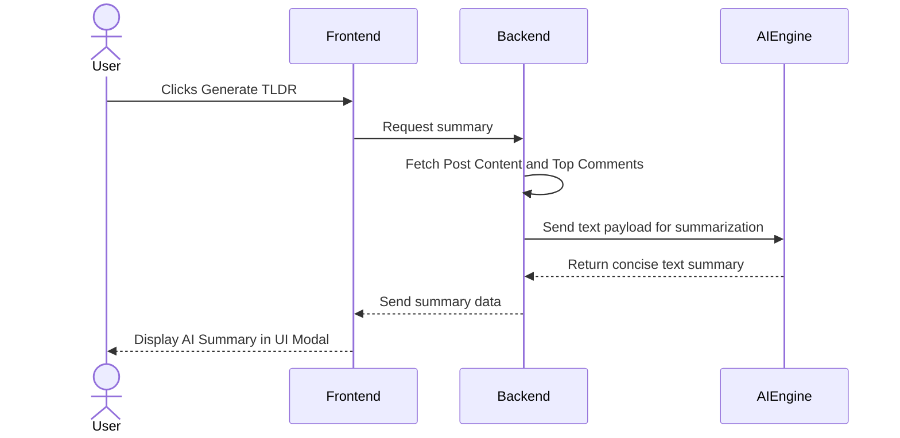

# Team 6

# FOZ - Vision Document

# Version 1.0
| | |
| :--- | :--- |
| **FOZ** | Version: 1.0 |
| **Vision document** | Date: 07/07/2026 |
|**FOZ_VD**|
## Table of Contents

1. Introduction
   1.1 References
2. Positioning
   2.1 Problem Statement
   2.2 Product Position Statement
3. Stakeholder and User Descriptions
   3.1 Stakeholder Summary
   3.2 User Summary
   3.3 User Environment
   3.4 Summary of Key Stakeholder or User Needs
   3.5 Alternatives and Competition
4. Product Overview
   4.1 Product Perspective
   4.2 Assumptions and Dependencies
5. Product Features
6. Non-Functional Requirements

## Vision (Small Project)
|Date | Version| Description | Author
| :--- | :--- | :--- | :--- |
| 05/07/2026 | 1.0 | Defined problem statement, user roles, product features, and non-functional requirements. |  Nguyễn Hải Trọng
## 1. Introduction

The purpose of this Vision Document is to collect, analyze, and define the high-level needs and features of FOZ, a web-based forum application. It focuses on the capabilities required by the stakeholders and target users, providing a clear foundation for the project's scope. 

### 1.1. References
* CS300 - Introduction to Software Engineering: PA1-2026 Guidelines.
* CS300 - Introduction to Software Engineering: PA2-2026 Guidelines.
* FOZ Project Proposal (PA1).
* FOZ Existing App Survey (Reddit, Threads).

## 2. Positioning

### 2.1. Problem Statement

| | |
| :--- | :--- |
| **The problem of** | cluttered, overly complex, and algorithm-heavy interfaces in current online discussion platforms |
| **affects** | general web users seeking straightforward, topic-focused community spaces |
| **the impact of which is** | a high barrier to entry, distraction from core discussions, and a frustrating user experience when trying to find specific information |
| **a successful solution would be** | a simple, intuitive web-based forum that focuses purely on meaningful community discussions, equipped with AI tools to quickly summarize long threads. |

### 2.2. Product Position Statement

| | |
| :----- | :----- |
| **For** | General web users seeking online community spaces |
| **Who** | want to easily ask questions, share knowledge, and connect over shared interests |
| **The FOZ** | is a web-based forum application |
| **That** | provides a simple, intuitive platform focusing on fundamental community discussions with an on-demand AI summarization feature |
| **Unlike** | traditional platforms (e.g., Reddit or Threads) that feature overwhelming UI layouts and aggressive recommendation algorithms |
| **Our product** | delivers a streamlined, clutter-free user experience tailored specifically for straightforward, text-based community dialogue and rapid information consumption. |

## 3. Stakeholder and User Descriptions

### 3.1. Stakeholder Summary
| Name | Description | Responsibilities |
| :--- | :--- | :--- |
| **Project Manager** | Team leader (Nguyễn Tuấn An). | Facilitates meetings, tracks sprint progress in Jira, ensures deadlines are met, and oversees project delivery. |
| **Development Team** | Full-stack engineers (Nam, Trọng, Khánh, Phú). | Designs UI/UX, builds frontend/backend architectures, manages the database, and ensures software quality via testing. |
| **Instructors / TAs** | Course evaluators. | Monitors project progress, provides feedback, and evaluates the final product against course requirements. |

### 3.2. User Summary
| Name | Description | Responsibilities |
| :--- | :--- | :--- |
| **Guest** | Unauthenticated visitors. | Can view profiles, read posts, and see comments. Cannot post, like, or report content. |
| **Standard User** | Authenticated community members. | Can create posts, like, comment, report inappropriate content, manage their own profile, and delete their own posts. |
| **Moderator** | Elevated users with community management tools. | Inherits all Standard User abilities. Reviews user reports and forwards critical issues to Administrators. |
| **Administrator** | Highest level of system access. | Complete control over database records. Can permanently ban users, instantly delete content, and assign Moderator roles. |

### 3.3. User Environment
Users will access FOZ exclusively through standard web browsers (such as Google Chrome, Safari, Microsoft Edge, or Firefox). The application must be responsive, ensuring seamless operation across internet-connected desktop computers, laptops, and mobile smartphones.

### 3.4. Summary of Key Stakeholder or User Needs

| Need | Priority | Concerns | Current Solution | Proposed Solutions |
| :--- | :--- | :--- | :--- | :--- |
| **Quick comprehension of long discussions** | High | Users do not have time to read hundreds of replies to find the consensus. | Scrolling manually and reading top comments. | Integrate an AI "Post Summarize (TL;DR)" feature. |
| **Discover relevant content** | High | Users want to find active communities without heavy, intrusive algorithms. | Algorithmic "For You" pages (e.g., Threads). | Generate a clean feed based purely on recent engagement metrics (comment velocity, likes). |
| **Safe community environment** | Medium | Toxic behavior ruins the discussion experience. | Automated bans which are often inaccurate. | A multi-tier user reporting system involving Standard Users, Moderators, and Admins. |

### 3.5. Alternatives and Competition
Based on our PA1 survey:
* **Threads:** Features a very clean UI and smooth cross-platform authentication (via Instagram). However, it leans heavily towards micro-blogging and aggressive algorithm recommendations rather than structured, topic-based forum discussions.
* **Reddit:** Excels in community categorization and deep discussions. However, its interface can be highly cluttered and overwhelming for casual users, and its strict karma/rules system acts as a high barrier to entry. FOZ aims to bridge this gap by offering the deep discussion capabilities of Reddit but with the minimalist, accessible UI similar to Threads.

## 4. Product Overview

### 4.1. Product Perspective
FOZ is an independent, self-contained web application. It acts as a centralized hub for community interactions, requiring only a modern web browser to access. The system will integrate with a third-party AI service (such as the OpenAI API or Gemini API) strictly to power the "Post Summarize" feature.

### 4.2. Assumptions and Dependencies
* **Internet Connection:** The application requires a stable internet connection to fetch real-time discussions.
* **AI API Availability:** The TL;DR feature depends on the continuous availability and responsiveness of the chosen external AI API provider.
* **Modern Browsers:** It is assumed that users are operating modern web browsers with JavaScript enabled.

## 5. Product Features

**1. Post Creation**

Users can effortlessly compose and publish text-based posts to spark new discussions on topics they care about. This feature provides a clean, distraction-free editor that encourages thoughtful input. It benefits authenticated users by giving them a reliable space to ask questions or share knowledge, thereby driving the core content engine of the entire community.

**2. Feed Generation**

The application generates a dynamic feed of posts calculated by recent engagement metrics, such as comment velocity and like counts. This ensures that the most active and relevant conversations naturally rise to the top without relying on invasive tracking algorithms. It greatly benefits both guests and standard users by minimizing search time and immediately presenting the platform's best content.

**3. User Interactions (Comments & Likes)**

Members can browse existing threads and actively interact by leaving nested comments or liking specific posts. This feature is the lifeblood of the forum, transforming static posts into evolving community dialogues. It empowers standard users to express agreement, validate others' opinions, and build a sense of connection within the platform.

**4. Search & Discovery**

A robust search mechanism allows users to query specific topics, keywords, or user profiles across the database. As the forum grows, this feature becomes essential for users who are seeking specific answers rather than casual browsing. It benefits all users by providing a precise tool to cut through the noise and discover niche discussions or specific creators.

**5. Administration & Moderation System**

The application includes a multi-tiered reporting system where users can flag inappropriate content for review. Moderators can evaluate these reports and forward severe violations to Administrators, who hold the power to permanently remove content or ban users. This robust safety net benefits the entire user base by maintaining high-quality discourse and ensuring a respectful environment.

**6. AI Post Summarize (TL;DR)**

FOZ integrates an AI engine to generate brief, on-demand overviews of lengthy and complex discussion threads. This solves the problem of information overload when a post has hundreds of conflicting replies. It highly benefits time-constrained users by allowing them to quickly grasp the main points and overall consensus of a conversation in seconds.

### Key Workflows (Mermaid Diagrams)

**Workflow 1: User Authentication & Post Creation**

**Workflow 2: AI Post Summarize (TL;DR)**

## 6. Non-Functional Requirements

**Performance Requirements:**

* The application's initial page load time must be < 2 seconds on a standard broadband connection. 

* Backend API response times for standard queries (fetching feeds, creating posts) must be < 500 milliseconds. 

* The system architecture must support at least 100 concurrent users interacting with the platform simultaneously without noticeable performance degradation. 

**Security Requirements:**

* All user passwords must be securely hashed and salted (e.g., using bcrypt) before being stored in the database. 

* All client-server communications must be encrypted using HTTPS (TLS 1.2 or higher). 

**Platform & Usability Requirements:**

* The application must be fully responsive, rendering correctly and maintaining usability on screen widths as small as mobile devices up to Full HD desktop displays. 

* Cross-browser compatibility must be ensured for the latest versions of Google Chrome, Safari, Mozilla Firefox, and Microsoft Edge.

* New users can understand the app workflow after 2 hours of training.
