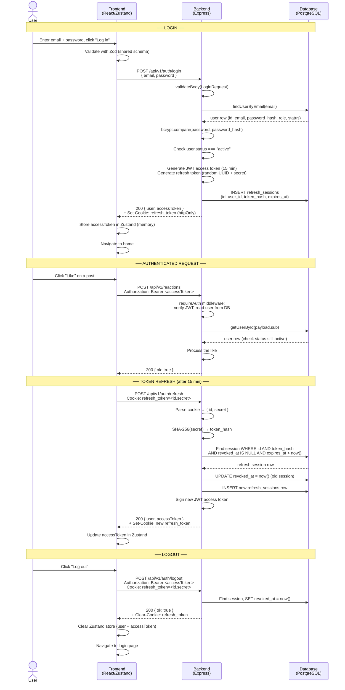
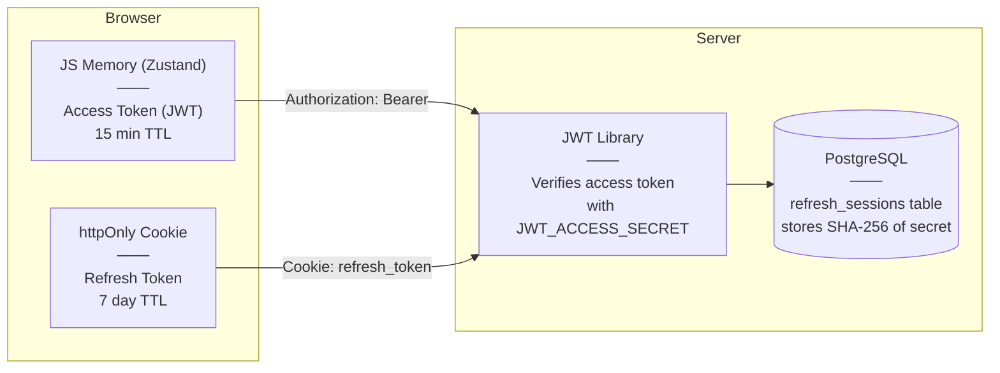

# AuthN Report

*Work performed by: Võ An Phú | Reviewed by: Nguyễn Tuấn An*

## 1. Overview

The Authentication (AuthN) functional group handles user identity and session management for the FOZ platform. It covers three layers: a React frontend for the user interface, an Express backend for API logic and security, and a PostgreSQL database for persistent storage. The system supports registration, login, logout, password change, and automatic session restoration.

## 2. UI Layer

The frontend provides four pages — Login, Register, Change Password, and a Logout dialog. All pages share a common layout component (`AuthShell`) and a reusable password input with a visibility toggle. Forms are validated client-side using Zod schemas shared with the backend, and errors are displayed inline or via toast notifications. The UI is fully responsive, adapting from mobile to desktop with Material Design 3 styling.

## 3. API & Logic Layer

The backend exposes five endpoints under `/api/v1/auth`:

| Method | Endpoint | Purpose |
|--------|----------|---------|
| POST | `/register` | Create account and auto-login |
| POST | `/login` | Authenticate with email and password |
| POST | `/refresh` | Rotate tokens using the refresh cookie |
| POST | `/logout` | Revoke the current session |
| PATCH | `/password` | Change password (requires current password) |

Each route is protected by middleware for rate limiting (10 requests per 15 minutes), input validation (shared Zod schemas), and authentication guards (`requireAuth` or `requireGuest`).

## 4. Token Strategy

The system uses a dual-token approach:

- **Access Token (JWT)** — stored in JavaScript memory (Zustand), sent as a `Bearer` header on every request, expires in 15 minutes. Contains the user's ID, role, and status.
- **Refresh Token** — stored in an `httpOnly` cookie, expires in 7 days. Only sent to the `/api/v1/auth/refresh` endpoint. Its secret is never stored — only a SHA-256 hash is kept in the database.

On each refresh, the old token is revoked and a new one is issued (token rotation). The `requireAuth` middleware re-reads the user from the database on every request to honor mid-session status changes such as bans or suspensions.

## 5. Data Persistence

Three tables support the AuthN system:

- **`user_accounts`** — stores user identity (id, email, bcrypt password hash, role, status). Email has a unique index on the lowercased value to prevent case-variant duplicates.
- **`refresh_sessions`** — tracks active login sessions (token hash, expiry, revocation timestamp). Uses soft deletes via `revoked_at` for auditability.
- **`profiles`** — created atomically with the user account inside a transaction. Stores display name, avatar, and other profile fields.

## 6. Auth Flow Diagram

## 7. Token Storage Diagram

