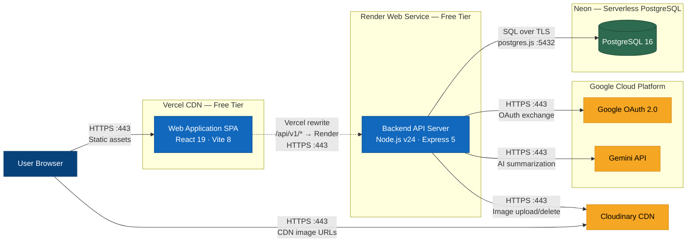
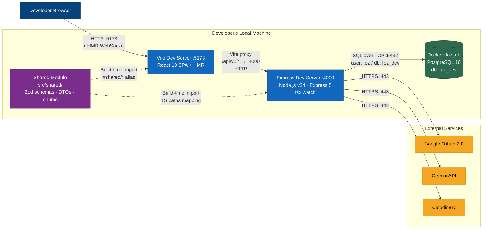

# D — Deployment Diagram

> **Version**: 1.1.0
> **Last Updated**: 2026-08-07
>
> This document maps the containers defined in [Section C of the Architecture Document](../ARCHITECTURE.md#3-c4-level-2--container-diagram) to the physical and cloud infrastructure that runs them, for both **development** and **production** environments. Diagrams use Mermaid syntax following C4 deployment conventions.

---

## Table of Contents

1. [Production Deployment Diagram](#1-production-deployment-diagram)
   - 1.1 [Diagram](#11-diagram)
   - 1.2 [Node Descriptions](#12-node-descriptions)
   - 1.3 [Communication Protocols Summary](#13-communication-protocols-summary)
2. [Development Deployment Diagram](#2-development-deployment-diagram)
   - 2.1 [Diagram](#21-diagram)
   - 2.2 [Node Descriptions](#22-node-descriptions)
   - 2.3 [Communication Protocols Summary](#23-communication-protocols-summary)
3. [Environment Comparison](#3-environment-comparison)

---

## 1. Production Deployment Diagram

### 1.1 Diagram

#### How the request flows

1. The **User Browser** loads static assets (HTML, JS, CSS) from **Vercel CDN** over HTTPS.
2. Once the React SPA is running in the browser, all API calls go to the same Vercel domain under `/api/v1/*`.
3. **Vercel rewrite rules** (defined in `vercel.json`) transparently proxy those requests to `https://foz-backend.onrender.com/api/v1/*` — the browser never contacts Render directly.
4. The **Backend API Server** on Render connects to **Neon PostgreSQL** via the `postgres.js` driver (TLS-encrypted, port 5432), and makes outbound HTTPS calls to **Google OAuth 2.0**, **Gemini API**, and **Cloudinary** as needed.
5. The browser loads images directly from **Cloudinary CDN** URLs stored in the database.

### 1.2 Node Descriptions

| Node | Infrastructure / Cloud Service | Containers Deployed | Notes |
|---|---|---|---|
| **User Device** | Desktop or mobile device running a modern web browser (Chrome, Firefox, Safari, Edge) | **Web Application (SPA)** — downloaded and executed client-side as static JS/CSS/HTML | The React 19 SPA runs entirely in the browser after the initial page load. All server communication is via REST API calls. |
| **Vercel — Edge Network / CDN** | **Vercel** (free tier). Global edge CDN with serverless rewrite rules. | **Web Application (SPA)** — static build output (`src/frontend/dist`) served from Vercel's CDN. | Vercel serves the static SPA bundle and uses rewrite rules (`vercel.json`) to proxy all `/api/v1/*` requests to the Render-hosted backend (`foz-backend.onrender.com`). This eliminates CORS issues in production and provides a unified domain for the user. Build command: `npm run build`. |
| **Render — Web Service** | **Render** (free tier). Managed web-service hosting. | **Backend API Server** — Node.js v24 Express 5 application running as a Render Web Service. | The backend runs as a single long-lived process. Render provides the `RENDER_EXTERNAL_HOSTNAME` env var used for Google OAuth callback URL construction. The free tier has cold-start latency on idle instances. |
| **Neon — Serverless PostgreSQL** | **Neon** (free tier). Serverless PostgreSQL with auto-scaling. | **PostgreSQL Database** — `postgres:16`-compatible managed database. | Neon provides a serverless PostgreSQL-compatible endpoint. The backend connects via `DATABASE_URL` using the `postgres.js` driver over TLS-encrypted TCP on port 5432. Schema migrations are managed via `drizzle-kit`. |
| **Google Cloud Platform** | **Google Cloud** (API-based services). | **Google OAuth 2.0** — social login identity provider. **Google Generative AI (Gemini API)** — AI summarization service. | Two independent Google services: OAuth 2.0 for authentication and Gemini API for post/comment TL;DR summarization with a fallback model chain (`gemini-2.5-flash` → `gemini-1.5-flash` → `gemini-2.0-flash`). |
| **Cloudinary** | **Cloudinary** (free tier). Cloud-based media management and CDN. | **Cloudinary Media Service** — image storage, transformation, and CDN delivery. | Post attachments and profile avatars are uploaded from the backend via Cloudinary's streaming API. CDN URLs are stored in the database and served directly to browsers for read access. |

### 1.3 Communication Protocols Summary

| From | To | Protocol | Port | Description |
|---|---|---|---|---|
| User Browser | Vercel CDN | HTTPS | 443 | Initial SPA download (HTML, JS, CSS, static assets) |
| Vercel CDN (rewrite) | Render Backend | HTTPS | 443 | Vercel transparently rewrites `/api/v1/*` to `foz-backend.onrender.com`. The browser never contacts Render directly. Authenticated requests include `Authorization: Bearer <token>` header; refresh uses HTTP-only cookies. |
| Render Backend | Neon PostgreSQL | PostgreSQL wire protocol over TLS | 5432 | SQL queries via `postgres.js` driver through Drizzle ORM |
| Render Backend | Google OAuth 2.0 | HTTPS | 443 | Authorization code exchange and user profile fetch |
| Render Backend | Google Gemini API | HTTPS REST | 443 | Structured prompt submission and JSON response parsing |
| Render Backend | Cloudinary | HTTPS | 443 | Image stream upload and asset deletion |
| User Browser | Cloudinary CDN | HTTPS | 443 | Direct image retrieval via CDN-delivered URLs |

---

## 2. Development Deployment Diagram

### 2.1 Diagram

#### Key development details

- **Vite proxy**: The Vite config (`src/frontend/vite.config.ts`) proxies both `/api/v1` and `/health` to `http://localhost:4000`, eliminating CORS issues during local development.
- **Backend runner**: The backend is launched via `tsx watch src/backend/index.ts` (defined as the `dev:be` script in `package.json`), which provides hot-reload on file changes.
- **Database**: PostgreSQL 16 runs as Docker service `foz_db` via `docker-compose.yml` with credentials `foz/foz`, database `foz_dev`, data persisted in volume `foz_pg_data`, and a health check (`pg_isready -U foz -d foz_dev`).
- **Shared Module**: Not a running process — `src/shared/` is imported at build time by both Vite (via `#shared` alias) and the backend (via TypeScript `paths` mapping).

### 2.2 Node Descriptions

| Node | Infrastructure | Containers / Processes Running | Notes |
|---|---|---|---|
| **Developer Browser** | Local browser (Chrome, Firefox, Edge) | **Web Application (SPA)** — React app loaded from `http://localhost:5173` | HMR (Hot Module Replacement) via Vite's WebSocket connection provides instant feedback during development. |
| **Vite Dev Server** | Local machine, Node.js process on **port 5173** | **Web Application (SPA)** — Vite 8 dev server serving the React 19 SPA with HMR | Proxies `/api/v1` and `/health` to `http://localhost:4000`. |
| **Express Dev Server** | Local machine, Node.js process on **port 4000** | **Backend API Server** — Express 5 RESTful API running in development mode | Launched via `tsx watch` for hot-reload. Environment variables loaded from `.env` file. |
| **Docker Container (foz_db)** | Local machine, **Docker** running `docker-compose.yml` | **PostgreSQL 16** — `postgres:16` image as service `foz_db` | Credentials: user `foz`, password `foz`, database `foz_dev`. Port `5432` exposed to localhost. Data persisted in Docker volume `foz_pg_data`. |
| **Shared Module** | Local filesystem (`src/shared/`) | **Shared Module** — TypeScript source (Zod schemas, DTOs, enums) | Not a running process. Consumed at build time via `#shared/*` path aliases. Changes trigger HMR/rebuild in consumers. |
| **Google Cloud Platform** | Google Cloud (same APIs as production) | **Google OAuth 2.0**, **Gemini API** | Requires `GOOGLE_CLIENT_ID`, `GOOGLE_CLIENT_SECRET`, and `AI_API_KEY` in `.env`. OAuth callback defaults to `http://localhost:4000/api/v1/auth/google/callback`. |
| **Cloudinary** | Cloudinary Cloud (same API as production) | **Cloudinary Media Service** | Requires `CLOUDINARY_CLOUD_NAME`, `CLOUDINARY_API_KEY`, and `CLOUDINARY_API_SECRET` in `.env`. |

### 2.3 Communication Protocols Summary

| From | To | Protocol | Port | Description |
|---|---|---|---|---|
| Browser | Vite Dev Server | HTTP + WebSocket | 5173 | Page loads and HMR updates |
| Vite Dev Server | Express Dev Server | HTTP (Vite proxy) | 4000 | Proxied REST API calls (`/api/v1/*` and `/health` → `localhost:4000`) |
| Express Dev Server | Docker PostgreSQL | PostgreSQL wire protocol (TCP) | 5432 | SQL queries via `postgres.js` / Drizzle ORM (unencrypted locally) |
| Express Dev Server | Google OAuth 2.0 | HTTPS | 443 | Authorization code exchange and user profile fetch |
| Express Dev Server | Gemini API | HTTPS REST | 443 | AI summarization requests |
| Express Dev Server | Cloudinary | HTTPS | 443 | Image upload and deletion |

---

## 3. Environment Comparison

| Aspect | Development | Production |
|---|---|---|
| **Frontend Hosting** | Vite dev server on `localhost:5173` | Vercel Edge CDN (global, static build) |
| **Backend Hosting** | Express on `localhost:4000` via `tsx watch` | Render Web Service (`foz-backend.onrender.com`) |
| **Database** | Docker container `foz_db` (`postgres:16`, local) | Neon Serverless PostgreSQL (cloud, TLS-encrypted) |
| **API Proxying** | Vite proxy (`/api/v1` and `/health` → `localhost:4000`) | Vercel rewrite rules (`/api/v1/*` → Render) |
| **TLS/HTTPS** | HTTP (no TLS locally) | HTTPS everywhere (Vercel, Render, Neon all enforce TLS) |
| **Image Storage** | Cloudinary (same cloud service) | Cloudinary (same cloud service) |
| **OAuth Callback** | `http://localhost:4000/api/v1/auth/google/callback` | `https://<RENDER_HOSTNAME>/api/v1/auth/google/callback` |
| **Shared Module** | Live source imports with HMR rebuild | Compiled into static bundles at build time |
| **Database Credentials** | Hardcoded in `docker-compose.yml` (`foz/foz`) | Managed via Neon dashboard + `DATABASE_URL` env var |
| **Cold Start** | None (always running) | Render free tier has cold-start on idle |
