# Reddit survey
## Authentication
- The **default homepage layout** and **feed** for **unauthenticated users** (Guest view)
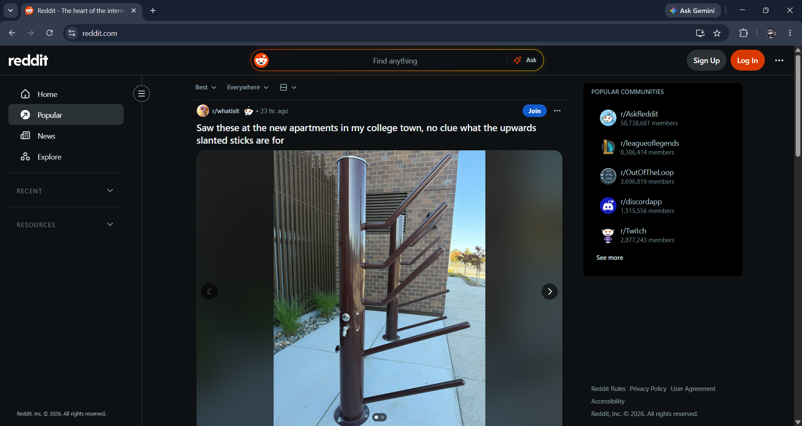

- The **user registration interface**, featuring email sign-up and third-party SSO (Single Sign-On) options. (**Sign up**)
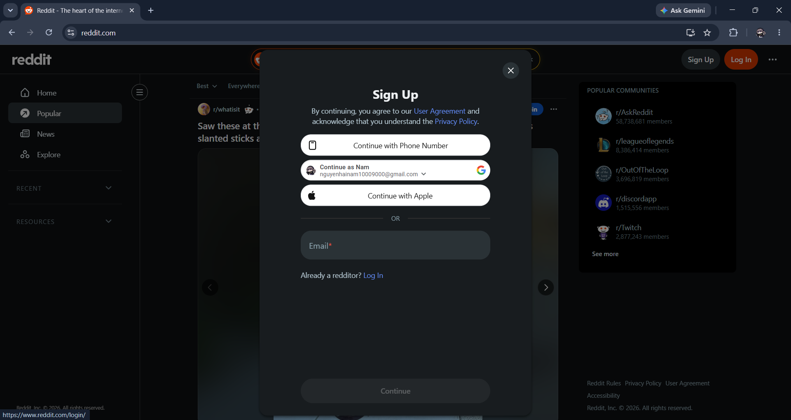

- The **authentication gateway** for returning users to **access** their personalized accounts and feeds. (**Log in**)
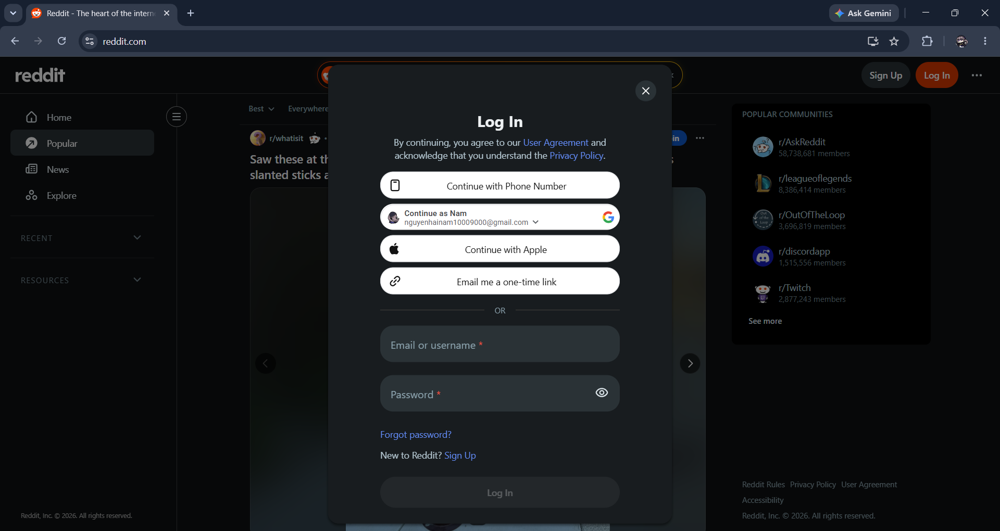

- The **UI flow** and **dropdown menu option** for securely **terminating** the current active session. (**Log out**)
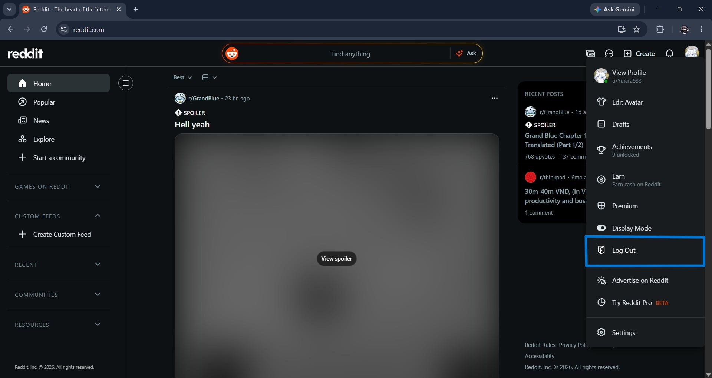

## Profile management
- **Access point** for viewing the **public profile** and **editing user-specific information**.
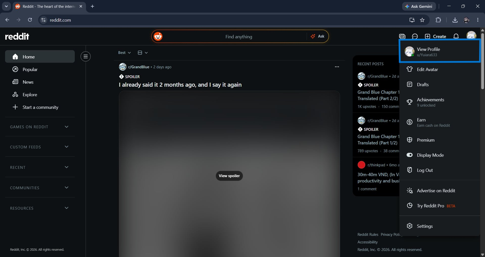

- An **overview** of the **public profile interface**, featuring the 'Update' button on the Settings sidebar to **initiate identity updates**.
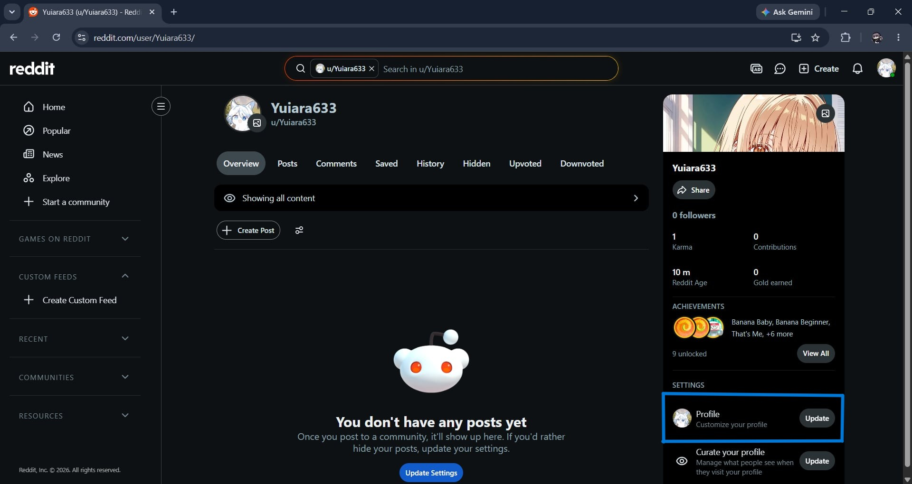

- The **profile customization interface**, allowing users to **update** their public bio, and **manage** avatar configurations.
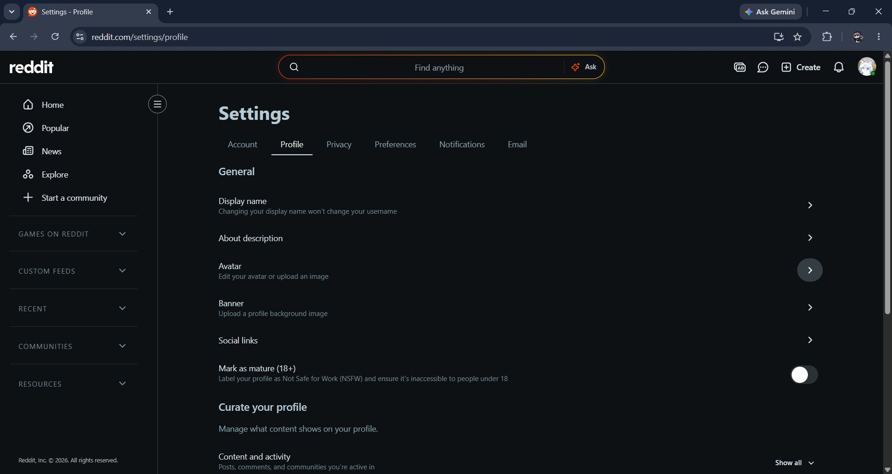

## Post Creation
- The **content composer interface** where users can **draft**, **format**, and **prepare** new posts for community submission.
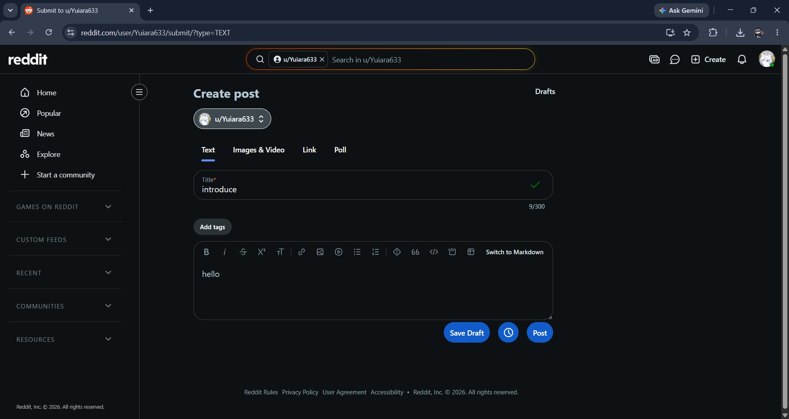

- The **post management overflow menu**, highlighting the 'Delete' option restricted to the content owner.
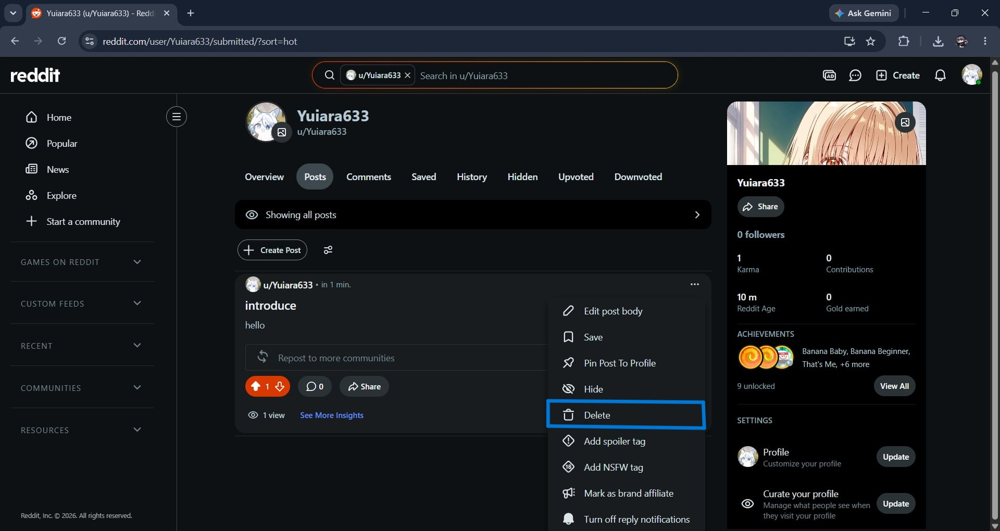

## Feed Generation
- The **user-centric 'Home' dashboard** displaying a **customized** feed based on personal subreddits and interests.
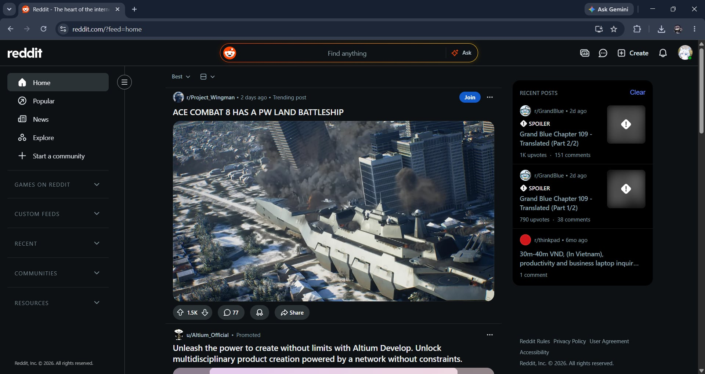

- The **algorithmic 'Popular'** aggregate feed designed for **discovering trending public discussions** across Reddit.
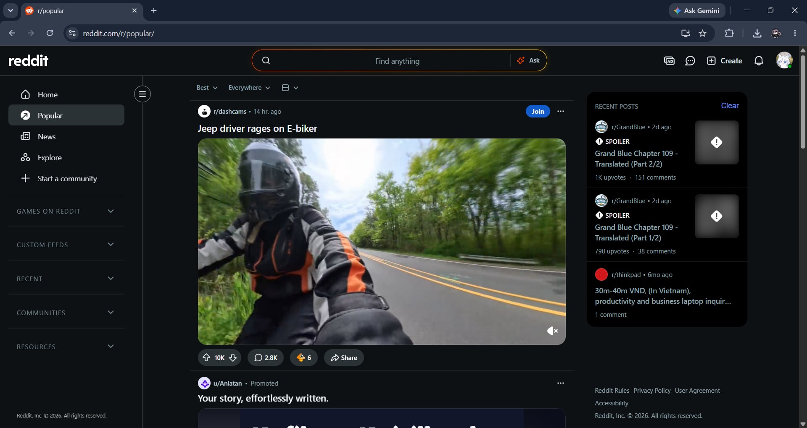

## User Interactions
- The **positive** rating trigger (**Upvote** button).
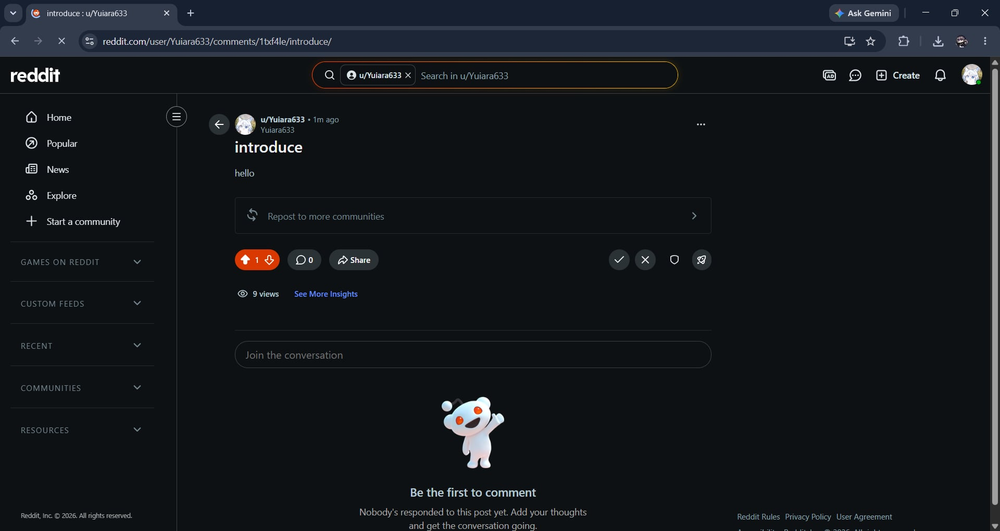

- The **negative** rating trigger (**Downvote** button).
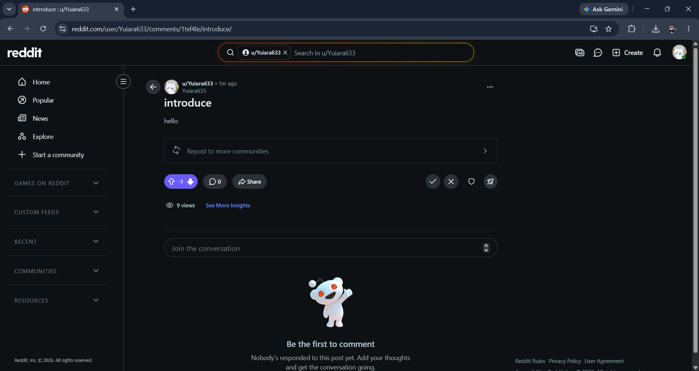

- The **text input area** and **engagement panel** for **submitting** user feedback and replies.
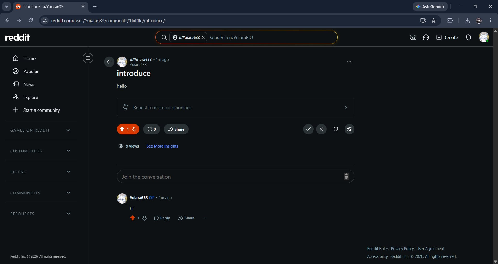

## Search & Discovery
- The **account search functionality** within the main search bar used to **locate specific Reddit profiles**.
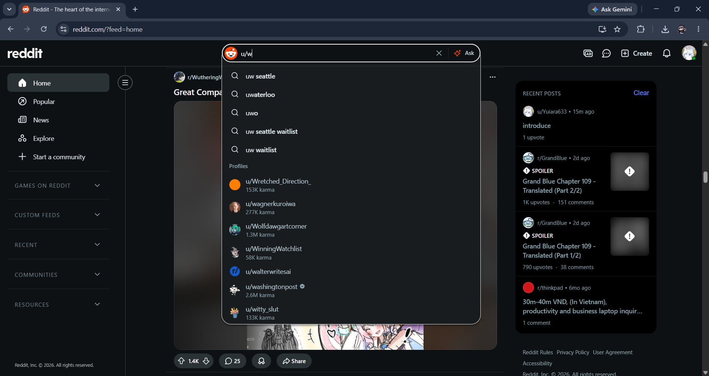

- The **keyword** filtering system designed to **discover** content based on **specific search** terms within post text.
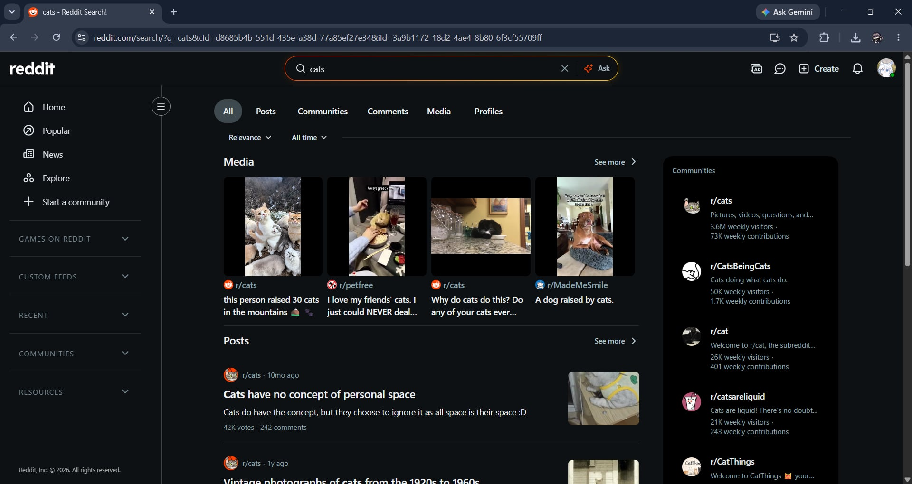

## Administration & Moderation
- The **user-initiated 'Report'** modal used for **submitting** content violations within a post.
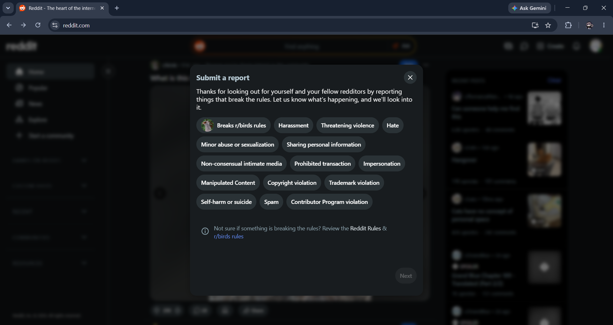
