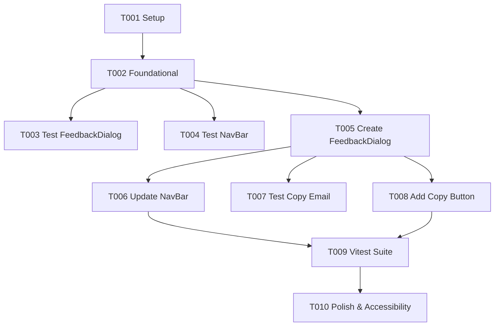

# Tasks: Feedback Menu Button & Dialog

**Input**: Design documents from `/specs/024-feedback-dialog/`  
**Prerequisites**: `spec.md`, `plan.md`, `research.md`, `data-model.md`, `contracts/feedback-dialog-ui.md`, `quickstart.md`

## Format: `- [ ] [ID] [P?] [Story?] Description with file path`

- **[P]**: Can run in parallel (different files, no dependencies)
- **[Story]**: Which user story this task belongs to (`[US1]`, `[US2]`)
- Exact file paths included in all task descriptions

---

## Phase 1: Setup (Shared Infrastructure)

**Purpose**: Verify project environment and feature branch

- [x] T001 Verify project environment and feature branch `024-feedback-dialog` in `.specify/feature.json`

---

## Phase 2: Foundational (Blocking Prerequisites)

**Purpose**: Core UI dependencies that MUST be verified before user story implementation

- [x] T002 Verify existing modal styling tokens (`bg-tertiary/40 backdrop-blur-xl`) and `react-hot-toast` integration in `src/frontend/src/components/`

**Checkpoint**: Foundation ready - user story implementation can now begin

---

## Phase 3: User Story 1 - Access Feedback Instructions from Menu (Priority: P1) 🎯 MVP

**Goal**: Replace "Report a Problem" with "Feedback" in `NavBar.tsx` and display accessible `FeedbackDialog.tsx` modal upon selection.

**Independent Test**: Open navigation menu, click "Feedback", and verify `FeedbackDialog` opens displaying support email instructions and close actions.

### Implementation & Tests for User Story 1

- [x] T003 [P] [US1] Create unit tests for `FeedbackDialog` component rendering and dismissal in `src/frontend/src/components/__tests__/FeedbackDialog.test.tsx`
- [x] T004 [P] [US1] Update unit tests in `src/frontend/src/components/__tests__/NavBar.test.tsx` to check for "Feedback" menu button instead of "Report a Problem"
- [x] T005 [P] [US1] Create `FeedbackDialog.tsx` modal component with backdrop blur, Escape key listener, and `support@foz.com` contact text in `src/frontend/src/components/FeedbackDialog.tsx`
- [x] T006 [US1] Update `NavBar.tsx` to replace "Report a Problem" with "Feedback" menu item and wire `FeedbackDialog` open/close state in `src/frontend/src/components/NavBar.tsx`

**Checkpoint**: User Story 1 (MVP) is fully functional and testable independently.

---

## Phase 4: User Story 2 - Actionable Contact Email & Copy Functionality (Priority: P2)

**Goal**: Provide an interactive `mailto:support@foz.com` link and a dedicated "Copy Email Address" button with `react-hot-toast` feedback.

**Independent Test**: Click "Copy Email Address" inside `FeedbackDialog`, verify email is copied to clipboard with a toast notification.

### Implementation & Tests for User Story 2

- [x] T007 [P] [US2] Add test cases for clipboard copying and toast notification triggering in `src/frontend/src/components/__tests__/FeedbackDialog.test.tsx`
- [x] T008 [US2] Implement "Copy Email Address" button with `navigator.clipboard.writeText("support@foz.com")` and `react-hot-toast` in `src/frontend/src/components/FeedbackDialog.tsx`

**Checkpoint**: User Stories 1 AND 2 are complete and fully functional.

---

## Phase 5: Polish & Cross-Cutting Concerns

**Purpose**: Validation, accessibility testing, and final quality check

- [x] T009 [P] Run Vitest component test suite (`npx vitest run src/frontend/src/components/__tests__/NavBar.test.tsx src/frontend/src/components/__tests__/FeedbackDialog.test.tsx`)
- [x] T010 Validate keyboard navigation, screen reader labels, and `quickstart.md` manual verification steps

---

## Dependencies & Execution Order

### Execution Strategy (MVP First)

1. Complete Phase 1 (T001) & Phase 2 (T002).
2. Complete Phase 3 (User Story 1: T003-T006) to deliver MVP.
3. Complete Phase 4 (User Story 2: T007-T008) to enhance contact UX with quick copy.
4. Complete Phase 5 (Polish & Verification: T009-T010).
