# Reddit survey
## Authentication
- The website features a dark mode interface with a clear hierarchical layout. The left navigation sidebar allows guests to freely explore major categories such as Home, Popular, and News. The focal point for guiding new users lies in the top right corner, where two prominent buttons —"Sign Up" and "Log In" (highlighted in the platform's signature orange) — are strategically placed. The central feed displays trending content, while the right-hand column provides a widget recommending "Popular Communities" alongside their real-time member counts.
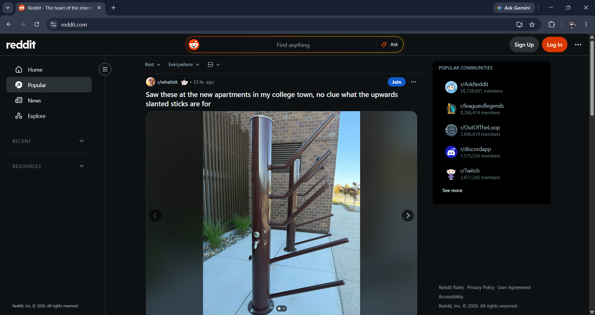

- The registration form is designed as a pop-up modal overlaid on a blurred background of the homepage, helping to focus the user's attention without disrupting their browsing flow. The platform prioritizes convenience by placing Single Sign-On (SSO) methods at the top, allowing for a frictionless registration process via Phone Number, a Google account, or an Apple account. Below the divider is the traditional sign-up method, prompting users to input their details into the "Email" field. The system also cleverly includes a "Log In" hyperlink at the bottom to instantly redirect those who realize they already have an account, accompanied by a reminder regarding the User Agreement and Privacy Policy.
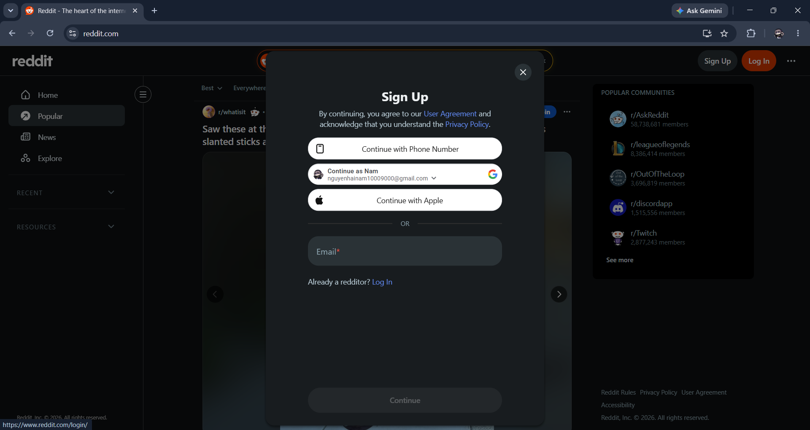

- This secure gateway is designed for returning users to access their personalized accounts. Maintaining a consistent pop-up design, this interface offers the same rapid SSO options (Phone, Google, Apple) and notably introduces an "Email me a one-time link" feature to enhance the passwordless login experience. The lower half features the standard login form, containing "Email or username" and "Password" fields (integrated with an eye icon to toggle password visibility). Immediately below this section are essential account recovery links, such as "Forgot password?", along with a "Sign Up" invitation for new users.
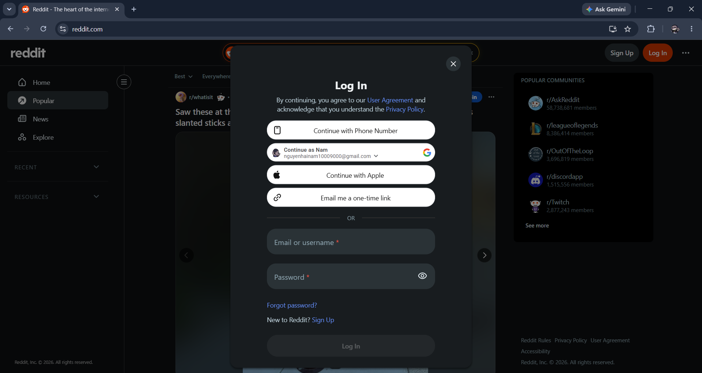

- The personal dashboard appears as a dropdown menu when a user clicks on their avatar in the top right corner of the navigation bar. This menu visually organizes account management shortcuts from top to bottom, including View Profile, Edit Avatar, Drafts, Achievements, and Settings. The "Log Out" option is distinctly positioned with an "open door" icon, providing an intuitive visual cue that helps users easily identify and safely execute the action to terminate their active session.
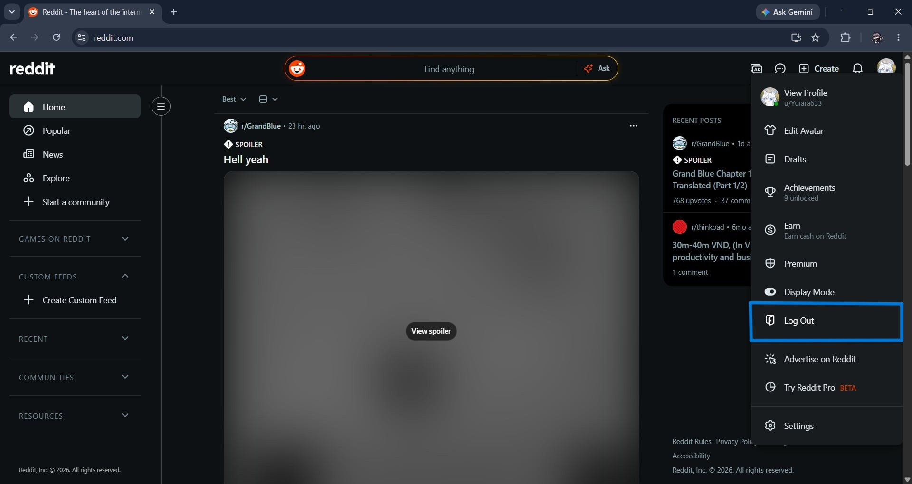

## Profile management
- The journey to personalizing your account starts right from the main navigation bar. By simply clicking on your user avatar tucked in the top right corner of the screen, a comprehensive dropdown menu slides into view, acting as your personal control center. Right at the very top, positioned as the most important action, is the "View Profile" option. This serves as the essential gateway, seamlessly pulling you away from the endless scrolling of the global feed and dropping you directly into your own dedicated space, where you can review your public presence and begin tweaking your user-specific details.
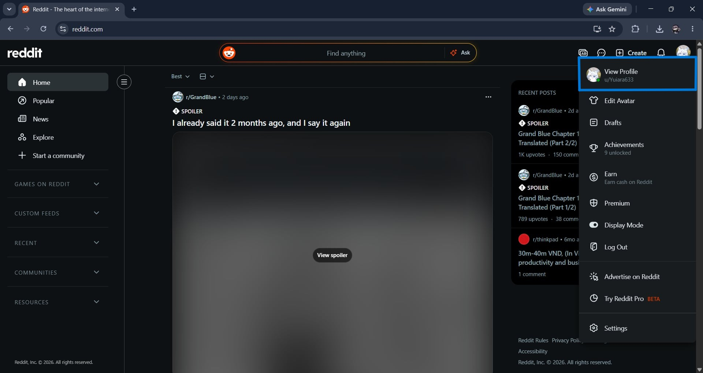

- Once you click through, you're greeted with a clean, organized overview of your digital identity. The main central area uses intuitive tabs to sort your activity—like your posts, comments, and saved items—while the right-hand sidebar acts as a quick-reference digital ID card, displaying your current banner, avatar, and core community stats like your Karma and account age. When you're ready to make changes to how others perceive you, your eyes are naturally drawn down this right sidebar to the dedicated "Settings" module. Here, right next to the "Customize your profile" text, is a highly visible "Update" button. Clicking this is the direct trigger that shifts you from simply viewing your public profile to actively editing it.
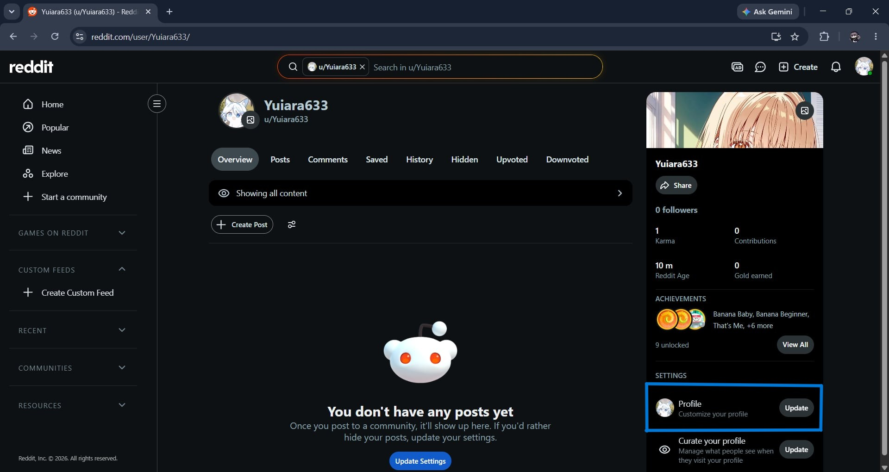

- After hitting that "Update" button, the platform transitions you into a dedicated, distraction-free customization interface. This backend settings menu is cleanly organized with horizontal tabs, placing you squarely in the "Profile" section. Under the "General" heading, you are presented with a straightforward, easy-to-navigate list of editable fields. This is where the real personalization happens: you can craft a unique "Display name" (which exists independently of your permanent username), write an engaging "About description" to serve as your bio, and visually tailor your space by uploading a custom Avatar and background Banner. The page even offers granular controls for linking external social media accounts or toggling an 18+ mature content warning, giving you absolute flexibility and ownership over your public persona.
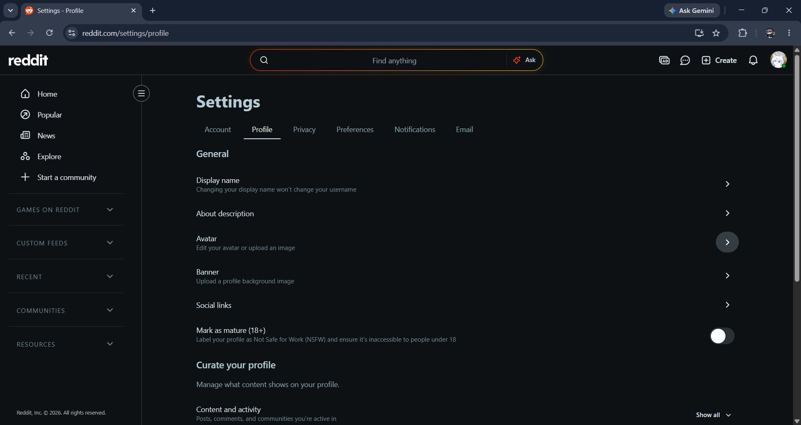

## Post Creation
- When you are ready to share your thoughts, the "Create post" interface serves as a clean, distraction-free canvas for your content. Right at the top, a dropdown indicator confirms exactly where your content will be published—in this instance, directly to your own user profile. The composer is highly versatile, providing specialized tabs depending on the medium you want to use: standard "Text", "Images & Video", a direct "Link", or an interactive "Poll". For text-based entries, you are given a clear 300-character limit for your title to keep things concise. The main body area is equipped with a robust rich-text formatting toolbar that acts like a mini word processor. It allows you to easily apply bolding, create bulleted lists, embed code blocks, or even swap over to raw Markdown if you prefer a more technical approach to formatting. Down at the bottom right, the platform gives you complete control over your publishing timeline with distinct actions to "Save Draft", schedule the post for later via the clock icon, or immediately push it live with the prominent blue "Post" button.
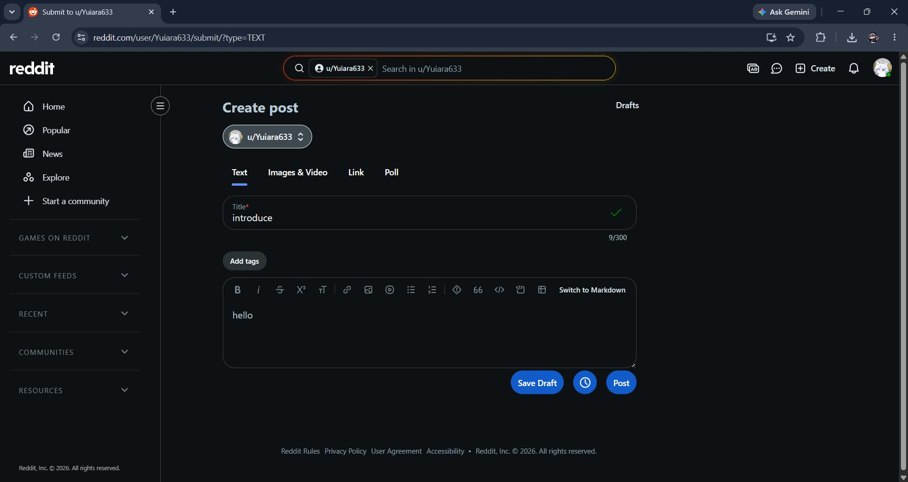

- Even after you have hit publish, you maintain absolute control over your content directly from your profile's feed. By clicking the subtle three-dot overflow menu (often called the kebab menu) located at the top right corner of your active post, a comprehensive list of administrative tools unfolds. Think of this dropdown as the control panel for your post's lifecycle. From here, you can seamlessly jump back in to "Edit post body," highlight your best work by choosing to "Pin Post To Profile," or apply necessary content warnings like "Add spoiler tag" or "Add NSFW tag". Crucially, prominently featured in this list is the "Delete" option, complete with a distinct trash bin icon. This definitive action is a permission strictly reserved for the original author of the post, ensuring that you always have the final say over your digital footprint and can permanently wipe the content from the platform at your discretion.
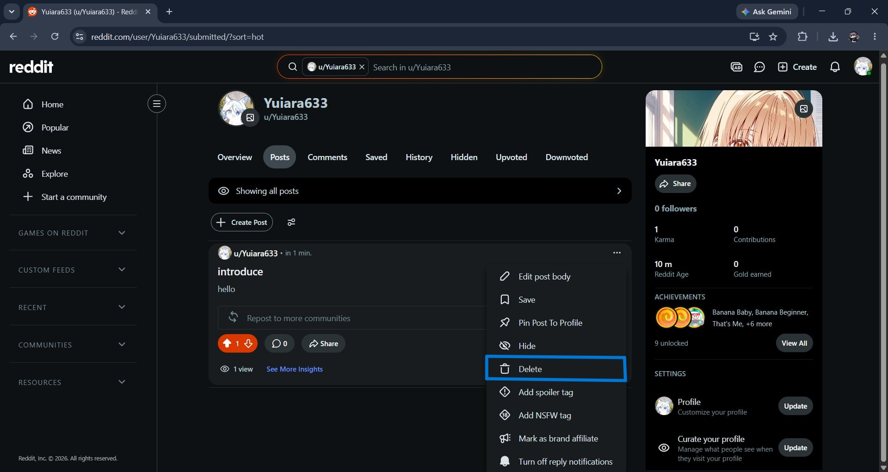

## Feed Generation
- When you select the "Home" tab nestled in the left-hand navigation menu, you are brought to a digital dashboard that is entirely unique to you. This central feed acts as a highly curated stream, pulling content exclusively from the specific subreddits and communities you have actively chosen to subscribe to. For instance, in this view, the main timeline features a niche gaming discussion from a community called `r/Project_Wingman`. At the top of the feed, you have sorting filters like "Best," which help cut through the noise by surfacing the most engaging content from your subscriptions first. Meanwhile, the right-hand sidebar features a convenient "Recent Posts" widget, essentially a breadcrumb trail of your recent reading history—keeping track of threads you've previously clicked on, such as manga discussions or laptop hardware inquiries. It is designed to be a comfortable, personalized bubble tailored exactly to your established hobbies.
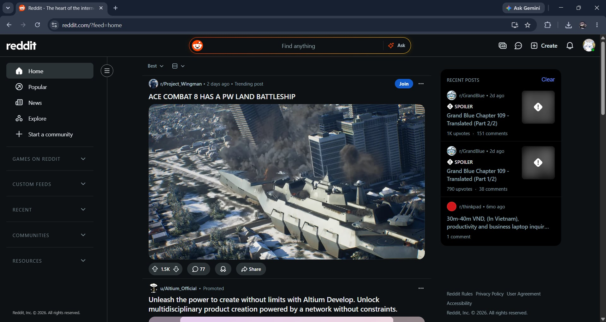

- In stark contrast, clicking the "Popular" option in the navigation bar pulls you out of your personalized bubble and into the broader landscape of viral internet culture. This algorithmic feed is specifically engineered for discovery. Rather than relying on your subscriptions, it aggregates the most heavily upvoted and intensely discussed posts from across the entire platform in real-time. As shown in the interface, the top spot is currently occupied by a viral dashcam video from `r/dashcams` that has already amassed tens of thousands of upvotes and comments. To help narrow down the sheer volume of global trends, the top filter bar includes location-based dropdowns like "Everywhere," allowing you to see what is capturing the public's attention globally or within specific regions. Because this feed exposes you to unfamiliar communities, each post prominently features a blue "Join" button, serving as a constant invitation to discover new interests and bring fresh content back to your personal Home feed.
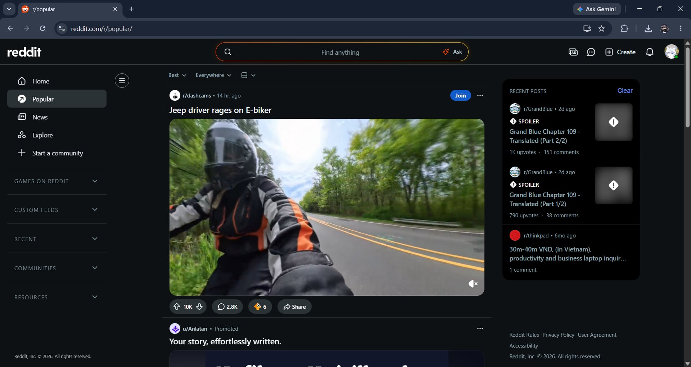

## User Interactions
- The Upvote mechanism serves as the platform's primary tool for expressing positive feedback, agreement, or appreciation for a piece of content. As shown in the interface, when you engage with a post you like, clicking the upward-pointing arrow instantly highlights the button in a vibrant orange-red color. This action dynamically updates the public vote counter (shifting the score to '1' in this example). This positive rating trigger is the lifeblood of the platform's algorithm, essentially acting as a democratic vote that helps push high-quality, relevant, or entertaining posts higher up in the community's feed for others to discover.
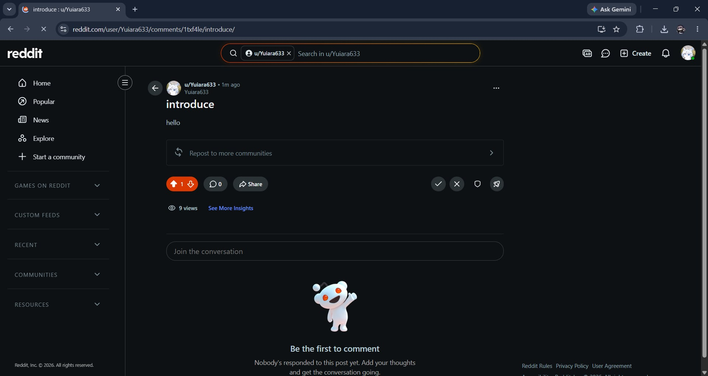

- Conversely, the Downvote button provides a direct and immediate method for users to signal negative feedback, disagreement, or flag low-effort content. When this action is triggered, the downward-facing arrow illuminates in a distinct periwinkle blue shade, simultaneously decreasing the post's overall visibility score (illustrated here by the counter dropping to '-1'). This negative rating trigger plays a crucial role in community self-moderation; it helps bury irrelevant, unhelpful, or off-topic discussions, ensuring that the most valuable content remains at the top of the timeline.
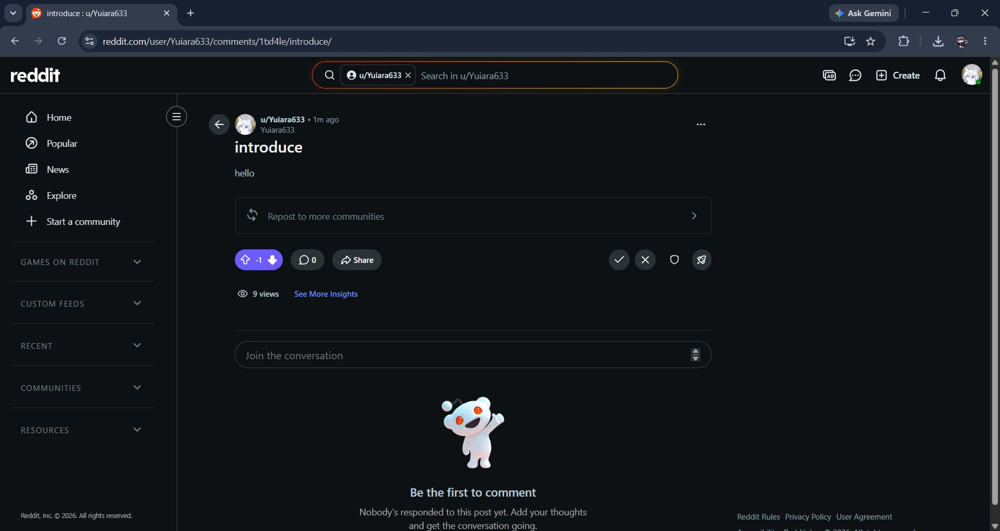

- Beyond simple voting, the true heart of community interaction is facilitated through the dedicated text input area and the resulting engagement panel. Positioned prominently just below the main post with the inviting placeholder text "Join the conversation," this field allows users to draft and format detailed replies. Once a thought is submitted — as demonstrated by the original poster's simple "hi" response — it populates a structured comment thread. Every piece of user feedback generated here comes equipped with its own mini-interaction bar, allowing the wider community to specifically upvote, reply, or share individual thoughts, thereby creating rich, multi-layered conversations.
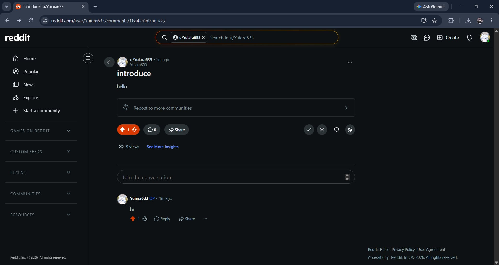

## Search & Discovery
- The main search bar isn't just for looking up general topics; it houses a robust account search functionality designed to help you quickly locate specific Reddit profiles. As seen in the interface, when you type a user indicator like "u/w", the dropdown menu dynamically updates in real-time. It intelligently separates standard search queries from a dedicated "Profiles" list. This visual breakdown immediately shows you the user's avatar, their exact username, and their total karma score, making it incredibly easy to identify and navigate to the exact person, creator, or official entity you are looking for without having to guess their full handle.
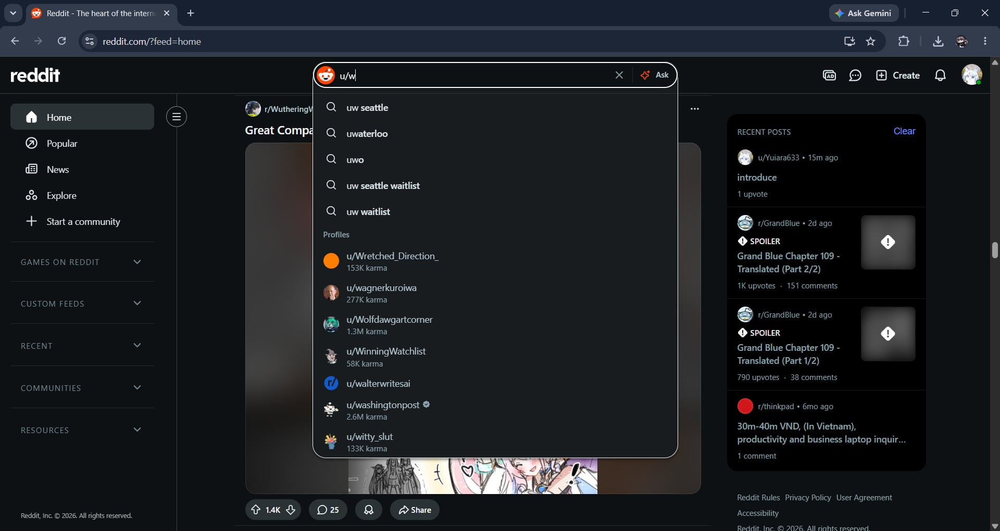

- When you want to explore a broader subject, the platform utilizes a powerful keyword filtering system perfectly designed to help you discover rich content across the entire site based on specific search terms. For example, simply searching for a word like "cats" brings up a highly organized and multi-faceted results page rather than a chaotic wall of text. The interface smartly categorizes the results using intuitive top navigation tabs like Posts, Communities, Comments, and Media. It visually prioritizes engaging video and image thumbnails at the top, lists highly-rated text discussions right below, and even curates a helpful sidebar of related subreddits, giving you a complete, 360-degree view of the exact topic you are interested in.
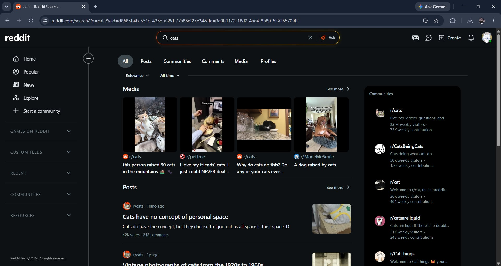

## Administration & Moderation
- The user-initiated 'Report' modal acts as a crucial line of defense for community moderation, empowering everyday users to safely flag inappropriate behavior. As shown in the provided interface, clicking the report option brings up a dedicated pop-up window that purposefully blurs the background content to keep your attention focused on the task. It opens with an encouraging and conversational message, thanking you for looking out for your fellow redditors and helping maintain the platform's integrity. The core of this modal features a cleanly organized grid of clickable, pill-shaped buttons that categorize various content violations. These options are highly comprehensive, covering everything from highly specific community guidelines — highlighted by the prominent button for when a post "Breaks `r/birds` rules" — to serious, platform-wide offenses like "Harassment", "Hate", or "Sharing personal information". At the bottom, the interface thoughtfully includes quick hyperlink resources to review both the global platform rules and the specific subreddit rules, ensuring you have the right context before finalizing and submitting your feedback via the "Next" button.
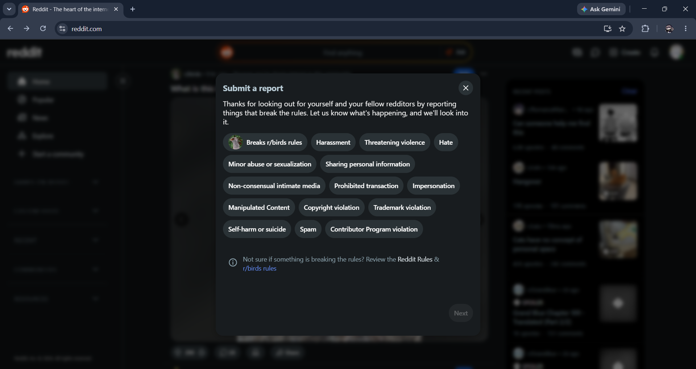

## Subreddit Interface and Identity
- This Explore page is basically the platform's way of playing matchmaker for new interests. Up at the top, there's a really convenient horizontal scrolling bar of category tags—like Games, Tech, or Sports—letting you filter down the massive site based on whatever you are in the mood for. The core of the page is built around a clean grid of community cards. Each card gives you a quick snapshot: the group's icon, a short bio, and their weekly visitor count to show how active they are. The absolute best UX choice here is sticking the "Join" button right on the card itself. It makes subscribing incredibly frictionless because you do not even have to click into the actual subreddit to add it to your daily feed.
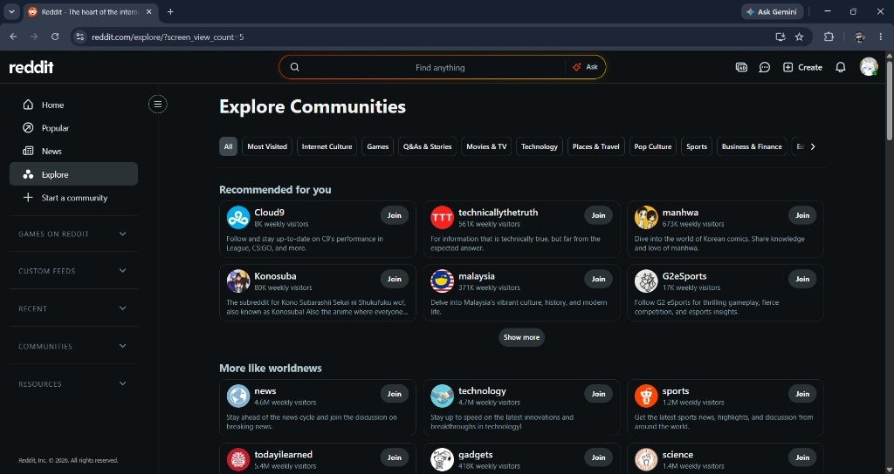

- Looking at the `r/nba` page, you can immediately feel the community's specific vibe. They customized the top banner to look like a hardwood basketball court, which instantly sets the mood. Instead of just showing a raw feed of the newest posts, the layout is carefully managed. Right at the top, they pinned the daily discussion threads so members can easily find them without scrolling. Below that, there's a massive, colorful announcement card for a live AMA session that practically demands attention. Over on the right-hand side, the sidebar acts as a neat control center. It shows the massive scale of the group with millions of visitors, and it neatly packs in all the essential links, like the community rules and wikis, keeping everything super organized and accessible.
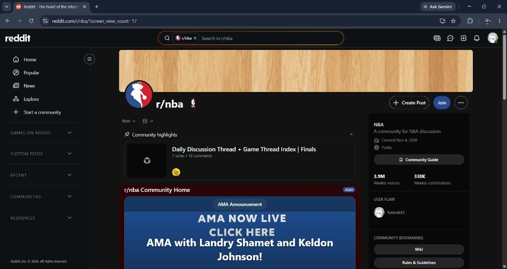
