# THREADS SURVEY 
 
## Authentication & First-Time Access 

### 1. Homepage & Navigation 

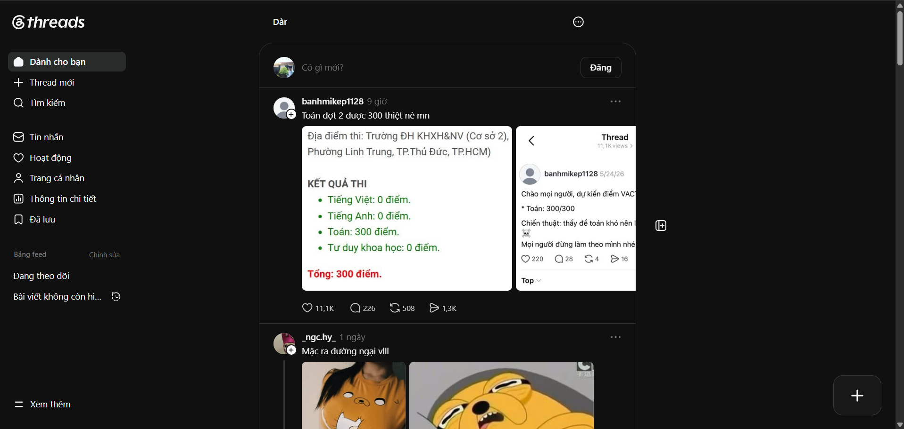

Threads adopts a modern and minimalist social media interface. The main navigation panel is positioned on the left side of the screen, providing quick access to the platform's core features: 

* Home Feed 

* Search 

* Create Post 

* Activity / Notifications 

* Profile 

* Settings 

The Threads logo is displayed in the top-left corner and functions as a shortcut that redirects users to the homepage. A large “+” button located in the bottom-right corner allows users to quickly create and publish new posts. 

Compared to many traditional social networking platforms, Threads focuses on simplicity and usability. The interface minimizes unnecessary visual elements and clutter, creating a clean and intuitive user experience. 

 

### 2. Guest Access (Unauthenticated Users) 

.png)
%202.png)
 
Users can access Threads without signing in and browse a feed containing trending and recommended public posts. This allows visitors to explore the platform before creating an account or logging in. 

However, interaction features are restricted for unauthenticated users. When attempting actions such as: 

* Liking a post 

* Replying to a thread 

* Reposting content 

* Following an account 

* Creating a post 

Threads displays a pop-up notification prompting the user to sign in before continuing. 

### 3. Sign-In Process 

Threads is tightly integrated with Instagram and relies on Instagram accounts for authentication. Users can sign in using their existing Instagram credentials rather than creating a separate Threads account. 

If Instagram is already logged in on the device, Threads provides a Quick Sign-In option that enables users to authenticate with a single click. This approach reduces onboarding friction and follows a common authentication pattern used by interconnected social media platforms. 

Alternatively, users may manually enter their Instagram username and password to access the platform. 

### 4. Account Registration 

Unlike many social media platforms, Threads does not currently support standalone account registration through its web application. 

To create a Threads account, users must first create an Instagram account. Once the Instagram account is available, it can be used to access Threads immediately through the integrated authentication system. 

This design simplifies account management by maintaining a unified identity across both Instagram and Threads. 

## Content Creation & Posting 

###  1. Create Thread 

Users can create new content by selecting the Create Thread button from the navigation menu or by clicking the floating “+” button located in the bottom-right corner of the interface. 

When activated, Threads opens a post creation dialog that allows users to compose content and attach various media types, including: 

* Images 

* Videos 

* GIFs 

* Polls 

* Location information 

A notable feature of Threads is the ability to associate posts with specific topics or communities. By tagging a thread under a particular subject area, users can increase the visibility of their content among audiences who are interested in that topic. This topic-based distribution mechanism helps optimize content discovery and directs relevant discussions toward users who are more likely to engage with them. 

From a design perspective, this feature improves traffic allocation and encourages the formation of topic-centered communities within the platform. 

### 2. Images and Videos 

Threads supports rich media content through image and video attachments. 

One particularly interesting design element is the way multiple images are displayed within a post. In many cases, adjacent images can be manually arranged into visually connected layouts, creating a seamless viewing experience. This presentation style can produce creative visual effects and make posts appear more engaging compared to traditional image galleries. 

Such design choices demonstrate how content presentation can enhance user engagement and encourage more creative forms of storytelling. Similar approaches may serve as useful references when designing visually dynamic social media interfaces. 

### 3. Drafts 

Threads allows users to save unfinished posts as drafts. 

This feature enables users to: 

Continue editing at a later time 

Prepare content in advance 

Review and refine posts before publication 

Draft management improves flexibility and supports users who prefer to plan or revise their content before sharing it publicly. 

### 4. Post Visibility & Content Controls 

Threads provides several visibility options that allow users to control who can interact with or view their content. 

Depending on the context, users may choose to share a post with: 

* Everyone (public) 

* Followers only 

* Accounts they follow 

* Specific mentioned users 

In addition, Threads integrates closely with Instagram, allowing users to share content across both platforms. This cross-platform functionality helps maintain consistency within the Meta ecosystem and enables creators to reach audiences on multiple services simultaneously. 

Another distinctive feature is Threads' approach to content sensitivity and spoiler protection. Users can choose to hide certain parts of a post, while the platform may also automatically obscure sensitive content. Unlike many social media platforms that simply blur hidden content, Threads often uses a decorative overlay effect featuring animated visual elements. 

This approach preserves content moderation functionality while maintaining an aesthetically pleasing user experience. It demonstrates how practical interface requirements can be combined with creative visual design to make the platform feel more engaging and distinctive. 

## Profile Management 

### 1. View Profile 

The Profile section allows users to manage and review their personal activity on Threads. By selecting the Profile button from the navigation menu, users are redirected to their profile page. 

In addition to displaying user activity, Threads also provides profile completion recommendations. If certain profile information is missing, the platform encourages users to complete their profile by adding details such as a profile picture, bio, or links. Similar profile-completion prompts are commonly found on other social networking platforms, as they help users establish a stronger online presence and improve engagement. 

On this page, users can view: 

* Their published posts (Threads) 

* Replies to other users' posts 

* Reposted content 

* Liked posts 

Here, users can also edit their posted threads: 

### 2. Edit Profile 

 

The Edit Profile button opens a pop-up dialog containing the user's basic account information and customization options. 

Users can modify various profile attributes, including: 

* Display name 

* Username 

* Profile picture (avatar) 

* Bio/description 

* External links 

* Other personal profile information 

The editing interface is simple and accessible, allowing users to update their information without leaving the current page. This pop-up design reduces navigation complexity and provides a smoother profile management experience. 

## Feed Generation & Content Discovery 

### 1. For You Feed 

The For You feed serves as the default homepage of Threads. Users can access it by selecting the For You tab or simply clicking the Threads logo. 

This feed is generated through a recommendation algorithm that prioritizes: 

* Trending and popular threads 

* High-engagement content 

* Posts related to topics the user has previously interacted with 

* Content aligned with the user's interests and browsing behavior 

The primary goal of the For You feed is content discovery. By combining trending discussions with personalized recommendations, Threads helps users explore new creators, communities, and topics beyond the accounts they already follow. 

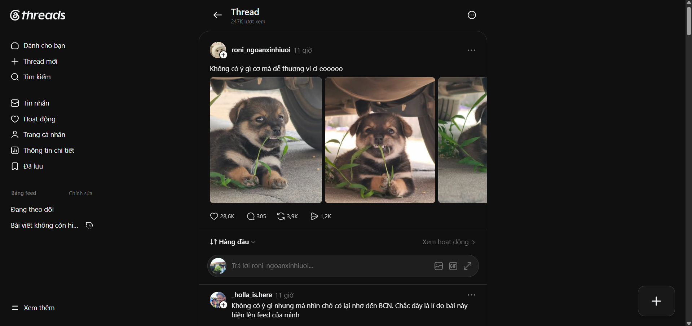

### 2. Following Feed 

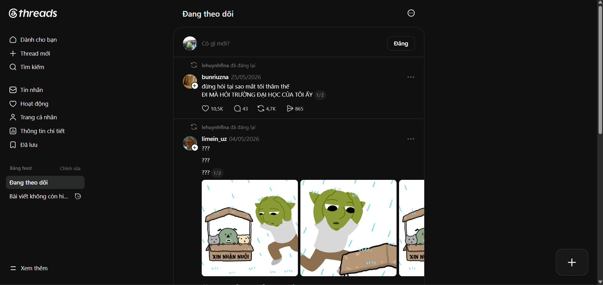

The Following feed provides a more focused and personalized experience by displaying content exclusively from accounts that the user follows. 

This feed typically includes: 

* Original posts from followed accounts 

* Reposts shared by followed accounts 

* Replies and interactions from followed users 

Unlike the For You feed, the Following feed does not heavily rely on recommendation algorithms. Instead, it prioritizes content from the user's existing social network. 

This design benefits users who prefer a chronological and less algorithm-driven experience, ensuring that important updates from followed accounts are not overshadowed by trending or recommended content. 

## User Interactions 

.png)

### 1. Like 
The Like feature allows users to express appreciation or agreement with a post. Liked posts are stored in the user's account and can be reviewed later through the Profile section. 

In addition to serving as a form of engagement, likes contribute to the platform's recommendation system by helping Threads better understand user interests and personalize future content suggestions. 

### 2. Repost 

The Repost feature enables users to share an existing thread with their own audience, similar to reposting or retweeting on other social media platforms. 

Reposted content is displayed in a dedicated section of the user's profile, allowing others to view posts they have chosen to share. Additionally, reposted threads are more likely to appear in the feeds of the user's followers and mutual connections, increasing the visibility of the original content. 

A high number of reposts is often considered an indicator that a thread is gaining significant attention, popularity, or influence within the community. 

 
### 3. Comment and Replies 

The Comment feature allows users to participate in discussions by responding directly to a thread. 

Unlike traditional comment systems that may be limited in structure, Threads organizes replies as conversation chains. Each comment can receive its own set of replies, creating extended discussions that may evolve into entirely new topics. 

As a result, comments are a central part of the Threads experience. Users can freely share opinions, insights, questions, and experiences, making discussions often as valuable as the original post itself. This design encourages deeper engagement and community-driven conversations. 

### 4. Share 

The Share feature allows users to distribute content beyond the Threads platform. 

Users can: 

* Copy and share a direct link to a thread 

* Send a thread through direct messages 

* Share content to other social media platforms and communication channels 

* Sharing plays an important role in content dissemination, helping posts reach a broader audience while also enabling users to easily exchange content with friends and communities. This feature significantly contributes to user engagement and platform growth through organic content distribution. 

### 5. User Preview Card 

Threads provides a convenient User Preview Card feature that appears when users hover over another user's profile picture or username. 

The preview card displays essential profile information, including: 

* Profile picture 

* Display name and username 

* Short bio 

* Follower information 

* Follow button 

From this pop-up, users can quickly follow the account without leaving their current page. They may also navigate directly to the user's full profile for more detailed information and content. 

This feature improves usability by reducing the number of clicks required to discover and connect with other users. It also encourages social interaction by making profile exploration and following accounts more accessible during normal browsing. 

### 6. Post Options Menu 

Each thread includes a three-dot menu that provides users with additional interaction and content management options. When selected, a contextual pop-up menu appears, offering several actions related to the post and its author. 

Available options may include: 

* Save post 

* Copy link 

* Not interested 

* Mute notifications for the post 

* Restrict the account 

* Block the account 

* Report the post 

These controls give users greater flexibility in managing their content consumption experience. For example, the Not Interested option helps personalize future recommendations by informing the algorithm about unwanted content, while Mute, Restrict, and Block provide tools for reducing unwanted interactions and improving user safety. 

The inclusion of moderation and personalization features within a single contextual menu follows a common social media design pattern. It allows users to quickly perform actions without leaving the current page, reducing interface complexity while maintaining easy access to important controls. 

## Search & Discovery 

### 1. Search Functionality 

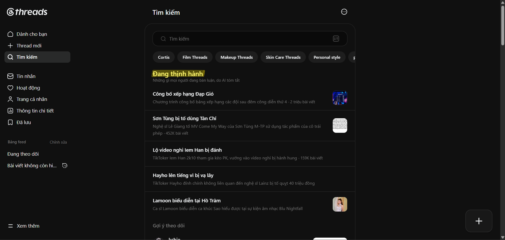

Users can access the search interface by selecting the Search button from the navigation menu. 

The search system allows users to find: 

* User accounts 

* Usernames 

* Keywords and phrases 

* Topics and discussions related to specific interests 

After entering a query, Threads returns a list of relevant results based on the searched keywords. To improve search accuracy, users can apply filters such as: 

* Recent results 

* Profiles only 

* Posts before a specific date 

* Posts after a specific date 

These filtering options help narrow the search scope and allow users to locate content more efficiently, especially when searching within large discussion topics. 

### 2. Trending Topics Discovery 

Below the search bar, Threads displays a collection of trending topics currently gaining attention across the platform. 

Each topic is accompanied by a brief AI-generated summary that helps users quickly understand the subject without reading multiple posts. Users can select any trending topic to explore related discussions and view threads associated with that subject. 

This feature supports content discovery by making emerging conversations more accessible and easier to follow. 

### 3. Recommended Accounts 

.png)

Further down the discovery page, Threads presents a list of recommended accounts that users may be interested in following. 

These recommendations are typically generated based on: 

* Existing Instagram connections 

* Mutual followers and social connections 

* Previous interactions on Threads 

* Topics and content the user frequently engages with 

This recommendation mechanism is similar to those used by platforms such as Facebook and Instagram, helping users expand their network and discover creators or communities aligned with their interests. 

By combining search tools, trending topics, and personalized account recommendations, Threads creates a balanced discovery experience that supports both intentional searching and passive content exploration. 

## Notifications & Activity Center 

### Activity Page 

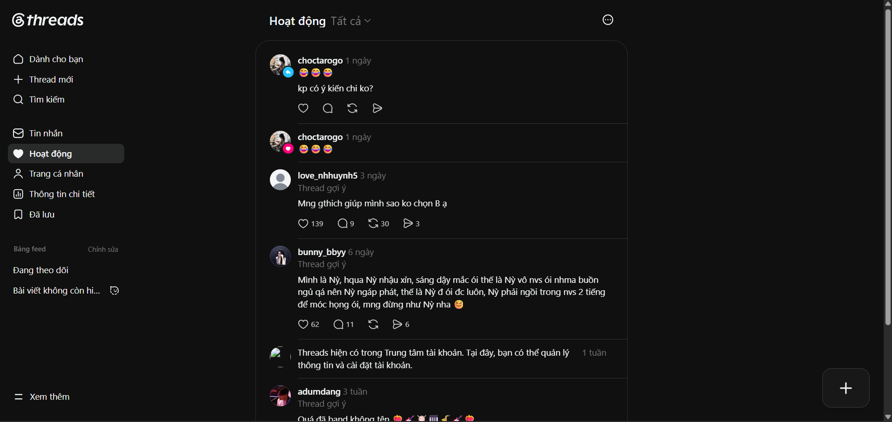

In Threads, notifications are managed through the Activity section, which can be accessed from the navigation menu. Selecting this option redirects users to the Activity page, where they can view all interactions and updates related to their account. 

The Activity page serves as a centralized notification hub, displaying events such as: 

* Likes on the user's posts 

* Replies and comments 

* Mentions by other users 

* Reposts of the user's content 

* New followers 

* Other engagement-related activities 

In addition to account-specific notifications, Threads may occasionally recommend trending discussions, popular threads, or content that the platform believes may be relevant to the user's interests. These recommendations help users stay informed about ongoing conversations and emerging topics within the community. 

To improve usability, users can filter notifications by category, allowing them to focus on specific types of activity, such as: 

* Replies 

* Mentions 

* Likes 

* Reposts 

* Follows 

This filtering system reduces information overload and enables users to quickly locate the interactions that matter most to them. 

The Activity page plays an important role in maintaining user engagement by keeping users informed about both personal interactions and broader platform trends, ensuring they remain connected to ongoing discussions and community activity. 

## More Menu & Settings 

### 1. More Menu 

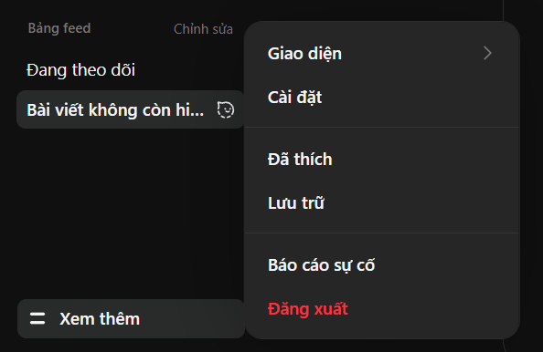

The More button provides access to additional features and account management options that are not displayed directly on the main navigation bar. 

Available options include: 

* Appearance (Light/Dark Mode) 

* Settings 

* Liked Posts 

* Saved Posts 

* Report a Problem 

* Log Out 

This design helps keep the primary interface clean and uncluttered while still providing quick access to less frequently used functions. 

### 2. Appearance Settings 

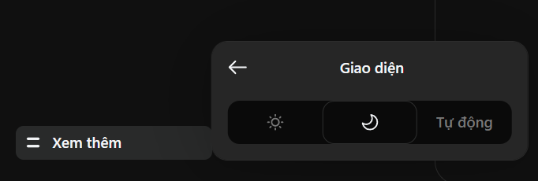

Threads allows users to switch between Light Mode and Dark Mode according to their personal preferences. 

Providing multiple appearance options enhances accessibility and allows users to customize their viewing experience. 

### 3. Account Settings 

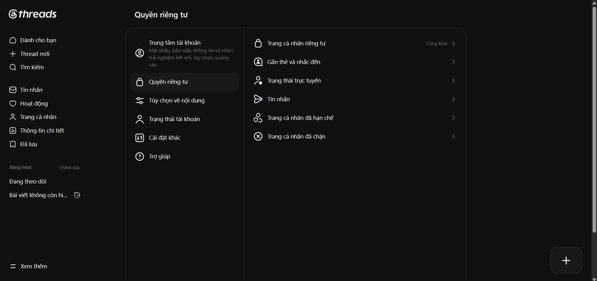

The Settings page serves as the central hub for managing account preferences, privacy, and platform behavior. 

#### Account Management 

Users can manage account-related information, including: 

* Personal profile information 

* Linked Instagram account 

* Account status and verification information 

* Password and security options 

Since Threads is integrated with Instagram, many account-related settings are synchronized across the Meta ecosystem. 

#### Privacy Controls 

Privacy settings allow users to control who can interact with their content and profile. 

Common options include: 

* Public or private profile visibility 

* Mention permissions 

* Reply permissions 

* Hidden words and content filtering 

* Blocked and restricted accounts 

These controls help users maintain a safer and more personalized social media experience. 

#### Notifications Settings 

Users can customize how and when they receive notifications, including: 

* Likes 

* Replies 

* Mentions 

* Reposts 

* New followers 

* Suggested content and recommendations 

Notification customization helps reduce distractions and allows users to focus on interactions that are most relevant to them. 

#### Content Preferences 

Threads provides tools for managing content recommendations and feed personalization. 

Users may: 

* Hide unwanted content 

* Manage muted accounts 

* Adjust recommendation preferences 

* Review interests and engagement history 

* These features contribute to a more personalized browsing experience. 

### 4. Liked and Saved Posts 

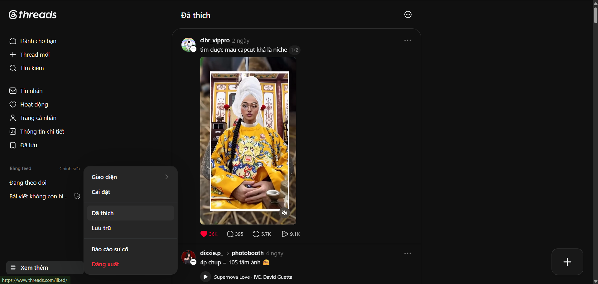

The More menu also provides shortcuts to content that users have previously interacted with. 

Liked Posts 

Displays posts that the user has liked, allowing them to revisit content that they found interesting or valuable. 

Saved Posts 

Displays posts that have been explicitly saved for future reference. This feature is useful for preserving important discussions, resources, or content that users wish to access later. 

### 5. Report a Problem 

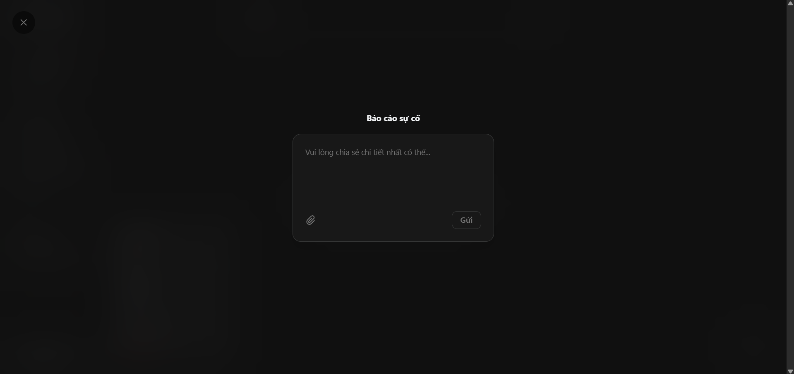

Threads includes a dedicated reporting system that allows users to submit feedback and report technical issues. 

Users can: 

Report bugs 

Describe unexpected behavior 

Submit screenshots or supporting information 

Provide feedback about platform features 

This channel helps Meta collect user feedback and continuously improve the platform. 

### 6. Log Out

## Messaging

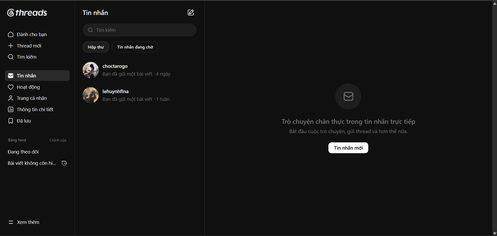

Threads includes a built-in messaging feature that allows users to communicate privately with other users.

Through the **Messages** section, users can:

* View conversations
* Send and receive messages
* Start new chats
* Share Threads posts directly within conversations

This feature complements public interactions such as likes, replies, and reposts by providing a private communication channel, making it easier for users to discuss content and stay connected without leaving the platform.

